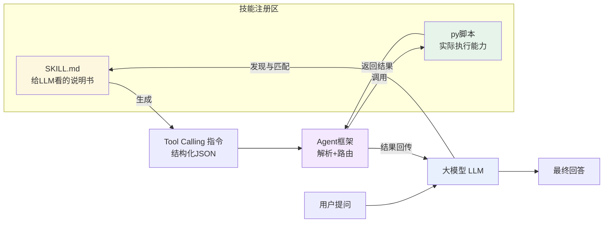

# Skills 机制：SKILL.md 如何工作

> 来源：豆包会话第 4、5、6、13 轮，归纳整理。
> 这套机制来自 Claude Agent Skills / LangChain（Python）生态，是区分「只会调 API」和「懂 Agent 工程化」的话题。

## 一、Skill 是什么

**Skill = 一套「给 AI 用的操作说明书 + 可执行能力」的打包体**：

```
skill-root/
└── my-skill/
    ├── SKILL.md        ← 说明书：告诉 LLM 这个技能是什么、怎么用、何时用
    └── scripts/        ← 执行代码：真正干活的脚本（.py / .js / .sh）
```

- SKILL.md 是给 **LLM 看的**元指令，不是给终端用户看的文档
- scripts 是真正执行动作的代码
- LLM 是「指挥官」，脚本是「士兵」，md 是连接两者的「命令手册」

## 二、SKILL.md 的工作机制（四步）

1. **发现（Discovery）**：系统在任务开始时扫描所有 skill 目录，读每个 SKILL.md 的 name / description，建立「能力索引」
2. **匹配（Matching）**：LLM 理解当前任务，在索引里找最匹配的 Skill
3. **加载（Loading）**：打开匹配到的 SKILL.md，完整内容**注入模型上下文**
4. **执行（Execution）**：LLM 按说明指引，发起工具调用，由执行器跑脚本完成动作

> ⚠️ **主体澄清（原笔记认知偏差，已修正）**：模型没有文件系统访问能力，**「读取 md」这个动作由宿主/框架完成**——框架把 SKILL.md 的文本内容注入到模型上下文里，模型只是「看到」这段文字。流程图里画「LLM 读取 SKILL.md」是简化表达，准确说法是「框架加载 SKILL.md 进上下文，LLM 基于注入的文本生成指令」。

**关键点**：md 文件本身不执行任何东西，它只是被注入上下文的指令文本；真正执行的是脚本。

## 三、为什么有些 Skill 需要 Python 库？py 文件谁调用？

- **为什么 Python**：PDF 解析、Excel 处理、数据分析、图像处理这类重活，Python 生态最成熟（pandas、openpyxl、pdfplumber、matplotlib），现成方案最多最省事
- **py 文件调用链**：

```
LLM（看到 SKILL.md 说明书）
  → 输出 Tool Calling 指令（结构化 JSON）
    → Agent 框架解析
      → 框架拉起 Python 进程执行 py 脚本
        → 结果（stdout / 文件 / 返回值）回传 LLM
```

- **核心澄清**：大模型从不直接调用 py 文件。模型只输出文本指令，由 Agent 框架（执行器）负责：找脚本 → 用解释器运行 → 收集输出喂回模型。LLM 和脚本之间永远隔着执行器。

## 四、Skill 与 Prompt 的异同（必考对比）

| 维度 | Prompt（提示词） | Skill（技能） |
| --- | --- | --- |
| 本质 | 一次性对话指令 | 可复用的能力包（说明书+脚本） |
| 作用时机 | 每次请求随对话发给模型 | 任务开始时发现、按需加载 |
| 是否含代码 | 通常纯文本 | md 说明 + 可执行脚本 |
| 可复用性 | 每次重新给 | 定义一次，多处复用 |
| 职责 | 告诉模型「怎么回答」 | 告诉模型「怎么做事」+ 提供做事能力 |
| 扩展性 | 无外部能力 | 可拉脚本执行真实操作 |

一句话：**Prompt 是「话术」，Skill 是「能力」**。Prompt 让模型知道怎么答，Skill 让模型知道怎么做、并且真的能做。

## 五、端到端流程图（Mermaid 可运行版）



### Mermaid 语法坑（实战踩过）

- **全角中文方括号【】出现在节点标签里会触发词法错误**；emoji 也可能触发
- 修复：标签改用引号包裹的字符串（`MD["xxx"]`）、换行用 `<br/>`、子图标题用 `subgraph id[标题]` 形式、不用特殊符号

## 六、LangChain4j 是否支持读 skill 文件加载工具

**不支持**（已核验官方文档）。文件化工具描述是 LangChain（Python/JS）和 Claude Agent Skills 的做法；LangChain4j 只提供两种工具定义方式：

1. **注解式**：`@Tool` + `@P` 注解 Java 方法，框架反射生成 ToolSpecification
2. **编程式**：`ToolSpecification.builder().name(...).description(...).parameters(...).build()` 手动构建 + `ToolExecutor` 绑定执行

**如果想文件化，可以自研**：文件只承载「描述」（name / description / 参数 Schema），启动时读文件生成 ToolSpecification，执行器仍用 Java 代码绑定——**文件只当说明书，不承载执行**，符合「执行永远在应用层」的原则。

**面试口径**：

> 我们工具是注解式（@Tool）+ 图节点注入。LangChain4j 不支持 Python 那种 skill 文件自动加载，我们也不需要——工具和业务代码在一起，类型安全、好调试。如果被追问「要不要配置化」：描述多到影响维护时会抽成配置，但执行器必须代码绑定。

## 七、3 道面试题自测

1. **大模型能直接执行 py 脚本吗？完整链路是什么？**
   不能，模型只会输出文本。链路：框架加载 SKILL.md 进上下文 → LLM 输出 Tool Calling 指令（工具名+参数 JSON）→ Agent 框架解析、匹配注册工具 → 框架调 Python 解释器执行脚本 → 结果回传 LLM → 生成最终回答。核心：**模型决策、框架执行**。
2. **SKILL.md 和 Prompt 的区别？**
   Prompt 是一次性指令，只影响「怎么回答」；SKILL.md 是可复用技能说明书，通过 name/description 被发现加载进上下文，指导「怎么做事」并绑定可执行脚本。一句话：Prompt 是话术，Skill 是能力。
3. **py 脚本执行报错谁处理？工程上怎么设计才稳？**
   模型不执行也不调试脚本，错误由框架捕获。设计：① 异常转成「工具结果消息」回传 LLM，让模型换参数或换方案重试；② 最大迭代轮数防死循环；③ 脚本超时和资源限制；④ 参数校验前置；⑤ 调用与错误日志。**错误也是一种可观察的工具结果**。

## 追问链 · 参考答案

| 层级 | 问题 | 参考答案要点 |
| --- | --- | --- |
| L1 | Skill 的目录结构长什么样？Skill 和 Prompt 有什么区别？ | Skill 目录 = SKILL.md（给 LLM 看的说明书：是什么、何时用、怎么用）+ scripts/（真正执行的脚本）。区别一句话：Prompt 是话术，Skill 是能力——Prompt 是每次请求随对话发的一次性指令，只管「怎么答」；Skill 是可复用能力包，任务开始时被框架发现、按需注入上下文，指导「怎么做」并绑定真实执行能力。 |
| L2 | SKILL.md 是怎么进入模型上下文的？py 脚本是谁执行的？ | 都不是模型做的。模型没有文件系统访问能力：「读 md」由宿主框架完成——框架扫描 skill 目录、读 name/description 建索引，匹配后把 SKILL.md 文本注入上下文；模型看到文本后输出 Tool Calling 指令，由框架拉起 Python 解释器执行脚本，结果再回传。模型和脚本之间永远隔着执行器。 |
| L3 | LangChain4j 为什么不支持 skill 文件机制？什么情况下值得文件化？ | LangChain4j 只有注解式（@Tool+@P）和编程式（ToolSpecification.builder）两种工具定义，文件化描述是 LangChain（Python/JS）和 Claude Agent Skills 的生态做法。Java 侧工具和业务代码在一起反而类型安全、好调试。值得文件化的信号是描述多到影响维护——但文件只承载说明书（name/description/Schema），执行器必须代码绑定。 |
| L4 | Skill 的 description 写得差会有什么后果？ | 两个方向的失败：描述太含糊，匹配阶段就找不到这个 skill，该用的能力没用上；多个 skill 描述边界重叠冲突，模型选错工具。这和 Function Calling 的 description 是同一个道理——它是模型做选择的唯一依据，且很难靠调参补救，只能改写描述、理清边界、控制 skill 数量。 |

## 误区 · 正解

| ❌ 误区 | ✅ 正解 |
| --- | --- |
| ❌ LLM 读取了 md 文件 | 模型没有文件系统，「读」这个动作由宿主框架完成：框架扫描目录、把 SKILL.md 文本注入模型上下文，模型只是「看到」这段文字再生成指令。流程图里画「LLM 读文件」是简化表达，面试说错这个等于暴露不懂「执行永远在应用层」这条地基。 |
| ❌ Skill 里的脚本由模型执行 | 模型只输出文本指令（工具名+参数 JSON），真正的执行链是：框架解析指令 → 匹配注册工具 → 拉起 Python 解释器跑脚本 → 收集 stdout/返回值回传模型。LLM 和脚本之间永远隔着执行器，所以超时控制、资源限制、错误回传这些都要在执行器层做。 |
| ❌ LangChain4j 也支持 SKILL.md | 不支持，已核验官方文档。LangChain4j 只有两种工具定义方式：注解式 @Tool+@P 反射生成 ToolSpecification，和编程式 ToolSpecification.builder 手动构建。文件化 skill 是 LangChain（Python/JS）与 Claude Agent Skills 的做法；Java 侧要文件化只能自研，且文件只当说明书、执行仍代码绑定。 |
