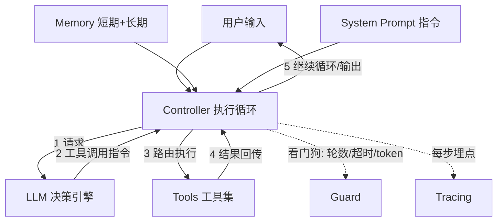

# Agent 范式：定义、组件、推理模式与 Workflow 的边界

> 2026-10-14 成稿，对应九问中的 Q1~Q6。
> 核心记忆锚点：**Agent 与 Workflow 的分界线只有一条——「下一步做什么」由谁决定**。
> 基础概念见 `ai-03-agent-tool-calling.md`（Tool Calling 五步、常见工具类型），本文是它的进阶篇。

## Q1. 什么是 Agent？与大模型的本质不同

### 定义

**Agent（智能体）= 以 LLM 为决策核心，能在「感知 → 决策 → 行动 → 观察 → 再决策」的循环中自主推进，直到达成目标或触发终止条件的系统。**

最小判定标准（两条同时满足才算 Agent）：
1. **有自主循环**：下一步做什么由模型决定，不是预先写死的
2. **有外部动作**：能改变系统状态（查库、写文件、调 API），不只是输出文字

### 与 LLM 的本质不同（三层，越往下越本质）

| 层次 | LLM | Agent |
| --- | --- | --- |
| **形态**：是函数还是系统 | 无状态函数：`f(prompt) → text`，一问一答 | 有状态系统：多轮闭环，外部记忆 + 工具 + 执行器 |
| **产出**：说什么还是做什么 | 产出**文本**，只影响人的认知 | 产出**动作与副作用**，直接改变世界（下单、转账、删文件） |
| **控制权**：谁决定下一步 | **人**决定下一步（写什么 prompt、给不给新信息） | **模型自己**决定下一步（调哪个工具、要不要重试、何时收尾） |

**一句话面试口径**：

> LLM 是一个能力很强的函数，Agent 是一个会自己决定何时调用什么能力的系统。本质差别不在「模型多强」，而在**控制流的所有权**——LLM 的控制流在调用方手里，Agent 的控制流在模型手里。这也是 Agent 风险更高的原因：控制权转移带来了不可预测性，所以必然需要看门狗。

补充对比维度：

| 维度 | LLM | Agent |
| --- | --- | --- |
| 状态 | 无状态（上下文靠外部拼） | 有状态（记忆/checkpoint） |
| 终止条件 | 输出完即结束 | 模型自认为完成 / 达上限被强制收尾 |
| 错误处理 | 调用方重试 | 模型观察错误后自行调整 |
| 成本特征 | 单次可预估 | 不可预估（轮数不定），必须设预算熔断 |

## Q2. Agent 的核心组件

### 四要素（教科书版）

**Brain（模型）+ Planning（规划）+ Tools（工具）+ Memory（记忆）**

### 工程六件套（面试更该讲这个）

| 组件 | 职责 | 落地形态 |
| --- | --- | --- |
| **模型（Brain）** | 决策：选工具、填参数、判断是否收尾 | 主模型 + 备用小模型（分类/改写） |
| **指令（System Prompt）** | 定义角色、边界、输出协议 | 结构化模板，防注入 |
| **工具集（Tools）** | 提供外部能力 | `@Tool` 注解 Bean + 注册表；每个工具独立鉴权/监控 |
| **记忆（Memory）** | 短期：本轮对话与工具结果；长期：用户偏好、知识库 | MessagesState + Redis + 向量库 |
| **执行循环（Controller）** | 驱动「调模型 → 解析 → 执行 → 回传」 | while 循环 + 看门狗（轮数/超时/token 预算） |
| **观测（Tracing）** | 每步可回溯 | Langfuse / OTel 埋点，记录每轮 thought/tool/耗时/token |



**面试口径**：说到「模型 + 工具 + 记忆」只是入门分；补上**执行循环（含看门狗）**和**可观测性**才算工程视角——这两块正是 Java 工程师的加分项（限流、熔断、审计、trace）。

## Q3. 其他 Agent 设计范式 + Agent 与 Workflow 的区别

### 主流设计范式清单（说得出 5 个以上即可）

| 范式 | 一句话 | 典型实现 |
| --- | --- | --- |
| ReAct | 边想边做，单线闭环 | LangChain/LangGraph AgentExecutor |
| Plan-and-Execute | 先出完整计划，再逐步执行 | LangChain Plan-and-Execute、BabyAGI |
| Reflection（Self-Refine / Reflexion） | 产出后自我批判、改进、重试 | Reflexion、CRITIC |
| Router / Dispatcher | 先用 LLM 分类意图，再分发到专用流程 | 生产最常见（成本最低） |
| Multi-Agent | 多角色分工协作（规划者/执行者/审查者） | AutoGen、CrewAI、MetaGPT |
| Orchestrator-Worker | 主 Agent 拆任务，子 Agent 并行执行 | Anthropic 推荐的多 Agent 模式 |
| Evaluator-Optimizer | 生成者 + 评审者双角色迭代 | 代码生成/翻译质量优化 |
| Human-in-the-loop | 关键动作前等人确认 | 审批、支付场景必备 |
| GraphRAG / Agentic RAG | 检索本身由 Agent 动态驱动（多轮、多源） | GraphRAG、Self-RAG |
| Memory-Augmented | 长期记忆分层（工作记忆/情景/语义） | MemGPT |

### Agent vs Workflow（重点，必考）

**唯一分界线：控制流由谁决定。**

| 维度 | Workflow（工作流编排） | Agent（智能体） |
| --- | --- | --- |
| 控制流决定者 | **开发者**（代码/DSL 预编排） | **模型**（运行时动态决定） |
| 执行路径 | 固定/有限分支，可画成流程图 | 每次执行路径可能不同 |
| 可预测性 | 高（能穷举、能测） | 低（需要大量评测集） |
| 成本 | 可精确预估 | 不可预估（必须设熔断） |
| 延迟 | 稳定 | 波动大 |
| 调试 | 断点/日志即可 | 必须全链路 trace |
| LLM 的角色 | 节点内的局部判断（分类、抽取、生成） | 全局调度者 |
| 适合任务 | 步骤可枚举、合规要求高、成本敏感 | 步骤不可枚举、需要探索与容错 |

**权威口径（Anthropic《Building Effective Agents》）**：

> **能用 Workflow 解决就不要用 Agent。** 从最简单的方案开始，只有当任务确实需要模型自主决定路径、且你能承担其不可预测性时，才升级为 Agent。

### 决策清单（面试可以直接背这张）

问四个问题：
1. 步骤能提前枚举吗？→ 能，用 Workflow
2. 失败代价高吗（资金、合规）？→ 高，用 Workflow + 人工确认
3. 成本有硬约束吗？→ 有，用 Workflow（Agent 成本不可控）
4. 输入分布稳定吗？→ 稳定，Workflow 足够

四个都答「否」，才考虑 Agent。

### 生产通常是混合架构（说出这层就领先一档）

> 我们的项目是**父图固定 Workflow（安全→意图→分支→持久化）+ 分支内局部 Agent**：搜车分支用有界 function-call（≤3~5 轮，等价于「参数有限的 Workflow + 局部自主」），金融分支才用自由 ReAct（≤50 轮看门狗）。**确定性用 Workflow 兜住，不确定性交给 Agent 且圈定范围**——这是成本和效果的平衡点。

## Q4. Workflow / Agent / Tools 三者的概念与区别

### 层级关系（一张图记住）

```
Tools（能力原子）  →  Function/API，被动调用、无状态、单一职责
      ↓ 被编排
Workflow（确定性编排）→  把 Tools 按预定流程串起来，分支由代码决定
      ↓ 把选择权交给模型
Agent（自主编排）→  运行时由模型决定用哪个 Tool、走哪条分支
```

### 对比表

| 维度 | Tools（工具） | Workflow（工作流） | Agent（智能体） |
| --- | --- | --- | --- |
| 本质 | 单个能力（函数/API/脚本） | 能力的**固定组合** | 能力的**动态组合** |
| 有无状态 | 无状态（每次独立） | 有流程状态 | 有记忆状态 |
| 谁决定调用顺序 | 调用方（人/代码/Agent） | 开发者预编排 | 模型运行时决定 |
| 是否含 LLM | 不一定（可以是纯业务接口） | 节点内可有 LLM | LLM 是核心 |
| 可预测性 | 完全确定 | 高 | 低 |
| 类比 | 工具箱里的零件 | 装配流水线 | 会看图施工的老师傅 |
| 面试一句话 | 「能做什么」 | 「按什么顺序做，我定」 | 「按什么顺序做，模型定」 |

### 两个高频洞察（加分）

1. **Tools 是前两者共同的底座**：Workflow 和 Agent 都由 Tools 构成，差别只在「编排权」归属
2. **Workflow 可以整体作为一个 Tool 给 Agent 用**：如把「完整的退款审批流程」封装成一个确定性工具，Agent 只在需要时调用它——**用 Workflow 的确定性去约束 Agent 的不确定性**，这是生产上控风险的标准手法

## Q5. Agent 推理模式有哪些？ReAct 是什么、怎么实现？

### 推理模式清单

| 模式 | 要点 | 适用 |
| --- | --- | --- |
| CoT（思维链） | 分步推理，不开工具 | 纯推理题 |
| **ReAct** | 思考-行动-观察循环，带工具 | Agent 通用主力 |
| Reflection | 自评 + 改进重试 | 质量敏感（写作/代码） |
| Plan-and-Execute | 先规划后执行 | 长任务、多步可枚举 |
| Self-Consistency | 多次采样投票 | 答案可验证的任务 |
| ToT / LATS | 树搜索 + 回溯 | 需要探索的难题 |
| 有界 FC 循环 | 固定上限的 function-call 循环 | 生产控成本（项目在用） |

### ReAct 是什么

**ReAct = Reason + Act**，出自 Yao 等人 2022 年论文《ReAct: Synergizing Reasoning and Acting in Language Models》（ICLR 2023）。让 LLM 在循环中交替「推理」与「行动」，用行动结果修正推理，而不是一次性凭空作答。

```
Thought（我现在该做什么）
  → Action（调用哪个工具、传什么参数）
    → Observation（工具返回了什么）
      → Thought（根据结果决定下一步）
        → ... → Final Answer
```

价值四点：多步推理、动态规划（按实际返回调整）、容错重试、信息充分才作答（降幻觉）。

### 具体怎么实现（工程细节，面试核心）

**第一步：定义协议。** 两种实现路数：

| 路数 | 做法 | 可靠性 |
| --- | --- | --- |
| 文本解析式（早期 LangChain） | System Prompt 里规定输出 `Thought: ... Action: ... Action Input: ...`，框架用正则解析 | 低——模型可能格式跑偏，要写兜底解析 |
| **原生 Function Calling（现代主流）** | 通过 `tools` 参数传工具 Schema，模型在 `tool_calls` 字段返回结构化 JSON | 高——结构化输出由解码约束保证，无需正则 |

**第二步：执行循环（伪代码，Java 语义）**

```java
List<Message> messages = buildMessages(systemPrompt, userInput, history);
int round = 0;
while (round++ < MAX_ROUNDS) {                      // ① 看门狗：轮数上限
    LLMResponse resp = llmClient.chat(messages, tools);
    if (totalTokens > TOKEN_BUDGET) break;          // ② 看门狗：token 预算
    if (!resp.hasToolCalls()) return resp.content(); // ③ 模型认为可以收尾了
    for (ToolCall call : resp.getToolCalls()) {
        String result = toolRegistry.execute(call.getName(), call.getArguments()); // ④ 执行
        messages.add(toolResult(call.getId(), result)); // ⑤ 观察结果回灌上下文
    }
    messages.add(assistantMessage(resp));            // 保留模型的思考过程
}
// ⑥ 到上限：不是报错，而是强制让模型基于已有信息产出 Final Answer
return forceSummarize(messages);
```

**第三步：看门狗四件套（生产必备）**

1. **最大轮数**：如 FINANCE 分支 50 轮、SEARCH 分支 ≤10 轮
2. **超时**：整轮执行超时强杀
3. **token 预算熔断**：超阈值强制收尾
4. **重复检测**：同工具同参数连续 N 次（模型"卡住"）→ 注入提示或直接强制汇总

**第四步：状态与可观测**
- 每轮的 thought / tool call / observation 都写进消息状态（LangGraph 的 MessagesState）与 trace
- 注意去重 bug：某些图的 checkpoint 会因消息 id 相同而去重，常见 hack 是给消息加零宽空格前缀（项目踩过）

**常见失败模式（主动说，证明你真的跑过）**

| 失败模式 | 表现 | 对策 |
| --- | --- | --- |
| 死循环 | 反复调同一工具 | 轮数上限 + 重复检测 |
| 工具误选 | 选了不该用的工具 | 优化 description、减少工具数量、给示例 |
| 参数幻觉 | 编造不存在的参数值 | 严格 Schema + 参数校验 + 错误回传让它重试 |
| 上下文膨胀 | 工具返回大 JSON 塞爆窗口 | 裁剪工具返回、分页、只回传必要字段 |
| 观察噪声 | 无关结果干扰推理 | 工具返回结构化 + 摘要 |

## Q6. ReAct / Plan-and-Execute / Reflection 三种范式的核心区别

### 对比表（必背）

| 维度 | ReAct | Plan-and-Execute | Reflection |
| --- | --- | --- | --- |
| 核心思想 | 边想边做，走一步看一步 | 先出完整计划，再执行 | 做完自评，改完再做 |
| 循环结构 | 单层循环：Thought→Action→Observation | 两层：Plan（一次）→ Execute（逐步，可 re-plan） | 执行 → 批判 → 改进（迭代 N 次） |
| 控制流 | 逐步局部决策（短视） | 先全局后局部 | 单任务内往复精修 |
| LLM 调用次数 | 高（每步一次） | 中（规划一次 + 执行若干） | 高（×迭代次数，通常 2~3 倍） |
| 主要收益 | 灵活、可容错、信息充分才答 | **全局视野、不迷路、可并行、成本更可控** | **产出质量显著提升** |
| 主要代价 | 可能短视/绕路、成本不可控 | 计划可能与现实脱节（需 re-plan 兜底） | 成本与延迟成倍放大 |
| 适合 | 探索型任务（查资料、排障） | 长任务、步骤可枚举（报告生成、批量处理） | 质量敏感且可自评（写作、代码、翻译） |
| 代表实现 | AgentExecutor / ReAct paper | Plan-and-Execute、BabyAGI | Self-Refine、Reflexion、CRITIC |

### 三者的关系是「可组合」而非「互斥」（关键洞察）

```
Plan-and-Execute  →  执行阶段内部用 ReAct  →  产出后用 Reflection 自检  →  不满意则 re-plan
```

- **Plan-and-Execute + ReAct**：规划器出步骤，每步交给 ReAct 执行——既有全局视野又有局部灵活性（最常用的生产组合）
- **ReAct + Reflection**：执行完让模型批判自己的答案再改一轮，显著降幻觉
- **Reflexion** 本质是把 Reflection 的反思结果写入长期记忆，下次执行时复用——从「单任务自省」升级为「跨任务学习」

### 怎么选（决策顺序）

1. **质量优先且产出可自评** → 加 Reflection（代价是成本翻倍）
2. **步骤能提前枚举、要控成本** → Plan-and-Execute（或直接用 Workflow）
3. **步骤不可枚举、需要探索** → ReAct + 看门狗
4. **生产落地** → 组合：Plan 定框 → ReAct 干活 → Reflection 兜底质量，并给每层都设预算

### 与本项目的对应（面试直接举例）

> autocava-ai 里两种模式并存：**FINANCE 用 ReAct 自由循环**（利率、月供这类问题步骤不定，需要模型自主探索，配 50 轮看门狗）；**SEARCH 子图用有界 FC 循环**（找车任务步骤可枚举，CONDITION/LOOKUP/RANKING/ANALYZE 分别 3/5/3/5 轮上限，到轮强制汇总）——本质是把「步骤可枚举」的任务退化成带自主性的 Workflow，把「不可枚举」的交给真 Agent。

## 追问链 · 参考答案

| 层级 | 问题 | 参考答案要点 |
| --- | --- | --- |
| L1 | Agent 和 LLM 的本质差别是什么？ | 三层递进：形态上 LLM 是无状态函数 f(prompt)→text，Agent 是有外部记忆和工具的有状态系统；产出上 LLM 只输出文本，Agent 产出动作与副作用（下单、查库）；最本质是控制权——LLM 的下一步由调用方决定，Agent 的下一步由模型自己决定。控制权转移带来不可预测性，所以 Agent 必须配看门狗和预算熔断。 |
| L2 | Agent 的工程组件有哪些？看门狗要哪几件？ | 教科书四要素是 Brain+Planning+Tools+Memory，工程上更应讲六件套：模型、System Prompt 指令、工具集、记忆、执行循环 Controller、观测 Tracing。看门狗四件：最大轮数、整轮超时、token 预算熔断、重复检测（同工具同参数连续 N 次判定卡住强制汇总）。循环和观测正是 Java 工程师的加分项。 |
| L3 | ReAct 的文本解析式和原生 Function Calling 式有什么区别？为什么主流用后者？ | 文本解析式在 System Prompt 里约定 Thought/Action/Action Input 格式，框架用正则解析，模型格式一跑偏就要写兜底，可靠性低。原生 FC 式通过 tools 参数传 Schema，模型在 tool_calls 字段返回结构化 JSON，由解码约束保证格式，无需正则。可靠性差距就是现代主流全用 FC 落地 ReAct 的原因。 |
| L4 | Agent 和 Workflow 的分界线是什么？什么情况坚决不用 Agent？ | 分界线只有一条：下一步做什么由谁决定——开发者预编排是 Workflow，模型运行时决定是 Agent。四个问题都答「是」就坚决用 Workflow：步骤能提前枚举、失败代价高（资金合规）、成本有硬约束、输入分布稳定。Anthropic 的口径也是能用 Workflow 就不要用 Agent，生产通常是父 Workflow + 分支内局部 Agent 的混合架构。 |
| L5 | ReAct、Plan-and-Execute、Reflection 三种范式怎么组合？「自动生成周报」怎么选型？ | 三者可组合不互斥：Plan 定全局框架 → 每步内部用 ReAct 执行 → 产出后 Reflection 自检，不满意则 re-plan。周报需求步骤可枚举（拉数据→汇总→成稿），选型是 Plan-and-Execute 或直接 Workflow 编排，成稿后加一轮 Reflection 校稿；不需要自由 ReAct——那是给步骤不可枚举的探索型任务的，用在周报上只会成本失控。 |
| L6 | ReAct 循环卡死了怎么发现？ | 不要等超时——超时是最后兜底，发现时 token 已经烧了。主动手段是重复检测：在循环里统计同工具同参数的连续调用次数，超阈值就判定模型「卡住」，注入提示或直接强制汇总；配合 trace 埋点看每轮 thought/tool/耗时/token，Langfuse 里能直接看到循环模式，比事后翻日志快得多。 |

## 误区 · 正解

| ❌ 误区 | ✅ 正解 |
| --- | --- |
| ❌ 用了 LLM 就是 Agent | Agent 的判定要两条同时满足：有自主循环（下一步由模型决定）+ 有外部动作（能改变系统状态）。Workflow 里嵌一个做分类或生成的 LLM 节点，只是「用了 LLM 的流程」，控制流还在代码手里。面试里把编排系统说成 Agent，会被追问控制权归属直接打穿。 |
| ❌ Agent 一定比 Workflow 先进 | 不是先进与否，是适配场景不同。确定性业务用 Agent 是自找麻烦：成本不可预估、执行路径不可穷举难测试、合规审计过不了。Anthropic《Building Effective Agents》的口径是能 Workflow 就 Workflow。生产最佳实践是父 Workflow 兜住确定性，只在分支内圈定范围给 Agent 自主。 |
| ❌ ReAct 就是 function calling | 两者不在一个层级：ReAct 是推理范式（Thought→Action→Observation 循环，早期靠文本正则解析也能实现），Function Calling 是工具调用的接口机制（结构化输出 tool_calls）。现代实现是用 FC 来落地 ReAct 的 Action 步，因为结构化输出可靠；但概念上范式≠机制，混着说会被追问。 |
| ❌ 三种范式只能选一个 | 生产上是分层组合而非互斥：Plan-and-Execute 出全局计划，每个执行步骤内部用 ReAct 灵活推进，产出后 Reflection 自评改进，不满意触发 re-plan。组合时给每层都设预算（轮数、token），否则成本叠乘失控。能讲出「Plan 定框、ReAct 干活、Reflection 兜底」就领先一档。 |
| ❌ Plan 一次就够 | 计划在执行中必然遇到意外：某步工具失败、返回结果推翻前置假设，没有 re-plan 机制整条链路就崩在中途。正确设计是执行器带反馈回路——每步结果回传规划器，偏差超阈值就重新规划剩余步骤；同时限制 re-plan 次数防无限重规划，这又是成本问题。 |
