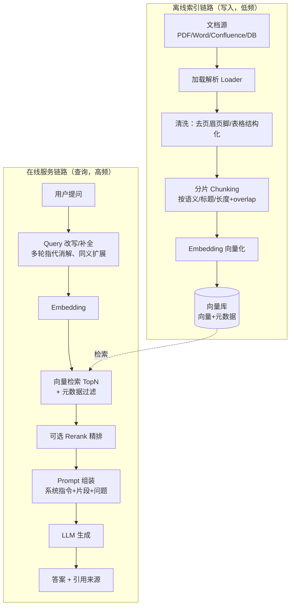

# RAG 工作流程进阶与向量数据库

> 2026-10-14 成稿，对应九问中的 Q7、Q8。
> 基础版（定义、Chunk 策略、选型、RAG vs 微调）见 `ai-02-llm-rag-basics.md`，本文不重复，重点在**双链路拆解 + 每个环节的失败点 + 进阶范式 + 向量库原理与选型**。

## Q7. 什么是 RAG？工作流程是怎样的？

### 一句话定义

**RAG（Retrieval-Augmented Generation，检索增强生成）：在生成答案之前，先从外部知识库检索相关内容，作为上下文一起交给 LLM，让模型「带着资料回答」而不是「凭记忆回答」。**

它解决三件事：知识滞后、私有数据、幻觉（有据可依）。

### 完整工作流：两条链路（必考，能画出来最好）

### 逐步拆解：每步做什么 + 最常见失败点

| 步骤 | 做什么 | 失败点与对策 |
| --- | --- | --- |
| 1. 加载解析 | PDF/Word/Markdown/网页/数据库抽文本 | 表格错乱、扫描件没做 OCR → 表格单独结构化、扫描件走 OCR |
| 2. 清洗 | 去页眉页脚/水印/目录，统一编码与标点 | 脏字符影响向量质量 → 正则清洗 + 保留标题层级 |
| 3. 分片 Chunking | 按语义/标题/固定长度切，加 overlap | 切碎语义（召回半句）→ 按结构切、加 overlap、给每个 chunk 带上标题路径做上下文 |
| 4. Embedding | 文本 → 向量 | 用通用模型但领域词区分度低 → 领域数据微调 embedding 模型或换领域模型 |
| 5. 入库 | 写向量 + 元数据（doc_id/部门/时间/权限） | 无元数据 → 后期无法做权限过滤和增量更新 |
| 6. Query 改写 | 补全指代、扩展同义词、生成假设答案（HyDE） | 多轮对话「它多少钱」直接检索必然跑偏 → 先用 LLM 结合历史重写 query |
| 7. 检索召回 | 向量相似度取 TopN（可混合 BM25 关键词） | 纯向量丢关键词精确匹配（如型号「A4L 2024款」）→ **混合检索** |
| 8. Rerank 精排 | 交叉编码器对 query+doc 逐对打分重排 | 直接开 Rerank 增加延迟 → 召回 Top50 → 精排取 Top5 |
| 9. Prompt 组装 | 系统指令 + 检索片段（带编号）+ 用户问题 | 不定边界 → 强约束「只基于片段回答，无相关信息就说不知道」 |
| 10. 生成 | LLM 输出答案 + 引用标注 | 幻觉 → 要求逐句标注来源编号，前端可点击溯源 |

### 进阶范式（能说出下面 3 个就明显高于平均）

| 范式 | 核心思想 |
| --- | --- |
| **Hybrid Retrieval** | 向量检索 + BM25/全文检索双路召回再融合（RRF 排序）——解决纯向量丢关键词精确匹配 |
| **HyDE** | 先让 LLM 生成「假设答案」，用假设答案去检索（答案和文档的向量更接近） |
| **RAG-Fusion / Multi-Query** | 把一个问题改写成多个子查询并行检索，再融合去重 |
| **Agentic RAG** | 检索由 Agent 动态驱动：判断是否需要检索、检索几轮、换什么查询、要不要再查第二个数据源 |
| **GraphRAG** | 用知识图谱存实体关系，解决「跨文档多跳推理」类问题（如"A 公司的供应商的竞争对手"） |
| **Self-RAG** | 模型自己决定何时检索，并对检索结果做相关性/支持度自评 |
| **Contextual Retrieval** | 索引时为每个 chunk 补一段由 LLM 生成的上下文说明，缓解「切碎了不知道说的是什么」 |

### 效果评估指标（加分项，很多人答不出）

| 层 | 指标 | 说明 |
| --- | --- | --- |
| 检索层 | Recall@K / 命中率 | 正确文档有没有被召回 |
| 检索层 | MRR / NDCG | 正确文档排得靠不靠前 |
| 生成层 | **忠实度 Faithfulness** | 答案是否忠于检索到的片段（幻觉率） |
| 生成层 | 答案相关性 | 是否回答了问题 |
| 工程层 | 首 token 耗时、检索耗时、单次成本 | SLO 与成本 |

无标准答案的场景用 **LLM-as-a-Judge** 批量打分 + 人工抽检校准。

## Q8. 什么是向量数据库？

### 定义

**向量数据库：专门用于存储高维向量并提供「近似最近邻（ANN）搜索」能力的数据库**——给定一个查询向量，快速找出最相似的 K 条记录，同时支持元数据过滤、增删改查、持久化和水平扩展。

### 为什么需要它（为什么 B+ 树不行 —— 这是关键理解）

1. **维度灾难**：向量动辄 768/1536 维，传统 B+ 树按单列排序的前提是「一维可比大小」；高维空间里没有这样的全序，树索引直接失效
2. **暴力检索不可行**：100 万条 × 1536 维，每次查询要做 10 亿次乘加——单次几秒，QPS 上不去
3. 所以需要**牺牲一点精度换速度**的近似算法（ANN）——这是向量库存在的全部理由

### 核心原理：ANN 三大主流算法

| 算法 | 思路 | 特点 |
| --- | --- | --- |
| **HNSW**（分层可导航小世界图） | 建多层图，上层稀疏做「高速公路」，下层稠密精确定位；查询从顶层贪心下降 | **工业默认**：查询最快、召回高；**内存占用大**（图结构常驻内存） |
| **IVF**（倒排文件） | 先聚类成 N 个桶，查询只搜最近的 nprobe 个桶 | 省内存、可扩展；需要训练；精度略低 |
| **PQ / 量化压缩** | 把向量切段做乘积量化，用码本近似表示 | 内存降一个数量级，精度损失可调；常与 IVF 组合成 IVF-PQ |
| DiskANN | 图索引落盘 | 超大规模省内存，延迟略高 |

**调参口径**：`efSearch`（HNSW）/ `nprobe`（IVF）越大越准但越慢——**召回率与延迟的旋钮**，回答「精度怎么调」时给这两个词。

### 相似度度量

| 度量 | 说明 | 场景 |
| --- | --- | --- |
| 余弦相似度 | 看夹角，长度无关 | 文本检索默认 |
| 内积 | 含长度信息 | 已归一化时等价余弦 |
| L2 距离 | 欧氏距离 | 图像/推荐 |

### 关键工程能力（选型 checklist）

1. **元数据过滤**：不能只按向量搜——要能「只在这个部门、这个时间段、有权限的文档里搜」
   - ⚠️ **陷阱**：pre-filter（先过滤再搜）保证准确但可能让候选集过小；post-filter（先搜再过滤）可能过滤完不够 K 条。要在面试里点出这个权衡
2. **增删改**：支持按 doc_id 批量删除/更新（RAG 文档更新依赖它）
3. **持久化与副本**：宕机不丢、可水平扩展
4. **多租户/权限**：企业知识库必须有（按用户过滤可访问文档）
5. **性能**：QPS、P99 延迟、索引构建时间

### 常见产品对比（能说 4~5 个即可）

| 产品 | 定位 | 特点 |
| --- | --- | --- |
| **Milvus** | 分布式专用向量库 | 海量（亿级）、HNSW/IVF/DiskANN 全支持、架构复杂需运维 |
| **Qdrant** | 专用向量库 | Rust 实现、过滤能力强、部署简单 |
| Weaviate | 专用向量库 | 内置模块化 embedding、GraphQL 接口 |
| **pgvector** | PG 扩展 | **复用现有 PG，零新增中间件**；百万级以内够用，千万级吃力 |
| Chroma | 嵌入式/轻量 | 原型验证最快上手，不适合生产高并发 |
| ES / OpenSearch | 搜索引擎扩展 | **混合检索（BM25+向量）一套引擎搞定**，已有 ES 的团队首选 |
| Redis Search | 内存数据库扩展 | 低延迟小规模向量场景 |
| FAISS | **库**不是数据库 | Facebook 算法库，无持久化/服务化能力，适合离线实验 |

**选型口径（面试可直接说）**：

> 百万级以内且已有 PostgreSQL → pgvector（少一个中间件，运维成本最低）；数据量上亿或高并发达标 → Milvus；已有 ES 且需要混合检索 → ES；原型验证 → Chroma。我们项目选 pgvector 就是这个逻辑：数据量够用、复用 PG、失败面小，接口层做抽象，将来量大了换 Milvus 成本可控。

### 与 RAG 的关系（一句话收尾）

> RAG 是「应用模式」，向量数据库是「检索底座」二选一中的一个（另一个是搜索引擎/关键词检索）。**生产上最好的 RAG 通常是混合检索**：向量库管语义、搜索引擎管关键词，两路召回融合后再 Rerank。

## 追问链 · 参考答案

| 层级 | 问题 | 参考答案要点 |
| --- | --- | --- |
| L1 | RAG 的完整工作流程有哪几步？向量数据库是什么？ | 双链路十步：离线索引（加载解析 → 清洗 → 分片 → Embedding → 带元数据入库）；在线服务（query 改写 → Embedding → 向量召回 TopN+元数据过滤 → Rerank → prompt 组装 → 生成带引用的答案）。向量数据库一句话：专门存高维向量、提供近似最近邻（ANN）搜索、支持元数据过滤和增删改的数据库。 |
| L2 | 为什么传统 B+ 树索引做不了向量检索？ | 两个根本原因：一是维度灾难——向量动辄 768/1536 维，高维空间里距离对比失去区分度；二是 B+ 树依赖「单列可排序」的全序关系，高维向量没有这样的序。暴力扫描 100 万条×1536 维每次查询要 10 亿次乘加，几秒一次 QPS 上不去，所以只能牺牲一点精度换速度，这就是 ANN 算法存在的理由。 |
| L3 | HNSW 和 IVF 怎么取舍？召回率怎么调？ | HNSW 建多层图，上层稀疏当高速公路、下层稠密精确定位，查询最快召回最高，是工业默认，代价是图结构常驻内存、占用大；IVF 先聚类分桶只搜最近几个桶，省内存可扩展但精度略低。调召回率给两个旋钮：HNSW 调大 efSearch、IVF 调大 nprobe，都是越大越准但越慢，按延迟预算取折中。 |
| L4 | 元数据过滤的 pre-filter / post-filter 陷阱是什么？ | pre-filter 先按元数据过滤再向量搜索，结果准确但候选集可能太小导致召回不足；post-filter 先搜 TopN 再过滤，可能过滤完不够 K 条、结果空洞。工程上没有银弹：过滤条件选择性强（如单部门小集合）倾向 post-filter 加大 N，选择性弱用 pre-filter，有些引擎支持在 ANN 遍历中内联过滤来缓解。 |
| L5 | 用户反馈「答非所问」，你的排查顺序是什么？ | 从便宜到贵逐层排：先看 query 改写——多轮指代有没有补全、要不要同义扩展；再看召回——正确文档有没有进 TopN（Recall 问题）、进了但排得靠后（排序问题）；然后看 Rerank 有没有帮倒忙；最后才怀疑生成模型本身。大部分「答非所问」死在检索层而不是模型层，别一上来就换模型。 |
| L6 | RAG 的效果怎么量化评估？ | 分三层：检索层看 Recall@K（正确文档有没有被召回）和 MRR/NDCG（排得靠不靠前）；生成层看忠实度 Faithfulness（答案是否忠于片段，即幻觉率）和答案相关性；工程层看首 token 耗时、检索耗时、单次成本。无标准答案的场景用 LLM-as-a-Judge 批量打分，再人工抽检校准评分器偏差。 |

## 误区 · 正解

| ❌ 误区 | ✅ 正解 |
| --- | --- |
| ❌ RAG 就是把文档丢进向量库 | 丢进库只是开始，每一环都决定成败：清洗不干净污染向量、分片切碎语义、query 不改写多轮必跑偏、纯向量丢关键词精确匹配要混合检索、召回宽了要 Rerank 收敛、上线后还要 Recall@K/Faithfulness 持续评估。把 RAG 当「接个库」做的系统，上线就是答非所问的重灾区。 |
| ❌ 向量检索比关键词检索先进，可以完全替代 | 各有强项：向量擅长语义相近，但对型号、编号、专有名词这类精确匹配恰恰是弱项——「A4L 2024款」向量可能召回一堆语义相近的车。生产上最好的 RAG 是混合检索：BM25/全文检索管关键词、向量管语义，两路召回用 RRF 融合再 Rerank，一套 ES 8.x 就能同时搞定两路。 |
| ❌ 召回 TopN 越大越好 | 越大越糟：拼进 prompt 的片段越多 token 越贵、无关噪声越多、模型注意力被稀释反而答偏。正确姿势是「召回宽、进 prompt 窄」——召回阶段 Top50 保证不漏，经相似度阈值过滤 + Rerank 精排收敛到 Top5 左右再组装 prompt，按成本和延迟预算定档位。 |
| ❌ pgvector 撑不住生产 | 要用数据说话不用感觉：百万级向量、正常 QPS 下 pgvector 完全够用，还能复用现有 PG 的备份、权限、运维体系，零新增中间件。真正吃力的场景是千万级以上或高并发低延迟硬指标，那时再迁 Milvus。工程上接口层做好抽象，选型留迁移余地，而不是一上来就堆重型架构。 |
