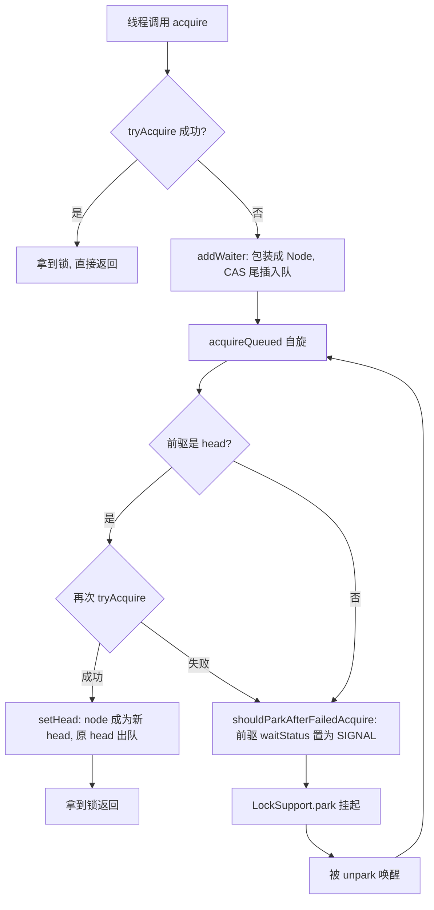
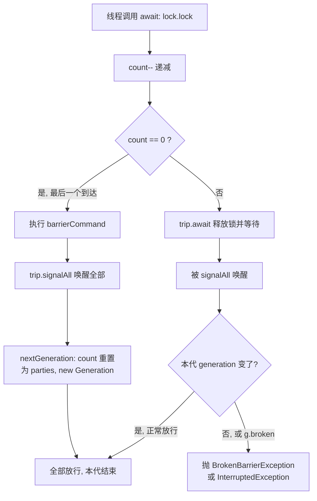
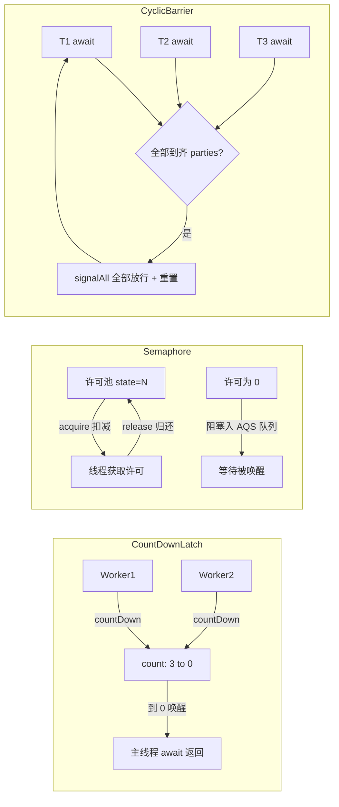

> 2026-10-14 成稿，Java 底层与并发主题

# AQS 原理 + Semaphore / CountDownLatch / CyclicBarrier

## 0. 一句话主线

**AQS = 一个 volatile int 的同步状态 state + 一条 CLH 变体的 FIFO 双向等待队列 + 一套 CAS 改状态、LockSupport 阻塞唤醒的模板方法骨架。** 子类只决定「state 是多少才允许通过」（tryAcquire / tryRelease），排队、阻塞、唤醒、中断、超时这些脏活全由 AQS 统一做掉。Semaphore 和 CountDownLatch 是 AQS 共享模式的直接子类；而 **CyclicBarrier 不是 AQS 子类**，它是 ReentrantLock + Condition 搭出来的。

> 面试口径：问「AQS 是什么」别只答「一个抽象类」。标准答法是三件套（state / 队列 / CAS+park），再加一句「它是模板方法模式，JUC 里 ReentrantLock、Semaphore、CountDownLatch、ReentrantReadWriteLock、FutureTask、ThreadPoolExecutor 的 Worker 都直接或间接依赖它」。

---

## 1. AQS 是什么

`AbstractQueuedSynchronizer`，位于 `java.util.concurrent.locks` 包，JDK 作者 Doug Lea。它是**构建锁和同步器的框架（synchronizer framework）**，不是给业务代码直接用的。

JUC 里基于它构建的东西：

| 同步器 | 模式 | state 的语义 |
| --- | --- | --- |
| ReentrantLock.Sync | 独占 | 0 = 未锁定，>0 = 已被持有，数值 = 重入次数 |
| ReentrantReadWriteLock.Sync | 独占 + 共享 | 高 16 位 = 读锁持有数，低 16 位 = 写锁重入数 |
| Semaphore.Sync | 共享 | 剩余的许可（permit）数量 |
| CountDownLatch.Sync | 共享 | 还没完成的计数值，减到 0 才放行 |
| FutureTask | 独占 | 任务状态（NEW / COMPLETING / NORMAL ...） |
| ThreadPoolExecutor.Worker | 独占 | 0 = 未占用，1 = 该 Worker 正在执行任务（用于中断控制） |

> 面试口径：能一口气说出 state 在 4 个类里分别代表什么，基本就能证明你真的看过源码，而不是背了概念。

---

## 2. AQS 三大核心

### 2.1 核心一：`volatile int state`

```java
private volatile int state;

protected final int getState() { return state; }
protected final void setState(int newState) { state = newState; }
protected final boolean compareAndSetState(int expect, int update) {
    return unsafe.compareAndSwapInt(this, stateOffset, expect, update);
}
```

要点：

- `volatile` 保证**可见性**；CAS 保证**原子性**。两者合起来才安全，缺一不可。
- **state 的语义完全由子类定义**。AQS 自己不知道 0 表示什么，它只提供读写接口。这是模板方法能成立的前提。
- 所有修改都必须走 `compareAndSetState`，不能 `setState` 乱改（除非已持有独占权，如 `tryRelease` 里）。
- 需要更大范围时用 `long`（如 `AbstractQueuedLongSynchronizer`，Semaphore 的 JDK 实现其实没用它，但 `java.util.concurrent` 里确有此类）。

### 2.2 核心二：CLH 变体的 FIFO 双向等待队列

经典 CLH 是单向、自旋、隐式链表；AQS 改成了**双向链表 + 阻塞（park）而非纯自旋**，所以叫「CLH 变体」。

```java
static final class Node {
    volatile int waitStatus;
    volatile Node prev;
    volatile Node next;
    volatile Thread thread;
    Node nextWaiter;      // Condition 队列用，或标记 SHARED/EXCLUSIVE
}
```

`waitStatus` 的取值：

| 值 | 常量 | 含义 |
| --- | --- | --- |
| 1 | CANCELLED | 该节点线程已取消（超时 / 中断），出队时会被跳过并从链上摘除 |
| -1 | SIGNAL | **后继节点正在等我唤醒**。我释放锁时必须 unpark 它的后继 |
| -2 | CONDITION | 节点在 Condition 等待队列里，不在同步队列里，`signal` 后会转移回同步队列 |
| -3 | PROPAGATE | **共享模式下，唤醒需要向后传播**（读锁、Semaphore、CountDownLatch 用得上） |
| 0 | — | 初始状态，或已被唤醒完成传递 |

> 面试口径：SIGNAL 记住一句话「**SIGNAL 不是'我在等信号'，而是'我欠后继一个唤醒'**」。这个反直觉，是高频追问点。

队列结构：head 是一个**哑节点（dummy node）**，它不代表任何等待线程，其 thread 为 null；真正排队的从 head.next 开始。这个设计让「判断前驱是不是 head」变得非常廉价，也让释放逻辑统一。

### 2.3 核心三：CAS 改 state + LockSupport 阻塞唤醒

- 抢不到锁 → 入队 → `LockSupport.park(this)` 挂起。
- 释放锁 → 找到 head 后继 → `LockSupport.unpark(thread)` 唤醒。
- 为什么不用 `Object.wait/notify`：wait/notify 必须持有 synchronized 的 monitor，且 notify 无法指定线程；park/unpark 是**以线程为粒度**的许可（permit）机制，更底层也更灵活，还允许 unpark 先于 park 发生（许可不丢失）。



---

## 3. 模板方法模式

AQS 把「能不能通过」这类**策略**交给子类，把「通不过怎么办」这类**流程**自己实现。

### 3.1 需要子类实现的钩子（5 个）

| 方法 | 模式 | 语义 |
| --- | --- | --- |
| `tryAcquire(int)` | 独占 | 尝试获取，成功返回 true |
| `tryRelease(int)` | 独占 | 尝试释放 |
| `tryAcquireShared(int)` | 共享 | 返回负数=失败；0=成功但后续无剩余；正数=成功且还有余量 |
| `tryReleaseShared(int)` | 共享 | 释放，返回是否应传播唤醒 |
| `isHeldExclusively()` | 独占 | 供 Condition 判断当前线程是否独占持有 |

### 3.2 AQS 提供的骨架

- 独占：`acquire(int)` / `release(int)`
- 可中断：`acquireInterruptibly(int)`
- 超时：`tryAcquireNanos(int, long)`（内部靠 `LockSupport.parkNanos`）
- 共享：`acquireShared` / `releaseShared` / 对应的可中断与超时版本
- 条件队列：`ConditionObject`（`await` / `signal` / `signalAll`，一个 AQS 可有多个 Condition）

`acquire` 的骨架代码（JDK 8/11/17 基本一致）：

```java
public final void acquire(int arg) {
    if (!tryAcquire(arg) &&
        acquireQueued(addWaiter(Node.EXCLUSIVE), arg))
        selfInterrupt();
}
```

一行代码里三层语义：先抢 → 抢不到就排队入队 → 在队列里循环抢 → 若期间被中断过，最后补一次自我中断（因为 `acquire` 是**不可中断**的，中断只记录不抛出）。

### 3.3 独占模式 vs 共享模式

| 维度 | 独占 EXCLUSIVE | 共享 SHARED |
| --- | --- | --- |
| 同一时刻 | 只有一个线程能过 | 多个线程可同时过（许可/计数够就行） |
| 节点标记 | `nextWaiter == null` | `nextWaiter == SHARED` |
| 唤醒传播 | 只唤醒 head 的一个后继 | `doReleaseShared` 会持续向后传播 |
| waitStatus | SIGNAL | SIGNAL + **PROPAGATE** |
| 典型使用者 | ReentrantLock、写锁 | Semaphore、CountDownLatch、读锁 |

**PROPAGATE 为什么单独存在**：共享模式下，如果只靠 SIGNAL 一对一唤醒，可能出现「释放了 3 个许可但只唤醒 1 个线程，剩下 2 个许可白白浪费、线程却还在睡」的漏唤醒 bug（JDK 历史 bug 6801020）。所以引入 -3 PROPAGATE：当 head 的状态被设为 PROPAGATE，后续释放会强制再触发一轮传播。

> 面试口径：被问「PROPAGATE 是干嘛的」，答「共享模式下的唤醒传播标记，解决多许可释放时只唤醒一个线程导致的漏唤醒问题」，加一句 JDK bug 编号效果更好。

---

## 4. acquire 完整流程（分步）

1. **tryAcquire(arg)**：子类逻辑。ReentrantLock 非公平版直接 CAS 把 state 从 0 改 1（不管队列里有没有人排队，这就是非公平的由来）；失败再看是否是可重入（`current == getExclusiveOwnerThread()`，state++）。
2. **addWaiter(mode)**：把当前线程包成 `Node`，先尝试一次 CAS 尾插 `compareAndSetTail`，失败则进入 `enq(node)` 的自旋 CAS 尾插循环，直到成功。
3. **acquireQueued(node, arg)**：
   - 取前驱 `p = node.prev`。
   - 若 `p == head`，说明我是队首，**再试一次 tryAcquire**（可能释放锁的线程刚好走了，省一次 park）。
   - 成功 → `setHead(node)`：把 node 的 thread 置 null、prev 置 null，成为新的哑 head，原 head 的 next 置 null 便于 GC。返回中断标记。
   - 失败（或前驱不是 head）→ `shouldParkAfterFailedAcquire`：把前驱的 waitStatus CAS 改成 SIGNAL（前驱若已 CANCELLED 则向前跳过并摘除），然后 `parkAndCheckInterrupt()` → `LockSupport.park(this)`。
4. **被 unpark 后**：从 park 处返回，回到步骤 3 的循环，检查中断标记，再次判断前驱是否为 head 并 tryAcquire。
5. **取消/异常**：`finally` 里若失败则 `cancelAcquire(node)`，把 waitStatus 置 CANCELLED，并从链上摘除（注意：next 指针仍保留，真正断开靠后续遍历）。

**为什么「前驱是 head 才 tryAcquire」**：这是 FIFO 公平性的保证。否则队列里第 5 个节点也能抢，公平性就没了。ReentrantLock 的公平锁额外用 `hasQueuedPredecessors()` 在 `tryAcquire` 里再做一次判断，非公平锁则允许新来的线程直接插队 CAS。

---

## 5. 为什么选 CLH 而不是 MCS

Doug Lea 在 AQS 论文的注释里给过理由，面试能说出 3 条就很够：

1. **CLH 的自旋/等待发生在前驱节点的状态字段上，可以更容易地取消和超时**。节点里直接存了 `thread` 引用，只要把某个节点的 thread 置空、waitStatus 置 CANCELLED，后面遍历时跳过即可；MCS 的链表结构拆节点更麻烦。
2. **CLH 天然 FIFO 公平**：队列顺序即到达顺序，判断「我是不是下一个」只需看前驱是不是 head，极其廉价。
3. **CLH 更容易扩展成阻塞而不是自旋**：MCS 是严格自旋锁（线程在本地变量上自旋），在多核上扩展性好但**不支持抢占式取消**，也不适合「线程数远大于 CPU 核数」的场景；AQS 面对的是几千个线程抢一把锁，必须阻塞挂起，CLH 变体改造成本更低。
4. 补充：AQS 的 CLH 是**双向**的（原版 CLH 单向），这是为了支持取消时向前找、以及 `next` 方向上的唤醒查找。

> 面试口径：「AQS 用的是 CLH 队列锁的变体——原版 CLH 在前驱节点的本地变量上自旋、单向链表、无取消机制；AQS 改成双向链表 + park 阻塞 + waitStatus 状态机，从而支持取消、超时、中断和条件队列。」

---

## 6. Semaphore

### 6.1 原理

- `state` = 当前可用许可数。
- `acquire()` → `sync.acquireSharedInterruptibly(1)` → `tryAcquireShared` 做**自旋 CAS 扣减**（`for(;;)` 里 `compareAndSetState(available, remaining)`），remaining < 0 返回负数 → 入 AQS 共享队列 park。
- `release()` → `tryReleaseShared` 自旋 CAS **增加**许可 → `doReleaseShared()` 唤醒后继并传播。
- 属于**共享模式**。
- `permits = 1` 时可当互斥锁用，**但不可重入**（自己再 acquire 会把自己堵死，因为许可已被自己占完）。

### 6.2 示例：接口限流

```java
import java.util.concurrent.Semaphore;
import java.util.concurrent.ExecutorService;
import java.util.concurrent.Executors;

public class SemaphoreRateLimitDemo {
    // 同一时刻最多 3 个线程调用下游接口
    private static final Semaphore semaphore = new Semaphore(3);
    private static final ExecutorService pool = Executors.newFixedThreadPool(10);

    public static void main(String[] args) throws InterruptedException {
        for (int i = 1; i <= 10; i++) {
            final int taskId = i;
            pool.submit(() -> {
                try {
                    semaphore.acquire();          // 抢许可，抢不到就阻塞
                    try {
                        System.out.println(Thread.currentThread().getName()
                                + " 调用下游接口, task=" + taskId
                                + ", 剩余许可=" + semaphore.availablePermits());
                        Thread.sleep(1000);        // 模拟 RPC 耗时
                    } finally {
                        semaphore.release();       // 必须在 finally 释放
                    }
                } catch (InterruptedException e) {
                    Thread.currentThread().interrupt();
                }
            });
        }
        pool.shutdown();
    }
}
```

要点：`release()` 必须放 `finally`；`acquire()` 可中断；还有 `tryAcquire()` 和 `tryAcquire(timeout, unit)` 非阻塞/超时版本。

### 6.3 用途

- 接口/方法级限流（如限制同时调用某第三方 API 的并发数）。
- 资源池：数据库连接池、对象池（许可数 = 池大小）。
- 二进制信号量当互斥锁（permits=1），但生产上直接用 ReentrantLock 更好（可重入、可公平、可 Condition）。

---

## 7. CountDownLatch

### 7.1 原理

- `state` = 还需要等待的事件数（构造时 `new Sync(count)` 直接 `setState(count)`）。
- `await()` → `acquireSharedInterruptibly(1)`，`tryAcquireShared` 返回 `state == 0 ? 1 : -1`。state > 0 则入队 park。
- `countDown()` → `releaseShared(1)`，`tryReleaseShared` 自旋 CAS 减 1；**当减到 0 时返回 true**，AQS 触发 `doReleaseShared`，唤醒所有等待线程并传播。
- **一次性，不可重置**。count 减到 0 后再调 `await()` 会立即返回（因为 `tryAcquireShared` 恒返回 1）。

### 7.2 示例：主线程等待 N 个服务初始化完成

```java
import java.util.concurrent.CountDownLatch;
import java.util.concurrent.ExecutorService;
import java.util.concurrent.Executors;

public class CountDownLatchInitDemo {
    private static final int SERVICE_COUNT = 3;
    private static final CountDownLatch latch = new CountDownLatch(SERVICE_COUNT);
    private static final ExecutorService pool = Executors.newFixedThreadPool(SERVICE_COUNT);

    public static void main(String[] args) throws InterruptedException {
        String[] services = {"缓存预热", "字典加载", "RPC连接池"};
        for (String name : services) {
            pool.submit(() -> {
                try {
                    Thread.sleep((long) (Math.random() * 2000));  // 模拟初始化耗时
                    System.out.println(name + " 初始化完成");
                } catch (InterruptedException e) {
                    Thread.currentThread().interrupt();
                } finally {
                    latch.countDown();   // 无论成功失败都要减，否则主线程永远等
                }
            });
        }
        System.out.println("主线程等待所有服务初始化...");
        latch.await();                   // 阻塞直到 count 为 0
        System.out.println("全部就绪, 应用启动");
        pool.shutdown();
    }
}
```

### 7.3 用途

- 主线程等待 N 个服务/组件初始化完成再对外提供服务（Spring 启动、压测预热）。
- 并行任务汇总：把大任务拆 N 份并行算，全部完成后主线程合并结果。
- **模拟并发压测起跑线**：`new CountDownLatch(1)` 作为"发令枪"，N 个线程先 `await()`，主线程 `countDown()` 让它们同一瞬间开跑。

### 7.4 CountDownLatch vs Thread.join

| 维度 | CountDownLatch | Thread.join |
| --- | --- | --- |
| 底层 | AQS 共享模式 + park/unpark | `Object.wait/notify`（Thread 对象上的 monitor） |
| 等待粒度 | **事件/任务**（一个线程可多次 countDown，一个 latch 可跨多线程） | **线程结束**（必须等目标线程 terminate） |
| 灵活度 | 高：可在任意代码点 countDown；可 await 超时；线程池场景也能用 | 低：必须持有 Thread 引用；用线程池时拿不到工作线程 |
| 可复用 | 否，但可 new 一个新的 | 每个线程只能 join 一次 |
| 是否释放锁 | await 不占任何锁 | join 内部是 synchronized 方法，会短暂持有 Thread 对象的锁 |

> 面试口径：「线程池场景下 join 基本没法用，因为你根本拿不到工作线程的引用；latch 等的是'事件'不是'线程'，所以能配合线程池。」

---

## 8. CyclicBarrier（重点：不是 AQS 子类）

### 8.1 重点澄清

**CyclicBarrier 不继承 AQS，它的 Sync 内部类也不是 AQS 的子类。** 它的源码是：

```java
public class CyclicBarrier {
    private static class Generation { boolean broken = false; }
    private final ReentrantLock lock = new ReentrantLock();
    private final Condition trip = lock.newCondition();
    private final int parties;
    private final Runnable barrierCommand;
    private Generation generation = new Generation();
    private int count;                 // 还在路上、未到达的线程数
}
```

`await()` 的核心逻辑（`dowait`）：

1. `lock.lock()` 加锁；
2. `count--`；若 `count == 0`（最后一个到达）：
   - 有 `barrierCommand` 就**由这个最后到达的线程**执行它；
   - `nextGeneration()`：`trip.signalAll()` 唤醒所有 → `count = parties` **重置** → new 一个新 Generation；
   - 返回 0；
3. 否则进入 `for(;;)`：`trip.await()`（可超时版 `awaitNanos`）等待；
4. 被唤醒后若 `g != generation` 说明本代已完成，正常返回；若 `g.broken` 抛 `BrokenBarrierException`。

### 8.2 关键特性

- **循环使用（Cyclic）**：放行后自动重置计数，可反复使用——这是与 CountDownLatch 最核心的区别。
- **相互等待**：所有线程都是「参与者」，一起等一起走；CountDownLatch 是「一方等另一方」。
- **可设超时**：`await(timeout, unit)` 超时抛 `TimeoutException`，并且**会让本代 broken 失效**。
- **barrierCommand**：最后一个到达的线程执行，常用于合并各线程的局部结果。
- **中断/异常传播**：任一参与者被中断或超时，`breakBarrier()` 把 `generation.broken = true` 并 `signalAll()`，**所有**其他等待中的线程都会收到 `BrokenBarrierException`，本代作废。



### 8.3 示例：多线程分片计算后合并结果

```java
import java.util.concurrent.BrokenBarrierException;
import java.util.concurrent.CyclicBarrier;
import java.util.concurrent.ExecutorService;
import java.util.concurrent.Executors;
import java.util.concurrent.atomic.AtomicInteger;

public class CyclicBarrierMergeDemo {
    private static final int PARTIES = 4;
    private static final int[] partial = new int[PARTIES];
    private static final AtomicInteger total = new AtomicInteger();

    public static void main(String[] args) {
        // 最后一个到达的线程负责合并各分片结果
        CyclicBarrier barrier = new CyclicBarrier(PARTIES, () -> {
            int sum = 0;
            for (int v : partial) sum += v;
            total.set(sum);
            System.out.println("本轮合并完成, 结果 = " + sum + ", 屏障自动重置");
        });

        ExecutorService pool = Executors.newFixedThreadPool(PARTIES);
        for (int i = 0; i < PARTIES; i++) {
            final int idx = i;
            pool.submit(() -> {
                try {
                    for (int round = 1; round <= 2; round++) {   // 跑两轮, 验证可循环
                        partial[idx] = (idx + 1) * 100 + round;  // 模拟本分片计算
                        System.out.println(Thread.currentThread().getName()
                                + " 第" + round + "轮到达屏障");
                        barrier.await();                         // 互相等待, 到齐一起走
                    }
                } catch (InterruptedException | BrokenBarrierException e) {
                    System.out.println("屏障被打破: " + e.getClass().getSimpleName());
                }
            });
        }
        pool.shutdown();
    }
}
```

---

## 9. 三者对比总表（必背）

| 维度 | Semaphore | CountDownLatch | CyclicBarrier |
| --- | --- | --- | --- |
| 能否重置/循环 | 能（release 归还许可，持续可用） | **不能**，一次性 | **能**，放行后自动重置，可循环 |
| 等待关系 | 多方竞争有限资源 | **一方等另一方**（主线程等 worker） | **线程之间互相等**（全部到齐才走） |
| 计数方向 | acquire **递减**、release **递增**（双向） | **递减**到 0 | **递减**到 0 后**重置**回 parties |
| 底层实现 | **AQS 共享模式** | **AQS 共享模式** | **ReentrantLock + Condition**（非 AQS 子类） |
| 是否阻塞主线程 | 取决于谁调 acquire | await() 阻塞调用方（通常是主线程） | 所有参与者线程都阻塞 |
| 典型场景 | 限流、资源池、连接池 | 等待 N 个初始化完成、并行汇总、压测发令枪 | 多轮迭代计算、分阶段任务、并行归约 |
| 是否支持超时 | `tryAcquire(timeout)` 支持 | `await(timeout)` 支持（超时返回 false） | `await(timeout)` 支持（超时抛 TimeoutException 并使屏障 broken） |
| 异常 | InterruptedException | InterruptedException | InterruptedException + **BrokenBarrierException** |
| 能否复用计数 | 天然持续复用 | 只能 new 新的 | 自动复用 |



---

## 10. 追问链 · 参考答案

| 层级 | 问题 | 参考答案要点 |
| --- | --- | --- |
| L1 | AQS 是哪三部分组成？state 的作用是什么，语义由谁定义？ | AQS 由三部分组成：volatile int state 同步状态、CLH 变体双向 FIFO 等待队列、CAS 改状态 + LockSupport park/unpark 的阻塞唤醒机制。state 是唯一的共享状态，语义完全由子类定义：ReentrantLock 里是重入次数，Semaphore 里是剩余许可数，CountDownLatch 里是未完成的计数。AQS 只提供读写接口，不理解语义。 |
| L1 | 独占模式和共享模式的核心区别？各自代表类有哪些？ | 独占模式同一时刻只有一个线程能获取，唤醒只传一个后继；共享模式许可或计数够就多个线程同时通过，唤醒通过 PROPAGATE 向后传播。独占代表：ReentrantLock、ReentrantReadWriteLock 写锁；共享代表：Semaphore、CountDownLatch、读锁。节点用 nextWaiter 字段区分，EXCLUSIVE 为 null、SHARED 为标记常量。 |
| L1 | CountDownLatch 的 await 和 countDown 分别在 AQS 层调用什么？ | await() 走 acquireSharedInterruptibly(1)，子类 tryAcquireShared 逻辑是 state == 0 返回 1、否则返回 -1 入队 park。countDown() 走 releaseShared(1)，tryReleaseShared 自旋 CAS 减 1，减到 0 时返回 true，AQS 触发 doReleaseShared 唤醒所有等待线程并向后传播。两者都是 AQS 共享模式的直接应用。 |
| L2 | 画一遍 acquire 的完整流程：tryAcquire 失败后依次发生什么？ | tryAcquire 失败后依次：addWaiter 把线程包成 Node 做 CAS 尾插入队（失败进 enq 自旋）；进 acquireQueued 循环，若前驱是 head 则再试一次 tryAcquire；再失败则 shouldParkAfterFailedAcquire 把前驱 waitStatus 置为 SIGNAL，然后 parkAndCheckInterrupt 调 LockSupport.park 挂起；被 unpark 后回到循环重试；拿到锁后 setHead 把自己设为新哑节点。 |
| L2 | Node 的 waitStatus 有哪几个值？SIGNAL 到底表示"我在等"还是"我要唤醒别人"？ | waitStatus 有 5 个值：0 初始态、1 CANCELLED（取消，出队时跳过）、-1 SIGNAL、-2 CONDITION（在条件队列）、-3 PROPAGATE（共享模式传播唤醒）。SIGNAL 是反直觉的：它不表示"我在等信号"，而表示"我的后继在等我唤醒"——持有该状态的节点释放锁时必须负责 unpark 后继，是"我欠后继一个唤醒"的记账标记。 |
| L2 | PROPAGATE(-3) 为什么存在？不设它会有什么 bug？ | PROPAGATE 是共享模式的唤醒传播标记，解决多许可同时释放时的漏唤醒问题：若只靠 SIGNAL 一对一唤醒，释放 3 个许可可能只唤醒 1 个线程，其余许可浪费、线程还在睡。head 被置为 PROPAGATE 后，doReleaseShared 会持续向后传播唤醒。这是 JDK 历史 bug 6801020 的修复方案，Semaphore、CountDownLatch、读锁都依赖它。 |
| L2 | CountDownLatch 的 count 减到 0 后，再调用 await 会怎样？再调用 countDown 会怎样？ | count 减到 0 后 tryAcquireShared 恒返回 1，所以之后任何 await() 都立即返回、不阻塞；再调 countDown() 会让 state 减成负数（tryReleaseShared 仍返回 false，不再触发唤醒），不产生效果但语义上是错误用法。CountDownLatch 是一次性的，不能重置，要循环使用请换 CyclicBarrier 或新建实例。 |
| L3 | `acquire` 方法体就一行 `if (!tryAcquire(arg) && acquireQueued(...)) selfInterrupt();`，为什么最后要 `selfInterrupt()`？ | 因为 acquire 是不可中断版本：park 期间被中断时 parkAndCheckInterrupt 只记录中断标记、不抛异常，线程会继续排队直到拿到锁。acquireQueued 返回的 true 表示"排队期间被中断过"，acquire 末尾补一次 selfInterrupt() 是为了把中断标记重新设上，还给调用方——否则中断信号就被静默吞掉了，调用方无法感知。 |
| L3 | acquireQueued 里为什么要「前驱是 head 才 tryAcquire」？直接让所有节点都试着抢会怎样？ | 这是 FIFO 公平性的核心保证：只有前驱是 head（即自己是队首）才有资格抢锁，队列顺序即到达顺序。若放开让所有节点都抢，第 5 个节点可能先于第 2 个拿到锁，队列形同虚设，公平性彻底丧失，还会造成大量无效 CAS 竞争。head 是哑节点（thread 为 null），判断前驱是否为 head 只需一次引用比较，代价极低。 |
| L3 | ReentrantLock 公平锁与非公平锁在源码上的唯一差异是什么？（提示：`hasQueuedPredecessors` / `!compareAndSetState` 前的判断） | 唯一差异在 FairSync.tryAcquire 里 CAS 之前多了 hasQueuedPredecessors() 判断：只有当队列里没有排在自己前面的线程时才允许 compareAndSetState(0, 1)，否则乖乖入队；NonfairSync 则上来就无脑 CAS，成功即插队。hasQueuedPredecessors 会检查 head.next 是否存在且不是当前线程。因此公平锁吞吐明显更低（每次要查队列），但能保证不饥饿，这就是默认非公平的原因。 |
| L4 | CyclicBarrier 是不是 AQS 的子类？如果不是，它靠什么实现？为什么要这么设计？ | 不是。CyclicBarrier 内部是 ReentrantLock + Condition（trip）+ Generation 对象，与 AQS 无继承关系。设计原因：barrier 需要"代"的概念来支持循环复用、需要在到齐时一次性 signalAll 唤醒全部参与者、还要处理 broken 状态传播，这些语义用一把互斥锁加条件队列表达最自然，硬套 AQS 的单一 state 模型反而别扭。 |
| L4 | 为什么 CyclicBarrier 不做成 AQS 子类？（提示：AQS 的 state 是单一 int 且语义固定在一把锁上，而 barrier 需要「代」的概念 + 条件通知 + 复用，用 ReentrantLock + Condition 更自然） | AQS 的抽象是"一个 volatile int state + 排队等到条件满足"，语义锚定在单一数值上；而 CyclicBarrier 需要的是：到齐时由最后到达者执行 barrierCommand、signalAll 一次性唤醒所有参与者、nextGeneration 重置 count 并更换代对象、任一异常让整代 broken。这组"代 + 批量通知 + 复用"的语义用 ReentrantLock 互斥保护 count、Condition 做等待唤醒即可直接表达，套 AQS 反而要把多段逻辑硬塞进 tryAcquireShared。 |
| L4 | 多线程分阶段计算（每阶段都要等齐再进入下一阶段）应该选哪个？为什么 CountDownLatch 做不到？ | 选 CyclicBarrier。分阶段计算要求所有线程互相等齐后一起进入下一阶段，且要循环多轮——CyclicBarrier 放行后 nextGeneration 自动把 count 重置回 parties，天然支持多轮。CountDownLatch 做不到是因为它是单向的"一方等另一方"，且 state 减到 0 后不可重置，第二阶段无法复用；强行用只能每阶段 new 一个 latch，还表达不了"互相等待"的语义。 |
| L4 | CyclicBarrier 某一个线程在 await 时被中断，其他线程会怎样？如何恢复？ | 任一参与者在 await 时被中断或超时，会触发 breakBarrier()：把当前 Generation 的 broken 置为 true 并 signalAll，所有其他等待线程都会收到 BrokenBarrierException，本代整体作废，且 barrier 之后无法再用（count 不会重置）。恢复手段只能是换一个新的 CyclicBarrier 实例。这个"一人出错全员失败"的设计是故意的，防止部分线程带着不完整数据进入下一阶段。 |
| L5 | 生产上用 Semaphore 做限流，release 忘了放 finally，会发生什么？如何排查（jstack 里看到什么状态）？ | acquire 后若业务代码抛异常导致 release 没执行，许可永久泄漏，最终可用许可耗尽，所有后续 acquire 线程都阻塞，接口全部超时。jstack 里会看到大量线程处于 WAITING (parking)，栈帧停在 LockSupport.park ← Semaphore.acquire ← 业务代码，且无人释放。修复：release 必须放 finally，并加 availablePermits() 监控告警，发现许可数持续下降即泄漏。 |
| L5 | CountDownLatch 的 countDown 放在 try 块里而不是 finally，某个 worker 抛异常会导致什么现象？（主线程永久挂起，接口永远不返回） | worker 在 countDown 之前抛异常时 countDown 被跳过，state 永远减不到 0，主线程的 await() 永久 park，对外表现为接口永远不返回、请求超时堆积。修复两条：countDown 必须放 finally 保证无论成败都减计数；主线程侧用 await(timeout, unit) 兜底，超时返回 false 后按降级逻辑处理，而不是无限等待。 |
| L5 | 压测要模拟 5000 并发同一瞬间打出去，怎么用 CountDownLatch 做发令枪？ | 用 new CountDownLatch(1) 做发令枪：5000 个线程各自就绪后先 await() 住，主线程等全部就绪后调一次 countDown()，state 从 1 减到 0，doReleaseShared 唤醒传播，5000 个线程几乎同一瞬间开跑。通常再配一个 CountDownLatch(5000) 收枪统计总耗时。注意 await 线程是 park 阻塞不占 CPU，且唤醒传播有微秒级先后，做不到纳秒级绝对同时。 |
| L5 | CyclicBarrier 的 barrierCommand 由哪个线程执行？如果它抛异常会怎样？（本代 broken，所有 await 抛 BrokenBarrierException） | barrierCommand 由最后一个到达屏障的线程（把 count 减到 0 的那个）同步执行，不是新线程。若它抛异常，dowait 会走 breakBarrier()：generation.broken = true 并 signalAll，所有正在 await 的线程收到 BrokenBarrierException，本代作废，barrier 后续不可复用。所以 barrierCommand 里必须自己 catch 住异常，合并逻辑要轻量、可容错。 |
| L5 | AQS 队列长度暴增说明什么？怎么定位是谁在抢锁？ | 队列暴增说明锁竞争严重或临界区耗时过长：大量线程抢不到锁排队 park，常见根因是临界区里有 RPC/IO、锁粒度过大或持锁线程被频繁上下文切换。定位手段：jstack 看哪些线程停在 LockSupport.park 及 acquireQueued 栈帧，找到对应锁类；再看持有锁的线程在干什么；也可用 JFR 的 Java Monitor Blocked / Thread Park 事件量化等待时长，进而缩锁、拆锁或换无锁方案。 |

---

## 11. 误区 · 正解

| ❌ 误区 | ✅ 正解 |
| --- | --- |
| 「CyclicBarrier 是 AQS 的子类」 | CyclicBarrier 与 AQS 没有继承关系，它内部由 ReentrantLock + Condition（trip）+ Generation 对象实现，靠 lock 保护 count 递减、trip.signalAll() 批量唤醒、nextGeneration 重置实现循环。JUC 里 AQS 的直接使用者是 Semaphore、CountDownLatch、ReentrantLock、ReentrantReadWriteLock、FutureTask，CyclicBarrier 不在其中。 |
| 「CountDownLatch 可以 reset 后复用」 | CountDownLatch 是一次性的：state 减到 0 后不可重置，之后 await() 恒立即返回，也没有 reset() 方法。需要"等齐后放行、再放行下一轮"的循环语义时，应改用 CyclicBarrier（放行后自动重置），或者每个阶段新建一个 CountDownLatch 实例。 |
| 「Semaphore(1) 等价于 ReentrantLock」 | 不等价。Semaphore(1) 不可重入：同一线程第二次 acquire 会因许可耗尽把自己堵死；它也没有 owner 概念，任何线程都能 release（包括没 acquire 过的线程，会凭空增加许可），且不支持 Condition。互斥场景生产上应直接用 ReentrantLock，它可重入、可公平、可挂多个 Condition。 |
| 「AQS 队列里的线程在自旋空转」 | AQS 是阻塞实现而非自旋锁：抢不到锁的线程在 shouldParkAfterFailedAcquire 后调 LockSupport.park 挂起，不占 CPU。acquireQueued 里的循环是"被 unpark 唤醒后再检查一次能否拿锁"的重试逻辑，不是忙等。纯自旋的是原版 CLH/MCS 队列锁，AQS 正是为了支持阻塞和取消才改造成 CLH 变体。 |
| 「waitStatus = SIGNAL 表示这个节点在等待信号」 | 正好相反。SIGNAL(-1) 记在某个节点上，表示"该节点的后继正在等它唤醒"——持有此状态的线程释放锁时必须负责 unpark 后继，是"我欠后继一个唤醒"的记账标记。入队流程中，线程 park 前会先把前驱的 waitStatus CAS 改成 SIGNAL，就是在让前驱承诺唤醒自己。 |
| 「CountDownLatch 的 await 会一直占着 CPU」 | 不会。await 底层走 acquireSharedInterruptibly：state != 0 时线程被包成 Node 入队并 LockSupport.park 挂起，是内核级阻塞，不占 CPU；count 减到 0 后 doReleaseShared 才批量唤醒。所以"主线程 await 中"的线程在 jstack 里是 WAITING (parking) 状态，而非 RUNNABLE。 |
| 「CyclicBarrier 的超时不影响其他人」 | 影响所有人。await(timeout, unit) 超时会抛 TimeoutException 并调用 breakBarrier()：把本代 Generation 标记为 broken 且 signalAll，所有正在等待的线程都收到 BrokenBarrierException，本轮整体作废、barrier 不可再用。中断某个参与者效果相同——"一人失败全员失败"是刻意设计，防止线程带着不完整数据进入下一阶段。 |
| 「CountDownLatch 和 Thread.join 差不多，随便选」 | 两者语义和底层都不同。join 底层是 Thread 对象上的 wait/notify，等的是"线程终止"，必须持有 Thread 引用——线程池场景根本拿不到工作线程，没法用；CountDownLatch 走 AQS 共享模式，等的是"事件数归零"，一个线程可多次 countDown，支持超时，可跨线程池协作。除"等少数几个裸线程跑完"的简单场景外，一律用 latch。 |

---

## 12. 速查卡（一分钟复习）

- **AQS 三件套**：volatile state + CLH 变体双向 FIFO 队列 + CAS/park-unpark。
- **模板方法**：子类写 tryAcquire/tryRelease（或 Shared 版），AQS 负责排队、阻塞、唤醒、中断、超时、Condition。
- **acquire 五步**：tryAcquire → addWaiter 尾插 → acquireQueued 自旋（前驱是 head 才抢）→ park → 被唤醒后 setHead。
- **Semaphore** = 共享模式，state = 许可数，限流 / 资源池。
- **CountDownLatch** = 共享模式，state = 计数，一次性，主线程等 N 个事件。
- **CyclicBarrier** = ReentrantLock + Condition，线程互相等，自动重置可循环，可超时可带 barrierCommand。
- **选择口诀**：限流用 Semaphore；等别人干完用 CountDownLatch；大家一起等齐再走、还要多轮，用 CyclicBarrier。
