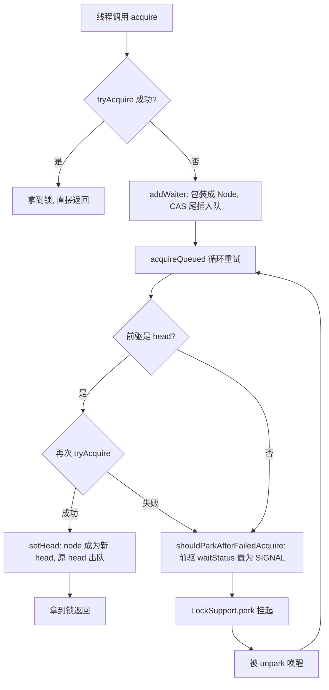
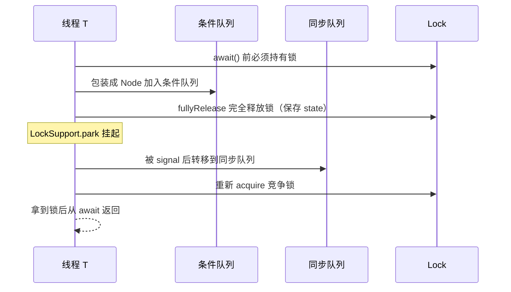

> 2026-10-14 成稿，Java 底层与并发主题  
> 2026-10-16 融合《AQS.docx》的叫号窗口类比与 6 张图，新增「入门」与源码级拆解的分层（7 步全景→方法级细节）  
> 2026-10-18 依据公众号《AQS 是什么？…》补全 Condition 条件队列、读写锁 state 拆分、unparkSuccessor 反向遍历、自写 Mutex 的 owner 校验，并补充追问与误区  
> 2026-11-10 拆分：Semaphore / CountDownLatch / CyclicBarrier 的机制、源码与三者对比表移入 `java-core-countdownlatch-cyclicbarrier-semaphore.md`，本篇只保留它们在 AQS 视角下的位置

# AQS 原理与源码拆解

## 0. 一句话主线

AQS 的三件套是 **volatile int state + CLH 变体双向队列**，以及 **CAS + park 的模板方法骨架**。子类只决定「state 是多少才允许通过」（tryAcquire / tryRelease），排队、阻塞、唤醒、中断、超时这些脏活全由 AQS 统一做掉。Semaphore 和 CountDownLatch 是 AQS 共享模式的直接子类；而 **CyclicBarrier 不是 AQS 子类**，它是 ReentrantLock + Condition 搭出来的。三者各自的机制、场景与对比已独立成篇，见 `java-core-countdownlatch-cyclicbarrier-semaphore.md`；本篇只关心它们在 AQS 这条主线上站在哪个位置。

> 面试口径：问「AQS 是什么」别只答「一个抽象类」。标准答法是三件套（state / 队列 / CAS+park），再加一句「它是模板方法模式，JUC 里 ReentrantLock、Semaphore、CountDownLatch、ReentrantReadWriteLock、FutureTask、ThreadPoolExecutor 的 Worker 都直接或间接依赖它」。

---


## 入门：先把 AQS 想成一排叫号窗口

源码细节容易看丢主线，先用一个生活模型把三件事对上号，后面每段源码都能回来看这张图。

模型：**一个政府办事大厅，只开一个柜台，柜台外有等候区**。

![ReentrantLock、Semaphore、CountDownLatch 都建立在 AQS 之上]()

> <span style="color:rgb(222, 60, 54)">这张原图有个细节要纠正：它把 CyclicBarrier 也画进了 AQS。实际 **CyclicBarrier 不是 AQS 的子类**，它内部是 ReentrantLock + Condition 搭出来的（详见 `java-core-countdownlatch-cyclicbarrier-semaphore.md`）。图里另外三个 ReentrantLock / Semaphore / CountDownLatch 的位置是对的。</span>

![叫号机 + 服务柜台 + 等候区]()

三样东西一对一映射：

| 大厅里的东西    | AQS 里的东西                     | 说明                                                          |
| --------- | ---------------------------- | ----------------------------------------------------------- |
| 柜台叫号机上的数字 | `volatile int state`         | **state=0 表示柜台空闲，资源可用；state=1 表示正有人在办理**。语义由子类自己定义，AQS 只管读写 |
| 等候区的座位    | CLH 变体双向等待队列                 | 每个排队线程 = 一个 `Node`，先进先出                                     |
| 「请坐下等叫号」  | `LockSupport.park()`         | **不是空转，是真的把线程挂起，不给 CPU 时间片**                                |
| 办完叫下一个    | `LockSupport.unpark(thread)` | 释放锁的线程负责唤醒队列里下一个                                            |

一次完整流程，用人话走一遍（对应源码 acquire 的真实步骤）：

1. 用户 A 走进大厅，看叫号机是 0，说明柜台空闲 → **拿到柜台**，叫号机改成 1，开始办业务。
2. 用户 B 紧跟着来，看叫号机是 1，柜台有人 → **抢不到**。
3. B 去等候区排队（**打包成一个 Node 挂到队尾**）。
4. B 在等候区坐下睡觉（**park 挂起，不耗 CPU**）。
5. A 办完业务，叫号机归 0（**release 把 state 改回去**）。
6. A 起身喊下一位（**unpark 队首线程**）。
7. B 被叫醒，走上前拿到柜台，叫号机改成 1，开始办业务。

> 这个模型的价值：面试时被问「AQS 里队列线程是自旋还是阻塞」，你可以直接答「**是 park 挂起，不是自旋**。**挂起和唤醒由<u>操作系统</u>**&#x5185;核完成，几乎不消耗 CPU 资源；acquireQueued 里的循环是唤醒后重试一次，不是忙等」。

---

## 1. AQS 是什么

`AbstractQueuedSynchronizer`，位于 `java.util.concurrent.locks` 包，JDK 作者 Doug Lea。它是**构建锁和同步器的框架（synchronizer framework）**，不是给业务代码直接用的。

JUC 里基于它构建的东西：

| 同步器                         | 模式      | state 的语义                           |
| --------------------------- | ------- | ----------------------------------- |
| ReentrantLock.Sync          | 独占      | 0 = 未锁定，>0 = 已被持有，数值 = 重入次数         |
| ReentrantReadWriteLock.Sync | 独占 + 共享 | 高 16 位 = 读锁持有数，低 16 位 = 写锁重入数       |
| Semaphore.Sync              | 共享      | 剩余的许可（permit）数量                     |
| CountDownLatch.Sync         | 共享      | 还没完成的计数值，减到 0 才放行                   |
| FutureTask                  | 独占      | 任务状态（NEW / COMPLETING / NORMAL ...） |
| ThreadPoolExecutor.Worker   | 独占      | 0 = 未占用，1 = 该 Worker 正在执行任务（用于中断控制） |

> 面试口径：能一口气说出 state 在 4 个类里分别代表什么，基本就能证明你真的看过源码，而不是背了概念。

### 1.1 和 synchronized 的关系

`synchronized` 和 AQS 解决的是同一类问题（互斥 + 等待/唤醒），但实现层不同：

| 维度    | synchronized                        | ReentrantLock / AQS                      |
| ----- | ----------------------------------- | ---------------------------------------- |
| 实现层   | JVM 内置 Monitor（C++）                 | Java 类库 + Unsafe/LockSupport             |
| 加锁/释放 | 字节码 `monitorenter`/`monitorexit`，自动 | 手动 `lock`/`unlock`，必须放 `finally`         |
| 公平性   | 非公平                                 | 可选公平/非公平                                 |
| 条件等待  | 一个 wait/notify 集合                   | 多个 `Condition`，可精确唤醒                     |
| 中断/超时 | 不支持                                 | `lockInterruptibly` / `tryLock(timeout)` |
| 可重入   | 支持                                  | 支持                                       |
| 适用    | 低竞争、代码简单                            | 高竞争、需要公平/超时/多条件                          |

**不要把 AQS 说成「纯用户态」**：队列管理是 Java 代码，但 CAS 走 `Unsafe`，park/unpark 最终会进内核做线程挂起和唤醒。它省掉的是「每个同步器自己写队列和状态机」的重复代码，不是省掉所有内核态切换。

---

## 2. AQS 三大核心

### 2.1 核心一：`volatile int state`

```java
private volatile int state;

protected final int getState() { return state; }
protected final void setState(int newState) { state = newState; }
protected final boolean compareAndSetState(int expect, int update) {
    return unsafe.compareAndSwapInt(this, stateOffset, expect, update);
}
```

要点：

- `volatile` 保证**可见性**；CAS 保证**原子性**。两者合起来才安全，缺一不可。
- **state 的语义完全由子类定义**。AQS 自己不知道 0 表示什么，它只提供读写接口。这是模板方法能成立的前提。
- 所有修改都必须走 `compareAndSetState`，不能 `setState` 乱改（除非已持有独占权，如 `tryRelease` 里）。
- 需要更大范围时用 `long`（如 `AbstractQueuedLongSynchronizer`，Semaphore 的 JDK 实现其实没用它，但 `java.util.concurrent` 里确有此类）。

**为什么不用 `AtomicInteger`**：`AtomicInteger` 内部也是 volatile + CAS，但多一层对象引用和间接访问；AQS 把 state 直接放在同步器对象里，用 `Unsafe.compareAndSwapInt(this, stateOffset, ...)` 原地 CAS，少一次指针跳转，也避免每个同步器多一个对象。

### 2.1.1 ReentrantReadWriteLock 的 state 拆分

读写锁用一个 int 同时存读锁和写锁：

```java
static final int SHARED_SHIFT   = 16;
static final int SHARED_UNIT    = (1 << SHARED_SHIFT); // 65536
static final int MAX_COUNT      = (1 << SHARED_SHIFT) - 1; // 65535，共享锁最大允许计数 
static final int EXCLUSIVE_MASK = (1 << SHARED_SHIFT) - 1; // 65535，用来 & state，取出低 16 位，也就是独占锁重入次数

static int sharedCount(int c)    { return c >>> SHARED_SHIFT; }   // 高 16 位：读锁数
static int exclusiveCount(int c) { return c & EXCLUSIVE_MASK; }   // 低 16 位：写锁重入数
```

- **写锁**用 `exclusiveOwnerThread（专属现成）` 记持有者，低 16 位记重入次数，所以写锁可重入。
- **读锁**可能有多个线程同时持有，不能只用一个 owner 字段；每个线程用 `ThreadLocal<HoldCounter>` 记自己的读锁重入次数，`HoldCounter` 里是 `count` 和 `tid`。释放时减自己的计数，减到 0 才把共享计数减 1。
- **读锁和写锁互斥**：写锁持有期间读锁拿不到，读锁持有期间写锁拿不到；但**读锁之间共享**。
- `MAX_COUNT=65535` 是上限，超过会抛 `Error`。


### 2.2 核心二：CLH 变体的 FIFO 双向等待队列

经典 CLH 是单向、自旋、隐式链表；AQS 改成了**双向链表 + 阻塞（park）而非纯自旋**，所以叫「CLH 变体」。

```java
static final class Node {
    volatile int waitStatus;
    volatile Node prev;
    volatile Node next;
    volatile Thread thread;
    Node nextWaiter;      // Condition 队列用，或标记 SHARED/EXCLUSIVE
}
```

`waitStatus` 的取值：

| 值  | 常量        | 含义                                                  |
| -- | --------- | --------------------------------------------------- |
| 1  | CANCELLED | 该节点线程已取消（超时 / 中断），出队时会被跳过并从链上摘除                     |
| -1 | SIGNAL    | **后继节点正在等我唤醒**。我释放锁时必须 unpark 它的后继                  |
| -2 | CONDITION | 节点在 Condition 等待队列里，不在同步队列里，`signal` 后会转移回同步队列      |
| -3 | PROPAGATE | **共享模式下，唤醒需要向后传播**（读锁、Semaphore、CountDownLatch 用得上） |
| 0  | —         | 初始状态，或已被唤醒完成传递                                      |

> 面试口径：SIGNAL 记住一句话「**SIGNAL 不是'我在等信号'，而是'我欠后继一个唤醒'**」。这个反直觉，是高频追问点。

队列结构：head 是一个**哑节点（dummy node）**，它不代表任何等待线程，其 thread 为 null；真正排队的从 head.next 开始。这个设计让「判断前驱是不是 head」变得非常廉价，也让释放逻辑统一。

![CLH 队列：head 到 tail 的双向 Node 链，每个节点有 pre 和 next 两条指针]()

对照上面的类比：**head 就是「叫号机下面那个位置」，后面的 Node 依次是排队的人**，**双向指针是为了<u>取消时能往回摘链、释放时能往 next 方向找后继</u>**。

**为什么 `unparkSuccessor` 从 tail 往前找**：**入队时先 `node.prev = pred`，再 CAS `tail`，`next` 是 CAS 成功后才补的，可能短暂为 null；取消节点的 `next` 也可能指向已取消节点。`prev` 在入队时就已经可靠，所以**<span style="color:rgb(222, 60, 54)">**从 tail 沿 `prev` 往前找**</span>**第一个 `waitStatus <= 0` 的节点，才不会漏掉真正的后继。这也是 AQS 用双向链表而不是单向链表的原因之一。**

线程走完入队流程后的样子：

![线程检查 state：0 直接成功，1 则创建 Node 挂到队尾]()

### 2.3 核心三：CAS 改 state + LockSupport 阻塞唤醒

- 抢不到锁 → 入队 → `LockSupport.park(this)` 挂起。
- 释放锁 → 找到 head 后继 → `LockSupport.unpark(thread)` 唤醒。
- 为什么不用 `Object.wait/notify`：**wait/notify 必须持有 synchronized 的 monitor**，且 notify 无法指定线程；park/unpark 是**以线程为粒度**的许可（permit）机制，更底层也更灵活，还允许 unpark 先于 park 发生（许可不丢失）。

**park 到底是什么**：`LockSupport.park()` 不是让线程自己转圈等，而是**向操作系统发一条指令：把这个线程挂起，暂时不给它分配任何 CPU 时间片**。对应地，释放锁的线程调 `unpark(thread)` 把指定的线程叫醒。**这套线程调度由<u>操作系统内核</u>完成，几乎不消耗 CPU 资源。**&#x8FD9;就是为什么 AQS 面对几千个线程抢一把锁不会把 CPU 打满——**挂起态的线程不参与调度**。

> 许可机制（为什么 `unpark` 可以先于 `park` 发生而不丢唤醒）、`park(Object blocker)` 里 blocker 的用途、底层与 pthread mutex 的关系、手写一把只用 LockSupport 的锁——这些在配套篇 **`java-core-lock-support.md`** 里展开，是吃透本节的前提。

补充两点常被忽略的语义：

- **permit 最多一个**：`unpark` 先于 `park` 调用时，permit 会被记住，`park` 立即返回，唤醒不丢失；连续多次 `unpark` 也只记一个 permit（许可、允许）。
- **park 可能无理由返回**（spurious wakeup）：所以 AQS 在 `acquireQueued` 的循环里会重新检查前驱和 `tryAcquire`，不能假设一次 `park` 返回就等于拿到锁。

<span style="color:rgb(222, 60, 54)">**最容易翻车的一点：被问「AQS 里排队线程是自旋等待吗」，答「自旋」就错了。** acquireQueued 里那个 `for(;;)` 循环是**被唤醒后重试一次**的逻辑，不是忙等。真正的忙等烧 CPU，AQS 恰恰是为了支持阻塞和取消才把 CLH 改造成 park 挂起式的。</span>

反过来说：如果这里用的是自旋，几千个线程会一直烧 CPU 轮询同一个状态，那才是灾难。这也是第 5 节讲「AQS 为什么选 CLH 而不是纯自旋的 MCS」的根本原因。



---


## 3. 模板方法模式

AQS &#x628A;**<u>「能不能通过」</u>**&#x8FD9;类**策略**交给子类，&#x628A;**<u>「通不通怎么办」</u>**&#x8FD9;类**流程**自己实现。

![模板方法：子类实现 tryAcquire/tryRelease，AQS 管入队出队与阻塞唤醒]()

看这张图的分工：AQS 把**最通用的活**全包了，线程的**排队、入队、出队、阻塞线程、唤醒线程**，这些复杂逻辑都&#x5199;**<u>在父类里</u>**。子类（ReentrantLock、Semaphore、CountDownLatch）只需要实现最简单的两件事：**给 state 定语义**（这个整数代表什么），以及在 `tryAcquire` / `tryRelease` 里**用 CAS 改它并告诉 AQS 成没成**。

**为什么这个模式能省下这么多代码**：如果每个同步器都自己写一遍队列 + park/unpark + 取消 + 超时处理，JUC 里这十几个类会有几千行重复且极易出错（唤醒漏了、中断没处理）。抽出 AQS 后，新写一个同步器只要几十行 tryAcquire/tryRelease，这是 JUC 设计的核心价值。

<span style="color:rgb(222, 60, 54)">**一个高频追问：模板方法模式在 AQS 这里，父类和子类的边界到底划在哪？** 答案就一句——**「流程」归父类，「规则」归子类**。入队、出队、park、unpark、处理中断、超时、取消节点的摘链，这些是流程，父类写死；「state 为几算通过」「拿到后怎么改 state」「减到几算完」，这些是规则，子类自己定。判断自己理解没到位的方法很简单：如果你说不出某段代码属于流程还是规则，就说明还没分清。</span>

同一个父类，长出两种不同的规则：

|                 | ReentrantLock（独占）      | CountDownLatch（共享）        |
| --------------- | ---------------------- | ------------------------- |
| 规则一句话           | 我占了别人就不能占              | 计数减到 0，所有人一起通过            |
| `tryAcquire` 逻辑 | state 为 0 就能抢到，抢到后改成 1 | state 减到 0 才返回成功，否则返回负数入队 |
| 谁能过             | 只有一个线程                 | 所有在等的线程                   |

### 3.1 需要子类实现的钩子（5 个）

| 方法                      | 模式 | 语义                            |
| ----------------------- | -- | ----------------------------- |
| `tryAcquire(int)`       | 独占 | 尝试获取，成功返回 true                |
| `tryRelease(int)`       | 独占 | 尝试释放                          |
| `tryAcquireShared(int)` | 共享 | 返回负数=失败；0=成功但后续无剩余；正数=成功且还有余量 |
| `tryReleaseShared(int)` | 共享 | 释放，返回是否应传播唤醒                  |
| `isHeldExclusively()`   | 独占 | 供 Condition 判断当前线程是否独占持有      |

### 3.2 AQS 提供的骨架

- 独占：`acquire(int)` / `release(int)`
- 可中断：`acquireInterruptibly(int)`
- 超时：`tryAcquireNanos(int, long)`（内部靠 `LockSupport.parkNanos`）
- 共享：`acquireShared` / `releaseShared` / 对应的可中断与超时版本
- 条件队列：`ConditionObject`（`await` / `signal` / `signalAll`，一个 AQS 可有多个 Condition）

`acquire` 的骨架代码（JDK 8/11/17 基本一致）：

```java
public final void acquire(int arg) {
    if (!tryAcquire(arg) &&
        acquireQueued(addWaiter(Node.EXCLUSIVE), arg))
        selfInterrupt();
}
```

一行代码里三层语义：先抢 → 抢不到就排队入队 → 在队列里循环抢 → 若期间被中断过，最后补一次自我中断（因为 `acquire` 是**不可中断**的，中断只记录不抛出）。

### 3.3 独占模式 vs 共享模式

| 维度         | 独占 EXCLUSIVE         | 共享 SHARED                   |
| ---------- | -------------------- | --------------------------- |
| 同一时刻       | 只有一个线程能过             | 多个线程可同时过（许可/计数够就行）          |
| 节点标记       | `nextWaiter == null` | `nextWaiter == SHARED`      |
| 唤醒传播       | 只唤醒 head 的一个后继       | `doReleaseShared` 会持续向后传播   |
| waitStatus | SIGNAL               | SIGNAL + **PROPAGATE（传播）**  |
| 典型使用者      | ReentrantLock、写锁     | Semaphore、CountDownLatch、读锁 |

**PROPAGATE 为什么单独存在**：共享模式下，如果只靠 SIGNAL 一对一唤醒，可能出现「释放了 3 个许可但只唤醒 1 个线程，剩下 2 个许可白白浪费、线程却还在睡」的漏唤醒 bug（JDK 历史 bug 6801020）。所以引入 -3 PROPAGATE：当 head 的状态被设为 PROPAGATE，后续释放会强制再触发一轮传播。

> 面试口径：被问「PROPAGATE 是干嘛的」，答「共享模式下的唤醒传播标记，解决多许可释放时只唤醒一个线程导致的漏唤醒问题」，加一句 JDK bug 编号效果更好。

---

### 3.4 用 AQS 写一把锁（以及原文示例的一个漏洞）

只实现 `tryAcquire`/`tryRelease`，排队、阻塞、唤醒、中断、超时全部由 AQS 接管：

```java
class Mutex implements Lock {
    private final Sync sync = new Sync();

    private static final class Sync extends AbstractQueuedSynchronizer {
        @Override
        protected boolean tryAcquire(int arg) {
            if (compareAndSetState(0, 1)) {
                setExclusiveOwnerThread(Thread.currentThread());
                return true;
            }
            return false;
        }

        @Override
        protected boolean tryRelease(int arg) {
            if (getExclusiveOwnerThread() != Thread.currentThread()) {
                throw new IllegalMonitorStateException();
            }
            setExclusiveOwnerThread(null);
            setState(0);
            return true;
        }

        @Override
        protected boolean isHeldExclusively() {
            return getExclusiveOwnerThread() == Thread.currentThread();
        }

        Condition newCondition() {
            return new ConditionObject();
        }
    }

    public void lock()   { sync.acquire(1); }
    public void unlock() { sync.release(1); }
    public boolean tryLock() { return sync.tryAcquire(1); }
    // 其余 Lock 接口方法略
}
```

<span style="color:rgb(222, 60, 54)">原文示例的 `tryRelease` 没有校验 owner，任何线程调 `unlock()` 都能把锁放掉</span>。互斥锁的 `tryRelease` 必须先判断 `getExclusiveOwnerThread() == Thread.currentThread()`，否则就是「谁都能替别人解锁」的严重漏洞。`isHeldExclusively` 也建议用 owner 判断，而不是只看 `state == 1`。

---


## 4. acquire 完整流程（分步）

先看一张全景图（线程 A 抢到锁执行业务，线程 B/C/D 在队列里等着）：

![线程 A 拿到锁执行业务，线程 B 入队后 park 挂起，A 业务结束 unpark 唤醒 B]()

对应到文字版：

1. 线程 A 到来，发现 state=0，抢到锁，把 state 改成 1，开始执行自己的业务逻辑。
2. 线程 B 到来，检查 state 发现是 1，抢不到锁。
3. AQS 把线程 B 打包成 node 放进队列里。
4. AQS 调 `LockSupport.park()`，线程 B 在队列中进入**睡眠状态**。
5. 线程 A 执行完业务逻辑，把 state 改成 0。
6. AQS 发现队列里还有等待的线程，于是调 `LockSupport.unpark(thread)`。
7. 线程 B 被唤醒，拿到 state=0，设置 state=1，开始执行自己的业务逻辑。

> 这一段是给「第一次面试被问 AQS」用的。面试官问「说一下 AQS 加锁到释放的全过程」，答完这 7 步基本就过关了。真正往深了问，才需要下面这些源码级细节——它们只是把上面 7 步拆到方法级别。

下面是源码级拆解，每一步对应 AQS 的哪个方法、Node 状态怎么变：

1. **tryAcquire(arg)**：子类逻辑。ReentrantLock 非公平版直接 CAS 把 state 从 0 改 1（不管队列里有没有人排队，这就是非公平的由来）；失败再看是否是可重入（`current == getExclusiveOwnerThread()`，state++）。
2. **addWaiter(mode)**：把当前线程包成 `Node`，先尝试一次 CAS 尾插 `compareAndSetTail`，失败则进入 `enq(node)` 的自旋 CAS 尾插循环，直到成功。
3. **acquireQueued(node, arg)**：
   - 取前驱 `p = node.prev`。
   - 若 `p == head`，说明我是队首，**再试一次 tryAcquire**（可能释放锁的线程刚好走了，省一次 park）。
   - 成功 → `setHead(node)`：把 node 的 thread 置 null、prev 置 null，成为**新的哑 head**，**<u>原 head 的 next 置 null 便于 GC</u>**。返回中断标记。
   - 失败（或前驱不是 head）→ `shouldParkAfterFailedAcquire`：把前驱的 waitStatus CAS 改成 SIGNAL（前驱若已 CANCELLED 则向前跳过并摘除），然后 `parkAndCheckInterrupt()` → `LockSupport.park(this)`。
4. **被 unpark 后**：从 park 处返回，回到步骤 3 的循环，检查中断标记，再次判断前驱是否为 head 并 tryAcquire。
5. **取消/异常**：`finally` 里若失败则 `cancelAcquire(node)`，把 waitStatus 置 CANCELLED，并从链上摘除（注意：next 指针仍保留，真正断开靠后续遍历）。

**为什么「前驱是 head 才 tryAcquire」**：这是 FIFO 公平性的保证。否则队列里第 5 个节点也能抢，公平性就没了。ReentrantLock 的公平锁额外用 `hasQueuedPredecessors()` 在 `tryAcquire` 里再做一次判断，非公平锁则允许新来的线程直接插队 CAS。

---

## 5. 为什么选 CLH 而不是 MCS

Doug Lea 在 AQS 论文的注释里给过理由，面试能说出 3 条就很够：

1. **CLH 的自旋/等待发生在前驱节点的状态字段上，可以更容易地<u>取消</u>和<u>超时</u>**。节点里直接存了 `thread` 引用，只要把某个节点的 thread 置空、waitStatus 置 CANCELLED，后面遍历时跳过即可；MCS 的链表结构拆节点更麻烦。
2. **CLH 天然 FIFO 公平**：队列顺序即到达顺序，判断「我是不是下一个」只需看前驱是不是 head，极其廉价。
3. **CLH 更容易扩展成阻塞而不是自旋**：MCS 是严格自旋锁（线程在本地变量上自旋），在多核上扩展性好但**不支持抢占式取消**，也不适合「线程数远大于 CPU 核数」的场景；AQS 面对的是几千个线程抢一把锁，必须阻塞挂起，CLH 变体改造成本更低。
4. 补充：AQS 的 CLH 是**双向**的（原版 CLH 单向），这是为了支持取消时向前找、以及 `next` 方向上的唤醒查找。

> 面试口径：「AQS 用的是 CLH 队列锁的变体——原版 CLH 在前驱节点的本地变量上自旋、单向链表、无取消机制；AQS 改成双向链表 + park 阻塞 + waitStatus 状态机，从而支持取消、超时、中断和条件队列。」

---

## 6. Condition 与条件队列（AQS 的第二条队列）

`Condition` 是 AQS 的第二条队列：**同步队列**（prev/next，抢锁失败排队）和**条件队列**（nextWaiter，等某个条件成立）。`ConditionObject` 是 AQS 的内部类，维护 `firstWaiter`/`lastWaiter` 的单向链表。



关键点：

- `await()` 必须持有锁，否则抛 `IllegalMonitorStateException`。它把当前线程加&#x5165;**<u>条件队列</u>**，然后**完全释放锁**（`fullyRelease`，把重入计数一起放掉），再 `park`。被 `signal` 后节点已经被转到同步队列，线程醒来要**重新竞争锁**，拿到锁才从 `await` 返回。
- `signal()` 也必须持有锁。它把**条件队列**的 `firstWaiter` 通过 `transferForSignal` 转到**同步队列**：先把节点 `waitStatus` 从 CONDITION 改成 0，再 `enq` 入队，并把前驱 CAS 成 SIGNAL，必要时 `unpark`。**`signal` 不会立刻让等待线程继续执行**，它只是把节点搬到同步队列，等待线程还要和别人一起抢锁。
- `signalAll()` 遍历条件队列，把所有节点都 transfer 到同步队列。
- `awaitNanos(long)` 返回剩余纳秒；`awaitUninterruptibly()` 不响应中断；`awaitUntil(Date)` 到指定时间。
- 一个 AQS 可以 `newCondition()` 多次，得到多个条件队列。生产者-消费者用 `notFull`/`notEmpty` 两个 Condition，可以只唤醒「生产者」或「消费者」，而 `Object.wait/notify` 只有一个等待集合，`notify` 无法指定唤醒哪一类线程。

<span style="color:rgb(222, 60, 54)">`signal()` 之后等待线程并不会立刻运行</span>，它只是从条件队列转到同步队列；如果当前线程一直不释放锁，被 signal 的线程仍然拿不到锁。理解这一点，才能解释「为什么 signal 之后还要 unlock」。

---


## 7. 追问链 · 参考答案

| 层级 | 问题                                                                                                                              | 参考答案要点                                                                                                                                                                                                                                                                            |
| -- | ------------------------------------------------------------------------------------------------------------------------------- | --------------------------------------------------------------------------------------------------------------------------------------------------------------------------------------------------------------------------------------------------------------------------------- |
| L1 | AQS 是哪三部分组成？state 的作用是什么，语义由谁定义？                                                                                                | AQS 由三部分组成：**volatile int state 同步状态、CLH 变体双向 FIFO 等待队列、CAS 改状态 + LockSupport park/unpark 的阻塞唤醒机制**。state 是唯一的共享状态，语义完全由子类定义：ReentrantLock 里是重入次数，Semaphore 里是剩余许可数，CountDownLatch 里是未完成的计数。AQS 只提供读写接口，不理解语义。                                                                    |
| L1 | 独占模式和共享模式的核心区别？各自代表类有哪些？                                                                                                        | 独占模式同一时刻只有一个线程能获取，唤醒只传一个后继；共享模式许可或计数够就多个线程同时通过，唤醒通过 PROPAGATE 向后传播。独占代表：ReentrantLock、ReentrantReadWriteLock 写锁；共享代表：Semaphore、CountDownLatch、读锁。节点用 nextWaiter 字段区分，EXCLUSIVE 为 null、SHARED 为标记常量。                                                                               |
| L1 | CountDownLatch 的 await 和 countDown 分别在 AQS 层调用什么？                                                                               | await() 走 acquireSharedInterruptibly(1)，子类 tryAcquireShared 逻辑是 state == 0 返回 1、否则返回 -1 入队 park。countDown() 走 releaseShared(1)，tryReleaseShared 自旋 CAS 减 1，减到 0 时返回 true，AQS 触发 doReleaseShared 唤醒所有等待线程并向后传播。两者都是 AQS 共享模式的直接应用。                                                 |
| L2 | 画一遍 acquire 的完整流程：tryAcquire 失败后依次发生什么？                                                                                         | tryAcquire 失败后依次：addWaiter 把线程包成 Node 做 CAS 尾插入队（失败进 enq 自旋）；进 acquireQueued 循环，若前驱是 head 则再试一次 tryAcquire；再失败则 shouldParkAfterFailedAcquire 把前驱 waitStatus 置为 SIGNAL，然后 parkAndCheckInterrupt 调 LockSupport.park 挂起；被 unpark 后回到循环重试；拿到锁后 setHead 把自己设为新哑节点。                     |
| L2 | Node 的 waitStatus 有哪几个值？SIGNAL 到底表示"我在等"还是"我要唤醒别人"？                                                                             | waitStatus 有 5 个值：0 初始态、1 CANCELLED（取消，出队时跳过）、-1 SIGNAL、-2 CONDITION（在条件队列）、-3 PROPAGATE（共享模式传播唤醒）。SIGNAL 是反直觉的：它不表示"我在等信号"，而表&#x793A;**"我的后继在等我唤醒"**——持有该状态的节点释放锁时必须负责 unpark 后继，是"我欠后继一个唤醒"的记账标记。                                                                               |
| L2 | PROPAGATE(-3) 为什么存在？不设它会有什么 bug？                                                                                                | PROPAGATE 是共享模式的唤醒传播标记，解决多许可同时释放时的漏唤醒问题：若只靠 SIGNAL 一对一唤醒，释放 3 个许可可能只唤醒 1 个线程，其余许可浪费、线程还在睡。head 被置为 PROPAGATE 后，doReleaseShared 会持续向后传播唤醒。这是 JDK 历史 bug 6801020 的修复方案，Semaphore、CountDownLatch、读锁都依赖它。                                                                             |
| L2 | CountDownLatch 的 count 减到 0 后，再调用 await 会怎样？再调用 countDown 会怎样？                                                                  | count 减到 0 后 tryAcquireShared 恒返回 1，所以之后任何 await() 都立即返回、不阻塞；再调 countDown() 则是空操作，tryReleaseShared 的循环第一句 `if (c == 0) return false;` 直接拦下，state 既不减也不变负，不触发唤醒也不抛异常。CountDownLatch 是一次性的，不能重置，要循环使用请换 CyclicBarrier 或新建实例。                                                        |
| L3 | `acquire` 方法体就一行 `if (!tryAcquire(arg) && acquireQueued(...)) selfInterrupt();`，为什么最后要 `selfInterrupt()`？                       | 因为 acquire 是不可中断版本：park 期间被中断时 parkAndCheckInterrupt 只记录中断标记、不抛异常，线程会继续排队直到拿到锁。acquireQueued 返回的 true 表示"排队期间被中断过"，acquire 末尾补一次 selfInterrupt() 是为了把中断标记重新设上，还给调用方——否则中断信号就被静默吞掉了，调用方无法感知。                                                                                       |
| L3 | acquireQueued 里为什么要「前驱是 head 才 tryAcquire」？直接让所有节点都试着抢会怎样？                                                                      | 这是 FIFO 公平性的核心保证：**只有前驱是 head（即自己是队首）才有资格抢锁，**&#x961F;列顺序即到达顺序。若放开让所有节点都抢，第 5 个节点可能先于第 2 个拿到锁，队列形同虚设，公平性彻底丧失，还会造成大量无效 CAS 竞争。head 是哑节点（thread 为 null），判断前驱是否为 head 只需一次引用比较，代价极低。                                                                                                 |
| L3 | ReentrantLock 公平锁与非公平锁在源码上的唯一差异是什么？（提示：`hasQueuedPredecessors` / `!compareAndSetState` 前的判断）                                    | 唯一差异在 FairSync.tryAcquire 里 CAS 之前多了 hasQueuedPredecessors() 判断：只有当队列里没有排在自己前面的线程时才允许 compareAndSetState(0, 1)，否则乖乖入队；NonfairSync 则上来就无脑 CAS，成功即插队。hasQueuedPredecessors 会检查 head.next 是否存在且不是当前线程。因此公平锁吞吐明显更低（每次要查队列），但能保证不饥饿，这就是默认非公平的原因。                                       |
| L4 | CyclicBarrier 是不是 AQS 的子类？如果不是，它靠什么实现？为什么要这么设计？                                                                                 | 不是。CyclicBarrier 内部是 ReentrantLock + Condition（trip）+ Generation 对象，与 AQS 无继承关系。设计原因：barrier 需要"代"的概念来支持循环复用、需要在到齐时一次性 signalAll 唤醒全部参与者、还要处理 broken 状态传播，这些语义用一把互斥锁加条件队列表达最自然，硬套 AQS 的单一 state 模型反而别扭。                                                                           |
| L4 | 为什么 CyclicBarrier 不做成 AQS 子类？（提示：AQS 的 state 是单一 int 且语义固定在一把锁上，而 barrier 需要「代」的概念 + 条件通知 + 复用，用 ReentrantLock + Condition 更自然） | AQS 的抽象是"一个 volatile int state + 排队等到条件满足"，语义锚定在单一数值上；而 CyclicBarrier 需要的是：到齐时由最后到达者执行 barrierCommand、signalAll 一次性唤醒所有参与者、nextGeneration 重置 count 并更换代对象、任一异常让整代 broken。这组"代 + 批量通知 + 复用"的语义用 ReentrantLock 互斥保护 count、Condition 做等待唤醒即可直接表达，套 AQS 反而要把多段逻辑硬塞进 tryAcquireShared。 |
| L4 | 多线程分阶段计算（每阶段都要等齐再进入下一阶段）应该选哪个？为什么 CountDownLatch 做不到？                                                                           | 选 CyclicBarrier。分阶段计算要求所有线程互相等齐后一起进入下一阶段，且要循环多轮——CyclicBarrier 放行后 nextGeneration 自动把 count 重置回 parties，天然支持多轮。CountDownLatch 做不到是因为它是单向的"一方等另一方"，且 state 减到 0 后不可重置，第二阶段无法复用；强行用只能每阶段 new 一个 latch，还表达不了"互相等待"的语义。                                                               |
| L4 | CyclicBarrier 某一个线程在 await 时被中断，其他线程会怎样？如何恢复？                                                                                   | 任一参与者在 await 时被中断或超时，会触发 breakBarrier()：把当前 Generation 的 broken 置为 true 并 signalAll，所有其他等待线程都会收到 BrokenBarrierException，本代整体作废，且 barrier 之后无法再用（count 不会重置）。恢复手段只能是换一个新的 CyclicBarrier 实例。这个"一人出错全员失败"的设计是故意的，防止部分线程带着不完整数据进入下一阶段。                                                |
| L5 | 生产上用 Semaphore 做限流，release 忘了放 finally，会发生什么？如何排查（jstack 里看到什么状态）？                                                              | acquire 后若业务代码抛异常导致 release 没执行，许可永久泄漏，最终可用许可耗尽，所有后续 acquire 线程都阻塞，接口全部超&#x65F6;**。jstack 里会看到大量线程处于 WAITING (parking)**，栈帧停在 LockSupport.park ← Semaphore.acquire ← 业务代码，且无人释放。修复：release 必须放 finally，并加 availablePermits() 监控告警，发现许可数持续下降即泄漏。                                   |
| L5 | CountDownLatch 的 countDown 放在 try 块里而不是 finally，某个 worker 抛异常会导致什么现象？（主线程永久挂起，接口永远不返回）                                          | worker 在 countDown 之前抛异常时 countDown 被跳过，state 永远减不到 0，主线程的 await() 永久 park，对外表现为接口永远不返回、请求超时堆积。修复两条：countDown 必须放 finally 保证无论成败都减计数；主线程侧用 await(timeout, unit) 兜底，超时返回 false 后按降级逻辑处理，而不是无限等待。                                                                                   |
| L5 | 压测要模拟 5000 并发同一瞬间打出去，怎么用 CountDownLatch 做发令枪？                                                                                   | 用 new CountDownLatch(1) 做发令枪：5000 个线程各自就绪后先 await() 住，主线程等全部就绪后调一次 countDown()，state 从 1 减到 0，doReleaseShared 唤醒传播，5000 个线程几乎同一瞬间开跑。通常再配一个 CountDownLatch(5000) 收枪统计总耗时。注意 await 线程是 park 阻塞不占 CPU，且唤醒传播有微秒级先后，做不到纳秒级绝对同时。                                                        |
| L5 | CyclicBarrier 的 barrierCommand 由哪个线程执行？如果它抛异常会怎样？（本代 broken，所有 await 抛 BrokenBarrierException）                                  | barrierCommand 由最后一个到达屏障的线程（把 count 减到 0 的那个）同步执行，不是新线程。若它抛异常，dowait 会走 breakBarrier()：generation.broken = true 并 signalAll，所有正在 await 的线程收到 BrokenBarrierException，本代作废，barrier 后续不可复用。所以 barrierCommand 里必须自己 catch 住异常，合并逻辑要轻量、可容错。                                            |
| L5 | AQS 队列长度暴增说明什么？怎么定位是谁在抢锁？                                                                                                       | 队列暴增说明锁竞争严重或临界区耗时过长：大量线程抢不到锁排队 park，常见根因是临界区里有 RPC/IO、锁粒度过大或持锁线程被频繁上下文切换。定位手段：jstack 看哪些线程停在 LockSupport.park 及 acquireQueued 栈帧，找到对应锁类；再看持有锁的线程在干什么；也可用 JFR 的 Java Monitor Blocked / Thread Park 事件量化等待时长，进而缩锁、拆锁或换无锁方案。                                                         |
| L2 | Condition 的 await/signal 到底做了什么？                                                                                                | await 必须持锁：把线程加入条件队列、fullyRelease 完全释放锁、park 挂起；被 signal 后转移到同步队列并重新 acquire 拿锁。signal 只是把 firstWaiter 转到同步队列并 unpark，不会立刻让等待线程执行，也不会释放当前线程的锁。                                                                                                                                    |
| L3 | ReentrantReadWriteLock 的 state 怎么同时存读锁和写锁？                                                                                      | 高 16 位存读锁持有数，低 16 位存写锁重入数；`sharedCount(c)=c>>>16`，`exclusiveCount(c)=c&0xFFFF`。写锁用 `exclusiveOwnerThread` 记持有者，读锁用 `ThreadLocal<HoldCounter>` 记每个线程的重入次数，最大计数 65535。                                                                                                              |
| L3 | unparkSuccessor 为什么从 tail 往前遍历？                                                                                                 | **入队时先设置 `prev` 再 CAS `tail`，`next` 是 CAS 成功后才补的**，可能短暂为 null；取消节点的 `next` 也可能指向已取消节点。**`prev` 始终可靠**，所以从 tail 沿 `prev` 往前找第一个 `waitStatus <= 0` 的节点，避免漏掉真正的后继。                                                                                                                   |
| L4 | 自己用 AQS 写互斥锁，tryRelease 要注意什么？                                                                                                  | 必须先校验 `getExclusiveOwnerThread() == Thread.currentThread()`，否则任何线程都能替别人解锁；然后清 owner、`setState(0)`、返回 true。`isHeldExclusively` 也建议用 owner 判断。                                                                                                                                      |
| L4 | Semaphore 有公平/非公平吗？                                                                                                             | 有。非公平版 `tryAcquireShared` 直接 CAS 扣许可；公平版先 `hasQueuedPredecessors()` 再扣。默认非公平，吞吐更高但可能饥饿；`new Semaphore(n, true)` 开公平。                                                                                                                                                              |

---

## 8. 误区 · 正解

| 误区                                      | 正解                                                                                                                                                                                                                                                             |
| --------------------------------------- | -------------------------------------------------------------------------------------------------------------------------------------------------------------------------------------------------------------------------------------------------------------- |
| 「CyclicBarrier 是 AQS 的子类」               | CyclicBarrier 与 AQS 没有继承关系，它内部由 ReentrantLock + Condition（trip）+ Generation 对象实现，靠 lock 保护 count 递减、trip.signalAll() 批量唤醒、nextGeneration 重置实现循环。JUC 里 AQS 的直接使用者是 Semaphore、CountDownLatch、ReentrantLock、ReentrantReadWriteLock、FutureTask，CyclicBarrier 不在其中。 |
| 「CountDownLatch 可以 reset 后复用」           | CountDownLatch 是一次性的：state 减到 0 后不可重置，之后 await() 恒立即返回，也没有 reset() 方法。需要"等齐后放行、再放行下一轮"的循环语义时，应改用 CyclicBarrier（放行后自动重置），或者每个阶段新建一个 CountDownLatch 实例。                                                                                                          |
| 「Semaphore(1) 等价于 ReentrantLock」        | 不等价。Semaphore(1) 不可重入：同一线程第二次 acquire 会因许可耗尽把自己堵死；它也没有 owner 概念，任何线程都能 release（包括没 acquire 过的线程，会凭空增加许可），且不支持 Condition。互斥场景生产上应直接用 ReentrantLock，它可重入、可公平、可挂多个 Condition。                                                                                     |
| 「AQS 队列里的线程在自旋空转」                       | AQS 是阻塞实现而非自旋锁：抢不到锁的线程在 shouldParkAfterFailedAcquire 后调 LockSupport.park 挂起，不占 CPU。acquireQueued 里的循环是"被 unpark 唤醒后再检查一次能否拿锁"的重试逻辑，不是忙等。纯自旋的是原版 CLH/MCS 队列锁，AQS 正是为了支持阻塞和取消才改造成 CLH 变体。                                                                        |
| 「waitStatus = SIGNAL 表示这个节点在等待信号」       | 正好相反。SIGNAL(-1) 记在某个节点上，表示"该节点的后继正在等它唤醒"——持有此状态的线程释放锁时必须负责 unpark 后继，是"我欠后继一个唤醒"的记账标记。入队流程中，线程 park 前会先把前驱的 waitStatus CAS 改成 SIGNAL，就是在让前驱承诺唤醒自己。                                                                                                             |
| 「CountDownLatch 的 await 会一直占着 CPU」      | 不会。await 底层走 acquireSharedInterruptibly：state != 0 时线程被包成 Node 入队并 LockSupport.park 挂起，是内核级阻塞，不占 CPU；count 减到 0 后 doReleaseShared 才批量唤醒。所以"主线程 await 中"的线程在 jstack 里是 WAITING (parking) 状态，而非 RUNNABLE。                                                        |
| 「CyclicBarrier 的超时不影响其他人」               | 影响所有人。await(timeout, unit) 超时会抛 TimeoutException 并调用 breakBarrier()：把本代 Generation 标记为 broken 且 signalAll，所有正在等待的线程都收到 BrokenBarrierException，本轮整体作废、barrier 不可再用。中断某个参与者效果相同——"一人失败全员失败"是刻意设计，防止线程带着不完整数据进入下一阶段。                                              |
| 「CountDownLatch 和 Thread.join 差不多，随便选」  | 两者语义和底层都不同。join 底层是 Thread 对象上的 wait/notify，等的是"线程终止"，必须持有 Thread 引用——线程池场景根本拿不到工作线程，没法用；CountDownLatch 走 AQS 共享模式，等的是"事件数归零"，一个线程可多次 countDown，支持超时，可跨线程池协作。除"等少数几个裸线程跑完"的简单场景外，一律用 latch。                                                                    |
| 「Condition 的 signal 会立刻让等待线程继续执行」       | `signal` 只是把条件队列节点转到同步队列并 unpark，等待线程还要重新竞争锁；当前线程不释放锁，它仍然拿不到锁。                                                                                                                                                                                                 |
| 「ReentrantReadWriteLock 的 state 只存写锁计数」 | 高 16 位是读锁持有数，低 16 位是写锁重入数；读锁重入靠 `ThreadLocal<HoldCounter>`，不是靠单一 owner 字段。                                                                                                                                                                                     |
| 「unparkSuccessor 从 head 往后找后继」          | 从 **tail 沿 prev 往前**找。`next` 可能为 null 或指向已取消节点，`prev` 在入队时就已可靠。                                                                                                                                                                                                |
| 「自己写的 AQS 锁，unlock 不需要校验 owner」         | 必须校验 `getExclusiveOwnerThread() == currentThread()`，否则任何线程都能替别人解锁；原文 Mutex 示例就漏了这一步。                                                                                                                                                                           |
| 「Semaphore 只有非公平实现」                     | `Semaphore` 同时有 `FairSync`/`NonfairSync`，`new Semaphore(n, true)` 开公平；默认非公平。                                                                                                                                                                                   |

---

## 9. 速查卡（一分钟复习）

- **AQS 三件套**：volatile state + CLH 变体双向 FIFO 队列 + CAS/park-unpark。
- **叫号窗口类比**：state=叫号机数字，Node 链=等候区座位，park=坐下睡觉等叫号，unpark=喊下一位。
- **模板方法**：子类写 tryAcquire/tryRelease（或 Shared 版），AQS 负责排队、阻塞、唤醒、中断、超时、Condition。
- **park 不是自旋**：挂起由操作系统内核完成，不占 CPU 时间片。这是 AQS 能扛几千线程的关键。底层是 `LockSupport`，见 `java-core-lock-support.md`。
- **acquire 五步**：tryAcquire → addWaiter 尾插 → acquireQueued 循环（前驱是 head 才抢）→ park → 被唤醒后 setHead。
- **Semaphore** = 共享模式，state = 许可数，限流 / 资源池。
- **CountDownLatch** = 共享模式，state = 计数，一次性，主线程等 N 个事件。
- **CyclicBarrier** = ReentrantLock + Condition，线程互相等，自动重置可循环，可超时可带 barrierCommand。
- **Condition**：AQS 的第二条队列（条件队列）。await 释放锁入条件队列并 park，signal 把节点转回同步队列、等待线程重新抢锁；signal 不释放锁。
- **读写锁 state**：高 16 位读锁数 + 低 16 位写锁重入数；读锁重入用 `ThreadLocal<HoldCounter>`。
- **unparkSuccessor**：从 tail 沿 prev 往前找，因为 next 可能为 null/已取消。
- **自写同步器**：tryRelease 必须校验 owner，否则谁都能解锁。
- **选择口诀**：限流用 Semaphore；等别人干完用 CountDownLatch；大家一起等齐再走、还要多轮，用 CyclicBarrier。
- **三者展开**：机制、代码骨架、场景、对比表与追问都在 `java-core-countdownlatch-cyclicbarrier-semaphore.md`。
