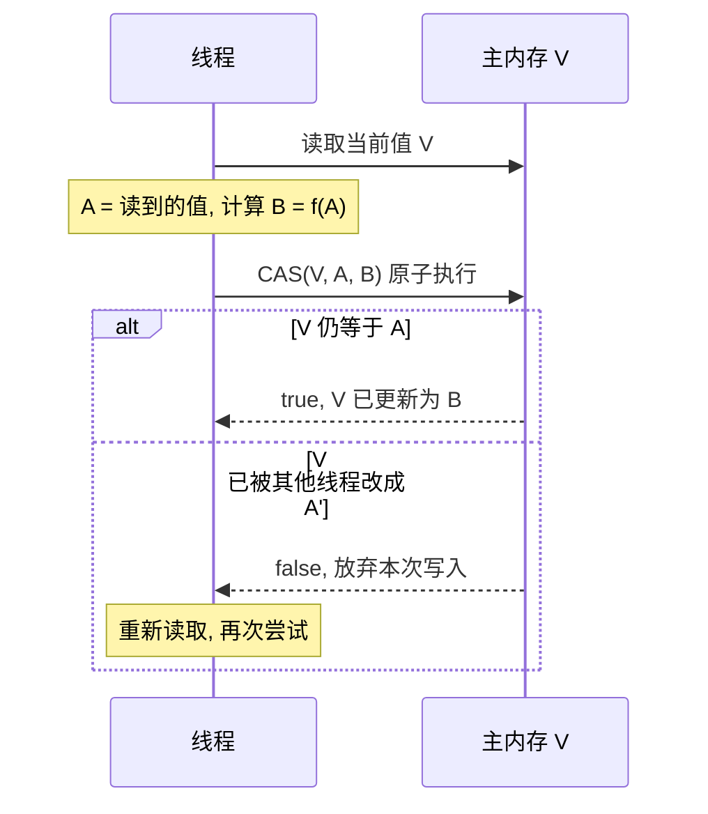
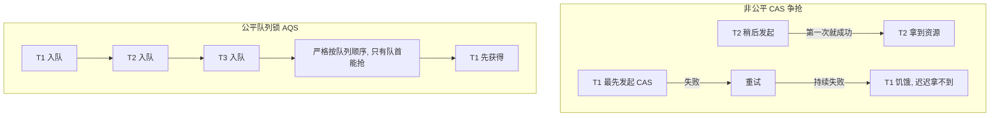
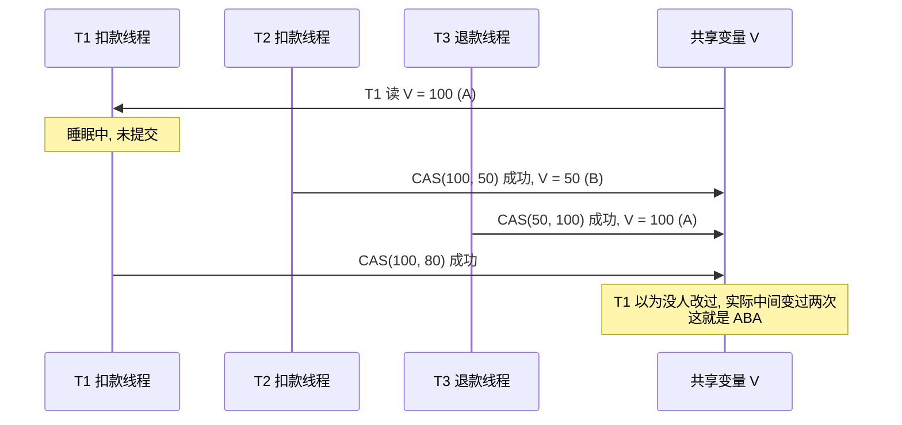

> 2026-10-14 成稿，Java 底层与并发主题

# CAS 特性 + 公平性问题 + ABA 问题

## 0. 一句话主线

**CAS 是一条 CPU 原子指令（x86 的 `lock cmpxchg`）在 Java 里的封装，它用「乐观重试」替代「互斥加锁」，换来无锁、无上下文切换、无死锁，代价是自旋烧 CPU、只能保护一个变量、不保证公平、以及 ABA。**

> 面试口径：问「CAS 是什么」，先给定义（V/A/B 三操作数），再给底层（`Unsafe.compareAndSwapInt` → JNI → `lock cmpxchg`），再主动说缺点（自旋、单变量、ABA、不公平）。主动说缺点的人，分数比只背优点的高一档。

---

## 1. CAS 是什么

Compare-And-Swap，三个操作数：

- **V**：要更新的内存位置（变量的内存地址）
- **A**：预期的原值（Expected）
- **B**：要写入的新值（New）

语义：**当且仅当 V 的当前值等于 A 时，才把 V 改成 B，返回 true；否则什么都不做，返回 false。** 调用方通常在一个 `for(;;)` 循环里失败重试，这就是「乐观锁」——不加锁，直接改，改的时候发现被别人动过就重来。

```java
// 伪代码：真实实现是一条 CPU 指令，不可被打断
boolean compareAndSwap(int* V, int A, int B) {
    if (*V == A) { *V = B; return true; }
    return false;
}
```

关键点：**"比较"和"交换"这两步在硬件层面是一个不可分割的整体**，中间不可能被其他 CPU 核插入，这是 CAS 能当同步原语用的根本原因。



---

## 2. 底层实现

### 2.1 调用链

```
AtomicInteger.incrementAndGet()
  → Unsafe.getAndAddInt(this, valueOffset, 1)
      → for(;;) { int current = getIntVolatile(o, offset);
                  if (compareAndSwapInt(o, offset, current, current+1)) return current; }
  → Unsafe.compareAndSwapInt(...)   // native 方法
  → JNI: Unsafe_CompareAndSwapInt (HotSpot 的 unsafe.cpp)
  → Atomic::cmpxchg (hotspot/src/os_cpu/...) 
  → CPU 指令: lock cmpxchg  (x86)
```

### 2.2 `lock` 前缀的作用

单核时代，`cmpxchg` 本身就原子（一条指令不会被中断）。多核时代必须加 `lock` 前缀：

- 早期实现：**锁总线**（assert LOCK# 信号），期间其他 CPU 无法访问内存，开销极大。
- 现代实现：**锁缓存行**（利用 MESI 缓存一致性协议）。若目标数据已在本核 cache 且独占（M/E 态），直接锁定缓存行修改，不必锁总线；只有在跨缓存行、未缓存等少数情况才升级为锁总线。

所以 CAS 的开销 ≈ 一次缓存行独占权获取，在**低中度竞争**下远小于线程上下文切换。

### 2.3 其他平台的对应指令

- x86/x64：`lock cmpxchg`
- ARM：`LDREX` / `STREX`（或 ARMv8 的 `LDXR`/`STXR`）——注意 ARM 是 LL/SC（Load-Link/Store-Conditional）机制，严格意义上不等价于 CAS，且有**虚假失败**的可能，所以 HotSpot 里必须包在循环里。

> 面试口径：「Java 的 CAS 最终落到 CPU 指令 x86 上是 `lock cmpxchg`，`lock` 前缀在现代 CPU 上是通过锁缓存行（MESI 协议）而非锁总线来实现的。」

---

## 3. CAS 的特性、优缺点

### 3.1 优点

| 优点 | 说明 |
| --- | --- |
| 无锁 | 线程不会因竞争而挂起，也就**没有死锁**（因为根本没有锁可持有） |
| 无上下文切换 | 竞争失败的线程只是在用户态重试，不需要陷入内核做线程切换（一次上下文切换约 1~10 微秒） |
| 粒度小、延迟低 | 低竞争下一次 CAS 几十纳秒 |
| 天然支持并发读 | 读线程完全无阻塞 |

### 3.2 缺点（面试必说）

**① 自旋空耗 CPU。** 竞争激烈时，大量线程在 `for(;;)` 里反复 CAS 失败，CPU 占用率飙到 100%，而且**线程越多越慢**（重试成功率随并发数下降）。这是 CAS 的最大短板。

**② 只能保证一个共享变量的原子操作。** `compareAndSwapInt` 一次只改一个 int。若要原子地同时改 `a` 和 `b`：
- 方案一：封装成对象，用 `AtomicReference<T>`（推荐）；
- 方案二：多个变量打包进一个 long（如 ReentrantReadWriteLock 把读写计数压进一个 int 的高低位）；
- 方案三：直接加锁。

**③ ABA 问题。** 见第 5 节。

**④ 高并发下大量失败导致 CPU 飙升。** 与①同源但表现不同：典型现象是压测时 TPS 不涨反降、CPU 打满、load 高但吞吐低。这正是 JDK 8 引入 `LongAdder` 的原因。

---

## 4. 在 Java 中的应用

| 应用点 | 说明 |
| --- | --- |
| `AtomicInteger` / `AtomicLong` / `AtomicBoolean` | 最基础的 CAS 包装，`incrementAndGet` 就是自旋 CAS |
| `LongAdder` / `DoubleAdder` | **分段分散热点**：内部是 `Cell[]` 数组 + base，不同线程打到不同 Cell 上，求和时累加。高并发计数场景吞吐远高于 AtomicLong，代价是 `sum()` 不保证强一致 |
| `AtomicReference` / `AtomicStampedReference` / `AtomicMarkableReference` | 把 CAS 推广到对象引用，后两者用于解 ABA |
| `AtomicIntegerArray` / `AtomicReferenceFieldUpdater` | 数组元素、对象字段的原子更新 |
| `ConcurrentHashMap` | bin 链表头结点插入用 `casTabAt`（基于 Unsafe）；`sizeCtl`、`transferIndex` 也靠 CAS；JDK 8 起在 bin 为空时用 CAS 插入，只有哈希冲突时才 synchronized 锁住链表头 |
| `synchronized` 的轻量级锁 | 偏向/轻量锁升级时，用 CAS 把 Mark Word 指向线程栈中的 Lock Record；CAS 失败说明有竞争，膨胀为重量级锁 |
| AQS 的 state | `compareAndSetState`，见 AQS 讲义 |
| 数据库乐观锁 | `update t set stock=stock-1, version=version+1 where id=? and version=?`，把 CAS 思想搬到 SQL 层 |

> 面试口径：「LongAdder 为什么快？因为 AtomicLong 是所有线程 CAS 同一个变量，热点集中；LongAdder 用 Cell 数组把热点打散到多个变量上，最终 sum 时累加。典型的空间换时间 + 分散竞争。」

---

## 5. 公平性问题（重点）

### 5.1 CAS 不保证公平

CAS 是**「抢」的语义**：谁先把指令执行成功谁赢，系统不记录谁先到。因此：

- 先到的线程可能连续多次 CAS 失败（每次都有别的线程抢先改成功）；
- 后到的线程可能第一次就成功，直接插队；
- **极端情况下某些线程长期饥饿（starvation）**，永远抢不到。

这跟 AQS 的 CLH 队列锁完全相反：队列锁是「先到先服务」，CAS 是「谁手快谁得」。



### 5.2 工程应对（4 种，面试按此顺序答）

**① 需要公平就用 AQS 的公平锁。**
`new ReentrantLock(true)`。源码上公平锁与非公平锁的差异就在 `tryAcquire` 里多了一个 `hasQueuedPredecessors()` 判断：

```java
// FairSync.tryAcquire
protected final boolean tryAcquire(int acquires) {
    final Thread current = Thread.currentThread();
    int c = getState();
    if (c == 0) {
        // 关键: 队列里没人排在我前面, 我才去 CAS
        if (!hasQueuedPredecessors() &&
            compareAndSetState(0, acquires)) {
            setExclusiveOwnerThread(current);
            return true;
        }
    }
    // ... 重入逻辑
}
```

非公平锁（NonfairSync）会先无脑 CAS 一次，成功了就插队，失败了才走 `acquire()` 入队。所以**默认非公平是有道理的**：公平锁吞吐明显更低（每次都要遍历判断队列），但能保证不饥饿。

**② 自旋失败后退避（yield / 指数退避）。**
让抢失败的线程让出 CPU，降低无效重试：

```java
for (;;) {
    int cur = value.get();
    if (value.compareAndSet(cur, cur + 1)) return;
    Thread.yield();           // 简单退避; 更好的做法是随机指数退避
}
```

生产级的退避会用 `LockSupport.parkNanos` + 随机化（避免惊群同步重试）。JDK 的 `Thread.onSpinWait()`（JDK 9+）是给 CPU 的 hint，比 yield 更轻量。

**③ LongAdder 分散热点。** 降低竞争强度 = 降低不公平的概率。计数场景（QPS 统计、限流计数）首选。

**④ 限制自旋次数后升级为重量级锁。** 这正是 `synchronized` 锁升级的思路：偏向锁 → 轻量级锁（CAS 自旋，默认 10 次左右或自适应自旋）→ 自旋仍失败则膨胀为重量级锁（monitor，线程 park 排队）。**JVM 用「有限次 CAS + 兜底排队」来同时拿到无锁的快和有锁的公平。**

> 面试口径：「CAS 不保证公平，我要公平就用 AQS 的公平锁队列；如果还想保留无锁的快，就退避 + 分散热点 + 自旋次数上限后升级。synchronized 的锁升级本质上就是这套组合拳。」

---

## 6. ABA 问题

### 6.1 什么是 ABA

线程 T1 读到值 A，准备 CAS(A, B)。在它动手之前，T2 把值 A 改成 B，又改回 A。T1 执行 CAS 时发现「当前值 == 预期值 A」，判断"没人改过"，于是成功。

**但事实上中间发生过变化，某些"结构/语义"已经被破坏。** CAS 只比较值相等，不关心"中间是否变过"。

### 6.2 三个具体场景 + 复现代码

#### 场景一：无锁栈的 pop

栈顶从 A（元素1）→ B（元素2）→ 又变回 A（元素1 被重新压回）。此时另一个线程 CAS 判断 head 仍是 A，认为栈没变，执行 pop 并修改 next 指针 —— 但此刻链表结构早已不同，会导致**元素丢失或链表断裂**，甚至死循环。这是教科书级的 ABA 案例。

#### 场景二：账户余额

余额 100，线程 T1 要扣 20 得 80，执行 `CAS(100, 80)`。中间：T2 扣款 50（100→50），T3 退款 50（50→100）。T1 的 CAS(100, 80) 成功，**但退款这笔业务被无声吞掉了**，账目错乱。

#### 场景三：库存 / 数据库乐观锁只比值不比版本

库存 100 → 扣 1 得 99 → 运营回滚到 100 → 再扣 1。若乐观锁 SQL 写成 `where stock = 100`（缓存里读到的旧值）而不是带 `version`，就会出现超卖。**这就是数据库层面的 ABA**：所以乐观锁必须带 version 或时间戳，绝不能直接比对业务值。

#### 复现代码（场景二，账户余额）

```java
import java.util.concurrent.atomic.AtomicInteger;

public class AbaAccountDemo {
    private static AtomicInteger balance = new AtomicInteger(100);

    public static void main(String[] args) throws InterruptedException {
        // T1: 读余额, 打算扣 20, 但故意慢一步
        Thread t1 = new Thread(() -> {
            int expected = balance.get();          // 读到 100
            System.out.println("T1 读到余额 = " + expected);
            try { Thread.sleep(1000); } catch (InterruptedException e) { }
            // 此刻余额已经历 100 -> 50 -> 100, T1 的 CAS 依然成功
            boolean ok = balance.compareAndSet(expected, expected - 20);
            System.out.println("T1 CAS(100, 80) 结果 = " + ok
                    + ", 最终余额 = " + balance.get());
        });

        // T2: 扣款 50
        Thread t2 = new Thread(() -> {
            System.out.println("T2 扣款 50: " + balance.compareAndSet(100, 50));
        });

        // T3: 退款 50, 余额又回到 100
        Thread t3 = new Thread(() -> {
            try { Thread.sleep(300); } catch (InterruptedException e) { }
            System.out.println("T3 退款 50: " + balance.compareAndSet(50, 100));
        });

        t1.start(); t2.start(); t3.start();
        t1.join(); t2.join(); t3.join();
        System.out.println("=== 期望余额 80 (100-20), 实际 " + balance.get() + " ===");
        System.out.println("注意: 退款 50 这笔被 T1 的 CAS 无声吞掉了");
    }
}
```



---

## 7. ABA 的解决方式

### 7.1 方案对比

| 方案 | 做法 | 适用场景 |
| --- | --- | --- |
| `AtomicStampedReference<V>` | 值 + int 版本戳，值每变一次戳递增，CAS 同时比较值和戳 | 需要知道"变过几次"，通用解 |
| `AtomicMarkableReference<V>` | 值 + boolean 标记，只关心"是否被改过" | 只需判断是否被改过，不关心次数（如 GC 标记、节点删除标记） |
| 数据库 `version` 字段 / 时间戳 | `where id=? and version=?`，更新时 `version+1` | 持久层乐观锁 |
| 悲观锁 | `synchronized` / `ReentrantLock` | 简单粗暴，竞争不高时成本可接受 |
| 不可变对象 | 每次变更 new 新对象，引用即版本 | 函数式风格，配合 AtomicReference |

### 7.2 `AtomicStampedReference` 完整示例（复现 + 修复对照）

```java
import java.util.concurrent.atomic.AtomicStampedReference;

public class AtomicStampedFixDemo {

    // 版本戳: 值每发生一次变化就 +1
    private static AtomicStampedReference<Integer> ref =
            new AtomicStampedReference<>(100, 0);

    public static void main(String[] args) throws InterruptedException {
        System.out.println("===== 场景: 100 -> 50 -> 100, 中间被改过 =====");

        Thread t1 = new Thread(() -> {
            int stamp = ref.getStamp();      // 读到版本号 0
            Integer value = ref.getReference();
            System.out.println("T1 读到 value=" + value + ", stamp=" + stamp);

            try { Thread.sleep(1000); } catch (InterruptedException e) { }

            // 同时比较 值 和 版本戳
            boolean ok = ref.compareAndSet(value, value - 20, stamp, stamp + 1);
            System.out.println("T1 CAS(value:100->80, stamp:" + stamp + "->" + (stamp + 1) + ") 结果 = " + ok);
        });

        Thread t2 = new Thread(() -> {
            try { Thread.sleep(100); } catch (InterruptedException e) { }
            ref.compareAndSet(100, 50, ref.getStamp(), ref.getStamp() + 1);
            System.out.println("T2 扣款 50 完成, 当前 value=" + ref.getReference()
                    + ", stamp=" + ref.getStamp());
        });

        Thread t3 = new Thread(() -> {
            try { Thread.sleep(500); } catch (InterruptedException e) { }
            ref.compareAndSet(50, 100, ref.getStamp(), ref.getStamp() + 1);
            System.out.println("T3 退款 50 完成, 当前 value=" + ref.getReference()
                    + ", stamp=" + ref.getStamp());
        });

        t1.start(); t2.start(); t3.start();
        t1.join(); t2.join(); t3.join();

        System.out.println("最终 value=" + ref.getReference() + ", stamp=" + ref.getStamp());
        System.out.println("结论: T1 的 CAS 失败(false), ABA 被版本戳挡住了");
    }
}
```

预期输出要点：`T1 读到 value=100, stamp=0` → T2 成功（stamp 变 1）→ T3 成功（stamp 变 2）→ T1 用 stamp=0 去 CAS，**失败返回 false**。对照 `AbaAccountDemo`，同样的时序下 AtomicInteger 会返回 true。

**关键 API：**

```java
AtomicStampedReference<Integer> ref = new AtomicStampedReference<>(100, 0);
ref.getReference();                          // 当前值
ref.getStamp();                              // 当前版本戳
ref.compareAndSet(期望值, 新值, 期望戳, 新戳);  // 值和戳同时匹配才成功
ref.attemptStamp(期望值, 新戳);                // 只改戳（值未变时）
```

> 面试口径：「AtomicStampedReference 的坑：① 版本戳是 int，理论上会溢出回绕，但 int 范围 21 亿次修改实际很难达到；② 它比较的是**引用**（==），包装类型要注意 Integer 缓存陷阱（-128~127），不要用 `new Integer` 或超出缓存范围的值做 CAS，否则引用不相等导致永远失败——建议用不可变对象并在外部持有同一个引用。」

### 7.3 `AtomicMarkableReference` 的最小示例

```java
import java.util.concurrent.atomic.AtomicMarkableReference;

public class AtomicMarkableDemo {
    public static void main(String[] args) {
        AtomicMarkableReference<String> ref =
                new AtomicMarkableReference<>("node", false);
        System.out.println("初始: " + ref.getReference() + ", marked=" + ref.isMarked());

        // 标记该节点"已被逻辑删除"
        boolean ok = ref.compareAndSet("node", "node", false, true);
        System.out.println("标记为已删除: " + ok + ", marked=" + ref.isMarked());

        // 另一个线程拿着旧的 marked=false 来改, 会失败
        boolean ok2 = ref.compareAndSet("node", "other", false, false);
        System.out.println("用旧标记尝试修改: " + ok2 + " (false 说明感知到已被改过)");
    }
}
```

---

## 8. LongAdder：CAS 竞争的正确解法

```java
import java.util.concurrent.atomic.AtomicLong;
import java.util.concurrent.atomic.LongAdder;

public class LongAdderCompareDemo {
    private static final int THREADS = 50;
    private static final int LOOPS = 200_000;

    public static void main(String[] args) throws InterruptedException {
        AtomicLong atomic = new AtomicLong();
        long t0 = System.currentTimeMillis();
        run(() -> atomic.incrementAndGet());
        System.out.println("AtomicLong 结果=" + atomic.get()
                + ", 耗时=" + (System.currentTimeMillis() - t0) + "ms");

        LongAdder adder = new LongAdder();
        long t1 = System.currentTimeMillis();
        run(adder::increment);
        System.out.println("LongAdder  结果=" + adder.sum()
                + ", 耗时=" + (System.currentTimeMillis() - t1) + "ms");
    }

    private static void run(Runnable task) throws InterruptedException {
        Thread[] ts = new Thread[THREADS];
        for (int i = 0; i < THREADS; i++) {
            ts[i] = new Thread(() -> {
                for (int j = 0; j < LOOPS; j++) task.run();
            });
            ts[i].start();
        }
        for (Thread t : ts) t.join();
    }
}
```

在 50 线程 × 20 万次的场景下，LongAdder 通常比 AtomicLong 快数倍。原因：AtomicLong 是 50 个线程 CAS 同一个变量，失败率极高；LongAdder 内部 `Cell[]` 按线程哈希分散，冲突概率大幅下降。

**取舍**：LongAdder 的 `sum()` 在并发更新下**不是强一致的快照**（累加过程中可能有 Cell 正在变），所以只适合统计类场景（QPS、计数），**不能**用来做需要精确值的状态机或幂等判断。

---

## 9. 追问链 · 参考答案

| 层级 | 问题 | 参考答案要点 |
| --- | --- | --- |
| L1 | CAS 的三个操作数是什么？为什么「比较 + 交换」必须是原子的？ | 三个操作数：V（内存地址）、A（预期原值）、B（新值），语义是当且仅当 V 当前值等于 A 才改成 B。比较和交换必须在硬件层面不可分割，否则两步之间插入其他线程的修改就会导致判断失效、出现丢失更新——正是原子性让 CAS 能作为同步原语，x86 上对应指令是 lock cmpxchg。 |
| L1 | Java 里 CAS 的调用链从 AtomicInteger 到 CPU 指令是怎么走的？ | 调用链：AtomicInteger.incrementAndGet → Unsafe.getAndAddInt（自旋循环里调 compareAndSwapInt）→ JNI 层 HotSpot 的 unsafe.cpp → Atomic::cmpxchg → CPU 指令 lock cmpxchg（x86）。其中 getAndAddInt 的自旋是 JDK 9 之前 AtomicInteger 重试的实现方式，整条链路说明 CAS 是 CPU 原子指令在 Java 层的封装。 |
| L1 | `lock` 前缀在多核 CPU 上是锁总线还是锁缓存行？ | 现代 CPU 上是锁缓存行：若目标数据在本核 cache 且处于 MESI 协议的 M/E 独占态，直接锁定该缓存行完成修改，不需要锁总线；只有跨缓存行或未命中缓存等少数情况才升级为锁总线（早期实现全靠拉低 LOCK# 信号锁总线，开销极大）。所以 CAS 开销约等于一次缓存行独占权获取。 |
| L2 | CAS 相比 synchronized 的优缺点各三条？ | 优点：无锁无死锁（没有锁可持有）、竞争失败只在用户态重试、无上下文切换（一次切换约 1~10 微秒）、低竞争下延迟几十纳秒。缺点：高竞争时自旋重试烧 CPU 且吞吐不升反降、一次只能原子保护一个变量、存在 ABA 问题、不保证公平。synchronized 则在 JDK 6 后靠锁升级（偏向/轻量/重量级）自适应竞争强度。 |
| L2 | 为什么 CAS 只能保证一个共享变量的原子性？要原子改两个变量怎么办？ | 因为 cmpxchg 指令一次只比较交换一个内存字，compareAndSwapInt 只能改一个 int。要原子改两个变量有三条路：① 把多个字段封装成对象，用 AtomicReference 整体替换引用；② 把多个值打包进一个 long/int 的高低 32/16 位（ReentrantReadWriteLock 就是这么压读写计数的）；③ 直接加锁。 |
| L2 | 高并发下 CAS 会导致什么现象？线上怎么判断是 CAS 自旋导致的 CPU 飙高？ | 现象是大量线程在 for(;;) 里反复 CAS 失败，CPU 占用 100%、load 高但吞吐低，线程越多越慢。排查：jstack 多次采样发现大量线程 RUNNABLE 且栈顶停在 AtomicInteger/Unsafe 相关方法（注意是 RUNNABLE 而非 park 的 WAITING）；perf/async-profiler 火焰图热点集中在自旋循环；确认后可换 LongAdder 分散热点。 |
| L3 | CAS 为什么不保证公平？举个饥饿的例子。 | CAS 是"抢"的语义：系统不记录线程到达顺序，谁先把指令执行成功谁赢。饥饿例子：T1 最先发起 CAS，但每次重试间隙都有新线程抢先成功，T1 连续失败几十次迟迟拿不到资源，而后到的 T2 第一次就成功插队。这与 AQS 队列锁的"先到先服务"完全相反，极端下某些线程会长期饥饿（starvation）。 |
| L3 | 想要公平有哪几种工程做法？各自代价是什么？ | 四种：① 用 AQS 公平锁 new ReentrantLock(true)，代价是吞吐明显下降（每次要查队列）；② 自旋失败后退避（Thread.yield 或 parkNanos 随机指数退避），代价是延迟略增；③ LongAdder 分散热点降低竞争强度，代价是 sum() 弱一致；④ 限制自旋次数后升级重量级锁，代价是实现复杂——synchronized 的锁升级就是这套组合。 |
| L3 | ReentrantLock 公平锁和非公平锁在源码上的唯一区别是什么？为什么默认非公平？ | 唯一区别：FairSync.tryAcquire 在 compareAndSetState 之前多了 hasQueuedPredecessors() 判断，队列里有人排在自己前面就放弃抢锁直接入队；NonfairSync 则先无脑 CAS 一次，成功即插队。默认非公平是因为公平锁吞吐低得多——刚唤醒的线程还要经历 park/unpark 切换，而非公平让刚释放锁的线程附近的新线程直接抢，减少上下文切换。 |
| L3 | synchronized 的锁升级过程如何体现「CAS + 兜底排队」的思想？ | 升级链：偏向锁 → 轻量级锁 → 重量级锁。轻量级锁用 CAS 把 Mark Word 替换为指向线程栈 Lock Record 的指针，成功即拿锁；CAS 失败说明有竞争，先自旋（默认约 10 次，自适应自旋会动态调整），自旋仍失败才膨胀为重量级锁（monitor，线程 park 排队）。JVM 正是用"有限次 CAS + 兜底排队"同时拿到无锁的快和有锁的公平。注意 JDK 15 起偏向锁默认关闭（JEP 374），JDK 18 移除。 |
| L4 | 什么是 ABA 问题？为什么说它本质上是「值相等 ≠ 语义未变」？ | ABA：T1 读到值 A 准备 CAS(A,B)，期间 T2 把值改成 B 又改回 A，T1 的 CAS 因当前值等于预期值而成功，但中间状态确实变过。本质是 CAS 只比较"值是否相等"，无法感知"中间是否发生过变化"——对于无锁栈、链表这类结构，值相同不代表指针拓扑相同，也不代表业务语义没变，所以相等不等于安全。 |
| L4 | 给出三个真实的 ABA 场景（无锁栈、账户、库存/DB 乐观锁）。 | ① 无锁栈 pop：栈顶 A→B→A，CAS 判 head 仍是 A 而成功 pop，但 next 指针已指向旧结构，导致元素丢失或链表断裂；② 账户余额：100→50（扣款）→100（退款），T1 的 CAS(100,80) 成功，退款被无声吞掉；③ DB 乐观锁：库存改了又改回，where stock=旧值 命中造成超卖——必须带 version 字段而非直接比业务值。 |
| L4 | AtomicStampedReference 和 AtomicMarkableReference 的区别？分别什么时候用？ | AtomicStampedReference 是"值 + int 版本戳"，每次修改戳递增，CAS 同时比较值和戳，能知道"变过几次"，是 ABA 通用解；AtomicMarkableReference 是"值 + boolean 标记"，只关心"是否被改过"，不关心次数，适合 GC 标记、节点逻辑删除标记这类二元状态场景。判断依据：需要区分变化次数就用前者，只需是否变过就用后者。 |
| L4 | AtomicStampedReference 用 Integer 做 value 有什么坑？（Integer 缓存 + 引用比较） | 坑在于它的 CAS 比较的是引用（==）而非 equals，而 Integer 对 -128~127 有缓存：范围内 valueOf 返回同一对象所以侥幸成功，超出范围每次装箱都是新对象，导致"值明明相等 CAS 却永远失败"。正确做法：要么全程持有同一个对象引用做 CAS，要么改用自定义不可变类，避免依赖包装类型的缓存行为。 |
| L5 | LongAdder 为什么比 AtomicLong 快？它的 sum() 有什么语义缺陷？什么场景不能用？ | 快的原因：AtomicLong 是所有线程 CAS 同一个变量，热点集中失败率高；LongAdder 内部是 base + Cell[] 数组，线程按哈希分散到不同 Cell 上累加，冲突概率大幅下降，典型场景下快数倍。缺陷：sum() 是逐个累加 Cell，过程中可能有 Cell 正在被更新，不是强一致快照。所以只用于 QPS 统计等计数场景，不能用于需要精确值的状态机、限流器、幂等判断。 |
| L5 | 数据库的乐观锁怎么写才不会有 ABA 问题？ | 必须带版本字段而不是直接比业务值：update t set stock=stock-1, version=version+1 where id=? and version=?，用读时拿到的 version 做匹配条件，更新成功即影响行数为 1，失败则重读重试。若写成 where stock=100 直接比业务值，库存改了又改回来时就会命中旧值导致超卖——这正是数据库层面的 ABA，version 等价于 AtomicStampedReference 的版本戳。 |
| L5 | ConcurrentHashMap 里哪些地方用了 CAS？为什么 JDK 8 不全程用 CAS 而是部分用 synchronized？ | JDK 8 的 ConcurrentHashMap 用 CAS 的地方：casTabAt 做空桶插入、sizeCtl 初始化和扩容标志、transferIndex 扩容任务划分、addCount 计数。但桶内已有节点（哈希冲突）时用 synchronized 锁住链表/红黑树头节点再插入，因为桶内修改涉及多步指针操作，CAS 只能保护单变量无法保证复合操作原子性，且 synchronized 已优化到竞争低时很轻量。 |
| L5 | 生产上一个接口 QPS 上不去、CPU 100%，排查发现是 AtomicInteger 热点计数，你怎么优化？ | 这是典型的 CAS 热点竞争：所有线程自旋抢同一个变量。优化：① 首选换 LongAdder，Cell[] 分散热点，sum() 弱一致对统计场景可接受；② 若必须强一致，做分片计数（按线程/时段拆多个计数器再汇总）；③ 降低采样粒度，改为批量累加（本地计数后定时 flush）。验证：优化后压测 CPU 应从 100% 下降且 TPS 提升，火焰图中 Unsafe 热点消失。 |
| L5 | CAS 的「虚假失败」是怎么回事？哪些 CPU 架构上会出现？（提示：ARM 的 LL/SC） | 虚假失败指值实际没被改过、CAS 却返回失败。ARM 用的是 LL/SC（Load-Link/Store-Conditional，LDREX/STREX）而非真正的 cmpxchg：LL 标记监控内存，SC 时只要监控因任何原因失效（包括中断、缓存行被抢占等）就失败，即使值没变。所以 HotSpot 在 ARM 上必须把 CAS 包在循环里重试；x86 的 lock cmpxchg 无此问题。 |

---

## 10. 误区 · 正解

| ❌ 误区 | ✅ 正解 |
| --- | --- |
| 「CAS 是无锁的，所以一定比加锁快」 | 只在低竞争下成立。高竞争时大量线程自旋重试、失败率随并发数上升，CAS 吞吐反而低于阻塞锁且烧 CPU，典型现象是压测 TPS 不涨反降。是否用 CAS 取决于竞争强度：低竞争用 CAS，高竞争考虑 LongAdder 分散热点或带兜底排队的锁（synchronized 锁升级就是这套思路）。 |
| 「CAS 不会发生死锁，所以它就是安全的」 | 对死锁免疫不等于没有问题。CAS 因为没有锁可持有所以不会死锁，但其余短板仍在：ABA 会吞掉中间变更、高竞争自旋耗 CPU、一次只能保护一个变量、不保证公平可能饥饿。评估 CAS 方案要把这四条一起纳入，而不是只拿"无死锁"当安全凭证。 |
| 「AtomicInteger 能原子地更新多个变量」 | 不能，它只保护自己那一个 int，compareAndSwapInt 一次只操作一个内存字。要原子改多个变量：封装成对象用 AtomicReference 整体换引用；或把多个值打包进一个 long 的高低 32 位（ReentrantReadWriteLock 对读写计数的做法）；或直接加锁保护复合操作。 |
| 「ABA 问题在业务系统里很少见，不用管」 | 账户余额、库存、订单状态机这类"值会来回变"的场景天然是 ABA 温床：只要存在退款、回滚、撤销等"改了又改回来"的业务路径，只比值的 CAS 就可能吞掉中间变更。正确做法是加版本戳——Java 层用 AtomicStampedReference，数据库乐观锁用 version 字段，绝不要直接比对业务值。 |
| 「用 AtomicStampedReference 包装 Integer 就万事大吉」 | 版本戳解的是 ABA，但它比较值时用 == 比较引用而非 equals：Integer 只对 -128~127 缓存，超出范围 Integer.valueOf(1000) 每次返回新对象，CAS 会因引用不等而永远失败。规避方式：全程持有同一对象引用做 CAS，或改用自定义不可变类，不要依赖包装类型缓存。 |
| 「LongAdder 可以完全替代 AtomicLong」 | 不能。LongAdder 的 sum() 是逐个累加 Cell 的结果，并发更新过程中读到的不是强一致快照，只适合 QPS 统计、监控计数这类允许短暂不一致的场景。需要精确值或 compareAndSet 语义的地方（限流器、状态机、幂等判断）必须用 AtomicLong。两者是"高吞吐弱一致"与"低吞吐强一致"的取舍。 |
| 「CAS 公平，因为谁先调用谁先执行」 | CAS 不保证公平：它是抢占语义，不排队、不记录到达顺序，后到线程完全可能第一次就成功，先到线程可能因反复被抢先而长期饥饿。要公平就用 AQS 公平锁（FairSync 里靠 hasQueuedPredecessors() 保证队列顺序），代价是吞吐下降；"先到先得"是队列锁的特性，不是 CAS 的。 |
| 「自旋就是 while(true) 死循环，JDK 里也这么写」 | JDK 的自旋都有退出条件：synchronized 轻量锁自旋达到次数上限（默认约 10 次或自适应调整）就膨胀为重量级锁改为 park 排队；ARM 的 LL/SC 因存在虚假失败才必须包循环重试。业务代码里手写 for(;;) CAS 必须加退避（Thread.yield 或 LockSupport.parkNanos 随机化），否则就是真死循环烧核。 |

---

## 11. 速查卡（一分钟复习）

- **定义**：V / A / B，当且仅当 V == A 才把 V 改成 B，原子不可分。
- **底层**：`Unsafe.compareAndSwapInt` → JNI → CPU `lock cmpxchg`（锁缓存行，MESI 协议）。
- **优点**：无锁、无上下文切换、无死锁、读不阻塞。
- **缺点**：① 自旋烧 CPU ② 只能改一个变量 ③ ABA ④ 高竞争吞吐反而降。
- **公平性**：CAS **不保证公平**（抢占语义，可能饥饿）。解法：AQS 公平锁（`hasQueuedPredecessors`）、yield/指数退避、LongAdder 分散热点、自旋上限后升级重量级锁（synchronized 锁升级思路）。
- **ABA**：值从 A → B → A，CAS 误判未变。场景：无锁栈 pop、账户余额 100→50→100、库存回滚、DB 乐观锁只比值不比版本。
- **解 ABA**：`AtomicStampedReference`（值+版本戳）、`AtomicMarkableReference`（值+布尔标记）、DB `version` 字段、悲观锁、不可变对象。
- **热点计数**：优先 LongAdder（分段 Cell 分散竞争），但要接受 sum() 弱一致。
