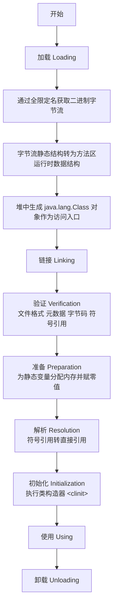
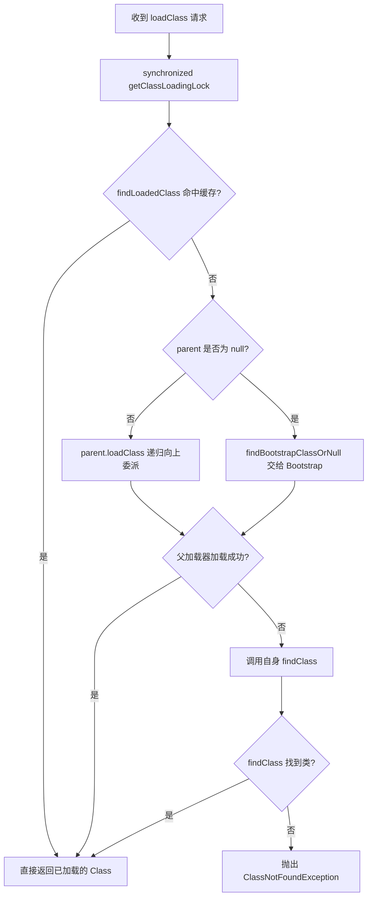
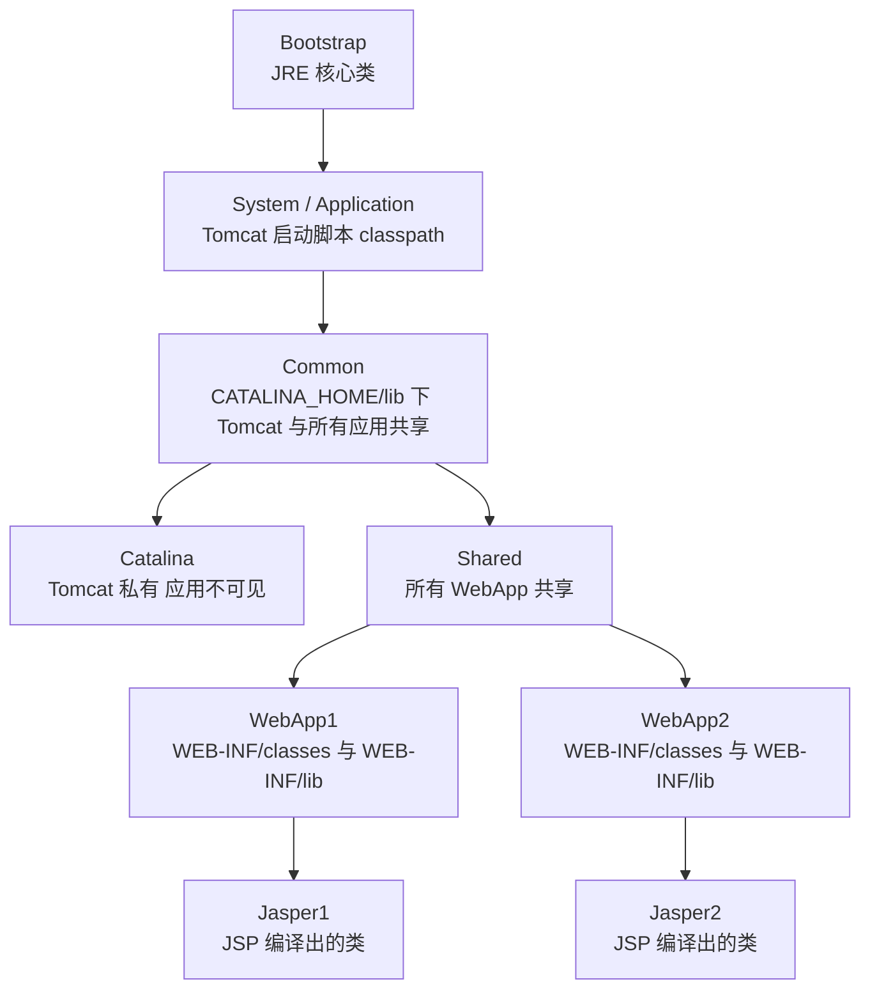

> 2026-10-14 成稿，Java 底层与并发主题

# 类加载机制与双亲委派模型

## 一句话主线

**类的唯一性 = 类全限定名 + 加载它的类加载器**；双亲委派用「先问父亲、再自己动手」的顺序，保证核心类只有一份且不被篡改，而 SPI、Tomcat、OSGi、热部署这四类场景又必须打破它。

面试定位：JVM 部分**必考题**，也是「背过概念」与「读过源码 / 踩过线上坑」的分水岭。P6-P7 要求不仅说清三层加载器与委派流程，还要讲出**为什么破坏、怎么破坏、破坏后怎么收场（类卸载与内存泄漏）**。

---

## 1. 类加载全过程

一个类从 `.class` 文件到可以使用，要经历 **加载 → 链接 → 初始化** 三大阶段（链接又细分为验证、准备、解析）。注意：这三步是**按顺序「开始」**，但解析可能在初始化之后才真正执行（支持运行时动态绑定），这是 JVM 规范允许的。



### 1.1 加载（Loading）

三件事：① 通过**全限定名**获取二进制字节流（来源可以是 jar、网络、运行时生成、数据库、加密文件，这是类加载器最灵活的地方）；② 把字节流的静态结构转为**方法区运行时数据结构**；③ 在堆中生成 `java.lang.Class` 对象，作为方法区数据的访问入口。

> 数组类特殊：**不由类加载器创建**，而是 JVM 运行时直接构造，只有它的元素类型才由类加载器加载。

### 1.2 链接（Linking）

**验证（Verification）**：确保字节流符合规范且不危害虚拟机安全，四个校验点：文件格式（魔数 `0xCAFEBABE`、版本号）、元数据（是否有父类、是否继承 final 类）、字节码（跳转是否越界、类型转换是否合法）、符号引用（能否定位到目标）。

**准备（Preparation）**：**为类变量（static 变量）分配内存并设置「零值」**（`int → 0`、`boolean → false`、引用 `→ null`）。
- **注意不是程序里写的初始值**：`static int a = 123;` 准备阶段 `a` 是 `0`，`123` 要等初始化阶段执行 `<clinit>` 才赋上。
- **例外**：`static final` 编译期常量（基本类型或 String 字面量）带 `ConstantValue` 属性，**在准备阶段就赋真值**（`static final int N = 123;` → 准备阶段 `N` 已是 `123`）；而 `static final Object O = new Object();` 要执行指令，仍在 `<clinit>` 中赋值。

**解析（Resolution）**：把常量池中的**符号引用**替换为**直接引用**（指针、相对偏移或句柄）。

### 1.3 初始化（Initialization）

执行类构造器 `<clinit>()`：由编译器自动收集**所有类变量的赋值动作 + static 静态代码块**，按源码顺序合并而成。JVM 保证**子类的 `<clinit>` 执行前父类的 `<clinit>` 已执行完**（所以父类 static 块先跑）；且 `<clinit>` 天然线程安全——多线程同时初始化同一个类时只有一个线程执行，其余阻塞等待（**这是静态内部类单例写法线程安全的依据**）。

**准备 vs 初始化（高频追问）**

| 对比项 | 准备 Preparation | 初始化 Initialization |
| --- | --- | --- |
| 做什么 | 分配内存 + 赋**零值** | 执行 `<clinit>`，赋**程序写的值** |
| `static int a = 123` | a = 0 | a = 123 |
| `static final int N = 123` | N = 123（ConstantValue） | 无动作 |
| 是否执行 Java 代码 | 否 | 是（static 块、静态赋值） |

**初始化的触发时机（「主动引用」，且仅这几种）**

`new` 实例化对象 / 读写类的静态字段（`getstatic`、`putstatic`，**final 编译期常量除外**）/ 调用静态方法（`invokestatic`）/ 反射调用（`Class.forName` 默认 `initialize=true`）/ 初始化子类时父类先初始化 / 虚拟机启动时的 `main` 方法所在类。

**不会触发初始化的「被动引用」三例（面试常考）**：子类引用父类的静态字段 → 只初始化父类；`A[] arr = new A[10];` → 不触发 `A` 初始化（触发的是数组类 `[LA`）；引用 `static final` 编译期常量 → 编译期已常量传播，不触发类初始化。

**面试口径**：`static int a = 123;` 在准备阶段是 `0`，初始化阶段才是 `123`；`static final int N = 123;` 在准备阶段就是 `123`。子类访问父类静态字段不会初始化子类。

---

## 2. 三层类加载器（JDK8）

层级关系（自顶向下，**箭头方向是「父指向子」**，不是委派方向）：

```
Bootstrap ClassLoader          (C++ 实现，JAVA_HOME/lib 核心类)
        ↑ parent
Extension ClassLoader          (jre/lib/ext，JDK9 起改名 Platform)
        ↑ parent
Application ClassLoader        (classpath，程序默认)
        ↑ parent
自定义 ClassLoader              (继承 ClassLoader，重写 findClass)
```

### 2.1 Bootstrap ClassLoader（启动类加载器）

- **C++ 实现，是 JVM 自身的一部分**，Java 层拿不到它的对象引用；
- 加载 `JAVA_HOME/lib` 下（或 `-Xbootclasspath` 指定）的核心类库，如 `rt.jar`、`resources.jar`；
- **Java 代码中 `String.class.getClassLoader()` 返回 `null`**，这就是它存在的证据，不是「没有加载器」。

### 2.2 Extension ClassLoader（扩展类加载器）

Java 实现，类名 `sun.misc.Launcher$ExtClassLoader`；加载 `jre/lib/ext` 目录或 `java.ext.dirs` 系统变量指定的路径；**JDK9 起改名为 Platform ClassLoader**（见第 5 节）。

### 2.3 Application / System ClassLoader（应用类加载器）

Java 实现，类名 `sun.misc.Launcher$AppClassLoader`；加载 `classpath`（`-cp` / `CLASSPATH`）下的类；是**程序的默认类加载器**，`ClassLoader.getSystemClassLoader()` 返回的正是它。

### 2.4 自定义 ClassLoader

继承 `java.lang.ClassLoader`：**推荐重写 `findClass(String name)`**（只在父加载器都失败后才被调用，**不破坏双亲委派**）；若重写 `loadClass(...)` 并改变「先委派父加载器」的顺序，**就破坏了双亲委派**（Tomcat 正是这么干的）。典型用途：class 文件加密解密、从网络/数据库加载、热部署、类隔离。

### 2.5 验证代码：打印类加载器层级

```java
public class ClassLoaderHierarchyDemo {

    public static void main(String[] args) {
        // 1. 核心类由 Bootstrap 加载，Java 层看到的是 null
        System.out.println("String -> " + String.class.getClassLoader());          // null

        // 2. JDK8：sunjce_provider.jar 位于 jre/lib/ext，由 ExtClassLoader 加载
        //    JDK9+ 该类已模块化，会打印 null 或 PlatformClassLoader，请以 JDK8 语义理解
        System.out.println("SunJCE -> " + com.sun.crypto.provider.SunJCE.class.getClassLoader());

        // 3. 自己写的类由 AppClassLoader 加载
        System.out.println("This  -> " + ClassLoaderHierarchyDemo.class.getClassLoader());

        // 4. 自底向上打印层级
        ClassLoader cl = ClassLoaderHierarchyDemo.class.getClassLoader();
        while (cl != null) {
            System.out.println("  loader: " + cl);
            cl = cl.getParent();     // 最后 cl 变为 null，即 Bootstrap
        }
    }
}
```

JDK8 下典型输出：`String -> null`；`SunJCE -> sun.misc.Launcher$ExtClassLoader@15db9742`；`This -> sun.misc.Launcher$AppClassLoader@18b4aac2`；层级链自底向上打印为 AppClassLoader → ExtClassLoader，再往上 `getParent()` 返回 `null`（即 Bootstrap）。

**面试口径**：问「Bootstrap 是什么」时，答「C++ 实现、JVM 一部分、加载 `lib` 下核心类、Java 里取到的是 `null`」四要素齐全才算完整。

---

## 3. 双亲委派模型（Parents Delegation Model）

### 3.1 定义

一个类加载器收到类加载请求时，**首先不会自己去加载，而是把这个请求委派给父加载器**去完成；每一层都如此，直到最顶层的 Bootstrap；**只有父加载器反馈自己无法完成加载（在自己的搜索范围内找不到该类）时，子加载器才会尝试自己去加载**。

> **措辞提醒**：中文的「双亲」是 `parent` 一词的早期翻译，**实际是「单亲」**——每个类加载器只有一个父加载器（不是「父 + 母」两个）。面试时顺口点出这一点，是很好的加分项，能体现你没有死记术语。

### 3.2 源码级流程（`java.lang.ClassLoader.loadClass`，JDK8 精简版）

```java
protected Class<?> loadClass(String name, boolean resolve) throws ClassNotFoundException {
    synchronized (getClassLoadingLock(name)) {          // 1. 按类名加锁，防止并发重复加载
        Class<?> c = findLoadedClass(name);             // 2. 先查缓存：本加载器是否已加载过
        if (c == null) {
            long t0 = System.nanoTime();
            try {
                if (parent != null) {
                    c = parent.loadClass(name, false);  // 3. 有父加载器 -> 委派给父
                } else {
                    c = findBootstrapClassOrNull(name); // 4. 无父（已是 Ext）-> 委派给 Bootstrap
                }
            } catch (ClassNotFoundException e) {
                // 父加载器加载失败，吞掉异常，落下去自己加载
            }
            if (c == null) {
                long t1 = System.nanoTime();
                c = findClass(name);                    // 5. 父都失败 -> 自己动手
                // 记录统计信息
            }
        }
        if (resolve) {
            resolveClass(c);
        }
        return c;
    }
}
```

三步要点，面试按此顺序背：① **加锁** `synchronized (getClassLoadingLock(name))`，JDK7 起按类名粒度加锁（并发加载下避免死锁），整个加载过程线程安全；② **查缓存** `findLoadedClass(name)`，已加载过直接返回，保证一个加载器内同一类只加载一次；③ **向上委派 → 向下兜底**，父能加载就用父的，父不能才调自己的 `findClass()`。



### 3.3 为什么需要双亲委派（两条，缺一不可）

**① 避免类重复加载，保证类的唯一性**

父加载器加载过的类，子加载器不会再加载一次。于是同一个类（比如 `java.lang.Object`）在 JVM 中**只有一份 `Class` 对象**。类的唯一性由**类本身 + 加载它的类加载器**共同决定：不同加载器加载的同名类，`Class` 对象不相等（第 6 节有代码验证）。如果没有委派，每个加载器各加载一份 `Object`，那类型判断、`instanceof`、转型全部失效。

**② 安全性（沙箱），防止核心 API 被篡改**

假设你自己写了一个 `java.lang.String` 放在 classpath 下：由于双亲委派，加载请求会先到 Bootstrap，Bootstrap 在 `rt.jar` 里找到了真正的 `String` 并加载，**你写的那个 `String` 根本不会被加载**（这叫「_靠优先级保证信任_」）。

更进一步，就算你绕过加载器直接 `defineClass("java.lang.String", ...)`，JVM 也会拒绝：

```java
// java.lang.ClassLoader.preDefineClass 中的检查
if ((name != null) && name.startsWith("java.")) {
    throw new SecurityException("Prohibited package name: " + name.substring(0, name.lastIndexOf('.')));
}
```

会抛出 `java.lang.SecurityException: Prohibited package name: java.lang`。

**面试口径**：双亲委派的两大价值是「**去重（类的唯一性）+ 安全（保护核心 API 不被覆盖）**」，答题务必两条都答，只答一条会扣分。

---

## 4. 破坏双亲委派的四种场景（区分度核心）

> 判断标准：**凡是类加载的「方向」不再是「自下而上委派」的，就是破坏了双亲委派**。

### 4.1 SPI / JDBC：父加载器需要子加载器的类

**矛盾点**：`java.sql.DriverManager` 是 JDK 核心类，由 **Bootstrap** 加载；而各家厂商的实现（`com.mysql.cj.jdbc.Driver`、`oracle.jdbc.OracleDriver`）在 **classpath** 下，理应由 **Application ClassLoader** 加载。`DriverManager` 的代码要去 `new` 这些实现类 —— **父加载器需要用到子加载器才能加载的类，委派方向反了**。

**解决方案：线程上下文类加载器（TCCL, Thread Context ClassLoader）**

```java
// 设置：在某个「能拿到 AppClassLoader 的地方」把加载器挂到线程上
Thread.currentThread().setContextClassLoader(ClassLoader.getSystemClassLoader());

// 使用：核心类（Bootstrap 加载的代码）里反向取回线程上的加载器
ClassLoader cl = Thread.currentThread().getContextClassLoader();
```

`DriverManager` 的静态块中通过 `ServiceLoader.load(Driver.class)` 加载实现，而 `ServiceLoader.load` 内部正是用 `Thread.currentThread().getContextClassLoader()` 拿到加载器 —— 相当于在**双亲委派这条「单向车道」上开了一条「逆向专用道」**。

JDBC 4.0 之后的完整链路：`META-INF/services/java.sql.Driver` 文件里写实现类名 → `ServiceLoader` 扫描并实例化 → Driver 的静态块里 `DriverManager.registerDriver(new Driver())` 完成注册 → 所以 `Class.forName("com.mysql.cj.jdbc.Driver")` 在 JDBC 4.0 之后**可以省略**。同类例子还有 JNDI、JAXB、JCE。

### 4.2 Tomcat 等 Web 容器：类隔离

Tomcat 的 `WebAppClassLoader` **默认先自己加载，加载不到再委派父加载器**（与标准双亲委派顺序相反，可通过 `delegate` 配置改回）。

**为什么必须这样**：一个 Tomcat 上跑多个 Web 应用，A 用 Spring 5、B 用 Spring 4，同一个 `org.springframework.core.` 包下的类名完全相同但版本不同，如果都委派给同一个父加载器，就只能有一份 —— 必然有一个应用起不来。打破委派后，每个 WebApp 用自己的 `WebAppClassLoader`，**同名类的不同版本可以共存**。



各层职责：

| 加载器 | 加载内容 | 可见性 |
| --- | --- | --- |
| Common | `CATALINA_HOME/lib` | Tomcat 与所有 WebApp 共享 |
| Catalina | Tomcat 自身的类 | **仅 Tomcat 可见**，应用不可见 |
| Shared | 所有 WebApp 共享的类 | 所有 WebApp 可见，Tomcat 不可见 |
| WebApp | 单个应用的 `WEB-INF/classes`、`WEB-INF/lib` | **仅该应用可见** |
| Jasper | JSP 编译生成的类 | 热加载时整体丢弃重建 |

**核心价值**：WebApp 之间的**类隔离**；同时 Shared 层避免了同一份 jar 在每个应用里重复加载。

### 4.3 OSGi / 模块化热部署

OSGi 的类加载器模型不是树形而是**网状**：每个 Bundle 有自己的 ClassLoader，Bundle 之间通过 `Import-Package` / `Export-Package` 声明依赖，加载请求在 Bundle 之间**横向传递**，而不是一味向上委派。由此换来**模块级热插拔**（不重启容器替换一个 Bundle）。后来的 Java 模块化和众多插件化框架（如早期的 SOFA、部分 IDE 插件体系）都受此影响。

### 4.4 热部署 / 热加载

思路：**每次代码变更后新建一个 ClassLoader 重新加载新的类**；旧 ClassLoader 连同它加载的旧类，一旦不再被引用就被 GC 回收，从而实现「不重启 JVM 更新代码」。典型实现：Tomcat 对 `WEB-INF` 变更重建 `WebAppClassLoader`、Spring Boot DevTools 的 `RestartClassLoader`、Arthas 的 `retransform`、JRebel。代价是**容易引发类加载器泄漏**（见 6.4）。

**面试口径**：被问「哪些场景破坏双亲委派」时按 **SPI/JDBC、Tomcat、OSGi、热部署** 四条答，并各补一句「为什么要破坏」（方向反了 / 类隔离 / 模块热插拔 / 换类）。只报名字不给原因，只能算半对。

---

## 5. JDK9 模块化（JPMS）之后的调整

1. **Extension ClassLoader 改名为 Platform ClassLoader**（`jdk.internal.loader.ClassLoaders$PlatformClassLoader`），`java.ext.dirs` 机制取消；
2. **Bootstrap 仍存在**，职责变为加载 `java.base` 等核心模块，依旧 C++ 实现、Java 层取不到（返回 `null`）；
3. **三个内置加载器分工明确**：Bootstrap → 核心模块；Platform → 平台模块与部分 JDK 模块；Application → classpath/modulepath 上的应用模块；
4. **Application ClassLoader 不再是 `URLClassLoader` 的子类**，改为继承 `jdk.internal.loader.BuiltinClassLoader`。这条影响很大：过去「反射往 `URLClassLoader` 的 `ucp` 里加 URL」这类 classpath hack 在 JDK9+ 会失效；
5. **双亲委派顺序微调**：收到请求后**先按包名判断该类归属哪个模块**，若该模块已由某个加载器负责就直接委派给它，然后再走传统「父优先」流程。大方向没变，只是多了一步模块归属判定；
6. 层级变为 **Bootstrap ← Platform ← Application**，与 JDK8 的 Bootstrap ← Extension ← Application 一一对应。

---

## 6. 自定义类加载器与类卸载

### 6.1 完整示例：重写 `findClass`

下面的加载器从指定磁盘目录读取 `.class` 文件，**只重写 `findClass`，不破坏双亲委派**。

```java
package com.example.cl;

import java.io.IOException;
import java.nio.file.Files;
import java.nio.file.Path;
import java.nio.file.Paths;

// 从指定目录加载 class 文件；只重写 findClass，遵循双亲委派
public class FileSystemClassLoader extends ClassLoader {

    private final Path classDir;

    public FileSystemClassLoader(String classDir) {
        // 默认父加载器为当前类的加载器（通常是 AppClassLoader）
        this(classDir, FileSystemClassLoader.class.getClassLoader());
    }

    public FileSystemClassLoader(String classDir, ClassLoader parent) {
        super(parent);          // parent 传 null 表示父加载器为 Bootstrap
        this.classDir = Paths.get(classDir);
    }

    @Override
    protected Class<?> findClass(String name) throws ClassNotFoundException {
        byte[] bytes = loadClassBytes(name);
        if (bytes == null) {
            throw new ClassNotFoundException(name);
        }
        // defineClass 把字节流转成 Class 对象，这是类加载器的核心方法
        return defineClass(name, bytes, 0, bytes.length);
    }

    private byte[] loadClassBytes(String name) throws ClassNotFoundException {
        Path file = classDir.resolve(name.replace('.', '/') + ".class");
        if (!Files.isRegularFile(file)) {
            return null;
        }
        try {
            return Files.readAllBytes(file);
        } catch (IOException e) {
            throw new ClassNotFoundException(name, e);
        }
    }
}
```

### 6.2 演示：同一个类被不同加载器加载 → Class 不相等

```java
package com.example.cl;

public class SameClassDifferentLoaderDemo {

    public static void main(String[] args) throws Exception {
        String dir = "D:/tmp/classes";   // 该目录下放 com/example/cl/Hello.class

        // 关键：parent 传 null（Bootstrap），
        // 否则两个加载器都会先委派给 AppClassLoader，结果是同一个 Class，实验看不到现象
        FileSystemClassLoader c1 = new FileSystemClassLoader(dir, null);
        FileSystemClassLoader c2 = new FileSystemClassLoader(dir, null);

        Class<?> a = c1.loadClass("com.example.cl.Hello");
        Class<?> b = c2.loadClass("com.example.cl.Hello");

        System.out.println("a == b               : " + (a == b));            // false
        System.out.println("a.equals(b)          : " + a.equals(b));          // false
        System.out.println("a.getName() 相同吗    : " + a.getName().equals(b.getName())); // true
        System.out.println("a 的加载器: " + a.getClassLoader());               // FileSystemClassLoader@x
        System.out.println("b 的加载器: " + b.getClassLoader());               // FileSystemClassLoader@y

        // 跨加载器的实例不能互相赋值，否则 ClassCastException
        Object o1 = a.getDeclaredConstructor().newInstance();
        System.out.println("a.isInstance(o1)     : " + a.isInstance(o1));     // true
        System.out.println("b.isInstance(o1)     : " + b.isInstance(o1));     // false
    }
}
```

**结论**：类名相同但加载器不同 → 两个 `Class` 对象不相等 → 它们的实例类型互不兼容，强转会抛 `ClassCastException`。这就是「类的唯一性 = 全限定名 + 类加载器」的直接证据，也是 Tomcat 类隔离的底层依据。

> 排错提示：如果 `a == b` 打印了 `true`，说明 `Hello` 也在 classpath 上，被共同的父加载器（AppClassLoader）抢先加载了。把 `Hello.class` 从 classpath 移走，或像上面一样把 `parent` 传 `null`。

### 6.3 类的卸载条件（三个必须同时满足）

① 该类**所有实例都已被回收**（堆中不存在该类及其子类的实例）；② **加载该类的 `ClassLoader` 已被回收**；③ 该类对应的 **`java.lang.Class` 对象没有任何地方引用**（无反射持有、无静态变量引用、无缓存）。三条**同时**满足才会在 Full GC / 元空间回收时卸载。`-verbose:class` 可观察加载与卸载日志，`-Xnoclassgc` 可关闭类卸载（默认开启）。

> 注意：**由 Bootstrap / Platform / Application 这三个内置加载器加载的类，在运行期内基本不可能被卸载**，因为加载器本身始终被 JVM 引用。能被卸载的绝大多数是自定义加载器加载的类 —— 这正是热部署可行的基础。

### 6.4 类加载器泄漏与元空间 OOM

**为什么热部署次数多了会 OOM**：每次热部署都新建一个 ClassLoader，旧加载器若仍被某处引用（条件 ② 不满足），它加载的所有类的元数据就无法释放，**元空间（JDK8 前是永久代）不断被填满**，最终 JDK8 之前报 `OutOfMemoryError: PermGen space`，JDK8 及之后报 `OutOfMemoryError: Metaspace`。

**常见泄漏源**：线程池/定时任务线程的 **ThreadLocal** 存了业务类对象（ThreadLocalMap 挂在线程上，线程不死 → 类不死 → 加载器不死）；线程本身由自定义加载器加载且一直存活；静态集合、单例、缓存持有实例或 `Class` 对象；日志框架（commons-logging、log4j 1.x）在容器层的引用；JNI 全局引用、未反注册的 `Driver` / `MBean` / `Listener`。

**排查手段**：`jmap -clstats <pid>` 看类加载器统计；`jcmd <pid> GC.class_histogram`；MAT / JProfiler 用 **Path to GC Roots** 找谁持有了 ClassLoader；`-XX:+TraceClassUnloading` 观察卸载。

**面试口径**：回答「元空间 OOM 怎么排查」时，落到「类加载器泄漏 → 三个卸载条件没同时满足 → 用 MAT 找 ClassLoader 的 GC Roots（ThreadLocal / 静态集合 / 未关闭的线程）」。

---

## 7. 追问链 · 参考答案

| 层级 | 问题 | 参考答案要点 |
| --- | --- | --- |
| L1 | 类加载有哪几个阶段？每个阶段做什么？ | 三大阶段：加载 → 链接（验证、准备、解析）→ 初始化。加载：读字节流、转方法区数据结构、堆中生成 Class 对象；验证做四重校验（魔数 0xCAFEBABE 起）；准备为静态变量分配内存赋零值；解析把符号引用转直接引用；初始化执行 <clinit>（static 赋值 + static 块）。注意解析可能在初始化之后才执行，JVM 规范允许。 |
| L1 | 双亲委派是什么？请用两三句话讲清楚。 | 类加载器收到加载请求时先不自己加载，而是委派给父加载器，逐层向上直到 Bootstrap；只有父加载器在自己的搜索范围内找不到该类时，子加载器才调用自己的 findClass 兜底。价值有二：避免重复加载保证类的唯一性、防止 java.lang 等核心 API 被篡改。顺带一提："双亲"是 parent 的误译，实际只有一个父加载器。 |
| L1 | JDK8 有哪几层类加载器？各自加载什么？ | 三层加自定义：Bootstrap ClassLoader（C++ 实现，加载 JAVA_HOME/lib 下 rt.jar 等核心类，Java 层取到的是 null）；Extension ClassLoader（sun.misc.Launcher$ExtClassLoader，加载 jre/lib/ext，JDK9 改名 Platform）；Application ClassLoader（加载 classpath，程序默认）；再往下是继承 ClassLoader 的自定义加载器。 |
| L2 | `static int a = 123;` 在准备阶段和初始化阶段各是多少？`static final int N = 123;` 呢？ | static int a = 123：准备阶段分配内存赋零值 a=0，123 要等初始化阶段执行 <clinit> 才赋上。static final int N = 123：编译期常量带 ConstantValue 属性，准备阶段 N 就已是 123，初始化阶段无动作。但 static final Object o = new Object() 需要执行指令，仍推迟到 <clinit>，不满足编译期常量条件。 |
| L2 | 哪些操作会触发类初始化？举出三个「不会触发初始化」的反例。 | 触发（主动引用）：new 实例化、读写非编译期常量的静态字段、调用静态方法、Class.forName 反射（默认 initialize=true）、初始化子类时父类先初始化、main 类。反例（被动引用）：① 子类引用父类静态字段只初始化父类；② new A[10] 只触发数组类 [LA 不触发 A；③ 引用 static final 编译期常量因常量传播根本不触发。 |
| L2 | 为什么 `String.class.getClassLoader()` 打印 `null`？ | 因为 String 由 Bootstrap ClassLoader 加载，而它是 C++ 实现、属于 JVM 自身的一部分，Java 对象体系里不存在它的实例，所以 getClassLoader() 返回 null。null 不是"没有加载器"，恰恰是"由启动类加载器加载"的证据。同理 rt.jar 里的核心类打印加载器都是 null。 |
| L2 | clinit 是线程安全的吗？为什么静态内部类单例是线程安全的？ | 是。<clinit> 由 JVM 保证线程安全：多线程同时初始化同一个类时，只有一个线程执行 <clinit>，其余线程阻塞等待，且只执行一次。静态内部类单例正是利用这一点：Holder 类里的 static final 实例在 Holder 首次被主动引用时才初始化，JVM 的 <clinit> 锁保证只创建一份，无需任何显式同步，天然懒加载且无线程安全问题。 |
| L3 | 说出 `loadClass` 的完整流程：加锁 → 查缓存 → 委派父 → `findClass` 兜底。 | ClassLoader.loadClass 四步：① synchronized (getClassLoadingLock(name)) 按类名粒度加锁（JDK7 起，避免并发加载死锁）；② findLoadedClass 查缓存，已加载过直接返回，保证同一加载器内同类只加载一次；③ parent != null 则递归委派父加载器，parent 为 null 则交给 findBootstrapClassOrNull；④ 父都抛 ClassNotFoundException 后，自己调 findClass 读字节流 defineClass。 |
| L3 | 自定义加载器为什么推荐重写 `findClass` 而不是 `loadClass`？ | 因为 findClass 只在父加载器全部失败后才被调用，重写它保留了 loadClass 里"加锁 → 查缓存 → 委派父 → 兜底"的完整双亲委派逻辑，不破坏委派；而重写 loadClass 若改变"先委派父"的顺序就破坏了双亲委派。除非你就是要做类隔离（如 Tomcat 的 WebAppClassLoader 先自己加载再委派），否则只重写 findClass 是标准姿势。 |
| L3 | 类的唯一性由什么决定？两个不同加载器加载的同名类是同一个类吗？ | 类的唯一性 = 全限定名 + 加载它的类加载器，两者共同决定。两个不同加载器加载的同名类是不同的 Class 对象：== 和 equals 都为 false，isInstance 交叉判断为 false，实例互相强转会抛 ClassCastException。这正是 Tomcat 能靠 WebAppClassLoader 实现同名类多版本共存的底层依据，也是热部署"换类"的原理。 |
| L3 | 自己写一个 `java.lang.String` 放 classpath 下，会发生什么？ | 不会发生任何事：双亲委派下加载请求先到 Bootstrap，它在 rt.jar 里找到真正的 String 并加载，你写的那个根本不会被加载。就算绕过委派直接 defineClass("java.lang.String")，ClassLoader.preDefineClass 里的检查会抛 SecurityException: Prohibited package name: java.lang。这是双亲委派"安全性"价值的直接体现。 |
| L4 | `DriverManager` 由 Bootstrap 加载、MySQL Driver 在 classpath 下，它是怎么加载到 Driver 的？TCCL 怎么设置？ | 靠线程上下文类加载器（TCCL）：DriverManager 静态块调 ServiceLoader.load(Driver.class)，后者用 Thread.currentThread().getContextClassLoader() 取回 AppClassLoader 去加载 classpath 下的 META-INF/services/java.sql.Driver 中声明的实现类。设置用 setContextClassLoader，AppClassLoader 默认就是主线程的 TCCL。这相当于在双亲委派的单向车道上开了逆向专用道。 |
| L4 | 两个 Web 应用依赖同一 jar 的不同版本，Tomcat 怎么做到互不干扰？ | 每个 Web 应用有独立的 WebAppClassLoader，且它默认打破双亲委派：先自己从 WEB-INF/classes 和 WEB-INF/lib 加载，找不到才委派父加载器。由于类唯一性 = 类名 + 加载器，A 应用的 Spring 5 和 B 应用的 Spring 4 由不同 WebAppClassLoader 加载，是同名的两个不同 Class，互不干扰。Shared 层则放所有应用共享的类避免重复加载。 |
| L4 | 热部署为什么要新建 ClassLoader？对同一个加载器重新 `loadClass` 不行吗？ | 不行：loadClass 开头 findLoadedClass 命中缓存会直接返回旧 Class，同一加载器内同名类只能加载一次。新建 ClassLoader 后，新加载器缓存为空，会重新加载新版字节码，新旧 Class 因加载器不同而共存为两个类型；旧加载器不再被引用后连同旧类元数据被 GC 卸载。Spring Boot DevTools 的 RestartClassLoader、JRebel 都是这个思路。 |
| L4 | 线上 `OutOfMemoryError: Metaspace`，怀疑类加载器泄漏，怎么查？ | 思路：类卸载需三条件同时满足（实例全回收、ClassLoader 被回收、Class 无引用），泄漏就是旧加载器被某处持有。排查：jmap -clstats 看加载器数量与存活实例；jcmd GC.class_histogram 看同名类多份；MAT 对 ClassLoader 做 Path to GC Roots，重点找 ThreadLocal（线程池线程不死）、静态集合、未反注册的 Driver/MBean；加 -XX:+TraceClassUnloading 观察卸载情况。 |
| L5 | 「双亲」到底是不是两个父加载器？（考点：是 `parent` 的历史翻译，实为单亲） | 不是。"双亲"是英文 parent 一词的早期误译，每个类加载器只有一个父加载器（parent 字段单数），本质是"单亲委派"。委派链是 AppClassLoader → Extension → Bootstrap 一条直线，不存在两个父亲并行委派。面试主动点破这个翻译问题，能体现你没有死记术语。 |
| L5 | 破坏双亲委派一定不好吗？什么时候「必须」破坏？ | 不一定，四类场景是必须且主动破坏的：① SPI/JDBC——父加载器要加载子加载器的类，方向反了，靠 TCCL 逆向；② Tomcat——多应用同名类多版本共存，需要类隔离；③ OSGi——Bundle 网状加载实现模块热插拔；④ 热部署——新建加载器换类。关键是破坏时清楚代价：类型不兼容（ClassCastException）和类加载器泄漏风险。 |
| L5 | TCCL 有没有坑？（比如线程池里线程复用导致 TCCL 是上一个任务的、父线程 TCCL 不会自动继承到子线程 —— 需要显式传递） | 有。① 线程池场景：工作线程被反复复用，TCCL 可能残留上一个任务设置的加载器，导致拿到错误的类甚至泄漏旧 ClassLoader，任务结束后应还原原 TCCL；② 线程创建时 TCCL 默认继承父线程，但异步任务、线程池里"父线程"早已不是发起者，需要显式传递；③ 忘记设置时 TCCL 可能是 null 或不期望的加载器，ServiceLoader 会找不到实现。 |
| L5 | JDK9 之后 `AppClassLoader` 为什么不再继承 `URLClassLoader`？对老代码有什么影响？ | JDK9 模块化后 Application ClassLoader 改为继承 jdk.internal.loader.BuiltinClassLoader（Extension 同步改名 Platform）。影响：老代码里"强转 getSystemClassLoader() 为 URLClassLoader、反射往 ucp 字段 addURL 动态加 classpath"的 hack 全部失效，会抛 ClassCastException 或找不到 ucp 字段。迁移方案：用 Instrumentation appendToSystemClassLoaderSearch 或在启动参数里加 classpath。 |
| L5 | 类的卸载三个条件里，哪一条最难满足？为什么内置加载器加载的类几乎不会被卸载？ | 最难满足的是第②条"加载该类的 ClassLoader 已被回收"——只要任何一处（ThreadLocal、静态集合、存活线程、日志框架、JNI 引用）还持有加载器或其类的 Class 对象，整个加载器连同名下所有类都无法卸载。内置的 Bootstrap/Platform/Application 加载器被 JVM 永久引用，条件②永远不满足，所以它们加载的类运行期内不可能卸载，能被卸载的基本只有自定义加载器的类。 |

---

## 8. 误区 · 正解

| ❌ 误区 | ✅ 正解 |
| --- | --- |
| 「双亲委派是有两个父加载器」 | 「双亲」是英文 parent 的历史误译，每个类加载器只有一个父加载器（ClassLoader 里是单数的 parent 字段），本质是单亲委派：AppClassLoader → Extension/Platform → Bootstrap 一条直线向上。面试主动点破这一点是加分项，能说明不是死记术语。 |
| 「准备阶段给静态变量赋的是程序里写的初始值」 | 准备阶段赋的是零值（0、false、null），程序写的初始值要等初始化阶段执行 <clinit> 才赋上。唯一例外：带 ConstantValue 属性的 static final 编译期常量（基本类型或 String 字面量）在准备阶段就赋真值——static final int N = 123 准备阶段 N 已是 123，而 static final Object o 仍在 <clinit> 赋值。 |
| 「`String.class.getClassLoader()` 返回 null，说明 String 没有类加载器」 | null 恰恰表示 String 由 Bootstrap ClassLoader 加载：它是 C++ 实现、JVM 自身的一部分，Java 对象体系里没有它的实例，所以拿不到引用。所有 rt.jar 核心类（java.lang.* 等）getClassLoader() 都返回 null，"null = Bootstrap"是约定语义而非"没有加载器"。 |
| 「只要类名相同，Class 对象就是同一个」 | 类的唯一性 = 全限定名 + 加载它的类加载器。两个不同加载器加载的同名类是两个不同的 Class 对象：== 为 false，isInstance 交叉判断为 false，实例互相强转抛 ClassCastException。这正是 Tomcat 类隔离（同名类多版本共存）和热部署换类的底层依据。 |
| 「双亲委派是为了提高加载速度」 | 与性能无关。核心价值有两条：① 避免重复加载，父加载过的类子加载器不再加载，保证 java.lang.Object 等类在 JVM 中只有一份，instanceof、转型才能成立；② 安全性，自定义的 java.lang.String 因委派到 Bootstrap 而永远不会被加载，核心 API 不被篡改。热部署等场景反而要主动打破它。 |
| 「重写 `loadClass` 才算自定义类加载器」 | 标准做法是重写 findClass：它只在父加载器全部失败后被调用，保留了 loadClass 里加锁、查缓存、先委派父的完整逻辑，不破坏双亲委派。重写 loadClass 并改变委派顺序才是破坏委派的做法——除非你明确要做类隔离（如 Tomcat 的 WebAppClassLoader 先自己加载再委派），否则不该碰 loadClass。 |
| 「破坏双亲委派是设计缺陷」 | 破坏往往是主动且必要的设计：SPI/JDBC 是父加载器要加载子加载器的类（方向反了，靠 TCCL 解决），Tomcat 要多应用类隔离，OSGi 要模块热插拔，热部署要换类。判断标准不是"破没破坏"，而是破坏时是否清楚代价：同名类类型不兼容（ClassCastException）和类加载器泄漏导致的 Metaspace OOM。 |
| 「热部署后旧的 Class 会被立刻回收 / JDK9 之后双亲委派被废弃了」 | 两个说法都不对。① 类卸载需三条件同时满足（实例全回收、ClassLoader 被回收、Class 无引用），只要有 ThreadLocal、静态集合或存活线程持有引用，旧加载器及其类就留在元空间，反复热部署最终 OOM: Metaspace；② JDK9 委派方向保留，只是 Extension 改名 Platform、AppClassLoader 改继承 BuiltinClassLoader、委派前增加模块归属判断。 |
