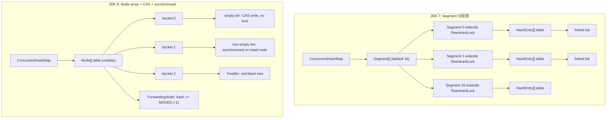
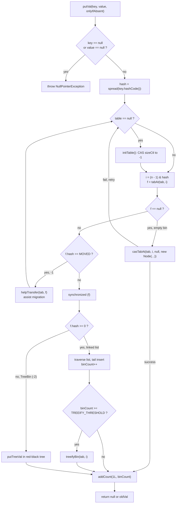
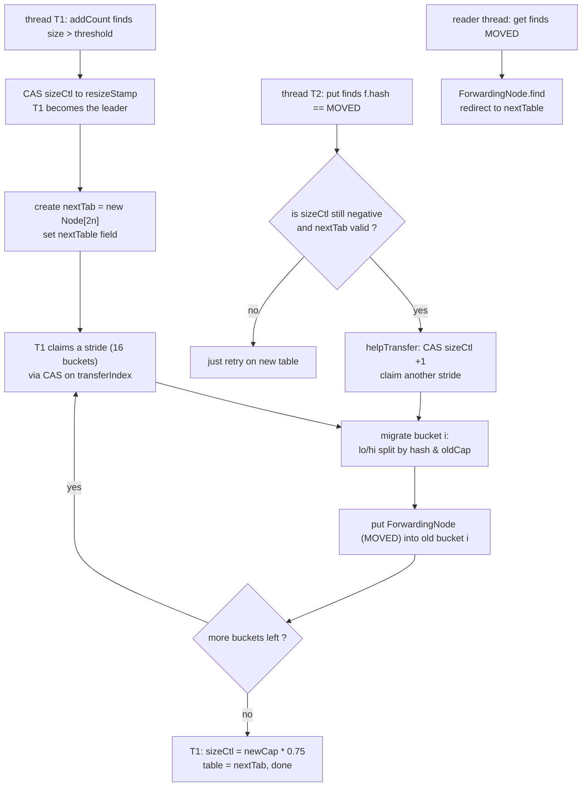

# ConcurrentHashMap 深度讲义（JDK 7 → JDK 8）

> 来源：Java 面试教练 · Java 底层与并发主题 ｜ 成稿时间：2026-10-14 ｜ 适用：12 年经验 Java 工程师 · 中大厂 P6-P7 面试

## 一句话主线

**ConcurrentHashMap 的演进主线是「不断降低锁粒度、不断用无锁替代有锁」：JDK 7 用 Segment 分段锁把一把大锁拆成 16 把；JDK 8 干脆放弃 Segment，改为「Node 数组 + 链表/红黑树」，空桶用 CAS 无锁插入、非空桶只 `synchronized` 锁住桶头节点，读操作全程无锁，扩容时其他线程还能协助迁移，计数用 CounterCell 分散热点。**

## 目录
1. 整体架构：从 Segment 到 CAS + synchronized
2. 基本功能与用法
3. 性能优化七条
4. 如何保证线程安全
5. sizeCtl 状态机
6. 扩容与协助迁移
7. 横向对比表
8. 关键源码片段合集
9. 追问链自测 L1-L5
10. 误区清单
11. 面试口径快查

## 1. 整体架构：从 Segment 到 CAS + synchronized

### 1.1 JDK 7：Segment 分段锁

- 结构：`ConcurrentHashMap` 内部持有一个 `Segment[]`，每个 `Segment` **继承 `ReentrantLock`**，内部又是一个独立的 `HashEntry[]` 数组。
- 默认 `concurrencyLevel = 16`，即默认 16 个 Segment，每个 Segment 独立加锁，**理论上支持 16 个线程并发写**（分别落在不同段）。
- 读操作大多不加锁：`HashEntry` 的 `value` 与 `next` 是 `volatile`，靠 volatile 读保证可见性。
- `size()` 需要统计所有 Segment 的 `count`：先不加锁累加两遍，若两遍结果一致就返回；不一致则**锁住所有 Segment**再统计（代价很大）。

```java
// JDK 7 java.util.concurrent.ConcurrentHashMap.Segment
static final class Segment<K,V> extends ReentrantLock implements Serializable {
    transient volatile HashEntry<K,V>[] table;  // 段内的小哈希表
    transient int count;                        // 段内元素个数
    transient int modCount;
    transient int threshold;
    final float loadFactor;
}
```

**JDK 7 的缺点：**

1. 锁粒度仍是"一段"（一个 Segment 里有多个桶），并发度受 `concurrencyLevel` 限制且构造后不可变。
2. `Segment[]` 一旦初始化就不再扩容，只有段内的 `HashEntry[]` 扩容，容易导致"某段特别大"的偏斜。
3. 每个 Segment 都是一把 `ReentrantLock`，**内存开销大**，且继承 ReentrantLock 导致锁语义暴露。
4. `size()` 在竞争激烈时要锁全表。

### 1.2 JDK 8：Node 数组 + 链表/红黑树 + CAS + synchronized

- 结构与 `HashMap` 几乎一致：`Node<K,V>[] table`，冲突拉链表，链表 ≥ 8 且表 ≥ 64 转红黑树（`TreeBin`）。
- **锁的对象变成"单个桶的头节点"**：`synchronized (f)`，f 就是 `tab[i]`。
- **空桶插入完全无锁**：用 `CAS` 把新节点写进 `tab[i]`。
- **读操作全程无锁**。
- 扩容支持**多线程协助迁移**（`helpTransfer`）。
- 计数用 `baseCount + CounterCell[]`，思路与 `LongAdder` 一致。

```java
static class Node<K,V> implements Map.Entry<K,V> {
    final int hash;
    final K key;
    volatile V val;        // 关键：volatile，保证读可见性
    volatile Node<K,V> next; // 关键：volatile
}
```

### 1.3 两种架构对比图



### 1.4 put 流程图（JDK 8）



## 2. 基本功能与用法

### 2.1 基本操作

| 操作 | 特点 |
| --- | --- |
| `put(k, v)` | 空桶 CAS，非空桶锁桶头；key/value 都不能是 null |
| `get(k)` | **全程无锁**，靠 volatile 读；可能读到正在迁移的桶，此时走 `ForwardingNode.find` 到新表 |
| `size()` | 返回 `int`，内部 `sumCount()` = `baseCount + 所有 CounterCell`；并发下是**估计值**，不是精确快照 |
| `mappingCount()` | 返回 `long`，源码注释建议优先用它（元素数可能超过 `Integer.MAX_VALUE`） |
| `remove(k)` | 锁桶头，`synchronized` 内替换链表指针 |
| `containsKey(k)` | 同 get，无锁 |

### 2.2 原子复合方法（CHM 的杀手锏）

```java
// 不存在才放（等价于：if (!map.containsKey(k)) map.put(k, v); 的原子版）
V putIfAbsent(K key, V value);

// 不存在时用函数计算并放入，整个"判断 + 计算 + 放入"是原子的
V computeIfAbsent(K key, Function<? super K, ? extends V> mappingFunction);

// 原子累加：缓存/计数场景
LongAdder adder = map.computeIfAbsent(key, k -> new LongAdder());
adder.increment();

// JDK 8 提供的其他原子操作
V computeIfPresent(K key, BiFunction<...> remappingFunction);
V compute(K key, BiFunction<...> remappingFunction);
V merge(K key, V value, BiFunction<...> remappingFunction);
boolean remove(Object key, Object value);      // CAS 语义的 remove
boolean replace(K key, V oldVal, V newVal);    // CAS 语义的 replace
```

> **面试口径**：`putIfAbsent` / `computeIfAbsent` 的价值在于把「判断 + 写入」两步合成一个原子操作。在 HashMap 里先 `containsKey` 再 `put` 是典型的 check-then-act 竞态，多线程下会覆盖；CHM 提供了原生的原子版本。
>
> ⚠️ 注意：`computeIfAbsent` 的 mappingFunction 里**不要再做本 map 的 put/remove**，可能导致死锁或 `IllegalStateException`（递归更新）。

### 2.3 遍历的弱一致性

- CHM 的迭代器（keySet / values / entrySet）是**弱一致性（weakly consistent）**的：
  - 迭代器创建后，其他线程的**写入可能被看到，也可能看不到**；
  - **不会抛 `ConcurrentModificationException`**；
  - 反映的是"创建迭代器时或之后某个时刻"的状态，而非精确快照。
- 与 `HashMap` 的 fail-fast（`modCount` 检查 → 抛 CME）形成对比。
- 原因：CHM 的迭代器直接遍历 `table` 数组和每个桶的 `next` 链，读的是 `volatile` 引用，天然容忍并发修改。

### 2.4 为什么 key 和 value 都不允许 null（高频必问）

```java
if (key == null || value == null) throw new NullPointerException();
```

**核心原因：并发场景下，`get` 返回 null 的语义无法消歧。**

1. `HashMap` 允许 null，因为它是**单线程**使用的：`map.get(k) == null` 时，你可以再调一次 `map.containsKey(k)` 来区分「k 不存在」和「k 存在但值是 null」—— 单线程下中间不会有其他线程改动，所以这个二义性是**可以消除**的。
2. `ConcurrentHashMap` 是**并发**容器：`get(k)` 返回 null 之后、你再调 `containsKey(k)` 之前，**另一个线程可能已经把 k 放进去或删掉了**。因此 `containsKey` 的结果不能用来解释上一次 `get` 的结果 —— **这个歧义在并发下无法消除**。
3. 更致命的是 CHM 的核心方法（如 `putIfAbsent`、`containsKey`）语义是「如果 key 不存在则……」，若允许 null value，就无法区分"放了一个 null 值"和"没放"。
4. Doug Lea 的原话大意：**在并发容器中允许 null，会迫使用户到处写 `if (get(k) != null)` 这种经不起推敲的代码**。与其让每个人踩坑，不如干脆禁止。

> **面试口径**：CHM 禁止 null 是因为 `get` 返回 null 无法区分"key 不存在"和"value 就是 null"。HashMap 可以靠随后的 containsKey 消除歧义，因为单线程状态不变；但 CHM 是并发的，两次调用之间状态可能已被其他线程改变，歧义无法消除，所以设计上直接禁掉。

## 3. 性能优化七条

1. **锁粒度从 Segment 降到单个桶。** JDK 7 锁一段（含多个桶），并发度固定为 `concurrencyLevel`；JDK 8 只 `synchronized (桶头节点)`，理论上并发度等于桶数量，冲突概率大幅降低。
2. **空桶插入用 CAS，完全无锁。** `casTabAt(tab, i, null, new Node(...))` 成功即返回，只在 CAS 失败（有竞争）时才进入重试/加锁路径。绝大多数 put 落在空桶上，这条路径覆盖了主要场景。
3. **非空桶才 `synchronized`，且只锁桶头。** 锁的持有时间极短（一次链表遍历或一次树插入），且不同桶之间完全不互斥。
4. **get 全程无锁。** `Node.val` 与 `Node.next` 都是 `volatile`，`table` 数组引用也是 `volatile`，配合 `Unsafe.getObjectVolatile`（`tabAt`）保证可见性；读线程永远不会阻塞写线程。
5. **扩容时多线程协助迁移。** 迁移不是单线程独占：其他线程遇到 `hash == MOVED` 的 `ForwardingNode` 会调用 `helpTransfer` 一起搬数据，`sizeCtl` 记录参与线程数，把 O(n) 的迁移成本摊到多个线程。
6. **size 计数用 `CounterCell` 分段计数。** 思路等同 `LongAdder`：先 CAS 抢 `baseCount`，抢失败就分散到 `CounterCell[]` 的不同槽位（按线程的 probe 哈希），求和时累加。避免了单个 `AtomicLong` 在高频写下成为 CAS 热点和伪共享瓶颈。
7. **链表转红黑树 + JDK 7 段内读不加锁。** 前者与 HashMap 一致，把单桶最坏查找从 O(n) 降到 O(log n)；后者指 JDK 7 中 `HashEntry.value` 是 volatile，段内读不加锁（JDK 8 沿用了同样的 volatile 读思路并进一步去掉了锁）。

## 4. 如何保证线程安全

### 4.1 五道防线

| 机制 | 作用 |
| --- | --- |
| `volatile` | `table` 数组引用、`Node.val`、`Node.next` 都是 volatile，保证读线程立即看到写线程的结果（可见性 + 禁止重排序） |
| `CAS` | 空桶插入 `casTabAt`；初始化表 `sizeCtl` 从 sc CAS 到 -1；计数 CAS `baseCount` / `CounterCell.value` |
| `synchronized` | 非空桶写操作，`synchronized (桶头节点)`，保证桶内操作的互斥与原子性 |
| `sizeCtl` 状态机 | 控制初始化 / 扩容 / 迁移线程数（见第 5 节） |
| `ForwardingNode` | 桶已迁移的标记（hash = MOVED = -1），读线程遇到它就去新表查，写线程遇到它就协助迁移 |

### 4.2 初始化 table 的防并发（sizeCtl = -1 占位）

```java
private final Node<K,V>[] initTable() {
    Node<K,V>[] tab; int sc;
    while ((tab = table) == null || tab.length == 0) {
        if ((sc = sizeCtl) < 0)
            Thread.yield();            // 已有线程在初始化，让出 CPU（自旋等待）
        else if (U.compareAndSwapInt(this, SIZECTL, sc, -1)) {  // CAS 占位为 -1
            try {
                if ((tab = table) == null || tab.length == 0) {
                    int n = (sc > 0) ? sc : DEFAULT_CAPACITY;   // 默认 16
                    Node<K,V>[] nt = (Node<K,V>[])new Node<?,?>[n];
                    table = tab = nt;
                    sc = n - (n >>> 2);                          // 阈值 = n * 0.75
                }
            } finally {
                sizeCtl = sc;          // 恢复为正的阈值
            }
            break;
        }
    }
    return tab;
}
```

**要点**：只有一个线程能 CAS 成功把 `sizeCtl` 从非负值改成 -1，其余线程看到 `sizeCtl < 0` 就 `Thread.yield()` 让出 CPU —— 这就是典型的「CAS 占位 + 自旋」防重复初始化模式。

### 4.3 为什么用 synchronized 而不是 ReentrantLock

- JDK 8 时 `synchronized` 已经过大量优化（偏向锁 / 轻量级锁 / 锁粗化 / 锁消除），在低竞争场景下性能与 `ReentrantLock` 接近甚至更好。
- `synchronized` 是 JVM 内置、无需额外对象，省内存；`ReentrantLock` 每个 Segment 一个对象，JDK 7 的内存开销明显。
- 锁住的只是一个桶头，临界区极小，优化后的 `synchronized` 完全够用。

### 4.4 CounterCell 计数（LongAdder 思路）

```java
private final void addCount(long x, int check) {
    CounterCell[] as; long b, s;
    // 先尝试 CAS baseCount；失败（有竞争）则分散到 CounterCell
    if ((as = counterCells) != null ||
        !U.compareAndSwapLong(this, BASECOUNT, b = baseCount, s = b + x)) {
        CounterCell a; long v; int m;
        boolean uncontended = true;
        if (as == null || (m = as.length - 1) < 0 ||
            (a = as[ThreadLocalRandom.getProbe() & m]) == null ||
            !(uncontended = U.compareAndSwapLong(a, CELLVALUE, v = a.value, v + x))) {
            fullAddCount(x, uncontended);   // 初始化/扩容 CounterCell 数组，或换槽重试
            return;
        }
        if (check <= 1) return;
        s = sumCount();
    }
    // check >= 0 时顺带检查是否需要扩容
    if (check >= 0) { /* ... 触发 transfer ... */ }
}
```

```java
@sun.misc.Contended static final class CounterCell {
    volatile long value;   // @Contended 避免伪共享
    CounterCell(long x) { value = x; }
}
```

## 5. sizeCtl 状态机

`sizeCtl` 是 CHM 里最重要的控制字段（`volatile int`），**一个字段三种含义**：

| 取值 | 含义 |
| --- | --- |
| `0` | 表还没初始化，使用默认容量 16 |
| `> 0` | 已初始化：表示**下一次扩容的阈值**（= capacity × 0.75）；若构造时传入初始容量，未初始化时它表示**待使用的初始容量** |
| `-1` | **正在初始化**（有线程抢到了初始化权，其他线程 `Thread.yield()` 等待） |
| `< -1`（记 -N） | **正在扩容/迁移**：`sizeCtl = -(1 + 参与迁移的线程数)`，即**有 N-1 个线程正在协助迁移** |

```java
private transient volatile int sizeCtl;
```

**迁移时的操控逻辑（简化）：**

```java
// 首个触发扩容的线程：CAS 把 sizeCtl 置为一个很大的负数（rs 左移 16 位做 generation 标记）
U.compareAndSwapInt(this, SIZECTL, sc, (rs << RESIZE_STAMP_SHIFT) + 2);
// 后续协助线程：每加入一个，sizeCtl 加 1
U.compareAndSwapInt(this, SIZECTL, sc, sc + 1);
// 线程退出迁移：sizeCtl 减 1
U.compareAndSwapInt(this, SIZECTL, sc = sizeCtl, sc - 1);
```

> **面试口径**：sizeCtl 是 CHM 的状态机核心 —— 正数表示扩容阈值（未初始化时表示初始容量），-1 表示正在初始化，-N 表示有 N-1 个线程正在协助扩容。用一个 volatile int 同时表达三种状态，配合 CAS 完成所有协调，不需要额外的锁。

## 6. 扩容与协助迁移

### 6.1 迁移要点

- 触发：`addCount` 后元素数超过阈值，或 `treeifyBin` 发现表太小（`tab.length < 64`），或 `putAll` 预留空间不足。
- 新表容量同样是 **2 倍**：`nextTab = new Node[n << 1]`。
- **分块迁移（`transfer`）**：把旧表按 `MIN_TRANSFER_STRIDE = 16` 个桶为一个 stride 分块，每个线程领取一块（`--i` 反向遍历，用 CAS 抢 `transferIndex`），互不干扰。
- 某桶迁移完成后，把 `ForwardingNode`（`hash = MOVED = -1`，持有 `nextTable` 引用）放进旧桶，作为"已搬走"的标记。
- 迁移过程同样使用**高低位拆分**（`hash & oldCap`），与 HashMap 一致，无需重新 hash。

### 6.2 协助迁移流程图



### 6.3 ForwardingNode

```java
static final class ForwardingNode<K,V> extends Node<K,V> {
    final Node<K,V>[] nextTable;
    ForwardingNode(Node<K,V>[] tab) {
        super(MOVED, null, null, null);   // MOVED = -1
        this.nextTable = tab;
    }
    // 读操作遇到它：跳到 nextTable 继续查
    Node<K,V> find(int h, Object k) {
        // 在 nextTable 上重新 (n-1) & h 定位并查找
    }
}
// 关键常量
static final int MOVED     = -1;  // ForwardingNode 的 hash
static final int TREEBIN   = -2;  // TreeBin 的 hash（红黑树根节点）
static final int RESERVED  = -3;  // ReservationNode 的 hash（computeIfAbsent 占位）
static final int HASH_BITS = 0x7fffffff;  // spread 里把 hash 限制为正数
```

> 注意：因为 `MOVED / TREEBIN / RESERVED` 都是负数，而正常 Node 的 hash 经 `spread` 后被限制为正数（`& HASH_BITS`），所以 `f.hash >= 0` 就能快速区分"普通链表桶"和"特殊桶"。

## 7. 横向对比表

| 维度 | `HashMap` | `Hashtable` | `Collections.synchronizedMap` | `ConcurrentHashMap`（JDK 7） | `ConcurrentHashMap`（JDK 8） |
| --- | --- | --- | --- | --- | --- |
| 线程安全 | 否 | 是 | 是 | 是 | 是 |
| 实现方式 | 无锁 | 方法级 `synchronized`，锁整个对象 | 装饰器，所有方法 `synchronized (mutex)` | Segment 分段锁（`ReentrantLock`） | CAS + `synchronized`（锁桶头） |
| 锁粒度 | — | 整张表 | 整张表 | 一个 Segment（多桶） | **单个桶** |
| 读是否加锁 | 否（但线程不安全） | 是 | 是 | 否（volatile 读） | **否（volatile 读）** |
| 并发度 | — | 1 | 1 | `concurrencyLevel`（默认 16） | 约等于桶数 |
| null key/value | 允许 1 个 null key，允许 null value | 都不允许 | 取决于被包装的 map | 都不允许 | **都不允许** |
| 迭代器 | fail-fast（抛 CME） | fail-fast | fail-fast（遍历需手动加锁） | 弱一致 | **弱一致（不抛 CME）** |
| size 精确度 | 精确 | 精确 | 精确 | 大概率精确（极端锁全表） | **估计值**（并发下） |
| 复合操作原子性 | 无 | 需自行加锁 | 需自行加锁 | 提供 putIfAbsent 等 | 提供 putIfAbsent/compute/merge |
| 性能 | 最高（单线程） | 很低 | 低 | 中 | **高** |

> **面试口径**：Hashtable 和 synchronizedMap 都是"一把大锁锁全表"，读写全部串行；JDK 7 CHM 用分段锁把锁拆成 16 份；JDK 8 CHM 进一步把锁降到桶级别，读完全无锁，写只在空桶 CAS / 非空桶锁头节点，是真正的"`读无锁、写细粒度锁`"设计。

## 8. 关键源码片段合集

### 8.1 常量与 spread
```java
private static final int MAXIMUM_CAPACITY    = 1 << 30;
private static final int DEFAULT_CAPACITY    = 16;
static final int TREEIFY_THRESHOLD           = 8;
static final int UNTREEIFY_THRESHOLD         = 6;
static final int MIN_TREEIFY_CAPACITY        = 64;
private static final int MIN_TRANSFER_STRIDE = 16;

static final int spread(int h) {
    return (h ^ (h >>> 16)) & HASH_BITS;   // 同 HashMap 扰动，并强制为正数
}
```

### 8.2 putVal 核心分支
```java
final V putVal(K key, V value, boolean onlyIfAbsent) {
    if (key == null || value == null) throw new NullPointerException();
    int hash = spread(key.hashCode());
    int binCount = 0;
    for (Node<K,V>[] tab = table;;) {
        Node<K,V> f; int n, i, fh;
        if (tab == null || (n = tab.length) == 0)
            tab = initTable();
        else if ((f = tabAt(tab, i = (n - 1) & hash)) == null) {
            // 空桶：CAS 无锁插入
            if (casTabAt(tab, i, null, new Node<K,V>(hash, key, value, null)))
                break;
        }
        else if ((fh = f.hash) == MOVED)
            tab = helpTransfer(tab, f);          // 正在迁移：协助迁移
        else {
            V oldVal = null;
            synchronized (f) {                    // 只锁桶头节点
                if (tabAt(tab, i) == f) {         // 双重检查，防止期间桶被换掉
                    if (fh >= 0) {                // 普通链表
                        binCount = 1;
                        for (Node<K,V> e = f;; ++binCount) {
                            K ek;
                            if (e.hash == hash &&
                                ((ek = e.key) == key || (ek != null && key.equals(ek)))) {
                                oldVal = e.val; break;
                            }
                            Node<K,V> pred = e;
                            if ((e = e.next) == null) {
                                pred.next = new Node<K,V>(hash, key, value, null);
                                break;
                            }
                        }
                    }
                    else if (f instanceof TreeBin) {   // 红黑树
                        Node<K,V> p;
                        binCount = 2;
                        if ((p = ((TreeBin<K,V>)f).putTreeVal(hash, key, value)) != null) {
                            oldVal = p.val;
                        }
                    }
                }
            }
            if (binCount != 0) {
                if (binCount >= TREEIFY_THRESHOLD)
                    treeifyBin(tab, i);
                if (oldVal != null)
                    return oldVal;
                break;
            }
        }
    }
    addCount(1L, binCount);
    return null;
}
```

### 8.3 get：全程无锁
```java
public V get(Object key) {
    Node<K,V>[] tab; Node<K,V> e, p; int n, eh; K ek;
    int h = spread(key.hashCode());
    if ((tab = table) != null && (n = tab.length) > 0 &&
        (e = tabAt(tab, (n - 1) & h)) != null) {       // volatile 读
        if ((eh = e.hash) == h) {
            if ((ek = e.key) == key || (ek != null && key.equals(ek)))
                return e.val;
        }
        else if (eh < 0)                                // 负数：TreeBin 或 ForwardingNode
            return (p = e.find(h, key)) != null ? p.val : null;
        while ((e = e.next) != null) {                  // 顺着 volatile next 链走
            if (e.hash == h && ((ek = e.key) == key || (ek != null && key.equals(ek))))
                return e.val;
        }
    }
    return null;
}
```

### 8.4 volatile 读写的三兄弟
```java
// 读：getObjectVolatile，保证可见性与禁止重排序
static final <K,V> Node<K,V> tabAt(Node<K,V>[] tab, int i) {
    return (Node<K,V>)U.getObjectVolatile(tab, ((long)i << ASHIFT) + ABASE);
}
// CAS 写：空桶插入的核心
static final <K,V> boolean casTabAt(Node<K,V>[] tab, int i, Node<K,V> c, Node<K,V> v) {
    return U.compareAndSwapObject(tab, ((long)i << ASHIFT) + ABASE, c, v);
}
// volatile 写
static final <K,V> void setTabAt(Node<K,V>[] tab, int i, Node<K,V> v) {
    U.putObjectVolatile(tab, ((long)i << ASHIFT) + ABASE, v);
}
```

### 8.5 size 与 sumCount（估计值，非精确快照）
```java
final long sumCount() {                    // baseCount + 所有 CounterCell
    CounterCell[] as = counterCells; CounterCell a;
    long sum = baseCount;
    if (as != null) {
        for (int i = 0; i < as.length; ++i) {
            if ((a = as[i]) != null) sum += a.value;
        }
    }
    return sum;
}
public int size() {
    long n = sumCount();
    return ((n < 0L) ? 0 : (n > (long)Integer.MAX_VALUE) ? Integer.MAX_VALUE : (int)n);
}
// 推荐用 long 版本；源码注释：ignore transient negative values
public long mappingCount() { long n = sumCount(); return (n < 0L) ? 0L : n; }
```

## 9. 追问链 · 参考答案

| 层级 | 问题 | 参考答案要点 |
| --- | --- | --- |
| L1 | 说说 JDK 7 和 JDK 8 的 ConcurrentHashMap 在结构上有什么区别。 | JDK 7 是 `Segment[]` 分段锁，默认 16 段，每段继承 `ReentrantLock` 并持有独立 `HashEntry[]`；JDK 8 移除 Segment，改用 `Node[] table` + 链表/红黑树，`synchronized` 只锁桶头节点。锁粒度从一段多桶降到单桶，并发度由固定 16 提升到约等于桶数。 |
| L1 | ConcurrentHashMap 为什么不允许 key 或 value 为 null？ | 因为并发下 `get(k)` 返回 null 的语义无法消歧。HashMap 单线程还能再调 `containsKey` 区分"key 不存在"和"value 是 null"；CHM 并发下两次调用之间状态可能已被其他线程改动，歧义不可消除，所以 `put(null,v)`、`put(k,null)` 直接抛 NPE。 |
| L2 | JDK 8 为什么放弃 Segment 改用 CAS + synchronized？Segment 方案有什么缺点？ | Segment 有四个缺点：锁粒度仍是一段多桶；并发度受 `concurrencyLevel` 限制且构造后不可变；`Segment[]` 本身不扩容导致段间偏斜；每段一把 `ReentrantLock` 内存开销大。JDK 8 改为空桶 CAS 无锁插入、非空桶 `synchronized` 锁单桶头，粒度细得多。 |
| L2 | `get` 操作为什么全程不需要加锁？靠什么保证读到的数据不是旧值？ | `table` 引用、`Node.val`、`Node.next` 都是 volatile，读用 `Unsafe.getObjectVolatile`（`tabAt`）保证能看见最新写入；遍历时若桶头 `hash < 0`，走 `ForwardingNode.find` 到新表继续查。读线程永不阻塞写线程，也无需加锁。 |
| L3 | `sizeCtl` 有哪几种取值，分别代表什么状态？`-N` 里的 N 与迁移线程数的关系是什么？ | 四种：`0` 未初始化（用默认容量 16）；`> 0` 是下次扩容阈值 capacity × 0.75（未初始化时表示待用初始容量）；`-1` 正在初始化；`< -1`（记 -N）正在迁移，**表示有 N-1 个线程在协助迁移**。扩容时先 CAS 成 `resizeStamp<<16 + 2`，协助线程 +1、退出 -1。 |
| L3 | `putVal` 里 `f.hash == MOVED` 这个分支是干什么的？线程遇到它之后会做什么？ | 该桶已迁走并放了 `ForwardingNode`（`hash = MOVED = -1`）。写线程遇到它说明表正在扩容，不会阻塞等待，而是调用 `helpTransfer(tab, f)` 领取一个 stride（16 个桶）一起搬数据，搬完回到循环重试插入，把 O(n) 迁移成本摊到多线程。 |
| L3 | `initTable()` 里是怎么防止多个线程重复初始化 table 的？ | 典型的「CAS 占位 + 自旋」。只有唯一线程能成功把 `sizeCtl` 从非负值 CAS 成 -1，抢到的才真正建数组（默认 16），`finally` 里把 `sizeCtl` 恢复成阈值 12；其余线程看到 `sizeCtl < 0` 就 `Thread.yield()` 让出 CPU 自旋等待。 |
| L4 | Hashtable、`Collections.synchronizedMap`、ConcurrentHashMap 三者有什么区别？为什么现在不该用 Hashtable？ | Hashtable 与 `synchronizedMap` 都是方法级 `synchronized`，一把大锁锁全表、读写全串行、并发度为 1；Hashtable 是遗留类，不允许 null、迭代器 fail-fast、已废弃。CHM 读全程无锁、写只锁单桶，还提供 `putIfAbsent` 等原子复合方法，性能高一个量级。 |
| L4 | CHM 的 `size()` 为什么不是精确值？如果你需要精确计数该怎么做？ | `sumCount()` 只是瞬时累加 `baseCount` 与各 `CounterCell.value`，遍历期间别的线程仍在改，得不到某一时刻的精确快照。要精确就自己维护 `AtomicLong`（精确）或 `LongAdder`（高吞吐但 sum 仍是估计值），要 long 版本读则改用 `mappingCount()`。 |
| L4 | `ForwardingNode` 的作用是什么？读线程和写线程分别怎么处理它？ | 它是"已迁移"标记节点，`hash = MOVED(-1)` 且持有 `nextTable` 引用。读线程在 `get` 里遇到 `eh < 0` 就走 `find(h,k)` 到 `nextTable` 重新定位；写线程遇到它则 `helpTransfer` 协助迁移；迁移全部完成后旧表被新表整体替换。 |
| L5 | 用 CHM 实现一个本地缓存，如何保证"同一个 key 只加载一次"？（`computeIfAbsent` + 注意函数内不要再做 map 操作；或者用 `FutureTask` 包装解决"缓存击穿"） | 直接用 `computeIfAbsent(k, loader)`：它把"判断 + 计算 + 放入"合成一个原子操作，同一 key 只会有一个线程真正加载。有两点约束：mappingFunction 内绝不能再对本 map 做 put/remove，否则递归更新会死锁或抛 `IllegalStateException`；要防缓存击穿则用 `FutureTask` 占位，让并发线程等同一个 Future 完成。 |
| L5 | 高并发写场景下，CHM 的性能瓶颈可能出现在哪里？如何进一步优化？（CounterCell 争用、同一热点桶的 synchronized 竞争、扩容时的迁移风暴 → 预设初始容量避免扩容） | 瓶颈三处：`baseCount` CAS 失败后落到 `CounterCell[]` 的计数争用；热点桶上 `synchronized (桶头)` 的真互斥；扩容时的迁移风暴。优化按序是：按 `expectedSize / 0.75 + 1` 预设初始容量彻底避免扩容；把热点 key 打散降低 hash 冲突；纯计数场景直接换成 `LongAdder`。 |
| L5 | 统计场景你会选 `AtomicLong`、`LongAdder` 还是 `CHM + computeIfAbsent`？各自的适用边界是什么？ | `AtomicLong` 结果精确、适合低并发或要快照；`LongAdder` 用 `base + Cell[]` 分段，高竞争吞吐可达 `AtomicLong` 数倍，但 `sum()` 只是估计值，适合监控；`CHM + computeIfAbsent` 适合**按 key 分维度**统计（如每接口 QPS），代价是每个 key 一个 LongAdder 对象。 |
| L5 | 为什么 CHM 的 `size()` 被设计成估计值而不是加锁求精确值？这体现了什么设计取舍？ | 这是为并发读吞吐牺牲精确性的取舍：精确 size 要么锁全表（JDK 7 的做法），要么全局暂停，都会把 O(1) 的读变成阻塞操作，摧毁"读无锁"的根基。设计者判定 size 只用于监控，给出 `mappingCount()` 的 long 估计值即可，需要精确的用户自己加计数器。 |

## 10. 误区 · 正解

| ❌ 误区 | ✅ 正解 |
| --- | --- |
| 「JDK 8 的 ConcurrentHashMap 还用 Segment 分段锁」 | JDK 8 已彻底移除 Segment（只保留一个内部兼容类）。结构是 `Node<K,V>[] table` + 链表/红黑树：空桶用 `casTabAt` CAS 无锁插入，非空桶才 `synchronized (f)` 锁桶头节点，读全程无锁，锁粒度从一段多桶降到单桶。 |
| 「ConcurrentHashMap 的 get 需要加锁」 | get 全程无锁。`table` 引用、`Node.val`、`Node.next` 都是 volatile，读走 `Unsafe.getObjectVolatile`（`tabAt`）保证可见性；遇到迁移中的 `ForwardingNode` 则跳到 `nextTable` 继续查。读线程永不阻塞写线程。 |
| 「CHM 的 size() 返回的是精确值」 | `size()` 只是 `baseCount + CounterCell[]` 的瞬时累加，并发写入时读到的不是某一瞬间的真实值，属于估计值。需要 long 版本用 `mappingCount()`；要精确值则自己维护 `AtomicLong` 或 `LongAdder` 单独计数。 |
| 「CHM 允许 null value，因为它是 Map 的实现」 | key 和 value 都不允许 null，`put(null,v)` 与 `put(k,null)` 都抛 `NullPointerException`。根源是并发下 `get(k)` 返回 null 无法区分"key 不存在"与"value 就是 null"，随后的 `containsKey` 也不能解释上一次 get 的结果。 |
| 「CHM 的迭代器是 fail-fast 的，遍历时修改会抛 ConcurrentModificationException」 | CHM 迭代器是**弱一致性**的：创建后其他线程的写入可能看到也可能看不到，但绝不抛 CME，因为它直接遍历 `table` 数组和 volatile 的 `next` 链。fail-fast（modCount 检查抛 CME）是 HashMap 的行为。 |
| 「synchronized 一定比 ReentrantLock 慢」 | 不成立。JDK 6 之后 synchronized 有偏向锁、轻量级锁、自适应自旋、锁消除、锁粗化；JDK 8 CHM 的临界区只锁一个桶、持有时间极短，且内置锁无需额外对象，比每段一把 `ReentrantLock` 省内存，综合更优。 |
| 「扩容时只有一个线程在搬数据」 | 其他线程 put 时遇到 `ForwardingNode` 会 `helpTransfer` 协助迁移，按 stride=16 分块、CAS 抢 `transferIndex` 领任务，参与线程数记在 `sizeCtl`（-N 表示 N-1 个线程在迁移）。读线程则直接跳到新表查询。 |
| 「CHM 的所有操作都是原子的，所以可以放心写 `if (!containsKey(k)) put(k, v)`」 | 每步线程安全不等于组合安全：`containsKey` 返回后、`put` 执行前，另一线程可能已插入同一 key，导致覆盖，这是典型的 check-then-act 竞态。必须改用 `putIfAbsent` 或 `computeIfAbsent` 把判断与写入合成一个原子操作。 |
| 「CHM 的扩容阈值和 HashMap 一样用 threshold 字段」 | CHM 没有独立的 `threshold` 字段，扩容阈值由 `sizeCtl` 表达（`> 0` 时即下次扩容阈值 = capacity × 0.75）。一个 volatile int 同时承载三种状态：初始容量/扩容阈值、-1 初始化中、-N 迁移中。 |

## 11. 面试口径快查

| 问题 | 一句话口径 |
| --- | --- |
| 架构演进 | JDK 7 Segment 分段锁（16 段）→ JDK 8 Node 数组 + CAS + synchronized（锁单桶） |
| 写操作 | 空桶 CAS 无锁；非空桶 `synchronized (桶头)`；桶正在迁移则协助迁移 |
| 读操作 | 全程无锁，靠 volatile（`table`/`val`/`next`）+ `Unsafe.getObjectVolatile` |
| 锁粒度 | Segment（多桶）→ 桶头节点（单桶），并发度从 16 提升到约等于桶数 |
| null | key/value 都不允许，并发下 `get` 返回 null 的歧义无法用 containsKey 消除 |
| sizeCtl | 0 未初始化；> 0 扩容阈值（未初始化时为初始容量）；-1 正在初始化；-N 表示 N-1 个线程在迁移 |
| 扩容 | 2 倍扩容，按 stride=16 分块，`transferIndex` CAS 领任务，多线程 helpTransfer |
| ForwardingNode | hash = MOVED(-1)，标记桶已迁移；读线程跳转新表，写线程协助迁移 |
| 计数 | baseCount + CounterCell[]（LongAdder 思路，`@Contended` 防伪共享），size 是估计值 |
| 遍历 | 弱一致性，不抛 ConcurrentModificationException |
| 原子方法 | putIfAbsent / computeIfAbsent / compute / merge / remove(k,v) / replace(k,old,new) |
| 对比 Hashtable | Hashtable 锁全表、串行、不允许 null、已废弃；CHM 读无锁、写锁桶、性能高一个量级 |
