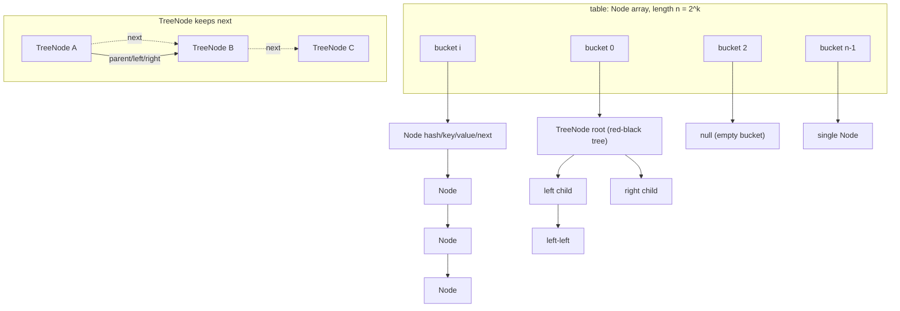
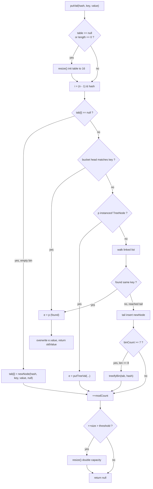
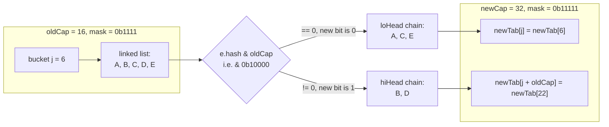
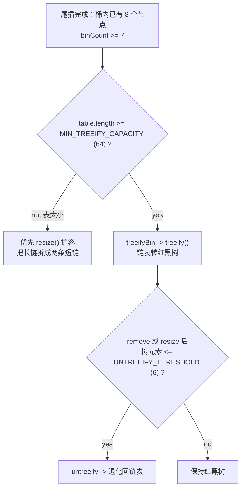

# HashMap 深度讲义（JDK 8）

> 来源：Java 面试教练 · Java 底层与并发主题 ｜ 成稿时间：2026-10-14 ｜ 适用：12 年经验 Java 工程师 · 中大厂 P6-P7 面试

## 一句话主线

HashMap 的本质是「用 `hash ^ (h >>> 16)` 做扰动、用 `(n-1) & hash` 做取模、以数组为骨架，冲突时先拉链表、链表过长且表够大才树化，容量永远保持 2 的幂以便用位运算和「高低位拆分」完成 O(1) 均摊的增删查」。

把这条主线背下来，下面所有细节都是它的展开。

## 目录

1. 底层架构：数组 + 链表 + 红黑树
2. put 完整流程
3. 为什么初始容量必须是 2 的 n 次幂
4. 为什么扩容是 2 倍
5. 纠错：首次容量是 16，64 是树化门槛
6. 为什么用红黑树而不用 AVL
7. 负载因子 0.75 与泊松分布
8. JDK 7 头插死循环 vs JDK 8 尾插修复
9. 其他必考点
10. 追问链自测 L1-L5
11. 误区清单
12. 面试口径快查

## 1. 底层架构：数组 + 链表 + 红黑树

### 1.1 三层结构

| 层级 | 数据结构 | 作用 | 退化/升级条件 |
| --- | --- | --- | --- |
| 骨架 | `Node<K,V>[] table` | O(1) 定位桶 | 长度恒为 2 的幂，初始 16 |
| 冲突解决（轻） | 单链表 | 桶内少量冲突 | 长度 > 8 且 table.length ≥ 64 → 树化 |
| 冲突解决（重） | 红黑树 `TreeNode` | 桶内大量冲突/哈希攻击 | 元素 ≤ 6 → 退化回链表 |

### 1.2 Node 与 TreeNode

```java
// JDK 8 java.util.HashMap.Node
static class Node<K,V> implements Map.Entry<K,V> {
    final int hash;     // 扰动后的 hash，final
    final K key;        // final
    V value;
    Node<K,V> next;     // 链表后继
}

// JDK 8 java.util.HashMap.TreeNode
// 继承链：TreeNode -> LinkedHashMap.Entry -> HashMap.Node
// 所以 TreeNode 依然持有 next（以及 prev），树里同时还藏着一条链表
static final class TreeNode<K,V> extends LinkedHashMap.Entry<K,V> {
    TreeNode<K,V> parent;  // 红黑树父节点
    TreeNode<K,V> left;
    TreeNode<K,V> right;
    TreeNode<K,V> prev;    // 链表前驱（删除时用）
    boolean red;
}
```

**为什么 TreeNode 还要保留 `next`？** 三个原因：

1. **退化需要**：`UNTREEIFY_THRESHOLD = 6` 触发退化时，直接按 `next` 顺序把树拆回链表，不需要重新组装顺序。
2. **遍历需要**：`split()` 扩容拆分树时先按 `next` 顺序拆成两条链，再各自决定是否树化/退化。
3. **删除需要**：`prev` 让红黑树删除节点时能在 O(1) 内把它从链表结构上摘掉，避免整树重排。

### 1.3 结构图



> **面试口径**：HashMap 是「数组 + 链表 + 红黑树」，数组负责 O(1) 定位，链表解决轻冲突，红黑树解决重冲突；TreeNode 虽然变成了树，但它仍然继承 Node 的 `next`，所以树里还藏着一条链表，扩容和退化都靠这条链。

## 2. put 完整流程

### 2.1 五步走

1. **算 hash**：`hash(key) = (key == null) ? 0 : (h = key.hashCode()) ^ (h >>> 16)`，高 16 位与低 16 位异或，把高位特征"掺"进低位。
2. **算下标**：`i = (n - 1) & hash`。
3. **空桶**：`tab[i] == null` → 直接 `newNode` 放进去。
4. **非空桶**：
   - 桶头就是目标 key → 记录 `e = p`；
   - 桶头是 `TreeNode` → 走 `putTreeVal` 红黑树插入；
   - 否则遍历链表：找到相同 key 就 `break`（`e` 指向它）；到尾也没找到就**尾插**新节点，插完若 `binCount >= 7`（此时桶内已有 8 个节点，新节点是第 9 个）调用 `treeifyBin`。
5. **收尾**：`e != null` 说明是覆盖 → 写新值、返回 `oldValue`；否则 `++modCount`，`++size > threshold` 则 `resize()`。

### 2.2 为什么要 `h ^ (h >>> 16)` 扰动

`int` 是 32 位，`(n-1) & hash` 在 n 很小（如 16）时只有低 4 位参与运算，高 28 位完全不起作用。如果 key 的 hashCode 只在高位有差异（很常见，比如 `Integer` 之外的自定义对象、连续的自增 ID），就会大量撞桶。

把高 16 位右移后与低 16 位异或，等价于**把高位的信息折叠进低位**，让低位同时携带高位特征，从而显著降低碰撞概率。这是一个"低成本、高收益"的折中，只多了一次异或和一次移位。

一个可以当场举的例子：`"Aa"` 和 `"BB"` 的 `hashCode()` 都是 2112，扰动后仍是 2112，`2112 & 15 = 0`，两个内容完全不同的 key 必然落进同一个桶。冲突本身不是 bug，`equals` 能把它们区分开；真正的问题是大量 key 抢同一个桶，所以才需要链表和红黑树兜底。

### 2.3 put 流程图



### 2.4 关键源码：putVal

```java
final V putVal(int hash, K key, V value, boolean onlyIfAbsent, boolean evict) {
    Node<K,V>[] tab; Node<K,V> p; int n, i;
    // 1) 懒加载：第一次 put 才初始化 table（默认 16）
    if ((tab = table) == null || (n = tab.length) == 0)
        n = (tab = resize()).length;
    // 2) 空桶：直接放
    if ((p = tab[i = (n - 1) & hash]) == null)
        tab[i] = newNode(hash, key, value, null);
    else {
        Node<K,V> e; K k;
        // 3) 桶头命中
        if (p.hash == hash && ((k = p.key) == key || (key != null && key.equals(k))))
            e = p;
        // 4) 红黑树
        else if (p instanceof TreeNode)
            e = ((TreeNode<K,V>)p).putTreeVal(this, tab, hash, key, value);
        // 5) 链表遍历 + 尾插
        else {
            for (int binCount = 0; ; ++binCount) {
                if ((e = p.next) == null) {
                    p.next = newNode(hash, key, value, null);
                    if (binCount >= TREEIFY_THRESHOLD - 1) // -1 for 1st：桶内已有 8 个，插第 9 个
                        treeifyBin(tab, hash);
                    break;
                }
                if (e.hash == hash && ((k = e.key) == key || (key != null && key.equals(k))))
                    break;
                p = e;
            }
        }
        // 6) 覆盖旧值
        if (e != null) {
            V oldValue = e.value;
            if (!onlyIfAbsent || oldValue == null)
                e.value = value;
            afterNodeAccess(e);
            return oldValue;
        }
    }
    ++modCount;
    // 7) JDK 8：先插入，后判断是否扩容
    if (++size > threshold)
        resize();
    afterNodeInsertion(evict);
    return null;
}
```

> **面试口径**：put 的流程是「扰动 hash → `(n-1)&hash` 定位 → 空桶直放 / 桶头命中 / 树插 / 链表尾插 → 命中则覆盖返回旧值，未命中则 modCount++、size++ 后再看是否扩容」。

### 2.5 第一次 put 才建表：`table` 的懒加载

`new HashMap<>()` 之后 `table` 还是 `null`，构造器只做一件事：把参数校验一遍、记下 `loadFactor`、算出 `threshold`。

| 构造方式 | 首次 put 前的 `threshold` | 首次 put 后 `table.length` | 首次 put 后 `threshold` |
| --- | --- | --- | --- |
| `new HashMap<>()` | 0 | 16 | 12 |
| `new HashMap<>(16)` | 16 | 16 | 12 |
| `new HashMap<>(100)` | 128 | 128 | 96 |

第一次 `put` 进到 `putVal` 第一行，走的是 `resize()` 的初始化分支：

```java
// resize() 里决定新容量的三段
if (oldCap > 0) {                       // 正常扩容：翻倍
    newCap = oldCap << 1;
} else if (oldThr > 0) {                // 构造时传了 initialCapacity，threshold 暂存的就是目标容量
    newCap = oldThr;
} else {                                // 无参构造：用默认值
    newCap = DEFAULT_INITIAL_CAPACITY;  // 16
    newThr = (int)(DEFAULT_LOAD_FACTOR * DEFAULT_INITIAL_CAPACITY);  // 12
}
// newThr 仍为 0 时按 newCap * loadFactor 补算，最后 threshold = newThr
```

三个要点：

- 构造参数是**容量下限**，不是立即分配的数组长度。传 100 得到 128，是因为 `tableSizeFor` 向上取了 2 的幂。
- 所以 `new HashMap<>(16)` 和无参构造在首次 put 之后完全等价，都是 16 个桶、阈值 12。
- 反过来说，`new HashMap<>(expectedSize / 0.75 + 1)` 的价值就在这一步：让初始化分支一次性把表建到足够大，避免后续反复 `resize()`。

### 2.6 remove 的四步

`remove` 走 `removeNode(hash, key, null, false, true)`，结构比 put 简单：

1. **定位桶**：`(n-1) & hash`，表空直接返回 null。
2. **找节点**：桶头命中就用它；桶头是 `TreeNode` 走 `getTreeNode`；否则沿 `next` 遍历。
3. **摘除**：树节点走 `removeTreeNode`（顺带做红黑树平衡），链表节点直接 `p.next = node.next`，O(1) 摘链。
4. **收尾**：`--size`、`++modCount`，然后判断树是否该退化，最后 `afterNodeRemoval`（`LinkedHashMap` 靠这个钩子维护双向链表）。

一个常被忽略的事实：**remove 不会缩容**。19 个元素删到只剩 1 个，`table.length` 和 `threshold` 依然是扩容后的 32 和 24，`HashMap` 没有 shrink 逻辑。

## 3. 为什么初始容量必须是 2 的 n 次幂

这是 HashMap 最经典的追问点，至少能答出三条理由。

### 理由一：只有 n = 2^k 时 `(n-1) & hash` 才等价于 `hash % n`

- `n = 2^k` 时，`n - 1` 的二进制是**末 k 位全 1**，例如 `16 - 1 = 15 = 0b1111`。
- 一个末 k 位全 1 的数做 `&` 运算，效果就是**掩码（mask）**，恰好保留 hash 的低 k 位，而 `hash % 2^k` 的数学定义也是"取低 k 位"。二者等价。
- 若 `n` 不是 2 的幂，比如 `n = 10`，`n - 1 = 9 = 0b1001`，中间两位是 0，做 `&` 会把这两位**永久抹成 0**，导致下标 2、3、6、7 等永远不可能被选中，桶分布严重不均，甚至有桶永远空着。
- 另外 `&` 是 CPU 单周期指令，`%` 在大多数 CPU 上需要除法指令，慢一个数量级。HashMap 是极致追求性能的容器，必须用位运算。

```text
hash = 0b...1011_0110_1101
n = 16, n - 1 = 0b1111  -> & 结果 = 0b1101 = 13 == hash % 16   √ 等价
n = 10, n - 1 = 0b1001  -> & 结果 = 0b1001 = 9  != hash % 10    × 不等价且分布残缺
```

### 理由二：扩容时新下标只可能是「原位」或「原位 + oldCap」，可以 O(1) 拆分

这是 JDK 8 的核心优化（`resize()` 里的高低位拆分）：

- 容量从 `oldCap` 扩到 `2 * oldCap`，参与掩码的位数从 k 位变成 k+1 位，**新增的只有最高那 1 位**。
- 对任意节点，判断 `e.hash & oldCap`：
  - 结果 `== 0` → 新增的那一位是 0 → **新下标 = 原下标 j**；
  - 结果 `!= 0` → 新增的那一位是 1 → **新下标 = j + oldCap**。
- 于是 resize 不需要对每个 key 重新 `hash()` 和重新取模，只需一次 `&` 判断，并且**天然把一个长链表均匀拆成两条短链表**（这正是树化的替代方案之一）。

> 注意 `e.hash & oldCap` 与 `e.hash & (oldCap - 1)` 不同：前者是"新增的那一位"，后者是"原来的 k 位"。

**关键源码：resize() 高低位拆分**

```java
// 遍历旧桶 j 上的链表，拆成 lo / hi 两条链（保持原顺序，尾插法）
Node<K,V> loHead = null, loTail = null;
Node<K,V> hiHead = null, hiTail = null;
Node<K,V> next;
do {
    next = e.next;
    if ((e.hash & oldCap) == 0) {   // 新增参与运算的那一位是 0 -> 原位
        if (loTail == null) loHead = e;
        else                loTail.next = e;
        loTail = e;
    } else {                         // 新增参与运算的那一位是 1 -> 原位 + oldCap
        if (hiTail == null) hiHead = e;
        else                hiTail.next = e;
        hiTail = e;
    }
} while ((e = next) != null);

if (loTail != null) { loTail.next = null; newTab[j] = loHead; }
if (hiTail != null) { hiTail.next = null; newTab[j + oldCap] = hiHead; }
```

### 理由三：保持 2 的幂，扩容后才能继续用同一套位运算

扩容必须保持 `n = 2^k` 这个不变量（invariant），`(n-1) & hash` 才始终成立。如果扩容后幂次性质被破坏，理由一和理由二同时失效，整个实现要被迫退回 `%` 取模 + 全量 rehash，性能大幅退化。

### 理由四（加分项）：构造函数传入非 2 的幂会被自动向上取整

`tableSizeFor(cap)` 用五次 `|=` 无符号右移把最高位之后全部填成 1，再加 1 得到 2 的幂：

```java
static final int tableSizeFor(int cap) {
    int n = cap - 1;
    n |= n >>> 1;  n |= n >>> 2;  n |= n >>> 4;  n |= n >>> 8;  n |= n >>> 16;
    return (n < 0) ? 1 : (n >= MAXIMUM_CAPACITY) ? MAXIMUM_CAPACITY : n + 1;
}
// new HashMap<>(10) -> 16；new HashMap<>(17) -> 32
```

所以 `new HashMap<>(10)` 的真实容量是 **16**，不是 10。这也是面试高频陷阱。

### 扩容高低位拆分示意图



> **面试口径**：容量取 2 的幂有三个好处：一是 `(n-1)&hash` 在 n 为 2 的幂时等价于取模且位运算更快；二是扩容时新位置只可能是原位或原位加 oldCap，靠 `hash & oldCap` 一次判断就能拆分，不用重新 hash；三是保证扩容后这套位运算还能继续用。

## 4. 为什么扩容是 2 倍

### 4.1 核心原因：2 倍才能维持 2^n 不变量
- 假设用 1.5 倍：16 → 24，24 **不是 2 的幂**，`(n-1) & hash` 立即失效（24-1 = 23 = 0b10111，中间有 0 位），必须退回 `%` 取模；同时"新增一位"的前提消失，高低位拆分也无法使用，只能全量 rehash。
- 用 2 倍：16 → 32 → 64 → 128，永远是 2 的幂，所有位运算优化持续有效。
- 2 倍也是空间与冲突率的平衡：太小（1.2 倍）扩容次数多；太大（4 倍）内存浪费严重。

### 4.2 阈值与触发时机
- `threshold = capacity * loadFactor`（默认 `16 * 0.75 = 12`），触发条件是 `++size > threshold`（注意是 `>` 不是 `>=`，默认参数下 size 达到 13 才扩容）。
- **第二条扩容路径**：链表长度达到 8 但 `table.length < 64` 时也触发 `resize()`（见第 5 节）。
- `resize()` 后 `newCap = oldCap << 1`，`newThr = oldThr << 1`（阈值同步翻倍）。

**12 计量的是键值对，不是桶。** 三个量单位不同，相乘之后才落到「映射数」上：

| 量 | 单位 | 含义 |
| --- | --- | --- |
| `capacity = 16` | 桶 | `table` 数组的槽位数 |
| `loadFactor = 0.75` | 无量纲 | 平均每个桶允许挂几个节点 |
| `threshold = 12` | 键值对 | 全表允许的映射总数上限 |

由此有三个容易答错的推论：

- **不看占用桶数**。碰撞时多个 key 落进同一个桶，12 个 key 全挤在 1 个桶里，`size` 照样是 12，照样要扩容。
- **覆盖旧值不计数**。`put` 命中已有 key 走覆盖分支，只改 `value` 并返回旧值，不 `++size`。所以 12 数的是去重后的 key 个数。
- **12 只属于容量 16**。扩容后阈值同步翻倍：16 到 32 时是 24，32 到 64 时是 48，64 到 128 时是 96。

顺序上再确认一遍：`++size` 是**先加再比**，所以 12 个装得下，第 13 个才扩容，扩容瞬间的负载是 13 / 32 ≈ 0.41。

> **面试口径**：`16 × 0.75 = 12` 里，16 是桶数、0.75 是平均每桶挂几个节点，乘出来 12 就是允许的键值对总数，不是「12 个桶被占满」。12 个键值对不扩容，第 13 个触发扩容到 32；覆盖已有 key 不动 `size`，所以反复提交同一个 key 永远不会触发扩容。

### 4.3 JDK 8 是「先插入后扩容」
- **JDK 7**：`addEntry` 中先判断是否需要 `resize(2 * table.length)`，**扩容后再 `createEntry` 插入**。
- **JDK 8**：先完成插入、`++size`，再判断是否扩容。逻辑更简洁，也避免了"扩容后新桶为空"的无效扩容。

> **面试口径**：扩容必须 2 倍，因为只有乘 2 才能保持 2 的幂，从而继续用 `(n-1)&hash` 和 `hash & oldCap` 高低位拆分；1.5 倍会破坏这个性质，导致必须改用取模和全量 rehash。

## 5. 纠错：首次容量是 16，64 是树化门槛

### 常见误解（必须纠正）

> **错误说法**：「HashMap 第一次扩容长度是 64」。
> **正确事实**：HashMap 的 `table` **首次初始化容量是 16**，即 `DEFAULT_INITIAL_CAPACITY = 1 << 4 = 16`。
> **64 是 `MIN_TREEIFY_CAPACITY`**，它是**树化的最小表容量门槛**，跟"第一次扩容"毫无关系。

### 5.1 三个常量必须分清

```java
static final int DEFAULT_INITIAL_CAPACITY = 1 << 4;   // 16  首次/默认表容量
static final int TREEIFY_THRESHOLD       = 8;         // 链表 -> 树的长度阈值
static final int UNTREEIFY_THRESHOLD     = 6;         // 树 -> 链表的退化阈值
static final int MIN_TREEIFY_CAPACITY    = 64;        // 允许树化的最小表容量
```

### 5.2 树化的真实判定逻辑（treeifyBin）

桶内节点数达到 8 之后，再插入第 9 个节点时才调用 `treeifyBin`，而且**不是立刻树化**，先判断表容量：

```java
final void treeifyBin(Node<K,V>[] tab, int hash) {
    int n, index; Node<K,V> e;
    // 关键：表容量 < 64 时，优先 resize 扩容，而不是树化
    if (tab == null || (n = tab.length) < MIN_TREEIFY_CAPACITY)
        resize();
    else if ((e = tab[index = (n - 1) & hash]) != null) {
        TreeNode<K,V> hd = null, tl = null;
        do {
            TreeNode<K,V> p = replacementTreeNode(e, null); // Node -> TreeNode，保留 next
            if (tl == null) hd = p;
            else { p.prev = tl; tl.next = p; }
            tl = p;
        } while ((e = e.next) != null);
        if ((tab[index] = hd) != null)
            hd.treeify(tab);   // 真正建成红黑树
    }
}
```

**为什么小表优先扩容而不是树化？**

1. 表容量小（如 16）却出现长度 8 的链表，往往只是**哈希分布暂时不均**，扩容一倍就能把这条链拆成两条，冲突天然缓解。
2. 扩容的成本（一次 rehash，O(n)）比树化的成本低：树化要构造 TreeNode 对象（内存开销约为 Node 的 2 倍）、还要做红黑树的平衡旋转。
3. 扩容收益更大：扩容降低的是**全局**冲突率；树化只优化**单个桶**。

### 5.3 临界点到底是 8 还是 9

`TREEIFY_THRESHOLD = 8` 这句话被讲成「链表长度达到 8 就树化」，但源码里的判定是 `binCount >= TREEIFY_THRESHOLD - 1`。关键在于 `binCount` 数的是什么：

- `binCount` 从 0 开始，每往前走一个节点才自增，所以它等于**当前尾巴节点的下标**。链表有 n 个节点时，`binCount = n - 1`。
- 走到尾巴时先挂上新节点，再判断 `binCount >= 7`，此刻新节点已经在链上了。
- `binCount >= 7` 等价于 `n - 1 >= 7`，即插入**前**已有 8 个节点，插入**后**是 9 个。

所以第一次树化时，桶内实际上是 9 个节点。`-1 for 1st` 那句注释说的正是「`binCount` 没算头节点，所以阈值要减 1」。

面试时可以说「阈值是 8」，但被追问细节时补一句：**8 是触发条件，真正树化在第 9 个节点**，这时才算把 9 个节点转成树。这个差别不影响任何工程判断，但能区分「背过」和「读过源码」。

### 5.4 完整判定链



> **面试口径（纠错版）**：第一次创建 table 的容量是 16，不是 64。64 是 MIN_TREEIFY_CAPACITY。当桶内已有 8 个节点、再插入第 9 个时，HashMap 会先看表容量够不够 64，不够就优先扩容，因为小表扩容能更有效缓解冲突，而且代价比树化低。只有表已经 ≥ 64 且桶内仍有 8 个以上节点，才真正树化。6 是退化阈值，留 2 的缓冲是为了避免在 8 附近反复树化/退化。

### 5.5 二十行代码自己验证

面试前跑一遍，比背结论可靠。JDK 8 自带反射，不需要额外依赖：

```java
static Object[] table(HashMap<?, ?> m) throws Exception {
    Field f = HashMap.class.getDeclaredField("table");
    f.setAccessible(true);
    return (Object[]) f.get(m);
}

static class Key {                       // 故意制造冲突的 key
    final int id;
    Key(int id) { this.id = id; }
    @Override public int hashCode() { return 1; }
    @Override public boolean equals(Object o) { return o instanceof Key && ((Key) o).id == id; }
}

public static void main(String[] args) throws Exception {
    // 1) 阈值：size 12 不扩容，13 才扩
    HashMap<Integer, Integer> h = new HashMap<>();
    for (int i = 1; i <= 14; i++) {
        h.put(i, i);
        Object[] t = table(h);
        System.out.println("size=" + h.size() + " cap=" + t.length);
    }
    // 2) 树化：同一桶第 8 个还是 Node，第 9 个变 TreeNode
    HashMap<Object, Integer> c = new HashMap<>(128);   // 先让容量 >= 64
    for (int i = 1; i <= 9; i++) {
        c.put(new Key(i), i);                          // Key.hashCode() 恒返回 1
        System.out.println("put #" + i + " head=" + table(c)[1].getClass().getSimpleName());
    }
}
// 输出：size=12 cap=16 → size=13 cap=32
//       put #8 head=Node → put #9 head=TreeNode
```

三个可以直接拿去答的结论：

1. `size=12` 时 `cap` 还是 16，第 13 个才变 32，`threshold` 同步从 12 变 24。
2. 默认容量 16 时同一桶灌到第 9 个，看到的是**扩容到 32 且桶头仍是 Node**，因为 `table.length < 64` 时 `treeifyBin` 走的是 `resize()`。
3. 容量先给到 128，第 8 个仍是 `Node`，第 9 个变成 `TreeNode`，临界点一目了然。

## 6. 为什么用红黑树而不用 AVL

| 维度 | AVL 树 | 红黑树 |
| --- | --- | --- |
| 平衡标准 | 严格平衡：任意节点左右子树高度差 ≤ 1 | 弱平衡：最长路径 ≤ 2 × 最短路径 |
| 查询 | 略快（树高约 1.44 log₂n） | 略慢（树高约 2 log₂n），仍是 O(log n) |
| 插入 | 最多 O(log n) 次旋转 | **最多 2 次旋转** |
| 删除 | 最多 O(log n) 次旋转 | **最多 3 次旋转** |
| 维护成本 | 高，每次写都要频繁回溯调整 | 低，摊还成本接近常数 |
| 适用场景 | 读远多于写（如数据库索引、字典） | **读写都频繁** |

**JDK 作者的取舍理由：** HashMap 的桶是**写多读也多**的场景，不是静态查找表；AVL 插入/删除的旋转次数是 O(log n) 量级，而红黑树把旋转压到常数级（插入 ≤ 2、删除 ≤ 3），**综合吞吐量优于 AVL**；红黑树树高最多 2 log₂n，查找只差一个很小的常数因子，在桶内元素只有 8 ~ 几十的量级下几乎感知不到；且 TreeNode 保留 `next` 链，扩容拆分与退化都很自然。

> **面试口径**：AVL 严格平衡、查询稍快但插入删除频繁旋转；红黑树弱平衡（最长路径不超过最短路径 2 倍），插入最多 2 次旋转、删除最多 3 次，综合增删查更优。HashMap 桶里读写都频繁，所以选红黑树。

## 7. 负载因子 0.75 与泊松分布

### 7.1 源码注释里的原话

JDK 8 源码在 `TREEIFY_THRESHOLD` 上方有一段注释，大意是：在理想情况下使用随机哈希码，桶中节点频率遵循**泊松分布**，负载因子 0.75 时桶内元素个数与概率为：0: 0.60653066，1: 0.30326533，2: 0.07581633，3: 0.01263606，4: 0.00157952，5: 0.00015795，6: 0.00001316，7: 0.00000094，**8: 0.00000006**。

也就是说，随机 hashCode 下一个桶里有 8 个元素的概率约为 **6 × 10⁻⁸（千万分之六）**，几乎不可能。所以链表长度达到 8 通常意味着 hashCode 实现很差或遭遇哈希攻击，此时才需要树化兜底。

### 7.2 那张表的前提是 λ = 0.5

源码注释的原话是「a parameter of about 0.5 on average for the default resizing threshold of 0.75」，也就是说**泊松分布的均值 λ 取的是 0.5**，不是 0.75。

验算一下：`e^-0.5 = 0.6065`，正好对上表里「0 个元素」的概率；`P(8) = e^-0.5 × 0.5^8 / 8! ≈ 5.9 × 10^-8`，也对得上 0.00000006。所以那张表确实是按 λ = 0.5 算的。

注释本身在这里并不完全自洽：阈值 0.75 意味着扩容时平均每桶 0.75 个元素，而表是按 0.5 算的。这不影响结论，8 个元素的概率在两个 λ 下都在 10^-8 量级，都足够说明「随机 hash 下桶内长到 8 个几乎不可能」。被追问时点明 λ = 0.5 就够了，不必展开。

### 7.3 0.75 的取值逻辑
- **太小（如 0.5）**：桶很空就扩容，空间利用率低、扩容频繁。
- **太大（如 1.0）**：冲突率显著上升，查找从 O(1) 退化到 O(n)。
- **0.75**：时间成本（冲突/查找）与空间成本（扩容/内存）的经验最优点，且 `16 × 0.75 = 12` 是整数，阈值计算干净。

> **面试口径**：0.75 是时间与空间的折中，源码注释用泊松分布说明：在 0.75 负载因子下，桶内元素达到 8 个的概率只有千万分之六，所以树化是极端兜底，正常情况链表根本长不到 8。

## 8. JDK 7 头插死循环 vs JDK 8 尾插修复

### 8.1 JDK 7 问题成因

- JDK 7 `resize()` 的 `transfer()` 采用**头插法**：新链表的节点顺序与旧链表**完全相反**。
- 多线程并发 `resize()` 时，线程 A 执行到 `e.next = newTable[i]` 被挂起，线程 B 完成迁移，链表已反转；线程 A 恢复后沿着已被修改的 `next` 继续走，形成 `A.next = B` 且 `B.next = A` 的**环形链表**。
- 之后对该桶 `get()` 时会**无限循环**，CPU 100%。

### 8.2 JDK 8 的修复与残留风险
- **改为尾插法**：新链表保持原有相对顺序，不会反转，因此**不会因为顺序反转而产生环**。
- **高低位拆分**：`loHead/loTail` 与 `hiHead/hiTail` 两条链，迁移时保持顺序。
- **但 HashMap 依然不是线程安全的**：并发 put 仍会**丢数据**（两线程同时写同一空桶，后写覆盖先写）、size 计数不准。并发场景请用 `ConcurrentHashMap`。

> **面试口径**：JDK 7 头插法在并发 resize 时会反转链表，两个线程互相改 next 指针形成环，get 时死循环；JDK 8 改成尾插法并用高低位拆分保持顺序，解决了死循环，但 HashMap 仍然不是线程安全的，并发 put 会丢数据，要并发就用 ConcurrentHashMap。

### 8.3 并发下到底怎么坏的

三条路径，按发生概率从高到低：

1. **同桶覆盖**。两个线程同时命中同一个空桶，都通过了 `tab[i] == null` 判断，然后各自 `tab[i] = newNode(...)`，后写的把先写的整条覆盖掉，那个 key 从此查不到。
2. **resize 期间写丢**。线程 A 正在迁移桶 j，线程 B 同时 put 一个本该落在 j 的 key。B 读到的可能是旧表也可能是新表，写进旧表的节点在迁移完成后没有落点，直接消失。
3. **`++size` 少算**。这是读、加、写三步，两个线程同时自增只生效一次，于是 `size` 偏小，连带 `threshold` 判断失效，本该校容的时候没扩。

这三条都不需要「同时写同一个 key」，写不同的 key 照样会坏。所以「key 不重复就没问题」是错的。

### 8.4 换成 ConcurrentHashMap 之后，问题被哪几层挡掉了

| 故障 | JDK 8 CHM 的对策 |
| --- | --- |
| 同桶覆盖 | 空桶用 CAS 插入，只有一个线程能成功 |
| 并发写同一桶 | `synchronized` 锁桶头节点，粒度从「整表」降到「单个桶」 |
| resize 期间丢写 | `ForwardingNode`（hash = MOVED）+ `transferIndex`，迁移期间别的线程发现 MOVED 就去 `helpTransfer` 一起搬 |
| `size` 不准 | `baseCount` + `CounterCell[]`，本质是 LongAdder 的分片计数 |
| 读操作 | 无锁读，`table` 与 `Node.val`/`next` 是 volatile，定位用 `getObjectVolatile` |

这里要纠正一个流传很广的说法：**「JDK 8 的 CHM 靠分段锁」是错的**。分段锁是 JDK 7 的 `Segment`（继承 `ReentrantLock`，默认 16 段），JDK 8 已经把它删掉，`Segment` 类只为兼容旧版序列化而保留，不再参与并发控制。JDK 8 的锁粒度是**桶头节点**，比段小得多。

选型口径：单线程或方法内局部使用就 `HashMap`（最快、最省内存）；会被多线程共享就 `ConcurrentHashMap`；`Hashtable` 是全表 `synchronized`，任何场景都不该再选它。

CHM 的 `sizeCtl` 状态机、`TreeBin` 的 `lockState` 读写标记、协助扩容的 `stride` 分配，都在配套讲义 `java-core-concurrenthashmap.md` 里展开。

## 9. 其他必考点

### 9.1 key 允许且只允许一个 null

```java
static final int hash(Object key) {
    int h;
    return (key == null) ? 0 : (h = key.hashCode()) ^ (h >>> 16);  // 扰动：高 16 位折叠进低 16 位
}
```

- `null` key 的 hash 固定为 0，永远落在 `table[0]`；第二次 put null 会覆盖，所以**只有一个 null key**。
- 对比：`Hashtable` 与 `ConcurrentHashMap` 都不允许 null（见配套讲义）。

### 9.2 fail-fast 与 modCount
- `modCount` 记录**结构性修改**次数（put、remove、clear、扩容等）。
- 迭代器创建时记录 `expectedModCount = modCount`，`next()` 前检查不一致即抛 `ConcurrentModificationException`。
- 这是**尽力而为（best-effort）**机制，用于尽早暴露 bug，**不能当并发控制手段**。
- 单线程下用 `iterator.remove()` 安全（它会同步 `expectedModCount`）。

### 9.3 常用方法速览

| 方法 | 语义 | 说明 |
| --- | --- | --- |
| `putIfAbsent(k, v)` | key 不存在或值为 null 时才 put | 等价于 `putVal(..., onlyIfAbsent=true)` |
| `computeIfAbsent(k, f)` | 不存在时用函数计算并放入 | 常用于 `Map<K, List<V>>` 分组 |
| `computeIfPresent(k, f)` | 存在时重算，返回 null 则删除 | |
| `compute(k, f)` | 无论是否存在都重算 | |
| `merge(k, v, remap)` | 合并，函数返回 null 则删除 | 计数场景常用 |
| `getOrDefault(k, dv)` | 取不到返回默认值 | 默认值仍会被求值 |

注意：`computeIfAbsent` 对**同一个 bin** 递归修改可能触发 `ConcurrentModificationException`，Lambda 内再次 put 同一个 map 是未定义行为。

### 9.4 覆写 equals 必须覆写 hashCode
- 判定式是 `p.hash == hash && (key == k || key.equals(k))`，hash 不等直接跳过。
- 只覆写 `equals`：逻辑相等的对象 hash 不同 → 落不同桶 → `get` 永远取不到，且能 put 进两个"相等"的 key。
- 只覆写 `hashCode`：hash 相同但 `equals` 为 false → 同桶链表里放两个逻辑重复的 key。

### 9.5 遍历顺序是无序的，扩容还会打乱它

- 遍历顺序由「桶下标升序 + 桶内链表顺序」决定，跟插入顺序没有关系。
- 实测：依次插入 `apple, banana, cherry, date, elder, fig, grape, honey, iris, jack`，遍历出来是 `banana, date, apple, cherry, iris, fig, honey, elder, grape, jack`。
- 扩容时节点被搬到「原位」或「原位 + oldCap」，重排之后顺序会变，所以同一个 map 在一次运行里前后两次遍历都可能不一样。
- 需要顺序就用 `LinkedHashMap`（默认插入序，`accessOrder = true` 时是访问序，可以做 LRU）或 `TreeMap`（按 key 排序）。
- 另一个容易被忽略的成本：遍历要扫过整个 `table` 数组，**容量给得过大、元素却很少时，遍历会明显变慢**。这也是「无脑 `new HashMap<>(1 << 20)`」的副作用。

## 10. 追问链 · 参考答案

| 层级 | 问题 | 参考答案要点 |
| --- | --- | --- |
| L1 | 说说 HashMap 的底层数据结构，以及 put 一个元素的完整流程。 | 结构是数组 + 链表 + 红黑树。put 五步：① `hash = h ^ (h>>>16)` 扰动；② `i = (n-1) & hash` 定位；③ 空桶直接放；④ 非空桶则先判桶头命中、是 `TreeNode` 走 `putTreeVal`，否则遍历链表**尾插**，桶内已有 8 个节点时再插第 9 个会调 `treeifyBin`；⑤ 命中则覆盖返回旧值，否则 `++modCount`、`++size > threshold` 时 `resize()`。 |
| L1 | `HashMap` 默认初始容量、默认负载因子、默认扩容阈值分别是多少？ | 初始容量 16（`DEFAULT_INITIAL_CAPACITY = 1 << 4`），负载因子 0.75，扩容阈值 16 × 0.75 = 12，这 12 计的是**键值对数量**（`size`），不是被占用的桶数，且第 13 个键值对插入后才扩容。注意 64 是 `MIN_TREEIFY_CAPACITY`（树化的最小表容量门槛），与首次扩容无关；且 table 懒加载，第一次 put 才创建。 |
| L2 | 为什么 HashMap 的容量必须是 2 的 n 次幂？至少说出两条理由。 | 两条：① `n = 2^k` 时 `n-1` 低 k 位全 1，`(n-1)&hash` 等价于 `hash % n`，且 `&` 是单周期指令，比 `%` 快一个数量级；② 扩容时新下标只有"原位"和"原位 + oldCap"两种，靠 `e.hash & oldCap` 一次判断即可拆分，无需重新 hash。 |
| L2 | `(n - 1) & hash` 为什么能代替 `hash % n`？如果 n 不是 2 的幂会怎样？ | 因为 `hash % 2^k` 的数学定义就是取低 k 位，而 `n-1` 末 k 位全 1 的 `&` 恰好是保留低 k 位的掩码，二者等价。n 不是 2 的幂时（如 n=10，n-1=0b1001）中间 0 位被永久抹掉，下标 2、3、6、7 恒空、分布残缺，且必须退回 `%` 取模。 |
| L2 | `new HashMap<>(100)` 之后 `table` 有多大？第一次 put 又做了什么？ | 构造完 `table` 还是 `null`，只把 `threshold` 设成 `tableSizeFor(100) = 128`。第一次 put 进 `putVal` 首行走 `resize()` 的初始化分支：`newCap = oldThr = 128`，建表后 `threshold = 128 × 0.75 = 96`。所以构造参数是容量下限，不是立即分配的长度。 |
| L3 | `remove` 的流程是什么？删完会缩容吗？ | 四步：`(n-1)&hash` 定位 → 桶头命中 / `getTreeNode` / 沿 `next` 找 → 树节点走 `removeTreeNode`、链表节点 `p.next = node.next` 摘链 → `--size`、`++modCount`、判断是否退化到 6 以下。不会缩容，`table.length` 和 `threshold` 保持扩容后的值。 |
| L3 | `resize()` 里 `e.hash & oldCap` 判断的是什么？为什么新下标只有"原位"和"原位 + oldCap"两种可能？ | 判断的是容量翻倍后**新参与掩码的那一位**（注意不是 `hash & (oldCap-1)`）。因为 oldCap 到 2×oldCap 只多出 1 位，该位为 0 则新下标 = 原下标 j，为 1 则 = j + oldCap，所以一次 `&` 就能把链表拆成 lo/hi 两条，无需 rehash。 |
| L3 | `treeifyBin` 里为什么先判断 `tab.length < MIN_TREEIFY_CAPACITY` 就 `resize()` 而不是直接树化？ | 小表出现长链往往只是 hash 分布暂时不均，扩容一倍就能把链拆成两条，收益是**全局**的；而树化只优化单个桶，还要构造 TreeNode（内存约为 Node 的 2 倍）并做红黑树平衡旋转，成本更高。所以表 < 64 时优先 `resize()`。 |
| L3 | `putVal` 中 `binCount >= TREEIFY_THRESHOLD - 1` 为什么要减 1？ | `binCount` 从 0 起算、每往前走一个节点才自增，走到尾巴时它等于「已有节点数 − 1」。`-1 for 1st` 补的就是没算头节点这一位：`binCount >= 7` 等价于插入前已有 8 个节点、插入后是 9 个，所以真正树化的临界点是第 9 个节点，不是第 8 个。 |
| L3 | 两个线程 put 的是完全不同的 key，为什么还会丢数据？ | 三条路径：① 同时命中同一个空桶，都通过 `tab[i] == null`，后写覆盖先写；② 一个线程正在 resize 迁移桶 j，另一个线程把新节点写进旧表，迁移完成后这个节点没有落点；③ `++size` 是读加写三步，并发自增只算一次，`size` 偏小导致扩容判断失效。所以「key 不重复」并不能免疫。 |
| L4 | JDK 7 的 HashMap 在并发 resize 时为什么会死循环？JDK 8 怎么修的？修完之后 HashMap 线程安全了吗？ | JDK 7 `transfer()` 用**头插法**，新链表顺序与旧链表完全相反，并发 resize 时两线程互相改 `next` 形成环形链表，`get` 时无限循环、CPU 100%。JDK 8 改**尾插法**并用 lo/hi 高低位拆分保持顺序。修完仍不安全：并发 put 会丢数据、size 不准，并发场景请用 ConcurrentHashMap。 |
| L4 | 为什么用红黑树不用 AVL 树？`UNTREEIFY_THRESHOLD` 是 6 而不是 8，这 2 的差值有什么用？ | AVL 严格平衡（左右高度差 ≤ 1）查询略快，但插入删除旋转是 O(log n) 量级；红黑树弱平衡（最长路径 ≤ 2 × 最短），插入最多 2 次旋转、删除最多 3 次，读写都频繁时综合更优。6 与 8 差 2 是留缓冲，防止元素在阈值附近反复树化/退化造成震荡。 |
| L4 | JDK 7 与 JDK 8 在"扩容与插入的先后顺序"上有什么区别？ | JDK 7 在 `addEntry` 里先判断是否 `resize(2*table.length)`，**扩容后再 `createEntry` 插入**；JDK 8 则是先完成插入、`++size`，再判断是否 `resize()`，即**先插入后扩容**，逻辑更简洁，也避免了"扩容后新桶仍为空"的无效扩容。 |
| L4 | JDK 8 的 `ConcurrentHashMap` 还是分段锁吗？ | 不是。分段锁是 JDK 7 的 `Segment`（继承 `ReentrantLock`，默认 16 段）。JDK 8 删掉了这套结构，改成空桶 CAS 插入、非空桶 `synchronized` 锁桶头、`ForwardingNode` + `transferIndex` 多线程协助扩容、`baseCount + CounterCell` 分片计数。`Segment` 类只为兼容旧版序列化保留，不再参与并发控制。 |
| L5 | 已知要存 100 万条数据，你会怎么构造 HashMap？为什么？（考察 `initialCapacity = expectedSize / 0.75 + 1`，避免多次 resize） | 按 `initialCapacity = 1000000 / 0.75 + 1 ≈ 1333334` 构造，`tableSizeFor` 会向上取整到 2097152（2^21）。这样全程只建一次 table、零 resize，避免多次 rehash 与数组拷贝；若后续还会增长可在此基础上再放大一档。 |
| L5 | 如果某个 key 对象的 `hashCode()` 实现很差（大量返回同一个值），HashMap 会退化成什么？红黑树能救吗？上限是多少？ | 所有 key 落同一个桶，先退化成 O(n) 的长链表；表 ≥ 64 且链长 ≥ 8 后树化成红黑树，查找降到 O(log n)。但树化只能兜底救不了本：TreeNode 内存约为 Node 的 2 倍且要反复旋转，吞吐仍远低于正常分布，桶内还会无限增长。根治办法是修 `hashCode()` 或换更好的散列。 |
| L5 | 线上出现 HashMap 相关 CPU 飙高，你会从哪几个方向排查？（死循环 / 哈希攻击 / 大对象 rehash / 并发写覆盖） | 四条线索：① JDK 7 并发 resize 的环形链表，`jstack` 看线程卡在 `HashMap.get`；② 哈希攻击导致长链/退化成树，`jmap` + histo 看桶分布；③ 大表 rehash 与 Promotion 带来的 GC 压力，看 GC 日志；④ 并发写覆盖导致 size 不准。定位后换 ConcurrentHashMap、预设容量、修 `hashCode()`。 |

## 11. 误区 · 正解

| 误区 | 正解 |
| --- | --- |
| 「HashMap 第一次扩容后长度是 64」 | 首次初始化容量是 **16**（`DEFAULT_INITIAL_CAPACITY = 1 << 4`）。64 是 `MIN_TREEIFY_CAPACITY`，即允许树化的最小表容量门槛，与"第一次扩容"毫无关系。16 装到 13 个元素时扩容到 32，再下一次才到 64。 |
| 「链表长度到 8 就立刻转成红黑树」 | 先纠一个细节：临界点是桶内已有 8 个节点、插入第 9 个时才调 `treeifyBin`。而且这只是必要条件，还须 `table.length >= 64`。小表时 `treeifyBin` 优先 `resize()`：扩容能把长链拆成两条、降低**全局**冲突率，且比构造 TreeNode（内存约为 Node 的 2 倍）加红黑树旋转更便宜；只有表已 ≥ 64 才真正 `treeify()`。 |
| 「扩容是 size >= threshold 时触发」 | 源码是 `++size > threshold`，注意是 `>` 而非 `>=`。默认容量 16、负载因子 0.75 时 threshold = 12，但 size 要达到 **13** 才触发 `resize()` 扩到 32。另有第二条路径：链长达到 8 而表 < 64 时也走 `resize()`。 |
| 「`new HashMap<>(10)` 的容量是 10」 | 构造时经 `tableSizeFor(10)` 向上取整为 **16**（传 17 得到 32）。该函数用五次「或等于」无符号右移把最高位之后全部填 1 再加 1，保证容量恒为 2 的幂，这正是 `(n-1)&hash` 成立的前提。 |
| 「JDK 8 改成尾插法之后 HashMap 就线程安全了」 | 尾插法只消除了并发 resize 的环形链表死循环。HashMap 仍然不是线程安全的：两线程同时写同一空桶会丢数据、`++size` 非原子导致计数不准、并发 put 还可能读到不一致状态。并发场景请用 `ConcurrentHashMap`。 |
| 「HashMap 不允许 null key」 | HashMap **允许且只允许一个** null key：`hash(null)` 固定返回 0，永远落在 `table[0]`，第二次 put null 会覆盖。不允许 null 的是 `Hashtable` 与 `ConcurrentHashMap`（并发下 get 返回 null 的二义性无法消除）。 |
| 「负载因子越小越好」 | 太小（如 0.5）桶还很空就扩容，空间利用率低、扩容与 rehash 频繁；太大（如 1.0）冲突率显著上升、查找退化到 O(n)。0.75 是时间与空间的经验最优点，且 `16 × 0.75 = 12` 是整数，阈值计算干净。 |
| 「红黑树一定比 AVL 快」 | 不准确。红黑树树高约 2log₂n，查询比 AVL（约 1.44log₂n）**略慢**；它赢在插入最多 2 次旋转、删除最多 3 次，综合增删查更优，适合读写都频繁的桶。若场景是纯静态查询，AVL 反而更快。 |
| 「TreeNode 变成树之后链表结构就没了」 | 链表还在。`TreeNode extends LinkedHashMap.Entry extends HashMap.Node`，`next`/`prev` 依然存在且不可少：退化时按 `next` 顺序拆回链表，`split()` 扩容时先拆成 lo/hi 两条链，删除时靠 `prev` 在 O(1) 内从链上摘除。 |

## 12. 面试口径快查
| 问题 | 一句话口径 |
| --- | --- |
| 定位下标 | `(n - 1) & hash`，n 为 2 的幂时等价于取模且更快 |
| 容量 2 的幂 | ① 掩码等价取模 ② 扩容可高低位拆分 ③ 保持位运算不变量 |
| 扩容 2 倍 | 只有 ×2 才能维持 2^n，1.5 倍会破坏所有位运算优化 |
| 树化条件 | 桶内达 8 后插第 9 个才触发，且 table ≥ 64；否则优先 resize；退化阈值 6 |
| 红黑树 vs AVL | 弱平衡，插入 ≤ 2 旋转、删除 ≤ 3 旋转，综合性能更优 |
| 0.75 | 泊松分布下桶内 8 个元素概率千万分之六，时空折中 |
| JDK 7 vs 8 | 头插死循环 → 尾插 + 高低位拆分；先扩容后插入 → 先插入后扩容 |
