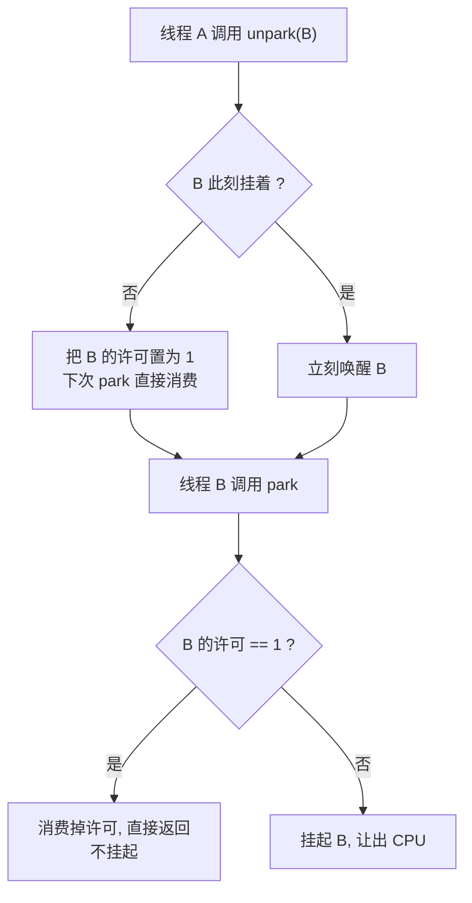
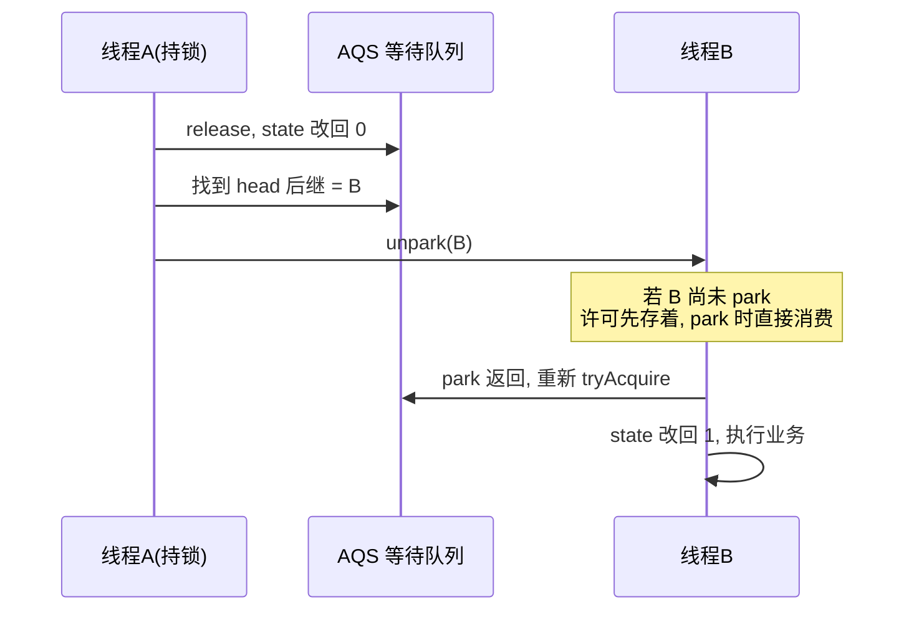

> 2026-10-16 成稿，Java 底层与并发主题。配套 `java-core-aqs.md`——AQS 的阻塞唤醒全靠它。
> 再往下一层是 `java-core-unsafe.md`：Unsafe 是什么、JDK 9 之后为什么有两个 Unsafe、CAS 在 CPU 层是什么指令。

# LockSupport 原理与用法

## 0. 一句话主线

**LockSupport 是 JUC 最底层的线程挂起/唤醒工具，只提供两个方法：`park`（挂起当前线程）和 `unpark`（唤醒指定线程）。它不依赖 synchronized、不需要持有任何锁、操作的是线程而不是对象，而且唤醒许可（permit）不丢失——即使 `unpark` 发生在 `park` 之前。**

`java.util.concurrent.locks.LockSupport` 里只有这两个方法，没有别的。它是 `AbstractQueuedSynchronizer`（AQS）能实现阻塞唤醒的**唯一基础设施**，也是 `ReentrantLock`、`CountDownLatch`、`ThreadPoolExecutor` 背后真正干活的那个零件。

> 面试口径：问「LockSupport 是什么」，别只答「一个工具类」。标准答法是三点差异——**面向线程而非对象**（unpark 能指定具体线程）、**不依赖 monitor**（不需要 synchronized）、**许可不丢失**（unpark 可以先于 park）。再补一句「AQS 就是靠它实现 park/unpark 的阻塞唤醒」。

---

## 1. 为什么需要它：先看不用它有多难

线程要等待另一个线程，最熟悉的方式是 `Object.wait/notify`，但它有三个硬伤：

| 硬伤 | 后果 |
| --- | --- |
| 必须持有对象的 monitor | 在 `synchronized` 块外调 `wait()` 直接抛 `IllegalMonitorStateException`；而 AQS 的队列逻辑并不持有任何对象的锁 |
| `notify()` 不指定线程 | 只能唤醒「任意一个」等待线程，无法精确唤醒某个特定线程。AQS 需要唤醒的是 **head 的直接后继**，做不到 |
| 无法「先通知后等待」 | 如果 A 线程执行 notify 时 B 线程还没 wait，通知丢失，B 会一直睡下去 |

第三个问题在 AQS 里非常致命：释放锁的线程调 `unpark` 时，刚入队的线程可能马上就来 park 了。**没有许可机制，unpark 就白调了。**

LockSupport 的解法是：每个线程有一个「**许可（permit）**」标记，语义是**最多一个、不会累积**：

- `unpark(t)`：把线程 t 的许可置为 1。如果 t 此刻正挂着，它立刻被唤醒。
- `park()`：如果当前线程许可为 1，就**消费掉这个许可并直接返回**（不挂起）；否则挂起。

这样 `unpark` 无论发生在 `park` 前还是 `park` 后，唤醒都不会丢。这就是「许可不丢失」的确切含义。



> 关键理解：**`unpark` 不是「叫醒」一个动作，而是「发一张通行证」**。通行证最多一张，重复 `unpark` 两次不会攒成两张（不累积），但只要还没被 `park` 消费掉就不会失效。

---

## 2. 源码：只有两个方法

> 下面两段是**真实源码**（分别取自本机 JDK 8 的 `src.zip` 与 OpenJDK 17），不是示意。你能看出 JDK 9 之后的一个关键变化：**用的 Unsafe 换了个类**。

**JDK 8**（`sun.misc.Unsafe`，字段名叫 `UNSAFE`）：

```java
package java.util.concurrent.locks;
import sun.misc.Unsafe;

public class LockSupport {
    private static void setBlocker(Thread t, Object arg) {
        // 直接写 Thread.parkBlocker 字段的偏移量
        UNSAFE.putObject(t, parkBlockerOffset, arg);
    }

    public static void unpark(Thread thread) {
        if (thread != null)
            UNSAFE.unpark(thread);          // 就这一行
    }

    public static void park(Object blocker) {
        Thread t = Thread.currentThread();
        setBlocker(t, blocker);             // 记录阻塞源，供 jstack 看
        UNSAFE.park(false, 0L);             // false=相对时间, 0=永久等待
        setBlocker(t, null);
    }

    // Hotspot implementation via intrinsics API
    private static final sun.misc.Unsafe UNSAFE;
    private static final long parkBlockerOffset;
    static {
        try {
            UNSAFE = sun.misc.Unsafe.getUnsafe();
            parkBlockerOffset = UNSAFE.objectFieldOffset(
                Thread.class.getDeclaredField("parkBlocker"));
        } catch (Exception ex) { throw new Error(ex); }
    }
}
```

**JDK 17**（改用 `jdk.internal.misc.Unsafe`，字段改名 `U`）：

```java
package java.util.concurrent.locks;
import jdk.internal.misc.Unsafe;

public class LockSupport {
    private static void setBlocker(Thread t, Object arg) {
        U.putReferenceOpaque(t, PARKBLOCKER, arg);   // 改用了 opaque 语义
    }

    public static void unpark(Thread thread) {
        if (thread != null)
            U.unpark(thread);
    }

    public static void park(Object blocker) {
        Thread t = Thread.currentThread();
        setBlocker(t, blocker);
        U.park(false, 0L);
        setBlocker(t, null);
    }

    private static final Unsafe U = Unsafe.getUnsafe();
    private static final long PARKBLOCKER
        = U.objectFieldOffset(Thread.class, "parkBlocker");
}
```

这里能看出三件事：

**① 全部委托给 `Unsafe`，LockSupport 本身只是薄薄一层封装**。`Unsafe.park` 是 native 方法，最终进 JVM，Linux 上落到 pthread 的互斥量锁上——**park 在操作系统层面就是一把不会释放的互斥锁**。

**② `park(Object blocker)` 的 blocker 是给 jstack 看的**。它给线程设了一个「阻塞源」标记，线程 dump 里能直接看到这个线程卡在哪个对象上，排查竞争时非常有用。**功能上和不带参数的 `park()` 完全一样**，只是多带了个诊断信息。

**③ `park(false, 0L)` 的两个参数是「是不是绝对时间」和「等多久」**：

| 调用 | 含义 |
| --- | --- |
| `park(false, 0L)` | 永久等待，直到被 unpark / 被中断 / 虚假唤醒 |
| `park(false, nanos)` | 相对等待 nanos 纳秒（`parkNanos` 用） |
| `park(true, deadline)` | 等到某个绝对时间点，单位是 epoch 毫秒（`parkUntil` 用） |

> 为什么 JDK 9 之后要换个 Unsafe 类、以及 `sun.misc.Unsafe` 和 `jdk.internal.misc.Unsafe` 到底是什么关系，见配套篇 **`java-core-unsafe.md`**。简答：**JDK 9 模块化后真身搬到了 `jdk.internal.misc`，`sun.misc.Unsafe` 只剩一层转发壳**，而 LockSupport 在 java.base 里，够不着 `jdk.unsupported`，所以直接用内部版。

---

## 3. 三个必须记住的语义细节

### 3.1 `unpark` 重复调用不累积

<span style="color:red">**最容易理解反的一点：`unpark` 不是「叫醒线程」这个动作，而是「发一张通行证」。** 很多人以为必须先park 再 unpark 才能唤醒，其实先 unpark 后 park 一样有效——这正是许可机制的价值，也是 AQS 入队时敢对前驱先 unpark 的底气。反过来，重复 unpark 也不会攒出多张票。</span>

```java
unpark(t);
unpark(t);
unpark(t);
park();   // 只消耗一张，仍然会挂起！
park();   // 这时才真正挂起
```

许可是一个 boolean 语义，不是计数器。这在 AQS 里是有意为之的设计：`release` 时可能连续 `unpark` 多个后继节点（共享模式的 PROPAGATE 传播），但**许可只需要保证「别丢掉那一次唤醒」**，不需要真的给每个线程攒够次数。

### 3.2 `park` 返回不等于「一定是被唤醒的」

`park()` 有三种返回路径：

1. 被 `unpark` 唤醒 → 许可被消费
2. **被中断** → 中断标志置位，park 返回
3. **虚假唤醒（spurious wakeup）** → 无缘无故返回

第 3 点是最容易被忽略的：<span style="color:red">**`park()` 一定要放在循环里，配合 `Thread.interrupted()` 检查中断标志，绝不能假设「park 返回了就说明拿到许可了」。**</span>

AQS 就是这么写的——`parkAndCheckInterrupt()` 里对 `park()` 的返回值不做任何信任，返回后无条件回到 `for(;;)` 循环重试：

```java
private void parkAndCheckInterrupt() throws InterruptedException {
    LockSupport.park(this);          // 返回就意味着可能被中断
    if (Thread.interrupted()) {      // 只有真的被中断才抛
        throw new InterruptedException();
    }
}
```

### 3.3 中断响应取决于调用方

`LockSupport.park()` 本身**不抛 InterruptedException**，它只负责把中断标志置上。是谁来决定要不要抛？取决于你调 park 后怎么检查：

- AQS 的 `acquire`（不可中断版）：park 后只记录标志，**不抛**，最后补一次 `selfInterrupt()` 还原中断位
- AQS 的 `acquireInterruptibly`（可中断版）：park 后立刻检查，**抛 InterruptedException**

同一套 park/unpark 底层，靠上层不同的检查方式，就分出了「可中断」和「不可中断」两种语义。

---

## 4. 在 AQS 里怎么用

AQS 从头到尾只用这两个方法，具体是三个位置：

```java
// ① 挂起自己：在 acquireQueued 的循环末尾
LockSupport.park(this);   // 传 this 是为了让 jstack 能看出卡在哪个队列节点

// ② 唤醒后继：release 时通过 doReleaseShared / unparkSuccessor
if (h != null && h.waitStatus <= 0) {
    LockSupport.unpark(successor);   // 精确唤醒队首，不误伤
}

// ③ 让许可不丢：新节点入队时先 unpark 一次，保证前驱后继交接不断档
if (pred != null) {
    LockSupport.unpark(pred);        // 唤醒前驱让它走完交接流程
}
```

注意第 ② 条的对比：`notifyAll()` 会唤醒所有等待线程（包括不该醒的），而 `unpark(successor)` **只唤醒精确的那一个**，唤醒后继的义务被收敛到当前节点的 `waitStatus = SIGNAL` 里记账。

第 ③ 条体现了许可机制的价值：新节点刚入队时前驱可能正要 park，此刻对前驱 `unpark` 一下，即使前驱还没 park 到，也会因为许可而直接通过——**交接过程无缝衔接，不会出现两人都睡死的窗口**。



---

## 5. 手写一把锁：跟 AQS 学

不用 AQS，用 LockSupport + CAS 就能实现一个最简互斥锁。这题面试常问，思路和 AQS 高度相似：

```java
import java.util.concurrent.atomic.AtomicInteger;
import java.util.concurrent.locks.LockSupport;

public class SimpleLock {
    // 0 = 空闲, 1 = 已锁定
    private final AtomicInteger state = new AtomicInteger(0);
    // 当前持有者，用于校验解锁资格
    private volatile Thread owner;
    // 当前在等锁的线程，用于解锁时精确唤醒
    private volatile Thread waiter;

    public void lock() {
        // ① 最快路径：直接 CAS 抢锁，抢到就返回
        if (state.compareAndSet(0, 1)) {
            owner = Thread.currentThread();
            return;
        }
        // ② 抢不到：登记自己为等待者，然后自旋重试
        waiter = Thread.currentThread();
        while (!state.compareAndSet(0, 1)) {
            // ③ CAS 也失败 → 交给操作系统挂起，别烧 CPU。
            //    这里必须是循环：park 可能因中断或虚假唤醒提前返回
            LockSupport.park(this);
        }
        owner = Thread.currentThread();
        waiter = null;
    }

    public void unlock() {
        // ④ 只能持有者解锁，防止误操作
        if (Thread.currentThread() != owner) {
            throw new IllegalMonitorStateException("当前线程未持有该锁");
        }
        state.set(0);
        owner = null;
        // ⑤ 唤醒等待者。若对方还没 park 到，许可先存着，
        //    它 park 时会直接消费掉，不会漏唤醒
        LockSupport.unpark(waiter);
    }
}
```

**两处容易写错的细节**（面试官很爱追问）：

- **`waiter` 必须在 park 之前赋值**。如果先 park 再登记 waiter，解锁时 `unpark(null)` 就丢了。
- **被唤醒后不能假定自己拿到了锁**，必须回到 `while (!state.compareAndSet(0, 1))` 重新抢。睡着的这段时间锁可能已经被别人拿走又放开了。

**这段代码跟 AQS 的差距，就是 AQS 多出来的那几万个字符：**

| 这把简锁 | AQS 补上的 |
| --- | --- |
| `waiter` 只能存一个线程，后来的会被覆盖 | 完整 FIFO 队列，任意多个线程有序排队 |
| `park()` 返回直接重试 | `parkAndCheckInterrupt` 检查中断，支持可中断获取 |
| 无法超时 | `tryLock(timeout)`，内部用 `parkNanos` 带超时 |
| 不可重入 | `state` 累加重入次数，owner 判断可重入 |
| 只有独占模式 | 独占 / 共享两套钩子 + PROPAGATE 传播唤醒 |
| 无取消机制（线程中断后仍在队列里） | `cancelAcquire` 把节点置 CANCELLED 并摘链 |
| 无 Condition | 每个 AQS 可挂多个 `ConditionObject` |

> 面试口径：「手写一把不使用 synchronized 的锁」就写上面这个，然后主动说「生产上没人这么写，因为 AQS 把可重入、公平性、超时、中断、共享模式全补齐了」——**能写出简锁并说清 AQS 补了什么，比背 AQS 源码更能证明你懂原理**。

---

## 6. 与 wait/notify 全对比

| 维度 | `Object.wait/notify` | `LockSupport.park/unpark` |
| --- | --- | --- |
| 作用对象 | **对象**（monitor） | **线程** |
| 前置条件 | 必须持有该对象的 monitor | **无任何前置条件** |
| 能否指定唤醒对象 | 不能，notify 只唤醒任意一个 | **能，unpark(t) 精确唤醒 t** |
| 通知先于等待 | **会丢失** | **不丢失（许可机制）** |
| 可重入性 | 可重入（同一线程可多次 wait） | 许可不累积，重复 park 会真的挂起 |
| 中断响应 | 抛 InterruptedException 并清标志 | 只置标志，是否抛出由调用方检查决定 |
| 虚假唤醒 | 可能 | 可能（**所以必须放循环里**） |
| 定位 | Java 语言级 | JDK 底层封装 Unsafe |

---

## 7. 误区 · 正解

| ❌ 误区 | ✅ 正解 |
| --- | --- |
| 「`LockSupport` 是锁工具类，用来加锁的」 | 它不是锁，是**阻塞唤醒工具**，只有 park/unpark 两个方法。锁的 state 管理、排队逻辑都由 AQS 或你自己的类实现，LockSupport 只负责「让线程睡着」和「把线程叫醒」。 |
| 「park 返回了说明拿到许可了」 | 不一定。park 有三种返回路径：被 unpark、被中断、**虚假唤醒**。正确写法是 park 放在 `for(;;)` 循环里，返回后重新检查条件。AQS 的 `parkAndCheckInterrupt` 就是无条件回到循环。 |
| 「unpark 两次就能积累两张许可，park 两次才醒」 | 许可**不累积**。每个线程最多一张，重复 unpark 只是反复置位同一个布尔标记。AQS 共享模式连续 unpark 多个后继也不需要累计次数。 |
| 「park 会抛 InterruptedException」 | 不抛。`LockSupport.park()` 本身无异常声明，只把中断标志置上。是上层代码（如 `parkAndCheckInterrupt`、`acquireInterruptibly`）检查后主动抛的。 |
| 「`unpark(null)` 会抛 NPE」 | 不会，源码里显式判空了：`if (thread != null)`。传 null 就是静默无操作。 |
| 「AQS 的等待队列是 AQS 自己实现的队列锁」 | 队列**确实是 AQS 自己的**（CLH 变体双向 Node 链），但**阻塞唤醒全部委托给 LockSupport**。AQS 没造轮子造轮子，它造的是队列 + 状态机 + 模式抽象。 |

---

## 8. 追问链 · 参考答案

| 层级 | 问题 | 参考答案要点 |
| --- | --- | --- |
| L1 | LockSupport 是什么？解决什么问题？ | `java.util.concurrent.locks` 下的底层工具类，只有 park（挂起当前线程）和 unpark（唤醒指定线程）两个方法，解决线程阻塞唤醒的问题。定位是 JUC 的基础设施，AQS 的所有阻塞唤醒都调它。 |
| L1 | 为什么有了 wait/notify 还要 LockSupport？ | 三个原因：wait/notify 必须持有 monitor 而 AQS 并不持有任何对象的锁；notify 无法指定唤醒哪个线程，而 AQS 要精确唤醒 head 的直接后继；wait/notify 的通知不保留，unpark 靠许可机制可以先于 park 发生而不丢。 |
| L2 | 「许可机制」到底是怎么实现的？为什么 unpark 可以先于 park？ | 每个线程有一个 permit 状态，最多一张、不累积。unpark 把许可置为 1，若线程已挂起则由 JVM 直接唤醒；park 时先检查许可，为 1 就消费掉并直接返回，为 0 才真正挂起。所以无论 unpark 早到还是晚到，最终都会生效，只是生效点不同（早到则 park 时消费，晚到则 park 中被唤醒）。 |
| L2 | 为什么 park 返回后必须写在循环里？ | 因为 park 有三种返回路径：被 unpark、被中断、虚假唤醒（spurious wakeup）。只有前两种是"有意义的"，虚假唤醒完全无原因。锁的正确条件是「循环 + 每次重新检查」，不能靠 park 的返回值判断是否获得许可。 |
| L2 | `park(Object blocker)` 里的 blocker 是干什么的？为什么 AQS 传 `this`？ | blocker 不影响任何功能，纯粹是给线程 dump 用的诊断信息：它被记录到线程对象上，jstack 时能显示该线程阻塞在哪个对象上。AQS 传 this 是因为队列节点持有线程引用，这样 dump 里能直接看出线程卡在哪个 Node 上，排查竞争问题非常有用。 |
| L3 | 为什么 AQS 不直接调 `Unsafe.park`，非要包一层 LockSupport？ | 三个理由：① **防误用**——Unsafe 是能直接操作内存的后门，不该散落在业务可见的 API 里，LockSupport 只暴露 park/unpark 两个安全方法；② **统一语义**——许可机制、blocker 诊断、超时与中断的组合，需要一个地方收口，避免每个同步器各写一套；③ **可移植**——Unsafe 是 HotSpot 特有实现，LockSupport 是 JDK 规范 API，换 VM 实现时改的是 LockSupport 内部而不是所有调用方。详见 `java-core-unsafe.md`。 |
| L3 | 为什么 JDK 9 之后 LockSupport 里的 Unsafe 从 `sun.misc` 换成了 `jdk.internal.misc`？ | JDK 9 模块化（JEP 260）把 Unsafe 的真身挪进了 `java.base` 模块的 `jdk.internal.misc.Unsafe`，原来那个 `sun.misc.Unsafe` 被移到 `jdk.unsupported` 模块，只剩一层转发壳。LockSupport 本身在 `java.base` 里，而 `java.base` **不能依赖 `jdk.unsupported`**（会形成模块环），所以只能直接用内部版。同理 AtomicInteger、ConcurrentHashMap 等 JDK 内部类在 JDK 9 后也全换成了 `jdk.internal.misc.Unsafe`。 |
| L3 | LockSupport 底层到操作系统是什么？和 mutex 什么关系？ | `Unsafe.park` 是 native 方法，进 JVM 后在 Linux 上最终调用 pthread 的 mutex lock/unlock。park 在操作系统层面就是一把**当前线程持有但永远不释放的互斥锁**，unpark 就是由别的线程来 unlock。所以挂起线程完全不占 CPU，调度由内核负责。 |
| L3 | AQS 里哪几处调用 park/unpark？ | 三处：① `acquireQueued` 循环末尾 `LockSupport.park(this)` 挂起自己；② `unparkSuccessor` / `doReleaseShared` 里 `unpark(successor)` 精确唤醒后继；③ 新节点入队时 `unpark(pred)` 保证与前驱的交接不出现两人都睡死的窗口。第三处的存在正是许可机制的价值。 |
| L3 | 多个线程同时 unpark 同一个线程会怎样？许可会不会不够分？ | 只有一个线程会被唤醒（因为许可被第一个到 park 的线程消费掉）。AQS 里靠 `waitStatus` 记账保证顺序：释放锁的线程只负责唤醒 head 的直接后继，由后继节点在获得锁后再唤醒自己的后继，形成链式传递。共享模式的 PROPAGATE 才做持续传播，因为那里允许多个线程同时通过。 |
| L4 | 为什么 AQS 不用 `notifyAll` 唤醒所有线程，而要精确唤醒一个？ | 两个原因。① 性能：队列可能有几千个线程，notifyAll 会全部唤醒后让它们各自 park 回去（惊群效应），浪费调度；精确唤醒只让该醒的醒。② 公平性：notifyAll 无法保证顺序，AQS 的 FIFO 公平性依赖「每次只唤醒队首」。链式传递（我唤醒你，你拿到锁后再唤醒下一个）是维护 FIFO 的关键。 |
| L4 | 简写一把 LockSupport 锁时，为什么 `unpark` 之后必须重新 `compareAndSet`？ | 因为许可机制只保证"不丢唤醒"，不保证"状态正确"。被唤醒的线程从 park 返回后必须重新走 CAS 尝试抢锁（`while (!state.compareAndSet(0, 1)) LockSupport.park(this)`），因为它睡着的这段时间锁可能已经被别人拿走又放开了。若直接假定 unpark 后就持锁，会出现两个线程同时认为自己持有锁。 |
| L4 | 如果 `unpark` 之后线程永远不来 park，许可会泄漏吗？ | 不会。许可只占一个 boolean 状态，泄漏的最坏后果就是这个线程下次 park 时直接通过一次（ABA 式误唤醒），而不是资源耗尽。但这个误唤醒正是 AQS 明确要防的——所以 AQS 用 `waitStatus` 记账来决定「该不该唤醒后继」，而不是无条件 unpark。 |

---

## 9. 速查卡（一分钟复习）

- **LockSupport = JUC 的阻塞唤醒地基**，只有 `park` / `unpark` 两个方法。
- **三个核心差异**：面向线程（可指定线程）、不依赖 monitor、**许可不丢失**。
- **许可语义**：每线程最多一张、**不累积**；unpark 早到则 park 时消费，晚到则 park 中被唤醒。
- **park 返回有三条路径**：被 unpark / 被中断 / **虚假唤醒** → <span style="color:red">**必须写在 for(;;) 循环里**</span>。
- **park 不抛 InterruptedException**，只置中断标志，由上层决定是否抛。
- **park(Object blocker) 的 blocker 只影响 jstack 诊断**，不影响功能；AQS 传 `this` 让 dump 能看出卡在哪个队列节点。
- **底层**：`Unsafe.park/unpark` → native → pthread mutex，park 在 OS 层面就是一把永不释放的互斥锁。Unsafe 详见 `java-core-unsafe.md`。
- **AQS 三处调用**：挂起自己、精确唤醒后继、入队时唤醒前驱防交接断档。
- **为什么不用 wait/notify**：要持有 monitor、无法指定线程、通知不保留。