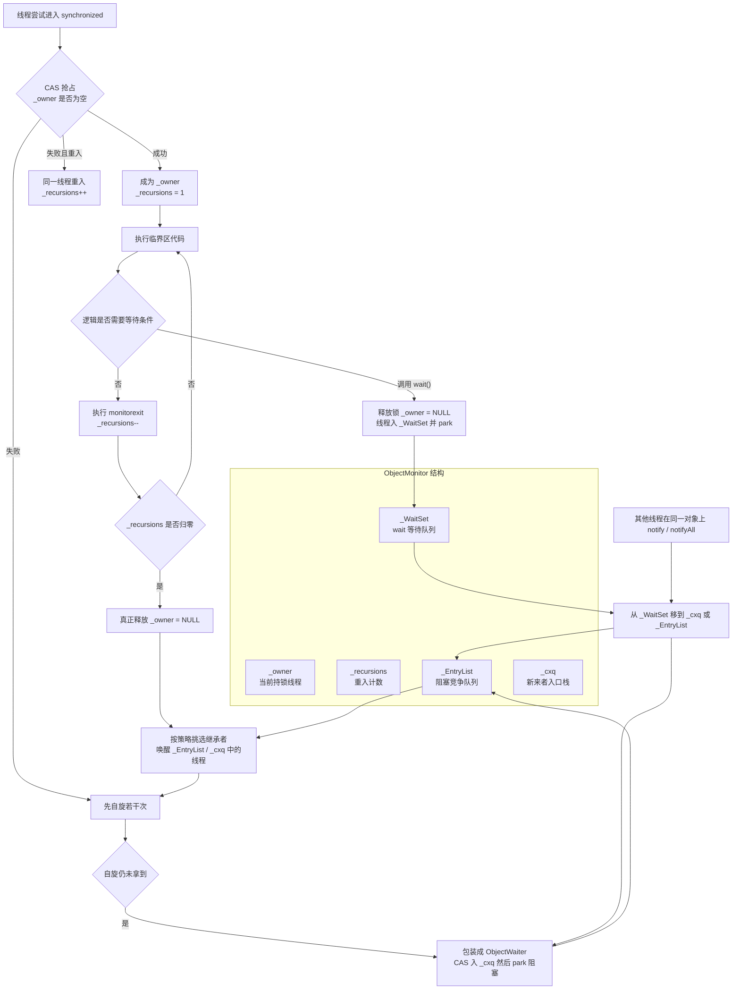
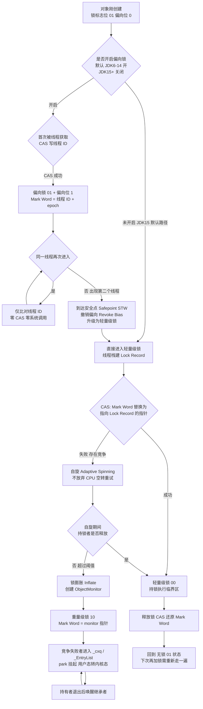

> 2026-10-14 成稿，Java 底层与并发主题  
> 2026-11-12 融合桌面《synchronized.pdf》《synchronized 锁升级.pdf》两份图解讲义：补 JOL 实测、与 ReentrantReadWriteLock 的降级对比、工程降锁开销清单，并订正两份原文 10 处表述（见第九节）

# synchronized 与锁升级：从字节码到 ObjectMonitor

## 一句话主线

synchronized 是 JVM 内置的**可重入、非公平、不可中断**的互斥原语，它靠对象头的 **Mark Word** 记录锁状态、靠 C++ 的 **ObjectMonitor** 实现阻塞与等待，并通过对大多数业务场景"其实没竞争"的洞察，设计了 **无锁 → 偏向锁 → 轻量级锁 → 重量级锁** 的单向升级路径，把 JDK 1.5 时代的性能包袱降到接近无锁的水平；而在 JDK 15 之后，**偏向锁已被 JEP 374 废弃**。

面试教练提示：这题的分水岭在于 —— P6 需要说清"偏向/轻量/重量三个阶段和自旋"；**P7 必须额外说出 ① Mark Word 各 bit 布局 ② 偏向锁在 JDK 15 被废弃的原因 ③ 批量重偏向/批量撤销阈值 ④ 与 ReentrantLock 的取舍。**

---

## 一、三种用法与锁对象

| 用法 | 代码示例 | 锁住的monitor对象 | 字节码表现 |
|------|----------|-------------------|------------|
| 修饰实例方法 | `public synchronized void m()` | **当前实例 this** | 方法 flags 上加 `ACC_SYNCHRONIZED`，无显式指令 |
| 修饰静态方法 | `public static synchronized void m()` | **当前类的 Class 对象**（`Xxx.class`） | 同上，方法 flags 加 `ACC_SYNCHRONIZED` |
| 同步代码块 | `synchronized(obj) { ... }` | **括号里指定的任意对象** | `monitorenter` / `monitorexit` 指令对 |

### 1.1 同步代码块的字节码

```java
public class SyncDemo {
    private final Object lock = new Object();
    private int value;
    public void inc() {
        synchronized (lock) { value++; }   // 显式指定锁对象，推荐写法
    }
}
```

`javap -c -p SyncDemo` 的关键输出：

```
  public void inc();
    Code:
       0: aload_0
       1: getfield      #3   // Field lock:Ljava/lang/Object;
       4: dup
       5: astore_1
       6: monitorenter              // ① 进入：尝试获取 lock 的 monitor
       7: aload_0
       8: dup
       9: getfield      #4   // Field value:I
      12: iconst_1
      13: iadd
      14: putfield      #4   // Field value:I
      17: aload_1
      18: monitorexit               // ② 正常路径退出
      19: goto          27
      22: astore_2                  //   异常落地开始
      23: aload_1
      24: monitorexit               // ③ 异常路径退出（第二个 monitorexit）
      25: aload_2
      26: athrow                    //    把异常继续抛出去
      27: return
    Exception table:
       from    to  target type
           7    19    22   any      // 覆盖整个临界区
          22    25    22   any
```

**必须能说出的两个关键点：**

1. **有两个 `monitorexit`**。JVM 在编译同步代码块时会**自动生成异常表**，无论临界区是正常 return 还是抛出异常，都必须走到 `monitorexit` 释放锁 —— 这是 synchronized 相对于 `ReentrantLock` 的最大优势之一：**编译器保证一定解锁，即使你的代码抛了异常或 return，不会像 lock/unlock 那样漏写 finally 导致死锁**。
2. `Exception table` 的 `from/to` 覆盖了 7~19（临界区范围），target 是 22（第二个 monitorexit 的位置）。看到 javap 输出里 monitorexit 的数量是 monitorenter 的两倍，属于正常现象。

### 1.2 方法级同步的字节码

```java
public synchronized void syncMethod() { value++; }
```

```
  public synchronized void syncMethod();
    descriptor: ()V
    flags: (0x0021) ACC_PUBLIC, ACC_SYNCHRONIZED
    // 方法体里没有任何 monitorenter/monitorexit
```

方法级同步是**隐式**的：JVM 在方法调用时检查 `ACC_SYNCHRONIZED` 标志，如果设置了，执行线程必须先获取 monitor（实例方法取 this、静态方法取 Class 对象），方法完成（正常或异常）时自动释放。好处是字节码更紧凑，缺点是**锁对象不可控**，粒度只能是整个方法。

> 方法论建议：实际工程中**优先用 `synchronized(private final Object lock)` 同步代码块**，而不是修饰方法。原因有三：① 锁粒度可控（不必锁住整个方法体）；② 锁对象私有外泄不出可以避免外部代码误同步导致死锁；③ `synchronized(this)` 会和该类里所有同步方法串成一把锁，容易意外降级为串行。

---

## 二、底层依赖：Monitor 与对象头

### 2.1 每个 Java 对象都关联一个 Monitor

在 HotSpot 里，每个对象都可以作为锁，因为：

- **Java 对象在堆里的布局 = 对象头（Header） + 实例数据（Instance Data） + 对齐填充（Padding）**
- 对象头又由三部分组成：**Mark Word** + **Klass Pointer（类型指针）** + （数组的话）数组长度
- **Mark Word** 是锁信息的载体，它在运行时会根据锁状态复用同一段 bit 存储不同内容

### 2.2 ObjectMonitor 结构（OpenJDK hotspot/share/runtime/objectMonitor.hpp）

当锁膨胀为**重量级锁**时，Mark Word 里存的是指向一个 C++ 对象 `ObjectMonitor` 的指针。核心字段：

| 字段 | 类型 | 作用 |
|------|------|------|
| `_owner` | void* / JavaThread* | 当前持有该 monitor 的线程（NULL 表示无主） |
| `_EntryList` | ObjectWaiter* 双向链表 | **阻塞队列**：抢锁失败的线程挂在这里，等待被唤醒再竞争 |
| `_WaitSet` | ObjectWaiter* 双向循环链表 | **等待队列**：调用了 `wait()` 的线程挂在这里 |
| `_recursions` | intptr_t | **重入计数**：同一线程每次重入 +1，退出 -1，归零才真正释放 |
| `_cxq` | ObjectWaiter* 单向栈 | 竞争队列：新来的抢锁线程先被 CAS 塞进这里，后由 _owner 在释放时迁移到 _EntryList |
| `_count` | volatile intptr_t | 近似等待线程数统计 |
| `_WaitSetLock` | int | 保护 _WaitSet 的自旋锁 |

> `_cxq` 和 `_EntryList` 是有分工的：`_cxq` 是**入口**，用 CAS 无锁push，吞吐高；`_EntryList` 是**候选**，唤醒时从这里挑。这个设计与 `synchronized` 的**非公平**特性直接相关 —— 新来的线程可以直接从 _cxq 插队抢到锁，不必排 _EntryList 的队。

补一句常被说错的话：<span style="color:red">**ObjectMonitor 的加锁入口确实是 CAS**</span>，`enter` 先 CAS 把 `_owner` 从 NULL 改成自己；但**解锁不是 CAS**，`exit` 用原子写把 `_owner` 置 NULL、`_recursions` 减到 0，再 `unpark` 后继。而且 CAS 失败之后也不是继续 CAS，而是包装成 `ObjectWaiter` 塞进 `_cxq` 然后 park。所以"加减锁都靠 CAS"只对了前半句。

#### ObjectMonitor 结构与线程流转图



### 2.3 Mark Word 布局（64 位 HotSpot）

64 位 JVM 下 Mark Word 占据 **8 字节 64 bit**，其结构随锁标志位动态变化：

| 锁状态 | 偏向标志 (biased_lock) | 锁标志位 (lock) | 存储内容（其余 62/58 bit） |
|--------|----------------------|----------------|---------------------------|
| **无锁 (Normal)** | 0 | **01** | identity hashcode（31 bit，调用过 hashCode 才写入） + 分代年龄（4 bit） + 未使用位（25 bit 压缩指针等） |
| **偏向锁 (Biased)** | 1 | **01** | 偏向线程 ID（JavaThread*，54 bit） + epoch（2 bit） + 分代年龄（4 bit） |
| **轻量级锁 (Lightweight Locked)** | - | **00** | 指向**栈帧中 Lock Record** 的指针（62 bit） |
| **重量级锁 (Heavyweight Locked)** | - | **10** | 指向 **ObjectMonitor** 的指针（62 bit） |
| **GC 标记 (Marked for GC)** | - | **11** | 空（不存任何东西，GC 专用标记） |

用 ASCII 图辅助记忆（低地址在右）：

```
|-------------------------------------------------------|--------------------|
|                    Mark Word (64 bits)                |   Klass Pointer    |
|-------------------------------------------------------|--------------------|

无锁态:   unused:25 | identity_hashcode:31 | unused:1 | age:4 | biased_lock:0 | lock:01
偏向态:   thread:54 |        epoch:2       | unused:1 | age:4 | biased_lock:1 | lock:01
轻量锁:                 ptr_to_lock_record:62                              | lock:00
重量锁:                 ptr_to_object_monitor:62                           | lock:10
GC标记:                 (空)                                              | lock:11
```

**必须记住的对应关系（面试高频考点）：**

- 锁标志位为 **01** 时还要看偏向标志位，**0 = 无锁，1 = 偏向锁**
- **00 = 轻量级锁，10 = 重量级锁，11 = GC 标记**
- 偏向锁态下 Mark Word 里**放不下 hashcode**：一个已经调用过 `Object.hashCode()` 的对象（无锁态写入了 hashcode）**无法进入偏向锁状态**；如果先偏向、再调 hashCode，JVM 会**直接撤销偏向并升级为重量级锁**（这是偏向锁的一个隐藏坑）。
- 分代年龄只有 4 bit，所以 **MaxTenuringThreshold 最大只能设 15**（`-XX:MaxTenuringThreshold=15`）。

---

## 三、锁升级全过程（核心）

### 3.1 为什么要升级？

JVM 团队的洞察：**绝大多数锁在实际运行中不仅没有多线程竞争，而且总是由同一个线程反复获得**。如果每次加锁都走一次 OS 级别的互斥量（mutex），那用户态↔内核态切换的开销就成了纯粹的浪费。于是设计了锁升级策略：**用最便宜的方式先尝试，真的发生竞争才逐步加码**。

### 3.2 锁升级状态机流程图



### 3.3 阶段一：偏向锁（Biased Locking）

**解决的问题**：消除同一线程反复加锁的同步开销，连 CAS 都不做。

**流程**：

1. 线程第一次获取锁时，JVM 用 **CAS** 把线程 ID 写进对象头的 Mark Word，并把偏向标志位置 1，锁标志位保持 01。
2. 此后该线程每次进入同步块，只需**比对 Mark Word 里的线程 ID 是否等于自己的 ID**，相等则直接放行 —— **不执行任何 CAS，不产生任何原子指令，几乎零成本**。
3. 一旦出现另一个线程尝试获取这把锁：**偏向锁必须被撤销**。撤销需要到达 **全局安全点（Safepoint）暂停所有线程（STW）**，检查持有偏向的线程是否还活着或者是否还在同步块里：
   - 原线程已退出同步块 → 撤销后对象回到无锁/可被重偏向状态；
   - 原线程仍在同步块中 → 升级为**轻量级锁**。

**偏向锁的代价（必须知道，这是 JDK 15 废弃它的理由）**：

- 撤销偏向需要 **STW**，而现代数据中心应用里 `HashMap`、`ConcurrentHashMap`、线程池任务队列这类 **JDK 内部数据结构被大量多线程竞争**，反而导致频繁的偏向撤销带来负收益。
- 维护成本极高：偏向锁的实现散布在解释器、C1、C2 三条执行路径里，为了适配它引入了大量复杂分支和 HotSpot 内部的代码特例。
- 收益下降：现代业务代码越来越倾向于**线程池 + 短任务**，一把锁往往被不同工作线程轮流持有，偏向的假设（同一个线程反复拿）不再成立。

### 3.4 阶段二：轻量级锁（Lightweight Locking）

**解决的问题**：线程交替执行（有竞争但很轻）时，避免直接升级为内核阻塞。

**加锁流程**：

1. 线程在自己**栈帧**里创建一个 **Lock Record**（锁记录，含一个 `displaced_mark_word` 字段用于备份原 Mark Word）。
2. 线程把对象 Mark Word **拷贝**进 Lock Record 的 displaced header（这一步叫 displaced mark word）。
3. 线程用 **CAS** 尝试把对象 Mark Word 替换成一个**指向自己 Lock Record 的指针**，同时把锁标志位改成 00。
4. **CAS 成功** → 获得轻量级锁，继续执行。
5. **CAS 失败** → 说明至少有两个线程在竞争，进入**自旋**。

**解锁流程**：用 CAS 把 Lock Record 里的 displaced mark word 还原回对象 Mark Word；**如果 CAS 失败，说明期间锁已经膨胀成了重量级锁**，必须走重量级锁的释放流程去唤醒阻塞线程。

> 面试细节：轻量级锁的 CAS 失败有两种情况 —— ① 真的是多线程竞争 ② 线程自己重入了（此时 CAS 也会失败，因为 Mark Word 已经是指向自己 Lock Record 的指针了）。JVM 会先检查是不是自己持的锁，是就把 Lock Record 的 displaced_header 置为 NULL 压栈作为重入计数。

### 3.5 自旋与自适应自旋

**自旋**：竞争失败的线程不立刻挂起，而是执行一个忙循环（如空转 `while` 或 CPU pause 指令）尝试反复 CAS，赌持锁线程很快释放。理由：**挂起/恢复线程涉及两次用户态↔内核态切换，代价远大于几十次忙循环**。

**自旋的问题**：自旋是**占用 CPU 空转**。如果持锁线程执行时间长（比如持锁做了一次 IO），自旋就是白白烧 CPU。

**自适应自旋（Adaptive Spinning，JDK 6 引入，JDK 7 起默认开启）**：

JVM 会根据这把锁上的历史表现动态调整：

- 如果上次自旋**成功**拿到过锁，JVM 认为这次大概率也能成功，**允许更长的自旋**（甚至增加 Spin 次数）；
- 如果某个锁上自旋**从来没成功过**，JVM 会**直接跳过自旋**，省得浪费 CPU。

同时 JVM 还会参考**锁持有者的状态**：若 owner 正在运行，增加自旋时间；若 owner 被阻塞/处于 sleep，则减少自旋时间。

> **面试口径**："自旋次数在早期版本是固定的（`-XX:PreBlockSpin`，默认 10 次），但 JDK 6 之后改成自适应自旋，由 JVM 根据上一次在同一把锁上的自旋成功率和锁持有者的运行时状态动态决策，JDK 7 之后这个参数是无效的默认自适应。这点和偏向锁不一样，自旋仍然是有效的优化手段。"

### 3.6 阶段三：重量级锁（Heavyweight Locking）

当**自旋超过阈值仍未获得锁**，或者有**多个线程同时在自旋**，JVM 判定竞争激烈，执行**锁膨胀（Inflate）**：

1. 向 OS 申请/复用一个 `ObjectMonitor` 对象；
2. 把 Mark Word 替换为指向该 monitor 的**指针**，锁标志位置为 **10**；
3. 后续竞争的线程被封装成 `ObjectWaiter`，经 `_cxq` 排队，然后 **park 挂起**。

到达这一步后，加锁失败的线程会：

- 从**用户态切换到内核态**（pthread mutex / park-unpark 底层依赖 OS 原语）
- 线程被挂起sleep，由 OS 调度器在锁释放时唤醒
- 涉及两次上下文切换 + 可能的 CPU 缓存失效

**这是 synchronized 真正昂贵的地方，也是"JDK 1.6 之前 synchronized 很慢"这句话的历史来源**（那时的 synchronized 直接就上系统互斥量，没有前面的几级优化）。

### 3.7 升级是单向的 —— 关于"锁降级"的准确表述

**主流且正确的面试结论：锁只能升级，不能降级。**

这里要分两层说清楚，避免回答得不准确被面试官追着打：

1. **偏向 → 轻量 → 重量** 这条链路是**单向**的。一旦膨胀成重量级锁（Mark Word 变成 monitor 指针），就**不会因为竞争消失而回退成轻量级锁或偏向锁**。
2. **重量级锁可以被"释放"**，释放后对象可以回到**无锁**状态：如果 ObjectMonitor 上没有线程在等待（_EntryList / _cxq 都空）且 JVM 在安全点执行 monitor deflation（去膨胀） 时，HotSpot 会回收/复用这个 monitor 对象并**将对象头还原为无锁的 Mark Word**。JDK 9+ 之后引入了更积极的异步 monitor deflation 机制。

> **面试口径（准确版）**："严格说锁升级是单向的，不存在重回轻量级锁或偏向锁的'降级'路径。但重量级锁在被彻底释放、且 JVM 在 safepoint 做 monitor deflation 时，可以把闲置的 ObjectMonitor 回收掉、把对象头还原成无锁态，这样后续再访问这个对象又要重新走一遍完整的锁获取流程。所以更严谨的说法是：锁状态在'已膨胀'这件事上不可逆，但'膨胀出来的 monitor'可以被回收，对象可以回到无锁起点。"

经常有人拿 ReentrantReadWriteLock 的锁降级来对比，这是两件不同的事，别混在一起：

| 维度 | synchronized 的"降级" | ReentrantReadWriteLock 的锁降级 |
| --- | --- | --- |
| 指什么 | 锁状态从重量级退回轻量级或偏向 | 持写锁时再申请读锁，然后释放写锁 |
| 是否存在 | 不存在，只能释放回无锁 | 支持，而且是官方推荐的用法 |
| 为什么 | 单一互斥语义，锁没有强弱之分；回退还得重建对象头，竞争回来又得再膨胀 | 保证释放写锁后数据不被别的写线程改掉，读到的仍是自己刚写的值 |
| 写法 | 无 | 先 `writeLock.lock()`，再 `readLock.lock()`，再 `writeLock.unlock()` |

所以"读写锁支持降级"说的是**锁的强弱转换**，"synchronized 不支持降级"说的是**锁状态不可回退**，两者只是共用了"降级"这个词。

### 3.8 偏向锁的现状（JDK 15 JEP 374，必答演进）

| JDK 版本 | 偏向锁状态 |
|----------|-----------|
| JDK 1.5 及之前 | 无偏向锁；synchronized 直接重量级，性能很差 |
| **JDK 6** | 引入偏向锁 + 轻量级锁 + 自适应自旋，**默认开启** |
| **JDK 7 ~ 14** | 默认开启偏向锁（`-XX:+UseBiasedLocking`），并有约 4s 的启动延迟（`-XX:BiasedLockingStartupDelay` 默认 4000ms，让 JVM 跳过启动阶段的大量单线程初始化） |
| **JDK 15** | **JEP 374：废弃偏向锁并默认禁用**（`-XX:-UseBiasedLocking`），命令行显式指定时会有 deprecation 警告 |
| **JDK 18+（规划）** | 相关代码逐步移除，最终 obsolete |

**废弃的三个理由（背下来）：**

1. **收益下降**：现代应用多线程竞争激烈，偏向锁频繁被撤销，而撤销需要 STW，反而拖慢。
2. **复杂度过高**：偏向锁在 HotSpot 的解释器、C1、C2 中实现分支众多，几乎只有 HotSpot 的核心实现团队能维护，成为引入新特性的障碍。
3. **替代出现**：JIT 的逃逸分析 + 锁消除，在很多原本依赖偏向锁的场景已经能直接把锁优化掉。

> **面试口径**："JDK 6 引入偏向锁是因为当时大量代码是单线程或伪并发；到 JDK 15 用 JEP 374 废弃默认关闭，原因是现代服务端应用多线程竞争激烈，偏向锁的 STW 撤销成本超过了收益，同时它在 HotSpot 里的实现复杂度已经变成维护负担。所以现在面试答锁升级时，标准说法是：无锁 → 轻量级锁 → 重量级锁，偏向锁作为一个历史优化阶段要额外说明它的演进背景，而不是当作默认必经的一级。"

---

## 四、偏向锁的批量重偏向与批量撤销

HotSpot 为每个**类**维护一个偏向锁撤销计数器（`Klass` 里的 `_biased_lock_revocation_count`），并设置一个 **epoch** 值。当一个类的实例频繁发生偏向撤销时，JVM 会触发两个批量优化。**阈值要背：20 和 40。**

### 4.1 批量重偏向（Bulk Rebias，阈值 20）

**触发**：某个类的对象作为锁，其偏向撤销次数**累计达到 20** 时。

**行为**：JVM 认为"这个类的锁确实被另一个线程批量地使用了"，于是**把这个类的 epoch 值 +1**。所有还处于偏向状态、且 epoch 值小于新 epoch 的对象，在下一次被线程访问时，JVM 认为它们处于"**可以重偏向**"状态，允许新的线程**直接 CAS 重偏向**到自己身上，而**不需要走到 STW 撤销**这条路。

**意义**：避免逐个对象走昂贵的 STW 安全点撤销。

### 4.2 批量撤销（Bulk Revoke，阈值 40）

**触发**：某个类的偏向撤销次数**累计达到 40** 时。

**行为**：JVM 判定"这个类的使用场景就是多线程竞争，不适合用偏向锁"，于是**把这个类的所有实例对象全部撤销偏向**（包括正在使用的和未加锁的），并把**该类标记为不可偏向**。此后这个类新建的对象**直接从无锁态开始**，不再进入偏向锁。

**意义**：承认失败，止损。

| 优化 | 阈值 | 后果 | 是否需要 STW |
|------|------|------|--------------|
| 批量重偏向 bulk rebias | **20** | 类 epoch+1，允许新线程 CAS 重偏向 | 否 |
| 批量撤销 bulk revoke | **40** | 该类所有实例撤销偏向，类被标记为不可偏向，后续 new 出的对象直接无锁 | 是（撤销动作本身） |

### 4.3 用 JOL 实测三种锁状态（可复现）

面试里说"我拿 JOL 看过对象头"比背结论更有说服力，但这段 demo 有四个坑，踩了就跑不出预期结果：

```java
// 依赖 org.openjdk.jol:jol-core
public class LockUpgradeDemo {
    static void print(String tag, Object o) {
        System.out.println("== " + tag + " ==");
        System.out.println(ClassLayout.parseInstance(o).toPrintable());
    }

    public static void main(String[] args) throws Exception {
        Thread.sleep(5000);                       // 坑 1：等过偏向锁 4s 启动延迟
        Object obj = new Object();
        print("新建", obj);                        // 101 可偏向，线程 ID 为 0（JDK 15+ 是 001）

        synchronized (obj) { print("首次加锁", obj); }   // 101 写入线程 ID

        Thread t2 = new Thread(() -> {
            synchronized (obj) { print("第二个线程", obj); }  // 00 轻量级
        });
        t2.start();
        t2.join();                                 // 坑 2：必须 join，否则看不到结果

        Thread t3 = new Thread(() -> {
            synchronized (obj) { print("并发竞争", obj); }    // 10 重量级
        });
        synchronized (obj) {                       // 坑 3：主线程持锁不放，制造真并发
            t3.start();
            Thread.sleep(100);
        }
        t3.join();
    }
}
```

JOL 0.16 之后会直接把状态标在值后面，比数二进制快得多：

| 输出片段 | 末 3 位 | 状态 |
| --- | --- | --- |
| `0x0000000000000005 (biasable; age: 0)` | 101 | 可偏向，还没绑定线程 |
| `0x0000000000029005 (biased: 0x...0a; age: 0)` | 101 | 已偏向 Thread-0 |
| `0x00000000027ef8f0 (thin lock: 0x...f0)` | 000 | 轻量级锁，指向栈上 Lock Record |
| `0x00000000026d4a0a (fat lock: 0x...0a)` | 010 | 重量级锁，指向 ObjectMonitor |
| `0x0000000000000001 (non-biasable; age: 0)` | 001 | 不可偏向的无锁态 |

第四行和第二行的区别值得停一下：都是 101，前者线程 ID 非 0，后者是 0。**新建对象在偏向生效后就是 101**（匿名偏向），不需要任何线程去抢，所以第一次 `synchronized` 只是把线程 ID 写进去，没有 CAS 竞争。

四个坑，按踩到的概率排：

1. **偏向锁有 4 秒启动延迟**。JVM 刚起来时 `-XX:BiasedLockingStartupDelay` 默认 4000ms，这期间 new 出来的对象是不可偏向的（001），加锁只能走轻量级。要么 `sleep(5000)`，要么加 `-XX:BiasedLockingStartupDelay=0`
2. **001 的对象永远变不成 101**。可偏向性是对象创建时就定下的，后面再加锁也改不了。网上不少 demo 先打印出 `...0001` 再声称"首次加锁变偏向锁"，这两句自相矛盾，看到就可以判定那份输出是拼的
3. **不制造并发就看不到膨胀**。两个线程一前一后各自加锁，最多到轻量级（00）；要看到 10，必须让一个线程持锁、另一个在门外等
4. **JDK 15 及以上没有偏向锁**。默认关闭，第一步直接是 00，跑不出 101 不是代码写错了。JDK 18 起 `-XX:+UseBiasedLocking` 已被 obsolete，加了也不生效

> 加分项：把这段跑通并截图，面试时能直接说"101 是匿名偏向，001 是不可偏向，同一份代码在 JDK 8 和 JDK 17 上第一步就不一样"，比只背流程图扎实得多。

---

## 五、synchronized 的其他重要特性

### 5.1 可重入性（Reentrancy）

同一线程可以**多次获取同一把锁**而不会自己把自己锁死。

- 重量级锁：靠 `ObjectMonitor._recursions` 计数，进入 +1，退出 -1，归零才真正释放。
- 轻量级锁：靠在栈里连续压入多个 **Lock Record**（displaced header 为 NULL 表示重入）来计数。
- 偏向锁：只需校验线程 ID 相同。

典型场景：一个 synchronized 方法调用另一个 synchronized 方法（同一个 this 锁）；子类同步方法调用 `super.xxx()` 的同步方法。

```java
public synchronized void outer() {
    inner();   // 同一个 this，不会死锁
}
public synchronized void inner() { }
```

### 5.2 非公平性（Non-fair）

synchronized **不保证等待最久的线程先获得锁**：

- monitor 的 `_cxq` 是一个 **LIFO 栈**，新来的线程被 push 到栈顶，在锁释放时有更大机会先被捞到；
- 而且新线程可以在进入队列前就尝试 CAS 抢占，直接插队。

这是吞吐与公平之间的权衡：非公平锁减少线程切换、提升吞吐，但可能导致饥饿。

### 5.3 不可中断性（Non-interruptible）

**线程在进入 synchronized 阻塞等待锁的过程中，无法响应 `interrupt()`**。

```java
// 线程 A 持有锁不释放，线程 B 执行：
Thread b = new Thread(() -> {
    synchronized (lock) { }   // 这里会一直阻塞
});
b.start();
b.interrupt();   // 无效！B 不会抛 InterruptedException，也不退出
```

这是 synchronized 相对于 `ReentrantLock` 的一个hard 限制：后者提供了 `lockInterruptibly()` 和 `tryLock(timeout)` 两种可以脱离等待的手段。（严格说，线程被 interrupt 后，`interrupt` 标志会被置位，进入同步块后你可以自己用 `Thread.currentThread().isInterrupted()` 检查并退出，但 JVM 不会自动抛异常帮你中断。）

### 5.4 wait / notify / notifyAll 必须在 synchronized 内调用

**原因**：`wait()` 的语义是"释放 monitor 所有权并挂到 `_WaitSet` 上"，它操作的就是 ObjectMonitor 的内部结构。如果调用者根本没持有这个 monitor，就没有 `_owner` 可以释放，也没有资格进 `_WaitSet`。

**不在 synchronized 内调用会抛 `IllegalMonitorStateException`**（运行时异常）。

```java
synchronized (lock) {
    while (!condition) {   // 必须用 while 而不是 if！防止虚假唤醒 spurious wakeup
        lock.wait();       // 释放锁 → 进入 _WaitSet → 被唤醒后重新抢锁
    }
    // 条件满足，处理业务
}

// 另一个线程
synchronized (lock) {
    condition = true;
    lock.notifyAll();      // 优先用 notifyAll，notify 只随机唤醒一个可能唤醒错对象
}
```

**wait vs sleep 的核心区别（必考）：**

| 对比项 | `wait()` | `sleep()` |
|--------|----------|-----------|
| 所属类 | `Object`（实例方法） | `Thread`（静态方法） |
| 是否释放锁 | **释放** monitor | **不释放**任何锁 |
| 使用前提 | 必须在 synchronized 内 | 无要求 |
| 唤醒方式 | `notify` / `notifyAll` / 带超时的 `wait(timeout)` | 超时到或被 interrupt |
| 底层落地位置 | `ObjectMonitor._WaitSet` | 线程被挂起但不进任何 monitor 队列 |

> 注意 `wait()` 释放锁的细节：线程从 `wait()` 返回时必须**重新竞争到锁**才能继续执行，所以被唤醒不等于立刻运行。

### 5.5 JVM 对 synchronized 的其他优化

**锁消除（Lock Elision）**

JIT 通过**逃逸分析（Escape Analysis）**判断某个锁对象**不会被其他线程访问到**（不外逸），就**完全移除**这次加锁/解锁。

```java
public String concat(String s1, String s2) {
    StringBuffer sb = new StringBuffer();   // JDK 自身例子
    sb.append(s1);
    sb.append(s2);
    return sb.toString();
    // sb 是局部变量，不逃逸，JIT 会消除 StringBuffer.append 内部的 synchronized
}
```

开启参数：`-XX:+DoEscapeAnalysis`（默认开），`-XX:+EliminateLocks`（默认开）。

**锁粗化（Lock Coarsening）**

JIT 发现**连续对同一个对象反复加锁解锁**（尤其循环体内），会把它们合并成**一个大范围的同步块**，减少无谓的加解锁次数。

```java
for (int i = 0; i < 1000; i++) {
    synchronized (lock) { doSomething(i); }
}
// JIT 可能优化成：
synchronized (lock) {
    for (int i = 0; i < 1000; i++) { doSomething(i); }
}
```

（注：锁粗化由 C2 自动完成，没有单独的开关参数，别去搜什么 `-XX:+UseLockCoarsening`。）

### 5.6 降低锁开销的清单

按"先测量、再动手"的顺序排，前三条是收益最大也最安全的：

1. **缩小同步块范围**。只包住共享变量的读改写，不要把日志、序列化、RPC 调用包进去。持有锁做 IO 是线上最典型的性能事故，一次 200ms 的远程调用就能把整条线程队列堵死
2. **用现成的并发容器替代手写同步**。计数用 `LongAdder` 或 `AtomicInteger`，映射用 `ConcurrentHashMap`，缓存用 `Caffeine`。这些类的分段、CAS、无锁读比一把大锁精细得多
3. **控制并发度**。锁竞争激烈往往是线程数开太多，把线程池调小有时比换锁更有效；数据分片（按 key 取模分段加锁）也是同一思路
4. **需要超时或中断时换 `ReentrantLock`**。高竞争下 `tryLock(timeout)` 能主动退让，避免线程无限期堆在锁上；`synchronized` 没有这个能力
5. **不要为了"优化"去关偏向锁**。JDK 15 起它本来就默认关了，参数也已被 obsolete；老 JDK 上只有确认"该锁被多线程轮流拿、撤销频繁"时，关掉才有意义，而且必须用 `-XX:+PrintBiasedLockingStatistics` 之类的数据说话
6. **别锁不该锁的对象**。字符串常量（可能来自常量池，全 JVM 共享）、包装类缓存（`Integer.valueOf` 复用 -128~127 的对象）、`this`（会波及同类所有同步方法）都是常见误用，应当用 `private final Object lock` 兜住

> 判断顺序建议：先进 `jstack` 看线程是不是真的停在 `BLOCKED (on object monitor)`，再用 JFR 的 `Java Monitor Blocked` 事件看阻塞时长，确认是锁竞争再改代码。凭感觉加锁、凭感觉去锁，通常只是把问题挪了个位置。

---

## 六、synchronized vs ReentrantLock 对比

| 维度 | synchronized | ReentrantLock |
|------|--------------|---------------|
| **实现层次** | JVM 关键字，字节码 + ObjectMonitor 实现 | JDK 层面，基于 **AQS**（AbstractQueuedSynchronizer）纯 Java 实现 |
| **加锁方式** | 关键字，自动释放（编译器生成两个 monitorexit） | 必须**手动** `lock()` / `unlock()`，且务必放在 `try-finally` |
| **是否可中断** | **不可**中断，等待锁时对 interrupt 无响应 | `lockInterruptibly()` 可中断 |
| **是否可超时** | 不支持 | `tryLock(long timeout, TimeUnit unit)` 支持 |
| **是否可尝试非阻塞获取** | 不支持 | `tryLock()` 立即返回 true/false |
| **公平性** | **只有非公平** | 构造时可选：**公平锁 / 非公平锁**（默认非公平） |
| **条件队列** | 一个 monitor 只有**一个** `_WaitSet`，只能用 wait/notify | 支持**多个 Condition**（`newCondition()`），可以实现精确分组唤醒 |
| **可重入** | 是（_recursions / Lock Record） | 是（AQS 的 state 计数） |
| **是否需要手动释放** | 否（异常路径编译器兜底） | **是**，漏写 finally 会死锁 |
| **是否可获取等待线程信息** | 不提供 | 提供 `getWaitingThreads`、`hasQueuedThreads`、`getQueueLength` 等监控接口 |
| **性能** | JDK 6 之后有锁升级优化，**低竞争、正常场景下与 ReentrantLock 基本持平甚至更快** | JDK 6 之前明显更快；如今**仅在高度竞争时因能避免无谓自旋而更可控** |
| **JVM 优化空间** | 有（JIT 可做锁消除、锁粗化，JVM 层面可见） | 无（JDK 层的普通类，JIT 优化力度小） |
| **推荐场景** | 常规互斥、简单同步块、不想操心解锁 | 需要 tryLock/可中断/公平/多条件队列/跨方法加锁解锁等高级能力 |

**选型建议（面试口径）：**

> "JDK 6 之后 synchronized 做了偏向锁、轻量级锁、自适应自旋、锁消除、锁粗化这一整套优化，**绝大多数普通场景首选 synchronized**——它代码简洁、不会忘记解锁、JVM 还能优化，而且 Thread Dump 里能直观看到锁信息。只有当需要 ReentrantLock 独有的能力时才用它：**可中断的锁获取、超时退让、公平锁、多个条件队列精确唤醒、跨方法加锁解锁（如手写的锁分段逻辑）**。另外由于 ReentrantLock 是 JDK 层实现，高竞争时它的等待队列能避免 synchronized 那种所有线程一起自旋烧 CPU 的情况，所以极端竞争下表现更可控。官方（Brian Goetz）的建议也是：除非需要那些高级特性，否则用 synchronized。"

---

## 七、追问链 · 参考答案

| 层级 | 问题 | 参考答案要点 |
| --- | --- | --- |
| L1 | synchronized 有哪三种用法？分别锁的是什么对象？ | 三种：修饰实例方法锁**当前实例 this**；修饰静态方法锁**当前类的 `Class` 对象**（`Xxx.class`）；同步代码块锁**括号里指定的任意对象**。前两者是隐式的，只在方法 flags 上打 `ACC_SYNCHRONIZED`；代码块则编译成显式的 `monitorenter`/`monitorexit` 指令对。 |
| L1 | 同步代码块在字节码层面是什么指令？为什么 `javap` 里会看到两个 `monitorexit`？ | 编译成 `monitorenter` 进入、`monitorexit` 退出。有两个 `monitorexit` 是因为编译器额外生成了异常表，覆盖整个临界区（from 7 to 19）：无论正常 return 还是抛异常，都要落到第二个 `monitorexit` 释放锁。这正是 synchronized 相对 ReentrantLock 的最大优势 —— 编译器保证一定解锁。 |
| L1 | 方法级 synchronized 和代码块 synchronized 在字节码上有什么区别？ | 方法级是隐式的：方法 `access_flags` 多一个 `ACC_SYNCHRONIZED`，方法体内没有任何 monitorenter/monitorexit，由 JVM 在调用时隐式获取 monitor。代码块是显式的 `monitorenter`/`monitorexit` 指令对。方法级字节码更紧凑，但锁对象不可控、粒度只能是整个方法。 |
| L1 | synchronized 是公平锁还是非公平锁？是可重入的吗？ | 是**非公平**锁：`_cxq` 是 LIFO 栈，新来线程被 push 到栈顶，且入队前可先 CAS 插队抢锁，不保证等待最久者先得。同时是**可重入**的：重量级锁靠 `ObjectMonitor._recursions` 计数，轻量级锁靠栈上连续压入 Lock Record，偏向锁只校验线程 ID。 |
| L2 | ObjectMonitor 的 `_EntryList` 和 `_WaitSet` 分别存放什么状态的线程？`_cxq` 又是什么？ | `_EntryList` 存**抢锁失败被 park 阻塞**的线程（候选队列）；`_WaitSet` 存调用了 `wait()` 主动等待条件的线程（双向循环链表）；`_cxq` 是单向栈，新来的抢锁线程先被 CAS 塞进这里，再由 owner 释放时迁移到 `_EntryList`。这一分工正是非公平的成因。 |
| L2 | `_recursions` 字段的作用是什么？对应 synchronized 的哪个特性？ | 它是**重入计数**：同一线程每次进入 +1、退出 -1，归零才真正把 `_owner` 置 NULL 释放锁。对应 synchronized 的**可重入性**，典型场景是同步方法调用另一个同锁的同步方法，或子类同步方法调用 `super` 的同步方法。 |
| L2 | 64 位 JVM 下 Mark Word 的锁标志位有哪几种组合？分别代表什么锁状态？ | 末两位：`01` 还要看偏向位，偏向位 0 是**无锁**（存 identity hashcode + 分代年龄），1 是**偏向锁**（存线程 ID 54 bit + epoch 2 bit + age 4 bit）；`00` 轻量级锁，存指向栈中 Lock Record 的指针；`10` 重量级锁，存指向 ObjectMonitor 的指针；`11` 是 GC 标记。 |
| L2 | 偏向锁和无锁的锁标志位都是 01，JVM 如何区分二者？ | 靠倒数第三位的**偏向标志位 biased_lock**。同为 `01` 时 biased_lock = 0 判为无锁，= 1 判为偏向锁。因为 64 bit 的 Mark Word 只有 2 位能表达 4 种状态，无锁与偏向只能共用 01，再用一位扩展区分。 |
| L2 | 为什么调用了 `hashCode()` 的对象无法进入偏向锁状态？ | 位域冲突：无锁态的 Mark Word 里 31 bit 已被 identity hashcode 占用，而偏向态那 54 bit 要存线程 ID，两者放不下。hashCode 只算一次且须终身稳定，所以先算过 hashCode 就进不了偏向态；若先偏向再调 hashCode，JVM 会直接撤销偏向并膨胀为重量级锁。 |
| L3 | 完整描述锁升级的四个阶段和每一步的触发条件。 | ① 无锁 → 偏向：首次被某线程获取，CAS 写线程 ID；② 偏向 → 轻量：第二个线程来竞争，在 Safepoint 撤销偏向后进入；③ 轻量 → 重量：自旋超阈值仍未拿到、或有多个线程同时在自旋，触发 inflate 膨胀；④ 另需注意 JDK 15 起偏向默认关闭，直接从无锁进轻量级锁。 |
| L3 | 偏向锁第一次获取时做了什么？之后同一线程再进入需要 CAS 吗？ | 首次获取由 JVM 用 CAS 把线程 ID 写进 Mark Word，并把偏向位置 1、锁标志位保持 01。此后同一线程再进入**只需比对 Mark Word 里的线程 ID 是否等于自己**，相等即放行 —— **不做任何 CAS、不产生任何原子指令**，几乎零成本。 |
| L3 | 偏向锁撤销为什么需要到达 Safepoint（STW）？这带来什么问题？ | 撤销要改写目标对象的 Mark Word，并判定持有偏向的线程是否还活着、是否仍停在同步块里；为避免检查过程中状态再变，必须到全局安全点暂停所有 Java 线程。代价是一次 **STW**，若这类撤销频繁发生（现代服务端很常见），收益被完全抵消 —— 这正是 JDK 15 废弃偏向锁的核心理由。 |
| L3 | 轻量级锁加锁时 Lock Record 建在哪里？存放什么内容？CAS 替换的指针指向谁？ | Lock Record 建在**当前线程的栈帧**里，其中 `displaced_mark_word` 字段先备份对象原 Mark Word；然后 CAS 把对象 Mark Word 替换成**指向该 Lock Record 的指针**，锁标志位置 00。解锁时再 CAS 把 displaced header 还原回去。 |
| L3 | 轻量级锁解锁时发现 CAS 失败，说明发生了什么？应该如何处理？ | 说明持有期间锁**已经膨胀成重量级锁**（Mark Word 已被换成 monitor 指针）。此时不能再简单还原，必须走重量级锁释放路径：`_recursions` 减到 0、`_owner` 置 NULL，并唤醒 `_cxq`/`_EntryList` 中的继承者。注意：自己重入时 CAS 也会失败，JVM 会先检查是否自持锁。 |
| L3 | 什么是自旋？什么是自适应自旋？JVM 依据什么动态调整自旋策略？ | 自旋是竞争失败后不挂起、忙循环反复 CAS，赌持锁者很快释放，省掉两次用户态↔内核态切换。**自适应自旋**（JDK 6 引入）按该锁的历史表现动态调整：上次自旋成功过就允许更长自旋，从没成功过则直接跳过；还参考 owner 状态，owner 运行时加长、被阻塞则缩短。 |
| L3 | 什么条件下会从轻量级锁膨胀为重量级锁？ | 轻量级锁 CAS 失败（说明存在真竞争）后先自旋；当**自旋超过阈值仍未获得锁**，或**有多个线程同时在自旋**，JVM 判定竞争激烈即 inflate：申请 ObjectMonitor、把 Mark Word 换成其指针、标志位置 10，后续竞争线程经 `_cxq` 排队并 park 挂起。 |
| L3 | 锁能不能降级？请给出严谨准确的表述。 | 主流结论是**锁只能升级不能降级**：偏向 → 轻量 → 重量单向，膨胀后不会因竞争消失而回退。严谨补充：ObjectMonitor 闲置且 JVM 在 safepoint 执行 monitor deflation（JDK 9+ 更积极）时，可将其回收并把对象头还原为**无锁态**，但那是回到起点而非降级，再加锁仍要走完整流程。 |
| L4 | JDK 15 的 JEP 374 做了什么？废弃偏向锁的三个理由是什么？ | JEP 374 **废弃偏向锁并默认禁用**（`-XX:-UseBiasedLocking`，显式指定会有 deprecation 警告）。三个理由：① 现代应用多线程竞争激烈，偏向频繁撤销且撤销要 STW，收益为负；② 在解释器/C1/C2 三条路径实现分支众多，维护成本过高；③ JIT 的逃逸分析 + 锁消除已能覆盖很多原场景。 |
| L4 | JDK 6 和 JDK 7 在偏向锁的默认开关上有什么区别？启动延迟参数是什么？ | 两者都**默认开启**偏向锁（`-XX:+UseBiasedLocking`），JDK 6 是引入它的版本（同时引入轻量级锁与自适应自旋）。真正的差别是启动延迟：`-XX:BiasedLockingStartupDelay` 默认 **4000ms**，让 JVM 跳过启动阶段的大量单线程初始化，前 4 秒 new 出的对象不带偏向。 |
| L4 | 批量重偏向和批量撤销的阈值分别是多少？触发后各自做了什么？ | 阈值按类累计的撤销次数计（存在 `Klass` 上）。**20** 触发批量重偏向：类 epoch +1，epoch 落后于新值的对象可被新线程直接 CAS 重偏向，不再走 STW 撤销。**40** 触发批量撤销：该类所有实例撤销偏向、类被标记为不可偏向，此后 new 出的对象直接从无锁态开始。 |
| L4 | `wait()` 为什么必须放在 synchronized 里？不在里面会怎样？ | `wait()` 的语义是"释放当前 monitor 所有权并把线程挂到 `_WaitSet`"，它直接操作 ObjectMonitor 的内部结构。未持有 monitor 就没有 `_owner` 可释放、也没资格进 `_WaitSet`，JVM 会抛 `IllegalMonitorStateException`（运行时异常）。 |
| L4 | `wait()` 和 `sleep()` 的核心区别？`notify` 和 `notifyAll` 应该优先用哪个，为什么？ | `wait()` 是 `Object` 的实例方法，**释放当前对象的 monitor** 并进入 `_WaitSet`，需 notify 或超时唤醒；`sleep()` 是 `Thread` 的静态方法，**一把锁都不释放**，只让出 CPU。应优先 `notifyAll`：notify 只随机唤醒一个，可能唤醒到等待不同条件的线程，造成信号丢失与永久挂起。 |
| L4 | 等待/通知的经典范式为什么要用 `while (!condition)` 而不是 `if`？ | 两个原因：一是存在**虚假唤醒**（spurious wakeup），线程可能在没有 notify 的情况下从 `wait()` 返回；二是被唤醒到重新抢到锁之间，条件可能又被其他线程改坏。用 `while` 保证唤醒后**重新校验条件**，不满足就继续 wait，这是官方推荐范式。 |
| L5 | `synchronized(this)` 和 `synchronized(private final Object lock)` 哪个好？为什么？ | 后者更好，三个理由：① 锁粒度可控，不必锁住整个方法体；② 锁对象私有不外泄，避免外部代码误同步导致死锁；③ `synchronized(this)` 会把该类所有同步方法串成同一把锁，容易意外降级为串行。同理也不推荐修饰方法。 |
| L5 | 什么是锁消除和锁粗化？各举一个例子。 | **锁消除**：JIT 经逃逸分析判定对象不外逸后直接移除加锁解锁，如局部 `StringBuffer.append` 里的 synchronized，参数 `-XX:+DoEscapeAnalysis` / `-XX:+EliminateLocks`（默认开）。**锁粗化**：把循环体内连续对同一对象的加解锁合并成一个大同步块，减少无谓的加解锁次数，由 C2 自动完成。 |
| L5 | 两个线程互相持有对方需要的锁会产生什么问题？如何用 jstack 定位死锁？（Found one Java-level deadlock） | 会形成**死锁**，双方永久阻塞、业务线程耗尽。定位用连续多次 `jstack <pid>`：输出末尾会出现 `Found one Java-level deadlock` 段，明确列出两个线程各自 `locked` 与 `waiting to lock` 的 monitor 地址及代码行，直接就能还原持有/等待环。 |
| L5 | synchronized 不能响应中断，如果一定要实现"等待锁超时后自动放弃"怎么办？（答：改用 ReentrantLock 的 tryLock(timeout)，或用 ConcurrentHashMap / Semaphore 等高层工具规避） | synchronized 等待锁时对 `interrupt()` 无响应（仅置位中断标志，需自己 `isInterrupted()` 检查）。要实现超时放弃，就换成 `ReentrantLock` 的 `tryLock(timeout, unit)` 或 `lockInterruptibly()`，在超时/中断分支里做补偿与降级；或者根本不阻塞 —— 改用 `ConcurrentHashMap`、`Semaphore` 等高层工具把互斥换成非阻塞路径。 |
| L5 | 生产环境 CPU 飙高但 QPS 很低，怀疑是 synchronized 重量级锁竞争，你会怎么验证和定位？（答：jstack 观察大量 thread 处于 BLOCKED 状态且 waiting to lock 同一个地址；perf / async-profiler 看 utime 分布；JFR 的 Java Monitor Blocked 事件） | 三步验证：① `jstack` 多次采样，若大量线程为 `BLOCKED (on object monitor)` 且 `waiting to lock` 指向同一个 monitor 地址，即可确认真竞争；② `async-profiler`/`perf` 看 utime 分布与锁相关栈顶；③ 开 JFR 采集 **Java Monitor Blocked** 事件，直接给出阻塞时长与代码位置。QPS 低而 CPU 高，说明大量时间耗在上下文切换与自旋上。 |
| L5 | 高并发计数器场景用 `synchronized` 还是 `AtomicInteger` 还是 `LongAdder`？各自的取舍？ | `synchronized` 语义最直白但高竞争下退化为内核互斥、两次上下文切换代价昂贵；`AtomicInteger` 用 CAS 自旋，中低竞争下最优且结果精确；`LongAdder` 用 `base + Cell[]` 分段（`Cell` 带 `@Contended` 防伪共享），高竞争吞吐可达 AtomicInteger 数倍，但 `sum()` 只是估计值，适合监控计数。 |
| L5 | 单例里有必要用 synchronized 吗？DCL 为什么还要配合 volatile？（呼应上一讲） | 通常没必要：优先用**静态内部类（Class Holder）**或**枚举**，它们由 JVM 类初始化锁保证线程安全且天然 lazy。若非要用 DCL，则 instance 必须 volatile —— `new Singleton()` 分分配内存、初始化、赋引用三步，后两步无数据依赖可被重排成"先赋引用"，其他线程第一次 null 检查会拿到未构造完的对象；volatile 写后的 StoreLoad 屏障禁止该重排，且这只在 JDK 1.5 之后的 JMM 下才可靠。 |

---

## 八、误区 · 正解

| ❌ 误区 | ✅ 正解 |
| --- | --- |
| 误区 1：synchronized 在 JDK 之后就不慢了，所以可以随便用。 | JDK 6 的优化（偏向锁、轻量级锁、自适应自旋、锁消除、锁粗化）只在**低竞争或无竞争**下生效。一旦真的膨胀成重量级锁，依然是内核态互斥，涉及两次上下文切换，代价很高。在长耗时的 IO 或 RPC 调用外面粗暴加 synchronized，是常见的性能事故来源。 |
| 误区 2：锁可以降级，竞争消失后重量级锁会退回轻量级锁。 | 锁升级是单向的，不存在重回轻量级或偏向态的"降级"路径。严谨说法是：ObjectMonitor 闲置后，JVM 在 safepoint 执行 monitor deflation 时可回收它并把对象头还原为**无锁态**，但那是回到起点而非降级 —— 对象再次加锁仍要走完整的锁获取流程。 |
| 误区 3：偏向锁现在还是默认开启的。 | **JDK 15 起 JEP 374 已废弃并默认禁用**（`-XX:-UseBiasedLocking`，显式指定会有 deprecation 警告）。原因是多线程竞争下撤销需 STW、成本超过收益，且实现复杂度过高。现在答锁升级应是"无锁 → 轻量级锁 → 重量级锁"，偏向锁只作为历史阶段说明演进背景。 |
| 误区 4：`synchronized` 修饰的方法比同步代码块性能更好/更紧凑，所以更推荐。 | 方法级只是字节码更紧凑（flags 多一个 `ACC_SYNCHRONIZED`），但锁粒度是整个方法体，且锁 this 会让该类所有同步方法串成一把锁而意外串行。工程上更推荐 `synchronized(private final Object lock)`：粒度可控、锁对象不外泄，避免外部代码误同步导致死锁。 |
| 误区 5：偏向锁是针对"代码片段"的，某个方法用了偏向锁就一直是偏向锁。 | 偏向锁是**对象级别**的状态，记录在对象头的 Mark Word 上，不是代码或方法的属性。同一个锁对象在不同时刻可以处于无锁、偏向、轻量级、重量级中的任意一种，并随竞争情况沿单向路径演进；批量撤销后该类新建对象还会直接从无锁态起步。 |
| 误区 6：自旋一定会自旋固定的 10 次（`-XX:PreBlockSpin`）。 | JDK 6 之后是**自适应自旋**：JVM 根据该锁历史上的自旋成功率与 owner 运行状态（运行中则加长、被阻塞则缩短）动态决策，从没成功过就直接跳过自旋以省 CPU。`-XX:PreBlockSpin` 在 JDK 7 之后已失效。偏向锁被废弃不等于自旋失效，自旋仍是有效优化。 |
| 误区 7：调用 `notify()` 会立刻唤醒线程并让它马上继续执行。 | `notify` 只是把线程从 `_WaitSet` 移到 `_cxq`/`_EntryList`，它还得**重新竞争到 monitor 锁**才能从 `wait()` 返回，被唤醒 ≠ 立即运行。这也是等待方必须用 `while` 而非 `if` 重新校验条件的原因 —— 唤醒到真正拿到锁之间，条件可能已被其他线程改坏。 |
| 误区 8：`wait()` 会释放所有锁，`sleep()` 也会释放锁。 | 正好要分清：`wait()` 只释放**当前那个对象的 monitor**，线程持有的其他锁一律不释放；而 `sleep()` **一把锁都不释放**，只是让出 CPU 时间片。另外 `wait()` 是 `Object` 的实例方法且必须在 synchronized 内调用，否则抛 `IllegalMonitorStateException`。 |
| 误区 9：synchronized 是悲观锁，一进去没拿到锁线程就挂起。 | 悲观锁的定性没问题，但"挂起"只对重量级锁成立。偏向锁阶段根本没有竞争，只比对线程 ID；轻量级锁阶段是在用户态自旋，线程保持 `RUNNABLE`；只有膨胀成重量级锁、进 `_cxq` 排队之后才 park 挂起。笼统说"没拿到就挂起"会把三级优化全抹掉。 |
| 误区 10：轻量级锁 CAS 失败就立刻膨胀成重量级锁。 | CAS 失败只是"有人跟我抢"的信号，接下来是自适应自旋。只有自旋超过阈值仍拿不到、或者出现第三个线程同时竞争，才 inflate。把这两步合并，就答不出"自旋为什么能省掉上下文切换"这个关键点。 |

---

## 九、两份原文的 10 处勘误

两份 PDF（`synchronized.pdf`、`synchronized 锁升级.pdf`）是同一主题的图解简版，结论大体对，但有 10 处需要改，其中第 5、6 条会让照着做的人跑不出结果：

| # | 原文说法 | 问题 | 正确说法 |
| --- | --- | --- | --- |
| 1 | synchronized 只支持锁升级，不支持锁降级 | 少了一个出口 | 不会退回轻量级或偏向，但释放后对象能回到无锁态（monitor deflation 会回收闲置 monitor）。读写锁的"降级"是另一个概念，见 3.7 |
| 2 | JVM 默认开启偏向锁（`-XX:+UseBiasedLocking`） | 版本已变 | JDK 6 到 14 默认开；JDK 15 起 JEP 374 默认关闭；JDK 18 起该参数 obsolete，加了不生效 |
| 3 | 轻量级锁 CAS 失败说明存在竞争，升级为重量级锁 | 跳过了自旋 | CAS 失败先进自适应自旋，自旋失败或有第三个线程竞争才 inflate。原文下一句自己又说"通过自旋尝试获取"，前后矛盾 |
| 4 | 重量级锁通过 monitorenter 和 monitorexit 指令实现 | 层次混淆 | 所有 synchronized 都编译成这两个指令，它们不是重量级锁的实现。重量级的实现是 `ObjectMonitor::enter` / `exit` |
| 5 | JOL 输出 `01 00 00 00` 标为无锁，紧接下一步标为偏向锁 | 两次输出自相矛盾 | 001 是不可偏向态，再加锁只能得到 00 轻量级。要看到 101，对象必须在偏向锁生效后创建，且创建时就是 101 |
| 6 | demo 里 new 完立刻加锁，没有等 4 秒 | 跑不出偏向锁 | 偏向锁有 `BiasedLockingStartupDelay` 默认 4000ms 延迟，需 sleep 或设该参数为 0 |
| 7 | demo 只 `start()` 不 `join()`，两个线程也没有重叠 | 看不到锁升级 | 主线程可能在子线程执行前就结束；两个线程先后执行最多到轻量级，要制造持锁与等待的真并发才会膨胀 |
| 8 | 建议用 `-XX:-UseBiasedLocking` 关闭偏向锁来优化 | 建议过时 | JDK 15+ 本来就关着，参数已 obsolete；老 JDK 上只有撤销确实频繁时才有收益，要靠统计数据判断 |
| 9 | synchronized 是悲观锁，没拿到锁就会线程挂起 | 只对重量级成立 | 偏向锁零竞争直接放行，轻量级锁自旋不挂起，进 `_cxq` 排队后才 park |
| 10 | ObjectMonitor 加减锁都是利用 CAS | 解锁不是 CAS | 加锁入口用 CAS 抢 `_owner`，失败后进 `_cxq` 并 park；解锁是原子写释放 `_owner`、`_recursions` 归零后 `unpark` 后继 |

原文还漏了三个面试常问的点，本文已在正文补齐：锁降级与 ReentrantReadWriteLock 的区别（3.7）、JOL 实测的四个坑（4.3）、降低锁开销的实操清单（5.6）。
