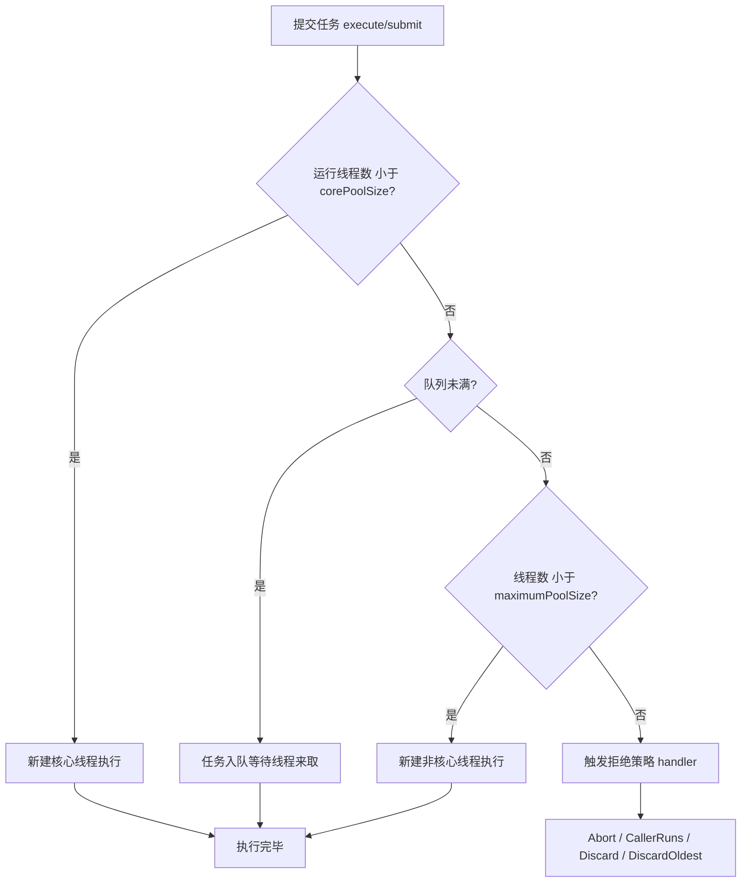

> 2026-10-28 成稿，Java 底层与并发主题  
> 素材来自公众号《7个参数、4种拒绝策略，和线上最常见的3个坑》（2026-10-28）  
> 核对后修正 5 处、补充 1 节：① workQueue 入队条件精确化（不是「核心线程忙才入队」，而是「运行线程数 ≥ corePoolSize 且队列未满」）；② 最大接收量公式加 in-flight 限定；③ 补充 SynchronousQueue 下 CachedThreadPool 的流转解释（解释它为何「来一个建一个线程」）；④ Spring @Async 默认执行器的装配顺序（纯 Spring 回退 SimpleAsyncTaskExecutor，Boot 有自动池化但参数需自定）；⑤ 线程数公式补封顶 caveat；⑥ 新增「线程池五种状态」一节（原文缺失的面试考点）。；2026-10-28 后续追加第十三节（参数动态调整 / setter）与第十四节（ForkJoinPool 对比）。  
> 版本前提：JDK 8+，ThreadPoolExecutor 的提交/流转/拒绝行为自 JDK 8 未变。
>
> 原文链接：<https://mp.weixin.qq.com/s/x9E7chOatJoDoBJgPILgVg>

# 线程池 ThreadPoolExecutor：参数、流转、拒绝策略与三个线上坑

## 一句话主线

线程池用「复用线程 + 限制数量 + 统一调度」解决了每请求 `new Thread` 的三大弊病；它的核心纪律是**任务流转顺序：核心线程 → 入队 → 扩容到最大 → 拒绝**，以及**队列必须有界**：无界队列和无限线程数（Executors 的坑）是线上 OOM 与接口超时的根源。

> 面试口径：问「线程池怎么工作的」别只背参数。标准答法是「七大参数 + 流转四步（core → queue → expand → reject）+ 默认 AbortPolicy + Executors 三个坑 + 线程池五种状态」。其中翻转最多人认知的是第二步：先入队、队列满了才扩容，而不是核心满了就立刻扩。

---

## 一、为什么不能直接 new Thread

每来一个请求 `new Thread(() -> handle()).start()`，有三个问题：

1. **创建销毁成本高**：线程要分配栈内存、走系统调用，比普通对象贵得多。
2. **数量不可控**：并发一高线程数爆炸，几千个线程光上下文切换就能把 CPU 吃满。
3. **无法管理**：没有统一的排队、拒绝、监控机制。

线程池同时解决这三件事：复用线程（避免反复创建）、限制数量（max 封顶）、统一调度（队列 + 拒绝策略 + 钩子监控）。

---

## 二、Executors 四个工厂方法为什么被禁用

《阿里巴巴Java开发手册》明确要求：不允许用 Executors 创建线程池，必须手动 `new ThreadPoolExecutor`。原因是默认参数埋了雷：

| 工厂方法                        | 隐藏参数                                                         | 后果                                                                                                 |
| --------------------------- | ------------------------------------------------------------ | -------------------------------------------------------------------------------------------------- |
| `newFixedThreadPool(n)`     | 队列 **`LinkedBlockingQueue`（无界**，`Integer.MAX_VALUE`）         | 消费慢时任务无限堆积，OOM                                                                                     |
| `newSingleThreadExecutor()` | 同上，无界队列                                                      | 同上，且只有 1 个线程                                                                                       |
| `newCachedThreadPool()`     | **`maximumPoolSize = Integer.MAX_VALUE`**，`SynchronousQueue` | <span style="color:rgb(222, 60, 54)">**任务来一个建一个线程**</span>，OOM（unable to create new native thread） |
| `newScheduledThreadPool(n)` | `DelayedWorkQueue`（容量 `Integer.MAX_VALUE`）                   | 堆积问题同无界队列                                                                                          |

实测 `newFixedThreadPool(2)` 提交 1 万个 sleep 60s 的任务：实际线程恒为 2，9998 个全堆在无界队列里，永不拒绝。另一个隐蔽问题是线程名都是 `pool-1-thread-1`，出事时 jstack 里分不清业务。

---

## 三、七大参数逐解

构造器签名：`ThreadPoolExecutor(corePoolSize, maximumPoolSize, keepAliveTime, unit, workQueue, threadFactory, handler)`。

| 参数                       | 含义     | 说明                                                                                                              |
| ------------------------ | ------ | --------------------------------------------------------------------------------------------------------------- |
| `corePoolSize`           | 核心线程数  | 常驻线程。默认**懒建**（来任务才创建）；`prestartAllCoreThreads()` 可预热。`allowCoreThreadTimeOut(true)` 后核心线程也遵守 `keepAliveTime` 回收 |
| `maximumPoolSize`        | 最大线程数  | 队列满之后线程数最多能扩到的上限                                                                                                |
| `keepAliveTime` + `unit` | 空闲存活时间 | **超出核心线程数**的线程，空闲超过该值后被回收                                                                                       |
| `workQueue`              | 工作队列   | 运行线程数 ≥ `corePoolSize` 且队列未满时，新任务入队等待                                                                           |
| `threadFactory`          | 线程工厂   | 强烈建议自定义，给线程起有意义名字，排查全靠它                                                                                         |
| `handler`                | 拒绝策略   | 队列满且线程数达上限时触发                                                                                                   |

> 注意 `workQueue` 这条：它的入队条件是「当前运行线程数 ≥ corePoolSize，且队列还有空位」。核心线程还没占满时，新任务优先**新建核心线程**而不是入队。这是第四节流转顺序的物理前提。

---

## 四、任务提交后怎么走（最容易被误解的一步）

很多人以为是「核心满了就扩容，扩到最大再排队」。错。真实顺序是：

**核心线程 → 入队 → 扩容到最大 → 拒绝**

提交一个任务（`execute`/`submit`）时源码（`execute` → `addWorker` / `workQueue.offer`）判定顺序：

1. 若当前运行线程数 **< `corePoolSize`** → 新建核心线程执行（**不入队**）。
2. 否则尝试**入队**（`workQueue.offer`）：
   - 成功 → 任务在队列里等线程来取。
   - 失败（队列满）→ 进入第 3 步。
3. 若当前线程数 **< `maximumPoolSize`** → 新建**非核心**线程执行。
4. 否则 → 触发**拒绝策略** `handler.rejectedExecution`。

```java
// 验证：core=1, max=3, 队列容量=2，连续提交 6 个任务
ThreadPoolExecutor pool = new ThreadPoolExecutor(1, 3, 60, TimeUnit.SECONDS, new ArrayBlockingQueue<>(2));
// 每个任务 sleep 2s，提交瞬间都来不及消费
```

实测输出（节选）：

```
提交任务1 -> 池内线程数=1, 队列积压=0   // 新建核心线程
提交任务2 -> 池内线程数=1, 队列积压=1   // 核心已满，入队
提交任务3 -> 池内线程数=1, 队列积压=2   // 队列满
提交任务4 -> 池内线程数=2, 队列积压=2   // 队列满，扩容到第 2 个线程
提交任务5 -> 池内线程数=3, 队列积压=2   // 继续扩容到最大
提交任务6 -> 被拒绝(队列满且线程已达上限)
```

### 容量结论与流转图

在途（in-flight）任务数上界 = **`maximumPoolSize` + 队列容量**。上例 = 3 + 2 = 5，第 6 个被拒。

> 限定语：这是「任务来不及消费（都还在跑或在排）的瞬间」能容纳的**未完成任务数上界**。一旦有任务执行完腾出队列位，就能再接收新任务，所以它不是累计总接收数。做容量规划时，这个数（max + queue）才是系统真正的「缓冲水位」，超过即触发拒绝。



### 为什么设计成「先排队再扩容」

因为线程创建/销毁成本高。队列能缓冲就先缓冲，避免任务量稍微一波动就疯狂建线程、之后又大批销毁。这是「用队列换线程数稳定」的取舍，也正因如此，**队列容量的选择直接决定了线程池的行为**。

### SynchronousQueue 为什么让 CachedThreadPool「来一个建一个线程」

`CachedThreadPool` 的 `corePoolSize=0`、`maximumPoolSize=Integer.MAX_VALUE`、队列是 `SynchronousQueue`（容量 0，不存任务）。套用上面的规则：

- 第 1 步「线程数 < core(0)」恒为假 → 不走建核心线程。
- 第 2 步入队 → 容量 0 必然失败。
- 第 3 步建非核心线程 → 直到 `Integer.MAX_VALUE`。

所以 CachedThreadPool 表现出来就是「每个任务新建一个线程」，这正是它 OOM 的根源，和 FixedThreadPool「无界队列堆积」是同一病根的两种表现。

---

## 五、四种拒绝策略

| 策略                    | 行为                             | 适用场景              |
| --------------------- | ------------------------------ | ----------------- |
| `AbortPolicy`（默认）     | 抛 `RejectedExecutionException` | 大多数业务，让调用方感知过载    |
| `CallerRunsPolicy`    | 由**提交任务的线程自己**执行               | 能接受降速、不想丢任务（天然背压） |
| `DiscardPolicy`       | 静默丢弃，什么都不做                     | 可丢的日志、埋点          |
| `DiscardOldestPolicy` | 丢**队列**最老的任务，再提交当前             | 只要最新数据的场景         |

默认的 `AbortPolicy` 其实是最好的默认值，起码抛异常能在日志里看到问题。最怕 `DiscardPolicy`，任务悄悄没了，排查毫无线索。

`CallerRunsPolicy` 很实用：队列满就让提交线程（如 Tomcat 工作线程）自己跑，该线程被占住就不再接收新请求，**天然形成背压**，把「雪崩」变成「变慢」。代价是接口响应变慢，但比丢请求或 OOM 好。

---

## 六、线程池的五种状态（面试高频，原文缺失）

线程池用一个 `AtomicInteger ctl` 同时存「运行状态（高 3 位）」和「工作线程数（低 29 位）」。五种状态及转换：

| 状态           | 接收新任务 | 处理队列任务 | 中断在跑任务 | 进入方式                            |
| ------------ | ----- | ------ | ------ | ------------------------------- |
| `RUNNING`    | 是     | 是      | 否      | 初始状态                            |
| `SHUTDOWN`   | 否     | 是      | 否      | `shutdown()`                    |
| `STOP`       | 否     | 否      | 是      | `shutdownNow()`                 |
| `TIDYING`    | 否     | 否      | 否      | 队列空且 worker=0（SHUTDOWN/STOP 之后） |
| `TERMINATED` | 否     | 否      | 否      | `terminated()` 钩子执行完            |

转换路径：

- `RUNNING` → `SHUTDOWN`（`shutdown()`）/ → `STOP`（`shutdownNow()`）
- `SHUTDOWN` 或 `STOP` → `TIDYING`（队列空且工作线程数归 0）
- `TIDYING` → `TERMINATED`（`terminated()` 跑完）

**关键区分：`SHUTDOWN` 与 `STOP` 的区别**：`SHUTDOWN` 不再收新任务，但会把队列里已提交的任务跑完；`STOP` 既不再收新任务，也**不**处理队列任务，还会中断正在执行的任务。这也是为什么优雅停机要用 `shutdown()` + `awaitTermination()` 而不是 `shutdownNow()`（后者会丢队列里没跑的任务）。

---

## 七、execute 与 submit 的区别（异常吞噬）

| 维度   | `execute(Runnable)`                      | `submit(Callable/Runnable)`                        |
| ---- | ---------------------------------------- | -------------------------------------------------- |
| 返回值  | 无（`void`）                                | 返回 `Future`                                        |
| 异常处理 | 任务内未捕获异常直接在线程抛出，打印到未捕获异常处理器（默认打到 stderr） | 异常被 `FutureTask` 捕获存入 outcome，**不调 `get()` 就静默丢失** |
| 源码   | 直接 `task.run()`，无包装                      | 内部 `new FutureTask<>(task)` 包装                     |

实测：同一个会抛 `RuntimeException` 的任务，`execute` 打印完整堆栈，`submit` 一点动静都没有。原因在 `FutureTask.run()` 把 `Throwable` 存进 `outcome`，只有 `get()` 才以 `ExecutionException` 抛出。

解决办法（任选）：

1. 不需要返回值就别用 `submit`，用 `execute`。
2. 用 `submit` 就一定要 `future.get()` 并 catch `ExecutionException`。
3. **最稳：任务内部自己 `try-catch`**（见第九节坑一）。

一句话：**任务里必须自己兜住异常，靠线程池帮你兜不住。**

---

## 八、三个线上坑

### 坑一：submit 吞异常

见第七节。正解：任务内 `try-catch`，或 `submit` 后必 `get()`，或用 `afterExecute` 钩子捞异常。

### 坑二：线程复用导致 ThreadLocal 脏数据 + 泄漏

线程池最本质特点是线程被复用，上一个任务留在 `ThreadLocal` 里的数据，下一个任务会直接读到，真实系统里就是用户数据串号（A 看到 B 的订单）。

规则：**`ThreadLocal`** 用完必须在 `finally` 里 `remove()`。

```java
pool.execute(() -> {
    try {
        CONTEXT.set(currentUser);
        doSomething();
    } finally {
        CONTEXT.remove();  // 一定要写
    }
});
```

顺带：ThreadLocal 的 `Entry` 用弱引用指向 key（ThreadLocal 对象），但 **value 是强引用**。key 被回收后若 value 还在，会留下 `key=null` 但 value 仍占内存的记录，这就是 ThreadLocal 内存泄漏。`remove()` 既能防串号也能防泄漏。

### 坑三：无界队列堆积把堆撑爆

用 64M 堆跑 `newFixedThreadPool(2)` + 每个任务持有 1MB 数据的死循环，只提交 57 个任务就 OOM（Java heap space）。因为任务在队列里排队、持有的数据一直不释放。真实业务一个任务可能持几百 KB 请求体 + 上下文，堆积几万就是几个 G。整个过程线程池**没有任何告警**，它只是在排队。

---

## 九、参数到底怎么设

### 9.1 线程数

| 任务类型    | 参考公式                    | 实例                                                                                      | 说明                 |
| ------- | ----------------------- | --------------------------------------------------------------------------------------- | ------------------ |
| CPU 密集型 | `N + 1`                 | <span style="background-color:rgb(243, 245, 247)">校验参数、算优惠金额</span>                     | N 是核数，多 1 个应对偶发缺页  |
| IO 密集型  | `2N` 起步                 | <span style="background-color:rgb(243, 245, 247)">查用户、查库存（数据库）、调支付网关（网络）、写订单、发消息</span> | IO 等待时线程让出 CPU，可多配 |
| 更精确     | `N × (1 + 等待时间 / 计算时间)` |                                                                                         | 需压测得到实际等待/计算比      |

公式只是起点：从 `N+1`（CPU）或 `2N`（IO）起步，压测看「队列积压是否持续增长、线程是否长期 RUNNABLE」。但**算出的数要设上限**，IO 等待比很大时公式会算出几千，受限于下游连接数、内存和上下文切换成本，不能真开几千个线程。

### 9.2 队列选型

| 队列                      | 特点            | 适用                |
| ----------------------- | ------------- | ----------------- |
| `ArrayBlockingQueue`    | 有界数组，性能好      | 推荐，绝大多数场景         |
| `LinkedBlockingQueue`   | 可指定容量（不指定=无界） | 容量必须显式指定          |
| `SynchronousQueue`      | 不存储，直接交给线程    | 配大 max，如 Cached 池 |
| `PriorityBlockingQueue` | 按优先级出队        | 有优先级需求            |
| `DelayQueue`            | 延迟出队          | 定时任务              |

**核心原则：队列一定要有界。** 无界队列等于把 OOM 风险推到最难排查的时候。

### 9.3 一个可直接用的配置

```java
int cpu = Runtime.getRuntime().availableProcessors();
int core = cpu + 1;                 // CPU 密集型
int max  = core * 2;
int queueCapacity = 200;            // 有界队列

return new ThreadPoolExecutor(
    core, max, 60L, TimeUnit.SECONDS,
    new ArrayBlockingQueue<>(queueCapacity),
    r -> {                          // 自定义线程名，jstack 一眼辨业务
        Thread t = new Thread(r, "order-pool-" + seq.getAndIncrement());
        t.setDaemon(false);
        return t;
    },
    new ThreadPoolExecutor.CallerRunsPolicy());  // 满了让调用线程自己跑，背压
```


刻意选择：`ArrayBlockingQueue(200)` 满了就拒绝，问题在可控范围暴露；`CallerRunsPolicy` 形成背压；自定义线程名便于排查；`max = core*2` 给突发留扩容空间；`keepAliveTime=60s` 突发过后回收多余线程。

---

## 十、优雅关闭

```java
pool.shutdown();                    // 不收新任务，已提交的任务跑完
if (!pool.awaitTermination(30, TimeUnit.SECONDS)) {
    log.warn("线程池未在30秒内关闭，强制中断");
    pool.shutdownNow();             // 中断所有线程，返回未执行的任务
}
```

两点：

1. `shutdown()` 之后再提交任务会触发拒绝（`RejectedExecutionException`）。
2. 线上停机先 `shutdown()` 再 `awaitTermination()`，否则正在执行的任务可能被硬中断。

---

## 十一、监控：线程池不报错，必须自己盯

继承 `ThreadPoolExecutor` 重写 `beforeExecute` / `afterExecute` 钩子，把指标打出来：

- `afterExecute` 里若 `r instanceof Future`，调 `((Future<?>) r).get()` 能把被 `submit` 吞掉的异常捞出来。
- 重点指标：`getQueue().size()`（队列积压，持续增长=过载信号）、`getActiveCount()`（长期等于 max=线程打满）、`getLargestPoolSize()`（判断 max 设得是否合理）。
- 告警建议：队列积压 > 容量 80%，或活跃线程数连续 N 分钟等于 max，就该告警。

---

## 十二、Spring Boot 里的 @Async

**默认执行器装配顺序**（被很多人讲错，这里精确化）：

1. `@Async("beanName")` 指定的 bean；
2. `AsyncConfigurer` 提供的 executor；
3. 容器中名为 `taskExecutor` 且类型为 `Executor` 的 bean；
4. 以上都没有，纯 Spring 框架会回退到 `SimpleAsyncTaskExecutor`（**每个任务新建一个线程，无池化**）。

- 纯 Spring（未配 AsyncConfigurer、无 taskExecutor bean）：落回 `SimpleAsyncTaskExecutor`，这正是「每任务一线程」的坑。
- **Spring Boot（2.1+）**：`TaskExecutionAutoConfiguration` 自动注册了一个 `ThreadPoolTaskExecutor`（bean 名 `applicationTaskExecutor`，别名 `taskExecutor`），所以 Boot 里 `@Async` 通常落到**这个池化执行器**，而不是 SimpleAsyncTaskExecutor。但其默认并发参数未必贴合你的业务，且你失去了对队列有界性、拒绝策略的显式控制。

**结论不变：无论哪种框架，生产都显式声明自己的线程池并指定名字。**

```java
@Configuration
public class AsyncConfig {
    @Bean("orderExecutor")
    public ThreadPoolTaskExecutor orderExecutor() {
        ThreadPoolTaskExecutor ex = new ThreadPoolTaskExecutor();
        ex.setCorePoolSize(8);
        ex.setMaxPoolSize(16);
        ex.setQueueCapacity(200);
        ex.setKeepAliveSeconds(60);
        ex.setThreadNamePrefix("order-async-");
        ex.setRejectedExecutionHandler(new ThreadPoolExecutor.CallerRunsPolicy());
        ex.setWaitForTasksToCompleteOnShutdown(true);  // 停机时跑完异步任务，不丢
        ex.setAwaitTerminationSeconds(30);
        ex.initialize();
        return ex;
    }
}
```

使用时 `@Async("orderExecutor")` 指定，别落到默认池。`ThreadPoolTaskExecutor` 底层就是 `ThreadPoolExecutor`，参数含义完全一致。

## 十四、ForkJoinPool 与 ThreadPoolExecutor 的对比

ForkJoinPool 面向「分治 + 工作窃取」，和 ThreadPoolExecutor 的「共享队列 + 固定 worker」是两套模型。

**核心差异**

| 维度    | ThreadPoolExecutor                | ForkJoinPool                                                                          |
| ----- | --------------------------------- | ------------------------------------------------------------------------------------- |
| 任务队列  | 全局一个 `BlockingQueue`，所有 worker 争抢 | 每个 worker 一条**双端队列**（deque），任务压自己队头、取自己队头                                             |
| 取任务方式 | worker 从共享队列取                     | worker 从自己 deque 头取；**空闲 worker 从别人 deque 尾偷**（work-stealing）                         |
| 适用任务  | 相互独立的普通任务、IO 任务                   | 递归可再分的 CPU 密集计算（分治）                                                                   |
| 默认并行度 | 你显式设 core/max                     | 默认 = `availableProcessors()`（commonPool）                                              |
| 阻塞 IO | 适合（线程多、可配大 max）                   | 不适合（worker 数少，一个阻塞占一个，commonPool 还影响并行流）                                              |
| 提交入口  | `execute` / `submit`              | `invoke` / `fork`+`join`，任务是 `ForkJoinTask`（`RecursiveTask` 有返回值、`RecursiveAction` 无） |

**工作窃取为什么快**：任务分治后，每个 worker 把自己拆出的子任务压进自己的 deque，先做完的线程不去空等，而是从别的线程 deque **尾部**偷任务（尾偷降低与 owner 在头部的竞争）。这让「拆出很多小任务」的场景几乎没有队列争用。

**什么时候用哪个**

- 普通业务异步、调用下游 RPC、写库等 IO 等待场景：用 **ThreadPoolExecutor**，队列有界 + 拒绝策略兜底。
- 纯 CPU 计算且可递归拆分（如大数组排序、树遍历、归并）：用 **ForkJoinPool**，或直接在 `ForkJoinPool.commonPool()` 上跑 `parallelStream()` / `CompletableFuture` 的纯计算阶段。

**两个大坑**

1. **别把阻塞 IO 丢进 commonPool**。`parallelStream()`、未指定 executor 的 `CompletableFuture` 默认用 `commonPool()`（JVM 级共享、守护线程、并行度 = 核数）。里面一旦有阻塞 IO 或 `join()` 另一个 future，会占住 commonPool 的 worker，拖累整个 JVM 上所有用并行流的地方。需要 IO 时显式传自定义 `Executor`。
2. **ForkJoinPool 不适合 IO 密集**：它 worker 数量约等于核数，没有线程数弹性；一个阻塞任务就废一个 worker。要 IO 并发还是回到 ThreadPoolExecutor 配大 max。

> 速记：ThreadPoolExecutor 是「一个队列大家抢」，适合杂活和 IO；ForkJoinPool 是「各干各的、闲的偷别人的」，适合 CPU 分治。

---

## 面试问法

| 编号  | 问题                                     | 答案（同一文档内可直接朗读）                                                                                                                                               |
| --- | -------------------------------------- | ------------------------------------------------------------------------------------------------------------------------------------------------------------ |
| L1  | 线程池提交任务的顺序？                            | 核心线程 → 入队 → 扩容到最大 → 拒绝。核心满了不直接扩容，而是先入队，队列满才扩容                                                                                                                |
| L2  | 为什么先排队再扩容？                             | 线程创建/销毁贵，用队列缓冲换线程数稳定，避免任务量微波动就狂建线程                                                                                                                           |
| L3  | 最大接收量怎么算？                              | 在途任务上界 = maximumPoolSize + 队列容量；再多一个（且前面没完成）就触发拒绝。是瞬时上界非累计                                                                                                   |
| L4  | Executors 为什么被禁用？                      | FixedThreadPool/Single/ Scheduled 用无界队列堆积 OOM；CachedThreadPool 用 SynchronousQueue + max=MAX_VALUE 无限建线程 OOM                                                  |
| L5  | execute 和 submit 异常区别？                 | execute 未捕获异常直接抛到线程；submit 包 FutureTask 把异常存进 outcome，不调 get() 就静默丢失                                                                                         |
| L6  | 四种拒绝策略？                                | AbortPolicy（默认，抛异常）、CallerRunsPolicy（提交线程自己跑，背压）、DiscardPolicy（静默丢）、DiscardOldestPolicy（丢最老再提交）                                                              |
| L7  | 线程池有哪几种状态？shutdown 与 shutdownNow 区别？   | RUNNING/SHUTDOWN/STOP/TIDYING（整理）/TERMINATED（终止） 五种。SHUTDOWN 不收新任务但跑完队列；STOP 不收新任务、不跑队列、中断在跑任务                                                               |
| L8  | ThreadLocal 在线程池里为什么危险？                | 线程复用导致上一任务数据被下一任务读到（串号），且 value 强引用泄漏；必须 finally remove                                                                                                      |
| L9  | 怎么合理设线程数？                              | **<u>CPU 密集 N+1、IO 密集 2N 起步</u>**，公式 N×(1+等待/计算)，压测调整并封顶，别真开几千线程                                                                                             |
| L10 | Spring @Async 默认线程池？                   | 纯 Spring 未配置回退 SimpleAsyncTaskExecutor（每任务一线程）；Boot 有自动 TaskExecutor 池化但参数需自定；生产都显式声明命名池                                                                     |
| L11 | 线程池参数能运行时动态调整吗？                        | 能。**setCorePoolSize / setMaximumPoolSize / setKeepAliveTime / setRejectedExecutionHandler 均可热改**；setThreadFactory 只影响新线程。但 workQueue 容量构造时定死不可热改，队列要留余量或接受重建 |
| L12 | ForkJoinPool 和 ThreadPoolExecutor 怎么选？ | ThreadPoolExecutor 是共享队列大家抢，适合普通任务与 IO；ForkJoinPool 是每 worker 一条 deque、工作窃取，适合递归可再分的 CPU 密集计算。阻塞 IO 别进 commonPool，否则拖累全 JVM 并行流                              |

---

## 误区 · 正解

| 误区                              | 正解                                                                           |
| ------------------------------- | ---------------------------------------------------------------------------- |
| 核心线程满了才扩容                       | 错。先入队，队列满才扩容（核心 → 队列 → 扩容 → 拒绝）                                              |
| 用 Executors 省事                  | 错。无界队列/无限线程埋 OOM 雷，阿里规约禁用，手动 new ThreadPoolExecutor                          |
| submit 和 execute 一样             | 错。submit 吞异常，必须 get() 或任务内 try-catch                                         |
| 线程池会帮你兜异常                       | 错。靠任务内 finally/try-catch，靠 afterExecute 监控捞 submit 异常                        |
| ThreadLocal 用完不用 remove         | 错。线程复用会串号 + value 强引用泄漏，finally 里 remove                                     |
| 队列越大越安全                         | 错。无界队列把 OOM 风险推到最难查的时候，队列必须有界                                                |
| CallerRunsPolicy 会丢任务           | 错。它不丢，让提交线程自己跑形成背压，代价是变慢                                                     |
| shutdown() 后还能提交                | 错。shutdown() 后提交直接被拒绝；要等收尾用 awaitTermination                                 |
| 纯 Spring 和 Boot 的 @Async 默认一样   | 错。纯 Spring 未配置回退 SimpleAsyncTaskExecutor 无池化；Boot 自动提供 TaskExecutor 池化但参数需自定 |
| 队列满调大 maximumPoolSize 就能立刻扩容    | 错一半。setter 可热改，但 workQueue 容量构造定死不可热改；已超的线程数也是空闲才回收，不会立刻杀                    |
| 并行流/CompletableFuture 默认池也能跑 IO | 错。默认用 commonPool（并行度=核数），阻塞 IO 会占满 worker 拖累全 JVM 的并行流，必须显式传自定义 Executor     |

---

## 速查卡

- 七大参数：`corePoolSize` / `maximumPoolSize` / `keepAliveTime`+`unit` / `workQueue` / `threadFactory` / `handler`。
- 流转四步：核心线程 → 入队 → 扩容到最大 → 拒绝。
- 在途上界：`maximumPoolSize + 队列容量`。
- 拒绝策略：Abort（默认）/ CallerRuns / Discard / DiscardOldest。
- 五种状态：RUNNING → SHUTDOWN(`shutdown()`) / STOP(`shutdownNow()`) → TIDYING → TERMINATED。
- 三大坑：submit 吞异常、ThreadLocal 不 remove 串号泄漏、无界队列 OOM。
- 三句口诀：队列必须有界；线程工厂必须自定义名；异常任务内自己兜。
- 参数热改：core/max/keepAlive/handler 可 setter 调；workQueue 容量不可热改；setThreadFactory 只管新线程。
- 选型分野：ThreadPoolExecutor 共享队列抢，适合杂活和 IO；ForkJoinPool 工作窃取，适合 CPU 分治；阻塞 IO 别进 commonPool。
