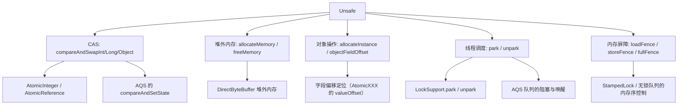

> 2026-10-16 成稿，Java 底层与并发主题。配套 `java-core-lock-support.md`——LockSupport 的 park/unpark 就靠它。  
> 源码依据：本机 JDK 8 `src.zip` + `javap sun.misc.Unsafe`；JDK 17 部分取自 OpenJDK 17 源码。

# Unsafe 是什么？JUC 的地基

## 0. 一句话主线

**`Unsafe` 是 JVM 留给 JDK 内部的一个"后门"类，提供绕过 Java 语言安全机制的底层能力：直接操作任意内存地址、CAS 无锁原子操作、绕过构造器创建对象、手动管理堆外内存、线程挂起与唤醒。它不是给业务代码用的——名字里的 "Unsafe" 就是在警告你。**

JUC 里几乎所有高性能并发结构的底层都踩在它上面：



> 面试口径：问「Unsafe 是什么」，标准答法是「**JDK 内部的后门类，提供绕过 JVM 安全检查的底层操作**」，然后必须补上它为什么叫 Unsafe——**因为它把 Java 的内存安全和类型安全全绕过去了，用错会直接让 JVM 进程崩溃（不是抛异常，是 crash）**。

---

## 1. 先弄清有两个 Unsafe（这是最容易讲错的地方）

很多人以为 Unsafe 就一个。JDK 9 模块化之后其实是**两个类、一真一壳**：

|          | `sun.misc.Unsafe`                    | `jdk.internal.misc.Unsafe`                                      |
| -------- | ------------------------------------ | --------------------------------------------------------------- |
| 所在模块     | **`jdk.unsupported`**                | **`java.base`**（内部包，不导出）                                        |
| 真实身份     | **转发壳**，内部持有 `theInternalUnsafe` 再转调 | **真身**，native 实现都在这                                             |
| 出现版本     | JDK 5 起                              | JDK 9 起                                                         |
| 业务代码能拿到吗 | 能（反射或 `--add-exports`），模块默认导出        | 默认拿不到，需 `--add-exports java.base/jdk.internal.misc=ALL-UNNAMED` |
| 谁在用它     | 第三方库（Netty、Kafka、RocketMQ、Guava 等）   | **JDK 内部**：LockSupport、AtomicInteger、ConcurrentHashMap          |

JDK 9+ 里 `sun.misc.Unsafe` 长这样（转发壳的证据）：

```java
public final class Unsafe {
    private static final Unsafe theUnsafe = new Unsafe();
    // 关键：真身在这里
    private static final jdk.internal.misc.Unsafe theInternalUnsafe =
        jdk.internal.misc.Unsafe.getUnsafe();

    public int getInt(Object o, long offset) {
        return theInternalUnsafe.getInt(o, offset);   // 一行转发
    }
}
```

**为什么 LockSupport（在 java.base 里）必须用内部版**：`java.base` **不能依赖 `jdk.unsupported`**——那会形成模块间的反向依赖，模块化设计上不允许。所以 JDK 9 之后，JDK 自己的类（LockSupport、AtomicInteger、ConcurrentHashMap 等）全部换成了 `jdk.internal.misc.Unsafe`。

<span style="color:rgb(222, 60, 54)">**一个常见误解：以为 JDK 9+ 里 `sun.misc.Unsafe` 被删了/不能用了。其实没有**——它被特意放进 `jdk.unsupported` 模块并 `exports sun.misc` + `opens sun.misc`，就是为了给 Netty、Kafka 这些存量库留迁移缓冲期（JEP 260 明确说：critical internal API 在"有替代方案之前"不强制封装）。反射取 `theUnsafe` 字段的老套路到 JDK 17 仍然有效。</span>

---

## 2. 它到底能干什么：按能力分五类

下面是 `javap` 反编译本机 JDK 8 `rt.jar` 得到的**真实方法清单**，不是凭记忆列的。

### 2.1 CAS：无锁并发的地基

```java
final native boolean compareAndSwapObject(Object o, long offset, Object expected, Object x);
final native boolean compareAndSwapInt  (Object o, long offset, int expected, int x);
final native boolean compareAndSwapLong (Object o, long offset, long expected, long x);

// JDK 8 之后加的自旋封装（内部就是循环 CAS）
int    getAndAddInt (Object o, long offset, int delta);
long   getAndAddLong(Object o, long offset, long delta);
int    getAndSetInt (Object o, long offset, int newValue);
Object getAndSetObject(Object o, long offset, Object newValue);
```

`compareAndSwapInt` 是 **CPU 原语级别的**：x86 上就是一条 `cmpxchg` 指令，配合 `lock` 前缀保证原子性。JUC 里 `AtomicInteger`、`AQS.compareAndSetState`、`ConcurrentHashMap` 的锁桶操作，最底层全是它。

`AtomicInteger.incrementAndGet()` 的真实实现（JDK 8）：

```java
public final int incrementAndGet() {
    return unsafe.getAndAddInt(this, valueOffset, 1) + 1;
}

// Unsafe 里的循环版
public final int getAndAddInt(Object o, long offset, int delta) {
    int v;
    do {
        v = getIntVolatile(o, offset);          // 先 volatile 读
    } while (!compareAndSwapInt(o, offset, v, v + delta));  // CAS 失败就重试
    return v;
}
```

**这段代码就是「自旋 CAS」的标准形态**，看懂它就看懂了整个 JUC 无锁层的套路。

<span style="color:rgb(222, 60, 54)">**一个常被问倒的点：CAS 为什么快？** 因为 `compareAndSwapInt` 被 JIT 识别成 intrinsic，编译后就是一条带 `lock` 前缀的 `cmpxchg` CPU 指令，**开销接近一次普通内存写**，**不进内核态、不做线程切换**。对比一下 synchronized 的 monitor 竞争要走内核的 mutex，就能理解为什么无锁结构在高并发下能拉开数量级的差距。代价是 CAS 失败要自旋重试，所以**只在竞争不激烈时划算**——竞争激烈时大量线程反复 CAS 失败，反而不如直接阻塞。</span>

### 2.2 直接操作内存：堆内堆外通吃

```java
native long  allocateMemory(long bytes);      // 分配堆外内存（malloc）
native long  reallocateMemory(long address, long bytes);
native void  freeMemory(long address);        // 手动释放（free）
native void  setMemory(Object o, long offset, long bytes, byte value);
native void  copyMemory(...);                 // 内存拷贝，不检查类型

// 按偏移量直接读写任意字段
native int  getInt(Object o, long offset);
native void putInt(Object o, long offset, int x);
native long getAddress(long address);
native void putAddress(long address, long x);
native int  addressSize();                    // 指针大小（64位 JVM 上是 8）
native int  pageSize();                       // 操作系统页大小，通常 4096
```

`DirectByteBuffer`（NIO 直接内存）、Netty 的 `PooledByteBuf`、RocketMQ 的 `MappedFile` 全靠这组方法。**代价是内存得自己手动 `freeMemory`，忘了就是堆外内存泄漏，而且这块内存 GC 管不着。**

### 2.3 对象与类操作：绕过语言规则

```java
native Object allocateInstance(Class<?> cls);  // 不开构造器就创建对象
native long   objectFieldOffset(Field f);      // 拿字段在对象里的偏移量
native Object staticFieldBase(Field f);
native long   staticFieldOffset(Field f);
native Class<?> defineClass(...);              // 绕过ClassLoader 定义类
native Class<?> defineAnonymousClass(...);     // JDK 15 后被 Hidden Classes 取代
native void   ensureClassInitialized(Class<?> c);
native boolean shouldBeInitialized(Class<?> c);
native int    arrayBaseOffset(Class<?> arrayClass);  // 数组第一个元素的偏移
native int    arrayIndexScale(Class<?> arrayClass);  // 每个元素占几字节
```

`allocateInstance` 能做反射做不到的事：**不调用任何构造器、不执行字段初始化就拿到一个对象实例**。反序列化框架（如 Kryo、FST）用它来跳过构造逻辑。

`objectFieldOffset` + `getInt/putInt` 的组合则是 JDK 8 时代 Atomic 系列的标准写法——先算出 `value` 字段的偏移量存成 static final，之后每次 CAS 都用这个偏移量定位。

### 2.4 线程调度：park / unpark

```java
native void park(boolean isAbsolute, long time);   // 挂起当前线程
native void unpark(Object thread);                 // 唤醒指定线程
```

这就是 `LockSupport` 的全部依赖所在——LockSupport 的 `park/unpark` 只是对这两个 native 方法的薄封装。详见 `java-core-lock-support.md`。

`isAbsolute` 和 `time` 的组合：`park(false, 0)` 永久等待；`park(false, nanos)` 相对等待；`park(true, deadline)` 等到某个绝对时间点。

### 2.5 内存屏障与其他

```java
native void loadFence();    // 读屏障：禁止后面的读重排到前面
native void storeFence();   // 写屏障：禁止前面的写重排到后面
native void fullFence();    // 全屏障：读写都不许跨过

native void monitorEnter(Object o);
native void monitorExit(Object o);
native boolean tryMonitorEnter(Object o);
native void throwException(Throwable e);   // 绕过编译器检查抛受检异常
```

`loadFence/storeFence/fullFence` 是 JDK 8 才加的，用来在没有 `volatile` 的场合手动控制内存可见性顺序，无锁队列、Disruptor 这类框架会用。

---

## 3. LockSupport 到底依赖它什么

回到你看到的那行代码，把它和 Unsafe 对上：

```java
// LockSupport（JDK 17）里的三处依赖
U.putReferenceOpaque(t, PARKBLOCKER, arg);   // ① 用偏移量写 Thread.parkBlocker 字段
U.park(false, 0L);                            // ② 挂起当前线程
U.unpark(thread);                             // ③ 唤醒指定线程

// 而 PARKBLOCKER 本身也是 Unsafe 算出来的
private static final long PARKBLOCKER
    = U.objectFieldOffset(Thread.class, "parkBlocker");
```

三件事，**没有一件是 Java 语言层面能做到的**：

| LockSupport 需要的能力                 | 为什么 Java 层面做不到                                                   | Unsafe 怎么补                                   |
| --------------------------------- | ---------------------------------------------------------------- | -------------------------------------------- |
| 挂起/唤醒线程                           | `Thread.suspend/resume` 已废弃（会死锁），`wait/notify` 要 monitor 且不能指定线程 | `park/unpark` 直接作用于线程，带许可机制                  |
| 往 `Thread` 的私有字段 `parkBlocker` 写值 | 字段是 private，反射能写但开销大且受限                                          | `objectFieldOffset` + `putReference` 按偏移量直接写 |
| 拿到字段偏移量                           | Java 完全没有"内存地址/偏移"的概念                                            | `objectFieldOffset` 把偏移量算出来                  |

> 一句话总结这层关系：**LockSupport 需要三样 Java 语言给不了的东西（挂起线程、按地址写私有字段、算偏移量），Unsafe 正好提供这三样，所以 LockSupport 离了 Unsafe 就实现不了。**

---

## 4. 为什么叫 Unsafe：四个真实的危险

<span style="color:rgb(222, 60, 54)">**记住这个区分：`Unsafe` 用错不是抛异常，是让整个 JVM 进程 crash。** 普通 Java 代码越界最多 `ArrayIndexOutOfBoundsException`，Unsafe 传错一个内存地址，JVM（用 C++ 写的）直接段错误退出，连栈都留不下。</span>

1. **内存安全全部失效**：`allocateMemory` 拿到的地址不受 GC 管理，忘了 `freeMemory` 就是堆外泄漏；地址算错、`copyMemory` 越界则是进程崩溃。
2. **类型安全失效**：`putInt(obj, offset, x)` 可以把任意 int 写进任意对象的任意偏移处，不管那个位置本来是 `String` 还是 `long`。JVM 不会拦你。
3. **不可移植**：偏移量、内存布局、指针大小都依赖具体 JVM 实现和 CPU 架构。HotSpot 上算对的偏移量，换一个 JVM 可能就错位。
4. **会被 JDK 逐步收掉**：JDK 内部 API 没有兼容性承诺。JDK 9 开始用 VarHandle 替代 CAS 和字段访问，JDK 15 用 Hidden Classes 取代 `defineAnonymousClass`，JDK 21 的 Foreign Function & Memory API 正式取代堆外内存操作。**依赖 Unsafe 的库每升一个大版本都要重新验证。**

---

## 5. 为什么拿不到它：双亲委派检查

`sun.misc.Unsafe.getUnsafe()` 的源码（JDK 8）里有一道关卡：

```java
@CallerSensitive
public static Unsafe getUnsafe() {
    Class<?> caller = Reflection.getCallerClass();
    if (!VM.isSystemDomainLoader(caller.getClassLoader()))
        throw new SecurityException("Unsafe");
    return theUnsafe;
}

// 只有 bootstrap 加载器（loader == null）或平台加载器能通过
public static boolean isSystemDomainLoader(ClassLoader loader) {
    return loader == null || loader == ClassLoader.getPlatformClassLoader();
}
```

**业务代码的 ClassLoader 是 AppClassLoader，所以直接调 `Unsafe.getUnsafe()` 会抛 `SecurityException`。** 这是刻意的——Oracle 不希望任何人用它。

两条绕过路径（都不推荐，但要懂原理）：

```java
// 路径一：反射偷 theUnsafe 字段（JDK 17 仍有效）
Field f = Unsafe.class.getDeclaredField("theUnsafe");
f.setAccessible(true);
Unsafe unsafe = (Unsafe) f.get(null);

// 路径二：启动参数放开模块（拿内部版）
// --add-exports java.base/jdk.internal.misc=ALL-UNNAMED
```

> 面试口径：被问「怎么拿到 Unsafe 实例」，答反射取 `theUnsafe` 字段即可，但**一定要补一句"生产代码不应该这么干"**。只答前半句会被认为只知道 hack 不懂风险。

---

## 6. 官方替代方案：为什么要逐步弃用

| Unsafe 的能力             | 官方替代                                                                         | 从哪个版本     |
| ---------------------- | ---------------------------------------------------------------------------- | --------- |
| CAS 原子操作               | **`VarHandle`**（JEP 193）                                                     | JDK 9     |
| 字段的 volatile / 有序访问    | `VarHandle` 的各种访问模式（plain / opaque / acquire / release / volatile）           | JDK 9     |
| `defineAnonymousClass` | **Hidden Classes**（JEP 371）                                                  | JDK 15    |
| 堆外内存 allocate/free     | **Foreign Function & Memory API**（`MemorySegment` / `Arena`，JEP 412/424/442） | JDK 21 正式 |
| 挂起唤醒线程                 | 一直就是 `LockSupport`，**没有替代**（LockSupport 本身就是安全的那一层）                          | —         |


注意最后一行：**park/unpark 这一块从来不需要替代**，因为你本来就该用 `LockSupport`，而不是直接调 `Unsafe.park`。Unsafe 里真正被盯上要淘汰的，是 CAS、堆外内存和类定义这三块。

`VarHandle` 的写法对比（能看出 JDK 想往哪走）：

```java
// 老写法（JDK 8，AtomicInteger 内部）
static final Unsafe U = Unsafe.getUnsafe();
static final long VALUE = U.objectFieldOffset(AtomicInteger.class.getDeclaredField("value"));
U.compareAndSwapInt(this, VALUE, expect, update);

// 新写法（JDK 9+）
static final VarHandle VALUE = MethodHandles.lookup()
    .findVarHandle(MyCounter.class, "value", int.class);
VALUE.compareAndSet(this, expect, update);   // 类型安全、受语言规范保护
```

`VarHandle` 的好处：**类型安全**（不会把 int 写到 long 字段上）、**受 JLS 内存模型规范约束**（不需要你自己去理解 Unsafe 的语义）、**有正式的 API 兼容性承诺**。

---

## 7. 误区 · 正解

| ❌ 误区                                                     | ✅ 正解                                                                                                                                                                                      |
| -------------------------------------------------------- | ----------------------------------------------------------------------------------------------------------------------------------------------------------------------------------------- |
| 「Unsafe 是 Java 官方 API，可以随便用」                             | 它是 **JDK 内部 API**，没有兼容性承诺，命名本身就是警告。业务代码应一律避免；确实需要时优先 VarHandle、MemorySegment 等官方替代。                                                                                                       |
| 「JDK 9 之后 `sun.misc.Unsafe` 被删了」                         | 没有。它被移到 `jdk.unsupported` 模块，内部持有 `jdk.internal.misc.Unsafe` 做转发，且该模块 `exports sun.misc` + `opens sun.misc`，反射取 `theUnsafe` 到 JDK 17 仍有效。JEP 260 的原文是"critical internal API 在有替代之前不强制封装"。 |
| 「`sun.misc.Unsafe` 和 `jdk.internal.misc.Unsafe` 是两个独立实现」 | 不是。JDK 9 之后 `sun.misc.Unsafe` 只是转发壳，真正的 native 实现在 `jdk.internal.misc.Unsafe`。JDK 自己的类（LockSupport、AtomicInteger）用的是后者，因为 java.base 不能依赖 jdk.unsupported。                                 |
| 「Unsafe 用错了会抛异常」                                         | 更可能直接让 **JVM 进程崩溃**。操作无效内存地址是 C 层面的段错误，不会有 Java 异常，也不会留下可用堆栈。这是它和普通 Java 代码最本质的区别。                                                                                                        |
| 「`Unsafe.getUnsafe()` 谁都能调」                              | 不行。源码里检查调用类的 ClassLoader，只有 bootstrap 或 platform 加载器能通过，业务代码的 AppClassLoader 会抛 `SecurityException`。要用只能反射取 `theUnsafe` 字段。                                                               |
| 「Unsafe 分配的内存会被 GC 回收」                                   | 不会。`allocateMemory` 分配的是堆外内存，不受 GC 管理，必须手动 `freeMemory`。忘了就是堆外内存泄漏，表现为进程 RSS 持续增长但堆内存正常。                                                                                                  |
| 「LockSupport 就是 Unsafe 的另一个名字」                           | LockSupport 是**对 Unsafe 的安全封装**，只暴露 park/unpark 两个方法，并加上了许可机制、blocker 诊断、超时处理。Unsafe 是能操作内存的后门，两者层级完全不同——业务代码可以用 LockSupport，**绝不该直接用 Unsafe**。                                           |

---

## 8. 追问链 · 参考答案

| 层级 | 问题                                                                  | 参考答案要点                                                                                                                                                                                                                                                                                                  |
| -- | ------------------------------------------------------------------- | ------------------------------------------------------------------------------------------------------------------------------------------------------------------------------------------------------------------------------------------------------------------------------------------------------- |
| L1 | Unsafe 是什么？为什么叫 Unsafe？                                             | 它是 JVM 留给 JDK 内部的后门类，提供绕过 Java 安全机制的底层能力：直接操作内存、CAS 原子操作、绕过构造器创建对象、手动管理堆外内存、线程挂起唤醒。叫 Unsafe 是因为它绕过了 Java 的内存安全和类型安全，**用错不是抛异常而是让 JVM 进程崩溃**，操作的是不受 GC 管理的内存。                                                                                                                                            |
| L1 | Unsafe 主要提供哪几类能力？                                                   | 五类：① CAS（compareAndSwapInt/Long/Object，x86 上是带 lock 前缀的 cmpxchg 指令）；② 堆外内存（allocateMemory/freeMemory/copyMemory，需手动释放）；③ 对象与类操作（allocateInstance 绕过构造器、objectFieldOffset 算字段偏移、defineClass）；④ 线程调度（park/unpark，LockSupport 的全部依赖）；⑤ 内存屏障（loadFence/storeFence/fullFence）。                               |
| L2 | `sun.misc.Unsafe` 和 `jdk.internal.misc.Unsafe` 什么关系？                | JDK 9 模块化（JEP 260）后真身是 `jdk.internal.misc.Unsafe`，在 java.base 模块；`sun.misc.Unsafe` 被移到 `jdk.unsupported` 模块，只剩一层持有 theInternalUnsafe 的转发壳。分两个是为了给第三方库留迁移缓冲——模块名带 unsupported 就是明示"不受支持"。                                                                                                                |
| L2 | 为什么 LockSupport 用 `jdk.internal.misc.Unsafe` 而不是 `sun.misc.Unsafe`？ | 因&#x4E3A;**&#x20;LockSupport 在 java.base 模块里**，而 java.base **不能依赖 jdk.unsupported**（会形成模块反向依赖）。所以 JDK 9 后 JDK 自己的类（LockSupport、AtomicInteger、ConcurrentHashMap）全部改用内部版。同理这也是判断"某个类是 JDK 内部还是第三方"的线索。                                                                                                    |
| L2 | LockSupport 具体依赖 Unsafe 的哪几个能力？                                     | 三个：① `park/unpark` 挂起唤醒线程；② `objectFieldOffset` 算出 `Thread.parkBlocker` 字段的偏移量；③ `putReference`/`putReferenceOpaque` 按偏移量写这个私有字段（写 blocker 供 jstack 诊断）。这三样 Java 语言层面都做不到——Thread.suspend/resume 已废弃，private 字段写不进去，偏移量概念 Java 里根本没有。                                                                   |
| L2 | CAS 在 CPU 层面到底是什么指令？                                                | x86 上是一条 `cmpxchg` 指令，配合 `lock` 前缀锁总线（或缓存行）保证原子性。Unsafe.compareAndSwapInt 是 native 方法，JVM 会把它识别成 intrinsic，JIT 编译时直接内联成这条 CPU 指令，所以 CAS 的开销接近一次普通内存写。这是 JUC 无锁结构性能高的根本原因。                                                                                                                               |
| L3 | 为什么 `Unsafe.getUnsafe()` 业务代码调不了？                                   | 源码里有 `@CallerSensitive` + 类加载器检查：`if (!VM.isSystemDomainLoader(caller.getClassLoader())) throw new SecurityException("Unsafe")`。只有 bootstrap（loader==null）或 platform 加载器能通过，业务代码是 AppClassLoader，所以被拒。想用只能反射取 `theUnsafe` static 字段，或加 `--add-exports` 放开模块。                                            |
| L3 | Unsafe 分配的内存不释放会怎样？怎么排查？                                            | **是堆外内存泄漏：内存不受 GC 管理**，进程 RSS 持续增长但堆内存（jstat 看到）正常，最终被操作系统 OOM kill。排查用 `Native Memory Tracking`（`-XX:NativeMemoryTracking=detail` + `jcmd VM.native_memory`），或看 `jcmd VM.system_properties` 之外用 pmap / perf 对比 RSS 与堆大小的差值。Netty 这类库内部有 `-Dio.netty.leakDetectionLevel` 之类的检测机制。                       |
| L3 | `AtomicInteger` 和 Unsafe 的关系？JDK 9 之后有变化吗？                          | JDK 8 里 AtomicInteger 用 `Unsafe.objectFieldOffset` 算出 value 字段偏移量，再调 `compareAndSwapInt` 或 `getAndAddInt` 自旋实现。JDK 9 之后改为 `jdk.internal.misc.Unsafe`；更新的代码则直接用 `VarHandle`（JEP 193），获得类型安全和规范化的内存序语义。                                                                                                   |
| L3 | 为什么 Unsafe 要被淘汰？替代方案按能力分别是什么？                                       | 三个原因：不安全（crash 风险）、不可移植（依赖具体 JVM 布局）、阻碍 JVM 演进（内部 API 无法重构）。替代：CAS 和字段访问 → VarHandle（JDK 9）；defineAnonymousClass → Hidden Classes（JDK 15）；堆外内存 → Foreign Function & Memory API 的 MemorySegment/Arena（JDK 21 正式）。**park/unpark 不需要替代，因为业务代码本来就该用 LockSupport。**                                          |
| L4 | 生产上真的完全不能用 Unsafe 吗？哪些库在用？                                          | 应该用，但要清楚代价：Netty（堆外 ByteBuf）、Kafka / RocketMQ（零拷贝与 mmap）、Guava、Hazelcast、Kryo / FST（allocateInstance 跳构造器）、Disruptor（内存屏障）都在用。它们能用是因为有专职团队跟进每个 JDK 版本的兼容性。普通业务代码没有任何理由引入——官方替代（VarHandle / MemorySegment）已覆盖绝大部分场景，除非你要做零拷贝网络框架或自研序列化器。                                                                 |
| L4 | 如果我在 JDK 17 上想用 Unsafe，具体要怎么做？风险是什么？                                | 两条路：① 反射取 `sun.misc.Unsafe.theUnsafe` 字段（`jdk.unsupported` 默认导出 opens，可行）；② 想用内部版要加 `--add-exports java.base/jdk.internal.misc=ALL-UNNAMED`（强烈不建议，内部版方法更多也更危险）。风险：JDK 18+ 可能进一步收紧；`--illegal-access` 开关在 JDK 17 已被移除（JEP 403 强封装），反射访问其他内部包会直接失败；且 JVM crash 无法用 Java 异常兜底。                             |
| L4 | `VarHandle` 相比 Unsafe 好在哪？为什么说它是"受规范约束"的？                           | 三点：① **类型安全**——VarHandle 在 lookup 时就绑定了字段类型，不会像 Unsafe 那样把 int 写到 long 字段上；② **内存序语义规范化**——提供 plain / opaque / acquire / release / volatile 五种明确的访问模式，语义由 JLS 定义，而不像 Unsafe 那样要靠你自己理解各种 putXxx/getXxxVolatile 的隐含含义；③ **有 API 兼容性承诺**，是正式 JDK API 而非内部实现。代价是写法略繁琐，性能与 Unsafe 基本持平（同样会被 JIT 内联成 CPU 指令）。 |

---

## 9. 速查卡（一分钟复习）

- **Unsafe = JVM 留给 JDK 内部的后门类**，绕过 Java 的内存安全与类型安全。
- **五类能力**：CAS / 堆外内存 / 对象与类操作 / park-unpark 线程调度 / 内存屏障。
- **两个 Unsafe**：JDK 9 后真身是 `jdk.internal.misc.Unsafe`（java.base），`sun.misc.Unsafe`（jdk.unsupported）只是转发壳。LockSupport 用前者，因为 java.base 不能依赖 jdk.unsupported。
- **LockSupport 依赖它三件事**：`park/unpark` 挂起唤醒、`objectFieldOffset` 算偏移、按偏移写 `Thread.parkBlocker` 私有字段。
- **CAS = CPU 的 `cmpxchg` 指令**（带 lock 前缀），JIT 内联，开销接近一次内存写。
- **用错不是抛异常，是 JVM 进程崩溃**。堆外内存不归 GC 管，必须手动 `freeMemory`。
- **拿不到它**：`getUnsafe()` 检查 ClassLoader，业务代码抛 SecurityException；只能反射取 `theUnsafe`。
- **官方替代**：CAS/字段访问 → `VarHandle`（JDK 9）；匿名类 → Hidden Classes（JDK 15）；堆外内存 → MemorySegment/Arena（JDK 21）。
- **park/unpark 无需替代**——业务代码本来就该用 LockSupport 而不是直接调 Unsafe。
