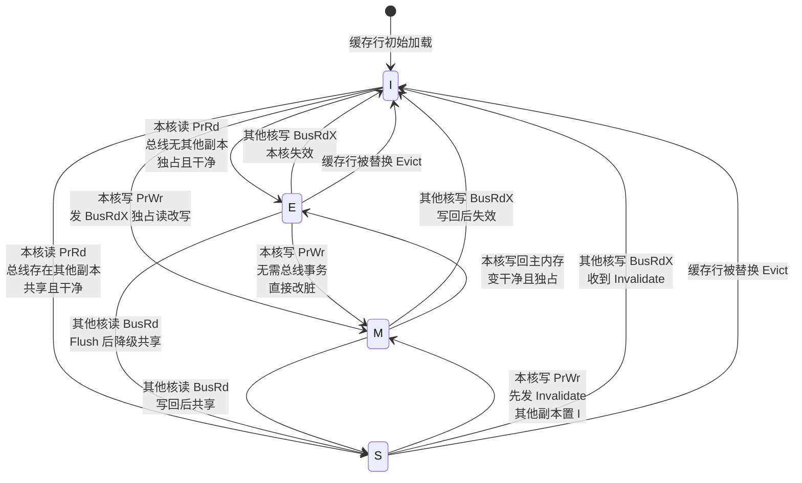
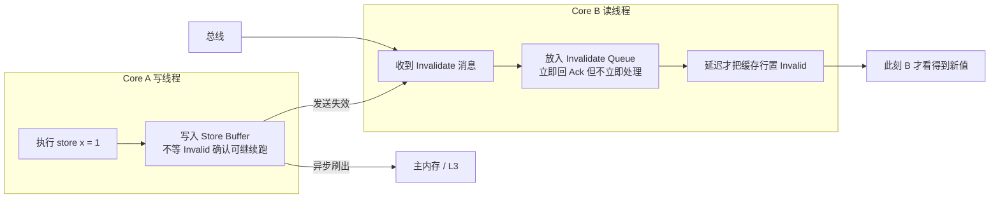
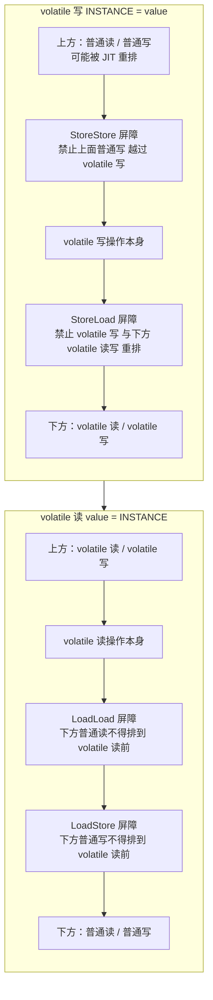
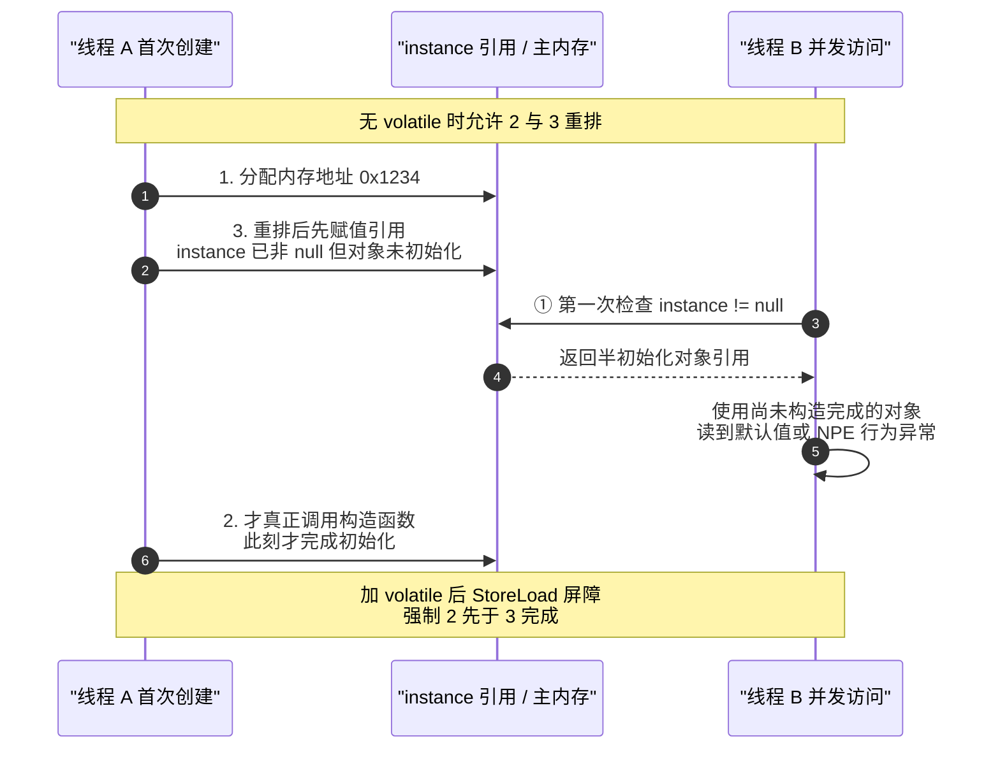

> 2026-10-14 成稿，Java 底层与并发主题

# volatile：可见性原理、MESI 协议与内存屏障

## 一句话主线

volatile 是 JVM 提供给开发者的**最轻量级的并发原语**：它用「内存屏障 + 缓存一致性协议」兑现了**可见性**和**有序性**两条承诺，但**一分钱原子性都不给**；理解它的关键不在于背「可见性/有序性/不保证原子性」这三句话，而在于能从上到下说出这条链：**Java 语义 → 编译器屏障 → CPU 屏障（store buffer / invalidate queue）→ MESI 总线嗅探**。

面试教练提示：P6 问到 volatile，标准答案是背三条语义；**P7 的及格线是能画出 MESI 状态转换图，并回答出「既然有 MESI 为什么还需要 volatile」**。这一问是本讲义的核心。

---

## 一、volatile 的三条语义

### 1.1 可见性（Visibility）

一个线程修改了 volatile 变量的值，**其他线程能立刻看到**。更准确的表述（JSR-133）：对一个 volatile 变量的写，会**立即把该线程工作内存（CPU 缓存/寄存器）中的新值刷新到主内存**，并且使其他线程里该变量的缓存副本**失效**，强制它们下次使用时重新从主内存加载。

### 1.2 有序性 / 禁止特定重排序

volatile 通过插入内存屏障，禁止**特定方向**的指令重排序：volatile 写之前的普通读写，不能重排到 volatile 写之后；volatile 读之后的普通读写，不能重排到 volatile 读之前。

注意措辞：volatile **不是禁止所有重排序**，而是建立一个「单向栅栏」，把 volatile 操作前后的内存操作隔开。

### 1.3 不保证原子性（最重要的一条）

volatile 变量的**单次读 / 单次写**是原子的（long/double 的 volatile 读写也被 JSR-133 保证原子），但**复合操作不是**。

典型反例 `i++`：

```java
private static volatile int count = 0;
public static void increment() { count++; }   // 不是原子操作
```

`count++` 反编译后实际是三个步骤：

```
getstatic     count     // 1. 读：从主内存把 count 读到操作数栈
iconst_1
iadd                    // 2. 改：在操作数栈里 +1
putstatic     count     // 3. 写：把结果写回 count
```

假设 count 初值 0，线程 A、B 同时执行：

| 时刻 | 线程 A | 线程 B | 主内存 count |
|------|--------|--------|--------------|
| t1 | 读取 count = 0 | | 0 |
| t2 | | 读取 count = 0 | 0 |
| t3 | 计算 0+1 = 1 | | 0 |
| t4 | | 计算 0+1 = 1 | 0 |
| t5 | 写回 count = 1 | | 1 |
| t6 | | 写回 count = 1 | **1（应为 2）** |

线程 B 在 t2 读到的 0 虽然是最新的，但在它执行 +1 和写回之间，值已经被 A 改成了 1 —— **B 是基于一个「过期但仍然合法」的旧值做写入，覆盖了 A 的结果**。volatile 保证「读到的那一刻是最新值」，但**不保证「读到到写回之间没人改」**。

> **面试口径**："volatile 保证可见性，但它只保证**读那一刻的可见性**。`i++` 是 read-modify-write 三步复合操作，两个线程可能读到同一个值各自加一写回，最终丢失一次更新。要保证原子性得用 `AtomicInteger`（CAS + volatile value）或 `synchronized` / `Lock`。"

正确写法（三者按场景选）：

```java
private static final AtomicInteger count = new AtomicInteger(0);   // CAS 自旋，中低竞争
public static void increment() { count.incrementAndGet(); }

private static final LongAdder adder = new LongAdder();            // 分段累加，高竞争吞吐更高
public static void incrementHot() { adder.increment(); }

private static int cnt = 0;                                        // 互斥，语义最直白
public static synchronized void inc() { cnt++; }
```

---

## 二、可见性到底是怎么保证的：从语言层到硬件层

这一节是 P7 的分水岭。必须能**分层讲**，不能只说"刷新主内存"。

### 2.1 分层视图

可见性的兑现横跨四个层次，从上往下依次是：

`Java 源码 volatile` → `编译期：JSR-133 屏障规则，禁止特定重排序` → `字节码：仅多一个 ACC_VOLATILE(0x0040) 标志，指令序列与普通变量完全相同` → `JIT 汇编：x86 生成带 lock 前缀的指令` → `CPU：缓存行回写 + 总线嗅探使他人副本失效` → `MESI：其他核缓存行置 Invalid，下次读必须重新加载`

一个容易忽略的事实：**volatile 在字节码层面和普通变量完全一样，没有任何区别**。差别只体现在：

1. 字段的 `access_flags` 里多了一个 `ACC_VOLATILE`（0x0040）；
2. JIT 看到这个标志后，在生成的汇编里插入屏障/带 lock 前缀的指令。

所以 `javap -c` 看到的同一份方法，volatile 版本和非 volatile 版本的指令序列是相同的；必须用 `-XX:+PrintAssembly` 或 `hsdis` 才能看到差异。

### 2.2 语言层：JSR-133 的抽象承诺

JMM（JSR-133）用 **happens-before** 描述可见性，而不是直接描述"刷新主内存"。两者的分工：语言层（给程序员的承诺）是 volatile 写 happens-before 后续对该变量的读；实现层（JVM 兑现这张支票的方式）是写完后立刻把值推到一致性点，并让其他核的副本失效。

### 2.3 汇编层：lock 前缀指令做了两件事

在 x86-64 上，HotSpot 对 volatile 写的典型实现是在写之后插入一条：

```asm
movl    $0x1, 0x10(%rsi)     ; volatile 字段写入
lock addl $0x0, (%rsp)       ; 相当于 StoreLoad 屏障
```

注：`addl $0x0, (%rsp)` 本身是「给栈顶加 0」，语义无害，但加上 `lock` 前缀后触发 CPU 的特殊行为。较新的 JDK 也会直接生成 `lock cmpxchg` 或用 `mfence`。

`lock` 前缀的两大效果：

1. **写回（Write-back）**：把当前处理器 store buffer 中的内容刷出，并将被修改的缓存行写入主内存（确切地说是写入 L3 / 一致性点），使其他核能看到。
2. **失效（Invalidate）**：通过总线（或更现代的 QPI / UPI、以及 L3 目录下的点对点消息）广播失效信号，其他核里缓存了同一地址的缓存行被标记为 **Invalid**。

> **面试口径**："volatile 写在 x86 上编译成一条带 `lock` 前缀的指令。这个前缀做两件事：一是把本核的修改立刻刷到主内存，二是通过总线嗅探让其他核对应缓存行失效。这也是为什么 volatile 写比 volatile 读昂贵得多——写独占总线/缓存行并广播失效，读在 x86 上几乎不生成额外指令（TSO 内存模型已足够强）。"

> 补充知识点：x86 是 TSO（Total Store Order）内存模型，天然禁止除 StoreLoad 之外的三种重排序，所以 volatile 读不需要任何屏障指令，开销接近普通读；而 ARM / POWER 是弱内存模型，volatile 读写都会生成真实屏障（如 `dmb`）。

### 2.4 MESI 缓存一致性协议

现代 CPU 每个核有自己的 L1/L2 缓存，多核共享 L3 和主内存。为了让大家看到的数据一致，硬件实现了缓存一致性协议，最经典的是 **MESI**，四种状态：

| 状态 | 全称 | 含义 | 是否脏 | 是否存在于多核 |
|------|------|------|--------|----------------|
| M | Modified | 已修改，只在本核缓存，与主内存不一致 | 是 | 仅本核 |
| E | Exclusive | 独占，干净，与主内存一致 | 否 | 仅本核 |
| S | Shared | 多核共享，干净，与主内存一致 | 否 | 多个核 |
| I | Invalid | 失效，该缓存行数据无效 | - | - |

#### MESI 状态转换图（含不同核发起的操作）



一次 volatile 写引发的总线事件序列：Core A 的缓存行原为 S 状态 → A 发出 BusRdX / Invalidate 消息 → Core B 收到后把该缓存行置 Invalid 并回 Ack → A 收齐 Ack 后转为 M 状态写入新值并写回主内存 → B 下次再读该地址时 cache miss，必须重新 BusRd 加载新值。

### 2.5 关键追问：既然硬件有 MESI 保证了缓存一致性，为什么还需要 volatile？

**这是本文件最重要的一问。**

答案是：**MESI 保证的是「最终」一致性，而不是「立即」一致性；而且它只解决缓存行层面的数据一致，解决不了指令重排序。**

具体原因是 CPU 为了性能引入的两个**异步队列**：



**1）Store Buffer（写缓冲）导致旧值可见**

CPU0 要写一个处于 S 状态的缓存行，必须先广播 Invalidate 并等所有核的 Ack，这个等待有几百个周期的延迟。为了避免这个停顿，硬件设计了 Store Buffer：写操作先丢进 Store Buffer 就返回继续跑，**由 Store Buffer 异步地在后台完成"失效其他核 → 刷缓存行"的完整流程**。

后果：**写指令已经执行完了，但新值还躺在 Store Buffer 里没进缓存行，其他核看到的仍然是旧值**。

**2）Invalidate Queue（失效队列）加剧窗口**

Core B 收到 Invalidate 消息后，如果立刻去失效缓存行会打断自己的流水线；于是硬件让它**先把消息塞进 Invalidate Queue 并马上回 Ack，回头再慢慢处理**。

后果：**Core B 明明已经"确认"了失效，但它自己的缓存行还是有效的旧副本，读上来的是陈数据**。Store Buffer + Invalidate Queue 这两个队列叠加，使得"写入已完成但别人还看不到"的时间窗口被显著放大。

**3）内存屏障的作用正是清空这两个队列**

| 屏障类型 | 硬件动作 | 解决的队列 |
|----------|----------|------------|
| 写屏障 Store Barrier | 把 Store Buffer 中的条目全部刷出（drain / flush）到缓存行 | Store Buffer |
| 读屏障 Load Barrier | 处理完 Invalidate Queue 中的全部消息后再执行后续读 | Invalidate Queue |
| 全屏障 mfence / lock 前缀 | 两者都做 | 两者 |

所以完整的逻辑链是：

> MESI 提供了**缓存行数据最终一致**的硬件机制，但它允许 Store Buffer / Invalidate Queue 造成的**短暂不一致窗口**；volatile 通过 JVM 插入的内存屏障**强制排干这两个队列**，把这个窗口压缩到零 —— 也就是把"最终一致"升级为 JMM 承诺的"立即可见"。此外，MESI 完全不关心指令重排序，**重排序只能靠内存屏障来禁止**，这是 volatile 的第二个不可替代的作用。

> **面试口径（高分版）**："MESI 和 volatile 不是同一层的东西。MESI 是缓存行级别的协议，保证多核看到的同一地址数据不会永久分叉；但出于性能考虑，CPU 有 Store Buffer 和 Invalidate Queue 两个异步结构，写可以先躺在 Store Buffer 里不刷出，收到的失效消息也可以先排进队列不处理，于是存在短暂的旧值可见窗口。volatile 生成的带 lock 前缀指令或 mfence 就是强制排干这两个缓冲（写屏障 store buffer 刷出、读屏障 invalidate queue 处理完），外加禁止编译器和 CPU 的重排序。所以 MESI 不替代 volatile，volatile 也不重复实现 MESI —— volatile 是站在 MESI 之上补上'及时性'和'顺序性'这两块短板。"

---

## 三、内存屏障

### 3.1 CPU 层的四类屏障

| 屏障 | 含义 | 禁止的重排序 | x86 上的开销 |
|------|------|--------------|--------------|
| LoadLoad | Load1; LL; Load2 | Load2 及后续读不能重排到 Load1 之前 | 几乎免费（TSO 保证） |
| StoreStore | Store1; SS; Store2 | Store2 不能重排到 Store1 之前（保证 Store1 数据先对其他核可见） | 几乎免费 |
| LoadStore | Load1; LS; Store2 | Store2 不能重排到 Load1 之前 | 几乎免费 |
| **StoreLoad** | Store1; SL; Load2 | Load2 及后续读不能重排到 Store1 之前（必须先让 Store1 对其他核可见） | **最重**，需 lock 前缀或 mfence |

**为什么 StoreLoad 最贵？** 因为它要求"先把 Store Buffer 排干（写可见），再等所有失效被处理（读拿到新值）"，等于同时做了写屏障和读屏障，横跨了 Store Buffer 与 Invalidate Queue 两个异步队列的完整往返延迟。JMH 实测下来 volatile 写的开销基本就是这一条 StoreLoad 屏障的成本。

> 有个细节值得背：HotSpot 之所以选择 `lock addl $0x0,(%rsp)` 而不是 `mfence`，是因为在多数 x86 微架构上前者延迟更低（mfence 在某些 CPU 上会把后续非内存指令也一起串行化）。

### 3.2 JSR-133 定义的 volatile 屏障插入规则

JMM 用一张表规定了编译器必须如何给 volatile 操作加栅栏：



用口诀记：**volatile 写：前 StoreStore，后 StoreLoad**（两道）；**volatile 读：后 LoadLoad + LoadStore**（两道，都在后面）。

注意 volatile 读**前面**是不放屏障的 —— 它不需要阻止上方的读跑到这里之后，只需要阻止下方的读写跑到它之前。

> **面试口径**："volatile 写前后各有一道屏障，前面是 StoreStore、后面是 StoreLoad；volatile 读的后面是 LoadLoad 加 LoadStore。这里最贵的就是 volatile 写后面的那条 StoreLoad，x86 上体现为 lock 前缀指令。JMM 采用的是保守策略：如果相邻两个操作之间没有 volatile 访问，编译器还是可以自由重排，所以 volatile 的开销只会落在真正需要的边界上。"

---

## 四、happens-before 规则

happens-before 是 JMM 的核心概念：如果 A happens-before B，那么 A 的执行结果对 B 可见，且 A 的指令顺序排在 B 之前。**注意：这只是可见性保证，不是时间上的先后。**

### 4.1 volatile 变量规则

> **对一个 volatile 变量的写，happens-before 后续任意线程对这个 volatile 变量的读。**

### 4.2 传递性

> 如果 A happens-before B，且 B happens-before C，则 A happens-before C。

这两条规则组合起来威力很大 —— 它让 volatile 成为一个**跨线程的发布管道**：既然 volatile 写之前的**所有**操作都被 StoreStore 屏障挡在 volatile 写之前（它们的结果会随 volatile 写一起被刷出），那么另一个线程一旦读到最新 volatile 值，就必然能看到那些写在 volatile 写之前的全部状态。
```java
class VolatilePublication {
    int a = 0;                       // 普通字段
    volatile boolean ready = false;  // 发布开关

    // 线程 A
    void writer() {
        a = 42;          // 1. 普通写
        ready = true;    // 2. volatile 写（StoreStore 屏障保住 1 不被排到 2 之后）
    }

    // 线程 B
    void reader() {
        if (ready) {     // 3. volatile 读，读到 true
            // 由 happens-before 传递性：
            // 1 hb 2（程序次序规则），2 hb 3（volatile 规则）
            // => 1 hb 3，所以这里必然读到 a == 42
            assert a == 42;
        }
    }
}
```

如果 `ready` 不加 volatile，**即使 B 读到了 ready == true，也可能看到 a == 0**（因为 1 和 2 可能被重排，或者 1 的结果还在 Store Buffer 里）。

### 4.3 JMM 完整 happens-before 规则清单（建议背熟）

1. 程序次序规则：同一线程内，前面的操作 hb 后面的操作
2. **volatile 变量规则**：volatile 写 hb 后续对该变量的读
3. **监视器锁规则**：unlock hb 后续对同一锁的 lock
4. **传递性**
5. 线程 start / join / interrupt / 对象 finalize 规则：`start()` hb 线程内所有操作 hb `join()` 返回；`interrupt()` hb 被中断线程检测到中断；构造完成 hb `finalize()` 开始

---

## 五、典型应用

### 5.1 状态标记位（最常用）

```java
public class ShutdownHookDemo {
    private volatile boolean shutdownRequested = false;
    public void shutdown() { shutdownRequested = true; }        // 一个线程写

    public void doWork() {
        while (!shutdownRequested) { /* 另一个线程轮询读 */ }
    }
}
```

如果不加 volatile，JVM 可能把 `while (!shutdownRequested)` 优化成读一次寄存器里的值甚至**死循环**（所谓 "hoisting"），线程永远看不到别的线程置的 true。这个 case 对 volatile 是**完美适用**的：单线程写、多线程读、写操作本身是幂等赋值，不涉及复合操作。

### 5.2 一次性安全发布（Safe Publication）

volatile 的传递性可以让一个**不含 volatile 字段的普通对象**被安全发布：

```java
class ConfigHolder {
    private Map<String, String> config;             // 非 volatile 普通字段
    private volatile boolean initialized = false;

    public void init() {
        config = loadFromRemote();   // 1
        initialized = true;          // 2 volatile 写：把 1 的结果一起"发布"出去
    }

    public Map<String, String> get() {
        if (!initialized) throw new IllegalStateException();
        return config;               // 保证看到完全构造好的 config
    }
}
```
与之等价的其他安全发布方式（面试可举例加分）：`static` 静态初始化器（JVM 在类初始化时加锁，天然安全）、`final` 字段正确构造的对象（构造函数不逸出 this）、volatile 字段引用的对象、`ConcurrentHashMap` / `BlockingQueue` 等并发容器、`synchronized` 内发布。

> 注意：`final` 字段的安全性依赖 JSR-133 的 **final 字段语义**（构造函数内对 final 的写会被插入 StoreStore 屏障 + freeze 操作），**前提是构造函数没有把 this 逸出**。

### 5.3 DCL 双重检查锁单例，为什么必须 volatile（必考）

经典错误写法：

```java
public class Singleton {
    private static Singleton instance;   // 缺少 volatile！

    private Singleton() {}

    public static Singleton getInstance() {
        if (instance == null) {                 // ① 第一次检查，避免每次都加锁
            synchronized (Singleton.class) {
                if (instance == null) {         // ② 第二次检查，防止并发重复创建
                    instance = new Singleton(); // ③ 问题所在：这不是原子操作
                }
            }
        }
        return instance;
    }
}
```

第 ③ 行 `instance = new Singleton()` 在字节码层面大致是：

```
new           #3      // 1. 分配对象内存空间
invokespecial #4      // 2. 调用构造函数，初始化对象成员
putstatic     #2      // 3. 把引用赋给静态变量 instance
```

问题在于：**步骤 2 和步骤 3 之间不存在数据依赖，JIT 完全可以把它们重排成 1 → 3 → 2**（写引用先于初始化）。加上 volatile 后，步骤 3 之后的 StoreLoad 屏障会禁止这个重排。

#### DCL 重排序问题示意



正确写法：

```java
public class Singleton {
    // volatile 是 DCL 成立的必要条件（JDK 1.5 之后的语义；JDK 1.4 及以前 JMM 有缺陷）
    private static volatile Singleton instance;

    private Singleton() {}

    public static Singleton getInstance() {
        if (instance == null) {
            synchronized (Singleton.class) {
                if (instance == null) {
                    instance = new Singleton();
                }
            }
        }
        return instance;
    }
}
```

> **面试口径**："DCL 必须加 volatile，因为 `new Singleton()` 会被分解成分配内存、初始化对象、赋值引用三步，后两步之间没有数据依赖可以被重排。若重排成'赋值引用先于初始化'，另一个线程在第一次 null 检查时会拿到非 null 但未构造完成的引用，访问它读到的是零值甚至直接崩。volatile 写后面那条 StoreLoad 屏障强制对象初始化先于引用赋值发布出去。另外要提一句，DCL 只在 JDK 1.5 修复 JMM 之后才真正可靠。"

> 加分：说出更好的替代方案 —— **静态内部类（Class Holder）** 或 **枚举单例**，既没有 DCL 的复杂度，又是天然线程安全且防反序列化：
>
> ```java
> // 推荐：静态内部类，lazy loading + JVM 类初始化锁保证线程安全
> class BestSingleton {
>     private BestSingleton() {}
>     private static class Holder { static final BestSingleton INSTANCE = new BestSingleton(); }
>     static BestSingleton get() { return Holder.INSTANCE; }
> }
> ```
>
> 或者最简洁的枚举写法：`enum Singleton { INSTANCE; }`（Effective Java 推荐，天然防反射和反序列化破坏）。

---

## 六、volatile 不适用的场景

| 场景 | 例子 | 原因 | 替代方案 |
|------|------|------|----------|
| 复合操作（读改写） | `i++`、`count += x` | read-modify-write 三步，中间可能被插入其他写 | `AtomicInteger` / `LongAdder` / 锁 |
| 依赖当前值的判断 | `if (x > 0) { x = x - 1; }` | check-then-act，检查到执行之间状态已变 | CAS 循环 / 锁 |
| 多变量的不变式 | 需要保证 `a + b == 10` 恒成立 | volatile 无法把多个变量的写打包成原子操作 | `synchronized` 把多个写包进一个临界区 |
| 需要互斥（while 期间不能被别人改） | 长时间的非原子逻辑 | volatile 没有排他性 | `ReentrantLock` / `synchronized` |

一句话判断标准：**只要新值依赖于旧值，或者需要同时维护多个变量的一致性，volatile 就没戏，必须上 CAS 或锁。**

---

## 七、volatile vs synchronized 对比

| 维度 | volatile | synchronized |
|------|----------|--------------|
| **原子性** | 不保证（仅单次读/写） | 保证（临界区互斥） |
| **可见性** | 保证（立即刷新 + 失效他人副本） | 保证（unlock 前必须同步回主内存） |
| **有序性** | 保证（禁止特定重排序） | 保证（同一锁的两个同步块串行执行 as-if-serial） |
| **是否阻塞** | 否，不会引起线程上下文切换 | 是，竞争失败的线程会阻塞挂起（内核态切换） |
| **是否需要线程上下文切换** | 不需要 | 升级到重量级锁时需要，用户态↔内核态开销大 |
| **能否被编译器优化掉** | 不能被优化掉（必须每次读） | JIT 可做锁消除、锁粗化 |
| **是否可重入** | 不适用 | 可重入（_recursions 计数） |
| **适用场景** | 一个线程写多个线程读；状态标记；一次性发布；DCL | 复合操作；多变量一致性；需要互斥的业务逻辑 |
| **性能量级** | 极低（volatile 读近乎免费，volatile 写约一个 StoreLoad 屏障） | 低竞争下（偏向/轻量）很低；高竞争下退化为内核互斥很贵 |
| **底层实现** | 内存屏障 + CPU 缓存一致性 | Monitor（ObjectMonitor）+ Mark Word 锁升级 |

> **面试口径**："volatile 是 synchronized 的轻量级替代，但不能互相取代：volatile 管的是'看得见、不乱序'，synchronized 额外管'只能一个人改'。需要互斥或有复合操作时，只能用 synchronized 或 JUC 的锁。volatile 最大的性能优势是不会造成线程阻塞和上下文切换。"

---

## 八、追问链 · 参考答案

| 层级 | 问题 | 参考答案要点 |
| --- | --- | --- |
| L1 | volatile 有哪三条语义？ | ① **可见性**：写立即刷新到主内存并使其他核的副本失效；② **有序性**：禁止特定方向的重排序（写前不能后移、读后不能前移），不是禁止全部重排；③ **不保证原子性**：单次读/写原子，但 `i++` 这类 read-modify-write 复合操作不安全。前两条由 JSR-133 的屏障规则兑现。 |
| L1 | 为什么 `volatile int i` 上的 `i++` 在多线程下会丢失更新？请用字节码三步解释。 | `count++` 编译为 `getstatic`（读）、`iadd`（改）、`putstatic`（写）三步。A、B 都读到 0，各自算出 1 后写回，结果仍是 1。volatile 只保证**读到那一刻是最新值**，不保证读到写回之间没人插进来改。要保证原子性得用 `AtomicInteger`/`LongAdder` 或 `synchronized`。 |
| L1 | volatile 能否修饰局部变量？为什么？（答：不能，局部变量在栈帧私有，不存在可见性问题；编译期就报错） | 不能，编译期就报错。局部变量存放在线程私有的栈帧里，天然不被其他线程共享，本来就不存在可见性与重排序问题，加 volatile 没有任何语义可兑现。volatile 是**字段修饰符**，只能修饰类的成员变量或静态字段 —— 这也正说明 volatile 解决的是堆上共享数据的跨线程可见性。 |
| L2 | volatile 写在 x86 上生成什么指令？这条指令的两大效果是什么？ | 生成带 `lock` 前缀的指令，典型是 `lock addl $0x0,(%rsp)`（较新 JDK 也用 `lock cmpxchg` 或 `mfence`）。两大效果：① 把 store buffer 排干、修改被推到一致性点（写回）；② 通过总线广播 Invalidate，使其他核的对应缓存行置 **Invalid**。代价约等于一条 StoreLoad 屏障。 |
| L2 | 说出 volatile 变量在字节码层面和普通变量的唯一区别是什么？ | 唯一区别是字段的 `access_flags` 上多一个 `ACC_VOLATILE`（0x0040），**指令序列与普通变量完全相同**。所以 `javap -c` 看不出任何差异，必须用 `-XX:+PrintAssembly` 或 hsdis 才能看到 JIT 真正插入的屏障/带 lock 前缀的指令。 |
| L2 | 为什么 volatile 读在 x86 上几乎不需要屏障指令，而写需要？ | x86 是 **TSO**（Total Store Order）内存模型，硬件已天然禁止 LoadLoad、LoadStore、StoreStore 三种重排序，只剩 StoreLoad 要防，所以 volatile 读不生成任何额外指令、开销接近普通读。而 volatile 写必须排干 store buffer 并广播失效，必须有 `lock` 前缀。ARM/POWER 等弱内存模型上读写都要真实屏障（如 `dmb`）。 |
| L3 | MESI 四个字母分别代表什么状态？Modified 和 Exclusive 的共同点与区别？ | **M**odified（已修改、脏）、**E**xclusive（独占、干净）、**S**hared（多核共享、干净）、**I**nvalid（失效）。M 与 E 的共同点是都只存在于本核、本核独占；区别是 E 与主内存一致（干净），M 与主内存不一致（脏），被替换或别人来读时必须先写回再让出。 |
| L3 | 一个核写处于 Shared 状态的缓存行，总线上会发生什么？ | 本核不能直接写，要先发 **BusRdX**（独占读改写）请求；其他核收到后把该缓存行置 Invalid 并回 Ack；本核收齐全部 Ack 后才转为 **M** 状态写入新值。之后其他核再读该地址会 cache miss，必须重新发 BusRd 取到新值 —— 这就是 MESI 保证的最终一致性。 |
| L3 | 已经有了 MESI 保证缓存一致性，为什么还需要 volatile 和内存屏障？ | 因为 MESI 只保证**最终**一致，且只管缓存行数据、完全不关心指令重排序。CPU 为性能引入的 **Store Buffer** 与 **Invalidate Queue** 让"写入完成"到"他人可见"之间存在窗口；volatile 用内存屏障强制排干这两个队列，把最终一致升级为 JMM 承诺的立即可见，并额外禁止重排序。 |
| L3 | Store Buffer 和 Invalidate Queue 各自造成了什么问题？分别靠什么屏障解决？ | Store Buffer 让"写指令已执行但新值还躺在缓冲里没进缓存行"，其他核仍读到旧值 → 由**写屏障**把 store buffer 全部刷出。Invalidate Queue 让"已回 Ack 但自己副本仍有效"，读上来的是陈数据 → 由**读屏障**把队列里的失效消息处理完再执行后续读。带 `lock` 前缀的指令或 mfence 是全屏障，两件事都做。 |
| L4 | CPU 层四类内存屏障分别禁止什么重排序？哪一类开销最大，为什么？ | LoadLoad 禁止后面的读排到前面的读之前；StoreStore 禁止后面的写排到前面的写之前；LoadStore 禁止写排到前面的读之前；**StoreLoad** 禁止后面的读排到前面的写之前。StoreLoad **开销最大**：它要同时排干 Store Buffer 并处理完 Invalidate Queue，横跨两个异步队列的完整往返延迟。 |
| L4 | JSR-133 规定 volatile 写前后各插什么屏障？volatile 读的屏障插在哪一侧？ | volatile **写**前面插 **StoreStore**、后面插 **StoreLoad**；volatile **读**的两道屏障都插在**后面**，是 **LoadLoad + LoadStore**，前面不放（只需阻止下方读写上移，不必阻止上方操作下移）。口诀：写"前 SS、后 SL"，读"后 LL + LS"。 |
| L4 | volatile 变量规则和传递性如何支撑"一次性安全发布"？请举出除了 volatile 之外的三种安全发布方式。 | volatile 写前的所有普通写被 StoreStore 屏障挡在写之前，随 volatile 写一起刷出；读方一旦读到新的 volatile 值，由"程序次序 + volatile 规则 + 传递性"必然看到那些写。其他安全发布方式：**static** 静态初始化器（JVM 类初始化锁）、正确构造的 **final** 字段（构造函数不逸出 this）、`ConcurrentHashMap`/`BlockingQueue` 等并发容器、synchronized 内发布。 |
| L4 | happens-before 是否意味着物理时间上的先后？请解释。 | 不意味着。happens-before 是 JMM 的**可见性**约定，表示 A 的结果对 B 可见且顺序上排在 B 之前，是操作间的偏序关系，不是时钟上的先后。即便 A 在物理时间上先发生，若两者之间没有 hb 链，B 仍可能看不到 A 的结果；反之存在 hb 也推不出物理时间顺序。 |
| L5 | DCL 单例为什么必须加 volatile？请把 `new Singleton()` 拆成三步并指出哪两步会被重排。 | 三步是：① 分配对象内存；② 调用构造函数初始化；③ 把引用赋给 instance。② 与 ③ 之间**无数据依赖**，JIT 可重排成 ①③②，其他线程在第一次 null 检查时会拿到非 null 但未构造完的对象，读到零值甚至崩溃。volatile 写后面的 StoreLoad 屏障禁止该重排。 |
| L5 | 除了 DCL，更好的单例写法是什么？静态内部类和枚举各好在何处？ | **静态内部类（Class Holder）**：`Holder.INSTANCE` 靠 JVM 类初始化锁保证唯一与线程安全，天然 lazy loading，且没有 DCL 的复杂度。**枚举** `enum Singleton { INSTANCE; }` 最简洁（Effective Java 推荐），天然防反射与反序列化破坏。两者都不需要 volatile，也不必写双重检查。 |
| L5 | volatile 数组或对象引用，能保证数组元素/对象字段的可见性吗？（答：不能。volatile 修饰的是引用本身，只保证引用赋值的可见性；元素访问需要 `AtomicReferenceArray` 或其他手段） | 不能。volatile 修饰的是**引用本身**，只保证引用赋值与读取的可见性；数组元素和对象内部字段完全不受保护，写入可能对其他线程长期不可见。要按元素粒度保证，数组用 `AtomicIntegerArray`/`AtomicReferenceArray`，对象字段则自己再加 volatile 或用 `VarHandle` 的 release/acquire 模式。 |
| L5 | volatile 能否让 `long` / `double` 的非原子问题消失？（答：能，JSR-133 规定 volatile 的 long/double 读写是原子的；但普通 long/double 在 32 位 JVM 上可能被拆成两个 32 位操作） | 能。JSR-133 明确规定 volatile 的 long/double 读写具有**原子性**；而普通 long/double 在 32 位 JVM 上可能被拆成两个 32 位操作，导致另一个线程读到"高 32 位新 + 低 32 位旧"的撕裂值。所以共享的 64 位计数器要么加 volatile，要么用 `AtomicLong`/`LongAdder`。 |
| L5 | 用 volatile 实现一个"生产者写一次、消费者读多次"的配置发布，需要什么充要条件？（答：单写者 + 写操作不依赖旧值 + 消费方能容忍读取到的中间重入） | 三个条件：① **单一写者**，只有一个线程写，避免写写竞争；② 写操作**不依赖旧值**，是整体替换而非 read-modify-write；③ 消费方能容忍读到发布过程中的中间状态，或统一先读 volatile 开关再取数据。典型写法是 volatile 引用指向一个**不可变**配置对象，替换时整体换引用，读者要么看到旧的要么看到新的。 |
| L5 | volatile 与 AtomicInteger 的性能差异在哪？什么场景下 LongAdder 比 AtomicInteger 更好？ | volatile 只有可见性、无原子性，代价是禁止 JIT 缓存到寄存器与禁止特定重排，适合状态标记；`AtomicInteger` 靠 CAS 自旋保证原子，中低竞争下最优且结果精确，但高竞争时大量 CAS 失败会烧 CPU；`LongAdder` 用 `base + Cell[]` 分段分摊热点（Cell 带 `@Contended` 防伪共享），高并发累加吞吐可达 AtomicInteger 数倍，代价是 `sum()` 只是估计值。 |

---

## 九、误区 · 正解

| ❌ 误区 | ✅ 正解 |
| --- | --- |
| 误区 1：volatile 能保证原子性。 | volatile 只保证**单次读/写**的原子性。`count++` 是 getstatic → iadd → putstatic 三步的 read-modify-write，两个线程可能读到同一个值各自加一写回，丢失一次更新。要保证原子性必须用 `AtomicInteger`（CAS + volatile value）或 `synchronized`/`Lock`。 |
| 误区 2：volatile 会让代码变快，所以应该到处用。 | 恰恰相反。volatile 禁止了部分 JIT 优化 —— 变量不能被缓存在寄存器、必须每次访存，还要禁止特定方向的重排序；volatile 写另需一条 StoreLoad 屏障（`lock` 前缀）。滥用会把本可进寄存器的热点变量强制每次访存，反而拖慢。 |
| 误区 3：volatile 修饰了数组/对象引用，数组元素或对象内部的字段也就有了可见性。 | volatile 保护的只是那个**引用本身**的读写。数组元素与对象内部字段的可见性不受任何影响，要自己另想办法：数组用 `AtomicIntegerArray`/`AtomicReferenceArray`，对象字段自己再加 volatile，或用 `VarHandle` 的 release/acquire 模式。 |
| 误区 4：有了 MESI 缓存一致性协议就不需要 volatile 了。 | MESI 只保证缓存行数据的**最终**一致，Store Buffer 与 Invalidate Queue 让"写入"到"他人可见"之间存在窗口；而且 MESI 完全不关心指令重排序。volatile 用内存屏障排干这两个队列并禁止重排序，补上的正是"及时性"与"顺序性"两块短板。 |
| 误区 5：volatile 写之前必须保证其他核的缓存行已经失效。 | 实际流程是：写操作进入 Store Buffer 后 CPU 就可以继续往下跑，没有必要同步等待各核 Ack；真正会等待失效确认的是后面的 **StoreLoad 屏障**（带 `lock` 前缀的指令）。MESI 的 Invalidate 与 Ack 收集由硬件在后台异步完成。 |
| 误区 6：volatile 读也需要像写那样插入 lock 前缀指令。 | 在 x86 的 **TSO** 内存模型下，volatile 读不生成任何额外指令 —— 硬件本身已禁止 LoadLoad / LoadStore / StoreStore 重排序，只需防 StoreLoad。只有 ARM、POWER 这类弱内存模型上，volatile 读才需要真实屏障（如 `dmb`）。 |
| 误区 7：volatile 能替代 synchronized 做互斥。 | volatile 没有任何**排他性**：两个线程可以同时写同一个 volatile 变量，只是彼此看得见，中间仍会互相覆盖。需要互斥、有复合操作、或要同时维护多个变量的不变式时，必须换成 `synchronized` 或 JUC 的锁与 CAS。 |
| 误区 8：DCL 单例在 JDK 1.4 及以前也是安全的。 | 不安全。旧 JMM 下 volatile 的语义有缺陷 —— 它不阻止 volatile 写与普通写之间的重排序，所以 DCL 挡不住"引用先赋值、对象后初始化"。DCL 是在 **JDK 1.5（JSR-133 重新定义 JMM）**之后才真正可靠；更稳妥的写法是静态内部类或枚举单例。 |
