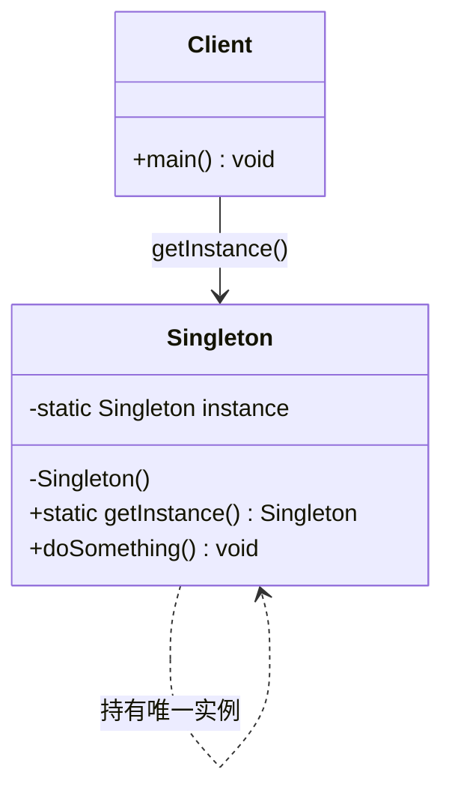
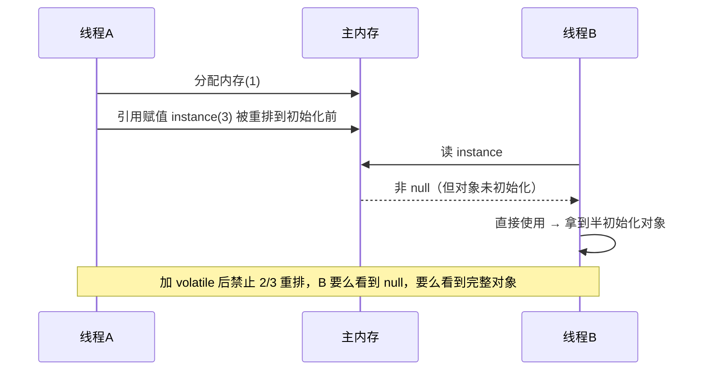

# 单例模式（Singleton）

> 一句话定位：**面试第一道设计模式题，也是唯一一个「写代码」比「背定义」更重要的模式**。考官真正想听的是 DCL 为什么要加 `volatile`、枚举为什么是《Effective Java》推荐写法、以及 Spring 的 Bean 单例和它有什么不同。
> 分类：创建型（Creational） | 面试热度：★★★★★
> 版本前提：JDK 17（示例用 `var` / `record` 之外的常规写法，便于口述手写）

---

## 1. 是什么

**保证一个类在整个 JVM 进程内只有一个实例，并提供一个全局访问点。**

GoF 原意是「类自己负责保存唯一实例，并保证不会被创建第二个」。落地成代码就是三件事：

| 要素 | 实现手段 |
| --- | --- |
| 不能随便 new | 构造器 `private` |
| 自己持有那一个实例 | `private static` 字段 |
| 对外给访问点 | `public static getInstance()` |



---

## 2. 解决什么问题

**没有它之前**：配置中心、连接池、ID 生成器这类对象，谁都能 `new`，于是出现多个实例各持一份状态，配置不一致、连接数失控、序列重复。用全局变量（static 字段）能解决「只有一个」，但全局变量无法延迟初始化、无法控制创建时机、也拿不到继承/接口带来的扩展性。

**为什么不直接用 static 工具类**：

| 维度 | static 工具类 | 单例 |
| --- | --- | --- |
| 能否延迟加载 | 类加载时即初始化 | 可懒加载（holder / DCL） |
| 能否实现接口、被替换 | 不能 | 能（实现接口后 mock 替换） |
| 能否有状态与生命周期 | 勉强 | 天然适合（init / destroy） |
| 是否能被 Spring 管理 | 不能 | 能（交给容器更彻底） |

**关键取舍**：单例换来「全局唯一」的同时，本质是**一个有状态的全局变量**，会带来隐式耦合和单测困难。所以现代工程更推荐「由 IoC 容器保证唯一（Spring `@Bean` / `@Component`）」，而不是自己写 `getInstance()`。

---

## 3. 怎么写（六种写法与各自考点）

### 3.1 饿汉式（Eager）

```java
public final class EagerSingleton {
    private static final EagerSingleton INSTANCE = new EagerSingleton();
    private EagerSingleton() {}
    public static EagerSingleton getInstance() { return INSTANCE; }
}
```

- 线程安全靠**类加载的初始化锁**（JVM 保证 `<clinit>` 只执行一次，且对其他线程可见）。
- 缺点：类一被加载就实例化，做不到懒加载；如果构造很重而这个类一直没被用到，白占内存。

### 3.2 懒汉式（Lazy，线程不安全）

```java
public final class LazySingleton {
    private static LazySingleton instance;
    private LazySingleton() {}
    public static LazySingleton getInstance() {
        if (instance == null) instance = new LazySingleton(); // 并发下会创建多个
        return instance;
    }
}
```

只在单线程下正确，面试时写出来会被追问，别主动用。

### 3.3 方法上加 `synchronized`

```java
public static synchronized LazySingleton getInstance() { ... }
```

正确但**每次调用都加锁**，JIT 甚至可能锁粗化，高并发下 `getInstance()` 变成串行点。不推荐。

### 3.4 双重检查锁（DCL，**必考**）

```java
public final class DclSingleton {
    private static volatile DclSingleton instance;   // ① volatile 不能少
    private DclSingleton() {}

    public static DclSingleton getInstance() {
        if (instance == null) {                       // ② 第一次检查：避免每次都加锁
            synchronized (DclSingleton.class) {
                if (instance == null) {               // ③ 第二次检查：防止重复创建
                    instance = new DclSingleton();
                }
            }
        }
        return instance;
    }
}
```

**为什么必须 `volatile`**——这是本题的区分度所在：

1. `instance = new DclSingleton()` 不是原子操作，字节码层面大致是：
   `① 分配堆内存 → ② 初始化对象（执行构造器）→ ③ 把引用赋给 instance`。
2. JIT / CPU 允许把 ③ **重排序**到 ② 之前（只要不违反 as-if-serial 单线程语义）。
3. 于是线程 A 走到 ③ 还没初始化完，线程 B 在 ② 处看到 `instance != null`，直接拿走一个**半初始化对象**——字段还是默认值，一用就 NPE 或状态错乱。
4. `volatile` 的两重作用：**禁止该重排序**（写 volatile 前的操作不会被重排到写之后；JDK 5 起 JSR-133 增强了 volatile 语义），以及**保证可见性**（B 一定看到 A 完整的写入）。



### 3.5 静态内部类（Holder，**推荐的手写写法**）

```java
public final class HolderSingleton {
    private HolderSingleton() {}
    private static class Holder {
        private static final HolderSingleton INSTANCE = new HolderSingleton();
    }
    public static HolderSingleton getInstance() { return Holder.INSTANCE; }
}
```

- **懒加载**：`Holder` 类只有在 `getInstance()` 被调用时才加载（JVM 的延迟加载规则）。
- **线程安全**：同样由类加载初始化锁保证，且没有 `synchronized`，读性能就是一次普通字段访问。
- 这是「延迟加载 + 无锁 + 无 volatile + 代码简洁」四者兼得的最优手写方案。

### 3.6 枚举（**《Effective Java》推荐**）

```java
public enum EnumSingleton {
    INSTANCE;
    public void doSomething() { /* ... */ }
}
```

三个硬保证：

1. **天然防反射攻击**：`Constructor.newInstance` 对枚举会直接抛 `IllegalArgumentException`（`Cannot reflectively create enum objects`），JVM 层面挡住。
2. **天然防序列化攻击**：枚举的序列化只写 `name`，反序列化按 `Enum.valueOf` 找回同一个对象，**不会**产生新实例，因此不需要写 `readResolve()`。
3. **天然线程安全**：枚举常量在类初始化时创建，由 JVM 保证唯一。

代价：不能懒加载、写法与常规 class 习惯不同、不方便继承（枚举隐式继承 `Enum`）。

### 写法对比总表

| 写法 | 懒加载 | 线程安全 | 防反射 | 防序列化 | 性能 | 备注 |
| --- | --- | --- | --- | --- | --- | --- |
| 饿汉 | ❌ | ✅ | ❌ | ❌ | 最好 | 最简单 |
| 懒汉（无锁） | ✅ | ❌ | ❌ | ❌ | 好 | 面试别写 |
| 方法级 synchronized | ✅ | ✅ | ❌ | ❌ | 差（每次加锁） | 已淘汰 |
| **DCL + volatile** | ✅ | ✅ | ❌ | ❌ | 好 | **必考，要讲清重排序** |
| **静态内部类** | ✅ | ✅ | ❌ | ❌ | 好 | **推荐手写方案** |
| **枚举** | ❌ | ✅ | ✅ | ✅ | 好 | **防攻击唯一自带方案** |

---

## 4. 使用场景

| 场景 | 说明 |
| --- | --- |
| 配置 / 环境对象 | `Environment`、全局配置加载器，整个进程一份，避免多处读到不同版本 |
| 资源池 | 连接池、线程池、对象池——池本身必须唯一，否则池化失去意义 |
| ID 生成器 | 雪花算法 workerId 分配器、序号生成器，多实例会产出重复 ID |
| 注册表 / 缓存目录 | SPI 的 `ExtensionLoader`、路由表、元数据缓存 |
| 无状态工具类实例 | 格式化器、序列化器（如 Jackson `ObjectMapper` 通常共享一个） |

**JDK / 框架中的真实例子**：

- `java.lang.Runtime` —— 饿汉式，`getRuntime()` 返回唯一运行时对象。
- `java.lang.System` 中的 `Console`、桌面环境的 `Desktop.getDesktop()`。
- `java.util.Calendar` 的 `getInstance()` 是**工厂方法**不是单例（每次返回新对象），别混。
- Spring 的 `SingletonBeanRegistry` —— 容器级单例，见第 5 节辨析。

---

## 5. 生产中的问题与排查

| 问题 | 现象 | 排查 / 修复 |
| --- | --- | --- |
| **Spring 单例 ≠ 设计模式单例** | 面试高频陷阱 | 设计模式的单例是「**一个 JVM 类加载器**内唯一」；Spring 的单例是「**一个 IoC 容器**内唯一」。两个容器（父子容器、多个 `ApplicationContext`）就会各有一个同名 Bean；同一个类被两个不同 ClassLoader 加载也会有两份 |
| **分布式下的伪单例** | 每台机器各有一个实例，全局并不唯一 | 真正的跨 JVM 唯一要靠外部协调：分布式锁、数据库唯一键、Redis `SETNX`、或 ZK 临时顺序节点选主 |
| **序列化破坏单例** | 反序列化后 `==` 比较为 false | 非枚举写法需要补 `private Object readResolve() { return INSTANCE; }` |
| **反射破坏单例** | `setAccessible(true)` 后可再次调用私有构造 | 构造器里加二次判断：`if (instance != null) throw new IllegalStateException()`；或直接用枚举 |
| **Clone 破坏单例** | 实现 `Cloneable` 后被 `clone()` 出新对象 | 不实现 `Cloneable`，或重写 `clone()` 直接返回 `INSTANCE` |
| **单例持有可变状态导致并发 bug** | 偶发数据错乱，难以复现 | 单例只管「唯一」，不意味着线程安全；有状态字段仍需同步或改 `ThreadLocal` / 无状态化 |
| **单例造成内存泄漏** | 单例生命周期 = 进程，持有 Activity / Context / 大集合不释放 | 注册式引用用 `WeakReference`；提供显式 `destroy()`；单例里不要缓存无界数据 |
| **单测噩梦** | 全局状态在测试间串味 | 让单例实现接口，测试注入 mock；或用 Spring `@DirtiesContext` 重建容器 |

---

## 6. 面试问法

### 60 秒版本

> 单例是创建型模式，保证一个类在一个 JVM 内只有一个实例并提供全局访问点，做法是构造器私有、静态字段持有实例、静态方法暴露。手写的话我推荐两种：需要懒加载用**静态内部类 Holder**，靠类加载的初始化锁保证线程安全，没有锁开销也没有 volatile 的困扰；如果还要防反射和序列化攻击，就用**枚举**，这是《Effective Java》推荐的写法，因为 JVM 从语言层面禁止反射创建枚举、枚举反序列化也只写 name 不会生成新对象。另外 DCL 写法必须给静态实例加 `volatile`，否则 `new` 的三步（分配内存、初始化、赋值引用）可能被重排序，别的线程会拿到半初始化对象。最后补充一点：Spring 的单例是**容器级**的，和设计模式的**类加载器级**单例不是一回事。

### 5 分钟版本补充点

1. `volatile` 防的是**重排序**（`instance = new X()` 的 2、3 步）而不仅是可见性，JDK 5 之后 volatile 语义增强才让 DCL 真正可用
2. JDK 9+ 的 `VarHandle` / JDK 5+ 的 `AtomicReference` 也能做懒加载单例，但工程上不如 Holder 直观
3. 类加载初始化锁：JVM 保证 `<clinit>` 只执行一次，且对其他线程可见——这是饿汉和 Holder 线程安全的共同根基
4. 单例的替代方案是「**交给容器**」：Spring `@Component` 默认就是单例作用域，比自己写 `getInstance()` 更容易被替换和 mock
5. 反模式信号：单例数量在代码库里快速增长，通常意味着依赖注入没用好，而不是真的需要那么多全局对象

---

## 7. 追问链 · 参考答案

| 层级 | 问题 | 参考答案要点 |
| --- | --- | --- |
| L1 | 单例模式是什么？ | 创建型模式，保证一个类在一个 JVM 内只有一个实例并提供全局访问点。实现三要素：构造器私有、静态字段持有唯一实例、静态方法暴露访问点 |
| L2 | 手写一种线程安全的懒加载单例 | 静态内部类 Holder：`getInstance()` 里返回内部类的 `static final` 字段。`Holder` 类在首次调用时才被加载，兼顾懒加载；由 JVM 类加载初始化锁保证唯一，无锁无 volatile |
| L3 | DCL 为什么必须加 `volatile`？ | `new` 拆成「分配内存 → 初始化 → 赋值引用」三步，后两步可能被重排序。线程 A 赋值后尚未初始化完，线程 B 判断 `!= null` 直接返回，拿到字段全默认值的半初始化对象。`volatile` 禁止该重排序并保证可见性（JDK 5 起语义增强后 DCL 才真正可用） |
| L3 | 枚举单例为什么能防反射和序列化？ | 反射层面，`Constructor.newInstance` 对枚举直接抛异常，JVM 禁止反射创建枚举实例；序列化层面，枚举只写 `name` 字段，反序列化走 `Enum.valueOf` 取回同一个常量，不产生新对象，所以也不需要写 `readResolve()` |
| L3 | 静态内部类为什么能做到懒加载？ | JVM 规范规定类在**首次主动使用**时才初始化。`Holder` 只有在 `getInstance()` 被调用时才触发加载与 `<clinit>`，因此外部类加载不会连带创建实例 |
| L4 | 饿汉和 Holder 都靠类加载保证安全，区别在哪？ | 饿汉的实例字段在**外部类**里，外部类一被加载就创建；Holder 的实例在**内部类**里，只有调用 `getInstance()` 触发内部类加载才创建。前者实现简单，后者多一层类但换来懒加载 |
| L4 | 单例能防住所有攻击吗？ | 普通写法防不住三种：反射（构造器加二次判空或改枚举）、反序列化（补 `readResolve()` 或改枚举）、`clone()`（不实现 `Cloneable` 或重写 `clone()` 返回 `INSTANCE`）。枚举一招全解 |
| L5 | Spring 的单例和设计模式单例有什么区别？ | 作用域不同：设计模式单例是**ClassLoader 级**（同一 JVM 内同一 ClassLoader 下唯一），Spring 单例是**IoC 容器级**（一个 `BeanFactory` 内唯一）。父子容器、多个 `ApplicationContext`、Web 应用多 DispatcherServlet 都可能出现多份同名 Bean |
| L5 | 集群部署下单例还成立吗？ | 不成立。每台 JVM 各有一个实例，进程内唯一 ≠ 全局唯一。跨 JVM 唯一要用外部协调：分布式锁、DB 唯一约束、Redis `SETNX` 或 ZK 选主，代价是引入外部依赖和可用性风险，所以能不做就不做 |
| L5 | 项目里单例很多，是不是该改？ | 单例本质是带状态的全局变量，会制造隐式耦合和单测困难。改法：让单例实现接口并交给 IoC 容器管理（Spring 默认单例作用域），依赖方只依赖接口；容器帮你做生命周期、作用域替换和 mock 注入 |

---

## 8. 误区 · 正解

| ❌ 误区 | ✅ 正解 |
| --- | --- |
| 「DCL 加 `volatile` 是为了可见性」 | 主要是**禁止重排序**。`new` 的「初始化」与「赋值引用」两步被重排后，别的线程能看到非 null 但半初始化的对象；可见性只是附带收益 |
| 「饿汉式是懒加载的」 | 饿汉在**类加载时**就创建实例，不是懒加载。要懒加载得用 Holder、DCL 或枚举之外的写法（枚举本身也非懒加载） |
| 「枚举单例可以懒加载」 | 枚举常量在枚举类初始化时创建，做不到延迟。它的价值在**防反射 + 防序列化**，不是懒加载 |
| 「加了 `synchronized` 的懒汉就够好了」 | 方法级 `synchronized` 让每次 `getInstance()` 都串行，高并发下成为瓶颈。工程上用 Holder 或 DCL |
| 「单例对象一定是线程安全的」 | 单例只保证**唯一**，不保证**安全**。单例内部的可变状态仍需同步、并发容器或无状态化改造 |
| 「`Runtime.getRuntime()` 是懒加载单例」 | 它是**饿汉式**：`private static final Runtime currentRuntime = new Runtime()`，类初始化时就建好 |
| 「Spring 的 `@Component` 单例 = 设计模式单例」 | Spring 是**容器级**单例，设计模式是**ClassLoader 级**。多个容器 / 多个 ClassLoader 都会出现多实例 |
| 「单例能防止别人 new 出来第二个」 | 构造器私有只挡住编译期；反射 `setAccessible(true)`、反序列化、`clone()` 都能绕过，需要额外防御或直接上枚举 |

---

## 9. 相关模式

| 模式 | 关系 |
| --- | --- |
| 工厂方法 / 抽象工厂 | 工厂本身常被实现成单例（如 `ExtensionLoader`、各类 `FactoryHolder`） |
| 享元（Flyweight） | 享元是「多个共享对象按 key 复用」，单例是「全局只有一个」；可视为享元的极端情况 |
| 原型（Prototype） | 原型靠复制产生新对象，与单例「禁止新对象」语义相反 |
| 外观（Facade） | 外观对象通常做成单例，作为子系统的唯一入口 |

---

## 10. 我的薄弱点

（学完后自己填，同步到 `weakness.md`）
