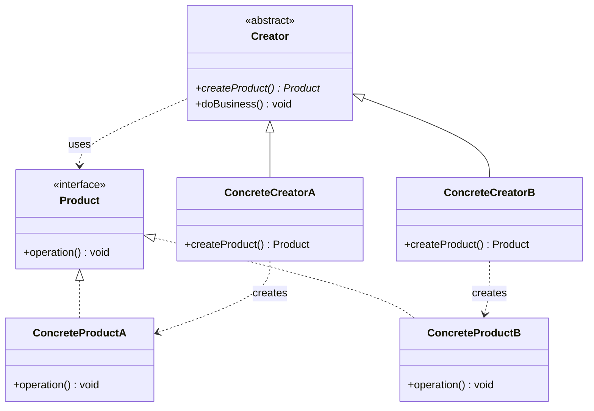
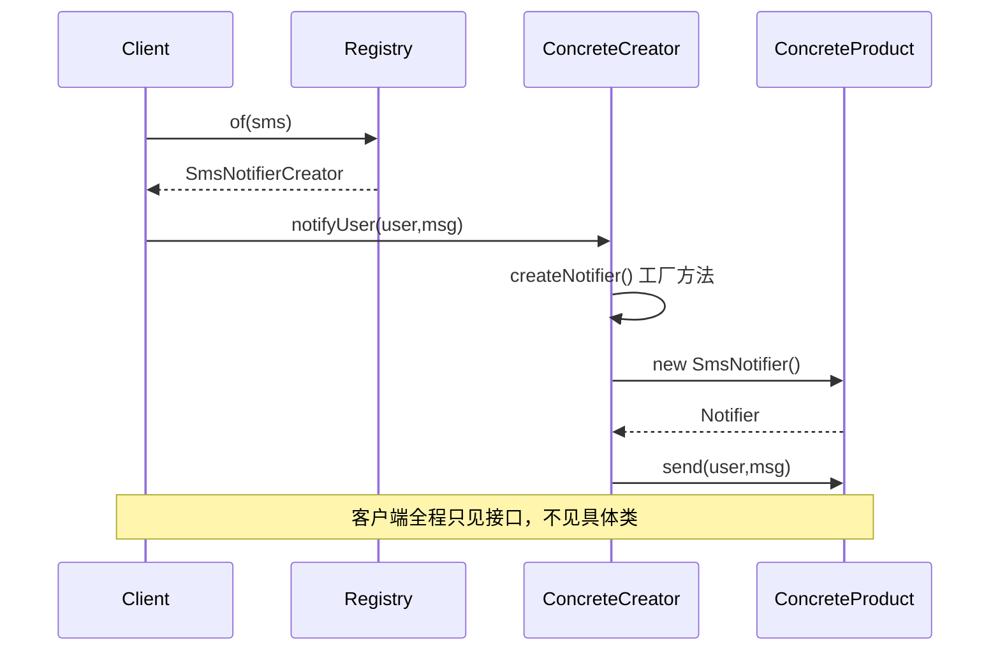

# 工厂方法（Factory Method）

> 一句话定位：**把 `new` 从客户端挪到工厂子类，让「创建哪种对象」交给子类决定**。考官真正想听的是它和简单工厂的区别（开闭原则）、和抽象工厂的区别（一个等级 vs 一族）、以及 `Calendar#getInstance()` / Spring `FactoryBean` 这些真实出处。
> 分类：创建型（Creational） | 面试热度：★★★★☆
> 版本前提：JDK 17

---

## 1. 是什么

**父类定义创建对象的接口（工厂方法），由子类决定实例化哪一个具体类，把对象的创建延迟到子类。**

GoF 定义：Define an interface for creating an object, but let subclasses decide which class to instantiate. 核心是把 `new ConcreteProduct()` 从客户端代码中移走，客户端只依赖抽象接口。

| 角色 | 职责 |
| --- | --- |
| Product | 产品抽象接口，如 `Logger`、`Connection` |
| ConcreteProduct | 具体产品实现，如 `LogbackLogger` |
| Creator | 抽象创建者，声明工厂方法 `createProduct()`，通常还有依赖产品的业务逻辑 |
| ConcreteCreator | 具体创建者，重写工厂方法，返回某个 ConcreteProduct |



---

## 2. 解决什么问题

**没有它之前**：客户端直接 `new MySqlConnection()`、`new LogbackLogger()`，代码里到处是具体类名。换一个实现要全文搜索替换；构造过程复杂时（读配置、建连接、初始化缓存），这些逻辑散落在每个调用点。

**before / after 对照**：

```java
// before：客户端硬编码具体类，换实现要改所有调用点
public void pay(String channel) {
    if ("ali".equals(channel)) {
        AliPayClient client = new AliPayClient(appId, key, gateway); // 构造逻辑散落
        client.pay(order);
    } else if ("wx".equals(channel)) {
        WxPayClient client = new WxPayClient(mchId, certPath);
        client.pay(order);
    }
}

// after：客户端只面向接口，创建交给工厂子类
public void pay(String channel) {
    PayClient client = PayClientFactory.of(channel).create(); // 具体类对客户端不可见
    client.pay(order);
}
```

**为什么不用别的方案**：

| 替代方案 | 问题 |
| --- | --- |
| 直接 `new` | 客户端与具体类编译期耦合，违反 DIP；构造逻辑无法收口 |
| 简单工厂（静态工厂） | 加产品要改工厂类的 `if/else`，**违反开闭原则**；且它不是 GoF 23 种之一 |
| 依赖注入容器 | 本质是容器级工厂，更彻底；但容器启动前、或非托管对象仍需手工工厂 |

**关键取舍**：工厂方法用「多写一个工厂子类」换「新增产品不改已有代码」。产品种类稳定时这是过度设计；产品需要横向扩展（新支付渠道、新存储引擎）时收益明显。

---

## 3. 怎么写

以「通知发送器」为例，生产级写法：工厂方法返回接口、工厂本身也面向接口注册，配合 `Map` 做查找而非 `switch`。

```java
// 产品接口与实现
public interface Notifier {
    void send(String target, String message);
}

public final class SmsNotifier implements Notifier {
    private final String signName;
    public SmsNotifier(String signName) { this.signName = signName; }
    @Override public void send(String target, String message) {
        System.out.printf("[SMS sign=%s] -> %s: %s%n", signName, target, message);
    }
}

public final class EmailNotifier implements Notifier {
    @Override public void send(String target, String message) {
        System.out.printf("[EMAIL] -> %s: %s%n", target, message);
    }
}

// Creator：声明工厂方法 + 依赖产品的业务模板
public abstract class NotifierCreator {
    /** 工厂方法：由子类决定实例化哪个产品 */
    protected abstract Notifier createNotifier();

    /** 模板业务逻辑：创建与使用解耦 */
    public final void notifyUser(String user, String msg) {
        Notifier notifier = createNotifier();
        notifier.send(user, msg);
    }
}

public final class SmsNotifierCreator extends NotifierCreator {
    @Override protected Notifier createNotifier() { return new SmsNotifier("默认签名"); }
}

public final class EmailNotifierCreator extends NotifierCreator {
    @Override protected Notifier createNotifier() { return new EmailNotifier(); }
}

// 注册表：新增渠道只新增类，不改既有代码（符合开闭原则）
public final class NotifierCreatorRegistry {
    private static final Map<String, Supplier<NotifierCreator>> CREATORS = new ConcurrentHashMap<>();
    static {
        CREATORS.put("sms", SmsNotifierCreator::new);
        CREATORS.put("email", EmailNotifierCreator::new);
    }
    public static NotifierCreator of(String channel) {
        Supplier<NotifierCreator> s = CREATORS.get(channel.toLowerCase(Locale.ROOT));
        if (s == null) throw new IllegalArgumentException("unknown channel: " + channel);
        return s.get();
    }
}
```



---

## 4. 使用场景

| 场景 | 说明 |
| --- | --- |
| 客户端不知道该 new 哪个实现 | 创建逻辑依赖运行时配置（渠道、环境、租户），编译期无法确定 |
| 构造过程复杂 | 需要读配置、建连接、初始化资源，想把构造逻辑收口到一处 |
| 框架预留扩展点 | 框架定义 Creator，用户实现子类返回自己的产品（模板方法 + 工厂方法常一起出现） |
| 配合 SPI 做可插拔 | `ServiceLoader` 加载实现，工厂方法负责实例化与缓存 |
| 单元测试替换实现 | 测试时换一个返回 mock 产品的 Creator 子类 |

**JDK / Spring / SLF4J 中的真实例子**：

- `java.util.Calendar#getInstance(Locale, TimeZone)` —— 按 Locale 返回 `GregorianCalendar` / `BuddhistCalendar` / `JapaneseImperialCalendar`，调用方无感知。
- `java.text.NumberFormat#getInstance()` —— 按 Locale 返回不同数字/货币格式化器。
- `Collection#iterator()` —— 工厂方法的变体：`ArrayList` 返回 `Itr`，`LinkedList` 返回 `ListItr`，客户端只面对 `Iterator` 接口。
- `java.util.ResourceBundle#getBundle()` —— 按 Locale 加载不同资源束。
- SLF4J `LoggerFactory.getLogger(Class)` —— 屏蔽 Logback / Log4j2 / JUL 的绑定差异。
- Spring `FactoryBean` —— **「生产 Bean 的 Bean」**，`getObject()` 就是工厂方法在容器里的变体（如 `SqlSessionFactoryBean` 生产 `SqlSessionFactory`）。注意别和 `BeanFactory` 混：`BeanFactory` 是 IoC 容器本身，`FactoryBean` 是容器里一个会造对象的 Bean，容器对它按 `&name` 取到的才是 FactoryBean 本身。

---

## 5. 生产中的问题与排查

| 问题 | 现象 | 排查 / 修复 |
| --- | --- | --- |
| 工厂类数量膨胀 | 每加一个产品就多一个 Creator 类 | 接受它（这是模式固有代价）；或用 `Map<String, Supplier<Product>>` 注册表收敛，牺牲一点「类型」换「数量」 |
| 与 Spring 混用造成两层工厂 | 自己写的工厂里又去 `applicationContext.getBean()` | 容器本身就是工厂，业务对象直接注入接口 + `@Qualifier` 或 `Map<String, Product>` 按 key 注入，别再包一层 |
| 简单工厂被误当工厂方法 | 面试官一问开闭原则就卡壳 | 记住判据：新增产品时**要不要改已有类的代码**。要改 = 简单工厂，不改 = 工厂方法 |
| 工厂方法里隐藏重活 | `create()` 里做了远程调用 / 大对象初始化，接口抖动时调用方超时 | 创建过程要轻；重初始化放产品的 `init()` 或交给容器生命周期（`@PostConstruct`） |
| 返回可变共享实例 | 工厂返回同一个可变单例，多线程改坏状态 | 明确语义：工厂方法默认**每次 new**；要共享就走单例/池化，并在文档里写清 |
| 渠道 key 大小写/拼写漂移 | 运行时 `unknown channel` | 注册表统一 `toLowerCase(Locale.ROOT)`，启动时做 key 校验（fast-fail） |
| 反射/SPI 加载不到实现 | `ServiceConfigurationError` | 检查 `META-INF/services` 文件、模块路径（JPMS 下需 `provides ... with`）、类加载器是否一致 |

---

## 6. 面试问法

### 60 秒版本

> 工厂方法是创建型模式，父类定义创建对象的接口，由子类决定实例化哪个具体类，本质是把 `new` 从客户端挪到工厂子类，让客户端只依赖抽象。它和简单工厂的关键区别是开闭原则：简单工厂是一个静态方法加 if/else，新增产品要改工厂类，而且它不在 GoF 23 种模式里；工厂方法每加一个产品只新增一个工厂子类，不改已有代码。它和抽象工厂的区别是维度：工厂方法一个工厂只产一个等级的产品，抽象工厂产一整族。JDK 里 `Calendar#getInstance()` 按 Locale 返回不同日历实现、`NumberFormat#getInstance()`、`Collection#iterator()` 都是典型例子；Spring 里的 `FactoryBean` 是它在容器中的变体。代价是类数量随产品线性膨胀，所以和 Spring 一起用时一般不再手写工厂，让容器直接按类型注入。

### 5 分钟版本补充点

1. 工厂方法常与**模板方法**同现：Creator 里的业务方法是模板，`createProduct()` 是被模板调用的钩子
2. 简单工厂不是 GoF 模式，但工程上用得更多——产品种类少而稳定时，一个静态工厂加注册表比「产品 × 工厂」两套类更划算
3. `Collection#iterator()` 是变体：工厂方法定义在产品本身上，创建的是「配套对象」而非产品自身
4. `FactoryBean` 的 `getObject()` 由容器调用并缓存（取决于 `isSingleton()`），`&` 前缀取 FactoryBean 本体——这是 Spring 面试的联动考点
5. 注册表写法（`Map<String, Supplier<Product>>`）是工厂方法的现代化简版：保留开闭原则，消灭类爆炸
6. 判断要不要用：看「新增产品」是不是高频事件。稳定枚举（如支付方式就两三种）直接简单工厂即可

---

## 7. 追问链 · 参考答案

| 层级 | 问题 | 参考答案要点 |
| --- | --- | --- |
| L1 | 工厂方法是什么？ | 创建型模式，父类声明创建对象的抽象方法，子类实现该方法决定实例化哪个具体类。四角色：Product / ConcreteProduct / Creator / ConcreteCreator，核心是把 `new` 从客户端挪走 |
| L2 | 和简单工厂的区别？ | 简单工厂是一个工厂类 + 静态方法 + `if/else/switch` 按参数返回不同产品，新增产品必须改这个工厂类，违反开闭原则；工厂方法每个产品对应一个工厂子类，新增产品只加类不改类。且简单工厂不属于 GoF 23 种模式 |
| L2 | 和抽象工厂的区别？ | 维度不同：工厂方法一个工厂只产**一个等级**的产品（如只产 Connection）；抽象工厂一个工厂产**一整族**产品（Connection + Statement + ResultSet 一套）。抽象工厂可以看成多个工厂方法的聚合 |
| L3 | `Calendar#getInstance()` 为什么算工厂方法？ | 调用方拿到的 `Calendar` 实际是 `GregorianCalendar`、佛历 `BuddhistCalendar` 或日本历 `JapaneseImperialCalendar`，由 Locale/TimeZone 在运行时决定。创建逻辑封装在 `createCalendar(TimeZone, Locale)` 内部，调用方只面向抽象类 |
| L3 | Spring 里它体现在哪？ | `FactoryBean`：实现 `getObject()` 的 Bean 会让容器把 `getObject()` 的返回值（而非自身）注册进容器，如 `SqlSessionFactoryBean` 生产 `SqlSessionFactory`。取 FactoryBean 本体要用 `&beanName`。注意与 `BeanFactory`（容器本身）是两回事 |
| L3 | `Collection#iterator()` 为什么是变体？ | 工厂方法定义在产品自身上：`ArrayList#iterator()` 返回 `Itr`，`LinkedList#iterator()` 返回 `ListItr`，客户端只依赖 `Iterator` 接口。创建者是产品、产品是迭代器，角色错位但仍符合「子类决定实例化谁」的意图 |
| L4 | 为什么工厂方法符合开闭原则？ | 新增产品时只需新增 ConcreteProduct 和对应 ConcreteCreator，既有 Creator、既有工厂子类、客户端代码全部不动。变更成本与存量代码解耦，只随增量线性增长 |
| L4 | 类爆炸怎么办？ | 三种收敛：① `Map<String, Supplier<Product>>` 注册表取代工厂子类；② 交给 IoC 容器按类型/名称注入；③ 产品族场景升级到抽象工厂统一收口。本质都是在「类型数」和「灵活性」之间重新找平衡 |
| L5 | 用了 Spring 还需要手写工厂吗？ | 多数情况不需要。容器本身就是大工厂：接口多实现时用 `Map<String, Product>` 注入（key 是 beanName）或 `@Qualifier` 选择。只有创建依赖运行时上下文（如按租户动态配置）时才手写，且应实现 `FactoryBean` 融入容器生命周期 |
| L5 | 工厂方法有什么不适用场景？ | 产品种类极少且稳定（两三种、几年不变）时直接简单工厂；构造逻辑极简单时直接 `new`；对象需要分步骤复杂构造时该用建造者。为「将来可能扩展」提前上工厂方法是典型过度设计 |

---

## 8. 误区 · 正解

| ❌ 误区 | ✅ 正解 |
| --- | --- |
| 「简单工厂是 GoF 23 种模式之一」 | 不是。GoF 23 种里只有**工厂方法**和**抽象工厂**两种工厂。简单工厂（静态工厂）是一种编程惯例，常作为前两者的人门引子，面试说错会直接暴露基础 |
| 「工厂方法就是一个返回对象的静态方法」 | 那是简单工厂/静态工厂。工厂方法的关键是**多态**：Creator 是抽象类或接口，由子类重写工厂方法，创建决策延迟到子类 |
| 「工厂方法符合开闭原则，怎么扩展都不改代码」 | 只限「新增产品」这一维度不改；若给工厂方法本身加参数、改返回类型，所有子类照样要动。开闭原则保护的是特定变化方向 |
| 「用了 Spring 就不能再提工厂模式」 | Spring 容器本身就是工厂（`BeanFactory`），`FactoryBean` 是工厂方法的容器内变体。设计模式没有消失，只是下沉到框架层 |
| 「`Calendar#getInstance()` 是单例」 | 不是，它每次返回**新**的日历对象（具体子类由 Locale 决定），是工厂方法。单例要求全局唯一实例，两者语义相反 |
| 「工厂方法返回的必须是新对象」 | 模式本身不限制。可以每次 new，也可以返回缓存/池化实例（如 `Integer.valueOf` 缓存 -128~127）。但返回共享可变对象时必须考虑线程安全 |
| 「抽象工厂比工厂方法更高级，该优先用」 | 两者解决不同维度的问题。只有「需要整套切换一族产品」（换数据库、换云 SDK）时才需要抽象工厂；单产品维度扩展用工厂方法，更简单 |
| 「工厂类越多越好，一个产品配一个工厂才规范」 | 类爆炸是工厂方法的固有代价。工程上用注册表（`Map + Supplier`）收敛是主流做法，保留开闭原则的同时把类数量压下来 |

---

## 9. 相关模式

| 模式 | 关系 |
| --- | --- |
| 简单工厂 | 非 GoF 模式，一个静态方法按参数返回产品，违反开闭原则；工厂方法的多态化前身 |
| 抽象工厂 | 工厂方法的升维：一个工厂产一族产品而非一个；抽象工厂内部通常由多个工厂方法组成 |
| 模板方法 | 黄金搭档：Creator 的业务方法是模板，`createProduct()` 是模板中的抽象钩子 |
| 建造者 | 都管创建，但工厂方法「一步拿到产品」，建造者「分步骤构造复杂对象」 |
| 原型 | 原型的工厂方法可以直接 `clone()` 已有实例来创建产品，避免重复构造 |
| 单例 | 工厂/注册表本身常被做成单例或交给 Spring 单例管理 |

---

## 10. 我的薄弱点

（学完后自己填，同步到 `weakness.md`）
