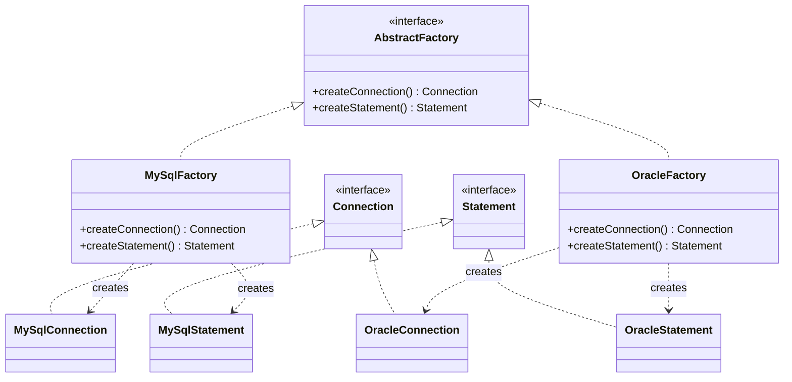

# 抽象工厂（Abstract Factory）

> 一句话定位：**一个工厂接口产出「一整个产品族」，用于整套切换实现**（换数据库、换云厂商 SDK）。本题最大区分度是讲清「产品等级结构 vs 产品族」和「开闭原则的倾斜性」——加产品族容易、加产品等级要动所有工厂。
> 分类：创建型（Creational） | 面试热度：★★★☆☆
> 版本前提：JDK 17

---

## 1. 是什么

**提供一个创建一系列相关或相互依赖对象的接口，而无需指定它们的具体类。**

理解它必须先分清两个概念：

| 概念 | 含义 | 例子 |
| --- | --- | --- |
| 产品等级结构 | **同一类产品**的不同实现（继承树上的兄弟） | `Connection` 下有 `MySQLConnection` / `OracleConnection` |
| 产品族 | **同一个品牌/来源**下的一整套产品 | MySQL 族的 `Connection + Statement + ResultSet`；Oracle 族同样一套 |

抽象工厂 = 一个工厂接口有**多个工厂方法**，每个方法产出一个等级的产品；一个具体工厂对应**一个产品族**。

| 角色 | 职责 |
| --- | --- |
| AbstractFactory | 声明一组 `createXxx()`，每个对应一个产品等级 |
| ConcreteFactory | 实现全部 `createXxx()`，产出同一族的产品 |
| AbstractProduct | 每个产品等级的抽象接口 |
| ConcreteProduct | 具体产品，隶属某个族、某个等级 |



---

## 2. 解决什么问题

**没有它之前**：要切换整套实现（如把数据访问层从 MySQL 换到 Oracle），客户端散落着 `new MySqlConnection()`、`new MySqlStatement()`、`new MySqlResultSet()`，每一处都要改，而且**容易混族**——拿了 MySQL 的 Connection 却配上 Oracle 的 Statement，编译期拦不住，运行时炸。

抽象工厂的两个核心价值：

1. **整套切换**：换一个 ConcreteFactory，一族产品整体替换。
2. **族内一致性**：同一个 ConcreteFactory 产出的产品保证兼容（同一品牌、同一协议版本），混族在结构上不可能发生。

**为什么不直接用工厂方法**：

| 维度 | 工厂方法 | 抽象工厂 |
| --- | --- | --- |
| 产出 | 一个等级的产品 | 一整族产品 |
| 工厂方法数量 | 1 个 | N 个（N = 产品等级数） |
| 切换粒度 | 换一个产品 | 换一整套实现 |
| 类数量 | 产品数 × 2 | 族数 × 等级数（乘法增长） |

**关键取舍**：抽象工厂是「维度税」最高的创建型模式。只有当**族切换是真实业务需求**（多数据库支持、多云厂商、多端 UI 皮肤）时才值得；否则用工厂方法即可。

---

## 3. 怎么写

以「云存储 SDK 族」为例：一族 = 同一云厂商的 `BlobClient + QueueClient` 整套。

```java
// ===== 产品等级 1：对象存储 =====
public interface BlobClient {
    void put(String key, byte[] data);
}
// ===== 产品等级 2：消息队列 =====
public interface QueueClient {
    void send(String topic, String message);
}

public final class S3BlobClient implements BlobClient {
    @Override public void put(String key, byte[] data) {
        System.out.println("[AWS S3] put " + key);
    }
}
public final class SqsQueueClient implements QueueClient {
    @Override public void send(String topic, String message) {
        System.out.println("[AWS SQS] send to " + topic);
    }
}
public final class OssBlobClient implements BlobClient {
    @Override public void put(String key, byte[] data) {
        System.out.println("[Aliyun OSS] put " + key);
    }
}
public final class MnsQueueClient implements QueueClient {
    @Override public void send(String topic, String message) {
        System.out.println("[Aliyun MNS] send to " + topic);
    }
}

// ===== 抽象工厂：一个接口 = 一整族 =====
public interface CloudFactory {
    BlobClient blobClient();
    QueueClient queueClient();
}

public final class AwsFactory implements CloudFactory {
    @Override public BlobClient blobClient() { return new S3BlobClient(); }
    @Override public QueueClient queueClient() { return new SqsQueueClient(); }
}
public final class AliyunFactory implements CloudFactory {
    @Override public BlobClient blobClient() { return new OssBlobClient(); }
    @Override public QueueClient queueClient() { return new MnsQueueClient(); }
}

// ===== 客户端：整套切换只改一处 =====
public class BackupService {
    private final BlobClient blob;
    private final QueueClient queue;
    public BackupService(CloudFactory factory) {   // 依赖抽象工厂
        this.blob = factory.blobClient();
        this.queue = factory.queueClient();
    }
    public void backup(String key, byte[] data) {
        blob.put(key, data);
        queue.send("backup-events", key);
    }
}
```

新增一个产品族（如腾讯云 COS + CMQ）：**只新增一组实现类和一个 ConcreteFactory，不改任何已有代码**。
新增一个产品等级（如加 `FunctionClient`）：**要改 AbstractFactory 接口，所有 ConcreteFactory 跟着改**——这就是下文的「倾斜性」。

---

## 4. 使用场景

| 场景 | 说明 |
| --- | --- |
| 多数据库适配 | DAO 层整套切换 Connection / Statement / ResultSet / Dialect |
| 多云厂商 SDK | 换云时整套替换存储、队列、函数计算客户端 |
| 跨平台 UI | 一套皮肤/主题族：Button + TextField + ScrollBar 同风格产出 |
| 中间件多协议 | RPC 框架按协议产出整套 Codec / Transporter / Serializer |
| 配置与环境族 | dev / prod 环境整套配置对象、密钥管理客户端 |

**JDK / 框架中的真实例子**：

- **JDBC 是教科书级抽象工厂**：`java.sql.Connection` 本身就是抽象工厂——`createStatement()`、`prepareStatement(sql)`、`prepareCall(sql)` 各产出一个产品等级；`Driver` 接口（`DriverManager.getConnection(url)` 底层）决定具体族是 MySQL 还是 Oracle。客户端只面向 `java.sql` 接口编程，换数据库只改驱动 jar 和 URL。
- `javax.xml.parsers.DocumentBuilderFactory#newInstance()` / `TransformerFactory#newInstance()`（JAXP）：通过 SPI（`META-INF/services` + 系统属性）选择 SAX/DOM 实现族（Xerces、JDK 内置等），`newInstance()` 返回的具体工厂对调用方透明。
- Dubbo `ProxyFactory` / `RegistryFactory`：每个扩展点都有一族实现（`JavassistProxyFactory` / `JdkProxyFactory`；`ZookeeperRegistryFactory` / `NacosRegistryFactory`），并用 `@SPI` + `ExtensionLoader` 做自适应选择——是抽象工厂思想在 SPI 框架里的工程化变体。

---

## 5. 生产中的问题与排查

| 问题 | 现象 | 排查 / 修复 |
| --- | --- | --- |
| **新增产品等级要改所有工厂** | 加一个等级，N 个 ConcreteFactory 全编译报错 | 这是模式固有代价（开闭原则倾斜性），无法消除只能缓解：接口给默认方法、或改用「工厂注册表 + 产品标识」的弱类型方案 |
| 类爆炸 | 族 × 等级 = 实现类乘法增长，包结构失控 | 接受并按「族」分包；等级超过 4 个时警惕，考虑降级为工厂方法 + 组合 |
| 混族使用 | 运行时协议错误、序列化不兼容 | 结构上杜绝：客户端只注入 AbstractFactory，不直接 new 任何 ConcreteProduct |
| 族内产品有依赖顺序 | 如必须先建 Connection 才能建 Statement | 在工厂内部封装顺序，或让低层产品作为高层工厂方法的入参（JDBC 就是这么做的：`conn.createStatement()`） |
| SPI 加载到错误的族 | 类路径上有多个实现，加载顺序不确定 | 显式指定（JAXP 用系统属性 `javax.xml.parsers.DocumentBuilderFactory`，Dubbo 用 URL 参数），别依赖 classpath 顺序 |
| 切换族时状态没清 | 换云 SDK 后旧客户端的连接/线程泄漏 | ConcreteFactory 实现 `Closeable`，切换前 `close()` 旧族全部产品；交给 Spring 时用 `@ConditionalOnProperty` 保证容器里只有一族 |
| 与工厂方法混淆 | 面试追问时讲不清维度 | 判据：工厂接口里有几个创建方法？1 个 = 工厂方法，N 个且产品相互关联 = 抽象工厂 |

---

## 6. 面试问法

### 60 秒版本

> 抽象工厂是创建型模式，一个工厂接口提供多个创建方法，产出一整族相互关联的产品，客户端只依赖抽象接口。理解它要分清两个概念：产品等级结构是同类产品的不同实现，比如 Connection 的 MySQL 和 Oracle 实现；产品族是同一来源下的一整套产品，比如 MySQL 的 Connection 加 Statement 加 ResultSet。它最大的特点是开闭原则的倾斜性：新增一个产品族非常方便，只加一个 ConcreteFactory，不动已有代码；但新增一个产品等级要改抽象工厂接口，所有具体工厂都得跟着改，这是它的固有代价。最经典的例子是 JDBC：`Connection` 接口本身就是抽象工厂，`createStatement`、`prepareStatement` 是它的工厂方法，`Driver` 决定具体走哪个数据库族。工程上它适合「整套切换实现」的场景，代价是类数量按族乘等级乘法膨胀。

### 5 分钟版本补充点

1. 抽象工厂 ≈ 「一组工厂方法的聚合」；从工厂方法演化而来：当工厂要产的产品从一个变成一组关联产品时，就升级成抽象工厂
2. 族内一致性是它相对「多个独立工厂方法」的核心收益——保证产出产品相互兼容
3. 缓解「新增等级要改全部工厂」的手段：接口默认方法、抽象骨架类、或退化为 `Map<产品标识, Supplier>` 的弱类型注册表（牺牲编译期检查）
4. 与 Spring 结合：用 `@ConditionalOnProperty("cloud.vendor")` 让容器只装配一族，比自己写工厂选择器更干净
5. 现实中纯 GoF 式抽象工厂越来越少，更多是思想变体：SPI（Dubbo `ExtensionLoader`）、JDBC、JAXP 都是「注册 + 选择 + 族创建」的混合体
6. 判题技巧：面试官举的例子如果只涉及一种产品的多个实现，那是工厂方法；涉及一整套配套实现的切换，才是抽象工厂

---

## 7. 追问链 · 参考答案

| 层级 | 问题 | 参考答案要点 |
| --- | --- | --- |
| L1 | 抽象工厂是什么？ | 创建型模式，提供一个创建一族相关产品的接口，客户端无需知道具体类。四角色：AbstractFactory / ConcreteFactory / AbstractProduct / ConcreteProduct，一个具体工厂对应一个产品族 |
| L1 | 什么是产品族和产品等级结构？ | 产品等级结构是同一类产品的不同实现（MySQL Connection 与 Oracle Connection 是同一等级的两个兄弟）；产品族是同一来源的一整套产品（MySQL 的 Connection+Statement+ResultSet）。抽象工厂按族组织生产 |
| L2 | 和工厂方法的区别？ | 工厂方法一个工厂产一个等级的产品，只有一个创建方法；抽象工厂一个工厂产一族产品，有 N 个创建方法且产品相互关联。抽象工厂可看作工厂方法在「产品维度」上的聚合升级 |
| L2 | 什么是开闭原则的倾斜性？ | 抽象工厂只对「新增产品族」开闭：加一个 ConcreteFactory 即可，不改已有代码。对「新增产品等级」不闭合：要改抽象工厂接口加方法，所有 ConcreteFactory 必须跟着实现。这是该模式无法消除的结构性代价 |
| L3 | 为什么说 JDBC 是抽象工厂？ | `java.sql.Connection` 接口有 `createStatement()`、`prepareStatement()`、`prepareCall()` 等多个创建方法，产出一族对象；`Driver` 决定具体族（MySQL 驱动返回 `com.mysql.cj.jdbc.ConnectionImpl` 一套）。客户端只面向 `java.sql` 接口，换库只换驱动和 URL |
| L3 | JAXP 怎么选具体实现族？ | `DocumentBuilderFactory.newInstance()` 按顺序查找：系统属性 → `$JAVA_HOME/conf/jaxp.properties` → `META-INF/services` SPI → 平台默认实现。是抽象工厂 + SPI 的组合，选择逻辑对调用方完全透明 |
| L3 | Dubbo 里哪里体现了这种思想？ | `ProxyFactory`（Javassist/JDK 一族）、`RegistryFactory`（Zookeeper/Nacos/Redis 一族）都是扩展点接口，由 `ExtensionLoader` 按 `@SPI` 默认值和 URL 参数选择具体实现，等价于「用配置选择 ConcreteFactory」的抽象工厂变体 |
| L4 | 新增产品等级时的改动面有多大？ | 改 AbstractFactory 接口加一个方法 + 每个 ConcreteFactory 实现该方法 + 新增该等级的抽象与所有族的具体实现。改动量 = 1 接口 + F 个工厂 + F 个产品（F 为族数），族越多越痛 |
| L4 | 怎么缓解类爆炸？ | 三条路：① 按族分包并严格限制等级数量；② 等级间有共性时用泛型/模板减少类数；③ 放弃强类型，用 `Map<产品标识, Supplier<?>>` 注册表（Dubbo SPI 本质是这条路）。每种都在类型安全和数量之间重新权衡 |
| L5 | 什么业务真的需要抽象工厂？ | 特征是「整套切换」：多数据库支持、多云厂商 SDK、多端 UI 皮肤、多协议 RPC。判据是产品之间是否存在必须一致的关联（协议、风格、版本）。如果产品彼此独立，用多个工厂方法即可，不要上抽象工厂 |

---

## 8. 误区 · 正解

| ❌ 误区 | ✅ 正解 |
| --- | --- |
| 「抽象工厂完全遵守开闭原则」 | 只对产品族维度遵守。新增产品等级必须改抽象接口和所有实现类，这是模式固有的**倾斜性**，面试答「完全遵守」会被追问击穿 |
| 「抽象工厂就是多个工厂方法的简单堆叠」 | 不止。它额外保证**族内一致性**：同一个 ConcreteFactory 产出的产品相互兼容，结构上杜绝混族。独立堆叠的工厂方法没有这个约束 |
| 「产品族 = 同一个包下的类」 | 产品族是语义概念：同一来源/品牌、必须配套使用的一整套产品。与包结构无关，判据是「换实现时它们要不要一起换」 |
| 「JDBC 的 `DriverManager` 是抽象工厂」 | `DriverManager` 是工厂选择器/注册中心；真正的抽象工厂是 `Connection` 接口本身——它有多个创建方法，产出一族对象 |
| 「新增产品等级时可以给接口加默认方法就没事」 | 默认方法只能缓解编译错误，挡不住语义问题：默认实现往往只能抛 `UnsupportedOperationException` 或返回 null，等于把编译期错误推迟到运行时，是妥协不是解决 |
| 「抽象工厂比工厂方法高级，能用就用」 | 维度不同不是高低之分。只扩展单一产品时用抽象工厂是过度设计，白白引入「族 × 等级」的类膨胀 |
| 「`DocumentBuilderFactory.newInstance()` 每次返回同一实现」 | 返回哪个实现取决于系统属性、SPI 配置文件和 classpath，是可变的。生产环境若依赖特定实现应显式指定，不能假设默认 |
| 「用了抽象工厂就不会混族」 | 前提是客户端只通过工厂拿产品。若允许直接 `new` 具体产品或跨工厂拼装，照样能混——模式只提供结构上的约束，要靠团队纪律兜底 |

---

## 9. 相关模式

| 模式 | 关系 |
| --- | --- |
| 工厂方法 | 抽象工厂的低维版本；抽象工厂常由一组工厂方法组成，新增等级 = 新增一个工厂方法 |
| 建造者 | 抽象工厂「一步拿到一族产品」，建造者「分步骤构造一个复杂对象」；二者可组合（工厂决定用哪个 Builder） |
| 原型 | 抽象工厂的 create 方法内部可以改为 `clone()` 模板实例，避免重复昂贵构造 |
| 单例 | 具体工厂通常无状态，适合做成单例或 Spring 单例 Bean |
| 外观 | 一族产品的使用很复杂时，可在抽象工厂之上再加一层外观统一入口 |
| 策略 | 策略关注「算法可替换」（行为），抽象工厂关注「一族对象可替换」（创建）；切换族时常用策略模式承载选择逻辑 |

---

## 10. 我的薄弱点

（学完后自己填，同步到 `weakness.md`）
