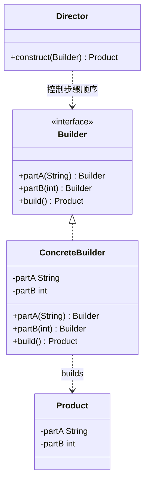
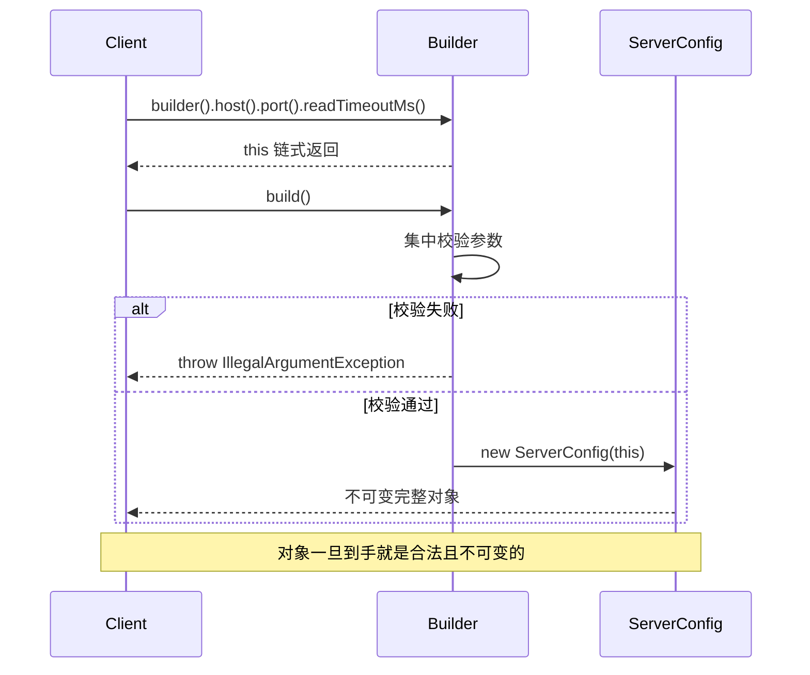

# 建造者（Builder）

> 一句话定位：**分步骤构造一个内部复杂的对象**，解决 telescoping constructor（重叠构造器）反模式和对象中间状态不一致问题。考官真正想听的是它和工厂模式的区别（分步 vs 一步）、`build()` 里做校验的写法、以及 Lombok `@Builder` 的那几个坑。
> 分类：创建型（Creational） | 面试热度：★★★★☆
> 版本前提：JDK 17

---

## 1. 是什么

**将一个复杂对象的构造过程与它的表示分离，使同样的构造过程可以创建不同的表示。**

与工厂模式的核心区别：工厂是「**一步**拿到产品」，建造者是「**分步骤**」构造一个内部复杂的对象，且步骤顺序由导演者（Director）控制（现代实现里 Director 常被省略，客户端直接链式调用）。

| 角色 | 职责 |
| --- | --- |
| Product | 被构造的复杂对象 |
| Builder | 抽象建造者，声明各个 `buildPart()` 步骤和 `build()` |
| ConcreteBuilder | 实现各步骤，内部持有半成品状态 |
| Director | 控制步骤顺序与组合（经典结构有，链式写法常省略） |



---

## 2. 解决什么问题

**痛点一：telescoping constructor（重叠构造器反模式）**。参数多时被迫写一串构造器：

```java
// before：参数从 2 个到 6 个，构造器越叠越多，调用处全是 null 占位
public class ServerConfig {
    public ServerConfig(String host, int port) { this(host, port, 0, null); }
    public ServerConfig(String host, int port, int timeout) { this(host, port, timeout, null); }
    public ServerConfig(String host, int port, int timeout, String tlsCertPath) { ... }
}

// 调用处：第 3、4 个参数是什么含义？只能跳源码
new ServerConfig("0.0.0.0", 8080, 3000, null);
```

**痛点二：`setXxx()` 的中间状态不一致**。先 `new` 再逐个 set，对象在 set 完成前处于**不完整状态**，多线程下被读到半成品；且无法构造 final 字段的不可变对象。

**替代方案对比**：

| 方案 | 问题 |
| --- | --- |
| 重叠构造器 | 参数组合爆炸（n 个可选参数最坏 2ⁿ 个构造器）；同类型相邻参数极易传错位置 |
| setter | 对象有中间态，线程不安全；无法设 final 字段；必填校验无处安放 |
| Builder | 具名赋值、一步校验、可产不可变对象；代价是多写一个 Builder 类 |

**关键取舍**：参数 ≤ 3 个时直接构造器或静态工厂即可；参数多、有可选项、要不可变对象时才值得上 Builder。

---

## 3. 怎么写

生产级链式 Builder 三要素：**静态内部类 + `return this` 链式 + `build()` 里集中校验**（校验放 `build()` 而非各 setter，是保证「要么不建、要么建成合法对象」的加分点）。

```java
public final class ServerConfig {
    private final String host;
    private final int port;
    private final int connectTimeoutMs;
    private final int readTimeoutMs;
    private final String tlsCertPath;

    private ServerConfig(Builder b) {
        this.host = b.host;
        this.port = b.port;
        this.connectTimeoutMs = b.connectTimeoutMs;
        this.readTimeoutMs = b.readTimeoutMs;
        this.tlsCertPath = b.tlsCertPath;
    }

    public static Builder builder() { return new Builder(); }

    public static final class Builder {
        private String host;
        private int port = 8080;                       // 默认值在 Builder 里给
        private int connectTimeoutMs = 3000;
        private int readTimeoutMs = 5000;
        private String tlsCertPath;

        private Builder() {}

        public Builder host(String host) { this.host = host; return this; }
        public Builder port(int port) { this.port = port; return this; }
        public Builder connectTimeoutMs(int ms) { this.connectTimeoutMs = ms; return this; }
        public Builder readTimeoutMs(int ms) { this.readTimeoutMs = ms; return this; }
        public Builder tlsCertPath(String path) { this.tlsCertPath = path; return this; }

        public ServerConfig build() {
            // 集中校验：放 build() 而不是各 setter，保证中间态不会泄漏
            if (host == null || host.isBlank())
                throw new IllegalArgumentException("host must not be blank");
            if (port < 1 || port > 65535)
                throw new IllegalArgumentException("invalid port: " + port);
            if (readTimeoutMs < connectTimeoutMs)
                throw new IllegalArgumentException("readTimeout < connectTimeout");
            return new ServerConfig(this);
        }
    }
}
```



---

## 4. 使用场景

| 场景 | 说明 |
| --- | --- |
| 构造参数多且有可选项 | 配置类、请求对象、查询条件对象 |
| 构造不可变对象 | Builder 可变、Product 全 final，build 后冻结 |
| 参数间有约束需要整体校验 | 校验逻辑放 `build()`，跨字段规则（如 readTimeout ≥ connectTimeout）才有地方写 |
| 构造过程要分步、顺序有意义 | 经典 Director 场景：装配流水线、报表组装 |
| 测试构造复杂对象 | Test Object Builder，每个测试只覆盖关心的字段 |

**JDK / 三方库 / 框架中的真实例子**：

- `java.lang.StringBuilder` / `StringBuffer` —— 最广为人知的 Builder 形态（append 链式），虽然语义上更接近「累加器」。
- JDK 11+ `java.net.http.HttpRequest.newBuilder()` —— `uri().header().timeout().GET().build()`，教科书式链式。
- `java.util.Locale.Builder`、`java.util.stream.Stream.Builder`。
- Guava `ImmutableList.builder()`、`CacheBuilder.newBuilder()`（`maximumSize().expireAfterWrite().build()` 产 `Cache`）。
- Jackson 2.10+ `ObjectMapper.builder()` / `JsonMapper.builder()`——官方推荐的模块注册与配置入口。
- MyBatis `SqlSessionFactoryBuilder`——名字里就带 Builder，`build(reader, environment, properties)` 多重重载收口到 XML 解析构建。
- OkHttp `Request.Builder` / `OkHttpClient.Builder`；Retrofit `Retrofit.Builder`。
- Spring `BeanDefinitionBuilder.rootBeanDefinition(...)`——编程式注册 BeanDefinition 的链式入口。

---

## 5. 生产中的问题与排查

| 问题 | 现象 | 排查 / 修复 |
| --- | --- | --- |
| **Lombok `@Builder` 吞掉字段默认值** | `private int retry = 3;` 加了 `@Builder` 后 build 出来 retry = 0 | `@Builder` 生成的全参构造器不执行字段初始化表达式。加 `@Builder.Default`（注意它要求该字段不能有 final，且初始化被挪进 Builder 内部） |
| **`@Builder` 顶掉无参构造器** | Jackson / MyBatis 反序列化报 `InvalidDefinitionException: cannot construct` | `@Builder` 在类上时会生成全参构造器，编译器因此不再补无参构造器。显式加 `@NoArgsConstructor(force = true)` + `@AllArgsConstructor`（配合 `@Builder` 三者并用是常见定式） |
| **`@Builder` 与继承不兼容** | 子类 Builder 里没有父类字段 | `@Builder` 只收本类字段。改用 `@SuperBuilder`（父子类都标），或放弃继承改组合 |
| `@Builder` 在类上 vs 构造器上行为不同 | 构造器上的 `@Builder` 只收该构造器的参数，字段默认值不受影响 | 想保留默认值/自定义构造逻辑时，把 `@Builder` 标在自己写的构造器上 |
| Builder 被复用导致串数据 | 单测/批处理里复用同一个 Builder，前一个对象的字段残留进后一个 | Builder 是有状态的一次性对象，**每个对象用新 Builder**；或在 `build()` 后 `reset()` |
| 校验写在 setter 里 | 链式中途就抛异常，错误信息不完整 | 校验集中在 `build()`，一次报全所有问题（可收集成 List 再抛） |
| Builder 在并发下共享 | 偶发字段错乱 | Builder 本身非线程安全，禁止跨线程共享；build 出的不可变 Product 才是可共享的 |
| 过度设计 | 3 个参数的类也套 Builder | 参数 ≤ 3、无可选项、无校验需求时直接构造器；Builder 的收益随参数数量增长 |

---

## 6. 面试问法

### 60 秒版本

> 建造者是创建型模式，把复杂对象的构造过程分步骤化，构造与表示分离。它和工厂模式的区别是粒度：工厂是一步拿到完整产品，建造者是分步骤组装，经典结构里还有 Director 控制步骤顺序，现代链式写法一般省略 Director 由客户端直接链式调用。它主要解决三个痛点：参数过多时的重叠构造器反模式、setter 造成的对象中间状态不一致、以及不可变对象 final 字段无法分步赋值的问题。标准写法是静态内部类 Builder、每个方法 return this 链式、所有校验集中在 build() 里，保证对象一旦产成就合法且不可变。真实例子很多：JDK 11 的 HttpRequest.newBuilder()、Guava 的 CacheBuilder、MyBatis 的 SqlSessionFactoryBuilder、OkHttp 的 Request.Builder。工程上常用 Lombok @Builder，但要注意它吞字段默认值、顶掉无参构造器导致 Jackson 反序列化失败、以及继承场景要用 @SuperBuilder 这三个坑。

### 5 分钟版本补充点

1. 校验放 `build()` 的理由：跨字段约束（A ≥ B）只有在所有字段就位后才能检查；且保证「Builder 可变、Product 不可变」的边界清晰
2. Builder + 不可变对象是**线程安全发布**的标准姿势：build 出的对象全 final，安全发布不需要额外同步
3. 与 telescoping constructor 的临界点：经验值是「可选参数 ≥ 3」或「同类型相邻参数 ≥ 2」就该换 Builder
4. `StringBuilder` 其实不算标准 Builder 模式（没有分离构造与表示），面试别拿它当主例，主例用 `HttpRequest` 或 `CacheBuilder`
5. JDK 里 Director 几乎绝迹——链式调用把「步骤顺序决策权」交给了客户端，这是模式在现代 API 设计中的自然演化
6. Kotlin / 带默认参数的命名参数语言里 Builder 需求大幅下降，这也是它被质疑「Java 补丁」的原因——可以主动提，显格局

---

## 7. 追问链 · 参考答案

| 层级 | 问题 | 参考答案要点 |
| --- | --- | --- |
| L1 | 建造者模式是什么？ | 创建型模式，将复杂对象的构造过程与表示分离，分步骤构造。四角色：Product / Builder / ConcreteBuilder / Director；链式写法中 Director 常被省略，客户端直接链式调用后 `build()` |
| L2 | 和工厂模式的核心区别？ | 工厂是**一步**拿到产品，关注「创建哪个类」；建造者是**分步骤**构造一个内部复杂的对象，关注「构造过程与参数组装」。工厂产出的对象通常层级多（多态），Builder 产出的通常是同一个类的不同配置形态 |
| L2 | 解决 telescoping constructor 的原理？ | 重叠构造器把「可选参数组合」编码成 N 个构造器重载，参数含义靠位置区分。Builder 用具名方法赋值，参数自带名字，可选参数不调用即取默认值，组合数从构造器个数解耦为方法调用 |
| L3 | 为什么校验要放 `build()`？ | 跨字段约束（如 readTimeout ≥ connectTimeout）必须等全部字段就位才能校验；放 setter 会过早抛错且错误信息零散。放 `build()` 保证「要么不建、要么建成合法对象」，Builder 中间态不外泄 |
| L3 | `@Builder` 为什么会让字段默认值失效？ | 类上标 `@Builder` 时 Lombok 生成一个**全参构造器**，Builder 通过它赋值；字段声明处的 `= 3` 初始化表达式在全参构造器路径上不生效。修复：加 `@Builder.Default`，Lombok 会把默认值挪进 Builder 的字段初始化 |
| L3 | `@Builder` 为什么导致 Jackson 反序列化失败？ | `@Builder` 生成全参构造器后，编译器不再自动生成无参构造器，而 Jackson（默认）/ MyBatis 需要无参构造器实例化。修复：显式 `@NoArgsConstructor` + `@AllArgsConstructor` 三件套并用 |
| L3 | 继承场景 `@Builder` 有什么问题？ | `@Builder` 只收集本类字段，父类字段进不了子类 Builder。解法是父子类都标 `@SuperBuilder`（生成的 Builder 是泛型递归类型），或放弃继承改组合 |
| L4 | Builder 和 setter 注入怎么选？ | 要不可变对象、有跨字段校验、参数一次性确定 → Builder；对象是框架管理的 Bean、依赖要后注入、允许运行期变更 → setter/字段注入。Spring Bean 用注入，DTO/配置对象用 Builder，界限是「生命周期归谁管」 |
| L4 | Builder 是线程安全的吗？ | 不是，也不该是。Builder 是有状态的一次性可变对象，限定单线程使用；它产出的 Product 若全 final 则天然线程安全、可自由共享。职责划分：Builder 管可变构造期，Product 管不可变使用期 |
| L5 | 什么时候不该用 Builder？ | 参数 ≤ 3 且无歧义、对象允许可变且无约束、或语言层面有更好方案（Kotlin 命名参数/默认参数）时不用。Builder 是「Java 缺乏命名参数」的补偿，参数少时它是纯样板代码 |

---

## 8. 误区 · 正解

| ❌ 误区 | ✅ 正解 |
| --- | --- |
| 「Builder 就是链式 setter」 | 不是。setter 直接改成品对象、产生中间态；Builder 改的是**中间载体**，成品只在 `build()` 一刻诞生，且可以是全 final 不可变对象。链式只是语法表象 |
| 「`StringBuilder` 是 Builder 模式的代表」 | 形态像但不是标准 Builder：它没有「构造与表示分离」，也没有 Director。更贴切的主例是 `HttpRequest.newBuilder()`、`CacheBuilder`、`SqlSessionFactoryBuilder` |
| 「`@Builder` 标在类上就万事大吉」 | 三个坑：字段默认值失效（要 `@Builder.Default`）、顶掉无参构造器导致 Jackson/MyBatis 反序列化失败（要补 `@NoArgsConstructor` + `@AllArgsConstructor`）、继承下父类字段丢失（要 `@SuperBuilder`） |
| 「校验放每个 set 方法里更及时」 | 单字段约束可以放，但跨字段约束只能放 `build()`；且过早抛错会让链式体验破碎。生产惯例：全部校验集中在 `build()`，一次性报告 |
| 「Director 是必需角色」 | 经典结构里有，但现代链式实现普遍省略，由客户端自己决定调用哪些步骤。只有「构造步骤顺序必须固定且复杂」（如装配流水线）时才保留 Director |
| 「Builder 可以复用以减少对象分配」 | 复用会让上一个对象的字段残留进下一个。Builder 按一次性使用设计；真要省分配应该走对象池，不是复用 Builder |
| 「有了 Builder 就不需要构造器校验了」 | `build()` 校验的是 Builder 收集的参数；Product 私有构造器仍可断言防御（尤其 Product 可被反射/其他路径创建时）。两层校验不冲突 |
| 「Builder 产出的对象一定不可变」 | 模式不强制。`build()` 返回可变对象也完全合法（如 `Stream.Builder` 产出的 Stream 是一次性消费型）。不可变是推荐实践而非模式要求 |

---

## 9. 相关模式

| 模式 | 关系 |
| --- | --- |
| 工厂方法 / 抽象工厂 | 工厂「一步到位」创建产品；Builder「分步组装」复杂对象。工厂内部可用 Builder 实现（先选族再组装） |
| 原型 | Builder 从零分步构造；原型从已有实例**复制**再微调。构造昂贵且新对象与旧对象相似时，原型比 Builder 更合适 |
| 模板方法 | Director 的 `construct()` 常是模板方法：固定步骤顺序，步骤实现交给 Builder |
| 组合 | Builder 常用来逐层组装组合结构（树形 UI、嵌套文档对象） |
| Setter 注入 | 非模式但常被对比：可变 Bean + 框架生命周期用注入；不可变对象 + 一次性构造用 Builder |

---

## 10. 我的薄弱点

（学完后自己填，同步到 `weakness.md`）
