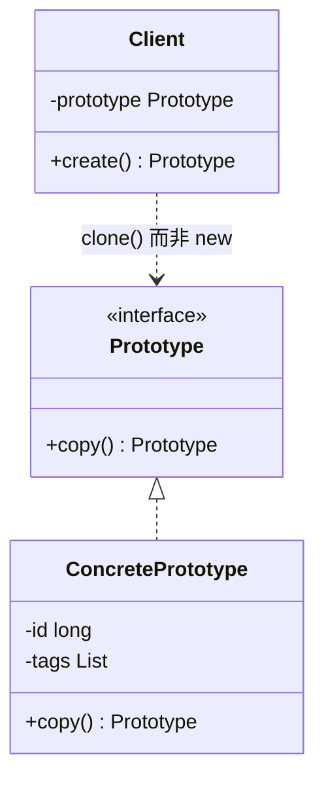

# 原型（Prototype）

> 一句话定位：**用已有实例作模板，通过复制创建新对象**，绕过昂贵的构造流程。考官真正想听的是深拷贝 vs 浅拷贝、`clone()` 的四个反直觉点（不调构造器、final 字段、与单例冲突、`ArrayList#clone()` 是浅拷贝）、以及 Spring 的 `prototype` 作用域其实和本模式无关。
> 分类：创建型（Creational） | 面试热度：★★☆☆☆
> 版本前提：JDK 17

---

## 1. 是什么

**用原型实例指定创建对象的种类，并通过拷贝这些原型创建新的对象。**

适用场景：对象构造昂贵（要查库、发 RPC、解析大文件），而新对象与已有对象**高度相似**——与其重新构造，不如复制一份再微调。

| 角色 | 职责 |
| --- | --- |
| Prototype | 声明 `clone()` 的接口（Java 里即 `Cloneable`） |
| ConcretePrototype | 实现克隆逻辑，决定深/浅拷贝策略 |
| Client | 持有原型，需要新对象时调 `clone()` |



---

## 2. 解决什么问题

**没有它之前**：要创建 1000 个「只有标题不同的文档对象」，每个都走一遍「查库加载模板 → 解析 → 填充」的构造流程，成本放大 1000 倍。或者要保存对象某时刻的快照（撤销/重试/审计），没有现成手段。

**核心难题：深拷贝 vs 浅拷贝**——这是本题真正的考点：

| 维度 | 浅拷贝 | 深拷贝 |
| --- | --- | --- |
| 复制内容 | 基本类型值 + 引用**地址** | 递归复制整个引用链上的对象 |
| 引用类型字段 | 副本与原件**共享**同一个对象 | 副本持有独立的新对象 |
| `Object#clone()` 默认行为 | ✅ 就是它 | ❌ 要自己实现 |
| 改副本的引用字段 | 原件跟着变（踩坑现场） | 互不影响 |
| 成本 | O(1) 字段拷贝 | 随对象图深度线性增长，还要处理循环引用 |

**为什么不直接用序列化/拷贝构造器**：见第 3 节的对比表——`clone()` 快但约束多，序列化简单但慢，拷贝构造器最可控。

---

## 3. 怎么写

先看清 JDK 的原生机制，再给生产级推荐写法。

**JDK 原生 clone 的规矩**：

```java
public class TaskTemplate implements Cloneable {   // ① Cloneable 是标记接口，没有任何方法
    private long id;                               //    不实现它直接调 clone() 抛 CloneNotSupportedException
    private String title;
    private List<String> tags = new ArrayList<>();

    @Override
    public TaskTemplate clone() {                  // ② Object#clone() 是 protected native，
        try {
            TaskTemplate copy = (TaskTemplate) super.clone(); // 浅拷贝：tags 引用被共享！
            copy.tags = new ArrayList<>(this.tags);           // 手动把引用字段拷贝一层 → 深拷贝
            return copy;
        } catch (CloneNotSupportedException e) {
            throw new AssertionError(e);           // 实现了 Cloneable 就不会到这
        }
    }
}
```

**生产更推荐：拷贝构造器 / 静态工厂**（最可控、无 `Cloneable` 的历史包袱）：

```java
public final class TaskTemplate {
    private final long id;
    private final String title;
    private final List<String> tags;

    public TaskTemplate(long id, String title, List<String> tags) {
        this.id = id;
        this.title = title;
        this.tags = List.copyOf(tags);             // 防御性拷贝，入不可变
    }

    /** 拷贝构造器：显式、可校验、可处理 final 字段 */
    public TaskTemplate(TaskTemplate src) {
        this(src.id, src.title, src.tags);         // 复用主构造器的校验
    }

    /** 复制并微调：原型模式最常见的真实用法 */
    public TaskTemplate withTitle(String newTitle) {
        return new TaskTemplate(this.id, newTitle, this.tags);
    }
}
```

**深拷贝实现方式对比**：

| 方式 | 优点 | 代价 / 坑 |
| --- | --- | --- |
| 递归 `clone()` | 性能最好 | 每个引用类型都要实现 Cloneable；循环引用要自己处理；final 字段无法重设 |
| Java 原生序列化 | 一行搞定深拷贝 | 慢（10 倍以上开销）；要求全图 `Serializable`；serialVersionUID 维护负担 |
| JSON 序列化（Jackson） | 跨语言可读、调试方便 | 更慢；丢失类型信息（泛型擦除、多态字段要 `@JsonTypeInfo`）；无 getter 的字段可能丢失 |
| Kryo / FST | 快于原生序列化 | 引入三方依赖；类结构演进时兼容性要自己管 |
| **拷贝构造器 / 静态工厂** | 最可控、可校验、支持 final、可读性最好 | 字段多时代码冗长（但每行都是显式意图） |
| `BeanUtils.copyProperties` | 最省事 | **Apache 和 Spring 的都是浅拷贝**——只复制属性值/引用，嵌套对象照样共享，最常见踩坑点 |

---

## 4. 使用场景

| 场景 | 说明 |
| --- | --- |
| 昂贵构造 + 少量差异 | 从 DB/网络加载的模板对象，复制后改两个字段即可用 |
| 快照 / 撤销 | 保存某时刻状态用于回滚、重试、审计 |
| 配置模板 | 一套标准配置，每个环境复制一份再覆盖差异项 |
| 防御性拷贝 | 返回内部可变对象前 clone 一份，防止调用方污染内部状态 |

**JDK / 框架中的真实例子**：

- `java.lang.Object#clone()` + `Cloneable` —— 机制源头。
- `java.util.ArrayList#clone()` —— **浅拷贝**：内部数组复制了，但数组里的元素引用不变（元素本身不复制）。
- `java.util.Calendar#clone()` —— 同样是浅拷贝语义。
- 数组的 `arr.clone()` —— 也是浅拷贝：基本类型数组值复制，对象数组只复制引用，要单独记一句。
- MyBatis 的 `BoundSql` / `MappedStatement` 设计上避免共享可变状态，每次执行生成独立参数上下文——原型思想（不共享可变量）的体现，虽然不走 `clone()`。

---

## 5. 生产中的问题与排查

| 问题 | 现象 | 排查 / 修复 |
| --- | --- | --- |
| **浅拷贝共享引用字段** | 改副本的 `tags`，原件也跟着变 | `clone()` 里对引用字段手动 `new ArrayList<>(...)`；或改用拷贝构造器统一处理 |
| **`BeanUtils.copyProperties` 被当深拷贝用** | 嵌套对象一改全改，bug 跨请求串数据 | 记住 Apache `BeanUtils` 和 Spring `BeanUtils` 都是**浅拷贝**；深拷贝换 `MapStruct`（生成逐字段代码）或序列化方案 |
| **`clone()` 不调用构造器** | 构造器里的参数校验、ID 生成、计数器自增全部被跳过 | 构造器放不变式校验的类不要用 clone；改用拷贝构造器（会走主构造器） |
| **final 字段无法在 `clone()` 里重设** | 拷贝时需要换一个 final 字段（如新 ID），编译报错 | final 只能在声明处或构造器赋值——这是 JDK 原生 clone 的硬伤。解法：拷贝构造器，或字段去掉 final 配合防御性约定 |
| **与单例冲突** | 单例类实现了 Cloneable，被 `clone()` 出第二个实例 | 单例不要实现 Cloneable；或重写 `clone()` 返回 `INSTANCE` / 直接抛异常 |
| 循环引用导致序列化栈溢出 | 深拷贝时 `StackOverflowError` | 递归 clone 要用 `IdentityHashMap` 记录已拷贝对象；原生序列化天然处理循环引用（但慢） |
| `CloneNotSupportedException` | 调 `clone()` 直接抛 | 类没实现 `Cloneable`。注意这个接口**没有任何方法**，纯标记，靠 JVM 在 `clone()` 里检查 |
| 数组 clone 的错觉 | 以为 `String[]` clone 后元素独立 | 数组 `clone()` 只复制数组本身，元素引用共享；深拷贝要 `Arrays.copyOf` + 逐元素复制 |

---

## 6. 面试问法

### 60 秒版本

> 原型模式是创建型模式，用已有实例作模板通过复制创建新对象，适合构造昂贵而新对象与模板高度相似的场景。Java 的落地是 `Cloneable` 加 `Object#clone()`：`Cloneable` 是没有方法的标记接口，`clone()` 是 protected native 方法，不实现接口直接调会抛 `CloneNotSupportedException`。核心难题是深浅拷贝：`clone()` 默认是浅拷贝，引用字段共享，深拷贝要递归处理引用链。原生 clone 有四个反直觉点：不调用构造器所以校验和计数器全跳过；final 字段无法在 clone 里重新赋值；和单例语义直接冲突；`ArrayList#clone()` 只复制数组不复制元素。工程上更推荐拷贝构造器或静态工厂——可控、走构造器校验、支持 final；图省事用 BeanUtils 要记得它是浅拷贝。最后，Spring 的 prototype 作用域和本模式无关，它只是每次注入都 new 一个新实例，不做任何复制。

### 5 分钟版本补充点

1. `clone()` 是 `protected native`，JVM 层面做逐字段内存拷贝（shallow bitwise copy），所以快且绕过构造器——绕过构造器既是特性也是坑
2. 深拷贝方案选型：性能敏感用递归 clone 或 Kryo；要可读可维护用拷贝构造器；跨服务边界用 JSON 序列化
3. 循环引用处理：递归 clone 用 `IdentityHashMap` 做 visited 表；原生序列化内部就是这么做的（handles 机制）
4. 防御性拷贝是原型的隐身用法：`getList()` 返回 `new ArrayList<>(this.list)`，是每个 senior 都该养成的习惯
5. `record` 与原型：record 的 canonical constructor 让 `with` 拷贝（`new R(r.a(), newB)`）成为最安全的复制姿势
6. 原型模式在现代 Java 里存在感下降——不可变对象 + wither 方法 + 拷贝构造器基本覆盖了它的场景，`Cloneable` 被《Effective Java》明确批评为「有缺陷的设计」

---

## 7. 追问链 · 参考答案

| 层级 | 问题 | 参考答案要点 |
| --- | --- | --- |
| L1 | 原型模式是什么？ | 创建型模式，以已有实例为模板通过复制创建新对象，避免重复昂贵构造。Java 落地是 `Cloneable` 标记接口 + `Object#clone()` 的 protected native 方法 |
| L1 | 深拷贝和浅拷贝的区别？ | 浅拷贝只复制基本类型值和引用地址，副本与原件共享引用类型字段；深拷贝递归复制整个引用链，副本完全独立。`Object#clone()` 默认是浅拷贝 |
| L2 | `Cloneable` 有什么特殊之处？ | 它是**没有任何方法的标记接口**，作用只是告诉 JVM 的 `clone()` 实现「允许拷贝本对象」。不实现它直接调 `clone()` 会抛 `CloneNotSupportedException`。这种「接口无方法却改变行为」的设计被《Effective Java》批评为反面教材 |
| L2 | 深拷贝有哪几种实现方式？ | 四种主流：递归调引用字段的 `clone()`（最快但要求每层都实现、要处理循环引用）；序列化（原生/JSON/Kryo，简单但慢，原生要全图 Serializable）；拷贝构造器/静态工厂（最可控、支持 final、推荐）；BeanUtils 拷贝（注意 Apache 和 Spring 实现都是浅拷贝） |
| L3 | `clone()` 为什么不调用构造器？ | `clone()` 是 JVM 层 native 实现，直接在堆上分配内存并逐字段做位拷贝（bitwise copy），完全绕过 Java 层构造流程。后果：构造器里的参数校验、ID 生成、实例计数器全部不执行 |
| L3 | final 字段和 `clone()` 有什么冲突？ | final 字段只能在声明处或构造器中赋值，而 `clone()` 不是构造器，拷贝后无法给 final 字段重新赋值（如换新 ID）。这是原生 clone 的硬伤，解决路径是拷贝构造器——走正常构造流程，final 字段可正常赋新值 |
| L3 | `ArrayList#clone()` 复制了什么？ | 浅拷贝：内部 `elementData` 数组被复制了一份，但数组里装的元素引用不变——两个 list 指向同一批元素对象。改其中一个元素的内部状态，两边都看到。数组的 `arr.clone()` 同理：对象数组只复制引用 |
| L4 | 原型模式和单例冲突吗？ | 冲突。单例要求全局唯一，clone 就是用来制造第二个实例的。防御：单例不实现 `Cloneable`，或重写 `clone()` 返回 `INSTANCE`/抛异常。这也是枚举单例的优势之一——枚举不支持 clone |
| L4 | Spring 的 prototype 作用域是原型模式吗？ | **不是**。Spring `prototype` 作用域是「每次注入/获取都 new 一个 Bean」，走完整构造流程，不复制任何已有对象，只是名字撞了。GoF 原型的核心是**复制已有实例**，两者语义相反，面试答混会扣分 |
| L5 | 什么场景真的该用原型？ | 判据是「构造昂贵 + 新对象与模板高度相似」：从 DB/RPC 加载的模板对象批量微调、状态快照用于撤销重做、配置模板按环境复制。构造便宜时直接 new 或 Builder；现代 Java 里不可变对象 + wither 方法已覆盖大部分场景 |

---

## 8. 误区 · 正解

| ❌ 误区 | ✅ 正解 |
| --- | --- |
| 「实现 `Cloneable` 就有了 `clone()` 方法」 | `Cloneable` 是空标记接口，`clone()` 来自 `Object`（protected native）。接口只是许可标记，不实现它调 `clone()` 抛 `CloneNotSupportedException` |
| 「`clone()` 默认就是深拷贝」 | 默认是**浅拷贝**：基本类型复制值，引用类型只复制引用。深拷贝要在 `clone()` 里手动对每个引用字段 `new` 新对象，或用序列化 |
| 「`clone()` 等价于再 new 一个相同对象」 | 不等价：`clone()` 是 native 层内存位拷贝，**不执行任何构造器**——校验、初始化逻辑、计数器全跳过。要「走构造流程的复制」用拷贝构造器 |
| 「`BeanUtils.copyProperties` 能做深拷贝」 | Apache `commons-beanutils` 和 Spring 的 `BeanUtils` 都是浅拷贝，嵌套对象引用原样共享。要深拷贝用 MapStruct、序列化或手写拷贝构造器 |
| 「数组 `clone()` 后元素就独立了」 | 数组 `clone()` 只复制数组容器本身：基本类型数组值复制没问题，对象数组只复制引用，元素仍然共享 |
| 「Spring prototype Bean 就是原型模式」 | 不是。Spring prototype 是每次注入都 new 新实例（走构造器），不复制任何对象；GoF 原型是复制已有实例（不走构造器）。机制正好相反 |
| 「`clone()` 性能好所以该优先用」 | 快是有代价的：浅拷贝坑、final 字段限制、不跑构造器校验、继承体系里每个子类都要正确重写。《Effective Java》建议优先拷贝构造器/静态工厂 |
| 「给类加上 `clone()` 就能随便拷贝」 | 继承链上只要有一层没正确实现（忘了 `super.clone()` 或引用字段没处理），整个拷贝就是错的。`Cloneable` 体系是脆弱的，这也是它被官方批评的原因 |

---

## 9. 相关模式

| 模式 | 关系 |
| --- | --- |
| 工厂方法 / 抽象工厂 | 工厂的创建方法内部可用 `clone()` 模板实例代替 `new`——「原型化工厂」；工厂关注「建哪个」，原型关注「复制谁」 |
| 建造者 | Builder 从零分步构造；原型从已有实例复制微调。新对象与某实例差异小 → 原型；差异大/从零装配 → Builder |
| 单例 | 语义直接对立：单例禁止新实例，原型专门制造新实例。单例类必须防 `clone()` 破坏 |
| 备忘录 | 备忘录保存快照时常用原型做状态复制；备忘录管「存取时机」，原型管「怎么复制」 |
| 装饰器 | 装饰器在不复制的前提下给对象加行为；当「加行为」不如「复制后改字段」划算时选原型 |

---

## 10. 我的薄弱点

（学完后自己填，同步到 `weakness.md`）
