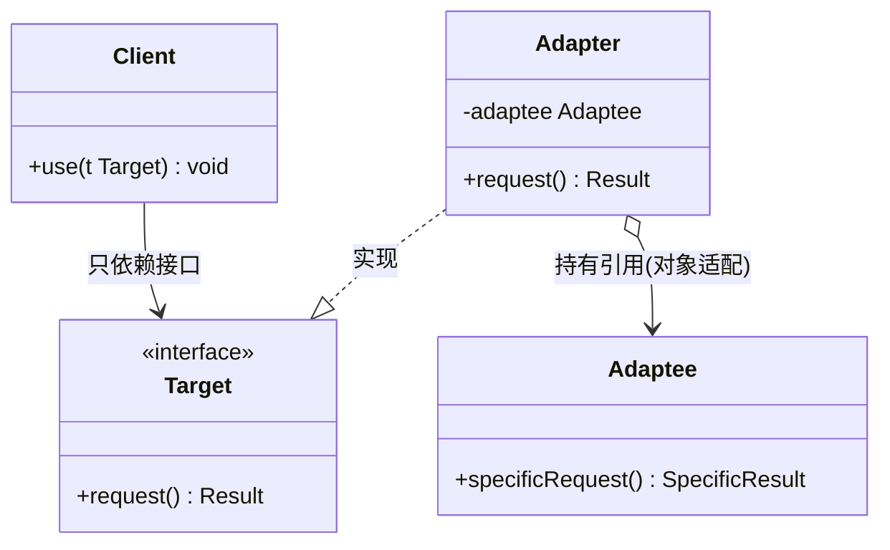

# 适配器模式（Adapter）

> 一句话定位：**结构型模式里最好讲、也最容易和其他模式混淆的一个**。考官真正想听的是类适配器与对象适配器的取舍、Spring MVC `HandlerAdapter` 的真实设计，以及适配器与装饰器/代理/外观/桥接那张辨析表。
> 分类：结构型（Structural） | 面试热度：★★★★☆
> 版本前提：JDK 17

---

## 1. 是什么

**把一个类的接口转换成客户端期望的另一个接口，使原本因接口不兼容而不能一起工作的类可以协同工作。**

核心角色：

| 角色 | 职责 |
| --- | --- |
| Target | 客户端期望的目标接口 |
| Adaptee | 已有但接口不兼容的被适配者 |
| Adapter | 把 Adaptee 包成 Target 的适配器 |
| Client | 只面向 Target 编程，不知道 Adaptee 存在 |



---

## 2. 解决什么问题

**没有它之前**：系统要接入一个第三方 SDK、一个遗留模块或一个 JDK 旧 API，它们的接口签名和你内部定义的不一致——参数顺序不同、返回值类型不同、甚至连方法名语义都不同。要么改第三方（没有源码，改不了），要么改自己所有调用方（调用点几十上百处，改不起），要么在调用处散落一坨 if/else 转换逻辑（三个月后没人看得懂）。适配器把「接口转换」收敛到一个类里，调用方无感知。

**为什么不用别的方案**：

| 方案 | 问题 |
| --- | --- |
| 直接修改被适配方源码 | 第三方 jar 无源码；有源码也会污染遗留模块、破坏其既有调用方 |
| 调用处手写转换 | 转换逻辑散落各处，重复且无法单测，签名一变要改 N 处 |
| 外观（Facade） | 外观是「简化一批接口提供一个高层入口」，不是「把一个接口变成另一个接口」；目标不同 |

**关键取舍**：适配器是**事后补救**手段——接口不合是既成事实时才用它。能在设计期统一接口就不要适配器；适配器层数越多，调用链越难读。

---

## 3. 怎么写（三种写法与取舍）

### 3.1 类适配器（Class Adapter，Java 里受限）

```java
// 适配器继承被适配者，同时实现目标接口
class ClassAdapter extends LegacyCharger implements UsbCharger {
    @Override
    public void chargeViaUsb() {
        super.chargeByRoundPin();   // 直接复用父类实现
    }
}
```

- 依赖**继承**：Java 单继承 + 实现接口，导致一个类适配器只能适配**一个具体 Adaptee 类**（连它的兄弟类都适配不了，除非适配器再继承它们——不可能）。
- 好处是可以**重写** Adaptee 的行为；坏处是继承强耦合、暴露父类全部 public/protected 方法。**Java 里基本不用**。

### 3.2 对象适配器（Object Adapter，**Java 唯一实用方案**）

```java
// 目标接口：客户端期望的支付网关
public interface PaymentGateway {
    PayResult pay(String orderId, BigDecimal amount);
}

// 被适配者：第三方 SDK，接口不兼容且不可改
public class ThirdPartyPaySdk {
    public SdkResponse makePayment(String bizNo, long amountInCents) { /* ... */ return null; }
}

// 对象适配器：组合持有被适配者，做参数转换 + 结果转换
public class ThirdPartyPayAdapter implements PaymentGateway {
    private final ThirdPartyPaySdk sdk;

    public ThirdPartyPayAdapter(ThirdPartyPaySdk sdk) {
        this.sdk = Objects.requireNonNull(sdk, "sdk must not be null");
    }

    @Override
    public PayResult pay(String orderId, BigDecimal amount) {
        long cents = amount.movePointRight(2).longValueExact(); // 元 -> 分，防精度丢失
        SdkResponse resp = sdk.makePayment(orderId, cents);
        return resp.isSuccess()
                ? PayResult.success(resp.getTradeNo())
                : PayResult.fail(resp.getErrCode(), resp.getErrMsg());
    }
}
```

要点：**组合而非继承**（符合合成复用原则）、构造器注入并 `requireNonNull` 防 NPE、适配器里只做「协议转换」不放业务逻辑。可以同时适配 Adaptee 及其任意子类。

### 3.3 接口适配器 / 缺省适配器（Default Adapter）

当一个接口方法很多、实现类只关心其中一两个时，先用**抽象类空实现**全部方法，子类只重写关心的：

```java
public abstract class WindowAdapter implements WindowListener {
    @Override public void windowOpened(WindowEvent e) {}
    @Override public void windowClosing(WindowEvent e) {}
    @Override public void windowClosed(WindowEvent e) {}
    // ... 其余方法全部空实现
}

// 业务代码只重写关心的一个
frame.addWindowListener(new WindowAdapter() {
    @Override public void windowClosing(WindowEvent e) { saveAndExit(); }
});
```

- Swing 的 `WindowAdapter`、`MouseAdapter`、`KeyAdapter` 都是这个套路。Swing 虽已边缘化，但思想仍在：Java 8 以后接口可以直接写 `default` 空方法，**缺省适配器的大部分场景被 default 方法取代**（如 `java.util.stream` 的接口默认方法）。

### 三种写法对比表

| 维度 | 类适配器 | 对象适配器 | 缺省适配器 |
| --- | --- | --- | --- |
| 连接方式 | 继承 Adaptee | 组合持有 Adaptee 引用 | 抽象类空实现接口 |
| 能适配几个 Adaptee | 1 个具体类（Java 单继承） | Adaptee 及其所有子类 | 不涉及 Adaptee |
| 能否重写 Adaptee 行为 | 能 | 不能（只能委托） | 不适用 |
| 耦合度 | 高（继承） | 低（组合，推荐） | 低 |
| 典型例子 | 几乎不用 | `InputStreamReader`、`HandlerAdapter` | Swing `WindowAdapter` |

---

## 4. 使用场景

| 场景 | 说明 |
| --- | --- |
| 接入第三方 SDK | 支付、短信、OSS、地图 SDK 接口与内部网关不一致，用适配器收敛转换逻辑 |
| 遗留系统改造 | 老模块接口过时但动不得，新代码面向新接口，中间垫一层适配器 |
| 框架统一异构组件 | 框架要把「形态各异的用户组件」统一成一套调用协议（见 HandlerAdapter） |
| 新旧 API 过渡 | 老 API 返回 `Enumeration`，新代码用 `Collection`，`Collections.list()` 适配 |
| 日志门面 | MyBatis 内部日志接口适配 slf4j / log4j2 / commons-logging，运行时按 classpath 探测选择 |

**JDK / Spring / MyBatis 中的真实例子**：

- `java.io.InputStreamReader` / `OutputStreamWriter`：把字节流 `InputStream` 适配成字符流 `Reader`，内部持有 `StreamDecoder` 完成字节→字符解码，是对象适配器的教科书例子。
- `java.util.Arrays#asList(T...)`：把数组适配成 `List` 视图（注意返回的是 `Arrays` 内部类 `ArrayList`，**不支持 add/remove**，只改了访问方式没改存储）。
- `Collections#enumeration(Collection)` 与 `Collections#list(Enumeration)`：新旧集合 API 的互相适配。
- `java.util.concurrent.FutureTask`：构造时接收 `Callable`（或 `Runnable` + result），内部用 `Executors.callable()` 把 `Runnable` 适配成 `Callable`，最终统一成 `RunnableFuture` 接口对外。
- **Spring MVC `HandlerAdapter`（最值得讲）**：`DispatcherServlet` 不直接调用 handler，而是遍历 `handlerAdapters` 找 `supports(handler)` 为真的那个，再 `handle()` 返回统一的 `ModelAndView`。`RequestMappingHandlerAdapter` 适配 `@RequestMapping` 注解方法（`HandlerMethod`）、`HttpRequestHandlerAdapter` 适配 `HttpRequestHandler` 接口、`SimpleControllerHandlerAdapter` 适配老式 `Controller` 接口、`SimpleServletHandlerAdapter` 适配裸 `Servlet`。新增一种 handler 类型只要加一个适配器，**开闭原则的样板**。
- MyBatis 日志模块：`LogFactory` 按 slf4j → commons-logging → log4j2 → jdk-logging 的顺序探测，各 `Slf4jImpl` / `Log4j2Impl` 都是把第三方日志适配到 MyBatis 的 `Log` 接口。
- Dubbo：`@Adaptive` 自适应扩展点在运行时按 URL 参数动态选择具体扩展实现，生成的 `$Adaptive` 类本质是适配器。

---

## 5. 生产中的问题与排查

| 问题 | 现象 | 排查 / 修复 |
| --- | --- | --- |
| **适配器层层堆叠** | 一个请求穿过 3~4 层 adapter，日志里类名全是 `XxxAdapter`，调用链难读 | 架构上限制适配只发生在系统边界（接 SDK、接遗留模块处）；中间层之间靠统一领域模型而不是连环适配 |
| **被适配者为 null 的 NPE** | 对象适配器构造时传入 null，调用时才炸 | 构造器 `Objects.requireNonNull` 快速失败；或用工厂方法集中创建并校验 |
| **适配器里塞了业务逻辑** | 适配器越写越胖，转换与业务混杂，无法复用 | 适配器只做「参数转换 + 委托调用 + 结果转换」三件事；业务逻辑下沉到领域服务 |
| **缺省适配器掩盖接口设计问题** | 接口十几个方法，实现类全继承抽象空实现，没人知道哪些方法真有用 | 接口过大先考虑接口隔离（ISP）拆分；Java 8+ 优先用 `default` 方法而非抽象适配类 |
| **转换时丢数据/精度** | 如 `BigDecimal` 元转分用 `double` 中间态丢精度，或字段在新旧模型间对不上 | 转换规则写成纯函数并配单测；金额用 `movePointRight(2).longValueExact()` 这类精确 API；字段映射表留文档 |
| **异常语义不一致** | 第三方 SDK 抛自己的 checked 异常，穿透适配器污染上层 | 适配器负责把外部异常**翻译**成内部统一异常体系，并保留 `cause` |
| **以为适配器能改行为** | 想给第三方 SDK 加缓存、加重试，写在适配器里 | 那是装饰器/代理的职责。适配器只改接口形状，不改功能；要增强就再包一层装饰器 |

---

## 6. 面试问法

### 60 秒版本

> 适配器模式把一个类的接口转换成客户端期望的另一个接口，让接口不兼容的类能协同工作，本质是事后补救。有三种写法：类适配器用继承，Java 单继承导致只能适配一个具体类，基本不用；对象适配器用组合持有被适配者引用，符合合成复用原则，是 Java 唯一实用方案；缺省适配器用抽象类空实现大接口，Swing 的 `WindowAdapter` 就是，Java 8 后大部分场景被接口 default 方法取代。真实例子很多：`InputStreamReader` 把字节流适配成字符流，`Arrays.asList` 把数组适配成 List，最典型的工程案例是 Spring MVC 的 `HandlerAdapter`——`DispatcherServlet` 面对注解方法、老式 Controller、Servlet 等形态各异的 handler，通过适配器统一适配成返回 `ModelAndView` 的调用，新增 handler 类型只需加适配器，完美体现开闭原则。和其他模式的区别一句话：适配器改接口，装饰器不改接口只加职责，代理不改接口只控访问，桥接是设计阶段就分离两个维度。

### 5 分钟版本补充点

1. 对象适配器能适配 Adaptee 及其**所有子类**（面向父类/接口编程），类适配器只能适配那一个具体类——这是组合胜过继承的又一例证
2. `Arrays.asList` 返回的是 `Arrays$ArrayList`，**不是** `java.util.ArrayList`，不支持增删——适配器提供的是「视图」而非「拷贝」，调用方误用会吃 `UnsupportedOperationException`
3. Spring MVC 新增 handler 类型的标准动作：实现 `HandlerAdapter`（`supports` + `handle`），注册成 Bean 即可，`DispatcherServlet` 在 `initHandlerAdapters` 里按 `@Order` 收集全部适配器
4. 适配器与防腐层（ACL, Anti-Corruption Layer）的关系：DDD 里接外部系统时的防腐层，落地手段通常就是一组适配器 + 转换器
5. 适配器模式是「亡羊补牢」，桥接模式是「未雨绸缪」——面试官如果追问两者区别，这句话要先抛出来
6. 性能上适配器是一次纯内存委托调用，JIT 内联后开销可忽略，不要在性能话题上被带偏

---

## 7. 追问链 · 参考答案

| 层级 | 问题 | 参考答案要点 |
| --- | --- | --- |
| L1 | 适配器模式是什么？ | 结构型模式，把一个类的接口转换成客户端期望的另一个接口，使接口不兼容的类能协同。角色四个：Target / Adaptee / Adapter / Client，客户端只面向 Target |
| L2 | 类适配器和对象适配器区别？ | 类适配器**继承** Adaptee 并实现 Target，Java 单继承导致只能适配一个具体类，耦合高；对象适配器**组合**持有 Adaptee 引用，可适配其所有子类，符合合成复用原则，是 Java 唯一实用方案 |
| L2 | 缺省适配器是什么？ | 抽象类空实现接口全部方法，子类只重写关心的，如 Swing `WindowAdapter`。Java 8 后接口支持 `default` 方法，大部分缺省适配器场景被取代 |
| L3 | `InputStreamReader` 怎么用适配器？ | 对象适配器：实现 `Reader`（Target），构造时持有 `InputStream`（Adaptee）并包装成 `StreamDecoder`，`read()` 委托给 decoder 完成字节到字符的解码转换。`OutputStreamWriter` 对称 |
| L3 | Spring MVC 为什么需要 `HandlerAdapter`？ | handler 形态各异：`@RequestMapping` 方法、`Controller` 接口、`HttpRequestHandler`、裸 `Servlet`，调用方式完全不同。`DispatcherServlet` 遍历 `HandlerAdapter` 列表找 `supports()` 命中的适配器，统一 `handle()` 返回 `ModelAndView`，新增类型不改 Servlet 代码 |
| L3 | `Arrays.asList` 是适配器吗？有什么坑？ | 是，把数组适配成 `List` 视图。坑：返回 `Arrays` 私有内部类，底层仍指向原数组，**不支持 add/remove**（继承自 `AbstractList` 的默认实现直接抛 `UnsupportedOperationException`），且改 list 元素会写回原数组 |
| L4 | 适配器和装饰器怎么区分？ | 看接口变没变：适配器**改接口**（Adaptee 的接口变成 Target），目的是兼容；装饰器**不改接口**（装饰后还是同一接口），目的是增强职责。UML 上装饰器持同类引用，适配器持异类引用 |
| L4 | 适配器和外观、代理怎么区分？ | 代理不改接口只控访问（加鉴权/缓存/远程转发）；外观是**简化**一批接口给一个高层入口，不追求接口形状匹配；适配器是把一个具体接口**精确转换**成另一个接口 |
| L4 | 适配器和桥接怎么区分？ | 时机不同：桥接是**设计阶段**主动把抽象与实现分离，让两个维度独立扩展；适配器是**事后补救**，已有类接口不合硬接上。口诀：桥接先修桥再通车，适配器路已修好硬接 |
| L5 | 项目里适配器写多了有什么信号？ | 说明系统边界缺少统一领域模型，或接口设计期没做好防腐。改进：在系统边界集中设防腐层（ACL），内部统一模型，适配器只存在于边界一层，避免连环适配 |

---

## 8. 误区 · 正解

| ❌ 误区 | ✅ 正解 |
| --- | --- |
| 「适配器就是包一层壳」 | 包一层壳是表象，关键是**接口形状的转换**：参数、返回值、异常、语义都要从 Adaptee 侧翻译到 Target 侧。不改接口的包壳是装饰器或代理 |
| 「类适配器在 Java 里和对象适配器差不多」 | 差很多。Java 单继承让类适配器只能适配**一个具体类**，且继承把 Adaptee 的实现细节全部暴露给适配器子类。Java 工程实践只用对象适配器 |
| 「适配器可以给老类加新功能」 | 不能，那是装饰器。适配器只做接口转换，功能上最多做参数/结果的数据变换；加缓存、加监控请用装饰器再包一层 |
| 「`Arrays.asList` 返回的 List 可以增删」 | 不可以。它是 `Arrays` 的内部类视图，增删抛 `UnsupportedOperationException`。要可增删需 `new ArrayList<>(Arrays.asList(...))` 再包一层 |
| 「Swing 淘汰了，缺省适配器不用学」 | Swing 边缘化了，但缺省适配器的思想活着：Java 8 的接口 `default` 方法就是语言层面对它的吸收，如 `Comparator` 的诸多 default 组合方法 |
| 「适配器模式性能差，多一次调用」 | 对象适配器只是一次普通接口委托，JIT 会内联，开销可忽略。它的成本在**可读性和架构层次**上，不在运行时性能 |
| 「Spring 里 `HandlerAdapter` 是动态生成的」 | 不是，它是普通的策略式接口，`DispatcherServlet` 启动时通过 `initHandlerAdapters()` 从容器收集全部实现 Bean，运行时按 `supports()` 逐个匹配 |
| 「两个系统对接就要每处都写适配器」 | 应在**边界集中**设防腐层：一层适配器把外部模型转成内部领域模型，内部代码只认领域模型。到处写适配器等于让外部模型渗入全系统 |

---

## 9. 相关模式

| 模式 | 关系 |
| --- | --- |
| 装饰器（Decorator） | UML 相似都持引用，但装饰器**不改接口**只叠加职责，适配器**改接口**做兼容 |
| 代理（Proxy） | 代理不改接口只控制访问（鉴权、缓存、远程），客户端通常不知道被代理对象存在；适配器改接口 |
| 外观（Facade） | 外观简化一批子系统接口提供高层入口；适配器把一个接口精确转成另一个 |
| 桥接（Bridge） | 桥接是设计阶段就分离抽象与实现（事前），适配器是已有接口不合的补救（事后） |
| 策略（Strategy） | 策略 interchangeable 的是算法，接口本来就一致；适配器解决的是接口不一致 |

---

## 10. 我的薄弱点

（学完后自己填，同步到 `weakness.md`）
