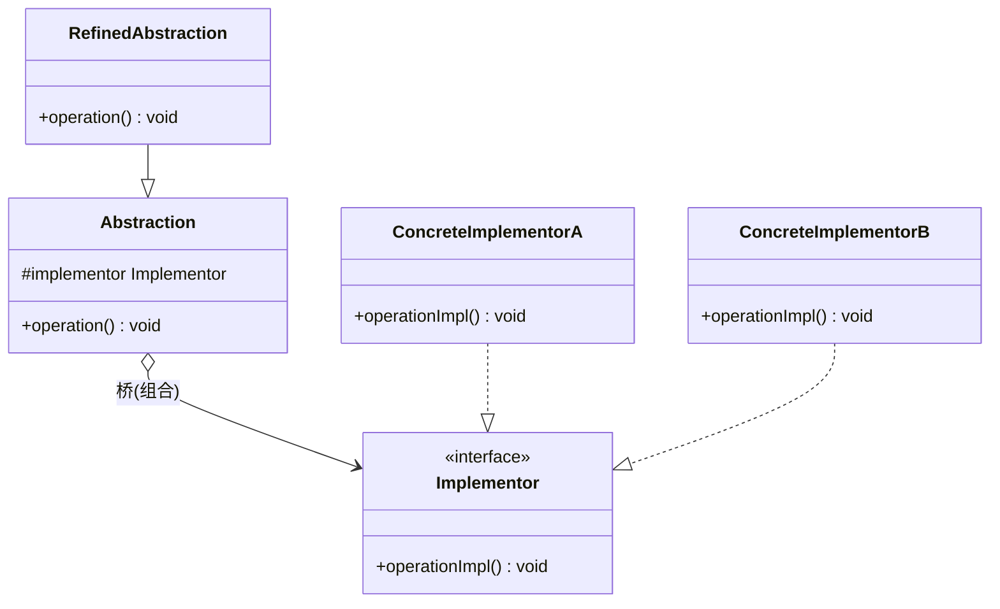

# 桥接模式（Bridge）

> 一句话定位：**GoF 里定义最绕、但工程案例最硬的一个**——JDBC 就是桥接。考官真正想听的是「两个独立变化的维度」这个识别信号，以及桥接与适配器「事前 vs 事后」的本质区别。
> 分类：结构型（Structural） | 面试热度：★★☆☆☆
> 版本前提：JDK 17

---

## 1. 是什么

**将抽象（Abstraction）与其实现（Implementor）分离，使二者可以独立变化。** 这里的「抽象」不是 `abstract class`，而是**业务侧的高层控制逻辑**；「实现」是底层具体实现方式。二者之间用**组合（一座桥）**连接，而不是继承。

核心角色：

| 角色 | 职责 |
| --- | --- |
| Abstraction | 抽象侧，持有一个 Implementor 引用（桥），定义高层业务操作 |
| RefinedAbstraction | 抽象侧的扩展子类，丰富业务语义 |
| Implementor | 实现侧接口，定义底层操作原语 |
| ConcreteImplementor | 实现侧的具体实现，可按维度自由扩展 |



---

## 2. 解决什么问题

**没有它之前**：一个类存在**两个独立变化的维度**时，用继承表达就是维度笛卡尔积爆炸。经典例子：消息类型（普通 / 加急 / 特急）× 发送方式（短信 / 邮件 / 站内信）。继承要 `UrgentSmsMessage`、`NormalEmailMessage`…… 3×3=9 个类，加一个维度或一个取值就乘上去，类数量失控且每个子类里业务逻辑与发送细节耦合在一起。

**桥接后**：类型维度 3 个类 + 方式维度 3 个类 = 6 个类，两边各自独立扩展，运行时通过组合自由配对（3×3 种组合照常支持，但不占用类数量）。

**为什么不用别的方案**：

| 方案 | 问题 |
| --- | --- |
| 多维度继承（一个维度作主维度） | 选哪个维度当主都别扭，类数量仍是乘积，且子类把两个维度焊死 |
| 策略模式 | 策略只能处理**一个维度**的算法替换；两个维度各配一个策略对象时，其实就是桥接的雏形 |
| 简单组合 + if/else | 把维度判断写成分支逻辑，扩展时要改老代码，违反开闭 |

**关键取舍**：桥接把「类爆炸」换成「对象组合」，代价是结构多一层间接，调用方需要理解「抽象持有实现」这套装配关系。维度只有一维时不要用桥接，策略更简单。

---

## 3. 怎么写

以「消息类型 × 发送方式」为例，生产级写法（构造器注入 + 接口隔离 + 可单测）：

```java
// 实现侧（Implementor）：发送方式维度
public interface MessageSender {
    void send(String receiver, String content);
}

public class SmsSender implements MessageSender {
    @Override public void send(String receiver, String content) {
        // 对接短信网关 SDK
    }
}

public class EmailSender implements MessageSender {
    @Override public void send(String receiver, String content) {
        // 对接邮件服务
    }
}

// 抽象侧（Abstraction）：消息类型维度，持桥引用
public abstract class AbstractMessage {
    protected final MessageSender sender;   // 桥：组合而非继承

    protected AbstractMessage(MessageSender sender) {
        this.sender = Objects.requireNonNull(sender);
    }
    public abstract void sendMessage(String receiver, String content);
}

public class NormalMessage extends AbstractMessage {
    public NormalMessage(MessageSender sender) { super(sender); }
    @Override public void sendMessage(String receiver, String content) {
        sender.send(receiver, content);                       // 直接发
    }
}

public class UrgentMessage extends AbstractMessage {
    public UrgentMessage(MessageSender sender) { super(sender); }
    @Override public void sendMessage(String receiver, String content) {
        sender.send(receiver, "[URGENT] " + content);          // 加急：强化语义
        // 追加监控上报、多次重试等横切动作
    }
}

// 客户端：两个维度自由组合
MessageSender sender = new EmailSender();
AbstractMessage msg = new UrgentMessage(sender);
msg.sendMessage("ops@corp.com", "DB 连接池耗尽");
```

扩展新维度取值（如「站内信」「特急」）各加一个类，**互不改对方代码**。3+3 而非 3×3。

---

## 4. 使用场景

| 场景 | 说明 |
| --- | --- |
| JDBC | 最经典案例，见下 |
| 跨平台 UI | AWT 的 `Component`（抽象）与 `ComponentPeer`（平台实现），同一份组件代码跑 Windows / Linux / macOS |
| 日志体系 | SLF4J 门面（抽象侧）与 logback / log4j2（实现侧）通过 `ServiceLoader` 绑定，也可视为外观 + 桥接 |
| 消息推送中台 | 业务场景 × 触达渠道（App push / 短信 / 微信模板 / 邮件） |
| 支付网关 | 业务类型（收单 / 退款 / 分账）× 支付渠道（微信 / 支付宝 / 银联） |
| 驱动 / 插件体系 | RPC 框架 `Protocol` 抽象与 dubbo / http / tri 各自实现 |

**JDK / 框架中的真实例子**：

- **JDBC（必讲）**：`DriverManager` 是桥的管理者，`java.sql.Driver` 接口是 Implementor 侧，`Connection` / `Statement` / `ResultSet` 是抽象侧 API。应用只面向 JDBC 抽象编程，MySQL（`com.mysql.cj.jdbc.Driver`）、Oracle、PostgreSQL 各自实现 `Driver` 并在 `META-INF/services/java.sql.Driver` 注册（JDK 6 起 `ServiceLoader` 自动加载，不再需要显式 `Class.forName`）。**换数据库只换驱动 jar 和 URL，不改一行代码**——这就是「抽象与实现独立变化」。
- `java.awt.Component` ↔ `ComponentPeer`：AWT 组件是抽象侧，peer 是各 OS 的原生实现侧，Toolkit 负责搭桥。
- SLF4J：`Logger` / `LoggerFactory` 抽象侧，`StaticLoggerBinder`（旧版）/ `SLF4JServiceProvider`（2.x 起）绑定 logback、log4j2 等实现侧。
- Dubbo：`Protocol`（协议维度）与 `Invoker`（调用语义维度）分层，`DubboProtocol` / `TripleProtocol` 各自实现，`Invoker` 侧按集群容错策略扩展。

---

## 5. 生产中的问题与排查

| 问题 | 现象 | 排查 / 修复 |
| --- | --- | --- |
| **识别不出两个维度就硬套** | 类图上有 Abstraction/Implementor，实际只有一维在变化，等于多包了一层没意义的对象 | 问自己：两个维度是否**各自**有独立的扩展需求？若只有一个会变，退化回策略模式 |
| **维度选择错误** | 把不独立的两个维度拆开了，实现侧接口被迫感知抽象侧概念 | 两个维度必须正交：改 A 维度的任何取值，B 维度代码不应需要动 |
| **桥装配散落在各处** | `new UrgentMessage(new SmsSender())` 这种组合代码遍布业务，换组合要改 N 处 | 装配交给工厂 / IoC 容器：Spring 里把 sender 做成 Bean 注入，组合关系收敛到配置层 |
| **抽象侧泄漏实现侧细节** | `AbstractMessage` 的方法签名里出现 `SmsSender` 特有的参数 | 抽象侧只依赖 Implementor 接口；出现泄漏说明维度划分错了，回到上一条 |
| **实现侧接口粒度过粗** | Implementor 一个方法干了三件事，某个 ConcreteImplementor 实现不了其中一件 | Implementor 定义**原语级**操作（细粒度），组合编排留给 Abstraction 侧 |
| **运行期组合错误** | 加急消息配了个不支持高优先级的通道，业务受损 | 装配处做兼容性校验；或引入配置矩阵显式声明允许的组合 |
| **误当适配器用** | 拿桥接去接一个接口不合的第三方类 | 接口不合用适配器；桥接是自己设计、自己控制两侧接口的，不存在「不兼容」问题 |

---

## 6. 面试问法

### 60 秒版本

> 桥接模式把抽象和实现分离，让两者独立变化，连接方式是组合而不是继承——注意这里的「抽象」指业务高层逻辑，不是 abstract class。它的识别信号是：**一个类存在两个或多个独立变化的维度**。比如消息类型（普通、加急、特急）乘以发送方式（短信、邮件、站内信），用继承要 3×3=9 个类且加维度就爆炸，用桥接只要 3+3=6 个类，运行时组合自由配对。最经典的真实案例是 JDBC：应用面向 `Connection`、`Statement` 这套抽象编程，`Driver` 接口是实现侧，MySQL、Oracle 各自实现并通过 SPI 注册，换数据库只换驱动不改代码。和适配器的本质区别是**时机**：桥接是设计阶段就规划好的分离，未雨绸缪；适配器是已有类接口不合的事后补救——桥接是先修桥再通车，适配器是路已修好硬接上。和策略模式的区别是：策略强调算法的可替换、只有一个维度；桥接强调结构上的分离、两侧都可以扩展。

### 5 分钟版本补充点

1. 判断要不要用桥接的一刀切标准：**类数量是不是两个维度取值的乘积**。是 → 桥接；不是 → 别过度设计
2. JDBC 里 `DriverManager.getConnection(url)` 的委派链：`DriverManager` 遍历注册的 `Driver` 调 `connect()`，返回第一个非 null 的连接——这套「管理者 + SPI 注册 + 面向接口」就是桥接的完整落地
3. 桥接经常和**抽象工厂**配合：工厂负责按需创建并装配「抽象 + 实现」的组合，客户端连 `new XxxMessage(sender)` 都不写
4. 桥接的 Implementor 侧接口要设计成**原语级**（primitive），不要设计成完整业务操作——粗粒度会把业务逻辑漏进实现侧，维度就又不正交了
5. 和策略模式的暧昧关系：桥接的 Implementor 看起来像策略。区分点：策略的上下文**通常只有一个算法槽位**且算法对客户可替换；桥接的两侧是**平等的层级关系**，各自有继承树
6. Java 里接口 + 组合的普及让桥接成了「常识性写法」，很多团队在用它而不自知——面试时主动承认这一点反而显得诚实

---

## 7. 追问链 · 参考答案

| 层级 | 问题 | 参考答案要点 |
| --- | --- | --- |
| L1 | 桥接模式是什么？ | 结构型模式，将抽象（高层业务逻辑）与实现（底层实现方式）分离，用组合连接而非继承，使两个维度可以独立扩展。角色：Abstraction / RefinedAbstraction / Implementor / ConcreteImplementor |
| L1 | 什么时候用桥接？ | 识别信号：一个类存在**两个以上独立变化的维度**，用继承会产生维度笛卡尔积的类爆炸（如 3 消息类型 × 3 发送方式 = 9 个类）。桥接把它降到 3+3 |
| L2 | 「抽象与实现分离」到底指什么？ | 「抽象」不是 abstract class，是业务侧控制逻辑（如消息的加急语义）；「实现」是底层操作原语（如具体发送动作）。分离指两侧各自成继承体系，靠 Abstraction 持有的 Implementor 引用（桥）在运行期组合 |
| L2 | 桥接为什么用组合而不是继承？ | 继承把两个维度在编译期焊死，类数量是乘积；组合把连接推迟到运行期装配，类数量变成加和，且两侧可各自扩展互不修改，符合开闭原则和合成复用原则 |
| L3 | 说一个 JDK 里的桥接实例 | JDBC：`Driver` 接口是 Implementor 侧，`Connection`/`Statement` 是抽象侧 API，`DriverManager` 管理桥。驱动通过 `META-INF/services/java.sql.Driver` SPI 注册（JDK 6 起自动加载），换库只换驱动 jar 不改代码 |
| L3 | AWT 里桥接怎么体现？ | `Component` 体系是抽象侧（Button、TextField），`ComponentPeer` 接口是实现侧，`Toolkit` 按当前 OS 创建对应 peer。同一份组件代码跑在不同操作系统上，窗口绘制交给原生实现 |
| L4 | 桥接和适配器的本质区别？ | **时机**不同：桥接是设计阶段主动做的结构规划，两侧接口都归自己定义；适配器是事后补救，Adaptee 接口已定且不可改。口诀：桥接先修桥再通车，适配器路已修好硬接上 |
| L4 | 桥接和策略模式怎么区分？ | 策略只有一个维度的算法槽位，强调运行时可替换的算法，Context 与 Strategy 是主从关系；桥接强调**结构分离**，抽象侧与实现侧是平等的两棵继承树，各自可扩展。一维用策略，多维用桥接 |
| L4 | 桥接常和什么模式配合？ | 抽象工厂：把「抽象 + 实现」的组合装配收敛到工厂里，客户端不感知配对逻辑；也可与单例配合（实现侧对象无状态时可共享） |
| L5 | 桥接误用的典型样子？ | 只有一维变化也硬拆两侧，结果只是多包了一层无意义对象，调用链变长、新人看不懂。判断法：若 Implementor 永远只有一个实现，拆出去没有任何扩展价值，应退化回策略或直接内联 |

---

## 8. 误区 · 正解

| ❌ 误区 | ✅ 正解 |
| --- | --- |
| 「桥接就是把接口和实现分开」 | 那是 Java 接口编程的日常，不是桥接。桥接的关键是**两个独立变化维度**各自成继承体系、用组合连接。只有一维时拆接口只是普通面向接口编程 |
| 「抽象指的是抽象类」 | 不是。Abstraction 指业务侧高层控制逻辑，可以是抽象类也可以是普通类；Implementor 指底层实现原语。GoF 原文明确说这里的 abstraction 与 abstract class 无关 |
| 「桥接和适配器差不多，都是包一层」 | 本质相反：桥接是**事前**设计、接口自己定、为了两侧各自扩展；适配器是**事后**补救、接口已被钉死、为了兼容。意图、时机、接口归属全不同 |
| 「JDBC 是工厂模式不是桥接」 | JDBC 里两者都有：`DriverManager.getConnection` 有工厂色彩，但整体架构（应用面向 `Connection`/`Statement` 抽象编程、各数据库实现 `Driver` 接口、运行期按 URL 绑定）是教科书级桥接 |
| 「维度多了就该拆成桥接」 | 前提是维度**独立变化**。若两个维度实际联动（改 A 必须改 B），说明它们不正交，拆了反而把耦合显性化到装配代码里 |
| 「桥接会降低性能」 | 只多一次接口委托调用，JIT 内联后开销可忽略。桥接的成本在**结构复杂度**和装配理解成本，不在运行时 |
| 「实现侧接口越全越好」 | 相反，Implementor 应是**原语级**细粒度接口。把完整业务操作放进实现侧会让抽象侧退化成一个空壳转发，两侧职责错位 |
| 「SLF4J 绑定 logback 纯粹是外观模式」 | 它同时是外观（简化日志 API）和桥接（`Logger` 抽象与具体日志实现分离，通过 `ServiceLoader` 绑定）。真实框架常是多种模式叠加，别非要二选一 |

---

## 9. 相关模式

| 模式 | 关系 |
| --- | --- |
| 适配器（Adapter） | 最大辨析点：桥接事前规划两侧分离，适配器事后补救接口不合 |
| 策略（Strategy） | 一维算法替换用策略；多维独立扩展用桥接。桥接的 Implementor 侧形似策略但语义不同 |
| 抽象工厂 | 常配合：工厂负责创建并装配「抽象 + 实现」的具体组合 |
| 外观（Facade） | 外观简化子系统调用入口；桥接分离两个维度。SLF4J 是两者叠加的实例 |
| 组合（Composite） | 抽象侧本身若呈树形层次，可与组合模式叠加（如控件树 × 渲染实现） |

---

## 10. 我的薄弱点

（学完后自己填，同步到 `weakness.md`）
