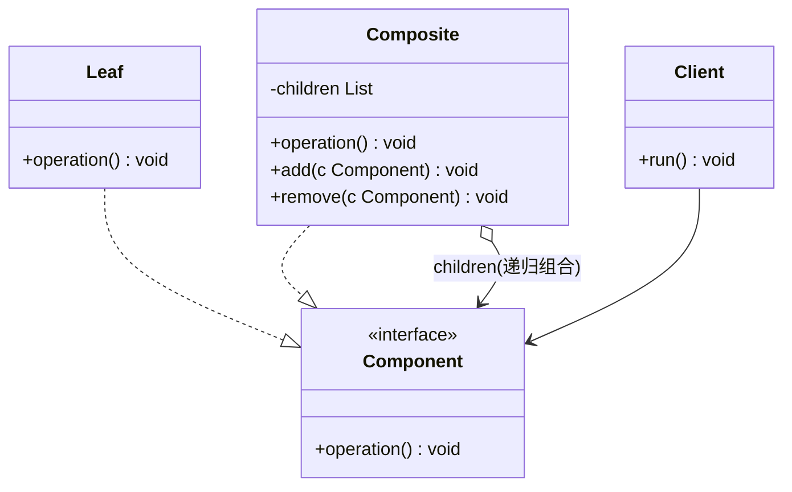

# 组合模式（Composite）

> 一句话定位：**「部分-整体」树形结构的唯一标准答案**。考官真正想听的是透明式与安全式的取舍、MyBatis `SqlNode` 树的源码细节，以及为什么「客户端对叶子和组合一视同仁」这句话是灵魂。
> 分类：结构型（Structural） | 面试热度：★★★☆☆
> 版本前提：JDK 17

---

## 1. 是什么

**把对象组织成树形结构以表示「部分-整体」的层次关系，使客户端对单个对象（Leaf）和组合对象（Composite）的使用具有一致性。**

灵魂在最后一句：客户端**不需要区分**当前操作的是叶子还是组合，同一个 `apply()` / `render()` / `size()` 调用，叶子直接执行，组合则递归分发给所有子节点。

核心角色：

| 角色 | 职责 |
| --- | --- |
| Component | 抽象组件，声明统一操作（以及透明式下的子节点管理接口） |
| Leaf | 叶子节点，无子节点，直接实现操作 |
| Composite | 组合节点，持有子节点列表，操作递归分发 |
| Client | 只面向 Component 编程 |



---

## 2. 解决什么问题

**没有它之前**：树形数据（组织架构、菜单、目录、BOM 清单、权限树）用「两种类 + 客户端 instanceof」处理——每种操作都要写 `if (node instanceof Folder) { for (child : ...) } else { ... }`，递归逻辑散落在每个调用方，新增一种节点类型要改所有调用处。

**组合模式后**：递归被封装进 Composite 内部，客户端对整棵树只做一次 `root.operation()`。新增节点类型只要实现 Component 接口。

**为什么不用别的方案**：

| 方案 | 问题 |
| --- | --- |
| 客户端手写递归 + instanceof | 类型判断散落各处，违反开闭，每加一个节点类型全网改 |
| 统一用集合表达，不分叶子组合 | 丢失「部分-整体」语义，无法表达嵌套层级 |

**关键取舍**：组合模式把类型判断从客户端挪进了 Composite 的递归分发里，换来客户端透明；代价是 Component 接口要同时容纳叶子和组合的操作集，接口设计上必然偏向一方（见 3 节透明式 vs 安全式）。

---

## 3. 怎么写（两种实现方案的取舍，本题核心）

### 3.1 透明式（Transparent）——子节点管理方法定义在 Component 里

```java
public abstract class Node {
    protected final String name;
    protected Node(String name) { this.name = name; }

    public abstract long size();                       // 统一业务操作

    // 子节点管理也上提到 Component —— 透明式的标志
    public void add(Node child) { throw new UnsupportedOperationException("leaf"); }
    public void remove(Node child) { throw new UnsupportedOperationException("leaf"); }
    public List<Node> children() { return List.of(); }
}

public class FileNode extends Node {                   // Leaf
    private final long bytes;
    public FileNode(String name, long bytes) { super(name); this.bytes = bytes; }
    @Override public long size() { return bytes; }
}

public class DirNode extends Node {                    // Composite
    private final List<Node> children = new ArrayList<>();
    public DirNode(String name) { super(name); }
    @Override public void add(Node child) { children.add(child); }
    @Override public void remove(Node child) { children.remove(child); }
    @Override public List<Node> children() { return List.copyOf(children); }
    @Override public long size() {
        return children.stream().mapToLong(Node::size).sum();   // 递归分发
    }
}

// 客户端：完全不区分叶子与目录
Node root = new DirNode("/");
((DirNode) root).add(new FileNode("a.txt", 100));
long total = root.size();   // 一次调用，整棵树递归求和
```

- **优点**：客户端完全不用区分叶子与组合，一致性最好，接口统一。
- **缺点**：Leaf 继承了不该有的 `add/remove`，只能靠抛 `UnsupportedOperationException` 兜底——**运行期才暴露，类型不安全**。

### 3.2 安全式（Safe）——子节点管理只定义在 Composite 里

```java
interface Node { long size(); }                 // Component 只有业务操作

class FileNode implements Node { /* 只有 size() */ }

class DirNode implements Node {
    private final List<Node> children = new ArrayList<>();
    public void add(Node c) { children.add(c); }        // 只存在于 Composite
    @Override public long size() {
        return children.stream().mapToLong(Node::size).sum();
    }
}
```

- **优点**：编译期类型安全，Leaf 上没有多余方法，不可能误调。
- **缺点**：客户端要 `instanceof DirNode` 才能 `add`，**失去透明性**。

### 取舍结论

| 维度 | 透明式 | 安全式 |
| --- | --- | --- |
| 子节点管理方法位置 | Component（Leaf 抛异常兜底） | 仅 Composite |
| 客户端一致性 | 最好，完全透明 | 差，需 instanceof |
| 类型安全 | 运行期才发现误用 | 编译期防误用 |
| 现实采用 | **更常见**（MyBatis SqlNode、AWT Component） | 对安全性要求极高的 API |

现实里**透明式更常见**：一致性带来的客户端简化价值大于 Leaf 上多几个空方法的丑陋。用透明式时务必在 Leaf 的兜底方法上写清 Javadoc。

---

## 4. 使用场景

| 场景 | 说明 |
| --- | --- |
| 组织架构 / 部门树 | 公司-部门-小组，统计人数、预算时整树递归 |
| 菜单 / 权限树 | 菜单项与菜单组统一渲染；权限点与权限组统一鉴权 |
| 文件系统 | 目录与文件，`java.io.File` 一身兼 Leaf 与 Composite |
| UI 控件树 | AWT/Swing `Container` 嵌套控件，`doLayout()` / `paint()` 递归下发 |
| BOM 物料清单 | 成品-部件-零件，成本与重量整树汇总 |
| 规则引擎 / 表达式树 | `AndExpression(OrExpression(a,b), NotExpression(c))` 递归求值 |
| 动态 SQL | MyBatis `SqlNode` 树，见下 |

**JDK / 框架中的真实例子**：

- **AWT/Swing 控件树**：`java.awt.Container` 继承 `Component` 又持有一组 `Component`，是最原汁原味的组合模式——`paint()`、`doLayout()`、`invalidate()` 全部递归下发。
- **MyBatis 动态 SQL `SqlNode` 树（最值得讲）**：`SqlNode` 是 Component（唯一方法 `apply(DynamicContext)`）；`MixedSqlNode` 是 Composite，持有 `List<SqlNode>` 并循环 `node.apply(context)`；`IfSqlNode`（先 `test` 表达式求值再决定是否应用子节点）、`ChooseSqlNode`（when/otherwise 分支）、`TrimSqlNode`（前后缀处理）、`TextSqlNode`（文本叶子）各司其职。一个 `<select>` 的动态 SQL 被解析成一棵 SqlNode 树，执行时 `rootSqlNode.apply(context)` 一次调用递归拼出最终 SQL——组合模式的工业级范本。
- `java.io.File`：`isDirectory()` 为真时是 Composite，`listFiles()` 取子节点；为假时是 Leaf。一个类兼任两角色，属于不严格的组合。
- 表达式树：规则引擎中 `Expression` 接口组合出 `AndExpression` / `OrExpression` / `NotExpression`，`eval()` 递归求值。
- **与访问者模式的配合**：需要对树中不同类型节点做**多种不同操作**（编译器的类型检查、代码生成、格式化）时，把操作抽到 `Visitor` 里，节点只留 `accept(visitor)`——避免每种新操作都改所有节点类。
- **与迭代器模式的配合**：遍历整棵树（先序/后序/层序）用迭代器封装栈或队列，客户端不手写递归。

---

## 5. 生产中的问题与排查

| 问题 | 现象 | 排查 / 修复 |
| --- | --- | --- |
| **树太深递归爆栈** | `StackOverflowError`，常见于深度嵌套的类目树、表达式树 | 默认线程栈（HotSpot 约 512K~1M）每帧几十字节，几千层就危险。改显式栈迭代遍历；或用 `-Xss` 调大；或限制树的业务深度 |
| **透明式的 UnsupportedOperationException 踩雷** | 调用方对 Leaf 调 `add()` 线上炸开 | Leaf 兜底方法必须写 Javadoc；或文档化「先 `children()` 判空」；对安全性敏感处改安全式 |
| **父子引用成环** | `add` 时把祖先节点加成子节点，递归永不终止 | `add` 里做环检测（沿 parent 链上溯）；或节点不持 parent 引用（AWT 持，MyBatis 不持） |
| **缓存子节点与父引用内存泄漏** | 树节点互相强引用，整树无法被 GC 回收一部分 | 明确树的所有权：通常整树同生共死；需要局部释放时用弱引用或显式 `remove` |
| **组合节点里做重型计算** | `size()` 每次全树递归，QPS 上来 CPU 打满 | Composite 内部做结果缓存，子树变更时失效（脏标记）；或增量维护聚合值 |
| **节点类型膨胀** | 每加一种业务节点就加类，几十种节点难维护 | 节点类只承载「结构 + 分发」，业务差异下沉到属性或策略对象；多操作场景抽 Visitor |
| **并发遍历与修改冲突** | 一边递归遍历一边 `add/remove`，`ConcurrentModificationException` | 遍历前快照（`List.copyOf`）；或用 COW 容器；或读写加锁 |
| **把组合当树形数据库用** | 内存里维护几万节点的大树，查询全靠递归扫描 | 组合模式管「结构与操作一致性」，不管检索性能。大树检索该上索引（物化路径 / closure table） |

---

## 6. 面试问法

### 60 秒版本

> 组合模式把对象组织成树形结构表达「部分-整体」层次，核心目标是**客户端对叶子和组合的使用具有一致性**——同一个方法调用，叶子直接执行，组合递归分发给子节点。角色是 Component、Leaf、Composite。实现上有两个流派：透明式把 `add/remove` 提到 Component 接口里，客户端完全不用区分节点类型，代价是 Leaf 要抛 `UnsupportedOperationException` 兜底；安全式把子节点管理只放 Composite，编译期安全但客户端要 instanceof。现实里透明式更常见，因为一致性价值更大。真实例子：AWT 的 `Container`/`Component` 控件树是最原味的；最值得讲的是 MyBatis 的动态 SQL——`<if>`、`<choose>`、`<trim>` 解析成 `SqlNode` 树，`MixedSqlNode` 是组合节点，执行时 `rootSqlNode.apply(context)` 一次调用递归拼出 SQL。需要遍历树或对不同节点做多种操作时，配合迭代器和访问者模式。

### 5 分钟版本补充点

1. 组合模式的本质是**把递归和类型判断从客户端收编进 Composite**，客户端代码量剧减是最大收益
2. MyBatis `SqlNode.apply(DynamicContext)` 的精妙处：`DynamicContext` 作为上下文在递归中一路传递、累积 SQL 片段——「递归分发 + 共享上下文」是组合模式处理树的通用套路
3. 透明式 Leaf 抛异常不是设计失误，是 GoF 原文认可的权衡；Java 集合框架同款做法（`AbstractList.add` 默认抛 `UnsupportedOperationException`，`Arrays.asList` 因此不可增删）
4. 树的操作分两类：**结构操作**（add/remove，透明与否的争论点）和**业务操作**（apply/size，两侧都必须实现）——面试时说清这个二分显得理解到位
5. 组合 + 访问者是编译器前端的标配：AST 是组合，类型检查/优化/代码生成各是一个 Visitor
6. 函数式视角：组合模式是「同构递归数据结构 + fold」的 OO 表达，Java 里没有代数数据类型才显得啰嗦

---

## 7. 追问链 · 参考答案

| 层级 | 问题 | 参考答案要点 |
| --- | --- | --- |
| L1 | 组合模式是什么？ | 结构型模式，把对象组织成树形结构表达「部分-整体」层次，使客户端对单个对象和组合对象的使用具有一致性。角色：Component / Leaf / Composite，Composite 持子节点列表并递归分发操作 |
| L1 | 什么场景该用组合模式？ | 数据天然是树且客户端需要统一处理叶子与组合：组织树、菜单权限树、目录、BOM、表达式树、动态 SQL。判定信号：代码里出现大量 `instanceof` + 手写递归 |
| L2 | 透明式和安全式的区别？ | 透明式把 `add/remove/getChild` 定义在 Component，Leaf 抛 `UnsupportedOperationException` 兜底——客户端一致性最好但类型不安全；安全式只定义在 Composite——编译期安全但客户端要 instanceof。现实中透明式更常见 |
| L2 | 组合模式的核心收益是什么？ | 把递归分发和类型判断从客户端收进 Composite。客户端对整棵树只调一次 `root.operation()`，新增节点类型实现 Component 即可，符合开闭原则 |
| L3 | MyBatis 动态 SQL 怎么用组合模式？ | `SqlNode` 是 Component（方法 `apply(DynamicContext)`）；`MixedSqlNode` 是 Composite，循环子节点 apply；`IfSqlNode`/`ChooseSqlNode`/`TrimSqlNode` 是带语义的装饰性节点；`TextSqlNode` 是叶子。`DynamicContext` 在递归中累积 SQL，一次 `apply` 拼出完整语句 |
| L3 | AWT 里的组合模式在哪？ | `java.awt.Container` 继承 `Component` 并持有 `Component[]`，`paint()`、`doLayout()`、`invalidate()` 都递归下发给子组件。控件树是 GoF 组合模式的教科书落地 |
| L4 | 组合模式和装饰器长得像，怎么区分？ | 装饰器是**一对一**包裹（持单个 Component 引用），目的是给单个对象叠加职责；组合是**一对多**持有子节点集合，目的是表达部分-整体层次。看持有的引用数量就能区分 |
| L4 | 组合和访问者怎么配合？ | 组合管「树结构 + 一致性遍历」，访问者管「对不同类型节点做不同操作」。节点类只留 `accept(Visitor)`，操作逻辑（类型检查、代码生成等）全在 Visitor 实现类里，新增操作不动节点类。编译器 AST 是标配案例 |
| L4 | 组合和迭代器怎么配合？ | 迭代器封装树的遍历顺序（先序/层序），内部用显式栈或队列避免客户端手写递归。组合提供结构，迭代器提供访问方式，两者正交 |
| L5 | 线上树形结构递归爆栈怎么办？ | 三步：先 `-Xss` 应急（治标）；再把递归改显式栈迭代（治本）；长期限制业务树深度或换存储模型。根源是 JVM 栈帧有限，几千层嵌套的表达式树/类目树在默认栈大小下就会溢出 |

---

## 8. 误区 · 正解

| ❌ 误区 | ✅ 正解 |
| --- | --- |
| 「组合模式就是树形数据结构」 | 不止。树形数据结构谁都会建，组合模式的增量价值是**操作的一致性**：Composite 实现与 Leaf 相同的接口并递归分发，客户端不区分。没有一致性操作，只是普通的树 |
| 「Leaf 抛 UnsupportedOperationException 是烂设计」 | 是透明式的**既定代价**，GoF 原文认可。它换来客户端完全透明，和 `AbstractList.add` 默认抛异常同款思路。介意就改安全式，但客户端要 instanceof |
| 「安全式一定比透明式好」 | 各有取舍。安全式编译期防错，但客户端失去透明性、到处 instanceof。MyBatis、AWT 都选透明式——一致性对框架使用者的价值大于类型安全 |
| 「组合节点里可以放业务逻辑」 | Composite 的职责是**持有子节点 + 递归分发**，最多加聚合计算（如 size 求和）。业务规则下沉到 Leaf 或抽到策略/Visitor，否则树越长越难维护 |
| 「文件系统的 File 是标准组合模式」 | 不算严格。`java.io.File` 一个类兼任 Leaf 和 Composite（`isDirectory()` 区分），没有 Component 抽象接口，属于简化变体 |
| 「树深了加 -Xss 就解决了」 | 治标。栈调大只是推迟爆栈，深度不可控的数据（用户传入的表达式）迟早再爆。正解是递归改显式栈迭代，或限制深度 |
| 「组合模式能提升树的查询性能」 | 不能。组合解决结构与操作一致性，不解决检索效率。大树的查找要靠物化路径、closure table、索引，与组合模式正交 |
| 「每个节点都要持父引用」 | 不是必须。MyBatis `SqlNode` 不持父引用；AWT 组件持 `parent`。持父引用方便向上传播事件，但要小心环和内存泄漏，按需要选 |

---

## 9. 相关模式

| 模式 | 关系 |
| --- | --- |
| 装饰器（Decorator） | 装饰器一对一包裹加职责；组合一对多持有表达层次。看持有引用个数即可区分 |
| 访问者（Visitor） | 对组合树上不同节点类型施加多种操作时配合：树是组合，操作是 Visitor |
| 迭代器（Iterator） | 封装树的遍历方式，与组合正交配合 |
| 解释器（Interpreter） | 解释器的 AST 通常用组合实现，终结符是 Leaf，非终结符是 Composite |
| 享元（Flyweight） | 叶子节点无状态且量大时可享元化共享（如编辑器里的字符/字形） |

---

## 10. 我的薄弱点

（学完后自己填，同步到 `weakness.md`）
