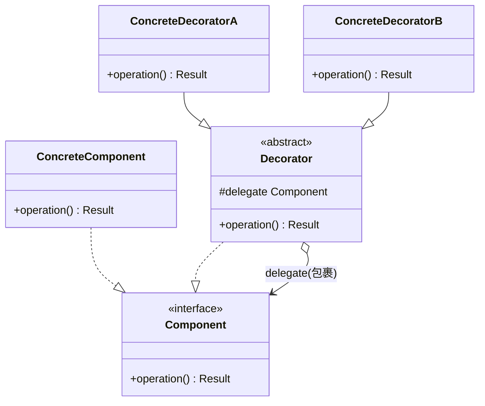
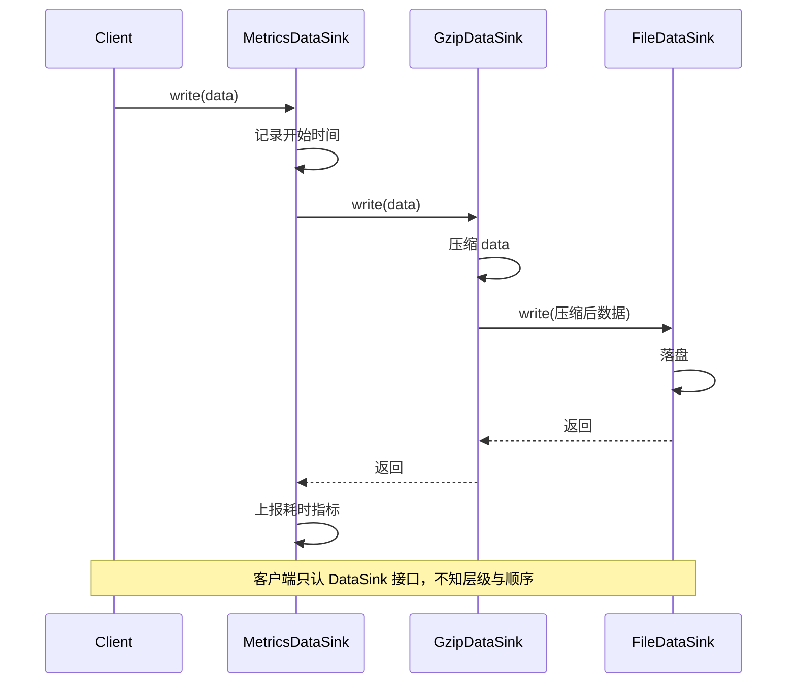

# 装饰器模式（Decorator）

> 一句话定位：**「不改类、不改接口、运行时动态叠加职责」的标准答案**，`java.io` 全家桶是它的名片。考官真正想听的是它对比继承的组合爆炸优势，以及与适配器/代理/责任链那张意图辨析表。
> 分类：结构型（Structural） | 面试热度：★★★★☆
> 版本前提：JDK 17

---

## 1. 是什么

**动态地给一个对象添加额外职责，就扩展功能而言，比生成子类（继承）更灵活。** 两个硬约束：不改变原类源码、不改变原接口——装饰后的对象对客户端来说还是同一个类型。

核心角色：

| 角色 | 职责 |
| --- | --- |
| Component | 抽象组件接口，装饰前后的对象都实现它 |
| ConcreteComponent | 被装饰的原始对象 |
| Decorator | 抽象装饰器：**持有一个 Component 引用，自身也实现 Component**（关键结构） |
| ConcreteDecorator | 具体装饰器，在委托调用前后叠加各自职责 |



结构的关键：Decorator **既是** Component（实现接口）**又持有** Component（组合引用），所以装饰器可以层层嵌套，客户端始终只看到最外层那个 Component。

---

## 2. 解决什么问题

**没有它之前**：要给一个核心功能叠加 N 种可选增强（缓冲、压缩、加密、日志、监控……），用继承表达就是**组合爆炸**——3 种增强两两自由组合要 2³=8 个子类，5 种增强 32 个子类，且每种组合在编译期焊死，运行期不能按需开关。

**装饰器后**：每种增强一个装饰器类（N 个类），运行时按需嵌套包裹，任意组合任意顺序。

**为什么不用继承**：

| 维度 | 继承增强 | 装饰器 |
| --- | --- | --- |
| 增强时机 | 编译期静态确定 | **运行期动态叠加** |
| 组合数量 | 2^N 个子类 | N 个装饰器类 |
| 对原类侵入 | 改原类或开继承口子 | 零侵入，原类可 `final` |
| 增强间依赖 | 子类互相可见，易纠缠 | 各装饰器独立，互不知晓 |

**关键取舍**：装饰器换来灵活性的代价是**对象层级变深**——调试时异常栈长、对象身份（`==`、`equals`）被外层遮蔽。增强项少且固定时，直接继承反而简单。

---

## 3. 怎么写

以「数据写出通道」为例：核心写出 + 可选的压缩、加密、监控增强，生产级写法：

```java
// Component：写出通道
public interface DataSink {
    void write(byte[] data) throws IOException;
}

// ConcreteComponent：最内层，真正写文件
public class FileDataSink implements DataSink {
    private final Path path;
    public FileDataSink(Path path) { this.path = path; }
    @Override public void write(byte[] data) throws IOException {
        Files.write(path, data, StandardOpenOption.CREATE, StandardOpenOption.APPEND);
    }
}

// Decorator：抽象装饰器，持引用 + 实现接口 + 默认透传
public abstract class DataSinkDecorator implements DataSink {
    protected final DataSink delegate;
    protected DataSinkDecorator(DataSink delegate) {
        this.delegate = Objects.requireNonNull(delegate);
    }
    @Override public void write(byte[] data) throws IOException {
        delegate.write(data);   // 默认透传，子类在前后叠加职责
    }
}

// ConcreteDecorator：压缩
public class GzipDataSink extends DataSinkDecorator {
    public GzipDataSink(DataSink delegate) { super(delegate); }
    @Override public void write(byte[] data) throws IOException {
        delegate.write(GzipUtil.compress(data));      // 先压缩再委托
    }
}

// ConcreteDecorator：监控埋点
public class MetricsDataSink extends DataSinkDecorator {
    public MetricsDataSink(DataSink delegate) { super(delegate); }
    @Override public void write(byte[] data) throws IOException {
        long start = System.nanoTime();
        delegate.write(data);
        Metrics.record("sink.write.ns", System.nanoTime() - start);
    }
}

// 客户端：运行期按需组装，顺序即语义
DataSink sink = new MetricsDataSink(
                    new GzipDataSink(
                        new FileDataSink(Path.of("/data/out.bin"))));
sink.write(payload);
```



---

## 4. 使用场景

| 场景 | 说明 |
| --- | --- |
| IO 流增强 | 缓冲、压缩、加密、行号、进度统计——`java.io` 的立身之本 |
| 集合能力叠加 | 同步、只读、类型检查——`Collections` 包装器 |
| Web 请求/响应包装 | 多次读取 body、改写 header、鉴权埋点——Servlet `Wrapper` 体系 |
| 缓存 / 事务横切 | 在核心执行器外包缓存层、事务层 |
| RPC 调用链增强 | 过滤器、监听器、重试、熔断逐层包装协议调用 |

**JDK / Spring / MyBatis / Dubbo 中的真实例子**：

- **`java.io` 全家桶（最教科书）**：`new DataInputStream(new BufferedInputStream(new GZIPInputStream(new FileInputStream(f))))`——缓冲、解压缩、基本类型读取层层包裹 `InputStream`，每层一个职责，运行时自由组合。
- `java.util.Collections#synchronizedList()` / `unmodifiableList()` / `checkedList()`：分别给 List 加同步、只读、泛型运行时类型检查三种职责，返回的都是包了一层委托的包装类（`SynchronizedList` / `UnmodifiableList` / `CheckedList`），可以叠加：`synchronizedList(checkedList(list, String.class))`。
- **MyBatis**：`CachingExecutor` 包装 `SimpleExecutor` / `ReuseExecutor` / `BatchExecutor` 实现二级缓存——`Executor` 是 Component，三个基础执行器是 ConcreteComponent，`CachingExecutor` 是装饰器，配置 `cacheEnabled=true` 时由 `Configuration.newExecutor()` 包上。MyBatis 插件链（Interceptor）也是层层 `Plugin.wrap()` 生成动态代理包装。
- **Spring / Servlet**：`HttpServletRequestWrapper` / `HttpServletResponseWrapper`（如 ContentCachingRequestWrapper 把 body 缓存起来允许多次读取）；缓存抽象里的 `TransactionAwareCacheDecorator` 给 `Cache` 加事务感知。
- **Dubbo**：`ProtocolFilterWrapper` / `ProtocolListenerWrapper` / `QosProtocolWrapper` 按固定顺序包装用户的 `Protocol` 实现，`export`/`refer` 时逐层套出过滤器链和监听器回调。

---

## 5. 生产中的问题与排查

| 问题 | 现象 | 排查 / 修复 |
| --- | --- | --- |
| **异常栈极长难定位** | 五六层装饰后 stack trace 里全是各层 `invoke/write`，真正抛点埋在中间 | 日志里打印装饰链的组装顺序（构造时记链式描述）；给每层装饰器 `toString()` 输出 delegate 链 |
| **装饰顺序影响语义** | 先加密后压缩 vs 先压缩后加密，结果和性能完全不同（加密后数据不可压缩） | 组装处显式声明顺序并写注释；框架侧用 `Ordered` 接口固化顺序（如 Dubbo Wrapper 的固定包装次序） |
| **装饰器忘了委托调用** | 某层装饰器没调 `delegate.xxx()`，原功能被静默吃掉，表现为「功能莫名失效」 | Code Review  checklist：每个重写方法必须出现 `delegate.` 调用；单测断言最内层被调到 |
| **equals / hashCode 语义变化** | 装饰后对象与原对象 `equals` 不等，放进 HashSet 查不到 | 明确包装对象不等于原对象这一约定；需要按内容比较时让装饰器委托 `equals` 给 delegate 或不用包装对象做 key |
| **层层 new 导致对象头浪费** | 每次请求都 new 出 4~5 层包装对象，GC 压力上升 | 无状态装饰器可缓存复用；或改用责任链一次遍历（如 Netty 的 pipeline 复用 Handler 上下文） |
| **装饰器与代理混淆使用** | 只想控访问却用了装饰器层层包裹，或想叠加职责却只包一层代理 | 先想清楚意图：加职责→装饰器；控访问/隐藏对象→代理。两者 UML 同构，意图不同 |
| **包装后丢失特有方法** | 客户端需要调用被装饰类特有的方法，包装后接口只剩 Component 的方法 | 特有方法本就不该被客户端依赖（面向接口编程）；确需暴露时在 Component 接口里补声明 |
| **对 final 参数 / 不可变流的误包** | 包装 `Collections.unmodifiableList` 的结果再指望它可变 | 装饰器不逆转被装饰对象的既有语义；包装顺序和语义要在文档中写清 |

---

## 6. 面试问法

### 60 秒版本

> 装饰器模式在不改原类、不改接口的前提下，运行时动态给对象叠加职责。结构上装饰器**既实现 Component 接口、又持有一个 Component 引用**，所以可以层层嵌套，客户端始终只看到同一个接口。它比继承强在哪：继承是静态的，N 种增强自由组合要 2^N 个子类；装饰器只要 N 个类，运行期按需包裹。最经典的例子是 `java.io`——`DataInputStream` 包 `BufferedInputStream` 包 `GZIPInputStream` 包 `FileInputStream`，每层一个职责；还有 `Collections` 的 `synchronizedList`/`unmodifiableList`/`checkedList`，MyBatis 的 `CachingExecutor` 包装基础执行器实现二级缓存，Dubbo 的 `ProtocolFilterWrapper` 链。和相近模式的区分是意图层面：装饰器不改接口加职责、适配器改接口做兼容、代理不改接口但控制访问且对客户端隐藏被代理对象、责任链的节点可以中断传递而装饰器必须继续委托。

### 5 分钟版本补充点

1. 装饰器与代理 UML 几乎同构，区分全靠**意图**：装饰器是客户端显式层层组装、关注职责叠加；代理通常只包一层、由框架创建、对客户端隐藏目标对象（Spring AOP、远程代理）
2. 装饰器**必须**继续调用 delegate，否则原功能被吃掉——这也是它与责任链的硬区别：责任链节点有权中断传递
3. `Collections.unmodifiableList` 这类「减法装饰器」说明装饰器不止能加功能，还能**剥夺**能力（重写 add 抛异常），GoF 原文称此为职责的灵活调整
4. MyBatis `Configuration.newExecutor()` 里的两行：`executor = new SimpleExecutor(...)` 后 `if (cacheEnabled) executor = new CachingExecutor(executor)`——装饰器落地的标准句式，值得记住
5. 装饰顺序即语义：加密 + 压缩两个装饰器，包法不同结果不同。生产里要么文档化顺序，要么用排序机制固化
6. 函数式视角：装饰器就是函数组合 `f(g(h(x)))`，Java 的 `Function.andThen`/`compose` 在纯函数场景可以替代装饰器类

---

## 7. 追问链 · 参考答案

| 层级 | 问题 | 参考答案要点 |
| --- | --- | --- |
| L1 | 装饰器模式是什么？ | 结构型模式，动态地给对象添加额外职责，不改原类、不改接口。装饰器既实现 Component 接口又持有 Component 引用，因此可层层嵌套，客户端始终面向同一接口 |
| L1 | 为什么比继承灵活？ | 继承增强在编译期焊死，N 种可选增强自由组合要 2^N 个子类（组合爆炸）；装饰器每种增强一个类（N 个），运行期按需嵌套包裹，任意组合任意顺序，原类还可保持 final |
| L2 | 装饰器的结构关键是什么？ | Decorator 抽象类**同时**实现 Component 并持有 Component 引用（既是又是+持有）。这保证装饰器可以套在任何 Component 外面，包括另一个装饰器，且对外类型不变 |
| L2 | 装饰器和适配器怎么区分？ | 看接口变没变：装饰器装饰后**还是同一个接口**（意图是加职责）；适配器把 Adaptee 的接口**转换成**另一个 Target 接口（意图是兼容）。同持引用，语义相反 |
| L3 | `java.io` 怎么用装饰器？ | `InputStream` 是 Component，`FileInputStream` 等是原始组件，`FilterInputStream` 是抽象装饰器，`BufferedInputStream`（缓冲）、`DataInputStream`（基本类型读取）、`GZIPInputStream`（解压）是具体装饰器，层层 `new` 包裹组合 |
| L3 | MyBatis 二级缓存怎么用装饰器？ | `Configuration.newExecutor()` 先创建 `SimpleExecutor`/`ReuseExecutor`/`BatchExecutor`，`cacheEnabled` 时用 `new CachingExecutor(executor)` 包一层。`CachingExecutor.query()` 先查二级缓存，未命中委托给 delegate 并回填缓存 |
| L4 | 装饰器和代理 UML 一样，区别在哪？ | 意图与使用方式：装饰器关注**职责叠加**，通常多层、由客户端显式组装；代理关注**访问控制**（鉴权、延迟加载、远程转发、AOP 横切），通常一层、由框架创建并对客户端隐藏目标对象 |
| L4 | 装饰器和责任链怎么区分？ | 都是链式结构。区别在传递语义：责任链节点处理不了可以**中断或转发给下一个**，请求未必走完链；装饰器每层**必须**委托调用被装饰对象，否则核心功能被吃掉 |
| L4 | 装饰器能做减法吗？ | 能。`Collections.unmodifiableList()` 把 `add/remove` 重写为抛 `UnsupportedOperationException`，剥夺了修改能力。装饰器的本质是「重新定义职责」，增减皆可 |
| L5 | 装饰链顺序引发的线上事故怎么防？ | 典型案例：先加密后压缩导致压缩率归零、体积膨胀。防御：组装点集中管理（工厂/配置），用 `Ordered` 或显式序列固化顺序，集成测试断言各顺序下的输出特征（如魔数、体积） |

---

## 8. 误区 · 正解

| ❌ 误区 | ✅ 正解 |
| --- | --- |
| 「装饰器就是套娃包几层」 | 套娃是表象，成立的前提是**装饰前后接口不变**且每层**必须委托**内层。改了接口是适配器，中断委托是责任链 |
| 「装饰器和代理是一回事」 | 结构同构、意图不同。装饰器：客户端显式组装、多层、加职责；代理：框架创建、通常一层、控制访问并隐藏目标。面试时要主动点破「UML 一样，意图不同」 |
| 「继承能做的事装饰器都能做」 | 不能。装饰器只能增强**接口方法**的行为，无法访问被装饰对象的 protected 成员、无法改变其内部状态结构。需要改内部的场景仍要继承或直接改类 |
| 「装饰顺序无所谓」 | 顺序即语义。加密+压缩与压缩+加密结果不同；监控在最外层统计的是全链路耗时，在最内层只统计单点。生产上顺序必须显式管理 |
| 「装饰器会显著降低性能」 | 每层只是一次接口委托，JIT 内联后开销可忽略。真正成本在**对象创建次数**（每层一个对象）和**可读性**，热点路径可考虑复用或合并 |
| 「`BufferedInputStream` 是适配器」 | 是装饰器：它包完还是 `InputStream`，接口没变，只是加了缓冲职责。`InputStreamReader` 才是适配器（`InputStream` → `Reader`，接口变了）。这组对比是高频考点 |
| 「装饰器可以省去单测」 | 恰恰相反：每层职责单一，单测极好写（mock delegate 断言委托调用与叠加逻辑）。反倒是多层组合后的集成行为要补集成测试 |
| 「装饰后的对象等于原对象」 | 不等。包装后 `==`、`equals`、`hashCode` 默认都按新对象算，用包装对象做 Map key 或与原对象混用比较会踩坑 |

---

## 9. 相关模式

| 模式 | 关系 |
| --- | --- |
| 适配器（Adapter） | 装饰器不改接口加职责；适配器改接口做兼容。同持引用，意图相反 |
| 代理（Proxy） | UML 同构。代理控访问、藏目标、通常一层；装饰器加职责、显式组装、可多层层叠 |
| 责任链（Chain of Responsibility） | 都有链式传递。责任链节点可中断传递；装饰器必须继续委托 |
| 组合（Composite） | 装饰器可视为「只有一个子节点的退化组合」；装饰器持单个引用，组合持集合 |
| 策略（Strategy） | 策略替换算法整体；装饰器在原行为**前后**叠加动作。策略是换，装饰器是包 |
| 模板方法（Template Method） | 模板方法用继承在编译期固定骨架；装饰器用组合在运行期叠加行为 |

---

## 10. 我的薄弱点

（学完后自己填，同步到 `weakness.md`）
