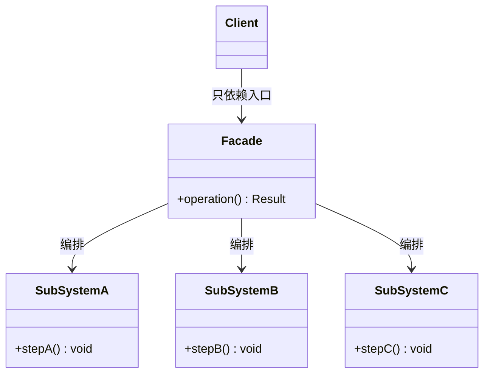
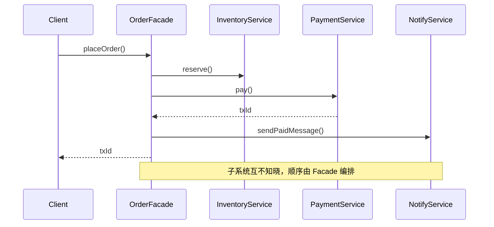

# 外观模式（Facade）

> 一句话定位：**「少接口就是多接口」——把一组子系统的繁琐调用收敛成一个统一入口**。考官真正想听的是「外观不封装子系统」这条关键认知、外观与适配器/中介者/代理的辨析，以及 SLF4J、`JdbcTemplate`、`SqlSession` 这些每天都在用却没意识到是外观的真实例子。
> 分类：结构型（Structural） | 面试热度：★★★☆☆
> 版本前提：JDK 17

---

## 1. 是什么

**为一组子系统接口提供一个统一的高层接口，让子系统更容易使用。** 它是迪米特法则（Law of Demeter，最少知识原则）在设计模式层面的直接落地。

核心角色：

| 角色 | 职责 |
| --- | --- |
| Facade（外观） | 知道哪些子系统负责什么、**编排调用顺序与组合**，对外暴露少量粗粒度方法 |
| SubSystem（子系统） | 实现具体功能，**不知道 Facade 的存在**，可被 Facade 调用也可被客户端直接调用 |
| Client | 只依赖 Facade，不再感知子系统的数量与调用顺序 |



---

## 2. 解决什么问题

**没有它之前**：以 JDBC 为例，一次查询要写「拿 Connection → 建 PreparedStatement → 绑参 → 执行 → 遍历 ResultSet → 处理 SQLException → finally 里按逆序关三层资源」七八步样板代码，任何一步漏关都是连接泄漏。每个 DAO 都复制一遍这套流程，业务代码被淹没在资源管理里。

**关键认知（面试区分度所在）**：

- Facade **不封装子系统**——子系统接口仍然是 public 的，客户端想绕过 Facade 直接用完全可以。外观提供的是「更省事的入口」，不是「唯一的入口」。想强制唯一入口要靠模块可见性（JPMS、package-private），那是另一件事。
- Facade 里**不要放业务逻辑**。它只做编排与转发；一旦往里写 if-else 业务分支，它就退化成上帝类（God Class），既当入口又当业务容器，改一处动全身。

**为什么不直接用别的方案**：

| 维度 | 客户端直接调子系统 | Facade |
| --- | --- | --- |
| 调用方需要知道的类数 | N 个子系统全要知道 | 1 个入口 |
| 调用顺序约束 | 散落在每个客户端里，容易错 | 收敛在 Facade 内 |
| 子系统替换成本 | 所有调用点都要改 | 只改 Facade 内部 |
| 灵活性 | 最高 | 粗粒度，特殊需求仍可绕过 Facade 直调子系统 |

---

## 3. 怎么写

以「下单」为例，把库存、支付、通知三个子系统收敛成一个 Facade：

```java
// 子系统：彼此独立，不知道 Facade 的存在
public class InventoryService {
    public boolean reserve(String sku, int qty) { /* 扣减预占 */ return true; }
}
public class PaymentService {
    public String pay(long orderId, BigDecimal amount) { /* 发起支付 */ return "TX123"; }
}
public class NotifyService {
    public void sendPaidMessage(long orderId) { /* 发 MQ 通知 */ }
}

// Facade：只做编排，不写业务规则
public class OrderFacade {
    private final InventoryService inventory;
    private final PaymentService payment;
    private final NotifyService notify;

    public OrderFacade(InventoryService i, PaymentService p, NotifyService n) {
        this.inventory = i; this.payment = p; this.notify = n;
    }

    public String placeOrder(String sku, int qty, long orderId, BigDecimal amount) {
        if (!inventory.reserve(sku, qty)) {
            throw new IllegalStateException("库存不足"); // 注意：不要吞子系统异常类型之外的核心信息
        }
        try {
            String txId = payment.pay(orderId, amount);
            notify.sendPaidMessage(orderId);
            return txId;
        } catch (PaymentException e) {
            inventory.reserve(sku, -qty);              // 编排层负责补偿回滚
            throw new OrderFailedException("支付失败", e); // 统一异常，不泄漏子系统类型
        }
    }
}
```

要点：

1. 构造注入子系统，Facade 本身无状态、可做成单例 / Spring Bean。
2. 异常翻译成 Facade 自己的 `OrderFailedException`，**避免客户端 import 子系统的异常类**——否则 Facade 就没起到解耦作用。
3. 补偿/回滚顺序属于「编排」，放 Facade 是对的；「满减规则」「风控校验」属于业务，不该放这里。



---

## 4. 使用场景

| 场景 | 说明 |
| --- | --- |
| 分层架构的层间入口 | Controller → Service 之间的 service facade，避免 Controller 直接组装多个 DAO |
| 第三方 SDK 封装 | 把 OSS/短信/支付 SDK 的几十个类收敛成自己语义的三四个方法，换厂商只改一层 |
| 遗留系统集成 | 给老系统的混乱接口套一个干净外观，新代码只依赖外观 |
| 微服务聚合层 | API 网关 / BFF：对前端一个接口，背后聚合多个微服务调用 |
| 复杂框架的简易入口 | 框架内部有几十个工作类，给用户一个 `XxxTemplate` 或 `Factory` |

**JDK / Spring / MyBatis 中的真实例子**：

- **SLF4J 是最典型的外观**：`LoggerFactory.getLogger()` + `Logger` 就是门面，底下 logback / log4j2 / JUL 随便换；而 `slf4j-log4j12` 这类桥接包是**适配器**（把 log4j 接口转成 slf4j 接口）——一个类库里外观与适配器同时出现，是讲两者区别的最佳素材。
- Spring `JdbcTemplate`：封装 Connection / Statement / ResultSet 的获取、遍历、关闭与 SQLException 翻译（`SQLErrorCodeSQLExceptionTranslator`）一整套流程，使用者只写 SQL 和 `RowMapper`。
- Spring `RestTemplate` / `TransactionTemplate`：前者收敛 HTTP 连接、编解码、错误处理；后者收敛事务的 begin/commit/rollback 样板。
- MyBatis `SqlSession`：对外的 `selectList/insert/update` 背后是 Executor + StatementHandler + ParameterHandler + ResultSetHandler 四大件的协同，用户完全不感知。
- `java.util.concurrent.Executors`：工厂 + 外观味道，把 `ThreadPoolExecutor` 的七个参数收敛成 `newFixedThreadPool` 等一句话调用（也因此藏了「无界队列」的坑，见第 5 节）。

---

## 5. 生产中的问题与排查

| 问题 | 现象 | 排查 / 修复 |
| --- | --- | --- |
| **Facade 膨胀成上帝类** | 一个 Facade 几十个方法、单个方法几百行 | 按业务域拆分多个细粒度 Facade；Facade 之间允许组合调用；业务规则下沉到领域服务 |
| **异常类型泄漏** | 客户端代码里 import 了子系统的 `SQLException` / SDK 异常 | Facade 必须翻译异常为自有类型，栈里保留 cause；code review 检查 Facade 签名是否出现子系统类型 |
| **Facade 吞异常** | 失败被 catch 后只打日志返回 null/false，上层无法区分「没数据」和「失败了」 | 要么抛出语义化异常，要么返回带错误码的 Result；禁止静默 catch |
| **误信 Facade 是唯一入口** | 新人绕过 Facade 直接调子系统，造成两套调用路径、行为不一致 | 约定 + 架构守护（ArchUnit 规则限制跨层访问）；明确 Facade 是「省事入口」而非「强制入口」 |
| **Executors 这类外观藏坑** | `Executors.newFixedThreadPool` 用 `LinkedBlockingQueue` 无界队列，突发流量 OOM | 外观简化了参数也隐藏了参数；生产直接 new `ThreadPoolExecutor` 显式给有界队列与拒绝策略 |
| **Facade 层做了分布式事务编排却无补偿** | 第二步失败，第一步已提交，数据不一致 | Facade 编排跨系统调用时要显式设计补偿（Saga）或引入事务协调器，不能默认「try-catch 就完事」 |
| **网关/BFF 外观层成为性能瓶颈** | 聚合调用串行执行，RT 是各下游之和 | 聚合改为并行（`CompletableFuture` / Reactor `zip`），并给每个下游设独立超时与熔断 |

---

## 6. 面试问法

### 60 秒版本

> 外观是结构型模式，给一组子系统提供一个统一的高层接口，是迪米特法则的直接体现。它只做编排——知道调哪些子系统、按什么顺序调——**但不封装子系统**，客户端仍然可以绕过它直调子系统；也**不放业务逻辑**，否则就变成上帝类。和相近模式的区别：外观是简化**一批**接口、意图是易用；适配器是转换**一个**接口、意图是兼容；中介者是**双向**协调同事对象，而外观是**单向**的，子系统根本不知道外观存在。实际例子到处都是：SLF4J 的 `LoggerFactory` 就是门面，底下 logback、log4j2 随便换；Spring 的 `JdbcTemplate` 封装了 JDBC 的资源管理与异常翻译；MyBatis 的 `SqlSession` 屏蔽了 Executor 和三大 Handler。分布式版本的对应物就是 API 网关和 BFF。

### 5 分钟版本补充点

1. Facade 通常做成单例或 Spring Bean，自身无状态，状态都在子系统里
2. 外观模式的「反向」收益：它同时是**天然的监控/熔断埋点**——所有流量都过这一个口子，加指标、限流、灰度都方便
3. 与「分层架构」的关系：每层暴露的 Service 接口本质就是下一层的外观
4. 微服务下外观的分布式形态：API 网关（南北向聚合）+ BFF（按前端类型定制聚合），两者都是外观
5. 反模式信号：Facade 方法数超过子系统方法数的一半，说明它没在简化，只是在复制签名

---

## 7. 追问链 · 参考答案

| 层级 | 问题 | 参考答案要点 |
| --- | --- | --- |
| L1 | 外观模式是什么？ | 结构型模式，为一组子系统接口提供统一的高层入口，降低客户端与子系统的耦合。三个角色：Facade 负责编排、SubSystem 不知 Facade 存在、Client 只依赖 Facade |
| L2 | 外观封装了子系统吗？ | **没有**。子系统仍是 public 可直调的，外观只提供「更省事的入口」而非「唯一入口」。想强制唯一入口要靠模块可见性（JPMS、package-private），那是访问控制不是外观 |
| L2 | 外观里能写业务逻辑吗？ | 不能。外观只做编排与转发、异常翻译、补偿顺序；写进 if-else 业务规则就退化成上帝类。判断标准：删掉外观后业务规则应该仍然存在于某个领域服务里 |
| L3 | SLF4J 是怎么体现外观的？ | `LoggerFactory.getLogger(Class)` 返回统一 `Logger` 门面，底层由 `ServiceLoader`（1.8+ 是 `SLF4JServiceProvider`）绑定 logback/log4j2。`slf4j-log4j12` 这类桥接包是适配器——同一生态里外观与适配器并存，是讲两者区别的标准素材 |
| L3 | `JdbcTemplate` 省掉了什么？ | 封装了 DataSource 取连接、Statement 创建与绑参、ResultSet 遍历、资源按逆序关闭、`SQLException` 到 `DataAccessException` 体系（`SQLErrorCodeSQLExceptionTranslator`）的翻译。用户只提供 SQL、`Object...` 参数和 `RowMapper` |
| L3 | MyBatis 的 `SqlSession` 背后有什么？ | 四大件：Executor（执行与缓存）、StatementHandler（语句与读写分离路由）、ParameterHandler（参数绑定）、ResultSetHandler（结果映射）。`DefaultSqlSession.selectList` 内部委托给 `Executor.query` 一路向下，用户完全不感知 |
| L4 | 外观和适配器的区别？ | 外观面向**一批**接口，产出更粗粒度的新接口，意图是**易用**；适配器面向**一个**接口，把它转成另一个既有接口，意图是**兼容**。外观定义新抽象，适配器对齐旧抽象 |
| L4 | 外观和中介者的区别？ | 方向不同：外观是**单向**的——客户端通过 Facade 用子系统，子系统不知道 Facade；中介者是**双向**的——同事对象互相不直接引用，都持有 Mediator 引用，由中介者在内部协调多方通信 |
| L4 | 外观和代理的区别？ | 代理面对**一个**对象且**保持接口一致**，目的是控制访问（懒加载、权限、增强）；外观面对**一批**对象且**改变接口粒度**（通常更粗），目的是简化。代理是「同一接口加个壳」，外观是「换个更好用的接口」 |
| L5 | 微服务里的外观是什么？ | API 网关与 BFF（Backend For Frontend）。BFF 本质就是分布式外观：对前端暴露一个聚合接口，背后并行调用多个微服务并裁剪字段。代价是要处理分布式问题——超时、熔断、部分失败、补偿，比单机外观复杂一个量级 |

---

## 8. 误区 · 正解

| ❌ 误区 | ✅ 正解 |
| --- | --- |
| 「外观把子系统封装起来不让外部用了」 | 外观**不限制**对子系统的直接访问，它只是提供更省事的入口。子系统类仍然 public，绕过 Facade 直调完全合法；要强制隔离得靠模块可见性 |
| 「外观层适合放业务规则」 | 外观只做编排、转发、异常翻译与补偿。业务规则放进外观会让它膨胀成上帝类，业务规则应属于领域服务 |
| 「外观和适配器差不多，都是包一层」 | 意图不同：外观**简化一批**接口（新接口更粗），适配器**转换一个**接口（对齐既有签名）。一个为易用，一个为兼容 |
| 「中介者就是复杂一点的外观」 | 方向相反：外观是客户端→子系统的**单向**简化，子系统不知外观；中介者是同事对象间**双向**通信的协调者，同事对象都持有中介者引用 |
| 「用了 Facade 后客户端就和子系统完全解耦了」 | 若 Facade 的方法签名或异常泄漏了子系统类型（如抛出 `SQLException`），客户端仍然耦合。外观必须翻译异常、使用自有参数与返回类型 |
| 「API 网关就是外观模式的全部」 | 网关/BFF 是外观在**分布式**下的形态，还要额外解决超时、熔断、部分失败与补偿；单机外观没有这些问题，不能直接套用经验 |
| 「`Executors` 是优秀的工厂外观，生产直接用」 | 它简化了参数也隐藏了参数：`newFixedThreadPool`/`newSingleThreadExecutor` 用**无界** `LinkedBlockingQueue`，可能 OOM。生产应显式 new `ThreadPoolExecutor` |

---

## 9. 相关模式

| 模式 | 关系 |
| --- | --- |
| 适配器（Adapter） | 外观简化一批接口，适配器转换一个接口；SLF4J 生态里两者并存（门面 + 桥接包） |
| 中介者（Mediator） | 外观单向简化调用，中介者双向协调同事对象；都为了解耦，方向相反 |
| 代理（Proxy） | 代理保持接口一致、控制单个对象访问；外观改变接口粒度、面向一批对象 |
| 单例（Singleton） | Facade 自身通常做成单例 / 容器 Bean，作为子系统的唯一入口实例 |
| 抽象工厂（AbstractFactory） | 都可以隐藏复杂性：工厂隐藏「创建」，外观隐藏「使用」；二者常组合 |

---

## 10. 我的薄弱点

（学完后自己填，同步到 `weakness.md`）
