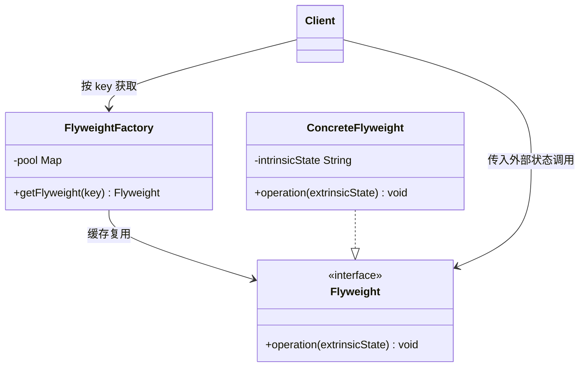
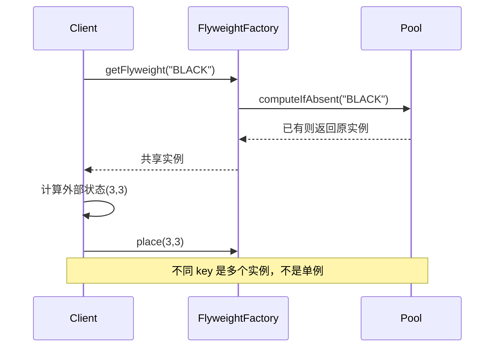

# 享元模式（Flyweight）

> 一句话定位：**「共享 + 拆分状态」——用共享技术支持大量细粒度对象的复用**。考官真正想听的是内部/外部状态的拆分逻辑、享元与单例/对象池的本质区别，以及 `IntegerCache` 那个 -128~127 的 `==` 陷阱。
> 分类：结构型（Structural） | 面试热度：★★★☆☆
> 版本前提：JDK 17

---

## 1. 是什么

**运用共享技术有效地支持大量细粒度对象的复用。** 核心手法是把对象的状态拆成两半：

| 状态 | 含义 | 存在哪 |
| --- | --- | --- |
| **内部状态（Intrinsic）** | 不随环境变化、**可共享**的部分（如字符的字形、棋子的颜色形状） | 存在享元对象内部，一个 key 一份 |
| **外部状态（Extrinsic）** | 随环境变化、**不可共享**的部分（如字符坐标、棋子落点） | 不存对象里，**由客户端在调用时传入** |

核心角色：

| 角色 | 职责 |
| --- | --- |
| Flyweight（抽象享元） | 声明接口，方法的参数里接收外部状态 |
| ConcreteFlyweight（具体享元） | 存内部状态，**必须不可变/无状态**，可被多方共享 |
| UnsharedConcreteFlyweight | 不需要共享的非共享享元，可独立存在 |
| FlyweightFactory | 池化与复用，通常 `Map` + `ConcurrentHashMap`，按 key 返回已有实例 |
| Client | 计算/持有外部状态，调用时传给享元 |



---

## 2. 解决什么问题

**没有它之前**：一个文本编辑器有 100 万个字符对象，每个对象都存字体、字号、颜色，内存爆炸；一盘围棋 361 个落子各存一套棋型数据。而观察发现：同字体的字符只有坐标不同，同色棋子只有位置不同——**大量对象是重复数据 + 少量差异**。

**为什么不用别的方案**：

| 维度 | 享元 | 对象池（连接池/线程池） |
| --- | --- | --- |
| 对象使用权 | **共享**，多方同时持有同一实例 | **独占**，借出期间别人不能用，用完归还 |
| 对象状态要求 | 必须不可变/无状态，否则并发污染 | 可以有状态，归还时重置 |
| 典型数量 | 实例数 ≈ key 的种类数 | 实例数 ≈ 并发上限 |
| 目的 | 省内存（消除重复数据） | 省创建成本（连接/线程创建昂贵） |

**关键取舍**：享元省内存的代价是把外部状态剥离出去，客户端每次调用都要算/传外部状态，代码更绕；而且**享元对象必须线程安全（通常做成不可变）**，一旦误把可变状态当内部状态，多方共享时数据直接串号。

---

## 3. 怎么写

以「围棋棋子」为例：颜色形状是内部状态，坐标是外部状态。

```java
// 享元：内部状态不可变
public final class ChessPiece {
    private final String color;   // 内部状态：黑/白
    private final String shape;   // 内部状态：棋型

    private ChessPiece(String color, String shape) {
        this.color = color;
        this.shape = shape;
    }

    // 外部状态 row/col 由客户端调用时传入
    public void place(int row, int col) {
        System.out.printf("%s 子落于 (%d,%d)%n", color, row, col);
    }

    public static ChessPiece of(String color) {
        return Factory.POOL.computeIfAbsent(color, c -> new ChessPiece(c, "圆"));
    }

    final class Factory {
        private static final Map<String, ChessPiece> POOL = new ConcurrentHashMap<>();
    }
}

// 客户端：坐标这类外部状态自己算、自己传
ChessPiece black = ChessPiece.of("BLACK");
ChessPiece black2 = ChessPiece.of("BLACK");
black.place(3, 3);
black2.place(15, 16);
assert black == black2;   // 同一 key 共享同一实例
```

要点：

1. 构造器私有，唯一入口是工厂的 `computeIfAbsent`——同 key 永远同一个实例。
2. 享元类 `final` + 字段 `final`、无 setter，**不可变是共享的前提**。
3. `place()` 不保存坐标；坐标是外部状态，用完即弃。



---

## 4. 使用场景

| 场景 | 说明 |
| --- | --- |
| 字符/字形渲染 | 编辑器里字符的字形、样式对象共享，坐标样式外部传入 |
| 游戏对象 | 子弹、树木、粒子：模型贴图共享，位置朝向外部传入 |
| GUI 图标与皮肤 | 同一图标被几百个按钮复用 |
| 字符串/数字常量 | 编译期与运行期常量复用（见下方真实例子） |
| 元数据对象 | 列定义、协议字段描述，同 schema 全表共享 |

**JDK 中的真实例子（面试高频）**：

- **`Integer.valueOf` 的 `IntegerCache`**：默认缓存 **-128 ~ 127**，上限可用 `-XX:AutoBoxCacheMax=<size>` 调大。于是 `Integer.valueOf(127) == Integer.valueOf(127)` 为 `true`，而 `128` 为 `false`——`==` vs `equals` 陷阱的根源。注意 `new Integer(127)`（已 deprecated）不走缓存。
- **`String` 常量池（`StringTable`）**：字面量与 `intern()` 复用同一对象；JDK 7 起常量池从永久代移到堆，`intern()` 行为随之变化（堆中已有则返回堆引用）。
- **`Boolean.valueOf` / `Byte` / `Short` / `Character`（`\u0000`~`\u007F`）/ `Long`** 都有类似缓存；`BigDecimal.valueOf` 内部对 0~10 也走缓存（`ZERO_THROUGH_TEN`）。
- **明确辨析：JDBC 连接池是对象池，不是享元**——连接是独占借出的，池的目的是省创建成本而不是消除重复数据，与享元的「共享同一实例」语义相反。

---

## 5. 生产中的问题与排查

| 问题 | 现象 | 排查 / 修复 |
| --- | --- | --- |
| **`IntegerCache` 的 `==` 陷阱** | 测试环境（值 < 128）通过，线上大数值比较失败 | 装箱类型永远用 `equals` 比较；静态检查开 Sonar `S4973`；面试必考 |
| **用可变对象做享元** | 并发下数据串号、状态被别的线程改掉 | 享元类 `final`、字段 `final`、去掉 setter；必须可变时退回对象池或 new |
| **误把会变的状态当内部状态** | 不同上下文的数据互相污染 | 评审状态拆分：「这个字段在整个生命周期会变吗？」会变的全部归外部状态 |
| **缓存池无界导致内存泄漏** | key 由外部输入生成，池子无限膨胀 OOM | 用有界缓存（Caffeine/Guava `maximumSize`）或 `WeakHashMap` 思路；监控 pool size |
| **`ConcurrentHashMap.computeIfAbsent` 中再嵌套 computeIfAbsent** | JDK 8 下死锁/`IllegalStateException` | 工厂里避免递归映射；初始化逻辑抽到 `mappingFunction` 之外 |
| **`String.intern()` 滥用** | 高频动态字符串 intern 导致 `StringTable` 膨胀、GC 压力 | 只 intern 枚举值级别的少量字符串；大表去重用自定义 `HashMap` 弱引用池 |
| **享元工厂成了全局锁点** | 高并发下 `synchronized` 工厂方法成瓶颈 | 用 `ConcurrentHashMap.computeIfAbsent` 无锁化；避免对整个 pool 加 `synchronized` |
| **享元与普通 DTO 混用** | 团队成员不知道对象被共享，随手改了字段 | 命名上标注（如 `*Flyweight`/`*Shared`）、JavaDoc 声明「此对象全局共享，禁止修改」 |

---

## 6. 面试问法

### 60 秒版本

> 享元是结构型模式，用共享技术支持大量细粒度对象的复用。核心是把状态拆成两半：**内部状态**不变、可共享，存在享元里；**外部状态**随环境变，由客户端调用时传入。所以享元对象必须**不可变**，否则多方共享会并发污染。它和两个相近概念要分清：单例是**全局只有一个**实例，享元是**同一 key 共享一个、不同 key 多个**——本质是「按 key 复用」；对象池如连接池是**独占借出**，用完归还，而享元是**多方同时共享**。JDK 里最典型的例子是 `Integer.valueOf` 的 `IntegerCache`，默认缓存 -128 到 127，上限能用 `-XX:AutoBoxCacheMax` 调，所以 127 用 `==` 比较为 true、128 为 false——这也是装箱类型必须用 `equals` 的原因。`String` 常量池、`Boolean.valueOf`、`Character` 缓存都是同一思路。

### 5 分钟版本补充点

1. 享元的四个角色里 `UnsharedConcreteFlyweight` 常被忽略：允许某些对象不共享，模式不强迫「一刀切全共享」
2. `StringTable` 在 JDK 7 从永久代移到堆，之后 `intern()` 返回堆中引用——这是「常量池在哪」系列追问的标准答案
3. 享元省内存的前提是**外部状态的存储成本 < 重复内部状态的成本**；如果外部状态本身也很大，共享收益就薄了
4. 判定能不能享元的口诀：「**同一份数据会不会在多个上下文里以不同面貌出现？**」会 → 拆内外状态；不会 → 不必享元
5. 对象池与享元的终极区分：对象池管理的是**生命周期**（借/还），享元管理的是**同一性**（同 key 同对象）

---

## 7. 追问链 · 参考答案

| 层级 | 问题 | 参考答案要点 |
| --- | --- | --- |
| L1 | 享元模式是什么？ | 结构型模式，通过共享技术支持大量细粒度对象复用。核心是把状态拆成内部状态（可共享、存对象内）与外部状态（不可共享、调用时传入），由工厂按 key 池化 |
| L1 | 内部状态和外部状态怎么区分？ | 判断标准：「这个值随调用环境变吗？」不变 → 内部状态，如字符字形；变 → 外部状态，如坐标。内部状态决定实例数（≈key 的种类数），外部状态决定调用形态 |
| L2 | 享元和单例的区别？ | 单例全局**只有一个**实例；享元**同一 key 一个、不同 key 多个**，是「按 key 复用」。单例可视为 key 退化成唯一值时的享元特例，但意图不同：单例管「唯一」，享元管「去重」 |
| L2 | 享元和对象池的区别？ | 对象池是**独占借出**：借出期间别人不能用，用完归还，对象可以有状态；享元是**多方共享**：同一实例同时被多方持有，因此对象必须不可变/无状态。连接池、线程池是对象池不是享元 |
| L3 | `IntegerCache` 的范围能改吗？ | 默认缓存 -128~127（下界固定，上界可用 `-XX:AutoBoxCacheMax=<size>` 调大）。缓存数组在 `IntegerCache` 静态块里一次建好，`Integer.valueOf` 范围内直接返回缓存元素，范围外 new |
| L3 | `String.intern()` 在 JDK 6/7+ 有什么区别？ | JDK 6 常量池在永久代，`intern()` 会把堆字符串**复制**一份到永久代；JDK 7 起常量池移到堆，`intern()` 只在 `StringTable` 里**记录引用**，堆中已有则返回原堆引用。两者 `==` 结果因此可能不同 |
| L3 | 享元工厂为什么常用 `ConcurrentHashMap`？ | 工厂是高频入口，`computeIfAbsent` 提供无锁化的「存在即返回、不存在原子建」语义；若用 `synchronized` 包住整个工厂方法，高并发下工厂本身会成为全局锁点 |
| L4 | 为什么说享元对象必须不可变？ | 因为同一实例被多方同时共享持有，任何一方改了状态，其他持有者立刻看到污染后的数据（串号）。不可变 + 无 setter 是共享的前提；做不到不可变的场景应退回对象池 |
| L4 | JDBC 连接池为什么不是享元？ | 连接是**独占**的：借出期间别人拿不到同一根，用完 `close()` 归还池；且连接有状态（事务、会话变量），池负责重置。享元恰恰相反——共享同一实例且要求无状态，两者目的也不同（省创建成本 vs 省内存） |
| L5 | 享元模式在工程里什么时候值得用？ | 当且仅当「对象数量巨大 + 内部状态重复度高 + 外部状态剥离成本低」三者同时成立，如文本渲染、游戏粒子。多数业务代码里外部状态剥离带来的复杂度超过内存收益，强行上享元是过度设计 |

---

## 8. 误区 · 正解

| ❌ 误区 | ✅ 正解 |
| --- | --- |
| 「享元就是单例的复数版」 | 不准确。单例管「全局唯一」，享元管「同 key 去重」——key 有 N 种就有 N 个实例，且享元的核心是**内外状态拆分**，单例没有这个维度 |
| 「连接池/线程池是享元模式」 | 它们是**对象池**：独占借出、用完归还、对象可有状态。享元是共享同一实例且要求对象不可变，语义相反 |
| 「享元对象可以有 setter，只要注意点」 | 共享对象一旦可变，并发下必然串号。享元类应 `final`、字段 `final`、无 setter——**不可变是硬约束**，不是建议 |
| 「`Integer.valueOf(128) == Integer.valueOf(128)` 为 true」 | 默认缓存上限是 127，128 会 new 出两个不同对象，`==` 为 false。装箱类型一律用 `equals` 比较 |
| 「外部状态也存在享元对象里」 | 外部状态**不存对象里**，由客户端计算并在调用方法时传入。存进去就失去了共享的意义，还会造成状态污染 |
| 「享元池越大越好，全缓存起来」 | 无界池在 key 来自外部输入时会无限膨胀直至 OOM。生产用有界缓存（`maximumSize`）并监控池大小 |
| 「`new Integer(127)` 也走缓存」 | `new` 永远创建新对象（且构造器已 deprecated for removal）；只有 `valueOf` / 自动装箱走 `IntegerCache` |

---

## 9. 相关模式

| 模式 | 关系 |
| --- | --- |
| 单例（Singleton） | 单例是「全局一个」，享元是「按 key 多个」；单例可视为享元 key 退化为唯一值的特例 |
| 工厂方法 / 抽象工厂 | 享元的复用逻辑通常就实现在工厂里（`FlyweightFactory`），工厂按 key 决定返回新对象还是已有对象 |
| 组合（Composite） | 享元常与组合搭配：树形结构里大量叶子节点共享同一享元（如文档渲染的字形树） |
| 状态（State）/ 策略（Strategy） | 无状态的状态对象、策略对象天然适合做成享元，全局共享一份 |

---

## 10. 我的薄弱点

（学完后自己填，同步到 `weakness.md`）
