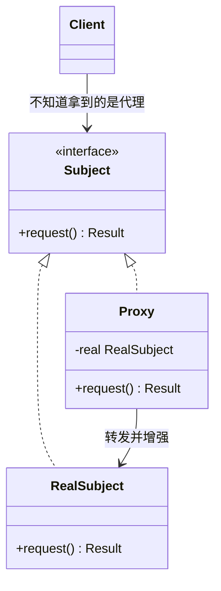
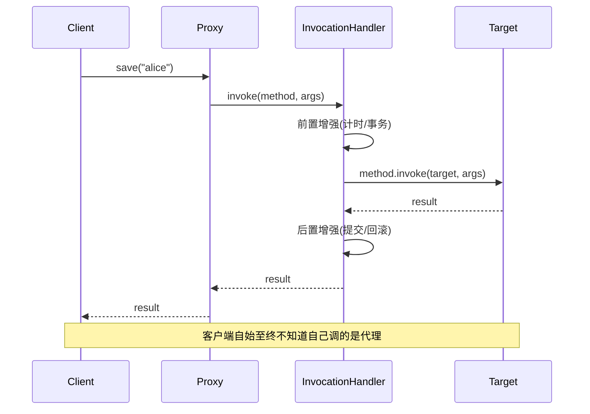

# 代理模式（Proxy）

> 一句话定位：**「不直接碰你，碰我给你的替身」——为对象提供一个代理以控制对它的访问**。考官真正想听的是 JDK 动态代理与 CGLib 的原理和选型、Spring Boot 2.x 默认改 CGLib 的版本差异，以及最值钱的坑——**自调用导致 AOP 失效**。
> 分类：结构型（Structural） | 面试热度：★★★★★（最常考的结构型）
> 版本前提：JDK 17 + Spring Boot 2/3

---

## 1. 是什么

**为其他对象提供一种代理，以控制对这个对象的访问。** 代理与目标实现同一接口（或继承同一类），在转发调用前后插入额外逻辑。

按意图分的常见类型：

| 类型 | 意图 | 典型例子 |
| --- | --- | --- |
| 远程代理 | 屏蔽网络细节，像调本地一样调远端 | RPC stub、Dubbo 消费端代理、Feign |
| 虚拟代理 | 延迟加载，用到才初始化 | MyBatis/Hibernate 懒加载 |
| 保护代理 | 权限与只读控制 | `Collections.unmodifiableList` |
| 缓存代理 | 结果缓存，命中不打扰目标 | `@Cacheable` |
| 智能引用 | 计数、日志、耗时统计 | AOP 的 `@Around` 切面 |
| AOP 动态代理 | 工程上最常见的形态 | `@Transactional` / `@Async` |



---

## 2. 解决什么问题

**没有它之前**：事务、日志、权限、缓存这类**横切逻辑**要么写进每个业务方法里（重复、污染业务代码），要么抽工具类手动调（调用点散落、容易漏）。远程调用还要手写序列化、网络传输、超时重试。

**为什么不用别的方案**：

| 维度 | 继承目标类重写方法 | 代理（组合 + 同接口） |
| --- | --- | --- |
| 增强范围 | 一个子类只能增强一个父类 | 一个 `InvocationHandler` 可增强任意接口实现 |
| 与目标的耦合 | 编译期绑死父类 | 运行期织入，目标可无感知 |
| final 类/方法 | 同样受限 | JDK 代理不受 final 类限制（但接口必须非 final） |
| 可叠加性 | 多层继承爆炸 | 多切面按 order 叠加，天然支持 |

**关键取舍**：代理换来「无侵入增强」的同时引入了间接层——异常栈变长、`getClass()` 结果改变、自调用绕过代理，这些都是第 5 节要面对的代价。

---

## 3. 怎么写

### 3.1 静态代理（编译期，一个类一个代理）

```java
public interface UserService { void save(String name); }

public class UserServiceImpl implements UserService {
    public void save(String name) { /* 真实业务 */ }
}

// 静态代理：手写，一个目标一个代理类，接口加一个方法所有代理都得跟着改 → 类爆炸
public class UserServiceLogProxy implements UserService {
    private final UserService target;
    public UserServiceLogProxy(UserService target) { this.target = target; }
    public void save(String name) {
        long t = System.nanoTime();
        target.save(name);
        System.out.println("save 耗时 " + (System.nanoTime() - t) / 1_000_000 + "ms");
    }
}
```

### 3.2 JDK 动态代理（只能代理接口）

```java
public class TimingHandler implements InvocationHandler {
    private final Object target;
    public TimingHandler(Object target) { this.target = target; }

    @Override
    public Object invoke(Object proxy, Method method, Object[] args) throws Throwable {
        long t = System.nanoTime();
        try {
            return method.invoke(target, args);   // 转发给真实对象
        } finally {
            System.out.println(method.getName() + " 耗时 " + (System.nanoTime() - t) / 1_000_000 + "ms");
        }
    }

    @SuppressWarnings("unchecked")
    public static <T> T wrap(T target, Class<T> iface) {
        return (T) Proxy.newProxyInstance(iface.getClassLoader(),
                new Class<?>[]{iface}, new TimingHandler(target));
    }
}

UserService proxy = TimingHandler.wrap(new UserServiceImpl(), UserService.class);
proxy.save("alice");   // 自动打印耗时
```

### 3.3 CGLib（可代理无接口类，通过继承生成子类）

```java
Enhancer enhancer = new Enhancer();
enhancer.setSuperclass(UserServiceImpl.class);
enhancer.setCallback((MethodInterceptor) (obj, method, args, methodProxy) -> {
    long t = System.nanoTime();
    Object r = methodProxy.invokeSuper(obj, args);  // 走 fastClass，不反射
    System.out.println("耗时 " + (System.nanoTime() - t) / 1_000_000 + "ms");
    return r;
});
UserServiceImpl proxy = (UserServiceImpl) enhancer.create();
```



---

## 4. 使用场景

| 场景 | 说明 |
| --- | --- |
| 声明式事务 | `@Transactional` 由代理在方法前后包一层 begin/commit/rollback |
| 缓存 | `@Cacheable` 命中缓存则不进入目标方法 |
| 异步 | `@Async` 把调用包装成任务提交到线程池 |
| 远程调用 | RPC stub / Dubbo `Invoker` / Feign 接口代理，屏蔽网络细节 |
| ORM 懒加载 | 实体关联对象首次访问时才触发 SQL |
| 只读保护 | `Collections.unmodifiableList` 修改操作直接抛异常 |

**JDK / Spring / MyBatis 中的真实例子**：

- **MyBatis Mapper 接口只有接口没有实现类**：`MapperProxyFactory` 为每个 Mapper 接口创建 JDK 动态代理，`MapperProxy.invoke` 把方法调用翻译成 `SqlSession` 的 `select/insert/update` 执行——「接口没实现类怎么能注入」这道高频题的答案就是动态代理。
- Spring `@Transactional` / `@Cacheable` / `@Async` / `@Validated`：全部由 `BeanPostProcessor`（如 `InfrastructureAdvisorAutoProxyCreator`）在 Bean 初始化后包一层代理实现。
- Dubbo 消费端：`ReferenceConfig.get()` 返回的就是代理，方法调用被转成 `Invoker.invoke` 走网络。
- Hibernate/MyBatis 懒加载：`javassist`/`ByteBuddy` 生成的虚拟代理，访问属性时触发 `SELECT`。
- `Collections.unmodifiableList`：保护代理味道，所有 mutator 方法抛 `UnsupportedOperationException`。

---

## 5. 生产中的问题与排查

| 问题 | 现象 | 排查 / 修复 |
| --- | --- | --- |
| **自调用导致 AOP 失效**（最值钱） | 同类中 `this.methodB()` 调 `@Transactional` 方法，事务不生效 | 根因：自调用走**目标对象**而非**代理对象**。修法：注入自身代理（`@Lazy` 防循环依赖）、`AopContext.currentProxy()`（需 `@EnableAspectJAutoProxy(exposeProxy = true)`）、把方法拆到另一个 Bean、或用 AspectJ 编译期/加载期织入 |
| **CGLib 代理 final 方法静默失效** | 不报错，但增强就是不执行 | CGLib 靠继承生成子类，`final` 类/方法、`private`、`static` 方法无法被重写增强。排查：看生成类名是否含 `$$EnhancerBySpringCGLIB$$`、方法是否 final |
| **`instanceof` / 类型判断踩坑** | `proxy instanceof UserServiceImpl` 在 JDK 代理下为 false | JDK 代理类继承 `Proxy` 实现接口，**不是**目标类的子类；CGLib 代理**是**目标类子类。类型判断要对接口做，或用 `AopUtils.getTargetClass()` |
| **异常栈变长、报错类名陌生** | 栈里出现 `$Proxy123`、`$$EnhancerBySpringCGLIB$$xxx` | 这是代理类的正常名字；定位问题时往下找目标类的真实栈帧，不要被代理帧干扰 |
| **`equals/hashCode/toString` 被代理** | 打印日志触发懒加载 SQL，甚至递归 toString | 这些方法也会走 `invoke`，代理里要特殊处理；ORM 实体的 `toString` 避免引用懒加载字段 |
| **JDK 代理 vs CGLib 选错导致注入失败** | `BeanCreationException: named ... expected at least 1 bean` | 注入字段写的是实现类类型，而容器里只有 JDK 代理（接口类型）。修法：注入声明为接口，或 `proxy-target-class=true` 换 CGLib |
| **代理叠加顺序错乱** | 事务在缓存外层/内层行为不符预期 | 切面有 order：`@Order` 或 `Ordered` 控制；事务默认最低优先级（最外层），`@EnableTransactionManagement(order=...)` 可调 |
| **代理对象被序列化出错** | 缓存/RPC 传输代理对象报 `NotSerializableException` | 传输 DTO，不传输 Bean 本体；必要时用 `AopProxyUtils` 取目标对象 |

---

## 6. 面试问法

### 60 秒版本

> 代理模式是为对象提供替身以控制访问，工程上最常见的是 AOP 动态代理。JDK 动态代理基于 `Proxy` + `InvocationHandler`，**只能代理接口**，生成的代理类继承 `Proxy` 并实现目标接口；CGLib 通过**继承目标类**生成子类，可以代理**没有接口的类**，但 `final` 类、`final`/`private`/`static` 方法增强不了。Spring 的选择规则本来是「有接口用 JDK，无接口用 CGLib」，但 **Spring Boot 2.x 起 `spring.aop.proxy-target-class` 默认改成 `true`，一律走 CGLib**。最值钱的坑是**自调用失效**：同类里 `this.methodB()` 调用带 `@Transactional` 的方法，走的是目标对象不是代理对象，事务直接不生效，解决方法是注入自身代理加 `@Lazy`、`AopContext.currentProxy()` 开 `exposeProxy`、或者干脆拆到另一个 Bean。MyBatis 的 Mapper 接口没有实现类，全靠 `MapperProxy` 这套 JDK 动态代理把方法调用翻译成 SQL 执行。

### 5 分钟版本补充点

1. CGLib 已随 Spring 重打包进 `spring-core`（`org.springframework.cglib`），业务里一般不用单独引依赖
2. JDK 9+ 之后 JDK 动态代理性能已接近 CGLib，Spring 5.2+ 还对 JDK 代理做了优化，「CGLib 一定更快」是过时结论
3. CGLib 创建代理时会调用**父类构造器**（依赖 Objenesis 的场景除外），目标类构造器有副作用会执行两次
4. Spring 5.2 引入了 `spring.aop.proxy-target-class` 之外的细粒度控制；判断当前 Bean 是不是代理可用 `AopUtils.isAopProxy` / `isCglibProxy`
5. AspectJ 是另一条路：编译期/加载期织入（CTW/LTW），不受代理模型限制，自调用、final 方法都能增强，代价是构建与启动更复杂
6. `MapperProxy` 的 `cachedInvoker`：把 `MapperMethod` 与 `SqlSession` 的绑定结果缓存起来，避免每次调用重复解析

---

## 7. 追问链 · 参考答案

| 层级 | 问题 | 参考答案要点 |
| --- | --- | --- |
| L1 | 代理模式是什么？ | 结构型模式，为对象提供替身以控制访问，代理与目标同接口，在转发前后插入横切逻辑（事务、日志、权限、缓存）。常见类型：远程、虚拟、保护、缓存代理及 AOP 动态代理 |
| L1 | 静态代理和动态代理的区别？ | 静态代理编译期手写、一个目标一个代理类，接口加方法所有代理都要改——类爆炸；动态代理运行期生成字节码，一个 `InvocationHandler` 增强任意目标 |
| L2 | JDK 动态代理为什么只能代理接口？ | 生成的代理类必须继承 `java.lang.Proxy`（`newProxyInstance` 的类结构定死），Java 单继承下只剩「实现接口」可用。调用走 `InvocationHandler.invoke` 反射转发 |
| L2 | CGLib 的原理与限制？ | 用 ASM 生成目标类的**子类**，配合 `MethodInterceptor` + FastClass 索引调用（不走反射）。限制：`final` 类/方法无法被重写，`private`、`static` 方法也增强不了；构造时会调用父类构造器 |
| L3 | Spring 怎么选 JDK 还是 CGLib？ | 传统规则：目标实现接口 → JDK；无接口 → CGLib。**Spring Boot 2.x 起 `spring.aop.proxy-target-class` 默认改为 `true`，一律 CGLib**——这是版本差异加分点，1.x 默认 false |
| L3 | MyBatis Mapper 没有实现类怎么工作的？ | `MapperProxyFactory.newInstance` 用 `Proxy.newProxyInstance` 生成 JDK 动态代理，`MapperProxy.invoke` 把方法包装成 `MapperMethodInvoker`（有缓存），最终翻译成 `SqlSession.selectList/insert` 等调用执行 SQL |
| L3 | `@Transactional` 是怎么织入的？ | `InfrastructureAdvisorAutoProxyCreator` 在 Bean 初始化后判断是否匹配 `TransactionAttributeSourcePointcut`，匹配则创建代理；运行时由 `TransactionInterceptor.invoke` 在方法前后做 `getTransaction`/commit/rollback |
| L4 | 为什么自调用会让 AOP 失效？ | Spring AOP 基于**代理对象**拦截：`this.methodB()` 直接调的是目标对象内部方法，不经过代理，`invoke` 不会触发，事务/缓存/异步全部失效。只有经代理引用（`self.methodB()`）才走增强链 |
| L4 | JDK 代理与 CGLib 的 `instanceof` 行为差异？ | JDK 代理类是 `Proxy` 子类 + 接口实现，`proxy instanceof UserServiceImpl`（实现类）为 **false**；CGLib 代理是目标类子类，`instanceof` 实现类为 **true**。注入字段写实现类类型在 JDK 代理下会 `BeanCreationException` |
| L5 | 什么时候应该绕开 Spring AOP 用 AspectJ？ | 当需要增强自调用、final/static/private 方法、字段访问、构造器，或不想引入运行时代理开销时，用 AspectJ 编译期/加载期织入（CTW/LTW）。代价：构建接插件、启动加 agent，团队心智成本高 |

---

## 8. 误区 · 正解

| ❌ 误区 | ✅ 正解 |
| --- | --- |
| 「JDK 动态代理比 CGLib 慢很多」 | JDK 9+ 优化后两者性能已接近，Spring 5.2+ 还进一步优化了 JDK 代理。「CGLib 一定更快」是过时结论，选型应按「有无接口」与版本默认而非性能 |
| 「Spring 永远默认用 JDK 动态代理」 | Spring Boot **2.x 起 `spring.aop.proxy-target-class` 默认 `true`**，一律 CGLib；1.x 才是「有接口走 JDK」的老规则 |
| 「CGLib 什么方法都能增强」 | `final` 类不能当父类，`final`/`private`/`static` 方法无法被子类重写——这些方法的增强会**静默失效**，不报错但切面不执行 |
| 「`@Transactional` 方法在同类内被调用也生效」 | 自调用 `this.methodB()` 走目标对象而非代理，事务失效。修法：注入自身代理（`@Lazy`）、`AopContext.currentProxy()`（`exposeProxy=true`）、拆到另一个 Bean、或 AspectJ |
| 「代理对象和原对象 `getClass()` 一样」 | 代理类是运行时生成的 `$Proxy...` / `$$EnhancerBySpringCGLIB$$...`，`getClass()` 不同；类型判断要用接口或 `AopUtils.getTargetClass()` |
| 「CGLib 需要单独引第三方依赖」 | Spring 已把 CGLib 重打包进 `spring-core`（`org.springframework.cglib`），用 Spring AOP 时无需额外引包 |
| 「`Collections.unmodifiableList` 返回原 List」 | 它返回一个保护代理，所有修改方法抛 `UnsupportedOperationException`；且它是对原 List 的**视图**，原 List 被改它会跟着变 |
| 「代理只会加一层调用，没有副作用」 | 异常栈变长、`equals/hashCode/toString` 也走 `invoke` 会触发懒加载甚至递归、序列化代理对象会失败——间接层本身也是成本 |

---

## 9. 相关模式

| 模式 | 关系 |
| --- | --- |
| 适配器（Adapter） | 适配器**改变接口**以兼容，代理**保持接口**以控制访问 |
| 装饰器（Decorator） | 结构最像：都包一层同接口对象。装饰器意图是**加职责**（可层层叠加且客户端知道），代理意图是**控制访问**（客户端通常不知道） |
| 外观（Facade） | 代理面对**一个**对象且接口一致；外观面对**一批**对象且接口更粗 |
| 享元（Flyweight） | 虚拟代理可作为享元的访问入口，按需加载共享对象 |
| 策略（Strategy） | AOP 切面本质是把策略织入调用链；代理是织入的载体 |

---

## 10. 我的薄弱点

（学完后自己填，同步到 `weakness.md`）
