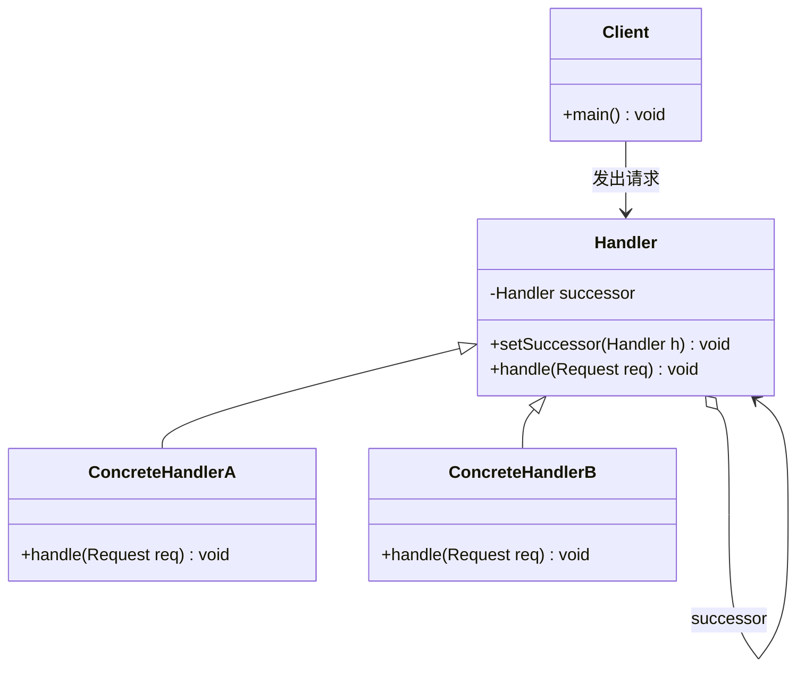
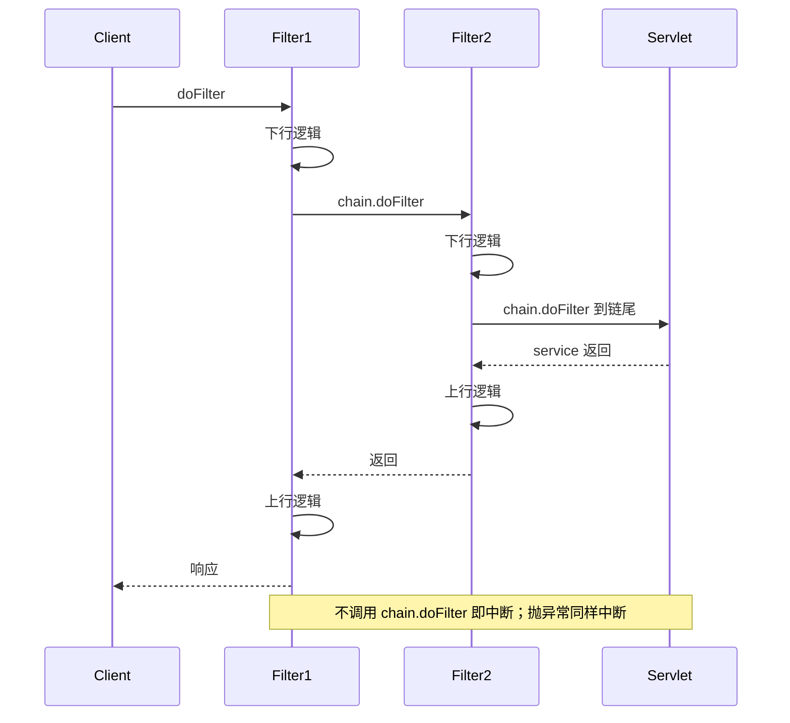

# 责任链模式（Chain of Responsibility）

> 一句话定位：**行为型模式里工程浓度最高的一个**——Servlet Filter、Spring MVC 拦截器、MyBatis 插件、Netty Pipeline、Sentinel SlotChain 全是它。考官真正想听的是「纯 vs 不纯」「`preHandle` 为什么逆序执行」「MyBatis 插件链是怎么用动态代理串起来的」。
> 分类：行为型（Behavioral） | 面试热度：★★★★★
> 版本前提：JDK 17

---

## 1. 是什么

**把请求的发送者和接收者解耦：让多个对象都有机会处理该请求，这些对象连成一条链，请求沿链传递，直到被某个对象处理为止。**

核心角色：

| 角色 | 职责 |
| --- | --- |
| Handler（抽象处理者） | 声明 `handle()`，持有 `successor` 引用指向后继 |
| ConcreteHandler（具体处理者） | 判断自己能否处理：能则处理，否则转发给 successor |
| Client | 组装链条并发出请求，不关心谁来处理 |



---

## 2. 解决什么问题

**没有它之前**：审批、鉴权、限流这类「一串关卡」逻辑，往往写成一个巨型 `if-else` 或层层嵌套的方法调用。加一关要改主干代码，违反开闭原则；关卡之间互相知道对方存在，耦合在调用链上；哪一关生效、哪一关被跳过全靠读代码。

**替代方案对比**：

| 维度 | 巨型 if-else / 硬编码流程 | 责任链 |
| --- | --- | --- |
| 增删关卡 | 改主干代码 | 改链的组装处（配置/SPI） |
| 关卡间耦合 | 彼此知道对方 | 只知 successor 接口，互不知晓 |
| 执行顺序 | 写死在代码里 | 由链的顺序决定，可动态调整 |
| 单测 | 只能整体测 | 每环可独立测 |

**关键取舍**：责任链用「运行时遍历」换掉「编译期硬编码」——灵活性的代价是**请求路径不再静态可见**，链条顺序由配置决定，配错了行为就变了，且调试时没法靠调用栈一眼看出会走哪几环。

---

## 3. 怎么写

### 3.1 经典写法（基于 successor 引用）

```java
public abstract class Handler {
    protected Handler successor;

    public Handler setSuccessor(Handler successor) {
        this.successor = successor;
        return successor; // 支持链式组装
    }

    public final void handle(Request req) {
        if (doHandle(req) && successor != null) {
            successor.handle(req);
        }
    }

    /** @return true 表示继续传递，false 表示中断 */
    protected abstract boolean doHandle(Request req);
}
```

### 3.2 生产级写法（Filter + Chain 接口，Servlet 风格）

现实中更常用的是「**把链本身抽象成对象**」，处理者不持 successor，而是持链，由链驱动游标——Servlet `FilterChain`、MyBatis `InterceptorChain` 都是这个风格：

```java
public interface Filter {
    void doFilter(Request req, Response resp, FilterChain chain);
}

public final class ApplicationFilterChain implements FilterChain {
    private final List<Filter> filters;
    private int pos = 0;

    public ApplicationFilterChain(List<Filter> filters) { this.filters = filters; }

    @Override
    public void doFilter(Request req, Response resp) {
        if (pos < filters.size()) {
            filters.get(pos++).doFilter(req, resp, this); // 把链本身传给下一环
        } else {
            // 链尾：执行真正的业务逻辑（Servlet.service）
            req.getTarget().service(req, resp);
        }
    }
}

// 典型 Filter：doFilter 之前是下行，之后是上行
public final class LoggingFilter implements Filter {
    @Override
    public void doFilter(Request req, Response resp, FilterChain chain) {
        long start = System.nanoTime();   // 下行阶段：请求进入时执行
        chain.doFilter(req, resp);        // 放行给下一环；不调用 = 中断
        long cost = System.nanoTime() - start; // 上行阶段：响应返回时执行
        log.info("{} cost {} ns", req.uri(), cost);
    }
}
```

**三种中断语义**（高频考点）：

1. 不调用 `chain.doFilter()` = **中断**，请求不再往下走（但已走过的环的上行代码仍会执行）。
2. 返回 `false`（Spring MVC `preHandle` 的语义）= 中断。
3. 抛异常 = 中断，且通常会跳过链上后续环节与部分上行逻辑。



---

## 4. 使用场景

| 场景 | 说明 |
| --- | --- |
| Web 请求预处理 | 编码、鉴权、日志、XSS 过滤——Servlet Filter 的标准用途 |
| 审批流 | 金额不同走不同级别审批人，逐级上抛 |
| 限流熔断 | Sentinel SlotChain 按固定顺序做统计、授权、系统保护、流控、降级 |
| RPC 调用链增强 | Dubbo Filter 做超时、重试、监控、上下文透传 |
| SQL 增强 | MyBatis 插件做分页、租户改写、加解密 |
| 事件处理 | Netty Pipeline 处理入站解码、业务、出站编码 |

**JDK / Spring / MyBatis / Netty / Sentinel 中的真实例子**：

- **Servlet `Filter` + `FilterChain`**：`doFilter(req, resp, chain)` 双向语义，`chain.doFilter()` 之前下行、之后上行；Tomcat 的实现类是 `ApplicationFilterChain`。
- **Spring MVC `HandlerInterceptor`**：`preHandle` → Controller → `postHandle` → `afterCompletion`。**执行顺序是高频追问**：多个拦截器的 `preHandle` 按**注册顺序**执行，`postHandle` 和 `afterCompletion` 按**逆序**执行（对称的栈式结构）；任一 `preHandle` 返回 `false` 直接中断，后续拦截器和 Controller 都不执行，但**已返回 true 的前置拦截器的 `afterCompletion` 仍会被触发**。源码在 `DispatcherServlet` 的 `mappedHandler.applyPreHandle` / `applyPostHandle` / `triggerAfterCompletion`。
- **MyBatis `Interceptor` + `Plugin`**：基于 **JDK 动态代理**拦截 `Executor` / `StatementHandler` / `ParameterHandler` / `ResultSetHandler` 四大对象的方法；用 `@Intercepts(@Signature(type=..., method=..., args=...))` 声明切点；`Plugin.wrap()` 生成代理，多个插件层层包裹形成代理链；`invocation.proceed()` 继续链路。**PageHelper 分页插件**就是这么拦截 `Executor.query` 改写 SQL 的。
- **Netty `ChannelPipeline`**：`ChannelHandler` 组成双向链表（`DefaultChannelPipeline` 内部是 `AbstractChannelHandlerContext` 双向链）。**Inbound 事件从头到尾传播，Outbound 事件从尾到头传播**；靠 `ChannelHandlerContext.fireChannelRead()` / `write()` 显式传递到下一个同方向处理器，不传就断。
- **Sentinel `SlotChain`**：`ProcessorSlotChain` 固定顺序为 `NodeSelectorSlot` → `ClusterBuilderSlot` → `LogSlot` → `StatisticSlot` → `AuthoritySlot` → `SystemSlot` → `FlowSlot` → `DegradeSlot`，由 `SlotChainBuilder` + SPI（`META-INF/services`）组装；任一 Slot 抛对应异常即中断。
- **Spring Security**：`FilterChainProxy` 委托给多个 `SecurityFilterChain`，每个链按 URL 匹配，链上挂着 `UsernamePasswordAuthenticationFilter` 等一串 Filter。
- **Dubbo `Filter`**：`ProtocolFilterWrapper` 在协议层用装饰器方式把一组 `Filter` 组装成链包裹真正的 invoker。

---

## 5. 生产中的问题与排查

| 问题 | 现象 | 排查 / 修复 |
| --- | --- | --- |
| 某环忘记调 `proceed()` / `doFilter()` | 请求**静默丢失**，无报错 | 这是最坑的故障形态。给链加「走到链尾必落地」的兜底日志；MyBatis 插件记得 `return invocation.proceed()` |
| 链的顺序依赖配置顺序 | 行为随注册顺序变化 | 把顺序显式化：Spring 用 `Ordered` / `@Order`，Dubbo Filter 用 `Activate.order`；关键顺序写进单测 |
| 链条过长 | 每次请求遍历开销大，且难定位是哪一环出问题 | 每环打印进入/退出链路日志（带 traceId）；对纯转发型链做采样耗时统计 |
| 异常导致上行逻辑被跳过 | 拦截器抛异常后 `afterCompletion` 没执行，资源未释放 | 弄清容器语义：Spring MVC 中 `postHandle` 只在正常返回时调用，异常时只走 `afterCompletion`（且只对已 `preHandle` 返回 true 的拦截器）；资源释放要放 `afterCompletion` 或 try-finally |
| 拦截器里做耗时操作 | `preHandle` 同步 RPC 拖慢全站 | 重操作异步化或挪到业务层；拦截器只做轻量判断 |
| 链上环之间传递共享对象被污染 | 后面的环读到被前面环改坏的数据 | 环间通信用不可变对象或显式拷贝；Netty 用 `ByteBuf` 引用计数管理生命周期 |
| Netty 中忘记 `fireChannelRead` | 消息在某 handler 里断掉 | 入站消息要么显式传播要么消费掉；注意 SimpleChannelInboundHandler 默认自动释放 msg |
| 动态组装的链出现环 | `handle()` 栈溢出 | 组装处校验：successor 不允许指回自身或祖先；链式 set 返回 `this` 时尤其容易写错 |

---

## 6. 面试问法

### 60 秒版本

> 责任链是行为型模式，把请求的发送者和接收者解耦，让多个处理者都有机会处理请求，处理者连成链，请求沿链传递直到被处理。它分**纯与不纯**两种：纯的责任链每环要么完全处理要么完全转发；现实中基本都是不纯的——比如 Servlet Filter，每环可以做一部分前置处理再调 `chain.doFilter()` 放行，`doFilter` 之前的代码在下行阶段执行、之后的在上行阶段执行。中断语义有三种：不调用放行方法、返回 false、抛异常。Spring MVC 拦截器是经典考点：`preHandle` 按注册顺序执行，`postHandle` 和 `afterCompletion` 按逆序执行，`preHandle` 返回 false 直接中断。MyBatis 插件链则是用 JDK 动态代理对 Executor 等四大对象层层包裹实现的，PageHelper 就是靠它做分页。另外 Netty Pipeline、Sentinel SlotChain、Dubbo Filter 链都是同一思想的变体。

### 5 分钟版本补充点

1. 两种结构形态：**successor 引用型**（处理者持后继）vs **链对象型**（`FilterChain` / `InterceptorChain` 持游标驱动），后者更主流
2. 与装饰器的核心区别：责任链的处理者**可中断传递**且彼此不知道对方，装饰器**必须继续调用**被包装者且强调层层增强叠加
3. Spring MVC 逆序的本质：`applyPostHandle` 是 `for (i = interceptors.length - 1; i >= 0; i--)` 倒序遍历，与 `preHandle` 构成栈式对称
4. MyBatis 插件的签名匹配：`@Signature` 里 `args` 必须与被拦截方法的参数类型完全一致，否则插件不生效——常见坑
5. Netty 双向链：Inbound 从头传播（`fireChannelRead`），Outbound 从尾传播（`write` 从 tail 往前找 outbound handler），两类 handler 在同一条链上按方向过滤
6. Sentinel 用 SPI 组装 SlotChain：每个 `ProcessorSlot` 有 `order`，`SlotChainBuilder` 排序后串成链

---

## 7. 追问链 · 参考答案

| 层级 | 问题 | 参考答案要点 |
| --- | --- | --- |
| L1 | 责任链模式是什么？ | 行为型模式。把请求发送者与接收者解耦，多个处理者连成链，请求沿链传递直到被处理。角色：Handler（持 successor）、ConcreteHandler、Client |
| L1 | 纯责任链和不纯责任链的区别？ | 纯：每环要么完全处理（终止）要么完全不处理（转发），请求必被某一环处理。不纯：一环可处理一部分再继续传递。现实中的拦截器链（Filter、Interceptor）几乎都是不纯的 |
| L2 | 责任链有哪几种中断方式？ | 三种：① 不调用放行方法（`chain.doFilter()` / `invocation.proceed()`）；② 返回 false（Spring MVC `preHandle` 语义）；③ 抛异常（Sentinel Slot 抛 `FlowException` 等）。异常中断会跳过链上后续环节 |
| L2 | Servlet Filter 的双向语义怎么理解？ | `chain.doFilter()` 之前的代码在**下行阶段**（请求进入）执行，之后的代码在**上行阶段**（响应返回）执行。不调用 `doFilter` 即中断，但已走过的环的上行代码仍会执行——典型的栈式嵌套调用 |
| L3 | Spring MVC 多个拦截器的执行顺序？ | `preHandle` 按**注册顺序**正序执行；`postHandle`、`afterCompletion` 按**逆序**执行（栈式对称）。源码：`DispatcherServlet` → `HandlerExecutionChain.applyPreHandle/applyPostHandle/triggerAfterCompletion`，后者是倒序 for 循环 |
| L3 | Spring MVC 拦截器 preHandle 返回 false 后会发生什么？ | 立即中断：后续拦截器、Controller、`postHandle` 都不执行；但**此前已返回 true 的拦截器的 `afterCompletion` 会被触发**（`triggerAfterCompletion` 从 `interceptorIndex` 倒序触发） |
| L3 | MyBatis 插件链是怎么实现的？ | 基于 JDK 动态代理：`Interceptor` 实现类用 `@Intercepts(@Signature(...))` 声明对 `Executor/StatementHandler/ParameterHandler/ResultSetHandler` 的切点；`Plugin.wrap()` 判断方法匹配后生成代理，多插件层层包裹；`invocation.proceed()` 继续链。PageHelper 分页就是拦截 `Executor.query` |
| L3 | Netty Pipeline 的事件是怎么传播的？ | `DefaultChannelPipeline` 内部是 `AbstractChannelHandlerContext` 双向链表。Inbound 事件从头到尾（`fireChannelRead` 找下一个 inbound handler），Outbound 从尾到头（`write` 往前找 outbound handler）。不显式调用传播方法事件就断 |
| L4 | 责任链和装饰器怎么区分？ | 结构相似但意图相反：装饰器**必须调用**被包装对象，强调层层增强叠加、客户端知道包装层次；责任链的处理者**可中断**传递，彼此不知道对方存在，是平级候选而非包裹关系 |
| L4 | 责任链和状态模式怎么区分？ | 责任链的处理者是**平级候选**，由「能否处理当前请求」决定谁接手，链的走向一次性；状态模式是**状态驱动切换**，对象在不同状态间转移，同一请求可能触发状态迁移后再次流转 |
| L5 | 责任链在生产中最大的坑是什么？ | 两个：① 某环忘记调用放行方法导致请求**静默丢失**，无异常无日志，只能靠链路日志（每环进入/退出 + traceId）排查；② 链的顺序由配置决定，配置错了行为就变了，需用 `Ordered`/SPI order 显式化并写单测固定顺序 |

---

## 8. 误区 · 正解

| ❌ 误区 | ✅ 正解 |
| --- | --- |
| 「责任链每一环都必须把请求处理完」 | 那是纯责任链。现实中的链几乎全是**不纯**的：一环做一部分处理再传给下一环，如 Filter 做日志后放行 |
| 「Filter 里不调用 `chain.doFilter()` 会报错」 | 不会报错，这是**合法的中断语义**——请求到此为止，常用于鉴权失败直接返回 401 |
| 「Spring MVC 拦截器的 postHandle 也按注册顺序执行」 | `preHandle` 按注册顺序，`postHandle` / `afterCompletion` 按**逆序**执行，构成栈式对称 |
| 「preHandle 返回 false 后所有拦截器的 afterCompletion 都不执行」 | **已返回 true 的前置拦截器**的 `afterCompletion` 仍会执行，只是后续拦截器和 Controller 被跳过 |
| 「MyBatis 插件是用 AOP 实现的」 | MyBatis 插件不走 Spring AOP，是**自己的 JDK 动态代理机制**：`Plugin.wrap()` + `Invocation.proceed()`，只代理四大接口 |
| 「Netty 的 Inbound 和 Outbound 是两条链」 | 是**同一条双向链表**，只是事件传播方向相反：Inbound 从头到尾，Outbound 从尾到头 |
| 「责任链处理者之间需要知道彼此」 | 处理者只知道 successor 或链对象这个**抽象**，不知道具体后继是谁，这正是解耦的意义所在 |
| 「链条越长越灵活，可以随便加」 | 链过长带来遍历开销和定位困难；每环都应有日志与耗时观测，顺序要显式配置并测试固化 |

---

## 9. 相关模式

| 模式 | 关系 |
| --- | --- |
| 装饰器（Decorator） | 结构相似（层层包裹），但装饰器必须继续调用且强调增强叠加；责任链可中断且处理者互不知晓 |
| 命令（Command） | 命令把请求封装成对象；责任链决定**谁来处理**这个对象，常组合使用 |
| 状态（State） | 责任链是平级候选者按「能否处理」接手；状态模式是同一对象在状态间迁移 |
| 组合（Composite） | 责任链常与组合搭配：叶子节点先尝试处理，处理不了上抛父节点 |
| 观察者（Observer） | 观察者是**广播**给所有订阅者；责任链是**单播**沿链传递直到被消费 |

---

## 10. 我的薄弱点

（学完后自己填，同步到 `weakness.md`）
