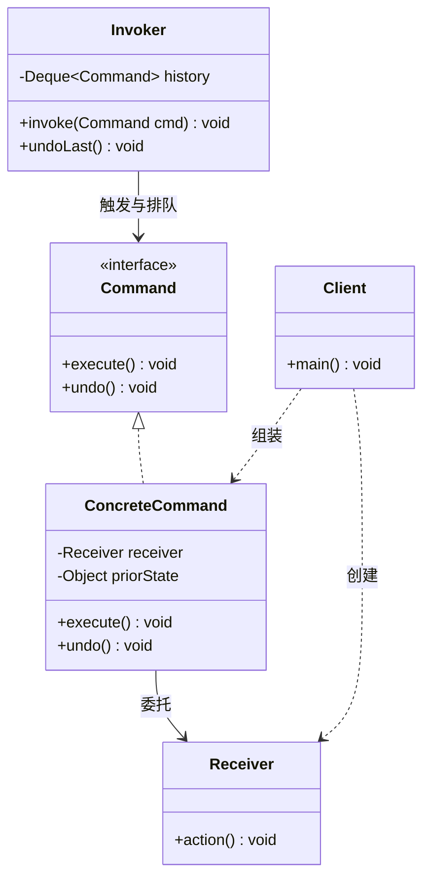
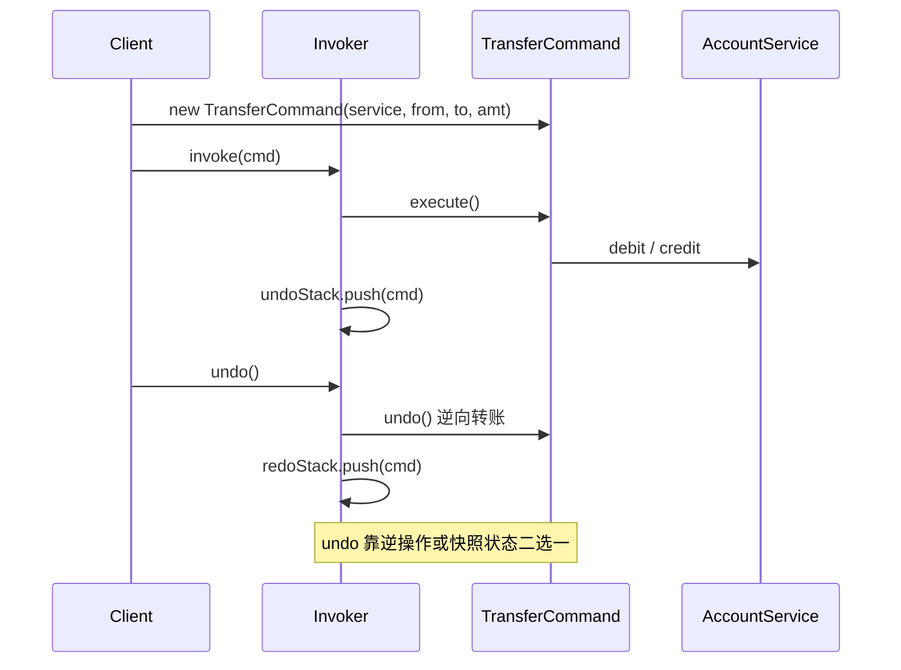

# 命令模式（Command）

> 一句话定位：**把「请求」变成对象**——考点不在封装本身，而在对象化之后能做的三件事：排队/异步、日志重放、撤销重做。`Runnable` 就是最朴素的命令，线程池队列、数据库 redo/undo log 是它的工程投影。
> 分类：行为型（Behavioral） | 面试热度：★★★☆☆
> 版本前提：JDK 17

---

## 1. 是什么

**把一个请求封装成一个对象，从而使你可用不同的请求对客户进行参数化；对请求排队、记录日志，以及支持可撤销的操作。**

核心角色：

| 角色 | 职责 |
| --- | --- |
| Command | 声明 `execute()`（可带 `undo()`） |
| ConcreteCommand | 持 Receiver 引用，`execute()` 里委托给 Receiver |
| Invoker | 触发命令，不关心命令具体做什么 |
| Receiver | 真正干活的业务对象 |
| Client | 组装：创建 ConcreteCommand 并绑定 Receiver，交给 Invoker |



---

## 2. 解决什么问题

**没有它之前**：调用方直接 `receiver.action()`，请求是一段即时执行的代码——**没法排队**（想异步就得包一层匿名 Runnable）、**没法记录**（执行完就消失，崩溃无法恢复）、**没法撤销**（做了就做了，没有反向操作）。

命令模式的价值不是「封装」（那是所有模式都有的副产品），而是**请求对象化之后获得的三项能力**：

| 能力 | 说明 | 工程投影 |
| --- | --- | --- |
| 排队 / 异步执行 | 命令是对象，可放进队列，由别的线程按序消费 | 线程池 `BlockingQueue<Runnable>`、MQ 消息 |
| 日志与重放 | 命令可序列化落盘，崩溃后按日志重放恢复状态 | 数据库 redo log、事件溯源（Event Sourcing） |
| 撤销 / 重做 | 命令对象保存执行前状态或逆操作，支持 `undo()` | 编辑器撤销栈、数据库 undo log |

**为什么不直接用回调 / lambda**：lambda 本质上就是一个匿名命令（`Runnable`/`Callable` 正是这么用的），但匿名命令**没有名字、没有状态、没有 `undo()`**，当需要排队持久化、撤销语义、宏命令组合时就必须显式建模成类。

---

## 3. 怎么写

生产级示例：带撤销能力的账户转账命令 + 支持宏命令与重做的 Invoker。

```java
public interface Command {
    void execute();
    void undo();
}

// Receiver：真正干活的账户服务
public final class AccountService {
    public void debit(String accountId, long cents) { /* 扣款 */ }
    public void credit(String accountId, long cents) { /* 入账 */ }
}

// ConcreteCommand：持 Receiver 引用 + 执行所需的全部参数（撤销靠逆操作）
public final class TransferCommand implements Command {
    private final AccountService service;
    private final String from, to;
    private final long cents;

    public TransferCommand(AccountService service, String from, String to, long cents) {
        this.service = service; this.from = from; this.to = to; this.cents = cents;
    }

    @Override public void execute() {
        service.debit(from, cents);
        service.credit(to, cents);
    }

    @Override public void undo() {   // 撤销 = 执行逆向转账
        service.debit(to, cents);
        service.credit(from, cents);
    }
}

// Invoker：执行 + 撤销栈 + 重做栈
public final class CommandInvoker {
    private final Deque<Command> undoStack = new ArrayDeque<>();
    private final Deque<Command> redoStack = new ArrayDeque<>();

    public void invoke(Command cmd) {
        cmd.execute();
        undoStack.push(cmd);
        redoStack.clear();          // 新命令使重做历史失效
    }

    public void undo() {
        if (!undoStack.isEmpty()) {
            Command cmd = undoStack.pop();
            cmd.undo();
            redoStack.push(cmd);
        }
    }

    public void redo() {
        if (!redoStack.isEmpty()) {
            Command cmd = redoStack.pop();
            cmd.execute();
            undoStack.push(cmd);
        }
    }
}
```

**宏命令（MacroCommand）**：Command 里装一组 Command，是命令 + 组合模式的结合——`execute()` 顺序执行子命令，`undo()` **逆序**撤销子命令（栈式对称，与拦截器逆序同理）。



---

## 4. 使用场景

| 场景 | 说明 |
| --- | --- |
| 异步任务提交 | 任务对象化后丢进队列/线程池，调用方与执行方解耦 |
| 撤销 / 重做 | 编辑器、表单工具，命令栈天然支持 undo/redo |
| 操作日志与重放 | 命令持久化后按序重放恢复状态（事件溯源、WAL） |
| 事务式操作 | 一组命令要么全做要么全撤销（宏命令 + undo） |
| 菜单 / 按钮回调 | GUI 中把「点击」与「业务动作」解耦，可热替换绑定 |
| 远程调用参数化 | 请求对象化后可序列化跨网络传输（RPC、MQ 消息） |

**JDK / 框架中的真实例子**：

- **`java.lang.Runnable` 是最朴素的命令**：把一段任务对象化交给 `Thread` / `ExecutorService` 执行——请求的排队与异步化就是这么来的。
- **`Callable` + `Future`**：带返回值的命令，`ExecutorService.submit()` 返回 `Future`，还能 `cancel()`——命令的取消语义。
- **线程池的 `BlockingQueue<Runnable>`**：就是命令队列；**拒绝策略**（`AbortPolicy` 等 4 种）是「命令无处安放时的处理」。
- **Swing**：`javax.swing.Action`（`actionPerformed`）是标准命令；`javax.swing.undo.UndoManager` 管理 `UndoableEdit` 命令栈实现撤销重做。
- **数据库 undo log / redo log**：最贴近工程的类比——redo log 是命令日志用于崩溃后**重放**，undo log 是命令的逆操作日志用于**回滚**。
- **MQ 消息**：一条消息可看作持久化的命令，消费者是 Receiver，重试与死信是命令的再调度。
- **Redis**：客户端把请求封装成 `RedisCommand` 对象再 `call()` 下发；服务端同样把每条命令分发给对应实现函数。

---

## 5. 生产中的问题与排查

| 问题 | 现象 | 排查 / 修复 |
| --- | --- | --- |
| 命令类数量膨胀 | 每个操作一个类，包下几百个小类 | 简单场景直接用 lambda + `Runnable`；只有需要 undo/日志/排队的命令才建显式类；同类命令合并成参数化的一个类 |
| undo 状态开销大 | 撤销需要保存执行前快照，内存/存储翻倍 | 优先用**逆操作**而非全量快照；必须快照时做增量（Memento）或写时复制 |
| 命令对象持有 Receiver 导致泄漏 | 命令进队列长期不消费，Receiver 无法 GC | 队列有界 + 拒绝策略；命令持 ID 而非对象引用，执行时再查 Receiver |
| 命令执行一半失败 | 宏命令前几个成功、中间失败，状态不一致 | 宏命令失败时逆序 undo 已执行子命令； undo 本身也可能失败，需补偿日志 |
| 命令队列积压 | 生产者快消费者慢，OOM | 有界队列 + 背压；监控队列水位；拒绝策略上报告警 |
| 异步命令顺序错乱 | 同账户的两条命令被并发执行，余额错误 | 按业务 key 分片到固定队列/线程（如 Disruptor、actor），保证同 key 串行 |
| 命令重放产生副作用 | 重放日志时重复发短信、扣款 | 命令分「纯查询」与「副作用命令」，重放只重建内部状态；副作用命令加幂等键 |

---

## 6. 面试问法

### 60 秒版本

> 命令模式是行为型模式，把一个请求封装成对象，角色有 Command、ConcreteCommand（持 Receiver）、Invoker、Receiver 和 Client。它的核心价值不是封装，而是请求对象化之后能做的三件事：第一是**排队和异步执行**，命令放进队列由别的线程消费，`Runnable` 加线程池就是最朴素的例子；第二是**日志和重放**，命令可持久化，崩溃后按日志恢复，数据库 redo log 就是这个思想；第三是**撤销重做**，命令里存逆操作或执行前状态，undo log 和编辑器的撤销栈都是。命令还能组合成宏命令，undo 时逆序撤销。和策略模式的区别在于：策略关注换算法，是同一目的的多种实现；命令关注把请求本身变成对象，以便排队、日志、撤销。实际项目里线程池的 Runnable 队列、MQ 消息、Swing 的 UndoManager 都是命令模式的体现。

### 5 分钟版本补充点

1. undo 的两种实现：**逆操作**（如转账的反向转账，省内存）vs **状态快照**（执行前存 Memento，通用但开销大）
2. 宏命令 = 命令 + 组合模式，`undo()` 必须**逆序**撤销子命令，否则依赖关系被破坏
3. `Runnable` 是退化命令（只有 execute），`Callable` 加了返回值，`Future.cancel()` 是命令的取消语义
4. 线程池拒绝策略（Abort/CallerRuns/Discard/DiscardOldest）本质是「命令队列满时的处置策略」
5. 事件溯源（Event Sourcing）是命令模式的架构级应用：状态不直接存，存命令序列，重放得当前状态
6. 命令对象宜持**参数与 ID** 而非 Receiver 强引用，避免队列积压时拖累 GC、跨 JVM 传输时无法序列化

---

## 7. 追问链 · 参考答案

| 层级 | 问题 | 参考答案要点 |
| --- | --- | --- |
| L1 | 命令模式是什么？ | 行为型模式。把请求封装成对象，使调用方可用不同请求参数化，并支持排队、日志、撤销。角色：Command/ConcreteCommand/Invoker/Receiver/Client |
| L1 | 命令模式有哪几个角色？ | Command 声明 `execute()`；ConcreteCommand 持 Receiver 并委托；Invoker 触发命令不关心细节；Receiver 真正执行；Client 负责组装命令与 Receiver 的绑定 |
| L2 | 命令模式真正的价值是什么？ | 不是封装，而是请求**对象化**后获得的三项能力：① 排队/异步执行；② 日志记录与重放（崩溃恢复）；③ 撤销/重做（存逆操作或快照）。没有对象化这三件事都做不了 |
| L2 | 撤销（undo）怎么实现？ | 两条路：① **逆操作**——execute 的反向操作，如转账撤销即反向转账，省内存但不是所有操作都有逆操作；② **状态快照**——execute 前保存 Receiver 状态（Memento），undo 时恢复，通用但内存/存储开销大 |
| L3 | 宏命令的 undo 为什么要逆序？ | 宏命令是命令 + 组合。子命令之间常有依赖（先建表后插数据），正序撤销会先撤掉被依赖的一方导致失败。逆序撤销是栈式对称，保证每一步撤销时系统仍处于合法状态 |
| L3 | 线程池和命令模式什么关系？ | `Runnable`/`Callable` 就是命令接口；`ExecutorService` 是 Invoker；`BlockingQueue<Runnable>` 是命令队列；`Future` 提供命令的异步结果与取消（`cancel`）；四种拒绝策略是队列满时的命令处置。线程池 = 命令模式 + 消费者池 |
| L4 | 命令模式和策略模式怎么区分？ | UML 相似（都把行为对象化），意图不同：策略关注「**换算法**」——同一目的的多种实现，由客户端主动选择；命令关注「**把请求变成对象**」——目的是排队、日志、撤销，Invoker 不需要知道命令内容。策略通常无状态，命令常携带参数与状态 |
| L4 | 命令模式和备忘录模式什么关系？ | 备忘录常作为命令 undo 的**支撑**：命令 execute 前让 Receiver 创建 Memento 存入命令对象，undo 时用快照恢复。备忘录管状态保存，命令管操作封装，两者组合实现可撤销系统 |
| L5 | 数据库日志和命令模式有什么关系？ | redo log 是**命令日志**：记录「做了什么修改」，崩溃后重放恢复，对应命令的持久化与重放；undo log 是**逆操作日志**：记录「怎么改回去」，事务回滚时执行，对应命令的 undo。WAL（先写日志再改数据）保证命令先持久化再执行 |
| L5 | 命令模式在工程上有哪些坑？ | ① 命令类膨胀——每个操作一个类，简单场景用 lambda；② undo 快照开销大——优先逆操作；③ 命令持 Receiver 强引用导致内存泄漏或生命周期错乱——改持 ID；④ 异步命令顺序错乱——按业务 key 串行化 |

---

## 8. 误区 · 正解

| ❌ 误区 | ✅ 正解 |
| --- | --- |
| 「命令模式就是把方法包成类，没什么用」 | 价值在对象化后的能力：排队/异步、日志重放、撤销重做。只做一层包装而不利用这三点，才是过度设计 |
| 「命令模式和策略模式是一回事」 | UML 相似但意图相反：策略是「同一目的的多种算法，选哪个」；命令是「把请求对象化，以便排队、日志、撤销」，Invoker 不关心命令内容 |
| 「undo 就是把数据库回滚一下」 | undo 是命令层语义：靠**逆操作**或**执行前快照**实现。DB 回滚只是 undo log 这一种投影；内存命令的 undo 与数据库无关 |
| 「宏命令撤销时按执行顺序撤销即可」 | 必须**逆序**撤销。子命令间有依赖关系，正序撤销会破坏中间状态，与拦截器 afterCompletion 逆序同理 |
| 「`Runnable` 不算命令模式，太简单了」 | `Runnable` 正是最朴素的命令：把任务对象化交给 Invoker（线程/线程池）排队异步执行。简单不代表不是 |
| 「命令必须持有 Receiver 对象」 | 更稳妥的做法是持 **Receiver 的 ID + 参数**，执行时解析。强引用会导致队列积压时 Receiver 无法 GC，也无法跨 JVM 序列化 |
| 「命令模式适合所有异步场景」 | 只有需要排队语义、持久化、撤销时才值得显式建命令类；普通异步一个 lambda 就够，过度建模只会让类爆炸 |

---

## 9. 相关模式

| 模式 | 关系 |
| --- | --- |
| 策略（Strategy） | UML 相似、意图相反：策略换算法，命令把请求对象化以支持排队/日志/撤销 |
| 组合（Composite） | 宏命令 = 命令 + 组合，undo 逆序执行 |
| 备忘录（Memento） | 命令 undo 的常用支撑：execute 前保存快照，undo 时恢复 |
| 责任链（CoR） | 命令封装请求，责任链决定谁来处理；常组合使用 |
| 观察者（Observer） | 观察者是事件广播；命令是请求的显式封装与延迟执行 |
| 原型（Prototype） | 命令对象需要重复执行时可 clone 出副本，避免共享可变状态 |

---

## 10. 我的薄弱点

（学完后自己填，同步到 `weakness.md`）
