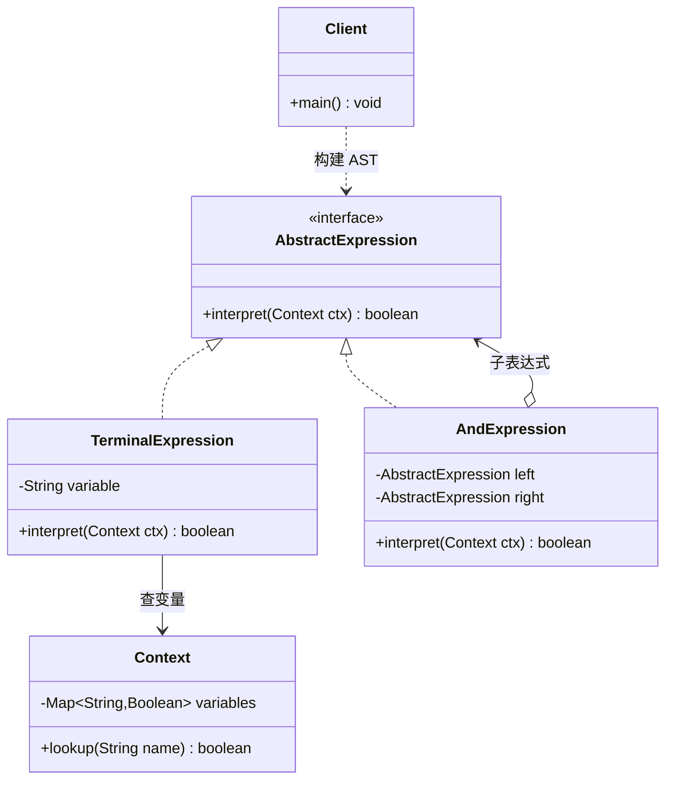
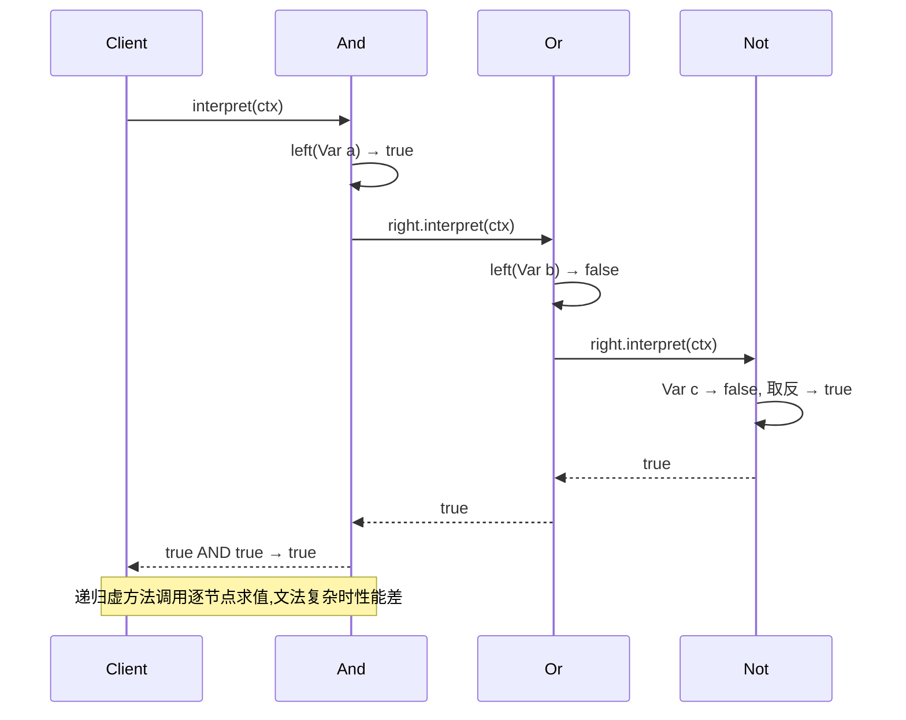

# 解释器模式（Interpreter）

> 一句话定位：**热度最低但「缺点」最值钱的模式**。考官真正想听的不是 AST 怎么画，而是「为什么现实项目没人用它」——类膨胀、递归解释性能差，复杂文法应该上 ANTLR 或表达式引擎（SpEL/Aviator）。
> 分类：行为型（Behavioral） | 面试热度：★☆☆☆☆
> 版本前提：JDK 17

---

## 1. 是什么

**给定一个语言，定义它的文法的一种表示，并定义一个解释器，使用该表示来解释语言中的句子。**

核心角色：

| 角色 | 职责 |
| --- | --- |
| AbstractExpression | 声明 `interpret(Context)` 抽象操作 |
| TerminalExpression | 终结符表达式：文法中最小单元（字面量、变量），不可再分 |
| NonterminalExpression | 非终结符表达式：含子表达式（如 `AND` 左右各一个表达式），递归解释 |
| Context | 解释所需的全局信息（变量表、输入字符串位置等） |
| Client | 构建**抽象语法树（AST）**并调用根节点的 `interpret()` |



**与组合模式的关系**：非终结符含子表达式，AST 天然是树——**解释器 = 组合模式 + 解释操作**。树的每个节点是同一接口，差异只在 `interpret()` 的实现。

---

## 2. 解决什么问题

**没有它之前**：解析 `a AND (b OR NOT c)` 这类小语言，要么写一堆硬编码的 `String.split` + `if-else`（加一个运算符就要重写解析逻辑），要么直接上编译原理（词法分析、语法分析器），杀鸡用牛刀。

解释器模式给的方案是：**每条文法规则对应一个类**，句子解析成 AST，递归调 `interpret()` 求值。加一条规则 = 加一个类，符合开闭原则。

**关键取舍（本题真正的考点）**：

| 方案 | 适用文法 | 代价 |
| --- | --- | --- |
| 硬编码解析 | 一两种固定格式 | 不可扩展，规则一变就重写 |
| **GoF 解释器** | **小而简单**的文法（几个终结符 + 几个组合规则） | 每条规则一个类 → 类膨胀；递归解释性能差 |
| 解析器生成器（ANTLR、JavaCC） | 复杂文法（SQL、DSL） | 学习成本，但生成高效解析器 |
| 表达式引擎（SpEL、MVEL、Aviator、QLExpress） | 运行时表达式求值 | 引入三方依赖，换取性能与功能 |

**缺点必须讲透**：
1. **类膨胀**：每条文法规则对应一个类，文法一复杂，类数量爆炸、无法维护。
2. **性能差**：`interpret()` 是递归虚方法调用，逐节点解释执行，比编译成字节码/机器码慢一个数量级以上。
3. 结论：**只适合小而简单的文法**。复杂场景用 ANTLR 生成解析器，或直接用成熟的表达式引擎。

---

## 3. 怎么写

极简示例：布尔表达式 `a AND (b OR NOT c)`，Client 手工构建 AST（真实场景会先有 parser 把字符串转成树，这里聚焦解释部分）：

```java
public interface Expr {
    boolean interpret(Map<String, Boolean> ctx);
}

// 终结符：变量
public record Var(String name) implements Expr {
    @Override public boolean interpret(Map<String, Boolean> ctx) {
        return ctx.getOrDefault(name, false);
    }
}

// 终结符：字面量
public record Lit(boolean value) implements Expr {
    @Override public boolean interpret(Map<String, Boolean> ctx) { return value; }
}

// 非终结符：AND / OR / NOT
public record And(Expr left, Expr right) implements Expr {
    @Override public boolean interpret(Map<String, Boolean> ctx) {
        return left.interpret(ctx) && right.interpret(ctx);
    }
}
public record Or(Expr left, Expr right) implements Expr {
    @Override public boolean interpret(Map<String, Boolean> ctx) {
        return left.interpret(ctx) || right.interpret(ctx);
    }
}
public record Not(Expr inner) implements Expr {
    @Override public boolean interpret(Map<String, Boolean> ctx) {
        return !inner.interpret(ctx);
    }
}

// Client：构建 AST 并求值 → a AND (b OR NOT c)
Expr ast = new And(new Var("a"), new Or(new Var("b"), new Not(new Var("c"))));
boolean result = ast.interpret(Map.of("a", true, "b", false, "c", false)); // true
```



---

## 4. 使用场景

| 场景 | 说明 |
| --- | --- |
| 小而稳定的 DSL | 告警规则（`cpu > 80 AND mem > 90`）、路由匹配规则 |
| 简单布尔/算术表达式求值 | 风控规则、权限表达式 |
| 模式字符串解析 | 日期格式、glob 路径匹配 |
| 教学/演示 AST 概念 | 理解组合模式 + 递归求值的经典教具 |

**JDK / Spring / MyBatis 中的真实例子**：

- **`java.util.regex.Pattern` / `Matcher`**：正则就是一套小文法，`Pattern.compile()` 内部把模式串编译成 `Node` 树（`Pattern$Node` 及其几十个子类），匹配时按树执行——思想与解释器一致，但已高度优化。
- **SpEL**（Spring Expression Language）：`SpelExpressionParser.parseExpression()` 生成 `SpelExpression`（内部是 `SpelNodeImpl` 树），`getValue()` 解释求值。用在 `@Value("#{...}")`、`@Cacheable(key = "...")`、Spring Security 的 `@PreAuthorize`。
- **OGNL / `javax.el`**：MyBatis 动态 SQL 的 `<if test="...">` 走 OGNL（`ExpressionEvaluator` / `OgnlCache`，3.5 起逐步替换为自有解析）；JSP EL、Struts 也基于 OGNL/EL。
- **`java.time.format.DateTimeFormatter`**：`ofPattern("yyyy-MM-dd")` 把模式字符串解析成内部结构再格式化/解析。
- **`java.nio.file.PathMatcher`**：`FileSystem.getPathMatcher("glob:*.java")`，glob 语法是一套小文法。
- **SQL 解析要辨析**：Druid `SQLParser`、JSqlParser、ShardingSphere 的 SQL 解析**不是** GoF 解释器——它们是真正的词法+语法解析器（手写递归下降或生成器产出），产出 AST 后走访问者模式处理。GoF 解释器扛不住 SQL 这种规模的文法。

---

## 5. 生产中的问题与排查

| 问题 | 现象 | 排查 / 修复 |
| --- | --- | --- |
| 把解释器当通用解析器用 | 文法加到几十条规则后类爆炸、没人敢动 | 及时切换到 ANTLR/JavaCC 生成解析器，或换 SpEL/Aviator/QLExpress |
| 递归 `interpret()` 爆栈 | 深层嵌套表达式 `StackOverflowError` | 限制表达式深度；改迭代式求值（显式栈）；复杂场景换编译型引擎（Aviator 编译成字节码） |
| 解释执行性能差 | 高频求值成为热点 | 缓存编译产物（SpEL 的 `compiledExpression`、正则 `Pattern.compile()` 结果复用）；热点表达式预编译 |
| Context 变成上帝类 | 变量、函数、配置全塞 Context，谁都能改 | Context 只放解释必需的只读信息；函数注册表与变量表分离 |
| 每次请求都重新解析表达式 | 同样的字符串重复 parse，CPU 浪费 | 解析结果（AST）按表达式字符串做缓存（如 `OgnlCache`、`ExpressionParser` 内部缓存） |
| 表达式注入 | 用户输入直接拼进 SpEL/OGNL 执行，RCE 风险 | 永远不要执行用户可控的完整表达式；用 SimpleEvaluationContext 限制能力（SpEL 的 `SimpleEvaluationContext` 关闭类型引用与方法调用） |
| 线程安全问题 | 多线程共享同一个 AST/Expression 求值 | SpEL 的 `SpelExpression` 求值线程安全（解释模式），但自定义节点若持可变状态需自行同步 |

---

## 6. 面试问法

### 60 秒版本

> 解释器模式是行为型模式，给定一个语言，定义文法的表示并定义解释器来解释句子。每条文法规则对应一个类：终结符表达式是叶子，非终结符表达式含子表达式，Client 把句子构建成 AST 后递归调用 interpret 求值——所以它本质上是组合模式加解释操作。它的缺点非常明确：一是类膨胀，每条规则一个类，文法复杂后无法维护；二是递归解释执行性能差，比编译执行慢一个数量级。所以真实工程里它只适合小而简单的文法，复杂场景应该用 ANTLR 这类解析器生成器，或者直接用 SpEL、Aviator、QLExpress 这样的表达式引擎。JDK 里的例子有正则 Pattern（内部编译成 Node 树）、DateTimeFormatter、PathMatcher 的 glob；Spring 里 SpEL 支撑了 `@Value("#{}")` 和 `@Cacheable` 的 key 表达式；MyBatis 动态 SQL 用的是 OGNL。注意 SQL 解析器如 Druid 不是 GoF 解释器，那是真正的词法语法分析。

### 5 分钟版本补充点

1. 解释器 = 组合模式 + 解释操作：非终结符含子表达式，AST 天然是树
2. 正则 `Pattern.compile()` 的内部结构就是解释器思想的优化版：模式串编译成 `Node` 树后匹配
3. SpEL 的性能优化：`SpelExpression` 支持编译成字节码（`SpelCompiler`），首次解释执行、计数阈值后编译，解决递归解释慢的问题
4. 安全边界：表达式引擎必须区分「可信模板」与「用户输入」，SpEL 提供 `SimpleEvaluationContext` 做能力裁剪
5. 解释器与访问者的分工：解释器把操作（interpret）散在各节点类里，加操作要改所有节点；访问者把操作抽出来，加操作只加一个访问者——表达式场景经常两者结合
6. 选型口诀：文法 ≤ 10 条规则且稳定 → 可以手写解释器；否则 → ANTLR / 表达式引擎

---

## 7. 追问链 · 参考答案

| 层级 | 问题 | 参考答案要点 |
| --- | --- | --- |
| L1 | 解释器模式是什么？ | 行为型模式。给定一个语言，定义其文法的表示和解释器来解释句子。每条文法规则一个类：TerminalExpression 是终结符，NonterminalExpression 含子表达式，Client 构建 AST 后调根节点 `interpret(Context)` 递归求值 |
| L1 | 解释器有哪些角色？ | AbstractExpression（声明 interpret）、TerminalExpression（终结符）、NonterminalExpression（非终结符，含子表达式）、Context（全局信息如变量表）、Client（构建 AST） |
| L2 | 解释器和组合模式什么关系？ | 解释器 = 组合模式 + 解释操作。非终结符含子表达式，AST 天然是树结构；组合模式解决「树形结构的统一访问」，解释器在这棵树上加 `interpret()` 递归求值语义 |
| L2 | 解释器模式最大的缺点是什么？ | 两个：① **类膨胀**——每条文法规则对应一个类，文法复杂后类数量爆炸无法维护；② **性能差**——递归虚方法调用逐节点解释，比编译执行慢一个数量级。所以它只适合小而简单的文法 |
| L3 | 正则表达式和解释器模式什么关系？ | `Pattern.compile(regex)` 把模式串解析并编译成内部的 `Node` 树（`Pattern$Node` 几十个子类：Char、Group、Branch、Loop 等），`Matcher` 匹配时沿 Node 链执行。思想与解释器一致，但做了大量优化（如 Boyer-Moore 加速），不是教科书式的递归 interpret |
| L3 | SpEL 是怎么求值的，性能问题怎么解决？ | `SpelExpressionParser` 把字符串解析成 `SpelNodeImpl` 树，包成 `SpelExpression`，`getValue()` 递归解释求值。性能优化：Spring 4.1 起 `SpelCompiler` 可把表达式编译成字节码（默认解释执行，计数超阈值后触发编译，混合模式 `MIXED`） |
| L3 | MyBatis 动态 SQL 的 test 表达式是谁解析的？ | 3.x 主要走 OGNL：`OgnlCache.getValue(expression, parameterObject)`，表达式字符串有缓存；新版本（3.5+）逐步替换为 MyBatis 自有的 `ExpressionEvaluator` 解析器，减少 OGNL 依赖与安全问题 |
| L4 | SQL 解析器（Druid/JSqlParser）是解释器模式吗？ | 不是。它们是真正的编译器前端：词法分析（Lexer）+ 语法分析（递归下降 Parser），产出 AST 后用**访问者模式**遍历处理。SQL 文法几百条规则，用 GoF 解释器会类爆炸且性能不可接受——这正印证了解释器「只适合小文法」的结论 |
| L4 | 解释器和访问者模式怎么配合？ | 解释器把操作散在各节点类的 `interpret()` 里，加新操作（如类型检查、优化、代码生成）要改所有节点类；访问者把操作抽离到 Visitor，节点只留 `accept()`。表达式系统常两者结合：AST 结构用组合，求值/优化用访问者 |
| L5 | 线上要支持用户配置的规则表达式，怎么选型？ | 文法小且可信（内部运维）→ 手写解释器或 SpEL；需要高性能 → Aviator/QLExpress（编译成字节码）；有注入风险（用户输入）→ SpEL 用 `SimpleEvaluationContext` 关闭类型引用，或 Aviator 沙箱；文法复杂 → ANTLR 生成解析器 |

---

## 8. 误区 · 正解

| ❌ 误区 | ✅ 正解 |
| --- | --- |
| 「解释器模式可以用来解析 SQL」 | 不能。SQL 文法几百条规则，解释器会类爆炸。Druid/JSqlParser 是词法+语法分析器配访问者模式，与 GoF 解释器不是一回事 |
| 「解释器模式很实用，项目里应该常用」 | 恰恰相反，它是 GoF 里使用率最低的模式之一。只适合小而稳定的文法；真实需求大多直接用 SpEL/Aviator 或 ANTLR |
| 「正则 Pattern 就是教科书解释器」 | 思想相通（模式串→Node 树→解释执行），但 `Pattern` 内部做了编译优化和匹配算法加速，是高度工程化的变体，不是递归 interpret 的教科书实现 |
| 「解释器模式的性能问题可以忽略」 | 不能。递归虚方法调用逐节点解释，比编译成字节码慢一个数量级；高频场景必须缓存 AST 或编译（SpEL 的 `SpelCompiler`、Aviator 的字节码生成） |
| 「Context 就是个大 Map，随便塞」 | Context 应只放解释必需的只读信息（变量表）。塞进函数、配置、IO 资源会变成上帝类，且带来线程安全问题 |
| 「用户输入的表达式直接交给 SpEL 执行没问题」 | 高危。SpEL 默认上下文支持类型引用和方法调用，存在表达式注入（RCE）风险。用户可控输入必须用 `SimpleEvaluationContext` 裁剪能力 |
| 「嵌套表达式递归求值没有代价」 | 深层嵌套会 `StackOverflowError`。需要限制深度、改迭代式求值，或换编译型表达式引擎 |

---

## 9. 相关模式

| 模式 | 关系 |
| --- | --- |
| 组合（Composite） | 解释器 = 组合 + 解释操作，AST 就是组合结构 |
| 访问者（Visitor） | 访问者把「对 AST 的操作」抽离出来，常与解释器互补：结构用组合，求值/优化用访问者 |
| 享元（Flyweight） | 终结符（如变量、字面量）可共享为享元，减少 AST 节点数 |
| 迭代器（Iterator） | 遍历 AST（前序/后序）时用迭代器 |
| 备忘录（Memento） | Context 状态需要保存/恢复时可用备忘录 |
| 策略（Strategy） | 不同求值策略（解释执行 vs 编译执行）可用策略切换，如 SpEL 的 MIXED 模式 |

---

## 10. 我的薄弱点

（学完后自己填，同步到 `weakness.md`）
