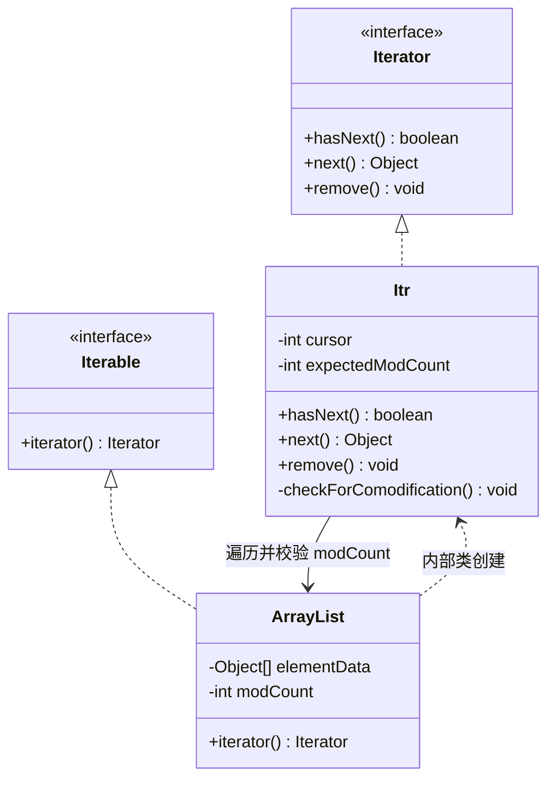
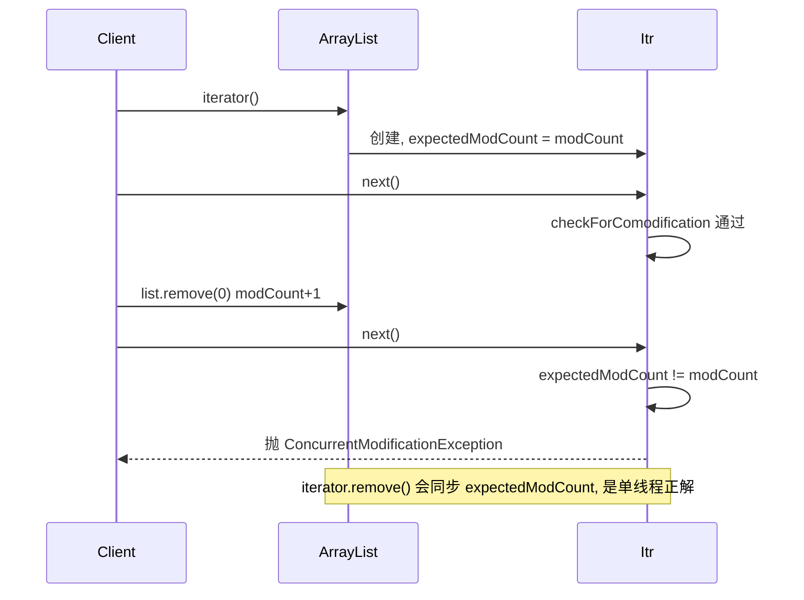

# 迭代器模式（Iterator）

> 一句话定位：**模式本身人人会用，考点全在 fail-fast**。考官真正想听的是 `modCount` 机制、「结构性修改」的精确定义、CME 为什么不能当并发控制用、以及 `CopyOnWriteArrayList` 快照迭代器的取舍。
> 分类：行为型（Behavioral） | 面试热度：★★★☆☆
> 版本前提：JDK 17

---

## 1. 是什么

**提供一种方法顺序访问一个聚合对象中的各个元素，而又不暴露该对象的内部表示。**

核心角色：

| 角色 | 职责 |
| --- | --- |
| Iterator | 声明 `hasNext()` / `next()` / `remove()` |
| ConcreteIterator | 持聚合引用与游标，实现遍历与 fail-fast 检测 |
| Aggregate | 声明 `iterator()` 工厂方法（Java 中是 `Iterable`） |
| ConcreteAggregate | 返回自己的迭代器（通常是内部类，如 `ArrayList$Itr`） |



---

## 2. 解决什么问题

**没有它之前**：遍历一个集合需要知道它的内部结构——数组用下标、链表用指针、树用递归。客户端代码与聚合的内部表示**强耦合**，集合换一种实现，所有遍历代码都要改；而且同一个集合想支持多种遍历方式（正序/逆序/过滤）时，这些逻辑全塞进集合类里。

**外部迭代 vs 内部迭代**（必考点）：

| 维度 | 外部迭代 | 内部迭代 |
| --- | --- | --- |
| 驱动方 | 客户端（`for` + `iterator()` 显式拉取） | 集合自己（`forEach` / Stream），客户端只给 lambda |
| 控制权 | 客户端可中途 break、remove | 由库控制执行节奏 |
| 并行化 | 只能串行 | 库可自行并行（Stream parallel） |
| 典型 API | `Iterator` | `Iterable.forEach`、`stream()` |

**`for-each` 是语法糖**：对**数组**编译成下标循环，对 **`Iterable`** 编译成 `Iterator` 的 `hasNext()/next()` 循环——`javap -c` 反编译即可验证，字节码里能看到 `Iterator` 的调用。

---

## 3. 怎么写

生产级示例：一个带 fail-fast 的极简环形缓冲（演示 `modCount` 机制的标准写法）：

```java
public final class RingBuffer<E> implements Iterable<E> {
    private final Object[] elements;
    private int size;
    private int modCount;                    // 结构性修改计数

    public RingBuffer(int capacity) { this.elements = new Object[capacity]; }

    public void add(E e) {
        if (size == elements.length) throw new IllegalStateException("full");
        elements[size++] = e;
        modCount++;                          // 每次结构性修改递增
    }

    public void removeLast() {
        if (size == 0) throw new NoSuchElementException();
        elements[--size] = null;
        modCount++;
    }

    @Override
    public Iterator<E> iterator() {
        return new Iterator<>() {
            private int cursor;
            private int expectedModCount = modCount;   // 创建时快照

            @Override public boolean hasNext() { return cursor < size; }

            @Override public E next() {
                if (expectedModCount != modCount)      // fail-fast 检测
                    throw new ConcurrentModificationException();
                if (cursor >= size) throw new NoSuchElementException();
                return (E) elements[cursor++];
            }
        };
    }
}
```

要点：`modCount` 由**集合**持有，迭代器创建时复制为 `expectedModCount`，每次 `next()`/`remove()` 前比对——不等即抛 `ConcurrentModificationException`。`ArrayList$Itr.checkForComodification()` 干的就是这件事。



---

## 4. 使用场景

| 场景 | 说明 |
| --- | --- |
| 屏蔽集合内部表示 | 客户端只面向 `Iterable`/`Iterator` 编程，集合换实现不改遍历代码 |
| 多种遍历方式 | 同一集合提供正序、逆序（`ListIterator`）、过滤迭代器 |
| 流式大数据查询 | 数据量超内存时逐条拉取而非全量加载 |
| 并行处理基础 | `Spliterator` 支持拆分，是并行流的底层 |

**JDK / 框架中的真实例子**：

- **`java.util.Iterator` / `Iterable`**：模式的标准形态，`Collection` 继承 `Iterable`。
- **`ArrayList$Itr` / `ArrayList$ListItr`**：fail-fast 的经典实现，私有内部类直接访问宿主数组。
- **`ConcurrentHashMap` 的 `KeyIterator` 等**：**弱一致性**迭代器，不抛 CME，可能看到也可能看不到遍历期间的修改。
- **`CopyOnWriteArrayList$COWIterator`**：迭代创建时的**数组快照**，不抛 CME，且 `remove()` 直接抛 `UnsupportedOperationException`。
- **`Spliterator`**（JDK 8）：`trySplit()` 把数据源拆成两段，是 `Stream.parallel()` 的基础。
- **`Enumeration`**：JDK 1.0 的遗留迭代器（`hasMoreElements()`/`nextElement()`），已被 `Iterator` 取代；`Collections.enumeration()` / `Collections.list()` 做新旧适配。
- **MyBatis `Cursor<T>`**：流式查询，内部包 `ResultSet`，`iterator()` 逐行取，避免大结果集撑爆内存。
- **`java.util.Scanner`**：基于正则的迭代器（`hasNext()`/`next()`）。

---

## 5. 生产中的问题与排查

| 问题 | 现象 | 排查 / 修复 |
| --- | --- | --- |
| 单线程遍历时调用 `list.remove()` | 抛 `ConcurrentModificationException` | 用 `iterator.remove()`（它会同步 `expectedModCount`），或 JDK 8 的 `removeIf()`，或收集待删元素遍历后统一删 |
| 多线程边遍历边修改 | 偶发 CME，难复现 | CME 是**尽力而为的检测不是保证**，不能依赖。改用 `CopyOnWriteArrayList`、`ConcurrentHashMap`，或遍历时持锁/复制快照 |
| 以为抓到 CME 就解决了并发问题 | 用 try-catch CME 做重试逻辑 | 错误。CME 是**用来发现 bug 的**，JDK javadoc 明确声明不可作为并发正确性的依据。并发修改要正道的并发容器或锁 |
| `set()` 后迭代器抛 CME | 误以为 `set()` 不算结构性修改就不会出问题 | `set()` 确实不改 `modCount`、不触发 CME，但多线程下 `set()` 仍有可见性问题，别混淆「不抛异常」与「线程安全」 |
| `iterator.remove()` 前没调 `next()` | 抛 `IllegalStateException` | `remove()` 删除的是**上次 `next()` 返回的元素**，必须先 `next()`；连续两次 `remove()` 也会抛 |
| `CopyOnWriteArrayList` 迭代器调 `remove()` | 抛 `UnsupportedOperationException` | COW 迭代器遍历的是快照，不支持增删，这是设计使然不是 bug；要删除直接操作集合本身 |
| 嵌套遍历共享同一个迭代器 | 内层把游标推到底，外层提前结束或抛异常 | 每次嵌套循环重新 `iterator()`；或改用下标/`forEach` |
| COW 迭代器看不到最新数据 | 遍历中新增的元素不出现 | 快照语义，创建时刻即固定。需要看到最新数据就重建迭代器或换 `ConcurrentHashMap` 弱一致迭代器 |

---

## 6. 面试问法

### 60 秒版本

> 迭代器模式是行为型模式，提供一种方法顺序访问聚合对象的元素而不暴露内部表示，角色有 Iterator、ConcreteIterator、Aggregate、ConcreteAggregate，Java 里就是 `Iterator`/`Iterable` 接口对。重点在 fail-fast：集合持有一个 `modCount` 记录结构性修改次数，迭代器创建时把它快照为 `expectedModCount`，每次 `next()`、`remove()` 前调用 `checkForComodification()` 比对，不等就抛 `ConcurrentModificationException`。结构性修改指改变 size 的操作——`add`、`remove`、`clear`，`set()` 不算。要注意 CME 是尽力而为的检测、不是保证，javadoc 明确说它用于发现 bug，不能作为并发控制的依据。单线程下正确做法是用 `iterator.remove()` 或 `removeIf()`；多线程下用 `CopyOnWriteArrayList`（迭代创建时的快照，不抛 CME 也看不到新修改）或 `ConcurrentHashMap` 的弱一致性迭代器。另外 for-each 是语法糖，对 Iterable 编译成 Iterator 循环；JDK 8 的 Spliterator 支持拆分，是并行流的基础。

### 5 分钟版本补充点

1. `checkForComodification()` 源码就一行：`if (modCount != expectedModCount) throw new ConcurrentModificationException()`——机制极简单，值钱的是语义边界
2. `iterator.remove()` 是**唯一**安全的遍历中删除方式（单线程下）：它删完会把 `expectedModCount` 重新同步为 `modCount`
3. fail-fast 的检测**不保证触发**：非同步的并发修改在任意时刻可见，`modCount` 的读取没有 volatile/锁，最坏情况下 CME 可能不抛——所以不能拿它当并发判断
4. COW 快照迭代器的取舍：写时复制让整个数组拷贝，写多读少才划算；读一致性换来的是写放大与旧视图
5. 内部迭代（Stream）把遍历控制权交给库，才能透明地做并行与短路优化——外部迭代做不到这一点
6. `ListIterator` 是双向加强版：`previous()`、`add()`、`set()`，只能通过 `List.listIterator()` 获得

---

## 7. 追问链 · 参考答案

| 层级 | 问题 | 参考答案要点 |
| --- | --- | --- |
| L1 | 迭代器模式是什么？ | 行为型模式。提供一种方法顺序访问聚合对象的元素而不暴露其内部表示。Java 中对应 `Iterator`（hasNext/next/remove）与 `Iterable`（iterator 工厂方法）接口对 |
| L1 | for-each 循环的底层是什么？ | 语法糖。对数组编译成下标循环；对 `Iterable` 编译成 `iterator()` + `hasNext()/next()` 循环，可用 `javap -c` 反编译验证。所以 for-each 里调集合 `remove()` 同样会触发 fail-fast |
| L2 | fail-fast 的机制是什么？ | 集合持 `modCount`（结构性修改次数），迭代器创建时快照为 `expectedModCount`，每次 `next()`/`remove()` 前调 `checkForComodification()` 比对，不等即抛 `ConcurrentModificationException`。源码在 `ArrayList$Itr`、`HashMap$HashIterator` |
| L2 | 什么是结构性修改？`set()` 算吗？ | 结构性修改 = 改变集合 size、使正在进行的迭代可能产生错误结果的修改：`add`/`remove`/`clear`/`addAll` 等，它们递增 `modCount`。`set(int, E)` 只改值不改结构，**不递增** `modCount`，不会触发 CME |
| L2 | 为什么 `iterator.remove()` 不会抛 CME？ | 它是迭代器自己的删除方法：先通过宿主执行真实删除（`modCount` 递增），随后**把 `expectedModCount` 重新赋值同步**，两者再次相等，后续 `next()` 检测通过。源码见 `ArrayList$Itr.remove()` |
| L3 | CME 能保证检测到所有并发修改吗？ | 不能。JDK javadoc 明确：fail-fast 是**尽力而为（best-effort）**——非同步并发修改下，`modCount` 的读写无任何同步/ volatile 语义，检测可能延迟甚至不发生。CME 的用途是**帮助发现 bug**，严禁用作并发正确性依据 |
| L3 | 单线程遍历中删除元素的正确姿势有哪些？ | ① `iterator.remove()`（先 `next()` 再删）；② JDK 8 `removeIf(predicate)`（内部就是迭代器删除，一条搞定）；③ 收集待删元素，遍历后 `removeAll`；④ 倒序下标遍历删除（数组类集合的技巧，不通用） |
| L3 | CopyOnWriteArrayList 的迭代器为什么不抛 CME？ | 它的迭代器（`COWIterator`）持有**创建时刻数组的引用**，即快照。写操作复制新数组替换引用，旧数组不变，迭代器继续遍历旧快照——因此无并发冲突、不抛 CME，但也**永远看不到创建后的修改**，且 `remove()` 抛 `UnsupportedOperationException` |
| L4 | fail-fast 和弱一致性迭代器怎么选？ | fail-fast（ArrayList/HashMap）：检测错误修改，适合单线程/外部同步场景。弱一致性（ConcurrentHashMap）：不抛 CME，可能反映部分并发修改，适合读多写多的并发遍历。快照型（COW）：视图固定、写放大，适合监听器列表这类写极少读极多的场景 |
| L4 | 外部迭代和内部迭代的区别？ | 外部迭代：客户端显式用 `Iterator` 拉元素，控制节奏可中途 break，但只能串行。内部迭代：客户端给 lambda（`forEach`/Stream），库控制遍历，可透明并行、短路、融合优化。并行化的前提是迭代器可拆分——`Spliterator.trySplit()` |
| L5 | 生产上遍历大结果集怎么避免 OOM？ | 不要全量加载到 List。用流式迭代器：MyBatis `Cursor<T>`（包 ResultSet 逐行取，需配合 `fetchSize` 与事务保持连接）、JDBC `ResultSet` 流式模式（MySQL 需 `useCursorFetch` 或 `Integer.MIN_VALUE` 的 fetchSize  trick）、或分页游标（id > lastId LIMIT n） |

---

## 8. 误区 · 正解

| ❌ 误区 | ✅ 正解 |
| --- | --- |
| 「抛了 CME 就说明代码是线程安全的」 | 恰恰相反。CME 是**尽力而为的检测**，javadoc 声明不保证触发，只能用来**发现 bug**。并发安全要靠并发容器或锁，不能依赖异常 |
| 「`set()` 会触发 fail-fast」 | 不会。`set()` 只改值不改 size，不递增 `modCount`。结构性修改（`add`/`remove`/`clear`）才触发 |
| 「多线程下迭代时加锁包住 `next()` 就安全」 | 不够。`modCount` 由集合在**修改时**递增，只在迭代侧加锁挡不住另一线程的 `add()`。要么修改与遍历用同一把锁互斥，要么换并发容器 |
| 「`CopyOnWriteArrayList` 迭代器能看到最新数据」 | 不能。它遍历**创建时刻的快照**，之后的新增删除不可见；且 `remove()` 抛 `UnsupportedOperationException` |
| 「for-each 循环和迭代器没关系」 | for-each 对 `Iterable` 就是编译成 `Iterator` 循环的语法糖，循环体内调 `list.remove()` 一样抛 CME |
| 「`iterator.remove()` 可以随时调用」 | 必须先成功调用一次 `next()`，否则抛 `IllegalStateException`；连续两次 `remove()` 中间没有 `next()` 也会抛 |
| 「`Enumeration` 和 `Iterator` 只是名字不同」 | `Enumeration` 是 JDK 1.0 遗留：没有 `remove()`、无 fail-fast、方法名冗长。新代码用 `Iterator`，旧 API（如 `Vector.elements()`）可用 `Collections.list()` 适配 |
| 「Stream 遍历底层也是 Iterator，所以一样」 | 并行流下底层是 `Spliterator`（支持 `trySplit()` 拆分），不是 Iterator；串行流确实退化为类似迭代器的遍历，但「可拆分」才是并行流的基础 |

---

## 9. 相关模式

| 模式 | 关系 |
| --- | --- |
| 组合（Composite） | 组合结构（树）的遍历常靠迭代器完成，如 AST 的前序遍历迭代器 |
| 工厂方法（Factory Method） | `iterator()` 就是工厂方法：聚合决定创建哪种 ConcreteIterator |
| 备忘录（Memento） | 迭代器可视为「遍历进度」的外部化状态；COW 快照迭代器本质是备忘录思想 |
| 访问者（Visitor） | 迭代器负责「怎么走到每个元素」，访问者负责「到了之后做什么」，两者可组合 |
| 策略（Strategy） | 不同遍历顺序（正序/逆序/深度优先）可作为可替换策略注入 |

---

## 10. 我的薄弱点

（学完后自己填，同步到 `weakness.md`）
