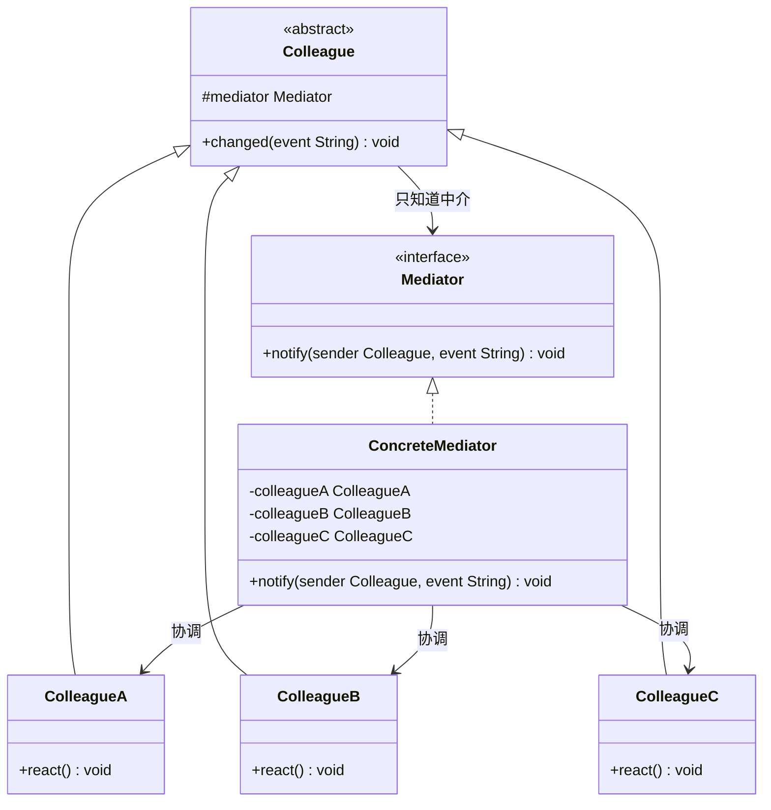

# 中介者模式（Mediator）

> 一句话定位：**用「一个中介对象」把网状的多对多交互收敛成星状的一对多交互**。考官真正想听的是它和外观（Facade）的本质区别——对外简化 vs 对内协调、单向 vs 双向，以及线程池为什么是最贴切又最容易被忽略的中介者例子。
> 分类：行为型（Behavioral） | 面试热度：★★☆☆☆
> 版本前提：JDK 17

---

## 1. 是什么

**用一个中介对象封装一组对象之间的交互，使这些对象不必显式相互引用，从而降低耦合、可以独立地改变它们之间的交互。**

核心角色：

| 角色 | 职责 |
| --- | --- |
| Mediator（抽象中介） | 定义同事间通信的接口，如 `notify(sender, event)` |
| ConcreteMediator（具体中介） | **知道并协调所有 Colleague**，实现交互路由逻辑 |
| Colleague（抽象同事） | 持有一个 Mediator 引用，**只认识中介，不认识彼此** |
| ConcreteColleague（具体同事） | 自身状态变化时通知 Mediator，由 Mediator 决定影响谁 |



---

## 2. 解决什么问题

**没有它之前**：N 个对象两两互相调用，形成网状依赖。加一个对象要改 N 个类的引用；改一条交互规则要翻遍所有参与者的代码；任何一个对象都无法脱离网络单独复用或单测。

**有了它之后**：交互逻辑从各个对象里**集中**到 Mediator，网状依赖变星状依赖。新增一个同事只需在 Mediator 里登记，老同事零改动。

| 替代方案 | 为什么不够好 |
| --- | --- |
| 直接互相引用 | 网状耦合，改一处牵全身，对象无法独立复用 |
| 外观（Facade） | Facade 是对外**单向**简化子系统，子系统之间仍然各自乱调；中介者是对内**双向**协调同事之间的交互 |
| 观察者 / 事件总线 | 单向广播，观察者与观察者之间不通信，无法表达「A 变了要按规则精确联动 B、C」的协调逻辑；但交互规则简单时它更轻 |

**关键取舍**：集中是双刃剑——耦合从「分散在 N 个类」变成「集中在一个类」，Mediator 有膨胀成上帝类的风险（见第 5 节）。

---

## 3. 怎么写

以聊天室为例（生产级写法：中介持有注册表、同事通过中介路由消息，而非互相持有引用）：

```java
interface ChatMediator {
    void register(User user);
    void broadcast(String message, User from);
    void sendTo(String message, User from, String toName);
}

class ChatRoom implements ChatMediator {
    private final Map<String, User> users = new ConcurrentHashMap<>();

    @Override public void register(User user) { users.put(user.name(), user); }

    @Override public void broadcast(String message, User from) {
        users.values().stream()
             .filter(u -> !u.equals(from))
             .forEach(u -> u.receive(message, from.name()));
    }

    @Override public void sendTo(String message, User from, String toName) {
        User to = users.get(toName);
        if (to != null) to.receive("[私聊] " + message, from.name());
    }
}

class User {
    private final String name;
    private final ChatMediator mediator;   // 只认识中介，不认识其他 User

    User(String name, ChatMediator mediator) {
        this.name = name;
        this.mediator = mediator;
        mediator.register(this);
    }
    String name() { return name; }
    void say(String msg) { mediator.broadcast(msg, this); }
    void whisper(String msg, String to) { mediator.sendTo(msg, this, to); }
    void receive(String msg, String from) {
        System.out.println(name + " 收到 " + from + ": " + msg);
    }
}
```

要点：User 之间**零引用**，路由表和分发规则全在 `ChatRoom`；想加「@提及提醒」「消息审计」只动 Mediator，不动任何 User。

---

## 4. 使用场景

| 场景 | 说明 |
| --- | --- |
| GUI 对话框联动 | GoF 原书例子：`Dialog` 协调 Button / TextBox / ListBox，勾选某框启用某按钮 |
| MVC 中的 Controller | Model 与 View 不直接引用，由 Controller 双向协调 |
| 消息中间件（架构层） | 服务 A/B/C 原本网状调用，引入 MQ Broker 后都只跟 Broker 通信 |
| 注册中心 | Nacos / Zookeeper：服务消费者与提供者不直接引用，都向注册中心登记与查询 |
| 工作流 / 审批引擎 | 各节点不互相调用，由引擎按流程定义路由 |

**JDK / 框架中的真实例子**：

- `java.util.Timer` —— `Timer` 是中介者，`TimerTask` 是同事：任务之间不相互引用，调度逻辑集中在 Timer 的单线程队列里。
- **`java.util.concurrent.ScheduledThreadPoolExecutor` / `ExecutorService`** —— 最容易被忽略却最贴切的例子：线程池中介了「提交任务的生产者线程」与「执行任务的工作线程」，二者通过阻塞队列交互、**从不直接通信**。
- MVC 框架的 `DispatcherServlet` / Controller 层 —— 协调 Model 与 View。

**辨析**：Guava `EventBus`、Spring 的 `ApplicationEventPublisher` 是**观察者（发布订阅）**，不是中介者——它们只做单向广播，不知道也不协调订阅者之间的交互规则。

---

## 5. 生产中的问题与排查

| 问题 | 现象 | 排查 / 修复 |
| --- | --- | --- |
| **Mediator 膨胀成上帝类** | 所有交互逻辑堆一处，Mediator 上千行 | 按业务场景拆成多个 Mediator（如 `OrderMediator` / `NotifyMediator`）；交互规则若是单向广播型，干脆换成事件驱动（观察者 / MQ） |
| **双向引用成环** | Colleague 持 Mediator、Mediator 持 Colleague，GC / 序列化出问题 | 明确生命周期归属：Mediator 通常长寿、Colleague 短寿时，Mediator 用 `WeakReference` 或显式 `unregister` |
| **隐式调用链难排查** | 一个字段变化引发连环联动，日志里看不到调用方 | 在 Mediator 的 `notify` 入口统一打 trace 日志（sender、event、受影响的目标列表），把隐式链路显式化 |
| **Mediator 成为性能瓶颈** | 所有交互串行经过单一中介 | 中介内部路由表用并发容器；无关联的事件分区处理；热点路径评估是否退化回直接调用 |
| **Mediator 单点** | 中介对象挂了整个交互网络瘫痪 | 单进程内靠冗余无意义；架构层（MQ Broker / 注册中心）必须集群部署 |
| **同事绕过中介直接通信** | 新人图省事又加了直接引用，星状退化为网状 | Code Review 红线：Colleague 构造器只允许注入 Mediator 类型；ArchUnit 写架构约束单测拦截 |

---

## 6. 面试问法

### 60 秒版本

> 中介者模式用一个中介对象封装一组对象的交互，让同事对象只持有中介的引用而互不相识，把网状的多对多依赖收敛成星状的一对多依赖，交互规则集中到中介里。它和外观模式最容易混：外观是客户端到子系统的**单向**简化，子系统根本不知道 Facade 存在；中介者是同事和中介之间的**双向**协调——同事主动通知中介，中介再回调其他同事，目的是对内协调而非对外简化。和观察者的区别在于观察者是单向广播、观察者之间不通信，中介者是双向协调。真实例子我首推**线程池**：生产者线程和工作线程从不直接通信，全靠 `ExecutorService` 中介；另外 `java.util.Timer` 和 TimerTask、MVC 的 Controller、消息中间件 Broker、注册中心都是不同层次的中介者。代价是中介容易膨胀成上帝类，需要按场景拆分。

### 5 分钟版本补充点

1. 判断是不是中介者的试金石：**交互双方是否互不知晓，且协调逻辑是否集中在第三方**——线程池、MQ Broker 都满足，EventBus 不满足（它不理解业务协调规则）
2. 中介者是**双向**通信：Colleague 调 Mediator，Mediator 回调 Colleague；这是与观察者（单向通知）最本质的语义差别
3. 网状 → 星状的收益量化：N 个对象两两通信是 O(N²) 条依赖边，引入中介后是 O(N)
4. 架构层面消息中间件、服务注册中心都是中介者思想的放大：目的同样是解耦交互双方、集中路由逻辑
5. 上帝类反模式的缓解：按场景拆中介、把协调规则配置化（规则引擎 / 状态机表）、或降级为事件驱动
6. 与门面常组合的写法：对外用 Facade 简化子系统入口，对内子系统组件之间用 Mediator 协调

---

## 7. 追问链 · 参考答案

| 层级 | 问题 | 参考答案要点 |
| --- | --- | --- |
| L1 | 中介者模式是什么？ | 行为型模式：用一个中介对象封装一组对象的交互，同事对象只持有中介引用、互不相识，网状多对多依赖收敛为星状一对多，交互规则集中到 Mediator，可独立改变交互而不动同事类 |
| L1 | 有哪些角色？ | Mediator 抽象中介定义通信接口；ConcreteMediator 持有并协调所有 Colleague；Colleague 只认识 Mediator；ConcreteColleague 状态变化时通知中介，由中介决定联动谁 |
| L2 | 它解决了什么依赖问题？ | N 个对象两两引用是 O(N²) 依赖边，改一个对象牵动全网。引入中介后每个对象只依赖中介，变 O(N)，新增同事只需在中介登记，老同事零改动 |
| L2 | 为什么说中介者是双向通信？ | Colleague 状态变化时**主动调用** Mediator 的 `notify`；Mediator 根据规则**回调**其他 Colleague 的方法。两个方向都有调用，这与观察者（Subject 单向通知 Observer）形成对照 |
| L3 | 中介者和外观模式的本质区别？ | 外观：客户端 → 子系统，**单向**，子系统不知道 Facade 存在，目的是**对外简化**调用入口。中介者：Colleague ↔ Mediator，**双向**，同事主动通知、中介回调，目的是**对内协调**同事间的交互。口诀：Facade 简化对外，Mediator 协调对内 |
| L3 | 中介者和观察者的区别？ | 观察者是**单向广播**：Subject 状态变化通知所有 Observer，Observer 之间不通信、Subject 不理解业务联动规则。中介者是**双向协调**：同事不直接通信全走中介，中介持有明确的协调逻辑决定影响谁 |
| L4 | 为什么线程池是中介者最贴切的例子？ | 提交任务的线程与执行任务的 `Worker` 线程**从不直接通信**，全部通过 `ThreadPoolExecutor` 内部的 `BlockingQueue` 与调度逻辑交互；增删任务或调整线程数互不影响对方代码。同事双方互不知晓、协调逻辑集中，完全契合定义 |
| L4 | EventBus / Spring 事件算中介者吗？ | 不算，它们是**观察者（发布订阅）**。EventBus 只做按类型分发，不持有「A 事件要联动 B 做某事」的协调规则，订阅者之间也不被协调。中介者的核心是中介**理解并集中**交互逻辑 |
| L5 | 中介者最大的工程风险是什么，怎么缓解？ | 所有交互逻辑集中导致 Mediator 膨胀成**上帝类**。缓解：按业务场景拆成多个中介；把协调规则外置为配置或规则引擎；交互若是单向广播型就降级为事件驱动；配合 ArchUnit 防止同事类重新出现直接引用 |
| L5 | 架构层面哪里用到了中介者思想？ | 消息中间件 Broker：服务 A/B/C 从网状直连变为只跟 Broker 通信；注册中心（Nacos/Zookeeper）：消费者与提供者不直接引用，都向注册中心登记与查询。本质都是把交互路由集中到第三方 |

---

## 8. 误区 · 正解

| ❌ 误区 | ✅ 正解 |
| --- | --- |
| 「中介者就是让别的类不互相 new」 | 不止解耦引用，核心是把**交互规则集中**到中介里，使交互可以独立演化。只解除引用但没有集中协调逻辑，那只是依赖注入 |
| 「外观和中介者差不多，都是封装一群对象」 | 本质不同：外观是**单向**简化（客户端 → 子系统，子系统不知 Facade），中介者是**双向**协调（同事主动通知中介、中介回调同事），前者对外后者对内 |
| 「EventBus 是典型的中介者实现」 | EventBus 是**观察者 / 发布订阅**：单向广播、不理解订阅者间的协调规则。中介者要求中介持有明确的协调逻辑并回调同事 |
| 「观察者模式可以完全替代中介者」 | 观察者只能单向广播，表达不了「A 变化后按规则精确联动 B、C」的双向协调；交互简单时可替代，规则复杂时中介者更贴切 |
| 「线程池跟设计模式没关系」 | `ExecutorService` 是教科书级中介者：生产者线程与工作线程从不直接通信，协调逻辑全集中在线程池与阻塞队列里 |
| 「中介者能消除所有耦合」 | 它把耦合**转移**到了中介身上，Mediator 可能膨胀成上帝类；且同事与中介双向引用会引入新的耦合与生命周期问题 |
| 「中介者里同事绝对不能知道彼此」 | 是目标不是教条。个别高频热点路径允许直接调用作为性能优化，但默认应走中介，避免星状退化为网状 |
| 「MVC 的 Controller 不是中介者」 | 是。Model 与 View 不直接引用，用户输入由 Controller 协调 Model 更新、再驱动 View 渲染，正是双向协调语义 |

---

## 9. 相关模式

| 模式 | 关系 |
| --- | --- |
| 外观（Facade） | 最常对比：外观单向简化对外，中介者双向协调对内；可组合使用（对外 Facade + 对内 Mediator） |
| 观察者（Observer） | 观察者单向广播，中介者双向协调；中介者内部的通知机制可用观察者实现；交互简单时可用观察者替代中介者 |
| 命令（Command） | 同事发给中介的请求可封装为 Command，便于排队、审计、撤销 |
| 代理（Proxy） | 代理控制**单个**对象的访问，中介者协调**一组**对象的交互，意图不同 |
| 状态（State） | 中介者内部若需按阶段切换协调规则，可内嵌状态机实现 |

---

## 10. 我的薄弱点

（学完后自己填，同步到 `weakness.md`）
