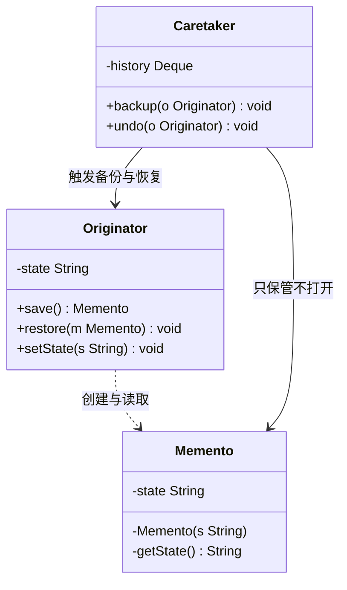

# 备忘录模式（Memento）

> 一句话定位：**在不破坏封装的前提下，捕获并外部保存对象的内部状态，以便之后恢复**。考官真正想听的是 Memento 如何对 Caretaker 保持黑盒（窄接口/宽接口技巧）、它和命令模式 undo 的本质区别（存操作 vs 存快照），以及数据库 undo log 为什么是最硬核的例子。
> 分类：行为型（Behavioral） | 面试热度：★★☆☆☆
> 版本前提：JDK 17

---

## 1. 是什么

**在不破坏封装的前提下，捕获一个对象的内部状态，并在该对象之外保存这个状态，以便之后将该对象恢复到原先的状态。**

核心角色：

| 角色 | 职责 |
| --- | --- |
| Originator（原发器） | 创建备忘录（`save()`），并用备忘录恢复自身状态（`restore(m)`） |
| Memento（备忘录） | 存储 Originator 的内部状态；对 Caretaker 是**黑盒** |
| Caretaker（负责人） | 保管备忘录（栈、列表），**不能查看或修改**其内容，也不能从里面取数据 |



---

## 2. 解决什么问题

**没有它之前**：想做撤销/回滚，要么把对象内部字段暴露给外部来保存（**破坏封装**，外部代码和内部字段耦合），要么什么都不存、事后靠人肉补偿。

**三个关键设计点（本题的区分度）**：

| 设计点 | 要点 |
| --- | --- |
| **封装边界** | Memento 必须对 Caretaker 是黑盒。Java 常见做法：把 Memento 做成 Originator 的**私有内部类或包私有类**，对外只暴露一个**窄接口**（通常是空的标记接口），Originator 内部再向下转型取回完整状态——即「窄接口 + 宽接口」双接口技巧 |
| **存什么** | 只存恢复所必需的字段，不是整个对象图；存太多会内存爆炸，存太少恢复不完整 |
| **谁负责状态转换** | Originator 自己负责「序列化/反序列化」自己的状态（只有它懂内部结构），Caretaker 只负责存和取，永远不打开备忘录 |

**与替代方案的对比**：

| 方案 | 问题 |
| --- | --- |
| 把字段 public / getter 全开放给外部保存 | 破坏封装，外部代码随内部字段改动而碎裂 |
| 序列化整个对象存起来 | 粒度太粗、开销大，且把序列化格式当成了公共契约 |
| 备忘录 | 状态保存逻辑收回 Originator 内部，对外只暴露不透明的 Memento 句柄，封装与可恢复兼得 |

---

## 3. 怎么写

窄接口 + 私有实现的生产级写法（Caretaker 拿不到任何状态细节）：

```java
// 窄接口：对外只是标记，Caretaker 只能持有它
public interface Memento { }

class Editor { // Originator
    private String content;
    private int cursor;

    // 宽实现：私有内部类，外部无法访问字段
    private record Snapshot(String content, int cursor) implements Memento { }

    public Memento save() { return new Snapshot(content, cursor); }

    public void restore(Memento m) {
        Snapshot s = (Snapshot) m;   // Originator 内部向下转型取回状态
        this.content = s.content();
        this.cursor = s.cursor();
    }
    public void type(String text) { content += text; cursor = content.length(); }
}

class History { // Caretaker：只管存取，从不打开 Memento
    private final Deque<Memento> undoStack = new ArrayDeque<>();
    private final int limit = 50;                       // 限制栈深，防内存暴涨

    public void backup(Editor e) {
        if (undoStack.size() >= limit) undoStack.pollLast();
        undoStack.push(e.save());
    }
    public void undo(Editor e) {
        if (!undoStack.isEmpty()) e.restore(undoStack.pop());
    }
}
```

要点：`Snapshot` 是 `record` 天然**不可变**（防快照被后续修改污染）；`History` 全程只见到 `Memento` 窄接口，看不到 `content/cursor`，封装边界成立。

---

## 4. 使用场景

| 场景 | 说明 |
| --- | --- |
| 编辑器 / IDE 撤销重做 | undo/redo 栈本质是 Memento 栈（如 Swing `UndoManager`，它实际融合了命令与备忘录） |
| 游戏存档 / 检查点 | checkpoint 保存角色与场景快照，读档即 restore |
| 事务多步回滚 | 工作流引擎在关键节点保存状态快照，失败时回退到上一稳定点 |
| 配置中心快照 | 配置变更前保存快照，发布出错一键回滚到上一版本 |
| 数据库事务回滚 | undo log 记录修改前的行镜像，回滚时按日志恢复 |

**真实例子（具体类与机制）**：

- **数据库 undo log / rollback segment** —— 最硬核的备忘录：InnoDB 的 undo log 保存行修改前的旧版本，既用于事务回滚，也支撑 MVCC 的版本链读取（`ReadView` 沿 undo 链找可见版本）。
- **数据库 SAVEPOINT** —— `SAVEPOINT sp1` / `ROLLBACK TO SAVEPOINT sp1`：一个事务内多个快照点，正是「一个 Originator、多个 Memento、Caretaker 按栈管理」的形态。
- Swing 的 `javax.swing.undo.UndoManager` —— 管理 `UndoableEdit` 栈，提供 `undo()` / `redo()` / `setLimit()` 限制深度。
- 游戏引擎的 checkpoint、虚拟机的 snapshot 恢复。

---

## 5. 生产中的问题与排查

| 问题 | 现象 | 排查 / 修复 |
| --- | --- | --- |
| **频繁快照内存暴涨** | 每次操作都存全量快照，老快照挤爆堆 | 改**增量快照**（只存 diff）；限制栈深度（如 `History.limit=50`）；超出淘汰最老快照 |
| **浅拷贝污染快照** | 快照里存了可变对象的引用，原对象继续被改，恢复出来是「改过的旧状态」 | Memento 字段必须**深拷贝或不可变**（用 `record` + 不可变集合 / `List.copyOf`）；恢复时亦然 |
| **快照含敏感信息落盘** | 快照序列化到磁盘 / 日志，密码、token 泄露 | 序列化前对敏感字段脱敏或剔除；快照文件加密并限制访问权限 |
| **快照生命周期过长** | Caretaker 长期持有大量 Memento，老年代持续增长 | 给快照加 TTL / 容量上限；用 `WeakReference` 包装非关键快照；审计 Caretaker 是否有未清理的栈 |
| **恢复后状态不一致** | 只恢复了内存对象，关联资源（文件句柄、缓存、DB 行）没同步回滚 | 备忘录只负责对象状态；外部资源要配合事务或补偿机制一起回滚 |
| **Caretaker 打开了 Memento** | Caretaker 读写字段，封装被破坏、与内部结构耦合 | 回到窄接口设计：Caretaker 只能持有 `Memento` 标记接口；ArchUnit 约束 Memento 实现类仅包内可见 |
| **多线程下备份/恢复竞态** | 一个线程在 save，另一个在改状态，快照是撕裂的 | 快照与修改要在同一把锁内进行，或先对状态做不可变拷贝再出锁 |

---

## 6. 面试问法

### 60 秒版本

> 备忘录模式在不破坏封装的前提下，把对象的内部状态捕获到一个 Memento 对象里交给外部的 Caretaker 保管，之后可以恢复原状态。三个角色：Originator 负责创建和恢复备忘录，因为只有它懂自己的内部结构；Memento 存状态，但必须对 Caretaker 是黑盒——Java 里通常把 Memento 做成 Originator 的私有内部类或包私有类，对外只暴露一个窄的标记接口，Originator 内部再向下转型取回完整状态，这是窄接口加宽接口的技巧；Caretaker 只保管不打开。和命令模式做撤销的区别很本质：命令 undo 存的是**操作**，回滚时执行逆操作，每个操作都要写逆；备忘录存的是**状态快照**，恢复时整体覆盖，不用写逆操作但内存开销更大，现实里两者经常结合。硬核例子是 InnoDB 的 undo log：保存修改前的行镜像，既支撑事务回滚也支撑 MVCC 版本链。工程上的坑主要是内存暴涨、浅拷贝污染快照和敏感信息落盘。

### 5 分钟版本补充点

1. 「不破坏封装」是备忘录区别于普通状态保存的灵魂——外部只能拿到不透明句柄，恢复逻辑收回 Originator
2. 窄接口技巧在 C++ 里用 friend 实现，Java 里没有 friend，所以用**私有内部类 + 标记接口 + 向下转型**达到同等效果
3. 备忘录与原型（Prototype）都涉及复制状态，但原型是为了**创建新对象**，备忘录是为了**恢复旧状态**，意图不同
4. `SAVEPOINT` / `ROLLBACK TO SAVEPOINT` 是「一个事务多个快照点」的典型，Caretaker 按栈管理多个 Memento
5. 快照选型：全量快照简单可靠但费内存；增量快照（只存 diff，如 Redis RDB vs AOF 的思路）省内存但恢复链路长，按操作频率与对象大小权衡
6. 恢复语义要和外部资源对齐：内存状态恢复了，DB / 缓存 / 文件如果没在同一事务里回滚，就会出现「对象旧了、世界新了」的撕裂

---

## 7. 追问链 · 参考答案

| 层级 | 问题 | 参考答案要点 |
| --- | --- | --- |
| L1 | 备忘录模式是什么？ | 行为型模式：在不破坏封装的前提下捕获对象内部状态并在外部保存，以便之后恢复。三角色：Originator 创建与恢复、Memento 存状态、Caretaker 只保管不打开 |
| L1 | 为什么说它「不破坏封装」？ | 外部拿到的只是不透明的 Memento 句柄，看不到也改不了里面的状态；状态的保存与恢复逻辑都在 Originator 内部，内部字段变化不会波及 Caretaker |
| L2 | Memento 怎么对 Caretaker 保持黑盒？ | 窄接口 + 宽接口技巧：Memento 实现类做成 Originator 的私有内部类或包私有类，对外只暴露空的标记接口；Caretaker 只能持有标记接口；Originator 恢复时向下转型取回完整状态 |
| L2 | 快照应该存什么？ | 只存恢复所必需的字段，不是整个对象图。存太多内存爆炸、还可能拖入不想保存的关联对象；存太少恢复不完整。字段值必须深拷贝或不可变，否则浅拷贝会被后续修改污染 |
| L3 | 备忘录 undo 和命令 undo 的区别？ | 命令 undo 存**操作**，回滚时执行逆操作（add 的逆是 remove），优点是省内存，代价是每个操作都要写逆操作且有些操作不可逆。备忘录存**状态快照**，恢复时整体覆盖，不需逆操作但内存开销大。现实里常结合：命令做主流程，备忘录兜底 |
| L3 | 备忘录和原型模式有什么关系？ | 都涉及复制对象状态，但意图相反方向：原型是**以现有对象为模板创建新对象**，备忘录是**把状态存起来以便恢复到旧状态**。备忘录的实现常借用原型的拷贝能力 |
| L4 | InnoDB 的 undo log 为什么算备忘录？ | undo log 在每次修改前保存行的旧版本镜像（Originator 是事务中的数据行，Memento 是旧镜像，存储引擎充当 Caretaker）。用途有二：事务回滚时按日志恢复旧值；MVCC 下 `ReadView` 沿 undo 版本链找到本事务可见的历史快照 |
| L4 | SAVEPOINT 体现备忘录的什么形态？ | `SAVEPOINT sp1; ...; ROLLBACK TO SAVEPOINT sp1` 是一个事务内挂多个快照点：一个 Originator、多个 Memento 按栈管理、可回退到任意中间点而不是只能全回滚——正是多 Caretaker 快照形态 |
| L5 | 频繁快照导致内存爆炸怎么治？ | 三板斧：改增量快照只存 diff；给撤销栈设硬上限（如 `UndoManager.setLimit`）淘汰最老；对非关键快照用 `WeakReference` 或 TTL。同时审计是否把大对象图无意卷进快照 |
| L5 | 快照落盘有什么安全坑？ | 快照往往包含完整业务状态，若含密码、token、身份证字段，序列化到磁盘或打进日志就是泄露面。对策：序列化前剔除或脱敏敏感字段、快照文件加密、访问权限收敛、明确快照的保留期 |

---

## 8. 误区 · 正解

| ❌ 误区 | ✅ 正解 |
| --- | --- |
| 「备忘录就是把对象整个序列化存起来」 | 备忘录存的是**恢复所必需的状态子集**，且对外是不透明句柄；序列化整个对象图粒度太粗、把序列化格式变成了公共契约，违背封装初衷 |
| 「Caretaker 可以读 Memento 里的字段做展示」 | 不能。Caretaker 的职责只是保管和传递，读取会破坏黑盒边界；要展示历史应让 Originator 提供查询方法或在 Memento 上单独开只读窄接口 |
| 「备忘录模式和撤销是同义词」 | 撤销只是备忘录的典型应用之一；它还用于检查点、配置回滚、MVCC 版本链等「恢复到先前状态」的一切场景 |
| 「快照里存引用类型没关系」 | 浅拷贝会让快照和当前状态共享可变对象，原对象一改快照就被污染。快照字段必须深拷贝或不可变（`record` + `List.copyOf` 是省事写法） |
| 「备忘录比命令模式做撤销更优」 | 各有代价：备忘录恢复快但费内存，命令省内存但要为每个操作写逆操作且存在不可逆操作。工程上常两者结合，命令驱动主流程、备忘录兜底 |
| 「恢复内存状态就等于全部回滚」 | 备忘录只管对象内部状态；DB 行、缓存、文件句柄等外部资源需要配套的事务或补偿机制一起回滚，否则出现状态撕裂 |
| 「undo log 是日志不是备忘录」 | undo log 保存修改前的行镜像用于恢复，完全符合备忘录语义——它是数据库内核级的 Memento，还顺带支撑 MVCC 版本链 |
| 「快照越多越好，撤销更细」 | 快照密度要和内存预算权衡。无限制的全量快照是内存泄漏温床；生产上要限栈深、做增量或按关键节点稀疏快照 |

---

## 9. 相关模式

| 模式 | 关系 |
| --- | --- |
| 命令（Command） | 做撤销的两大路线：命令存操作执行逆操作，备忘录存快照整体覆盖；常结合使用（Swing `UndoManager` 即命令+备忘录混合） |
| 原型（Prototype） | 都复制状态：原型为了创建新对象，备忘录为了恢复旧状态；备忘录可用原型拷贝来实现快照 |
| 状态（State） | 状态模式切换的是「行为」，备忘录保存的是「数据」；游戏存档常同时存当前 State 对象标识与字段快照 |
| 迭代器（Iterator） | GoF 提到迭代器可用备忘录保存遍历位置快照（如可回退的迭代器） |
| 责任链（Chain of Responsibility） | 无直接关联；但工作流回退场景中，链上每个节点的快照可串成备忘录栈 |

---

## 10. 我的薄弱点

（学完后自己填，同步到 `weakness.md`）
