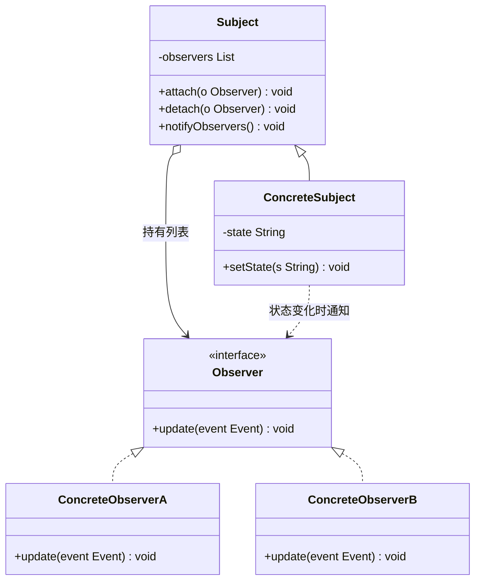

# 观察者模式（Observer）

> 一句话定位：**定义对象间一对多的依赖，状态变化时自动通知所有依赖者**——也叫发布-订阅、Listener。考官真正想听的是推模型 vs 拉模型、观察者 vs 发布订阅（有没有 Broker）、JDK `Observable` 为什么被废弃，以及 Spring 事件在事务边界上的坑和 `@TransactionalEventListener` 的解法。
> 分类：行为型（Behavioral） | 面试热度：★★★★★
> 版本前提：JDK 17

---

## 1. 是什么

**定义对象间一种一对多的依赖关系，当一个对象的状态发生改变时，所有依赖它的对象都得到通知并被自动更新。**

核心角色：

| 角色 | 职责 |
| --- | --- |
| Subject（主题） | 持有观察者列表，提供 `attach / detach / notifyObservers` |
| Observer（观察者） | 定义 `update()` 回调接口 |
| ConcreteSubject | 状态变化时触发通知 |
| ConcreteObserver | 实现 `update()`，响应变化 |



---

## 2. 解决什么问题

**没有它之前**：状态持有方主动调用所有关心它的人（`a.notifyB(); a.notifyC();`），每新增一个关注者都要改持有方代码；或者关注者轮询，浪费且延迟高。

**推模型 vs 拉模型（必考点）**：

| 维度 | 推模型（Push） | 拉模型（Pull） |
| --- | --- | --- |
| 通知内容 | Subject 把变化的数据**直接推**给 Observer：`update(data)` | Subject 只通知「我变了」，Observer **自己回来取**：`update(subject)` 后调 `subject.getState()` |
| 优点 | 简单直接，Observer 无依赖 | Observer 按需取数，不被无关数据打扰 |
| 缺点 | Observer 可能收到不需要的数据；字段变了要改签名 | Observer 要认识 Subject 的具体类型，耦合回升 |
| 代表 | JDK 原生 `Observer.update(Observable, Object)`（**推**）；Spring 事件、EventBus | 部分 GUI 框架的变更通知 |

**为什么不直接回调 / 轮询**：

| 方案 | 问题 |
| --- | --- |
| 持有方主动逐个调用 | 持有方硬编码所有关注者，OCP 被破坏 |
| 关注者轮询状态 | 实时性差、空转浪费 CPU |
| 观察者 | 持有方只维护列表，新增关注者零改动；通知时机精确到状态变更点 |

---

## 3. 怎么写

生产级写法（类型安全的事件对象 + 拷贝列表防并发修改 + 异常隔离）：

```java
public record OrderPaidEvent(String orderId, long amount, Instant paidAt) { }

interface OrderEventListener {
    void onOrderPaid(OrderPaidEvent event);
}

class OrderService {  // Subject
    private final List<OrderEventListener> listeners = new CopyOnWriteArrayList<>();

    public void subscribe(OrderEventListener l) { listeners.add(l); }
    public void unsubscribe(OrderEventListener l) { listeners.remove(l); }

    public void pay(String orderId, long amount) {
        // ... 支付主流程 ...
        OrderPaidEvent event = new OrderPaidEvent(orderId, amount, Instant.now());
        for (OrderEventListener l : listeners) {
            try {
                l.onOrderPaid(event);          // 默认同步调用
            } catch (Exception ex) {
                log.warn("listener {} failed", l.getClass().getName(), ex);
                // 异常隔离：一个监听器挂掉不影响其他监听器和主流程
            }
        }
    }
}

// 使用
orderService.subscribe(e -> inventoryClient.deduct(e.orderId()));   // 扣库存
orderService.subscribe(e -> pointService.grant(e.orderId(), e.amount())); // 加积分
orderService.pay("O20261007", 9900);
```

要点：用 `CopyOnWriteArrayList` 允许监听器在通知过程中注册/注销而不抛 `ConcurrentModificationException`；事件做成不可变 `record`；同步通知里必须**try-catch 隔离**单个监听器异常。

---

## 4. 使用场景

| 场景 | 说明 |
| --- | --- |
| GUI 事件 | 按钮点击、窗口关闭的 Listener（AWT/Swing/JavaFX 全是观察者） |
| 领域事件 | 订单已支付 → 通知库存、积分、消息等下游，主流程与下游解耦 |
| 配置变更推送 | 配置中心变更后通知所有订阅者刷新本地缓存 |
| 监控告警 | 指标越阈值通知告警订阅者 |
| 响应式流 | 背压场景下数据流推送给订阅者 |

**JDK / Spring / 框架中的真实例子**：

- `java.beans.PropertyChangeListener` / `PropertyChangeSupport` —— JavaBeans 规范的属性变化通知，AWT/Swing 大量使用。
- **Spring 事件机制**：`ApplicationEventPublisher.publishEvent()` 发布，`@EventListener` 或 `ApplicationListener<E>` 订阅；**`@TransactionalEventListener`** 在事务指定阶段（默认 `AFTER_COMMIT`）触发，解决「事务未提交事件先发出」的坑——加分点。
- **Guava `EventBus`**：`@Subscribe` 标注订阅方法（只能有一个参数）；默认**同步**执行；`AsyncEventBus` 才异步；`@AllowConcurrentEvents` 声明订阅方法线程安全以允许并发调用；无订阅者的事件进入 `DeadEvent`。
- JDK 9 `java.util.concurrent.Flow` —— Reactive Streams 四接口：`Publisher` / `Subscriber` / `Subscription` / `Processor`，带背压。
- Servlet 规范：`ServletContextListener` / `HttpSessionListener` / `ServletRequestListener`。
- Project Reactor `Flux.subscribe()`、RxJava `Observable`；Netty 的 `ChannelFutureListener`（异步 I/O 完成回调）。

**JDK 弃用史（高频）**：`java.util.Observable` / `Observer` 在 **JDK 9 被 `@Deprecated`**。原因：Observable 是**类不是接口**（单继承受限）、非线程安全、通知顺序无保证、不支持丰富的事件类型。现代替代：`PropertyChangeListener`、`Flow`、Spring 事件、EventBus、Reactor。

---

## 5. 生产中的问题与排查

| 问题 | 现象 | 排查 / 修复 |
| --- | --- | --- |
| **同步观察者拖垮主流程** | 某个监听器做 RPC / 写库，接口 RT 被拉长 | 异步化：`@Async` + `@EventListener`、`AsyncEventBus`、或干脆发 MQ；同步只留必须在同一事务内的逻辑 |
| **监听器异常冒泡** | 一个监听器抛异常，后续监听器收不到、主流程事务回滚 | 发布处 try-catch 隔离每个监听器；Spring 中注意 `@EventListener` 默认在发布者同线程同事务执行，异常会向上传播 |
| **监听器内存泄漏** | Observer 注册后从不注销，Subject 长寿命 → 观察者无法 GC，老年代缓涨 | 成对提供 `subscribe/unsubscribe` 并在销毁钩子里注销；或用 `WeakReference` 持有；堆 dump 找被事件列表 pinning 的对象 |
| **依赖通知顺序** | 业务依赖「先扣库存再加积分」的隐式顺序，升级后翻车 | 顺序本无保证。强顺序需求改用编排（显式调用链 / 工作流），或用 Spring `@Order` 明确排序并写进契约 |
| **循环通知死循环** | A 变更通知 B，B 的处理又改了 A，CPU 打满 | 事件里禁止反向写回源头；给事件加版本/来源标记做防重；画事件依赖图消除环 |
| **事务内发事件污染事务** | 事件里调远程接口 / 发 MQ，事务被拉长甚至大事务 | 用 `@TransactionalEventListener(phase = AFTER_COMMIT)` 把副作用挪到提交后；未提交前的副作用一旦回滚就是脏数据 |
| **EventBus 订阅方法签名错误** | 订阅方法写了两个参数，启动报 `IllegalArgumentException` | `@Subscribe` 方法必须且只能有一个参数（事件类型）；用 `DeadEvent` 兜底观察未匹配事件 |
| **重复注册同一监听器** | 同一实例被 subscribe 两次，事件被处理两遍 | 注册集合用 Set 语义或注册前判重；监听器幂等化兜底 |

---

## 6. 面试问法

### 60 秒版本

> 观察者模式定义对象间一对多的依赖，Subject 状态变化时自动通知所有 Observer，也叫发布订阅、Listener。两个必考细节：一是**推模型和拉模型**——推模型把数据直接塞进 `update(data)`，简单但可能推送多余数据；拉模型只通知「我变了」、观察者自己回来取，灵活但观察者要认识 Subject 类型，JDK 原生 `Observer` 是推模型。二是**观察者和发布订阅的区别**：观察者是对象级直接通知，Subject 持有 Observer 引用、彼此知晓、通常同步；发布订阅中间有 Broker/Channel，发布者与订阅者互不知晓、通常异步、支持持久化削峰，MQ 是典型。JDK 的 `Observable` 在 JDK 9 被废弃，因为它是类不是接口、非线程安全、顺序无保证；现代替代是 `PropertyChangeListener`、`Flow`、Spring 事件和 EventBus。生产上最大的坑是同步执行——监听器慢会拖垮主流程、异常会冒泡影响事务，要异步化并用 `@TransactionalEventListener(AFTER_COMMIT)` 把副作用挪到事务提交后。

### 5 分钟版本补充点

1. `@TransactionalEventListener` 的四个阶段：`AFTER_COMMIT`（默认）/ `AFTER_ROLLBACK` / `AFTER_COMPLETION` / `BEFORE_COMMIT`；`fallbackExecution = true` 时无事务也直接执行
2. Guava `EventBus` 默认同步、订阅方法只能一个参数、`@AllowConcurrentEvents` 声明线程安全、`DeadEvent` 兜住无订阅者事件——这四个细节能区分「用过」和「研究过」
3. JDK 9 `Flow` 对齐 Reactive Streams 规范，`Subscription.request(n)` 实现背压，是观察者模式在流式场景的工业化形态
4. Spring 事件的广播器是 `ApplicationEventMulticaster`，默认 `SimpleApplicationEventMulticaster` 同步执行；注入 `taskExecutor` 即全局异步
5. 监听器泄漏是经典内存泄漏源：长寿命 Subject + 忘注销的 Observer；Android 的 `BroadcastReceiver`、Swing 的 Listener 列表都是重灾区
6. 顺序与可靠性都不要赌：观察者模式不提供顺序保证、不提供持久化；要可靠性就升级成 MQ 发布订阅

---

## 7. 追问链 · 参考答案

| 层级 | 问题 | 参考答案要点 |
| --- | --- | --- |
| L1 | 观察者模式是什么？ | 行为型模式：定义对象间一对多依赖，Subject 状态变化时自动通知并更新所有 Observer。角色：Subject 维护观察者列表并提供 `attach/detach/notify`，Observer 定义 `update()` 回调 |
| L1 | 推模型和拉模型有什么区别？ | 推模型：`update(data)` 由 Subject 把变化数据直接推给观察者，简单但可能推送无关数据。拉模型：`update(subject)` 只通知变化，观察者按需回取，灵活但观察者要认识 Subject 具体类型。JDK 原生 `Observer` 是推模型 |
| L2 | JDK 的 Observable 为什么被废弃？ | JDK 9 起 `@Deprecated`。四个硬伤：`Observable` 是**类**不是接口导致单继承受限；实现非线程安全；通知顺序无保证；事件模型过于简陋。官方建议改用 `java.beans` 的 `PropertyChangeListener` 或 JDK 9 的 `Flow` |
| L2 | 观察者和发布订阅是一回事吗？ | 不是。观察者是**对象级直接通知**：Subject 持有 Observer 引用、彼此知晓、默认同步调用。发布订阅是**架构级消息总线**：中间有 Broker/Channel，发布者与订阅者互不知晓、通常异步、支持持久化与削峰，MQ 是典型实现 |
| L3 | Spring 事件机制怎么用？ | 发布：`ApplicationEventPublisher.publishEvent(event)`（任意对象即可，不强求继承 `ApplicationEvent`）。订阅：`@EventListener` 标注方法或实现 `ApplicationListener<E>`。底层由 `ApplicationEventMulticaster` 按事件类型匹配，默认同步执行 |
| L3 | `@TransactionalEventListener` 解决什么问题？ | 普通 `@EventListener` 在发布者的**事务内**同步执行，事件里的远程调用会拉长事务，且事务回滚后已发出的副作用变脏数据。`@TransactionalEventListener` 默认 `AFTER_COMMIT` 阶段触发，保证只在提交成功后才执行；还有 `AFTER_ROLLBACK` / `AFTER_COMPLETION` / `BEFORE_COMMIT` 可选 |
| L4 | EventBus 有哪些容易踩的细节？ | 四个：默认**同步**执行（异步要用 `AsyncEventBus`）；`@Subscribe` 方法**只能有一个参数**；订阅方法默认单线程调用，声明线程安全要加 `@AllowConcurrentEvents`；没有订阅者的事件会包装成 `DeadEvent` 投递，可监听它做兜底监控 |
| L4 | Flow 和经典观察者有什么不同？ | `Flow`（JDK 9，对齐 Reactive Streams）在观察者基础上引入**背压**：`Subscriber` 通过 `Subscription.request(n)` 主动声明处理能力，Publisher 按量推送，避免快生产者压垮慢消费者。四接口：Publisher / Subscriber / Subscription / Processor |
| L5 | 同步观察者架构在生产上怎么加固？ | 三个方向：异步化（`@Async`、`AsyncEventBus`、MQ）把慢监听器移出主链路；异常隔离，发布处对每个监听器 try-catch 防止冒泡回事务；生命周期管理，注册/注销成对出现或用弱引用，防止监听器泄漏 |
| L5 | 什么时候该从观察者升级到 MQ？ | 出现以下任一信号：需要跨进程通知、要求消息持久化不丢失、需要削峰填谷、需要消费重试与死信、订阅方需要独立扩缩容。观察者解决进程内解耦，MQ 解决系统间解耦，二者是补充不是替代 |

---

## 8. 误区 · 正解

| ❌ 误区 | ✅ 正解 |
| --- | --- |
| 「观察者模式就是发布订阅」 | 广义同族但有关键差别：观察者是 Subject 直接持有 Observer 引用的**同步直接调用**，彼此知晓；发布订阅有 Broker 居中，双方互不知晓、通常异步且可持久化 |
| 「JDK 的 Observable 还是写监听器的首选」 | 它在 JDK 9 已被 `@Deprecated`：是类不是接口、非线程安全、顺序无保证。新项目用 `PropertyChangeSupport`、`Flow`、Spring 事件或 EventBus |
| 「Spring 的 @EventListener 是异步的」 | 默认**同步**且在发布者的事务内执行。要异步需加 `@Async` 或给 `ApplicationEventMulticaster` 配 `taskExecutor`；要事务安全用 `@TransactionalEventListener(AFTER_COMMIT)` |
| 「EventBus 默认异步」 | Guava `EventBus` 默认**同步**，订阅方法在发布线程执行；异步要用 `AsyncEventBus`（内部是 Executor 分发） |
| 「监听器按注册顺序执行，可以依赖」 | 规范层面顺序无保证（部分实现恰好有序也不要依赖）。强顺序需求应显式编排或用 `@Order` 并写进契约 |
| 「监听器里抛异常无所谓」 | 同步模型下异常会**冒泡回发布方**：Spring 中会中断后续监听器并可能导致事务回滚。发布处必须逐监听器 try-catch 隔离 |
| 「注册一次就不用管了」 | Subject 长寿命而 Observer 不注销是经典内存泄漏（Android/Swing 重灾区）。必须成对注销，或用弱引用 / 生命周期绑定 |
| 「观察者模式能保证消息不丢」 | 进程内调用没有任何持久化与重试，JVM 崩溃事件即丢。要可靠性必须升级到 MQ 发布订阅或本地事件表（outbox） |

---

## 9. 相关模式

| 模式 | 关系 |
| --- | --- |
| 中介者（Mediator） | 观察者单向广播、观察者间不通信；中介者双向协调同事间交互。中介者内部的通知机制常用观察者实现 |
| 发布订阅 / 消息队列 | 观察者的架构级放大：加 Broker、异步化、持久化后即 MQ 的 Pub-Sub 模型 |
| 命令（Command） | 事件的处理动作可封装为 Command，便于排队、重试、撤销 |
| 责任链（Chain of Responsibility） | 事件沿链传递是另一种分发方式；观察者是一对多广播，责任链是沿链单点处理 |
| 状态（State） | 状态对象的流转动作常通过事件通知外部（状态机 + 观察者组合，如 Spring StateMachine 的 listener） |

---

## 10. 我的薄弱点

（学完后自己填，同步到 `weakness.md`）
