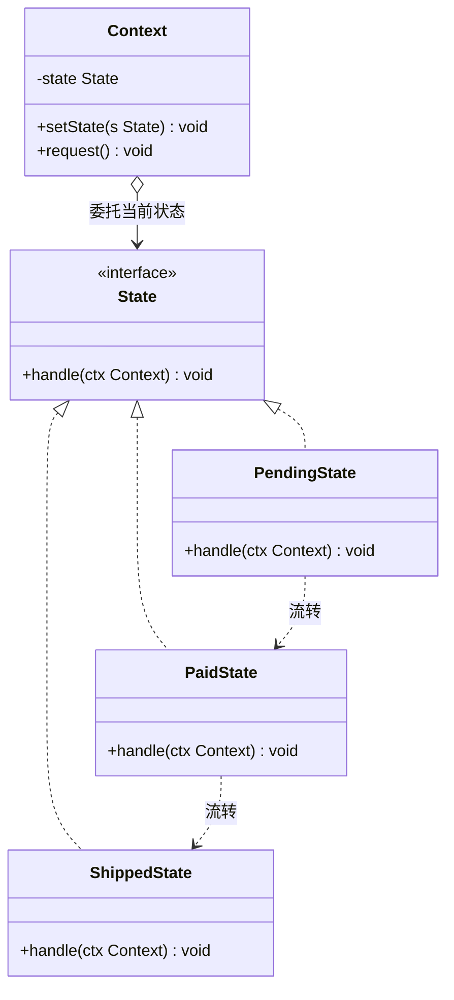
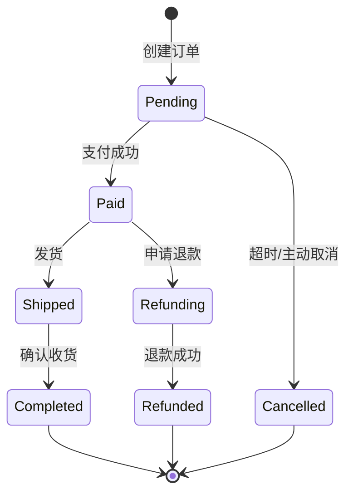

# 状态模式（State）

> 一句话定位：**让对象在内部状态改变时改变行为，看起来像换了类**。考官真正想听的是它和策略模式的辨析（UML 几乎一样、意图相反）、状态流转应该放哪里（State 里 / Context 里 / 状态机表），以及生产上状态变更的幂等与并发控制。
> 分类：行为型（Behavioral） | 面试热度：★★★★☆
> 版本前提：JDK 17

---

## 1. 是什么

**允许一个对象在内部状态改变时改变它的行为，对象看起来好像修改了它的类。**

核心角色：

| 角色 | 职责 |
| --- | --- |
| Context（上下文） | 持有当前 State 引用，把状态相关的行为**委托**给它 |
| State（抽象状态） | 定义状态相关行为的接口 |
| ConcreteState（具体状态） | 实现该状态下的行为，**并负责切换到下一个状态** |





---

## 2. 解决什么问题

**没有它之前**：一个对象的行为依赖状态字段，于是每个方法里都是巨型 `if (status == PENDING) ... else if (status == PAID) ...`。新增一个状态要翻遍所有方法改分支；非法流转（已完成 → 待支付）没有任何防护。

**状态模式的做法**：把每个状态下的行为封装成独立的 State 类，Context 只做委托。新增状态 = 新增一个类，老代码不动（OCP）；非法流转在状态类里显式抛异常或被状态机表拒绝。

| 替代方案 | 问题 |
| --- | --- |
| `if/else` / `switch` 分支 | 状态多时分支爆炸；流转规则散落各处；非法流转无防护。状态 ≤ 3 个且稳定时反而更直白（见「什么时候不要用」） |
| 策略模式 | UML 相同但意图不同：策略由客户端**主动选择**且策略互不依赖；状态是对象内部**自动流转**、状态之间相互知晓（见第 9 节详表） |
| 状态机框架 | 状态爆炸（几十上百）时上手写状态类会类膨胀，应升级 Spring StateMachine 这类框架 |

---

## 3. 怎么写

订单状态机（流转放 State 里 + 非法流转显式拒绝）：

```java
interface OrderState {
    OrderState pay();
    OrderState ship();
    OrderState cancel();
    String name();
    default OrderState illegal(String action) {
        throw new IllegalStateException("状态 " + name() + " 不允许执行 " + action);
    }
}

enum OrderStates implements OrderState {          // 枚举实现：天然单例、无状态类膨胀
    PENDING {
        public OrderState pay()    { return PAID; }
        public OrderState ship()   { return illegal("发货"); }
        public OrderState cancel() { return CANCELLED; }
        public String name() { return "待支付"; }
    },
    PAID {
        public OrderState pay()    { return illegal("重复支付"); }
        public OrderState ship()   { return SHIPPED; }
        public OrderState cancel() { return illegal("取消"); }
        public String name() { return "已支付"; }
    },
    SHIPPED { /* pay/cancel 均 illegal，ship illegal */ 
        public OrderState pay()    { return illegal("支付"); }
        public OrderState ship()   { return illegal("发货"); }
        public OrderState cancel() { return illegal("取消"); }
        public String name() { return "已发货"; }
    },
    CANCELLED { /* 终态：全部 illegal */ 
        public OrderState pay()    { return illegal("支付"); }
        public OrderState ship()   { return illegal("发货"); }
        public OrderState cancel() { return illegal("取消"); }
        public String name() { return "已取消"; }
    };
}

class Order {                                        // Context
    private OrderState state = OrderStates.PENDING;  // 持久化时映射到 DB status 字段

    public void pay()    { transition(state.pay()); }
    public void ship()   { transition(state.ship()); }
    public void cancel() { transition(state.cancel()); }

    private void transition(OrderState next) {
        // 生产上此处必须与 DB 同事务 + 乐观锁：UPDATE ... WHERE id=? AND status=?
        this.state = next;
    }
}
```

要点：用 `enum` 实现 State 避免每个状态一个文件；非法流转不是静默忽略而是**显式抛异常**；`transition` 注释点出生产落库的关键——状态变更要和业务数据在**同一事务**并用条件更新防并发。

---

## 4. 使用场景

| 场景 | 说明 |
| --- | --- |
| 订单 / 支付状态机 | 待支付 → 已支付 → 已发货 → 已完成 / 已取消，面试举例首选 |
| 审批流 / 工单流转 | 待提交 → 审批中 → 通过 / 驳回，每节点行为与可流转目标不同 |
| 游戏角色状态 | 站立 / 跑动 / 跳跃 / 攻击，同一按键在不同状态下行为不同 |
| 电梯控制 | 上行 / 下行 / 停止 / 维护，请求响应随状态变化 |
| 连接生命周期 | 连接建立 / 传输 / 半关闭 / 关闭，读写行为随状态受限 |

**JDK / 框架中的真实例子**：

- **线程状态 `java.lang.Thread.State`** —— `NEW / RUNNABLE / BLOCKED / WAITING / TIMED_WAITING / TERMINATED`：JDK 虽没用类层次实现，但语义教科书级——`start()` 只能在 `NEW` 调用，非法流转抛 `IllegalThreadStateException`。
- **TCP 连接状态** —— `ESTABLISHED / LISTEN / CLOSE_WAIT / TIME_WAIT` 等：协议栈层面最经典的状态机，每个报文按当前状态决定行为与下一状态。
- **Spring StateMachine** —— `StateMachineConfigurerAdapter`（新版为 `StateMachineConfigurer`）配置状态、事件、转移（transition）、守卫（guard）、动作（action），支持状态持久化与分布式。
- 工作流引擎 Activiti / Flowable 的节点流转，本质是可配置的状态机。

---

## 5. 生产中的问题与排查

| 问题 | 现象 | 排查 / 修复 |
| --- | --- | --- |
| **并发下状态被同时转换** | 两个线程同时看到「待支付」，重复支付 / 重复发货 | 状态更新用 **CAS 条件更新**：`UPDATE ... SET status=? WHERE id=? AND status=?`，按影响行数判断成败；配合幂等表防重 |
| **内存状态与 DB 不一致** | 代码改了状态但 DB 更新失败（或反之），重启后状态错乱 | 状态变更与业务数据**同一事务**提交；以 DB 为唯一事实源，内存状态从 DB 重建 |
| **非法流转无防护** | 「已完成」被改回「待支付」，资损 | 显式**转移白名单**（状态机表 `Map<State, Map<Event, State>>`）；非法流转抛异常并告警，不静默忽略 |
| **状态类膨胀** | 几十个状态各一个类，文件爆炸 | 用枚举实现轻量状态机；状态更多时升级 Spring StateMachine / Squirrel 等框架，流转配置化 |
| **State 与 Context 双向依赖成环** | State 持有 Context、Context 持有 State，序列化 / GC / 测试困难 | State 设计成无状态单例（枚举或静态常量），流转时以方法参数传 Context，不长期持有 |
| **流转规则散落难维护** | 想知道「已支付能去哪」要翻所有状态类 | 流转集中为**状态机表/配置**：`Map<State, Map<Event, State>>`，代码只查表；配可视化导出状态图 |
| **异步回调乱序** | 支付成功回调晚于取消请求到达，状态被错误覆盖 | 事件携带版本号 / 时间戳，只允许单调推进；乱序事件进死信人工处理 |
| **状态历史无审计** | 出了纠纷查不到状态怎么变的 | 每次流转写状态变更日志表（旧状态、事件、新状态、操作人、时间），与业务表同事务 |

---

## 6. 面试问法

### 60 秒版本

> 状态模式允许对象在内部状态改变时改变行为，看起来像换了类。Context 持有当前 State 引用并把行为委托给它，每个 ConcreteState 实现该状态下的行为并负责切换到下一个状态。它和策略模式是最大的考点，因为 UML 几乎相同：**策略是客户端主动选择一种算法、策略之间互不依赖；状态是对象内部自动流转、状态之间相互知晓**——口诀「策略是你选的，状态是它自己变的」。状态流转放哪里有三派：放 ConcreteState 里是 GoF 原意，规则分散但消灭了巨型 switch；放 Context 里会退化回 if/else；工程上我更推荐状态机表，用 `Map<State, Map<Event, State>>` 描述流转，代码只查表。典型例子是订单状态机、TCP 连接状态和 `Thread.State`。生产上的关键是并发与一致性：状态变更要和业务数据同事务，用条件更新 `UPDATE ... WHERE status=?` 做乐观并发控制，非法流转要有显式白名单防护。

### 5 分钟版本补充点

1. 判断用状态还是策略的试金石：**这些「算法」之间会不会互相跳转**——会跳转是状态，不会跳转是策略
2. 用 `enum` 实现轻量状态机是 Java 的便利写法：天然单例、避免类爆炸、编译期穷举检查
3. 状态模式的「看起来像改了类」：Context 的同一方法调用，因当前 State 不同而表现完全不同，运行期行为切换
4. Spring StateMachine 的四个核心概念：State、Event、Transition、Guard/Action；支持状态持久化（`StateMachinePersister`）解决重启恢复
5. 什么时候不要用：状态 ≤ 3 个且几乎不变时，`if/else` 更直白；强行上模式是过度设计
6. 幂等是状态机的另一半：状态流转方法必须可重入安全（重复支付回调、重复发货指令），靠条件更新 + 幂等键兜底

---

## 7. 追问链 · 参考答案

| 层级 | 问题 | 参考答案要点 |
| --- | --- | --- |
| L1 | 状态模式是什么？ | 行为型模式：对象内部状态改变时改变其行为，看起来像修改了类。Context 持当前 State 引用并委托行为，ConcreteState 实现该状态下的行为并负责切换到下一状态 |
| L1 | 和策略模式有什么区别？ | UML 几乎相同，意图相反：策略是**客户端主动选择**算法、策略间互不依赖、一次选定通常不变；状态是**对象内部自动流转**、状态间相互知晓（持有或触发下一个状态）。口诀：策略是你选的，状态是它自己变的 |
| L2 | 状态流转逻辑放哪里？ | 三派：放 ConcreteState（GoF 原意，规则分散但消灭巨型 switch，新增状态要改相关状态类）；放 Context（集中但退化回 if/else）；工程推荐**状态机表** `Map<State, Map<Event, State>>`，流转配置化、代码只查表 |
| L2 | 什么时候不该用状态模式？ | 状态很少（2-3 个）且稳定时 `if/else` 更直白，上模式是过度设计；状态爆炸（几十个）时手写状态类膨胀，应升级 Spring StateMachine 这类框架，把流转做成配置 |
| L3 | `Thread.State` 体现状态模式哪些语义？ | 六种状态 `NEW / RUNNABLE / BLOCKED / WAITING / TIMED_WAITING / TERMINATED`，同一行为（如 `start()`）只在 `NEW` 下合法，重复调用抛 `IllegalThreadStateException`——行为随状态变化 + 非法流转显式拒绝，虽非类层次实现但语义完整 |
| L3 | Spring StateMachine 的核心概念？ | State（状态）、Event（事件）、Transition（转移，source/event/target）、Guard（守卫，转移前置条件）、Action（转移时执行的动作）。`StateMachinePersister` 支持把状态持久化到 Redis/DB，解决重启恢复与多实例共享 |
| L4 | 并发下状态被同时转换怎么防？ | 状态更新走**乐观并发控制**：`UPDATE order SET status=? WHERE id=? AND status=?`，影响行数为 0 说明已被别人流转，直接失败重查。内存态同理用 CAS。配合幂等表防重复事件（如同一个支付回调通知两次） |
| L4 | 内存状态与 DB 不一致怎么办？ | 以 DB 为唯一事实源：状态变更和业务数据在**同一事务**提交；应用启动或状态存疑时从 DB 重建内存状态机，不允许内存私自流转不落库 |
| L5 | 非法流转怎么系统性地防护？ | 显式转移白名单：状态机表里没有的 (当前状态, 事件) 组合一律拒绝并告警，而不是在各方法里零散 if 判断。配套状态变更审计表（旧态/事件/新态/操作人/时间），出问题可追溯 |
| L5 | 状态机和消息乱序怎么共存？ | 异步回调（支付结果、物流推送）可能乱序到达。事件携带版本号或业务时间戳，状态机只接受单调推进的转移；晚到的过期事件幂等丢弃，无法裁决的进死信队列人工处理 |

---

## 8. 误区 · 正解

| ❌ 误区 | ✅ 正解 |
| --- | --- |
| 「状态模式和策略模式就是同一个东西」 | UML 相同但意图相反：策略由客户端选择、算法间互不依赖；状态由对象内部自动流转、状态间相互知晓。判断标准：这些类之间会不会互相跳转 |
| 「状态流转逻辑只能写在 State 里」 | 那只是 GoF 原意。放 Context 会退化，工程上更推荐状态机表/配置（`Map<State, Map<Event, State>>`）或框架，流转一目了然且可可视化导出 |
| 「每个状态必须写一个类」 | 状态轻量时用 `enum` 实现即可：天然单例、编译期穷举检查、避免文件爆炸；类层次只在状态携带复杂字段或需要 Spring 注入时必要 |
| 「非法流转静默忽略就行」 | 静默会把资损藏成「偶发 bug」。非法流转应显式抛异常或走白名单拒绝并告警，让问题在第一时间暴露 |
| 「状态改了内存就完事」 | 内存状态与 DB 必须一致：状态变更与业务数据同事务提交，更新用 `WHERE status=旧值` 做乐观并发控制，否则并发下会重复支付、重复发货 |
| 「任何有状态的代码都该上状态模式」 | 状态 ≤ 3 个且几乎不变时 `if/else` 更直白。状态模式的价值在**状态多、流转复杂、非法流转要防护**时才兑现 |
| 「TCP 状态机跟状态模式无关」 | TCP 的 `ESTABLISHED / CLOSE_WAIT / TIME_WAIT` 等就是协议栈级状态机：每个报文按当前状态决定行为与下一状态，是讲状态模式最有说服力的非业务例子 |
| 「状态模式能保证流转幂等」 | 模式只解决行为组织，不解决幂等。重复事件（支付回调重发）要靠条件更新、幂等键、事件版本号单独设计 |

---

## 9. 相关模式

| 模式 | 关系 |
| --- | --- |
| 策略（Strategy） | **本题最大考点**：结构同、意图反——策略客户端主动选、互不依赖；状态自动流转、相互知晓。「策略是你选的，状态是它自己变的」 |
| 观察者（Observer） | 状态流转常发布事件通知外部（Spring StateMachine 的 listener 即二者组合） |
| 命令（Command） | 触发流转的事件可封装为 Command，统一入队、审计、重试 |
| 备忘录（Memento） | 状态机快照（当前状态 + 上下文数据）可用备忘录持久化，实现恢复与回滚 |
| 享元（Flyweight） | 无状态的 ConcreteState 应做成共享单例（枚举 / 静态常量），本质是享元 |
| 单例（Singleton） | State 对象通常全局共享一个实例，枚举实现天然满足 |

---

## 10. 我的薄弱点

（学完后自己填，同步到 `weakness.md`）
