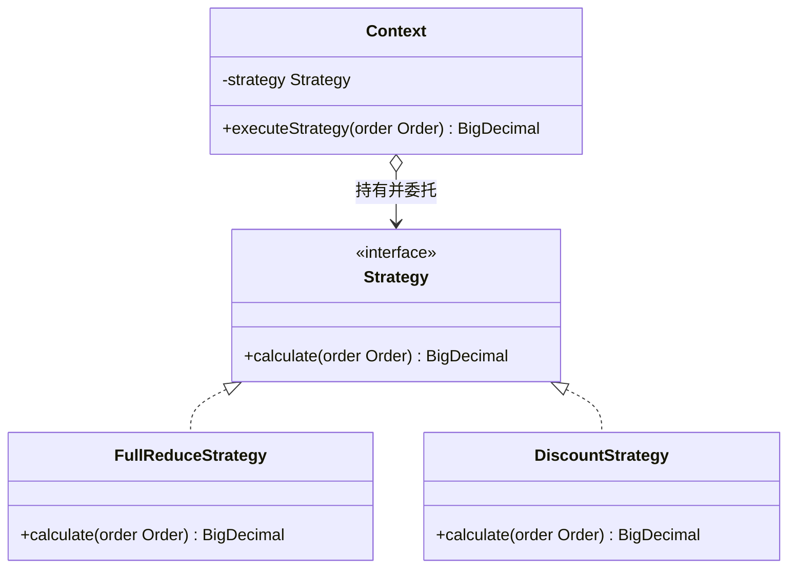

# 策略模式（Strategy）

> 一句话定位：**行为型里热度最高的模式，面试考察的不是定义，而是「你用它消掉过多少 `if-else`」**。考官真正想听的是策略 + 策略工厂 + Spring 注入 `Map<String, Strategy>` 的工程化组合——新增策略只加一个 `@Component`，不改任何已有代码。
> 分类：行为型（Behavioral） | 面试热度：★★★★★
> 版本前提：JDK 17 + Spring Boot（容器注入部分是工程加分项）

---

## 1. 是什么

**定义一系列算法，把它们一个个封装起来，并且使它们可以互相替换；算法的变化独立于使用算法的客户。**

| 角色 | 职责 |
| --- | --- |
| Strategy（策略接口） | 声明算法入口，如 `BigDecimal calculate(Order order)` |
| ConcreteStrategy（具体策略） | 实现一种具体算法，如 `FullReduceStrategy`、`DiscountStrategy` |
| Context（上下文） | 持有策略引用，把请求**委托**给策略，自身不实现算法 |



---

## 2. 解决什么问题

**痛点：判定条件散落在业务代码里。** 每加一种支付方式 / 优惠类型 / 文件格式，都要在多处 `if-else` / `switch` 里插分支，改一处漏一处，**违反开闭原则**（对扩展开放、对修改关闭）。

**before**（判定条件渗透进业务）：

```java
public BigDecimal pay(String channel, BigDecimal amount) {
    if ("WECHAT".equals(channel)) {          // 新增渠道要改这里
        return wechatPay(amount);
    } else if ("ALIPAY".equals(channel)) {
        return alipayPay(amount);
    } else if ("BANK".equals(channel)) {     // 还有 5 处类似判断散在各处
        return bankPay(amount);
    }
    throw new IllegalArgumentException("未知渠道");
}
```

**after**（策略 + 注册表，新增渠道只加类）：

```java
payService.pay("BANK_CARD", amount); // 新增渠道 = 新增一个 @Component，本行不用动
```

**为什么不用别的方案**：

| 替代方案 | 问题 |
| --- | --- |
| 继续 `if-else` | 每加一种类型改多处，回归面大，违反开闭 |
| 继承 + 子类重写 | Java 单继承，且「按类型分流」和「业务继承体系」是两回事，会撑爆类层次 |
| 命令模式 | 命令封装「请求」用于排队/撤销/日志，策略封装「算法」用于替换，意图不同 |

**关键取舍**：策略把「选哪个算法」与「算法怎么算」分开，代价是类数量膨胀和一处「选择逻辑」。选择逻辑用 Map / 注解注册消掉，是工程化的关键一步。

---

## 3. 怎么写

### 3.1 策略接口 + 具体策略（无状态单例）

```java
public interface PayStrategy {
    String channel();                        // 自报家门，作为注册 key
    PayResult pay(PayRequest request);
}

@Component
public class WechatPayStrategy implements PayStrategy {
    @Override public String channel() { return "WECHAT"; }
    @Override public PayResult pay(PayRequest req) {
        // 调微信下单 SDK……策略对象保持无状态，可被多线程共享
        return PayResult.success("wx_" + req.orderId());
    }
}

@Component
public class AlipayPayStrategy implements PayStrategy {
    @Override public String channel() { return "ALIPAY"; }
    @Override public PayResult pay(PayRequest req) {
        return PayResult.success("ali_" + req.orderId());
    }
}
```

### 3.2 策略工厂：Spring 注入 `List<Strategy>` 自动注册

```java
@Component
public class PayStrategyFactory {
    private final Map<String, PayStrategy> registry;

    // Spring 会把容器里所有 PayStrategy 实现注入成 List
    public PayStrategyFactory(List<PayStrategy> strategies) {
        this.registry = strategies.stream()
            .collect(Collectors.toUnmodifiableMap(PayStrategy::channel, Function.identity()));
    }

    public PayResult pay(String channel, PayRequest req) {
        PayStrategy strategy = registry.get(channel);
        if (strategy == null) throw new IllegalArgumentException("未知渠道: " + channel);
        return strategy.pay(req);
    }
}
```

**这是面试最能体现工程经验的一段**：新增渠道只需写一个 `@Component`，Spring 启动时自动注入进 `List`、注册进 Map，**不改任何已有代码**——真正落实开闭原则。也可以注入 `Map<String, PayStrategy>`（Spring 会以 beanName 为 key 自动组装），或用自定义注解 `@PayChannel("WECHAT")` 做 key，避免 beanName 硬编码。

---

## 4. 使用场景

| 场景 | 说明 |
| --- | --- |
| 支付方式 | 微信 / 支付宝 / 银行卡，渠道即策略 key |
| 优惠计算 | 满减 / 折扣 / 会员价，可叠加场景配责任链 |
| 文件解析 | CSV / Excel / JSON 解析器按后缀分流 |
| 路由规则 | 灰度路由、按租户 / 按权重分流 |
| 风控规则 | 每条规则一个策略，规则可热插拔 |

**JDK / Spring 中的真实例子**：

- `java.util.Comparator` —— 最经典的策略：`Collections.sort(list, comparator)`、`List.sort()`；JDK 8 后 `Comparator.comparing(User::getAge).thenComparing(User::getName)` 链式组合。
- `ThreadPoolExecutor` 的 `RejectedExecutionHandler` —— 四种拒绝策略：`AbortPolicy`（默认，抛 `RejectedExecutionException`）、`CallerRunsPolicy`（调用者线程自己跑，天然反压）、`DiscardPolicy`（静默丢弃）、`DiscardOldestPolicy`（丢队头任务）。
- Spring `Resource` 体系 —— `ClassPathResource` / `FileSystemResource` / `UrlResource` 实现同一接口，`ResourceLoader` 按前缀选策略。
- Spring Security `PasswordEncoder` 策略族 —— `BCryptPasswordEncoder` / `NoOpPasswordEncoder` / `Pbkdf2PasswordEncoder`，`DelegatingPasswordEncoder` 按 `{id}` 前缀分派。
- Spring 的 `InstantiationStrategy`（`SimpleInstantiationStrategy` / `CglibSubclassingInstantiationStrategy`）、`AuthenticationProvider`。
- JDK 9+ `String` 紧凑字符串：`LATIN1` / `UTF16` 两种编码策略由 JVM 内部按内容自动选择（`String.coder()`）。

---

## 5. 生产中的问题与排查

| 问题 | 现象 | 排查 / 修复 |
| --- | --- | --- |
| **策略类数量膨胀** | 每种业务差异都建一个策略，类爆炸 | 粒度按「算法」而非「业务分支」划分；差异只是参数时用配置化策略（规则引擎 / 参数表），不是每种差异都建类 |
| **策略持可变状态导致并发错乱** | 偶发结果错误，压测才复现 | 策略必须是**无状态单例**：字段只读、运行时数据走参数或 `ThreadLocal`；Spring 注入的 `@Component` 默认单例，千万别加实例级可变字段 |
| **选择逻辑仍是 `if-else`** | 策略有了，分流处还是一串 if | 用 `Map<String, Strategy>` 注册表 / `List` 自动注册消掉；选择逻辑收敛到工厂一处 |
| **客户端必须知道所有策略** | 调用方硬编码渠道字符串 | 用工厂 / 注册表隐藏策略集合；key 由策略自报（`channel()` 方法或注解），客户端只传业务标识 |
| **Map key 冲突** | 两个策略注册同一个 key，启动正常、运行结果错 | 注册时用 `toUnmodifiableMap`，重复 key 启动即抛异常；或注册后断言 size 一致 |
| **策略不存在时静默降级** | 打到默认策略，数据悄悄算错 | `registry.get` 为 null 必须**显式抛异常**，不要默默 fallback，除非业务明确允许 |
| **策略内调用远程服务无超时** | 某策略 hang 住拖垮整个接口 | 策略是代码组织方式，不改调用语义；远程调用该加的超时、熔断、降级一个不能少 |

---

## 6. 面试问法

### 60 秒版本

> 策略模式是行为型模式，定义一系列算法并封装成同一接口的实现，让它们可以互相替换，算法变化独立于使用它的客户。它最大的工程价值是**消除 `if-else`**：没有它时，每加一种类型要在多处分支里插代码，违反开闭原则；用了策略之后，再配合策略工厂——Spring 场景下注入 `List<Strategy>` 或 `Map<String, Strategy>`，让策略自报 key 自动注册——新增策略只需要加一个 `@Component`，不改任何已有代码。经典例子是 JDK 的 `Comparator`，以及 `ThreadPoolExecutor` 的四种 `RejectedExecutionHandler` 拒绝策略。和状态模式的区别在于：**策略是客户端主动选的，状态是对象自己流转的**；和模板方法的区别在于：策略用组合换整个算法，模板方法用继承只换几个步骤，现代工程优先组合。

### 5 分钟版本补充点

1. 策略对象必须**无状态单例**，否则并发下共享状态出错；Spring `@Component` 默认单例正好契合
2. `Map<String, Strategy>` 注入时 Spring 以 beanName 为 key；更稳妥的做法是注入 `List`、让策略实现 `String channel()` 自报 key，或用自定义注解做 key
3. `CallerRunsPolicy` 是四种拒绝策略里最有味道的：让提交任务的线程自己执行，天然形成反压，生产上常用它 + 有界队列扛突刺流量
4. 策略的选择逻辑本身仍是一处 `if`，只是被收敛进工厂；想彻底消灭分流代码可上规则引擎，但那是过度设计的边界
5. 策略常与工厂、享元（策略无状态可缓存复用）、责任链（多策略顺序执行）组合出现
6. 反面信号：策略类数量随业务线性膨胀，说明差异其实是「参数」而非「算法」，应改为配置化

---

## 7. 追问链 · 参考答案

| 层级 | 问题 | 参考答案要点 |
| --- | --- | --- |
| L1 | 策略模式是什么？ | 行为型模式。定义一系列算法，各自封装成同一接口的实现，可互相替换，算法变化独立于使用它的客户。角色：Strategy 接口 / ConcreteStrategy / Context |
| L1 | 解决什么问题？ | 消除散落的 `if-else` / `switch`：判定条件渗透进业务代码，每加一种类型改多处，违反开闭。策略把「选哪个」和「怎么算」分离，新增类型只加类不改码 |
| L2 | 策略和工厂怎么配合？ | 策略工厂持 `Map<key, Strategy>` 注册表，按业务标识取策略。Spring 下注入 `List<Strategy>` 或 `Map<String, Strategy>`（key 为 beanName），策略自报 `channel()` 自动注册，新增策略只加一个 `@Component` |
| L2 | 策略为什么要求无状态？ | 策略通常作为单例被多线程共享（Spring 默认单例）。有可变实例字段就会并发错乱。运行时数据走方法参数或 `ThreadLocal`，策略本身只保留算法 |
| L3 | 举个 JDK 里的策略例子 | `Comparator`：`Collections.sort(list, cmp)` 把排序算法（比较规则）作为策略传入；JDK 8 起 `Comparator.comparing(...).thenComparing(...)` 链式组合多个策略 |
| L3 | 线程池拒绝策略是哪四种？ | `AbortPolicy`（默认，抛 `RejectedExecutionException`）、`CallerRunsPolicy`（提交者线程自己跑，天然反压）、`DiscardPolicy`（静默丢新任务）、`DiscardOldestPolicy`（丢队头）。生产常用 CallerRuns + 有界队列 |
| L4 | 策略和状态模式的区别？ | UML 相同，**意图不同**。策略由客户端主动选择、策略间互不感知、通常无状态；状态由 Context 内部流转、状态间互相知晓下一状态。**口诀：策略是你选的，状态是它自己变的** |
| L4 | 策略和模板方法的区别？ | 策略用**组合（接口）**替换整个算法，可运行时切换；模板方法用**继承（抽象类）**只替换算法中的几个步骤，编译期绑定。优先组合：继承是强耦合，且 Java 单继承 |
| L4 | 策略和命令模式的区别？ | 命令封装「请求」（谁发起、做什么、参数），用于排队、撤销、日志；策略封装「算法」，用于替换。命令的 Receiver 执行体可以用策略实现，但两者意图正交 |
| L5 | 项目里策略类爆炸怎么办？ | 区分「算法差异」和「参数差异」：后者不该建类，应配置化（规则表 / 规则引擎）。策略粒度按算法划分，一个策略内部可以用配置参数适配多个业务变体 |

---

## 8. 误区 · 正解

| ❌ 误区 | ✅ 正解 |
| --- | --- |
| 「策略模式就是换个写法的 `if-else`」 | 策略消灭的是**散布多处的判定条件**，把选择收敛到工厂一处、算法各自成类；新增类型不改已有代码。工厂里那一次 Map 查找不算 `if-else` 复发 |
| 「策略对象可以存中间计算结果到字段里」 | 策略必须**无状态**。Spring 单例下字段被多线程共享会错乱；中间结果放局部变量或返回值 |
| 「策略和状态模式只是名字不同」 | UML 相同但意图相反：策略由**客户端选择**、策略间不互知；状态由**对象内部流转**、状态间互知后继。面试答不出这句会被认为只会背图 |
| 「用枚举实现策略更优雅，应该首选」 | 枚举策略适合**数量固定、无依赖**的场景（如 `TimeUnit`）；策略需要注入 DAO / RPC 等依赖、或数量随业务增长时，枚举拿不到 Spring 依赖，必须用 `@Component` 方案 |
| 「新增了策略，工厂里还是得改一行注册」 | Spring 自动注入 `List<Strategy>` 的方案**一行都不用改**：新 `@Component` 启动时自动进 List 完成注册。手动 `register()` 的工厂才需要改 |
| 「策略模式能完全消除 if」 | 不能。选择逻辑总有一处（Map.get / 一次 if），策略只是把它收敛到工厂。彻底消灭分流是规则引擎的事，多数项目不需要 |
| 「`Collections.sort` 第二个参数传 Lambda，不算策略模式」 | Lambda 就是策略的语法糖：`Comparator` 是单抽象方法接口，`list.sort((a,b)->...)` 传的就是一个匿名策略实例 |

---

## 9. 相关模式

| 模式 | 关系 |
| --- | --- |
| 状态（State） | UML 相同；策略客户端选、互不感知，状态内部流转、互相知晓 |
| 模板方法（Template Method） | 策略用组合换整个算法；模板方法用继承换部分步骤。优先组合 |
| 命令（Command） | 命令封装请求（可排队/撤销），策略封装算法（可替换），意图正交 |
| 工厂方法 / 简单工厂 | 策略的「选择」通常由工厂承担（策略工厂是二者最常见的组合） |
| 享元（Flyweight） | 无状态策略可按 key 缓存复用，等价于享元 |
| 责任链（Chain of Responsibility） | 多策略需按序执行 / 叠加时，可升级为责任链 |

---

## 10. 我的薄弱点

（学完后自己填，同步到 `weakness.md`）
