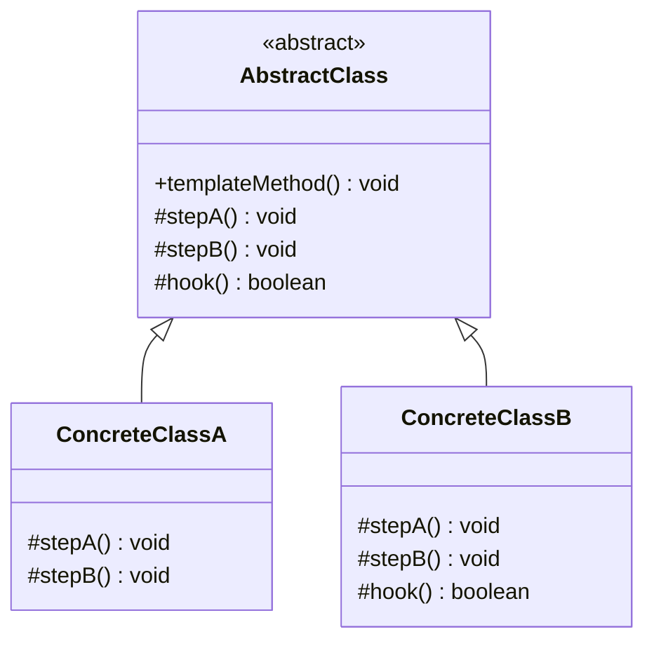

# 模板方法模式（Template Method）

> 一句话定位：**「流程固定、步骤可变」的标准答案，也是理解 AQS 和 Spring `refresh()` 的钥匙**。面试的区分度不在定义，而在能否讲清好莱坞原则、三类方法（抽象/具体/钩子）、以及为什么 AQS 是模板方法最教科书的落地。
> 分类：行为型（Behavioral） | 面试热度：★★★★☆
> 版本前提：JDK 17 + Spring（源码例子是本题最大价值）

---

## 1. 是什么

**定义一个操作中的算法骨架，将一些步骤延迟到子类中，使子类可以不改变算法结构即可重定义某些步骤。**

| 角色 | 职责 |
| --- | --- |
| AbstractClass（抽象类） | 定义模板方法（算法骨架，通常 `final`）+ 抽象方法 / 钩子方法 |
| ConcreteClass（具体子类） | 实现抽象步骤、可选重写钩子，**不改动算法骨架** |

三类方法必须分清：

| 方法类型 | 谁实现 | 子类可否重写 | 例子 |
| --- | --- | --- | --- |
| 抽象方法 | 父类只声明 | **必须**实现 | AQS 的 `tryAcquire(int)` |
| 具体方法 | 父类实现 | 不重写（模板方法应 `final`） | AQS 的 `acquire(int)` |
| 钩子方法（Hook） | 父类给默认实现 | **可选**重写，影响流程 | Spring 的 `onRefresh()`、`HttpServlet` 的 `doGet()` |



---

## 2. 解决什么问题

**痛点**：多个算法**流程一致、个别步骤不同**（比如「取连接 → 执行 → 异常处理 → 关连接」）。没有模板方法时，要么复制粘贴整个流程（改流程要改 N 处），要么把流程交给每个调用方自己拼（必然有人漏掉关连接）。

**好莱坞原则（Hollywood Principle）**：「**别调用我们，我们会调用你**」。父类控制流程，子类只提供步骤片段，避免低层组件反向控制高层流程——这与依赖倒置「高层不依赖低层细节」一脉相承，框架（父类）调用应用代码（子类），而非相反。

**为什么不用策略**：

| 维度 | 模板方法 | 策略 |
| --- | --- | --- |
| 复用机制 | **继承**（抽象类） | **组合**（接口 + 委托） |
| 替换粒度 | 只替换**部分步骤** | 替换**整个算法** |
| 耦合 | 子类与父类紧耦合，单继承受限 | 松耦合，可运行时替换 |
| 适用场景 | 流程固定、只有少数步骤变化 | 算法整体可换、需运行时切换 |

**关键取舍**：现代工程**优先策略/回调**，因为继承是强耦合且 Java 单继承宝贵。模板方法留给「骨架必须强管控」的场景——框架源码（AQS、Spring 启动流程）是它最好的栖息地，业务代码里则应克制使用。

---

## 3. 怎么写

```java
public abstract class AbstractDataImporter {

    /** 模板方法：final 防止子类篡改骨架 */
    public final ImportResult importData(Path file) {
        String raw = readFile(file);                 // 具体方法：父类实现
        if (!validate(raw)) {                        // 钩子：子类可选关闭校验
            throw new IllegalArgumentException("校验失败: " + file);
        }
        List<Row> rows = parse(raw);                 // 抽象方法：子类必须实现
        int count = persist(rows);                   // 抽象方法：子类必须实现
        return new ImportResult(file, count);
    }

    private String readFile(Path file) {
        try { return Files.readString(file); }
        catch (IOException e) { throw new UncheckedIOException(e); }
    }

    /** 钩子：默认开启校验，子类可重写关闭 */
    protected boolean validate(String raw) { return raw != null && !raw.isBlank(); }

    protected abstract List<Row> parse(String raw);
    protected abstract int persist(List<Row> rows);
}

public class CsvImporter extends AbstractDataImporter {
    @Override protected List<Row> parse(String raw) {
        return raw.lines().skip(1).map(Row::fromCsvLine).toList();
    }
    @Override protected int persist(List<Row> rows) {
        return rowRepository.batchInsert(rows);      // 注入的仓储
    }
}
```

要点：`templateMethod` 声明为 **`final`**（防子类改流程）；`parse`/`persist` 是必须实现的抽象步骤；`validate` 是钩子，默认开启、子类可选关闭。

---

## 4. 使用场景

| 场景 | 说明 |
| --- | --- |
| 框架骨架管控 | 并发原语、容器启动、请求分派——骨架绝不能被使用者篡改 |
| 资源管理范式 | 「获取资源 → 执行 → 释放」固定流程，业务只填中间一步 |
| 算法骨架复用 | 数据导入 / 报表生成：读、校验、写流程一致，格式各异 |
| 测试生命周期 | `setUp` / `tearDown` 围绕测试方法的固定前后置 |

**JDK / 框架中的真实例子**（本题最大价值所在）：

- **AQS（`AbstractQueuedSynchronizer`）——最值得讲的模板方法**：`acquire(int)` / `release(int)` 是模板方法，固定了「尝试获取 → 入队排队 → 挂起/唤醒」的完整流程；子类只需实现 `tryAcquire(int)` / `tryRelease(int)`。`ReentrantLock`、`Semaphore`、`CountDownLatch` 全部是它的产物。
- **`HttpServlet`**：`service()` 是模板方法，按 HTTP method 分派到 `doGet()` / `doPost()`，子类只重写 `doXxx()`。
- **Spring `AbstractApplicationContext#refresh()`**：容器启动的 12 步模板；`postProcessBeanFactory()` / `onRefresh()` 是给子类的钩子（如 `AbstractRefreshableWebApplicationContext` 在 `onRefresh()` 里建 Web 容器）。
- **`JdbcTemplate#execute()` / `RedisTemplate#execute()`**：固定「取连接 → 执行 → 释放」骨架，变化部分以回调参数传入（`PreparedStatementCreator` / `RowMapper`）。
- **MyBatis `BaseExecutor`**：`query()` 定义骨架（查一级缓存 → `doQuery()` → 写缓存），`SimpleExecutor` / `ReuseExecutor` / `BatchExecutor` 各自实现 `doQuery()`。
- **`InputStream#read(byte[], int, int)`**：模板方法，子类只需实现无参 `read()`。
- **`AbstractList`**：集合骨架实现，`get(int)`/`size()` 留给子类。
- **JUnit**：`setUp()` / `tearDown()` 是测试骨架的钩子（JUnit 5 改为 `@BeforeEach` 注解，思路相同）。

---

## 5. 生产中的问题与排查

| 问题 | 现象 | 排查 / 修复 |
| --- | --- | --- |
| **子类重写了模板方法改掉流程** | 骨架被悄悄篡改，排查困难 | 模板方法一律声明 `final`；框架代码更要如此（AQS 的 `acquire` 就是 `final`） |
| **构造期调用可覆写方法** | 子类字段还是 null / 默认值，NPE 或逻辑错乱 | **Java 经典陷阱**：父类构造器（或被构造器调用的模板方法）调用可覆写方法时，子类方法看到的是尚未初始化的子类字段。模板方法不要在构造期触发，或把可变步骤推迟到显式 `init()` |
| **钩子过多父类难理解** | 父类几十个空钩子，读不懂哪些是必改 | 钩子按「必改/可选」分组命名（如 `mustXxx` 抽象 / `isAllowXxx` 钩子）；超过 5-6 个钩子时考虑拆成策略组合 |
| **继承层级过深** | `A extends B extends C extends D`，改一步影响一片 | 模板方法只适合 1-2 层；层级一深就该换成策略/回调组合 |
| **骨架与步骤职责错位** | 子类实现里还要自己处理异常/关资源 | 横切逻辑（异常、资源、日志）必须收敛在骨架里；发现子类重复写 try-finally 就是骨架设计漏了 |
| **子类在步骤里调用父类方法形成环** | 流程回环、栈溢出 | 遵守好莱坞原则：父类调子类，子类不反向驱动流程；子类方法应是纯粹的「填空」 |
| **回调接口泄漏内部资源** | 用户在 `RowMapper` 里把 `ResultSet` 存起来 | 回调参数生命周期由骨架管控，文档注明「禁止逃逸」；框架侧用完即关 |

---

## 6. 面试问法

### 60 秒版本

> 模板方法是行为型模式，在抽象类里定义算法骨架，把个别步骤延迟到子类实现，子类不改变算法结构就能重定义某些步骤。它体现**好莱坞原则**——「别调用我们，我们会调用你」，父类控制流程、子类只填空。要分清三类方法：抽象方法子类必须实现，具体方法父类实现，钩子方法父类给默认实现、子类可选重写来影响流程；模板方法本身要声明 `final` 防止子类改骨架。最教科书的例子是 **AQS**：`acquire()` 固定了入队排队的完整流程，子类只实现 `tryAcquire()`，`ReentrantLock`、`Semaphore`、`CountDownLatch` 都是这么来的。Spring 里 `AbstractApplicationContext.refresh()` 的 12 步启动流程、MyBatis `BaseExecutor` 的 `query()` 也是。和策略的区别：模板方法用继承只换部分步骤，策略用组合换整个算法，业务代码优先组合，模板方法留给框架级骨架管控。

### 5 分钟版本补充点

1. `JdbcTemplate` 严格说是**模板方法 + 回调**的结合：固定流程在模板里，变化部分（`PreparedStatementCreator`/`RowMapper`）以参数传入而非子类——面试点出这句是加分项
2. 钩子方法的典型形态：`boolean isAllowXxx()` 默认 `true`、空实现的 `onXxx()`；Spring `refresh()` 里的 `onRefresh()` 就是给 Web 子类创建内嵌容器的钩子
3. **构造期调用可覆写方法是 Java 经典陷阱**：父类构造时子类字段未初始化，子类方法读到默认值——所以骨架不该在构造期触发
4. AQS 的 `tryAcquire` 返回 `boolean`、模板据此决定是否入队——钩子返回值影响骨架走向，是「钩子控制流程」的实例
5. JUnit 5 用 `@BeforeEach` 注解替代继承式 `setUp()`，说明框架也在从「继承模板」向「组合/注解」迁移
6. 业务代码里模板方法常被策略替代，但它对「骨架必须强管控」的框架场景仍不可替代

---

## 7. 追问链 · 参考答案

| 层级 | 问题 | 参考答案要点 |
| --- | --- | --- |
| L1 | 模板方法模式是什么？ | 行为型模式。抽象类定义算法骨架（模板方法），把部分步骤延迟到子类，子类不改结构即可重定义这些步骤。角色：AbstractClass / ConcreteClass |
| L1 | 三类方法分别是什么？ | 抽象方法：子类必须实现；具体方法：父类实现、子类不重写；钩子方法：父类给默认实现，子类**可选**重写以影响流程（如 `isAllowXxx()`） |
| L2 | 好莱坞原则是什么？ | 「别调用我们，我们会调用你」。父类（框架）控制流程并调用子类提供的步骤，子类不反向驱动流程。与依赖倒置一致：高层流程不依赖低层细节，反而由高层调用低层实现 |
| L2 | 模板方法为什么要 `final`？ | 骨架是模式的核心资产，子类重写模板方法等于篡改算法结构，模式失效。AQS 的 `acquire()` / `release()` 都是 `final`，只允许实现 `tryAcquire` 等钩子 |
| L3 | 为什么说 AQS 是模板方法？ | `acquire(int)` 固定了「tryAcquire 尝试 → 失败入队 → 挂起 → 唤醒重试」的完整流程且为 `final`；子类只实现 `tryAcquire(int)` / `tryRelease(int)`。`ReentrantLock`、`Semaphore`、`CountDownLatch` 全部基于此骨架 |
| L3 | Spring 里哪段是模板方法？ | `AbstractApplicationContext#refresh()`：12 步容器启动模板（`obtainFreshBeanFactory`、`invokeBeanFactoryPostProcessors`、`onRefresh`、`finishBeanFactoryInitialization` 等），`postProcessBeanFactory()` 和 `onRefresh()` 是留给子类的钩子 |
| L3 | MyBatis 里哪段是模板方法？ | `BaseExecutor#query()` 定义骨架：拼缓存 key → 查一级缓存 → 未命中调抽象方法 `doQuery()` → 结果写入缓存。`SimpleExecutor` / `ReuseExecutor` / `BatchExecutor` 分别实现 `doQuery()` |
| L4 | 模板方法和策略的区别？ | 模板方法用**继承**只替换算法的部分步骤，编译期绑定；策略用**组合**替换整个算法，可运行时切换。优先组合：继承是强耦合、Java 单继承。模板方法适合流程强管控的框架场景 |
| L4 | `JdbcTemplate` 是模板方法吗？ | 严格说是模板方法 + **回调**的结合：骨架（取连接、异常处理、关连接）固定在 `execute()` 里，变化部分不通过子类而是以 `PreparedStatementCreator` / `RowMapper` 参数传入。实现的是模板方法的意图，机制是回调 |
| L5 | 业务代码里该不该用模板方法？ | 克制使用。流程强管控、步骤差异小（1-2 层继承）时可用；步骤差异大或需运行时切换时用策略。信号：子类里出现重复的 try-finally / 异常处理，说明骨架该把横切逻辑收回去 |

---

## 8. 误区 · 正解

| ❌ 误区 | ✅ 正解 |
| --- | --- |
| 「模板方法就是抽象类 + 抽象方法」 | 还差**骨架与钩子**：模板方法把**调用顺序**固定在父类（且通常 `final`），抽象方法只是被骨架调用的空位；没有固定流程的抽象类不是模板方法 |
| 「模板方法可以被重写，只要重写时小心」 | 必须 `final`。骨架可重写意味着算法结构可被子类破坏，AQS 等框架全部把模板方法设为 `final` |
| 「钩子方法也是必须实现的」 | 钩子（Hook）是**可选**重写：父类给默认空实现或默认返回值（如 `isAllowXxx()` 默认 `true`），子类不重写也能跑通流程 |
| 「模板方法和策略模式差不多，随便选一个」 | 替换粒度不同：模板方法只换**部分步骤**（继承），策略换**整个算法**（组合）。继承强耦合且 Java 单继承，业务代码优先策略 |
| 「父类构造器里调模板方法更方便初始化」 | **经典陷阱**：构造期子类字段尚未初始化，可覆写方法读到默认值导致 NPE / 逻辑错误。可变步骤应推迟到显式 `init()` 或首次使用时 |
| 「`JdbcTemplate` 继承自一个模板基类」 | 它不是继承式模板方法，而是**回调式**：变化部分以 `PreparedStatementCreator` / `RowMapper` 参数传入。面试能辨析这点说明真读过源码 |
| 「继承层级越深，模板方法复用越好」 | 恰恰相反：层级一深，改动传导和阅读成本指数上升。模板方法适合 1-2 层扁平结构，深了就该拆策略组合 |
| 「`Collections.sort` 是模板方法」 | 那是**策略**：比较规则（`Comparator`）作为整体算法以参数传入。模板方法是继承换步骤，`sort` 是组合换算法 |

---

## 9. 相关模式

| 模式 | 关系 |
| --- | --- |
| 策略（Strategy） | 模板方法用继承换部分步骤；策略用组合换整个算法。现代工程优先策略 |
| 工厂方法（Factory Method） | 工厂方法是模板方法的特例：骨架是「创建对象并使用」，可变步骤是「创建哪个对象」 |
| 回调 / 钩子（Callback） | `JdbcTemplate` 式「模板 + 回调参数」是模板方法意图的组合式实现 |
| 建造者（Builder） | 建造者的 Director 可用模板方法固定构建顺序，步骤由 Builder 实现 |
| 状态（State） | 状态流转的骨架可做成模板方法，状态类实现各步骤 |

---

## 10. 我的薄弱点

（学完后自己填，同步到 `weakness.md`）
