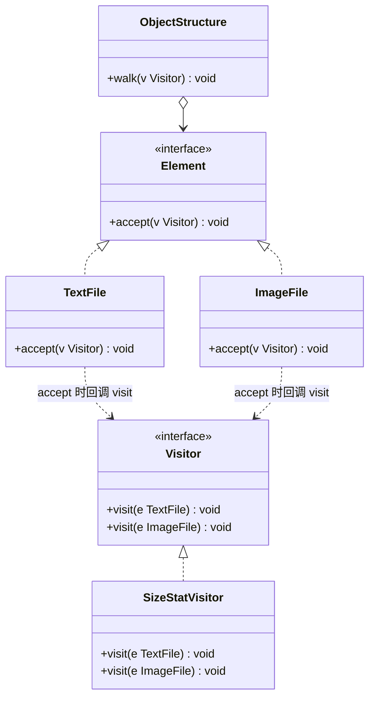
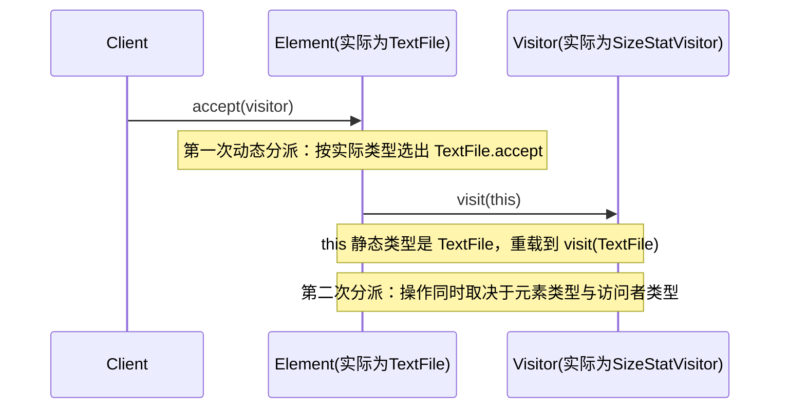

# 访问者模式（Visitor）

> 一句话定位：**GoF 里最「偏科」的模式——低频出现，但一旦场景对（AST、编译器、报表）就是唯一正解**。面试的灵魂考点是**双分派（Double Dispatch）**，以及它对开闭原则的「倾斜性」：加操作容易、加元素难。
> 分类：行为型（Behavioral） | 面试热度：★☆☆☆☆
> 版本前提：JDK 17（会对比 JDK 21 模式匹配的替代方案）

---

## 1. 是什么

**表示一个作用于某对象结构中各元素的操作。它使你可以在不改变各元素类的前提下，定义作用于这些元素的新操作。**

| 角色 | 职责 |
| --- | --- |
| Visitor（访问者接口） | 为**每种** ConcreteElement 声明一个 `visit(ConcreteElementA)` 重载 |
| ConcreteVisitor | 实现一套具体操作（如「导出 PDF」「统计大小」） |
| Element | 声明 `accept(Visitor)` |
| ConcreteElement | `accept` 里回调 `visitor.visit(this)` |
| ObjectStructure | 持有元素集合，遍历并让每个元素接受访问 |



---

## 2. 解决什么问题

**痛点**：一批类型稳定的数据元素（文件、AST 节点、商品），需要不断追加**新操作**（导出 PDF、统计大小、计价、安全检查）。直接在元素类里加方法 → 每加一种操作要改所有元素类；用 `instanceof` 链判断 → 编译期无 exhaustiveness 检查，漏一个类型静默跳过。

**双分派是本题灵魂**——Java 只有单分派：

| 机制 | 绑定时机 | 按什么选择 |
| --- | --- | --- |
| 方法重载（overload） | **编译期**静态绑定 | 参数的**声明类型** |
| 方法重写（override） | **运行期**动态绑定 | 对象的**实际类型** |

一次 `foo.bar(x)` 只有一次动态分派（选 `bar` 的实现），`x` 是按声明类型选重载的。访问者模式用两次分派把「操作取决于元素类型 + 访问者类型」同时解决：



**开闭原则的倾斜性**（与抽象工厂呼应，必写）：

| 变化方向 | 代价 | 是否合开闭 |
| --- | --- | --- |
| 新增**操作**（新 Visitor） | 加一个类即可 | ✅ 符合 |
| 新增**元素类型**（新 ConcreteElement） | Visitor 接口加方法，**所有 Visitor 实现类都要改** | ❌ 违反 |

**结论：访问者适合「元素结构稳定、操作频繁扩展」的场景**（AST、报表、编译器）。元素类型三天两头加的场景千万别用。

---

## 3. 怎么写

```java
/** 元素：文件节点 */
public interface FileNode {
    void accept(FileNodeVisitor visitor);
}

public record TextFile(String name, long bytes) implements FileNode {
    @Override public void accept(FileNodeVisitor v) { v.visit(this); } // this 静态类型 = TextFile
}
public record ImageFile(String name, long bytes, String format) implements FileNode {
    @Override public void accept(FileNodeVisitor v) { v.visit(this); }
}

/** 访问者：为每种元素一个重载 */
public interface FileNodeVisitor {
    void visit(TextFile file);
    void visit(ImageFile file);
}

/** 新操作 = 新 Visitor，不改任何元素类 */
public class SizeStatVisitor implements FileNodeVisitor {
    private long totalBytes;
    @Override public void visit(TextFile f)  { totalBytes += f.bytes(); }
    @Override public void visit(ImageFile f) { totalBytes += f.bytes(); }
    public long totalBytes() { return totalBytes; }
}

/** ObjectStructure：遍历并派发 */
public class FileTree {
    private final List<FileNode> nodes;
    public void walk(FileNodeVisitor visitor) {
        nodes.forEach(node -> node.accept(visitor)); // 遍历与操作解耦
    }
}
```

新增「导出清单」操作只需再写一个 `ExportVisitor implements FileNodeVisitor`，元素类一行不动。

---

## 4. 使用场景

| 场景 | 说明 |
| --- | --- |
| 编译器 / AST 遍历 | 节点类型稳定（语言语法不变），分析操作（检查、优化、生成）持续增加 |
| 报表导出 | 同一批数据导出 PDF / Excel / Word，每种格式一个 Visitor |
| 价格计算 | 对不同商品类型用不同计价规则，规则族持续扩展 |
| 资源统计 | 统计目录下各类型文件大小、数量 |

**JDK / 框架中的真实例子**：

- **`java.nio.file.FileVisitor` + `Files.walkFileTree()`** —— 最标准的 JDK 访问者：`preVisitDirectory` / `visitFile` / `visitFileFailed` / `postVisitDirectory` 四个回调，常用 `SimpleFileVisitor` 空实现做父类。
- **`javax.lang.model.element.ElementVisitor`** —— 注解处理器（APT）里访问 AST 元素；配套 `TypeVisitor` 访问类型。写注解处理器必用。
- **ASM 字节码框架** —— `ClassVisitor` / `MethodVisitor` / `AnnotationVisitor`，Spring 用 ASM 读 class 元数据（`AsmUtils` 相关链路）就是这套。
- **编译器前端** —— JavaParser 的 `VoidVisitor<A>`、ANTLR 生成的 `XxxBaseVisitor`。

---

## 5. 生产中的问题与排查

| 问题 | 现象 | 排查 / 修复 |
| --- | --- | --- |
| **破坏封装** | 元素为支持 Visitor 暴露大量内部 getter | `accept` 要求元素把细节交给 Visitor，封装与扩展性二选一；敏感字段用包级可见或仅暴露计算结果 |
| **新增元素类型改动面大** | 加一个元素，所有 Visitor 编译报错 | 这是模式固有代价；元素不稳定就别用访问者，改用 `instanceof` 模式匹配或把操作放回元素类 |
| **`visit` 重载参数写错** | `visit(Element)` 而非 `visit(TextFile)`，静默走错误分支 | 重载按**声明类型**分派，写错参数类型不会报错只会静默分派错；`accept` 里必须 `visitor.visit(this)` 且 `this` 的静态类型就是具体类 |
| **访问者持累加状态的并发问题** | 多线程共用一个 Visitor 统计，结果错乱 | Visitor 通常有状态（累加器），**不能共享**；每次遍历 new 一个，或用 `ThreadLocal` |
| **遍历顺序敏感** | 先统计后汇总写成边遍历边汇总，结果差一批 | 明确约定：先 `walk` 完成再读累加结果；或 Visitor 内部按阶段分桶 |
| **ObjectStructure 与 Visitor 职责混淆** | 把「怎么遍历」写进 Visitor | 遍历是 ObjectStructure / 迭代器的事，Visitor 只关心「对每种类型做什么」；混在一起两边都难测 |
| **用访问者硬套简单场景** | 两三个 `instanceof` 能解决的，建了一整套 Visitor | 元素少且操作少时直接模式匹配；访问者的价值在**操作会持续增长**时才兑现 |

---

## 6. 面试问法

### 60 秒版本

> 访问者模式在不改变元素类的前提下，为对象结构定义新操作。它的灵魂是**双分派**：Java 方法重写是运行期动态绑定、重载是编译期静态绑定，一次调用只有一次动态分派；访问者通过 `element.accept(visitor)`——第一次按元素实际类型动态分派——再在 `accept` 里 `visitor.visit(this)`，`this` 的静态类型就是具体元素类，重载到对应的 `visit`——第二次分派，于是**操作同时取决于元素类型和访问者类型**。它对开闭原则是倾斜的：新增操作（新 Visitor）只加一个类，新增元素类型却要改所有 Visitor 实现，所以只适合**元素结构稳定、操作频繁扩展**的场景，比如编译器 AST、报表导出。JDK 里最标准的例子是 `FileVisitor` 配合 `Files.walkFileTree()`，还有注解处理器的 `ElementVisitor`、ASM 的 `ClassVisitor`。JDK 21 的 `switch` 模式匹配能实现类似效果，代码更短，但失去了双分派那种「加操作不改元素」的扩展性。

### 5 分钟版本补充点

1. 双分派口诀：`accept` 选元素（动态），`visit(this)` 选重载（静态但参数类型已是具体的）
2. 与迭代器分工：迭代器管**怎么遍历**（不关心做什么），访问者管**对每种类型做什么**（不关心怎么遍历），二者常配合——`FileTree.walk(visitor)` 内部就是迭代
3. JDK 16 `instanceof` 模式匹配（`if (f instanceof TextFile t)`）和 JDK 21 `switch` 模式匹配 + `sealed` 类型是访问者的轻量替代：sealed 让编译器检查穷尽性，补上了传统 `instanceof` 链漏类型的缺陷
4. `visit` 重载参数写错是静默 bug：声明类型决定分派，写成 `visit(Element)` 不会报错但永远走不到正确分支
5. Visitor 一般有状态（累加器），不可多线程共享，每次遍历新建
6. ASM 的 `ClassVisitor` 是链式的：每个 visitor 可以把事件转发给下一个，兼具装饰器味道

---

## 7. 追问链 · 参考答案

| 层级 | 问题 | 参考答案要点 |
| --- | --- | --- |
| L1 | 访问者模式是什么？ | 行为型模式。在不改变元素类的前提下，为对象结构中的元素定义新操作。角色：Visitor（每种元素一个 `visit` 重载）/ ConcreteVisitor / Element（`accept`）/ ObjectStructure |
| L1 | 什么时候用访问者？ | **元素结构稳定、操作需要频繁扩展**：如 AST 节点类型不变但分析操作持续增加；报表数据不变但导出格式持续增加。元素常变则不适合 |
| L2 | 什么是双分派？ | Java 单分派：重写按实际类型动态绑定，重载按声明类型静态绑定。访问者两次分派：`accept(visitor)` 动态选出真实元素类型；`visit(this)` 中 `this` 静态类型是具体类，重载到对应 `visit`——操作同时取决于元素与访问者类型 |
| L2 | 为什么 `accept` 里要 `visit(this)` 而不是直接调？ | 每个 ConcreteElement 的 `accept` 中 `this` 的**静态类型**就是该具体类，编译期即绑定到正确的 `visit(ConcreteX)` 重载。若在调用方用 `Element` 类型变量直接调 `visit`，只会命中 `visit(Element)` 那个重载 |
| L3 | 访问者对开闭原则有什么倾斜？ | 加**操作**（新 Visitor）：加一个类，符合开闭；加**元素类型**：Visitor 接口要加方法，**所有 Visitor 实现都得改**，违反开闭。与抽象工厂「加产品族易、加产品等级难」的倾斜是同构的 |
| L3 | JDK 里有哪些访问者实例？ | `java.nio.file.FileVisitor`（`Files.walkFileTree()`，回调 `visitFile` / `preVisitDirectory` 等）、`javax.lang.model.element.ElementVisitor`（注解处理 APT）、ASM 的 `ClassVisitor` / `MethodVisitor` |
| L4 | 访问者和迭代器的区别？ | 迭代器负责**遍历**元素，不关心对每个元素做什么；访问者负责**对不同类型元素做不同操作**，不关心怎么遍历。二者常配合：ObjectStructure 用迭代器遍历，逐个 `accept(visitor)` |
| L4 | 访问者和策略的区别？ | 策略为**同一个对象**替换整个算法；访问者为**一组不同类型的元素**各定义一套操作，靠双分派按元素类型分派。策略是「换一个」，访问者是「对每种各来一套」 |
| L5 | JDK 21 模式匹配能否替代访问者？ | 能写出更短的等价代码：`switch (node) { case TextFile t -> ...; case ImageFile i -> ...; }`，配合 `sealed` 还有编译器穷尽性检查。但操作逻辑耦合在一处，新增操作要改这个方法而非加新类——失去了访问者「加操作零改动」的扩展性，按需取舍 |
| L5 | 元素类型要加怎么办？ | 三种出路：① 接受改动，所有 Visitor 补新方法（模式本意）；② Visitor 接口给默认方法抛 `UnsupportedOperationException`，缓冲改动；③ 预判元素不稳定就一开始别用访问者，改 `instanceof` / 模式匹配或操作放回元素类 |

---

## 8. 误区 · 正解

| ❌ 误区 | ✅ 正解 |
| --- | --- |
| 「访问者就是用 `instanceof` 判断类型」 | 恰恰相反，访问者**避免** `instanceof`：靠 `accept` + `visit(this)` 双分派把类型分派交给多态与重载，编译期就能保证每种元素有对应处理 |
| 「Java 支持双分派」 | Java 只有**单分派**：重写动态绑定（一次），重载静态绑定。双分派是访问者用「accept 动态 + visit(this) 重载」**模拟**出来的 |
| 「新增元素类型只要加一个类」 | 错。新增元素要在 Visitor 接口加 `visit` 方法，**所有 Visitor 实现类都要改**。访问者只对「新增操作」开闭友好 |
| 「访问者适合所有「一组对象多种操作」的场景」 | 前提是**元素类型稳定**。元素三天两头新增的场景，访问者改动面爆炸，不如 `instanceof` 链或操作内置于元素 |
| 「`visit` 方法参数写错编译器会报错」 | 不会。重载按声明类型分派，参数写成父类型只会静默分派到错误的重载——这是访问者最隐蔽的 bug 来源 |
| 「Visitor 可以做成单例全局共享」 | Visitor 通常持有累加状态（如 `totalBytes`），共享会并发错乱；每次遍历新建，或状态外置 |
| 「遍历逻辑应该写在 Visitor 里」 | 遍历是 ObjectStructure / 迭代器的职责；Visitor 只管「对每种类型做什么」。职责混淆会导致同一套操作换个遍历方式就得重写 |
| 「模式匹配出现后访问者就没用了」 | 模式匹配（JDK 21 `switch` + sealed）是轻量替代，但新增操作要改既有方法而非加类；操作多且持续增长时，访问者的扩展性仍然成立 |

---

## 9. 相关模式

| 模式 | 关系 |
| --- | --- |
| 迭代器（Iterator） | 迭代器管遍历，访问者管操作；ObjectStructure 常用迭代器遍历后逐个 `accept` |
| 组合（Composite） | 访问者最常作用于组合结构（树 / AST），对叶子和容器分别 `visit` |
| 策略（Strategy） | 策略替换同一对象的整体算法；访问者按元素类型分派不同操作，靠双分派 |
| 解释器（Interpreter） | 解释器把操作内置在语法树节点里；访问者把操作外置——AST 场景的两条路线 |
| 命令（Command） | 访问者的每个 `visit` 可视为对元素执行的命令，但访问者强调按类型分派 |

---

## 10. 我的薄弱点

（学完后自己填，同步到 `weakness.md`）
