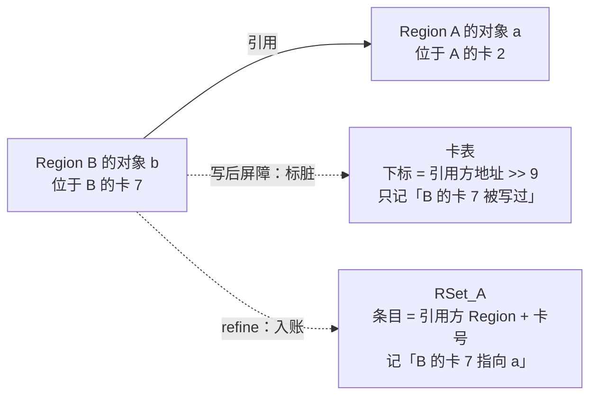
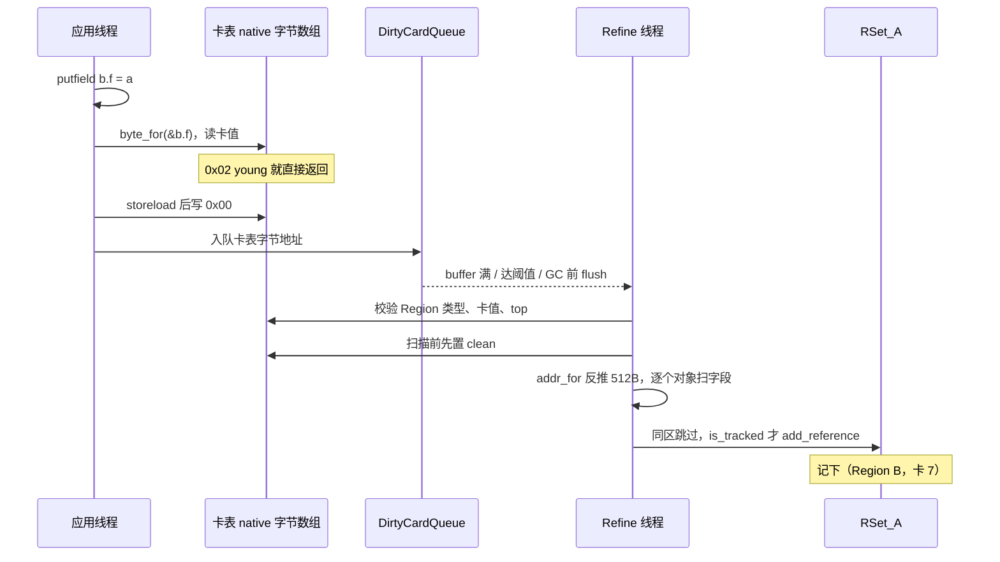
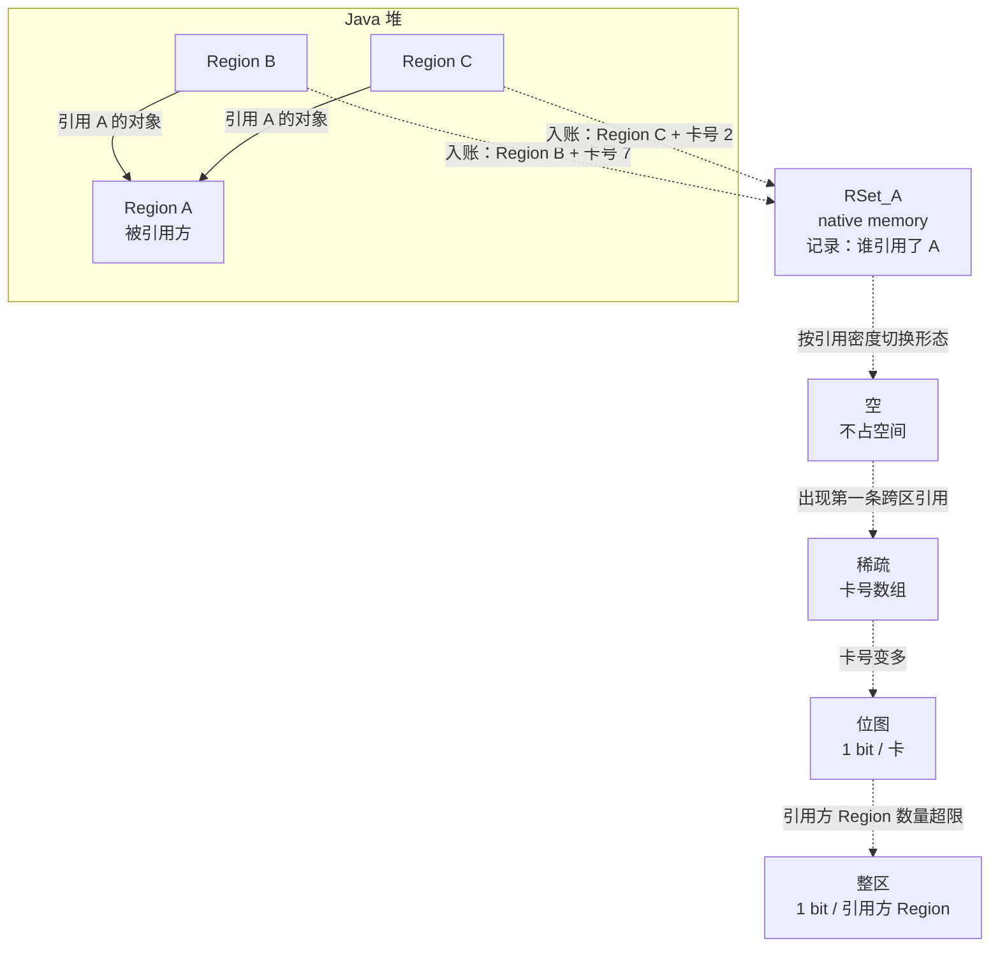
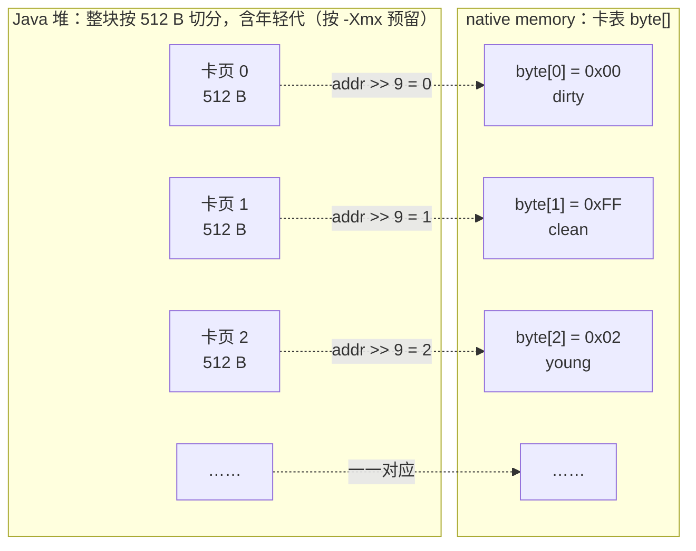

# JVM · 卡表与 RSet（记忆集）

> 定位：跨代 / 跨区引用追踪的两块基石。面试官用它区分「背过 G1」和「真的懂 G1」的人。追问通常从 RSet 一路下探到卡表、写屏障、SATB，最后落到「停顿为什么能可控」。
> 版本前提：以 JDK 8 到 25 为主线，重点描述 JDK 11 / 17 / 21。卡表状态值按 JDK 8、JDK 17-21、JDK 25+ 三档写，refine 流程取自 JDK 21 源码。卡表与 RSet 的基本结构自 JDK 8 未变；RSet 内部实现已重构为 `G1CardSet`，JDK 25 起同一批回收的 Region 可共享一个 `G1CardSet`；ZGC 自 JDK 23 起默认分代。
> 生成日期：2026-10-08（2026-10-20 更名并补三张存储架构图）

## 1. 是什么

RSet（Remembered Set）是每个 Region 一个的辅助结构，记录「**谁引用了我**」（pointing-into），以「引用方 Region 索引 + 该 Region 内的卡位置」的形式存储。

它解决的问题是：G1 回收某个 Region 时（该 Region 在 Collection Set 中），需要知道「堆里还有谁指向我」，否则这些引用指向的对象会被错误回收。

## 2. 为什么这样设计

没有 RSet 会怎样：回收 Region A 之前，必须扫描整个堆找出所有指向 A 的引用。这就是「全堆扫描」，停顿不可控，与 G1「可预测停顿」的目标直接冲突。

为什么不能照搬传统分代 GC 的卡表方案：

| 方案 | 做法 | 为什么 G1 不能直接用 |
| --- | --- | --- |
| 传统分代（CMS/Parallel） | 一张**全局卡表**覆盖整个堆（1 字节 / 512B 卡），只标「这块被写过」；代际边界固定 | G1 中 Region 的角色（Eden/Survivor/Old）是动态的，没有固定的代际边界，无法预先划定「哪片区域需要被记录」 |
| G1 的 RSet | **per-Region** 的记忆集，任意 Region 之间都可以互相记录 | 内存代价更高，换来 Region 角色自由 |

一句话：卡表是「按内存位置记、只知道这块被写过」，RSet 是「按被引用方记、知道是谁写的」。G1 把入边信息从「全局一张表」拆成「每个 Region 一本账」，这是 Region 化堆的必然代价。

代价（面试必答）：

1. **内存**：RSet 自身占内存，但**在 native 侧、不占 Java 堆**。Oracle 调优指南的口径是**总体影响小于 5%**（卡表本身只占约 0.2%，因为 1 字节管 512 字节）；「10%-20%」是早期 G1 在高跨区引用密度下的极端观察值，被不少文章当成了通例。近年的 `G1CardSet` 重构进一步压低了这块开销。
2. 写屏障开销：每次引用赋值都要执行写屏障判断，是吞吐的固定税。
3. Refinement CPU 开销：后台线程持续消费脏卡并更新 RSet。
4. 扫描代价：GC 时 RSet 中的引用要作为根的一部分被扫描，RSet 越粗（coarsening 越多）扫描越慢。

## 3. 底层怎么实现

### 3.1 卡表、RSet、SATB：三个不能混的结构

| 结构 | 归属 | 记录方向 | 粒度 | 内存代价 |
| --- | --- | --- | --- | --- |
| **Card Table（卡表）** | **全局一张**，覆盖整个堆 | points-out：这块内存被写过 | 1 字节 / 卡（512B） | 约堆的 0.2% |
| **RSet** | **每个 Region 一个** | points-into：谁引用了我 | 归属是 Region，内部从 1 bit/Region 到 1 bit/卡 | 官方口径 < 5%，也在 native 侧 |
| **SATB 队列** | 每线程一个 + 全局共享 | 并发标记期间被覆盖的旧引用 | 对象 | 与标记期分配量相关 |

**关键**：卡表是「粗线索」，RSet 是「细答案」。卡表只知道「这 512 字节里有人写过引用」，不知道写给了谁；RSet 知道「是哪个 Region 的哪张卡指向我」，所以回收时直接把 RSet 当根的一部分扫，不用回头再看卡表。GC 扫描时卡表还兼任「这张卡已经扫过」的标记，日志里那个 Clear CT 就是回收后清空它。

#### 三个流传很广的错说法

| 错说法 | 正解 |
| --- | --- |
| 「卡表是把老年代划分成卡」 | <span style="color:red">卡表覆盖整个堆</span>，含年轻代。只是 YGC 时只关心新生代之外的脏卡。Serial / Parallel / CMS / G1 都是整堆一张 |
| 「脏卡说明这张卡里有对象引用新生代」 | 脏卡只代表「这张卡被写过引用」。写屏障**不检查写入的值指向谁**，所以脏卡里可能根本没有跨代引用，扫了才知道。这种保守正是它能用 1 字节/卡 换性能的前提 |
| 「RSet 就是一组卡表」 | G1 全局只有一张卡表。RSet 是 per-Region 的入边索引，初始为空，形态从「卡号数组」到「卡位图」再到「整区位图」逐级降级，没有哪个 Region 自带一张卡表 |

一句必须能说清的对比：

- **卡表按内存位置组织**：第 i 个字节对应第 i 块 512B，天然是 points-out，只能回答「这里可能写过」。
- **RSet 按被引用方组织**：每个 Region 一本账，本质是倒排索引，直接回答「谁可能指向我」。

先看两者的方向差异。同一次引用，卡表只知道「哪里被写过」，RSet 能说出「是谁指向我」：



> 所以「RSet 底层是卡表」只在细粒度那一档勉强成立：那一档记的确实是卡号，和卡表共用 512B 这个刻度。粗粒度那一档只记 Region 编号，卡表完全不参与。

### 3.2 更新链路（核心）

```
应用线程: b.f = a
   ↓
写后屏障 write_ref_field_post：byte_for(&b.f) 取卡地址
   ↓ 卡值 == young(0x02)？→ 直接返回（YGC 会整体扫到）
   ↓ 慢路径：storeload，卡置 0x00(dirty)，卡地址入线程本地队列
   ↓
Refine 线程（buffer 满 / 达到阈值 / GC 开始前 flush 触发）
   ↓
refine_card_concurrently：校验 Region 类型、卡值、top 裁剪
   ↓ 扫描前先把卡置回 clean，等于宣布「这张卡我负责了」
   ↓
扫这 512B 内的对象字段
   ↓ 同区跳过；目标 Region is_tracked 才 add_reference
   ↓
更新【目标 Region】的 RSet
```

两个必须说清的点：

1. **写入是异步的**。应用线程只做「标脏 + 入队」，真正的 RSet 更新由 Refinement 线程完成。所以存在「引用已建立但 RSet 尚未更新」的窗口期，这个窗口期由**写屏障 + 已入队的脏卡**兜底：GC 开始时会先处理队列中剩余的脏卡（STW 阶段 refine），保证不漏。
2. **写屏障 ≠ 内存屏障**。写屏障是 GC 层面在字段赋值处插入的钩子（维护卡表/RSet/SATB）；内存屏障是 JMM/CPU 层面的指令（LoadLoad、StoreLoad 等）。把两者混为一谈是典型减分点。另外 G1 **同时有写前屏障和写后屏障**：写前屏障用于 SATB，写后屏障用于卡表；CMS 用写后屏障做增量更新，两者不对称。

### 3.3 卡表到底记了什么：一次赋值走完七步

先纠正一个前提。卡表没有「目标」这一维信息：它是一维数组，下标由「引用方对象的字段地址」右移 9 位得到，值只有一个字节的状态。所以「卡表记录我引用了谁」这个说法本身就不成立，它只能回答「这一格 512 字节里，发生过一次引用写入」。

真正记录「谁指向谁」的动作发生在 refine 阶段，而且不是写屏障做的，是 refine 线程把那 512 字节里的对象读出来、逐个字段看指向哪，再决定要不要写进目标 Region 的 RSet。

场景：老年代 Region B 里的对象 `b`，字段 `b.f` 落在 B 的卡 7；年轻代 Region A 里的对象 `a` 落在 A 的卡 2。执行 `b.f = a`。

#### 第一步：编译器在 putfield 后面插钩子

`b.f = a` 编译成 `putfield`。C2 的 `g1_write_barrier_post` 和解释器模板都会在这条指令后面追加一段屏障代码。它不是 JMM 的内存屏障，是 GC 的钩子。

#### 第二步：算「引用方」的卡地址

```cpp
volatile CardValue* byte = _card_table->byte_for(field);
```

`field` 是 `b.f` 这个字段的地址，不是 `a` 的地址。再往里一层：

```cpp
CardValue* byte_for(const void* p) const {
  return &_byte_map_base[uintptr_t(p) >> _card_shift];   // 卡页 512B 时 _card_shift = 9
}
```

`_byte_map_base` 在初始化时已经减掉了堆起始地址，所以一次右移加一次加法就是最终地址，汇编层面接近两条指令。这是卡表能塞进写屏障的前提。

#### 第三步：看卡值，young 直接放行

```cpp
inline void G1BarrierSet::write_ref_field_post(T* field) {
  volatile CardValue* byte = _card_table->byte_for(field);
  if (*byte != G1CardTable::g1_young_card_val()) {   // 0x02
    write_ref_field_post_slow(byte);
  }
}
```

引用方在年轻代 Region 时，覆盖它的卡整片被标成 young（0x02），这一步直接返回。理由：年轻代 Region 每次 YGC 都被整体扫描，它指向谁都会被看到，不需要记账。

#### 第四步：慢路径就地标脏 + 入队

```cpp
void G1BarrierSet::write_ref_field_post_slow(volatile CardValue* byte) {
  OrderAccess::storeload();                       // 让「引用已写入」先于「卡变脏」可见
  if (*byte != G1CardTable::dirty_card_val()) {   // 0x00
    *byte = G1CardTable::dirty_card_val();
    G1DirtyCardQueue& queue = G1ThreadLocalData::dirty_card_queue(Thread::current());
    G1BarrierSet::dirty_card_queue_set().enqueue(queue, byte);
  }
}
```

三个细节：

1. `storeload()` 是这里唯一的全屏障，作用是让「引用已经写进去」先于「卡被标脏」被其他线程看到。少了它，refine 线程可能先看到脏卡、后看到新引用，读到旧值。
2. 入队的是卡表字节的地址（`CardValue*`），不是卡号，也不是对象。refine 时用 `addr_for` 反推 512 字节区间。
3. `if (*byte != dirty)` 不是原子判断，多个线程可能重复入队同一张卡。去重在 refine 侧完成（第五步的「先置 clean」），重复入队最多白跑一次，不会错。

队列是线程本地的 `G1DirtyCardQueue`，底层 buffer 默认 `G1UpdateBufferSize = 256` 个槽。满了交到全局 `G1DirtyCardQueueSet`，由 refine 线程消费。

#### 第五步：refine 线程先校验，再宣布「这张卡我负责了」

后台 `G1ConcurrentRefineThread` 取卡，调用 `G1RemSet::refine_card_concurrently`。真正的校验在 `clean_card_before_refine`：

```cpp
CardValue* card_ptr = *card_ptr_addr;
HeapWord* start = _ct->addr_for(card_ptr);                    // 卡地址 → 512B 区间起点
HeapRegion* r = _g1h->heap_region_containing_or_null(start);
if (r == nullptr) return false;                               // 卡指向未提交内存，丢弃
if (*card_ptr != G1CardTable::dirty_card_val()) return false;  // 已经不脏，别人处理过
if (!r->is_old_or_humongous()) return false;                   // 引用方在年轻代 / 空闲区，不记
HeapWord* scan_limit = r->top();
if (scan_limit <= start) return false;                         // 裁剪后为空，是陈旧卡
*const_cast<volatile CardValue*>(card_ptr) = G1CardTable::clean_card_val();  // 先清，再扫
return true;
```

这里有一个必须看清的变量：`r` 是由卡起点反推出来的，指向**引用方**所在的 Region，不是目标对象所在的 Region。目标是谁要到第六步扫完字段才知道。所以这一串校验都在问「这张卡值不值得扫」，回答不了「卡片里有没有指向我的引用」。

两个反直觉的点：

- <span style="color:red">卡是在扫描之前就置回 clean 的，不是扫描之后</span>。置 clean 等于「这张卡我认领了」，责任从队列转到这次 refine。如果扫描期间引用又被改写，写屏障会重新标脏并再入队，那是下一轮的工作。
- 如果扫描中途失败（碰到只分配了一半的对象），这张已经置 clean 的卡必须重新标脏并重入队。`enqueue_for_reprocessing` 会为一张卡单独分配整个 buffer，宁可浪费内存也不漏扫。

#### 第六步：扫这 512 字节，逐个字段判断

```cpp
HeapWord* start = _ct->addr_for(card_ptr);
HeapWord* end = start + G1CardTable::card_size_in_words();   // 512B / 8 = 64 个字
MemRegion dirty_region(start, MIN2(scan_limit, end));

G1ConcurrentRefineOopClosure conc_refine_cl(_g1h, worker_id);
r->oops_on_memregion_seq_iterate_careful<false>(dirty_region, &conc_refine_cl);
```

`oops_on_memregion_seq_iterate_careful` 从区间起点对齐到第一个对象头，再顺着对象大小一路走，对每个 oop 字段回调：

```cpp
inline void G1ConcurrentRefineOopClosure::do_oop_work(T* p) {
  oop obj = CompressedOops::decode_not_null(...);
  if (HeapRegion::is_in_same_region(p, obj)) return;   // 同区引用不记账
  HeapRegionRemSet* to_rem_set = _g1h->heap_region_containing(obj)->rem_set();
  if (to_rem_set->is_tracked()) {                      // 目标 Region 是否需要这条记录
    to_rem_set->add_reference(p, _worker_id);          // 「谁指向谁」在这一行成形
  }
}
```

两个过滤条件决定了记账边界：

- 同区跳过：同一个 Region 内部的引用，回收这个 Region 时本来就会整体扫到，记进 RSet 是纯浪费。
- `is_tracked()`：只有被跟踪的 Region 才收。年轻代 Region 要（YGC 靠它找老年代指针），Mixed GC 候选的老年代 Region 要，其余不收。

到这里，「Region B 的卡 7 指向 Region A 的 `a`」这条信息才第一次成形，被写进 `RSet_A`。

#### 第七步：GC 时反过来用

YGC 扫描年轻代 Region A 时，把 `RSet_A` 当作根的一部分：拿到条目 `(Region B, 卡 7)`，直接去扫 B 的卡 7，找到 `b.f`，顺着它找到 `a` 并标记存活。整个老年代不用碰。

链条到此闭环：卡表负责把「可能的引用方」从整个堆缩小到 512 字节，RSet 负责把「确定指向我的引用方」从 512 字节缩小到一个 Region 的一个卡号。



一句话收口：写屏障只产生「哪里被写过」，refine 读这 512 字节才推出「谁指向谁」。卡表永远 points-out，RSet 才是 points-into，两者之间隔着一次对象扫描。

### 3.4 G1 用这张卡表吗：三个角色，一条流水线

用到，而且是整条 RSet 流水线的起点。G1 的卡表和 Serial / Parallel 共用同一个 `CardTable` 基类（`G1CardTable` 继承它），差别在三处：多几个状态值、refine 的产物是 per-Region 的 RSet、Region 回收时要主动重置卡表。

#### 角色一：RSet 的输入队列

写屏障标脏，refine 消费，产物是 RSet。和 CMS 的分工不同：

| | CMS | G1 |
| --- | --- | --- |
| 卡表的产物 | 卡表本身就是记忆集 | 卡表只是中间产物，最终落在 per-Region 的 RSet |
| 记账单位 | 代际边界固定，一张卡表管「老 → 新」 | Region 动态，同一张卡可能被记进任意目标 Region |
| 谁扫脏卡 | 应用线程 / 并行 GC 线程 | 并发 refine 线程 + 被征用的应用线程 + GC 前的 STW refine |

#### 角色二：状态值控制「要不要 refine」

卡表不是 0/1 位图。JDK 17 / 21 的取值：

| 值 | 名字 | 含义 | 谁写 |
| --- | --- | --- | --- |
| `0xFF` | `clean_card_val()` | 干净，不需要扫 | refine 完成 / GC 清表 |
| `0x00` | `dirty_card_val()` | 脏，待 refine | 写屏障慢路径 |
| `0x01` | `g1_card_already_scanned` | GC 期间已扫过，别重复扫 | GC 并行扫描阶段 |
| `0x02` | `g1_young_card_val()` | 整片属于年轻代 Region，写屏障直接放行 | Region 分配 / 回收时 |

`0x01` 只在 GC 暂停期间有意义：并行扫描阶段把卡表当临时工作表，合并各来源需要扫的卡，扫过的标成 already scanned。判断依据是最低位，最低位为 1 就跳过。

版本差异要单独记，这是旧文章最容易带偏的地方：

- JDK 8 时代 CardTable 的取值是 `clean = -1`（0xFF）、`dirty = 0`、`precleaned = 1`、`claimed = 2`、`deferred = 4`，G1 当时用 `claimed` 做多线程认领。所以「claimed 是 G1 的第四态」只在 JDK 8 成立。
- JDK 17 / 21：`claimed` 已不在 CardTable 里，换成 `g1_card_already_scanned = 0x01` 和 `g1_young_card_val = 0x02`。
- JDK 26 之后的主线（当前 master 分支，尚未进入 LTS）：`g1_young_card_val` 被泛化成 `g1_to_cset_card = 0x02`，另加 `g1_from_remset_card = 0x04`，用途是把 mutator 产生的脏卡和从 RSet 合并来的卡分开，让卡生成速率的预测更准。源码注释明确说 to-cset 这个颜色在 mutator 阶段是粘性的，refine 线程遇到直接拷贝、不重新 refine。JDK 25 还是三色，别把 master 的变化提前算到 LTS 头上。

#### 角色三：Region 回收时必须重置

这是「卡表按地址记」的代价。卡表是全局一维数组，Region 只是逻辑划分，Region 被回收并重新分配后，覆盖它的那一段卡表可能还残留着上一个 Region 的脏标记。

G1 的处理是分配 / 回收 Region 时把覆盖它的卡表区间整片写成 young（`g1_mark_as_young`），写屏障读到 young 直接跳过，不会为已经不存在的对象做 refine。真正记账前，`clean_card_before_refine` 还会再校验 `is_old_or_humongous()` 和 `top()` 裁剪，拦住陈旧卡。

三处防线是叠着的：写屏障看 young 值，refine 看 Region 类型，refine 看 `top()` 裁剪。少任何一层，陈旧卡都会变成白跑的 refine，或者更糟的错记。

#### 卡表多大，能不能调

`-Xmx2g` 时卡表是 `2^31 / 512 = 4MB`，按堆的保留地址空间算，不按实际使用量。

卡页大小在 JDK 25 起变成可配置参数：

```
-XX:GCCardSizeInBytes=512   # 默认 512，64 位范围 128-1024
```

调大卡页省卡表内存，但每次 refine 要扫更多对象；调小反之。生产上几乎不动，知道它能调即可，别再说「512 是写死的」。

### 3.5 RSet 的形态：从空到粗化

RSet 的形态不是并列任选，而是**随引用密度单向降级**：

| 阶段 | 存储 | 精度 | 何时进入 |
| --- | --- | --- | --- |
| 空 | 不占空间 | — | 没有跨 Region 引用指向本 Region |
| 稀疏 | 数组，直接记「引用方 Region + 卡号」 | 精确到卡 | 出现第一条跨 Region 引用 |
| 位图 | 每个引用方 Region 一张位图，1 bit / 卡 | 精确到卡 | 卡号多到用数组不划算 |
| 整区（粗化） | 全局位图，1 bit / 引用方 Region | 只知道「这个 Region 里有人引用我」 | 细粒度条目数达到上限 |

存储结构上，RSet 归每个 Region 所有，但实体放在 native memory，内部形态沿着「空 → 稀疏 → 位图 → 整区」单向降级：



**方向最容易背反**：<span style="color:red">coarse 不是起点，是降级终点</span>。粗化一旦发生不会自动回退，因为回退需要重新扫描。代价也很具体：被粗化的 Region 在 GC 时要把整个 Region 的卡筛一遍，所以粗化条目变多会直接表现为暂停变长。

两条比表格更常被追问的规则：

- <span style="color:red">**年轻代 Region 的 RSet 只收 old → young**</span>。YGC 扫 CSet 里的年轻代 Region 时，正是靠它找「老年代指向我」的引用；没有老年代对象指向它时，这本账就是空的。
- **young 作为引用方时一律不记**，young → old 也不记。Mixed GC 之前必然先做过 YGC，那时年轻代已被清空或扫描过，所以老年代 Region 的 RSet 只需要 old → old 那一部分。

合起来是一句更精确的定义：**RSet 记的不是「谁引用我」，而是「谁引用我、且这次回收不会顺带扫到它」**。把「全部记下来」当成定义，追问一句「年轻代引用记不记」就露馅了。

补充：早期资料常把粒度写成「稀疏 / 细粒度 / 粗粒度」，并把「细粒度」解释成「记录 Region 索引」，这是二手转述的偏差，细粒度那一档记的是**卡**。现代实现（`G1CardSet` 系列）把这三档包成数组式、位图式、整区式，语义不变；另外 JIT 编译代码里的引用有独立的 Code Root 集合，不走 Region RSet。

### 3.6 关键参数

| 参数 | 作用 |
| --- | --- |
| `-XX:G1RSetUpdatingPauseTimePercent` | 默认 10，控制 RSet 更新在 GC 暂停中允许占用的时间百分比上限 |
| `-XX:G1ConcRefinementThreads` | 并发 refine 线程数（默认由 ParallelGCThreads 推导） |
| `-XX:G1UpdateBufferSize` | 每个线程的脏卡队列长度，默认 256 个槽 |
| `-XX:G1HeapRegionSize` | Region 大小，默认由堆自动推导（1-32MB，2 的幂）。Region 越小 → 跨 Region 引用越多 → RSet 压力越大 |
| `-XX:G1RemSetArrayOfCardsEntries` | 稀疏形态的卡条目上限，实验性参数，生产基本不动 |
| `-XX:+UnlockDiagnosticVMOptions -XX:+G1SummarizeRSetStats` | JDK 8 下的 RSet 统计输出 |
| `-Xlog:gc+remset*=debug` | JDK 9+ 统一日志观察 RSet 行为 |

### 3.7 别的收集器有没有记忆集

| 收集器 | 记忆集 | 靠什么替代或支撑 |
| --- | --- | --- |
| Serial / Parallel | 全局卡表 | YGC 只扫老年代的脏卡 |
| CMS | 全局卡表，无 RSet | 老年代是连续空间、没有 Region，不需要按区记账；并发标记期间的引用变化靠写后屏障配合重扫 |
| G1 | RSet（+ 全局卡表做细化中转） | points-into，per-Region，同时支撑 YGC 和 Mixed GC |
| ZGC，非分代（JDK 11–22） | 无 | 不分代，就没有跨代引用要记；并发靠染色指针 + 读屏障 |
| ZGC，分代（JDK 21 引入，JDK 23 起默认） | 有 | 写屏障维护 remembered set（old → young），读屏障只负责去色和修指针 |
| Shenandoah，非分代 | 无 | SATB + Brooks 转发指针 + 读屏障，全堆并发标记 |
| Shenandoah，分代（JDK 24 实验，JDK 25 转正） | 有卡表 | 分了代就必然要记 old → young |

「ZGC / Shenandoah 不用记忆集，用读屏障」这句话要按版本拆开说才成立：

1. 非分代版本确实没有记忆集。但**原因不是读屏障，是不分代**。没有代际就没有跨代引用，自然不需要 RSet；读屏障解决的是另一件事，即并发转移后指针失效，读到旧地址时当场修正（自愈）。
2. 分代之后立刻破功。<span style="color:red">JDK 23 起 ZGC 默认分代，JDK 24 删掉了非分代模式</span>；JEP 439 明确写了分代 ZGC 由写屏障维护 remembered set，读屏障只剩「去色 + 修指针」两件事。
3. 所以「ZGC 没有记忆集」在 2020 年前后是对的，放到今天的默认配置上就是错的。被问到时先说清版本，比硬背结论安全。

### 3.8 它们住在哪、占多大

这一节最容易答错：「卡表 / RSet 占 Java 堆」在中文资料里传得很广，但和 HotSpot 的实际分配相反。

| | 卡表 | RSet |
| --- | --- | --- |
| 分配位置 | **native memory**（C heap）里一整块连续字节数组 | **native memory**（`G1CardSet` / `CHeapBitMap`） |
| 在 Java 堆里吗 | 否 | 否 |
| 在 Metaspace 里吗 | 否 | 否 |
| 大小由什么定 | **堆的保留容量 / 512 字节**（≈ `-Xmx` / 512） | 「有多少个 Region 引用我」× 条目密度，空 RSet 不占空间 |
| 量级 | 1/512 ≈ **0.2%** | 官方口径 < 5%，极端负载实测可到 8% |

存储结构上，卡表是「堆地址空间」与「字节数组」之间的一层线性映射，两者分属不同内存区域：



**卡页为什么是 512 字节**：写屏障的最终形态就一条指令，`byte_map[addr >> 9] = dirty`。右移 9 位等于除以 512，所以卡大小必须是 2 的幂。512 是长期默认值，JDK 25 起变成可配置的 `-XX:GCCardSizeInBytes`（默认 512，64 位范围 128-1024），细节见 3.4 节。

**为什么按整个堆算，而不是只按老年代**：卡表覆盖堆的保留地址空间（启动时整块 reserve），官方文档的措辞是 G1 "logically partitions the heap into cards"。老年代只是「YGC 时会被筛出来的那部分脏卡」，不是卡表的边界。`-Xmx2g` 时卡表长度 2^31 / 512 = 4,194,304 字节，正好 4MB。

**卡表不止两个取值**：JDK 17 / 21 是四个值，clean = 0xFF、dirty = 0x00、already scanned = 0x01、young = 0x02；JDK 8 另有 precleaned / claimed / deferred。所以它不是 0/1 位图。完整取值表在 3.4 节。

**RSet 不在堆里，这一点直接决定怎么排查**：堆 used 涨不涨和 RSet 没关系，RSet 膨胀只体现在进程 RSS 上。线上「堆没满但 RSS 一路涨」时，要看 `jcmd <pid> VM.native_memory summary` 里 GC 分类下的 Card set / Remembered set，`jmap -heap` 里永远找不到它们。

**RSet 大小取决于什么**：一句话，**取决于有多少个 Region 引用我，和本 Region 里塞了多少对象无关**。Region 调小会让同一组对象更容易跨区，从而间接推高条目数；但单纯 Region 数量多，不等于 RSet 就大。

## 4. 生产中的问题与排查

| 现象 | 可能原因 | 排查动作 |
| --- | --- | --- |
| GC 暂停时间持续增长，且随老年代增长而恶化 | RSet 膨胀 → 根扫描变慢；coarsening 增多导致扫描变粗 | `-Xlog:gc+remset*=debug` 看 refine 耗时与 RSet 规模；检查是否大量对象跨 Region 互相引用 |
| 暂停中出现大量脏卡处理 | Refinement 线程跟不上，脏卡积压到 STW 阶段处理 | 看 refine 线程数与队列长度；适当增加 `G1ConcRefinementThreads` |
| `to-space exhausted` / Evacuation Failure | 根扫描与转移耗时超预算、回收不及预期 | 结合 RSet 规模、`MaxGCPauseMillis`、IHOP 一起看 |
| 堆 used 不高，但进程 RSS 持续上涨 | 卡表 / RSet 在 native 侧，堆监控看不见 | `jcmd <pid> VM.native_memory summary` 看 GC 分类；`jmap -heap` 找不到它们 |

**排查思路模板**（面试可直接用）：先确认是不是 RSet 问题（日志中 refine/根扫描耗时占比高）→ 再定位是什么造成跨 Region 引用密集（大集合、缓存、长生命周期对象互相持有）→ 方案优先级：业务侧减少不必要的跨区引用 > 调大暂停预算 > 调 Region 大小 > 换 ZGC。

## 5. 可跑实验

实验目录：`labs/jvm-03-rset-pressure/`（可复制 skill 的 `assets/lab-project/`）

**目的**：观察 Region 大小与跨 Region 引用密度对 RSet 与 GC 暂停的影响。

**做法**：

- 固定堆：`-Xms512m -Xmx512m -XX:+UseG1GC`
- 构造大量老年代对象互相引用（比如若干个长生命周期 List，互相填充对方的元素，制造纯 Old → Old 的跨 Region 引用）
- 对比两组：`-XX:G1HeapRegionSize=1m` 与 `-XX:G1HeapRegionSize=8m`
- 加上 `-Xlog:gc+remset*=debug -Xlog:gc*:file=gc.log`

**预期现象**：Region 小的一组跨 Region 引用更多，RSet 条目更多、refine 活动更频繁，暂停时间更长。

**实际现象**：（运行后填写）

**结论**：（运行后填写）

## 6. 面试问法

**Q1：G1 的 RSet 是什么，解决什么问题？**
- 60 秒版本：每个 Region 一个，记录「谁引用了我」；目的是回收某 Region 时不必扫描全堆；本质是 Region 化堆的代价。
- 补充点：对比传统分代 GC 的全局卡表，说明为什么 G1 不能沿用（Region 角色动态、无固定代际边界）。

**Q2：RSet 和卡表是什么关系？**
- 60 秒版本：卡表只记「这一格 512B 被写过引用」，连目标是谁都不知道（points-out）；RSet 记「谁可能指向我」（points-into）。写屏障标脏，refine 线程读完这 512B 才把入边写进 RSet。
- 补充点：卡大小 512 字节（1<<9）；脏卡入 DirtyCardQueue 由 Refinement 线程消费，更新是异步的。

**Q3：RSet 是同步更新的吗？**
- 60 秒版本：不是。应用线程只标脏卡并入队，更新由后台 Refinement 线程完成。
- 补充点：GC 开始时会先把剩余脏卡处理完，所以不会漏；这是「写屏障 + 队列」的组合兜底。

**Q4：RSet 有什么粒度？为什么要分级？**
- 60 秒版本：粗粒度（1 bit/Region，省内存但扫描粗）与细粒度（精确到卡，内存高），细粒度太满会 coarsen。
- 补充点：指出「三粒度」是早期文档说法，现代实现是 coarse + fine 自适应，Code Root 有独立集合。

**Q5：RSet 有什么代价？**
- 60 秒版本：内存（在 native 侧，官方口径不到堆的 5%）、写屏障开销、refine 线程 CPU、扫描代价。

**Q6：G1 为什么用 SATB 而不是增量更新？**
- 60 秒版本：SATB 用写前屏障记录被删除的引用，重新标记阶段不用重扫整个堆，停顿更可控；代价是产生浮动垃圾。
- 补充点：CMS 用增量更新（写后屏障）；G1 两种屏障都有，写前屏障服务 SATB，写后屏障服务卡表。

**Q7：写屏障和内存屏障是一回事吗？**
- 60 秒版本：不是，一个是 GC 钩子，一个是 JMM/CPU 指令。这是典型的减分筛查点。

**Q8：线上 G1 暂停越来越长，怀疑 RSet 有问题，你怎么验证？**
- 60 秒版本：开 `-Xlog:gc+remset*=debug` 看 refine 与根扫描耗时占比；结合 NMT 看内存；定位跨 Region 引用来源；给出降级/调优路径。

**Q9：卡表和 RSet 到底什么关系，能不能说 RSet 就是卡表？**
- 60 秒版本：不能。全局只有一张卡表、按内存位置记、只知道「这块被写过」；RSet 是 per-Region 的入边索引，回答「谁指向我」。两者共用 512B 这个刻度，但 RSet 的粗粒度档根本不看卡表。
- 补充点：卡表在 G1 里还兼任细化队列的输入和「已扫描」标记；RSet 形态是从空到卡号数组、卡位图、整区位图单向降级。

**Q10：ZGC / Shenandoah 有记忆集吗？**
- 60 秒版本：分版本。非分代版本没有，原因是不分代而不是「用了读屏障」；JDK 23 起 ZGC 默认分代，写屏障维护 old → young 的 remembered set，JDK 24 已删除非分代模式。
- 补充点：Shenandoah 走 SATB + Brooks 转发指针，JDK 24 实验性分代、JDK 25 转正，分代后用卡表记跨代引用。

**Q11：卡表和 RSet 存在 Java 堆里吗？**
- 60 秒版本：都不在，两者都是 native memory。卡表是一整块连续字节数组，RSet 由 `G1CardSet` / `CHeapBitMap` 在 C heap 上分配。
- 补充点：所以 RSet 膨胀只抬进程 RSS、不抬堆 used；要用 `jcmd <pid> VM.native_memory summary` 看，`jmap -heap` 里看不到。

**Q12：卡表怎么记录「我引用了谁」？**
- 60 秒版本：它不记录。卡表是一维数组，下标等于引用方字段地址右移 9 位，值只有状态字节，没有任何目标信息。一次赋值走下来：写屏障算 `byte_for(&b.f)`、看卡值（young 直接返回）、慢路径 `storeload` 后置 dirty 并入队；refine 线程校验 Region 与 `top()`、扫描前先置 clean、再反推 512B 逐个对象扫字段，遇到跨区且目标 `is_tracked()` 才 `add_reference`，这时「谁指向谁」才落进 RSet。
- 补充点：「哪里被写过」和「谁指向谁」之间隔着一次对象扫描，这是卡表能用 1 字节/512B 换性能的根本原因；说「卡表记录引用关系」是把 RSet 的职责错记到卡表头上。

**Q13：G1 到底用不用卡表？**
- 60 秒版本：用，而且是 RSet 流水线的起点。卡表产出脏卡、refine 消费脏卡产出 per-Region RSet，GC 时再拿 RSet 当根扫。G1 的卡表还多两种状态：young（0x02）让写屏障跳过年轻代，already scanned（0x01）在 GC 期间标记已扫过的卡。
- 补充点：卡表按地址记、Region 按逻辑分，所以 Region 回收时必须把覆盖它的卡表重置成 young，否则残留脏卡会让 refine 白跑；JDK 25 起卡页大小可配（`GCCardSizeInBytes`），不再是写死的 512。

## 7. 误区 · 正解

| 误区 | 正解 |
| --- | --- |
| 卡表是把老年代切成 512B 的卡 | 卡表覆盖**整个堆**，1 字节 / 卡；YGC 只是挑新生代之外的脏卡来扫 |
| 脏卡就说明有对象引用新生代 | 脏卡只说明「这块被写过引用」。写屏障不比对新值指向哪，所以是保守标记，会误报 |
| RSet 是一组卡表，或者卡表的封装 | 全局只有一张卡表。RSet 是 per-Region 的倒排索引，只有细粒度档借用「卡」这个刻度 |
| RSet 记录「谁引用我」的全部 | 只记这次回收不会顺带扫到的引用：young 作为引用方一律不记；年轻代 Region 的 RSet 只收 old → young 的条目，没有就是空的 |
| RSet 占 Java 堆，G1 会预留堆的 1%-5% 给它 | RSet 在 native memory（`G1CardSet` / `CHeapBitMap`），不在堆里；<5% 是 NMT 里的观测值，不是预留 |
| 卡表大小 = 老年代容量 ÷ 512 | 按整个堆算（保留了多大就按多大，≈ `-Xmx`）÷ 512；官方原文是 partitions the heap into cards |
| RSet 的粒度就是 512B 卡页 | 归属单位是 Region，最粗一档是 1 bit / 引用方 Region；只有细粒度档才到卡 |
| 粗粒度是 RSet 的初始形态 | 初始为空；粗粒度是**降级终点**，由细粒度条目超限触发，且不可回退 |
| ZGC 用读屏障所以不需要记忆集 | 非分代 ZGC 无记忆集是因为**不分代**；JDK 23 起默认分代，写屏障维护 remembered set，JDK 24 移除非分代模式 |
| CMS 没有 RSet 就说明它不用卡表 | CMS 有卡表、无 RSet。不需要按区记账是因为老年代连续、没有 Region，不是因为不需要跨代引用信息 |
| 卡表记录「我引用了谁」 | 卡表只记「哪一格 512B 被写过」，没有目标信息；入边是 refine 读完这 512B 之后才写进 RSet 的 |
| 卡是扫完才置回 clean | 扫描前就置 clean，等于认领；扫描失败要重新标脏并单独重入队，否则永久漏扫 |
| 卡页 512 字节是写死的 | 长期默认值。JDK 25 起 `-XX:GCCardSizeInBytes` 可调（默认 512，64 位范围 128-1024） |
| `claimed_card_val` 是 G1 的第四种状态 | 那是 JDK 8 的取值。JDK 17 到 25 是 already scanned = 0x01、young = 0x02，JDK 26 起再加 to cset / from remset |

一分钟版：

1. 卡表 = 全局一张、1 字节管 512B、只知「这块被写过」，覆盖整个堆，**没有目标信息**。
2. 一次赋值：写屏障标脏并入队 → refine 校验后先置 clean → 扫这 512B → 跨区且 `is_tracked` 才 `add_reference` 进 RSet。
3. RSet = 每个 Region 一本账、只知「谁可能指向我」，从空一路降级到整区位图。
4. ZGC 非分代无记忆集是因为不分代；JDK 23 起默认分代，写屏障照样维护 remembered set。
5. 卡表和 RSet 都在 native memory，`jmap -heap` 永远看不到，要用 NMT。

## 8. 我的薄弱点

（学完后填写，同步到 `weakness.md`）
