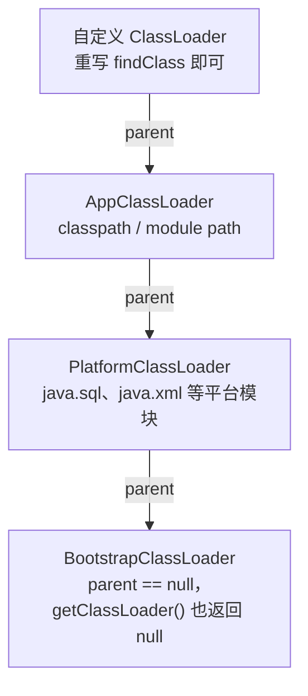
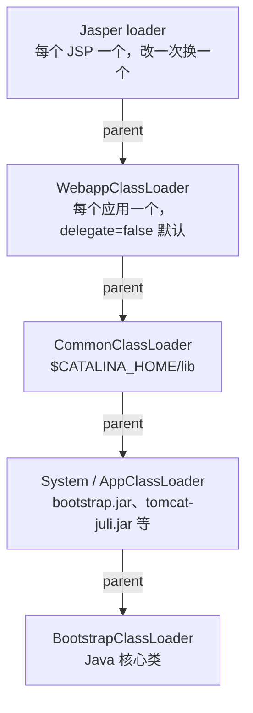
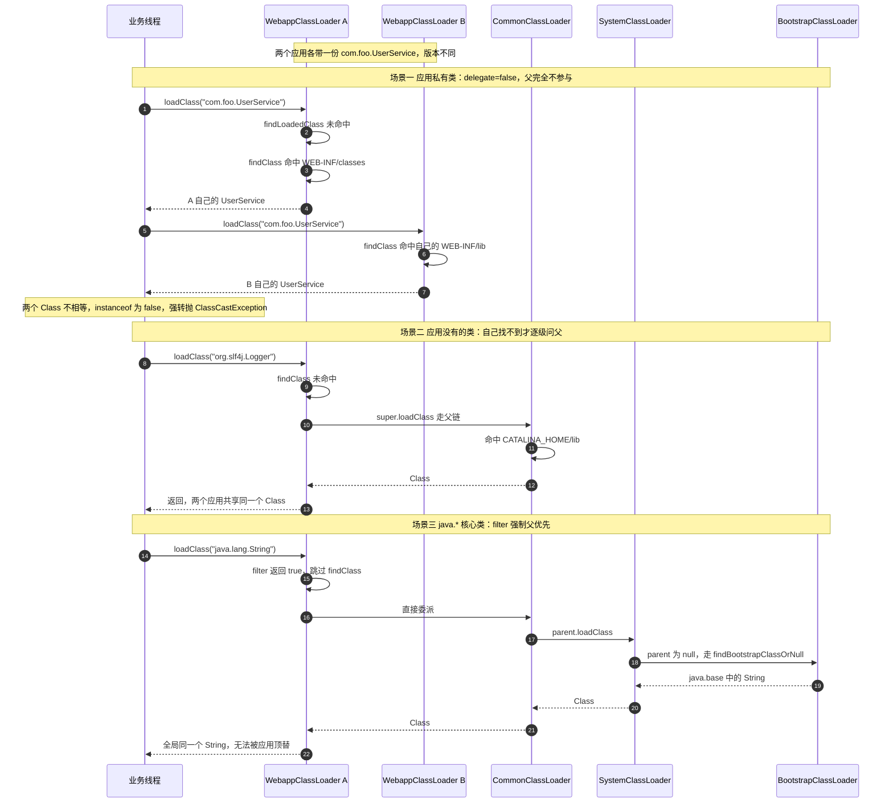

# JVM · 类加载机制与双亲委派

> 定位：这道题的追问会从「五个阶段」一路走到「Tomcat 里两个应用的同名 Spring 为什么不冲突」，分水岭在版本前提和「同名类不相等」。
> 版本前提：以 JDK 17 / 21 为主线，JDK 8 的差异单独标注；Tomcat 9（`javax.*`）与 Tomcat 10+（`jakarta.*`）。

## 原文勘误速览

| 原文说法 | 问题 | 修正 |
| --- | --- | --- |
| 扩展类加载器加载 `JAVA_HOME/jre/lib/ext`，由 `sun.misc.Launcher$ExtClassLoader` 实现 | JDK 9 删除了 `jre` 子目录和扩展机制，设置 `java.ext.dirs` 会让 JVM 直接**拒绝启动** | JDK 9+ 是 **PlatformClassLoader**，实现类 `jdk.internal.loader.ClassLoaders$PlatformClassLoader` |
| 启动类加载器加载 `rt.jar` | `rt.jar` 在 JDK 9 被删除，类改存 `lib/modules` | 资源路径变成 `jrt:/java.base/java/lang/Class.class` |
| 初始化阶段「在执行类的构造方法」 | 把类构造器和实例构造器混成一个 | 执行的是 **`<clinit>`**，构造方法是 `<init>` |
| 准备阶段只给静态变量设默认值 | 漏了编译期常量这个反例 | **`static final` 编译期常量在准备阶段就赋最终值** |
| Tomcat 有 Catalina 和 Shared 两个加载器 | 那是 Tomcat 5.5 的结构 | Tomcat 6 起**三个合并为 Common** |
| 破坏双亲委派「主要有两种」 | 漏了最早的一次 | JDK 1.2 新增 `findClass` 兼容重写 `loadClass` 的老代码 |

另外原文在「载入」和「加载」之间来回换词。统一叫**加载（Loading）**，`链接（Linking）= 验证 + 准备 + 解析`。

## 1. 是什么

JVM 的操作对象是 **Class 文件**，不是 Java 源码。把一个类的二进制字节流读进来、校验、转成方法区里的运行时结构、再在堆上生成 `java.lang.Class` 对象，这套动作叫类加载机制。

三个概念各管一段：

- 类加载器决定「谁来加载」，负责找到 `.class` 并调用 `defineClass`
- 类加载过程决定「怎么加载」，是加载 → 验证 → 准备 → 解析 → 初始化
- 双亲委派决定「谁先加载」，收到请求先问父加载器

完整生命周期有七个阶段，其中验证、准备、解析合称连接：

![类加载生命周期：加载 → 连接（验证、准备、解析）→ 初始化 → 使用 → 卸载]()

「加载」这一步做三件事，缺一不可：

![加载阶段的三步：取二进制字节流、转成方法区运行时结构、生成 Class 对象]()

一个容易被忽略的例外：**数组类由 JVM 直接创建，不经过 ClassLoader**。`String[]` 的 `Class` 对象是 JVM 在堆上造的，但它的元素类型 `String` 仍需由对应加载器加载。数组类的定义加载器就是元素类型的加载器；`int[]` 这种基本类型数组的加载器是 Bootstrap（`getClassLoader()` 返回 `null`）。

## 2. 为什么这样设计

没有双亲委派之前，每个加载器各自为政，会踩两个坑。

**核心类可以被顶替**。用户在自己的 classpath 里放一个 `java.lang.String`，如果应用加载器先加载它，`main` 方法的签名、`Object` 的方法全部错位，JVM 的类型体系当场崩掉。双亲委派强制让这类请求一路传到 Bootstrap，保证 **`java.lang.Object` 全 JVM 只有一个**。

**同一个类会被反复加载**。父子加载器都去解析同一份字节码，浪费内存，更麻烦的是会出现两个 `Class` 对象互不认账。

替代方案有两个，代价都更大：OSGi 用网状委派，灵活但排查极其困难，一个 `NoClassDefFoundError` 要沿着 bundle 依赖图找；完全平铺（每个加载器都先自己加载）就是 Tomcat 的做法，隔离性换来了同一个库在每个应用各存一份。

关键取舍是：**委派顺序决定了「隔离」和「共享」的比例**。父优先等于共享，子优先等于隔离。JDK 默认父优先，容器和插件框架按需改成子优先。

## 3. 底层怎么实现

### 3.1 五个阶段里真正被问的细节

准备阶段给 static 变量分配内存并设零值（`int` 为 0，引用为 `null`）。两个前提要补：

- <span style="color:red">**`static final` 的编译期常量不走这一步，在准备阶段就写入最终值**</span>。`static final int A = 1;` 准备完就是 1，初始化阶段不会再动它。
- JDK 7 起 HotSpot 把静态变量随 `Class` 对象一起放到**堆**上，JDK 8 起类元数据在 **Metaspace**（本地内存）。所以「静态变量在方法区」这句话在 JDK 8+ 只对一半：逻辑上归属类，物理上在堆。

解析阶段把常量池里的符号引用换成直接引用。JVM 规范只保证 加载 → 验证 → 准备 → **初始化** 这四个阶段的顺序，**解析可以推迟到初始化之后**，用来支持晚期绑定。注意是「可以」，不是「动态绑定时一定」。

初始化阶段执行 **`<clinit>()`**，由编译器自动收集 static 变量赋值和 static 块，**按源码顺序**拼接。三个边界：

- <span style="color:red">**`<clinit>` 是类构造器，不是构造方法**</span>。构造方法是 `<init>`，负责实例字段，两者在 `javap` 里是两个不同的方法。
- `<clinit>` **不包含父类**。父类的 `<clinit>` 由 JVM 保证先执行完。
- 一个类没有静态赋值也没有静态块时，**不会生成 `<clinit>`**。接口的 `<clinit>` 也不要求先执行父接口的，只有用到父接口的静态字段才触发。

原文还漏了初始化时机，这是同一道题的另一半：

| 会触发初始化（主动引用） | 不会触发（被动引用） |
| --- | --- |
| `new`、读写静态字段、调用静态方法 | 通过**子类引用父类的静态字段**，只初始化父类 |
| 反射 `Class.forName(name)`，默认 `initialize=true` | `new SuperClass[10]`，只初始化数组类 `[LSuperClass` |
| 初始化子类时先初始化父类 | 引用 **`static final` 编译期常量**，值在编译期已进调用方常量池 |
| 启动时的主类（含 `main`） | 只用 `ClassLoader.loadClass()` 加载，不初始化 |

**卸载**要同时满足三条：该类所有实例已被回收、加载它的 ClassLoader 已被回收、对应的 `Class` 对象没有任何引用。Bootstrap 加载的类基本不会被卸载，所以 `OutOfMemoryError: Metaspace` 的现场一般都是自定义加载器泄漏。

### 3.2 类加载器：JDK 8 和 JDK 9+ 是两套名字

| | JDK 8 及以前 | JDK 9 及以后 |
| --- | --- | --- |
| 启动 | Bootstrap，加载 `jre/lib` 下的 `rt.jar` | Bootstrap，加载 `java.base` 等平台模块，来自 `lib/modules` |
| 中间层 | **Extension**，`sun.misc.Launcher$ExtClassLoader`，扫 `jre/lib/ext` | **Platform**，`jdk.internal.loader.ClassLoaders$PlatformClassLoader` |
| 应用 | `sun.misc.Launcher$AppClassLoader`，扫 classpath | `jdk.internal.loader.ClassLoaders$AppClassLoader`，扫 classpath / module path |
| 扩展机制 | `java.ext.dirs` | **已移除，设置该属性 JVM 不启动** |

JDK 9+ 的实际层级（箭头指向 parent，是**组合**不是继承）：



所以「父加载器」指的是 `parent` 字段，不是 `extends`。自定义加载器通常调 `super(parent)` 指定父，写 `super()` 时父是 AppClassLoader。

### 3.3 ClassLoader 的三个方法

- `loadClass(name, resolve)`：入口，负责查缓存、委派、决定是否解析
- `findClass(name)`：**自己**去读字节码，默认实现直接抛 `ClassNotFoundException`
- `defineClass(...)`：字节数组转 `Class` 对象，native 方法，真正把类造出来

JDK 17 的 `loadClass` 主干（`java.lang.ClassLoader`）：

```java
protected Class<?> loadClass(String name, boolean resolve) throws ClassNotFoundException {
    synchronized (getClassLoadingLock(name)) {
        Class<?> c = findLoadedClass(name);              // 1. 查本加载器缓存
        if (c == null) {
            try {
                if (parent != null) {
                    c = parent.loadClass(name, false);   // 2. 委派父加载器
                } else {
                    c = findBootstrapClassOrNull(name);  // 3. 父为 null 说明已到顶层
                }
            } catch (ClassNotFoundException ignored) { }
            if (c == null) {
                c = findClass(name);                     // 4. 父加载不了才自己找
            }
        }
        if (resolve) resolveClass(c);
        return c;
    }
}
```

**默认实现是父优先，`findClass` 只是最后一步**。原文只讲了「委派父」，漏了第 1 步缓存，而被问「为什么同一个类只加载一次」时，答案正是 `findLoadedClass` 加父链委派。

要打破委派，重写 `loadClass`（自己先找）；要遵守委派、只换数据来源，重写 `findClass`。

### 3.4 双亲委派的真实作用

原文说「避免重复加载」，这只在**同一条父链上**成立。更准确的三条：

1. **保证核心类唯一**：`java.lang.Object` 无论谁请求都得到同一个 `Class`
2. **防止核心库被篡改**：即使绕开委派直接 `defineClass("java.lang.String")`，`ClassLoader.preDefineClass` 也会抛 `SecurityException: Prohibited package name: java.lang`
3. **减少重复加载**：沿父链只加载一次

反过来说，<span style="color:red">**双亲委派不能保证全局唯一**</span>：不同 ClassLoader 加载同一份 `A.class`，得到的是两个完全不同的类。这时 `a1.getClass() == a2.getClass()` 为 `false`，`a1 instanceof A` 为 `false`，强转抛 `ClassCastException: com.foo.A cannot be cast to com.foo.A`。看到「同样是 `com.foo.A` 却转不过去」，先怀疑加载器，不要怀疑代码。

这也是 Tomcat 多应用隔离、插件热插拔、DevTools 重启的底层原理。

### 3.5 破坏双亲委派的三个节点

原文只说 SPI 和热部署，漏了最早的一次。完整的三次（按周志明的划分）：

![三次破坏双亲委派：JDK 1.2 兼容老代码、SPI 加载厂商实现、OSGi 与热部署的平级委派]()

1. **JDK 1.2 之前**：`loadClass` 是唯一入口，用户想自定义加载只能整个重写。1.2 引入双亲委派后，为了兼容这批代码，新增了 `findClass`，把「自己加载」的逻辑单独拆出去。所以今天仍能看到重写 `loadClass` 的老库，它们天然绕过了委派。
2. **SPI / JDBC / JNDI**：父加载器加载的接口，需要加载子加载器可见的实现。
3. **热部署 / OSGi**：换 ClassLoader 实例，或让加载器之间平级委派。

### 3.6 SPI 与线程上下文类加载器

以 JDBC 为例。`java.sql.Driver` 在 `java.sql` 模块里，由 Bootstrap 加载；`com.mysql.cj.jdbc.Driver` 在应用的 classpath，Bootstrap 根本看不到这个路径。

破局靠 **`ServiceLoader` + 线程上下文类加载器（TCCL）**：

- 驱动 jar 里放 `META-INF/services/java.sql.Driver`，一行一个实现类全限定名
- `DriverManager` 静态初始化调 `ServiceLoader.load(Driver.class)`，内部取 `Thread.currentThread().getContextClassLoader()`
- 用这个加载器去加载实现类，再 `newInstance` 注册进 `CopyOnWriteArrayList`

```java
// DriverManager 的等价写法
ClassLoader cl = Thread.currentThread().getContextClassLoader();
for (Driver d : ServiceLoader.load(Driver.class, cl)) { /* 注册 */ }
```

只调 `.iterator()` 不会触发实例化，要 `hasNext()` / `next()` 才真正加载。

本质是**逆向委派**：正常是子问父，SPI 是父（加载的代码）反过来用子加载器加载。TCCL 把「当前线程能看到哪些类」这个信息传了下去。

生产坑在 Tomcat 里：`DriverManager` 由 System 加载器加载，注册驱动时会校验调用方加载器能否看到该驱动（`isDriverAllowed`）。webapp reload 后旧驱动还挂在 `DriverManager` 上，既造成 `No suitable driver`，又钉住旧加载器导致 Metaspace 泄漏。修复是在 `ServletContextListener#contextDestroyed` 里遍历 `DriverManager.getDrivers()` 并 `deregisterDriver`。

### 3.7 Tomcat 的加载器

Tomcat 6 把 Catalina 和 Shared 合并进 Common，`$CATALINA_HOME/lib` 一份：



关键在 `WebappClassLoaderBase.loadClass` 的顺序：<span style="color:red">**默认 `delegate=false`，先找 `WEB-INF` 再问父**</span>，是子优先，和 JDK 默认反着来。

但不是无脑子优先，`filter()` 会把 `java.*` 和容器自己的包（Tomcat 9 的 `javax.servlet.*`、Tomcat 10+ 的 `jakarta.servlet.*`、`org.apache.*`）强制交给父加载器，否则应用放一个假的 `HttpServlet` 就能劫持容器。

把三条路径串起来看，差别只在一处：**先 `findClass` 还是先 `parent.loadClass`**。



三条路径对应三种结果：场景一先自己找，所以**隔离**；场景二自己找不到才往上问，所以**共享**；场景三 `filter()` 直接判真、连找都不找，所以**核心类唯一**。

改回父优先：`<Context><Loader delegate="true"/></Context>`，或者在 `META-INF/context.xml` 里配。

代价要讲清楚：同一份 Spring 在每个应用各加载一份，**Metaspace 占用随应用数线性上涨**，这是 Tomcat 部署几十个应用时 Metaspace 吃紧的常见原因。

### 3.8 热部署：换的是 ClassLoader，不是类

先立一条事实：**一个 ClassLoader 实例加载过的类无法被替换**。能丢弃的只有整个加载器。所以热部署的套路固定是四步：

1. 监控变更（`WatchService` 监听 `target/classes`，或 DevTools 的 classpath 轮询）
2. **丢掉旧 ClassLoader 实例，新建一个**
3. 用新实例重新 `defineClass`，加载新版本
4. 旧实例和它加载的所有类，只有在**没有任何引用**时才被 GC，Metaspace 才真正释放

Spring Boot DevTools 的 `RestartClassLoader` 就是第 2 步的实现：它只加载项目自己的 `target/classes` 和少数依赖，**先自己加载（打破父优先）**，父加载器保留不变的第三方 jar。重启时只换这个 loader 实例，所以比重启 JVM 快一个数量级。

要和另一条路区分开：`Instrumentation.redefineClasses`（`-javaagent` + JVM TI）。它只能改**方法体**，不能增删字段、增删方法、改签名，因为改结构要重排对象内存布局、修正所有已有实例。IDEA 的 HotSwap 走这条路，所以「改方法体立刻生效，加个字段就得重启」。`redefineClasses` 还有一条限制：不能改类的父类，也不能新增接口。

热部署最典型的故障是 **`OutOfMemoryError: Metaspace`**：旧加载器被某个引用钉住，类和它的元数据都回收不了。常见钉住点：`ThreadLocal` 没 `remove`、静态字段持有、线程池里的线程、`DriverManager` 注册的驱动、`java.util.logging` 的 Handler、`ShutdownHook`。

### 3.9 解释执行与 JIT

`javac` 把源码编译成平台无关的字节码，这一步是编译；JVM 执行时先解释，热点方法再由 JIT 编译成本地机器码放进 CodeCache：

![javac 生成字节码，JVM 先解释执行，调用次数到阈值后 JIT 编译并写入 CodeCache]()

<span style="color:red">**「Java 是解释型语言」这个说法是错的，准确说法是编译加解释混合执行**</span>。原文的逻辑也反了：正因为要先编译成字节码、运行时再把字节码转成机器码，它才不是纯粹的解释型语言。

JDK 8 起默认**分层编译**：

- C1：编译快、优化浅，负责快速把方法变成机器码
- C2：编译慢、优化深（逃逸分析、内联、向量化）
- 热点探测看两个计数器：方法调用计数器和回边计数器（循环体），阈值 `-XX:CompileThreshold`，JDK 8 非分层默认 **10000**

CodeCache 满了会打 `CodeCache is full. Compiler has been disabled.`，之后只剩解释执行，吞吐会明显掉。参数 `-XX:ReservedCodeCacheSize`，64 位默认 **240MB**。

## 4. 生产中的问题与排查

| 现象 | 根因 | 判据 |
| --- | --- | --- |
| `NoClassDefFoundError: Could not initialize class X` | **不是找不到类，是该类 `<clinit>` 之前抛过异常** | 第一次会看到 `ExceptionInInitializerError`，之后都变成这个 |
| `ClassNotFoundException` | 加载阶段就找不到，通常是显式 `Class.forName` 或加载器路径不含该类 | 看异常里的加载器；`-Xlog:class+load` |
| `NoClassDefFoundError: com/foo/A`（无 cause） | 编译时在、运行时不在，缺 jar 或加载器隔离 | `sc -d com.foo.A` 看 `classLoaderHash` |
| `ClassCastException: A cannot be cast to A` | 同名类被**两个加载器**加载 | 打印两边 `getClass().getClassLoader()` |
| `OutOfMemoryError: Metaspace` | 类卸载不掉 | `jcmd <pid> VM.metaspace` 看 loader 数量 |

排查链路：

```bash
# 1. 看类到底从哪加载、由谁加载
java -Xlog:class+load=info -jar app.jar          # JDK 9+
java -verbose:class -jar app.jar                  # JDK 8

# 2. 按加载器统计加载了多少类，找数量异常的 loader
jcmd <pid> VM.classloader_stats

# 3. 看 Metaspace 明细，确认是类太多还是加载器泄漏
jcmd <pid> VM.metaspace
jmap -clstats <pid>

# 4. Arthas 定位具体类的加载器
classloader -t
sc -d com.foo.A
```

判据：`VM.classloader_stats` 里某个自定义 loader 的 `classes` 持续增长且不回落，基本就是热部署或动态代理在泄漏；配合 `VM.metaspace` 里 `Non-Class` 或 `Class` 区域持续上涨确认。

## 5. 可跑实验

**实验一：同名类被两个加载器加载**

准备两份目录，各放一份 `com.foo.A`（内容相同即可），用两个 `URLClassLoader` 分别加载：

```java
URLClassLoader l1 = new URLClassLoader(new URL[]{dir1.toUri().toURL()}, null);
URLClassLoader l2 = new URLClassLoader(new URL[]{dir2.toUri().toURL()}, null);
Class<?> c1 = l1.loadClass("com.foo.A");
Class<?> c2 = l2.loadClass("com.foo.A");
System.out.println(c1 == c2);   // false
```

预期 `false`。把父加载器从 `null` 改成 `ClassLoader.getSystemClassLoader()`，并且类在 classpath 上，结果变成 `true`，因为委派让父加载器返回了同一份。

**实验二：`Class.forName` 与 `loadClass` 的差别**

```java
Class.forName("com.foo.A");                        // static 块执行
Thread.currentThread().getContextClassLoader().loadClass("com.foo.A");  // static 块不执行
Class.forName("com.foo.A", false, loader);         // 不执行
```

结论：`forName` 默认 `initialize=true`，`loadClass` 只做加载。

**实验三：加载器泄漏**

循环里 `new URLClassLoader(...)` 并 `loadClass`，每次丢掉引用，用 `jcmd <pid> VM.metaspace` 观察。不持有引用时 `Class` 数会回落；把某个 `Class` 塞进静态 `List` 后，Metaspace 只涨不降。

## 6. 面试问法

### 说说类的加载过程

60 秒版本：生命周期七个阶段，加载、验证、准备、解析、初始化、使用、卸载，中间三个合称连接。加载做三件事：取二进制字节流、转成方法区运行时结构、堆上生成 `Class` 对象。准备阶段赋零值，初始化阶段执行 `<clinit>`。

补充点：解析可以推迟到初始化之后，JVM 规范只约束前四个阶段的顺序；`static final` 编译期常量在准备阶段就是最终值。

### 类加载器有哪些

60 秒版本：JDK 8 是 Bootstrap、Extension、Application，JDK 9+ 是 Bootstrap、Platform、Application，再加自定义。层级靠 `parent` 字段组合，Bootstrap 的 `parent` 是 `null`。

补充点：JDK 9 删了 `jre` 目录、`rt.jar` 和扩展机制，还答 `ExtClassLoader` 会被认为没更新知识。实现类在 `jdk.internal.loader.ClassLoaders` 里，`sun.misc` 那套已经不能直接引用。

### 双亲委派怎么实现的

60 秒版本：`ClassLoader.loadClass` 里先 `findLoadedClass` 查缓存，再 `parent.loadClass`，父为 `null` 时走 `findBootstrapClassOrNull`，最后才 `findClass`。想守规矩重写 `findClass`，想打破重写 `loadClass`。

补充点：还有 `getClassLoadingLock` 做并发控制，JDK 7 起按类名分段加锁，同一个加载器可以并行加载不同的类。

### 为什么要双亲委派

60 秒版本：核心类唯一、防止核心库被篡改、沿父链避免重复加载。安全兜底是 `preDefineClass` 拒绝 `java.*` 包名。

补充点：它只保证同一条父链上唯一，跨加载器同名类仍是两个类，这正是容器隔离和 `ClassCastException: A cannot be cast to A` 的来源。

### 怎么打破双亲委派，有哪些例子

60 秒版本：重写 `loadClass` 改成自己先加载。典型是 SPI 与 JDBC 用 TCCL 做逆向委派、Tomcat 用 `delegate=false` 子优先、OSGi 用网状委派、热部署换加载器实例。

补充点：还有一次历史性的破坏，JDK 1.2 为了让重写 `loadClass` 的老代码能跑，才拆出 `findClass`。

### SPI 为什么需要线程上下文类加载器

60 秒版本：`java.sql.Driver` 由 Bootstrap 加载，实现类在 classpath，Bootstrap 看不到这个路径。`DriverManager` 用 TCCL 拿到应用级加载器去加载实现，形成逆向委派。

补充点：Tomcat 下要在 `contextDestroyed` 里 `deregisterDriver`，否则旧驱动挂在 `DriverManager` 上，既报 `No suitable driver` 又钉住旧加载器泄漏 Metaspace。

### Tomcat 的类加载为什么打破双亲委派

60 秒版本：每个 webapp 一个 `WebappClassLoader`，默认 `delegate=false`，先找 `WEB-INF/classes` 和 `WEB-INF/lib`。目的是让不同应用用不同版本的同一个库。

补充点：`filter()` 对 `java.*` 和容器自己的 `javax.servlet`、`jakarta.servlet`、`org.apache` 强制父优先，防止应用覆盖容器 API；代价是同一个库重复加载，Metaspace 随应用数上涨。

### 怎么实现热部署

60 秒版本：`WatchService` 监控 class 变化，丢掉旧 ClassLoader 建新的，重新 `defineClass`。类本身不能替换，只能整包换加载器。

补充点：DevTools 的 `RestartClassLoader` 只加载 `target/classes` 和少量依赖，先自己加载；对比 `Instrumentation.redefineClasses` 只能改方法体，加字段必须重启。

### 解释执行和编译执行的区别

60 秒版本：解释是逐条翻译执行，编译是一次性翻译。JVM 先解释，热点代码 JIT 编译进 CodeCache，所以 Java 是混合执行。

补充点：JDK 8 起默认分层编译 C1 加 C2，热点阈值 `-XX:CompileThreshold`；CodeCache 满了会禁用编译器，吞吐断崖式下跌。

## 7. 追问链 · 参考答案

| 层级 | 问题 | 参考答案要点 |
| --- | --- | --- |
| L1 | 类加载有哪几个阶段 | **加载、验证、准备、解析、初始化**，加使用和卸载共七个；验证、准备、解析合称**连接** |
| L1 | 类加载器有哪些 | JDK 8 是 **Bootstrap / Extension / Application**，JDK 9+ 是 **Bootstrap / Platform / Application**，再加自定义；关系是 `parent` 字段组合，不是继承 |
| L1 | 双亲委派是什么 | 收到加载请求先交给父加载器，父加载不了才自己加载；代码在 `ClassLoader.loadClass`，父为 `null` 时走 `findBootstrapClassOrNull` |
| L2 | 准备阶段做了什么 | 给 **static 变量**分配内存并设零值；但 **`static final` 编译期常量在这里就赋最终值**；实例变量不在此阶段 |
| L2 | 初始化阶段做了什么 | 执行编译器生成的 **`<clinit>`**，内容是 static 赋值和 static 块，按源码顺序；**不含父类也不含实例字段**，那是 `<init>` |
| L2 | 什么情况会触发初始化 | `new`、读写静态字段、调静态方法、反射 `Class.forName`、初始化子类先初始化父类、启动主类；数组定义和编译期常量不触发 |
| L2 | 一个类什么时候能被卸载 | 三个条件同时成立：**所有实例已回收、加载它的 ClassLoader 已回收、Class 对象无引用** |
| L3 | `loadClass` 的源码顺序 | 先 `findLoadedClass` 查缓存，再 `parent.loadClass`，`parent == null` 时 `findBootstrapClassOrNull`，都没拿到才 `findClass`；全程在 `getClassLoadingLock` 内 |
| L3 | `loadClass`、`findClass`、`defineClass` 的关系 | `loadClass` 管委派和缓存，`findClass` 负责自己找字节码（默认抛 CNFE），`defineClass` 把字节数组变成 `Class`，是 native 方法 |
| L3 | 为什么要重写 `findClass` 而不是 `loadClass` | 重写 `findClass` 保留父优先的委派，只换数据来源；重写 `loadClass` 等于自己决定顺序，会打破委派 |
| L3 | TCCL 是怎么打破委派的 | 父加载器加载的接口需要子加载器可见的实现，通过 `Thread.currentThread().getContextClassLoader()` 拿到应用级加载器做**逆向委派** |
| L4 | 双亲委派能保证类全局唯一吗 | **不能**。它只保证同一条父链上唯一；两个 ClassLoader 加载同一份 class 得到两个不同 `Class`，`equals`、`instanceof` 全为 `false` |
| L4 | Tomcat 为什么要子优先 | 让每个应用用自己 `WEB-INF/lib` 里的版本，实现应用间隔离；默认 `delegate=false`，可用 `<Loader delegate="true">` 改回父优先 |
| L4 | Tomcat 怎么防止应用覆盖容器 API | `WebappClassLoaderBase.filter()` 对 `java.*` 和容器自己的包（`javax.servlet` / `jakarta.servlet` / `org.apache`）强制交给父加载器 |
| L4 | 热部署为什么要换加载器 | 一个 ClassLoader 实例加载过的类**无法被替换或卸载**，只能丢掉整个实例再建新的，旧实例无引用后元数据才释放 |
| L5 | `NoClassDefFoundError: Could not initialize class` 是什么 | **不是找不到类**，是 `<clinit>` 之前抛过异常；第一次是 `ExceptionInInitializerError`，之后都是这个错，要去看第一次的 cause |
| L5 | Metaspace 一直涨怎么查 | `jcmd <pid> VM.classloader_stats` 找 class 数持续增长的自定义 loader，`jcmd <pid> VM.metaspace` 看明细，再查 `ThreadLocal`、静态字段、`DriverManager`、线程池等钉住点 |
| L5 | Tomcat 下 `No suitable driver` 怎么定位 | `DriverManager` 由 System 加载，校验调用方加载器能否看到驱动；webapp 里的驱动对 System 不可见，或 reload 后旧驱动没注销，需在 `contextDestroyed` 里 `deregisterDriver` |

## 8. 误区 · 正解

| 误区 | 正解 |
| --- | --- |
| 「初始化阶段在执行类的构造方法」 | 执行的是 **`<clinit>` 类构造器**，收集 static 赋值和 static 块；构造方法是 **`<init>`**，负责实例字段，由 `new` 触发 |
| 「准备阶段给所有静态变量设默认值」 | **`static final` 编译期常量在准备阶段就写入最终值**，因为字节码里有 `ConstantValue` 属性；只有非 final 的 static 才先设零值 |
| 「静态变量在方法区」 | JDK 7 起 HotSpot 把静态变量随 `Class` 对象放到**堆**，JDK 8 起类元数据在 **Metaspace**。逻辑归属不变，物理位置变了 |
| 「类加载器是继承关系」 | 是**组合**：`ClassLoader` 有个 `parent` 字段，构造函数里传进去。所以可以给任意加载器指定任意父，Tomcat 才能拼出自定义层级 |
| 「扩展类加载器加载 `jre/lib/ext`」 | **JDK 9 已移除扩展机制**，`jre` 目录、`rt.jar`、`java.ext.dirs` 全部删除，设置该属性 JVM 拒绝启动；现在叫 **PlatformClassLoader** |
| 「双亲委派保证类全局唯一」 | 只保证**同一条父链**上唯一。<span style="color:red">**不同 ClassLoader 加载同名类得到两个不同 Class**</span>，这正是容器隔离的基础 |
| 「破坏双亲委派只有 SPI 和热部署两种」 | 还有最早的一次：**JDK 1.2 为兼容老代码才拆出 `findClass`**，这些老库天然绕过委派 |
| 「Tomcat 有 Catalina、Shared、Common 三层」 | **Tomcat 6 起合并为一个 Common**，映射到 `$CATALINA_HOME/lib`；Catalina 和 Shared 是 5.5 的结构 |
| 「Tomcat 遵循双亲委派」 | <span style="color:red">**默认 `delegate=false`，是子优先**</span>，先找 `WEB-INF` 再问父；只有 `java.*` 和容器包被 `filter()` 强制父优先 |
| 「`NoClassDefFoundError` 就是找不到类」 | 它有两个来源：**编译时在、运行时不在**，以及**类初始化失败过**。后者报 `Could not initialize class`，第一次的 `ExceptionInInitializerError` 才带真实 cause |
| 「Java 是解释型语言」 | Java 是**编译加解释混合执行**：`javac` 编译成字节码，运行时解释执行热点方法再 JIT 编译进 CodeCache。说它是解释型只是因为字节码到机器码发生在运行期 |

## 9. 我的薄弱点

（学完后自己填，同步到 weakness.md）
