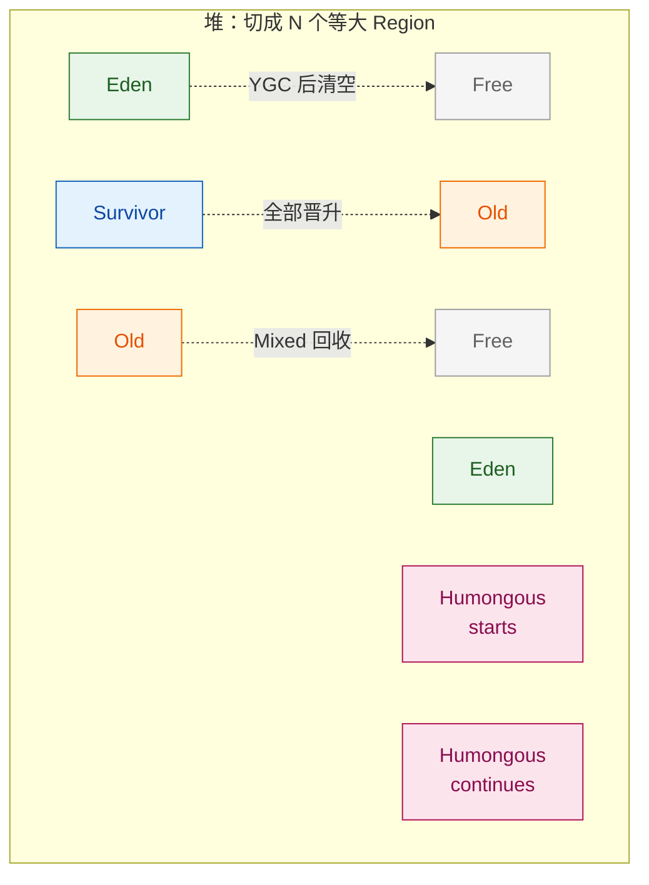
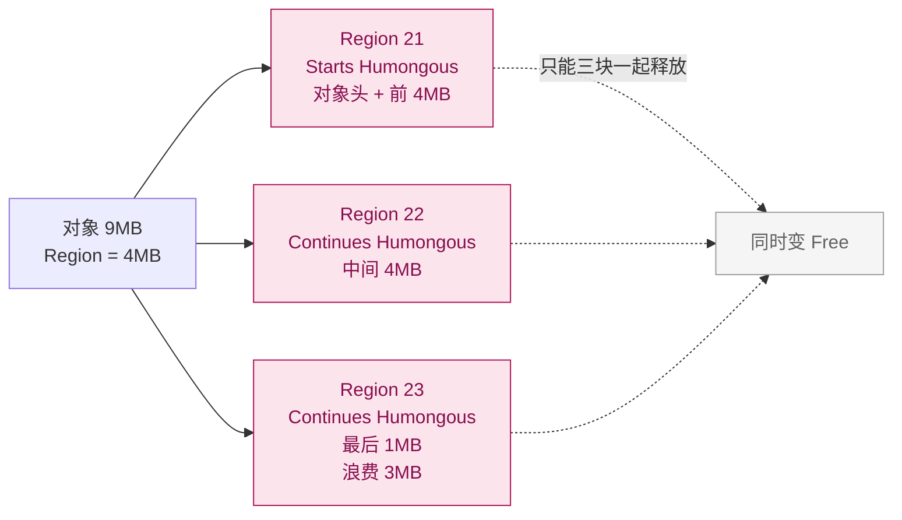
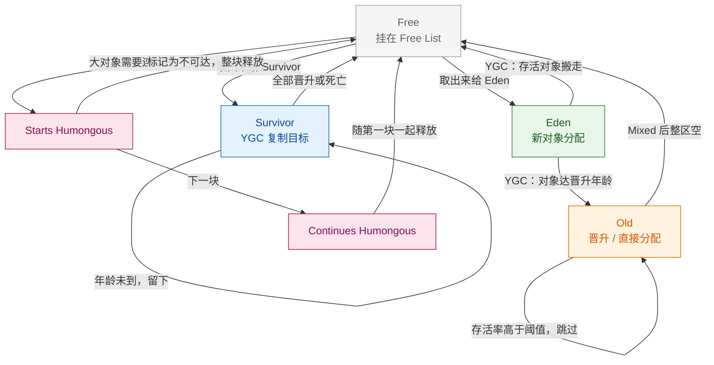
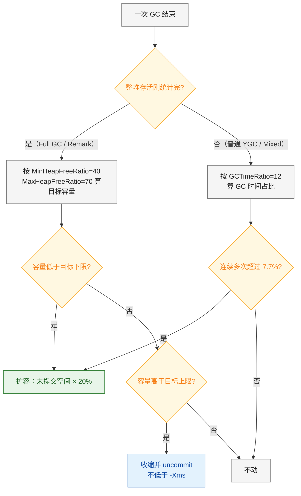
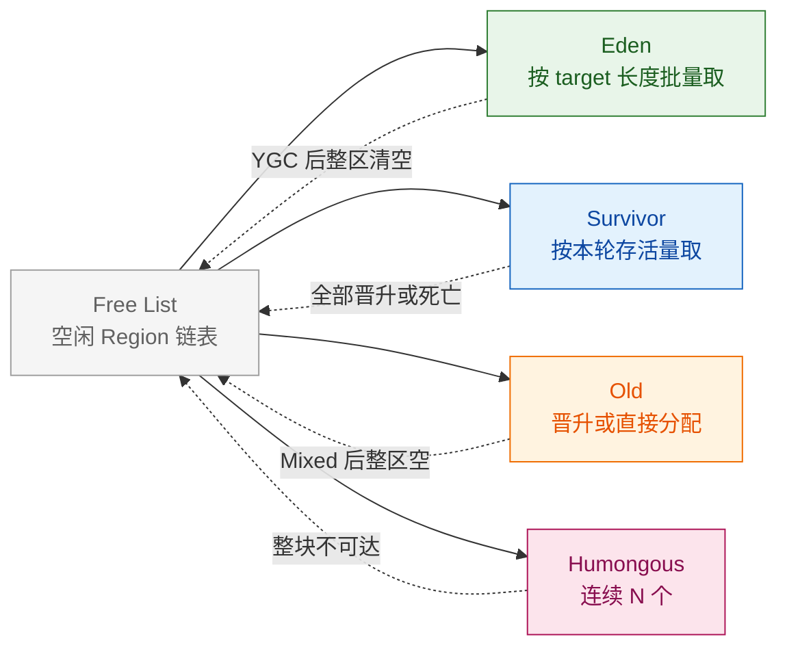
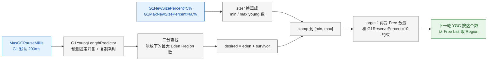
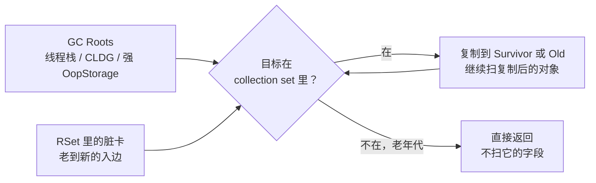
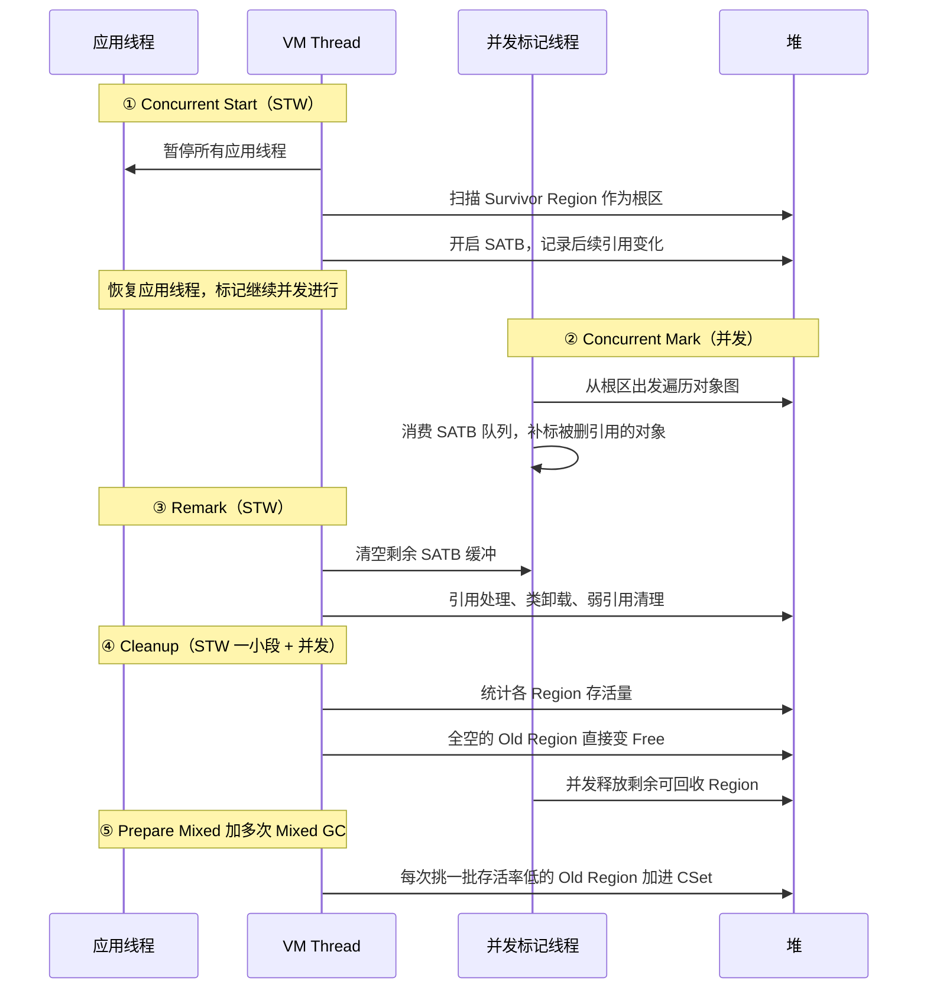

# JVM · G1 收集器：Region 布局与 GC 时序

> 版本前提：以 JDK 11 / 17 / 21 为主线，参数默认值与源码取自 JDK 21u，涉及旧版本差异的地方单独标注。卡表与 RSet 的底层结构见 `jvm-card-table-remembered-set.md`，本文只讲它们在 G1 里的角色。

## 一分钟版

1. G1 把堆切成等大的 Region，逻辑上仍分代，物理上不连续，一个 Region 在任意时刻只能是 Eden、Survivor、Old、Humongous、Free 之一。
2. Region 大小在启动时按 `MaxHeapSize / 2048` 推导，取 2 的幂，夹在 1MB 到 32MB 之间，之后不再改变；能变的是堆容量，也就是 Region 总数。
3. 没有任何参数能直接指定「Eden 放 20 个 Region」。Eden 长度每轮 YGC 前由停顿预测模型重算，Survivor 由存活率和晋升阈值决定，Old 按需从 Free List 分配。
4. GC 主线是三段：Young Only 反复 YGC，老年代占用到 IHOP 后进入并发标记周期，标记完转 Mixed 阶段分多次回收老年代，兜底是 Full GC。
5. G1 的停顿目标是 `-XX:MaxGCPauseMillis`，G1 下默认 200ms，它是目标不是承诺，靠「这轮少收几个 Region」来逼近。

## 一、G1 要解决什么问题

### 1.1 从连续分代到分区堆

Parallel 和 CMS 的堆是物理连续的：年轻代一整块，老年代一整块。这种布局的代价是回收粒度被代际边界锁死，年轻代只能整体收，老年代只能整体标记或压缩。

G1 换了个思路：把堆切成等大的 Region，每个 Region 独立决定放什么。新生对象进 Eden Region，YGC 存活对象进 Survivor Region，晋升对象进 Old Region。回收时挑一批 Region 组成收集集（Collection Set，CSet），收完把空的 Region 还给 Free List。

这样做换来两个能力：**按 Region 粒度回收**，不必整代全收；**按 Region 估算成本**，从而按停顿目标决定这一轮收多少。

### 1.2 三个设计支点

| 支点       | 具体做法                                       | 带来的结果                       |
| -------- | ------------------------------------------ | --------------------------- |
| Region 化 | 堆切成 1MB 到 32MB 的等大块，逻辑分代                   | 回收粒度从「一代」降到「一批 Region」      |
| 停顿可预测    | 用历史数据预测每个 Region 的复制成本，反推这一轮能收几个           | 用 `MaxGCPauseMillis` 约束单次停顿 |
| 增量回收     | 并发标记先算出哪些 Old Region 值得收，再分多次 Mixed GC 慢慢收 | 避免一次压缩整个老年代                 |

### 1.3 和 CMS、Parallel 的分工

| 维度   | Parallel      | CMS                              | G1                    |
| ---- | ------------- | -------------------------------- | --------------------- |
| 堆布局  | 连续分代          | 连续分代                             | 等大 Region，逻辑分代        |
| 回收粒度 | 整代            | 整代（老年代并发标记清除）                    | 一批 Region             |
| 压缩   | 年轻代复制，老年代整堆压缩 | 不压缩，靠碎片容忍                        | 复制式回收，天然局部压缩          |
| 停顿控制 | 吞吐优先，可设目标但粒度粗 | 以低停顿为主，有 Concurrent Mode Failure | 显式停顿目标加成本模型           |
| 大对象  | 老年代直接分配       | 老年代直接分配                          | Humongous Region，单独处理 |
| 默认地位 | JDK 8 默认      | 从未默认                             | JDK 9 起默认（JEP 248）    |

## 二、Region 类型全景

### 2.1 源码里只有六个 Tag

`heapRegionType.hpp` 的枚举不是六个平铺的值，而是把「大类」放高位、「小类」放最低位：

```cpp
typedef enum {
  FreeTag               = 0,

  YoungMask             = 2,
  EdenTag               = YoungMask,
  SurvTag               = YoungMask + 1,

  HumongousMask         = 4,
  StartsHumongousTag    = HumongousMask,
  ContinuesHumongousTag = HumongousMask + 1,

  OldMask               = 8,
  OldTag                = OldMask
} Tag;
```

这样设计的好处是判断变快：`is_young()` 只要 `(tag & YoungMask) != 0`，一次与运算就能同时覆盖 Eden 和 Survivor。判断顺序也不影响正确性。

| 类型                  | Tag 值 | 含义                 | 怎么产生          | 怎么消失                                   |
| ------------------- | ----- | ------------------ | ------------- | -------------------------------------- |
| Free                | 0     | 未分配，挂在 Free List 上 | 初始化，或回收后整区清空  | 被分配给 Eden / Survivor / Old / Humongous |
| Eden                | 2     | 新生对象的默认落点          | 从 Free List 取 | YGC 后整区存活对象搬走，变 Free                   |
| Survivor            | 3     | YGC 存活对象的暂存区       | YGC 的复制目标     | 区内对象全部晋升或死亡后变 Free                     |
| Old                 | 8     | 晋升对象与长期存活对象        | 晋升，或直接分配进 Old | Mixed GC 判定可回收后变 Free                  |
| Starts Humongous    | 4     | 大对象第一块，含对象头        | 大对象分配         | 整块回收后一起变 Free                          |
| Continues Humongous | 5     | 大对象后续块，没有对象头       | 大对象分配         | 整块回收后一起变 Free                          |

堆布局长这样：



三类 Region 在 GC 里的待遇完全不同：Eden 每次 YGC 全收，Survivor 每次 YGC 都作为 CSet 的一部分，Old 只有进了 CSet 才收。Humongous 单独一条路径，见 2.2。

### 2.2 Humongous 为什么要拆成 starts 加 continues

判定线只有一个：**对象大小严格大于 Region 的一半**。

```cpp
static size_t humongous_threshold_for(size_t region_size) {
  return (region_size / 2);
}

static bool is_humongous(size_t word_size) {
  // 必须是严格大于：TLAB 的上限就是阈值，不能把 TLAB 判成大对象
  return word_size > _humongous_object_threshold_in_words;
}
```

所以 Region 为 4MB 时，超过 2MB 的对象就是 Humongous，与「超过一个 Region」不是一回事。这一点很多资料写错。

碎片问题从这里开始：一个 9MB 的对象要占 3 个 Region。第一块放对象头和前 4MB，第二块放中间 4MB，第三块只用 1MB，剩下 3MB 无法给别人用。**整块必须一起释放**，因为 GC 扫描需要从对象头开始。



三个后果要记住：

- Continues 块没有对象头，不能单独扫描，必须靠 `_humongous_start_region` 回到第一块。
- 分配需要连续的空闲 Region。碎片化时会出现「总空闲够、连续块不够」，直接触发 GC，这就是日志里 `G1 Humongous Allocation` 的来源。
- 回收粒度粗，一个 9MB 的对象只要还有引用，三个 Region 都不能动。

### 2.3 一个 Region 的一生



这张图有一个容易忽略的分支：Eden 里的对象不会「变成」Survivor 区里的对象，是复制过去的。原 Region 整块清空回 Free List，所以 **Eden 的回收成本只与存活对象数量成正比**，不是与 Eden 大小成正比。

### 2.4 归档 Region

CDS 归档的类元数据可以映射成堆里的归档 Region，它们在常规 GC 里不参与回收，属于只读区域。这类 Region 不在 `HeapRegionType` 的六个 Tag 里，是 `HeapRegion` 上的独立标记，所以别把它当成第七种类型。

### 2.5 四个容易记错的点

| 说法                     | 实际情况                                       |
| ---------------------- | ------------------------------------------ |
| Region 是连续的            | 逻辑编号连续，物理地址不要求连续，只要求按 Region 大小对齐          |
| G1 没有分代                | 有逻辑分代，Eden 和 Survivor 属于年轻代，Old 属于老年代      |
| Humongous 是大于一个 Region | 是大于半个 Region，`region_size / 2`             |
| Free Region 仍然占内存      | 占的是虚拟地址，物理内存可以 uncommit 掉，`-Xms` 以内的部分通常保留 |

## 三、Region 的数量是怎么定的

### 3.1 默认大小等于最大堆除以 2048，取 2 的幂

启动时 `G1Arguments::initialize_alignments()` 只做一件事：

```cpp
void G1Arguments::initialize_alignments() {
  CardTable::initialize_card_size();
  // 注意这里传的是 MaxHeapSize，不是当前堆大小
  HeapRegion::setup_heap_region_size(MaxHeapSize);
  SpaceAlignment = HeapRegion::GrainBytes;
  HeapAlignment = calculate_heap_alignment(SpaceAlignment);
  ...
}
```

推导过程在 `HeapRegion::setup_heap_region_size`：

```cpp
void HeapRegion::setup_heap_region_size(size_t max_heap_size) {
  size_t region_size = G1HeapRegionSize;
  if (region_size == 0) {  // 默认值 0 表示按 ergonomics 推导
    region_size = clamp(max_heap_size / HeapRegionBounds::target_number(),
                        HeapRegionBounds::min_size(),
                        HeapRegionBounds::max_ergonomics_size());
  }
  // 向上取到 2 的幂，向上取比向下取更划算
  region_size = round_up_power_of_2(region_size);
  region_size = clamp(region_size, HeapRegionBounds::min_size(),
                      HeapRegionBounds::max_size());
  int region_size_log = log2i_exact(region_size);
  guarantee(LogOfHRGrainBytes == 0, "we should only set it once");
  LogOfHRGrainBytes = region_size_log;
  ...
}
```

常量来自 `heapRegionBounds.hpp`：

| 常量                     | 值     | 作用                           |
| ---------------------- | ----- | ---------------------------- |
| `TARGET_REGION_NUMBER` | 2048  | 推导时的目标 Region 数              |
| `MIN_REGION_SIZE`      | 1MB   | 下限                           |
| `MAX_ERGONOMICS_SIZE`  | 32MB  | 自动推导的上限                      |
| `MAX_REGION_SIZE`      | 512MB | 手动指定 `G1HeapRegionSize` 时的上限 |

把公式代进去，不同堆的推导结果：

| `-Xmx` | 除以 2048 | clamp 后   | 向上取 2 的幂 | Region 数 |
| ------ | ------- | --------- | -------- | -------- |
| 1G     | 512K    | 1MB（触下限）  | 1MB      | 1024     |
| 2G     | 1M      | 1M        | 1MB      | 2048     |
| 3G     | 1.5M    | 1.5M      | 2MB      | 1536     |
| 4G     | 2M      | 2M        | 2MB      | 2048     |
| 8G     | 4M      | 4M        | 4MB      | 2048     |
| 32G    | 16M     | 16M       | 16MB     | 2048     |
| 64G    | 32M     | 32M       | 32MB     | 2048     |
| 128G   | 64M     | 32MB（触上限） | 32MB     | 4096     |
| 256G   | 128M    | 32MB（触上限） | 32MB     | 8192     |

<span style="color:red">Region 总数只有 2G 到 64G 的堆才刚好 2048 个</span>，1G 是 1024，128G 是 4096。面试里说「G1 固定 2048 个 Region」是要被追问的。

### 3.2 为什么把目标定在 2048

三个约束互相拉扯的结果：

- Region 太大，回收粒度粗。一个 Region 里只要有一个存活对象就不能释放，整个 Region 的剩余空间都算浪费。
- Region 太小，管理成本高。每个 Region 都有自己的 RSet、卡表切片、标记位图，Region 越多，这些元数据的固定开销越大。
- Humongous 阈值是 Region 的一半。Region 越小，大对象越容易被判成 Humongous，碎片问题越严重。

2048 是 HotSpot 在这三者之间取的折中值。**它不是一个可调参数**，源码里是 `static const size_t`，没有任何 flag 能改。

### 3.3 Region 大小运行期不能改

源码里那句 `guarantee(LogOfHRGrainBytes == 0, "we should only set it once")` 就是硬证据。Region 大小在 `initialize_alignments` 里算一次，之后 `GrainBytes`、`GrainWords`、`CardsPerRegion` 全部按它推导。**整个堆的对齐和卡表划分都依赖这个值**，所以没有回旋余地。

所以，<span style="color:red">Region 大小在 JVM 启动时算一次，之后不再改变</span>。想改只能重启，改 `-XX:G1HeapRegionSize` 或者改 `-Xmx`。


能变的是堆容量。堆从 `-Xms` 涨到 `-Xmx` 的过程中，提交的 Region 数会变，但每个 Region 多大是固定的。这一点在排查「为什么 Region 数和我算的不一样」时特别重要：`num_regions()` 返回的是当前提交的 Region 数，不是 `-Xmx` 对应的最大值。

### 3.4 堆什么时候涨、什么时候缩

G1 默认允许堆在 `-Xms` 到 `-Xmx` 之间浮动。**两个方向用的是两套判据**：涨看 GC 时间占比，缩看空闲比例。

扩容看 GC 时间占比，在每次 YGC 结束后算：

```cpp
size_t G1HeapSizingPolicy::young_collection_expansion_amount() {
  double long_term_pause_time_ratio = _analytics->long_term_pause_time_ratio();
  double short_term_pause_time_ratio = _analytics->short_term_pause_time_ratio();
  const double pause_time_threshold = 1.0 / (1.0 + GCTimeRatio);
  double threshold = scale_with_heap(pause_time_threshold);
  ...
  if (committed_bytes < InitialHeapSize / 4) {
    expand_bytes = (InitialHeapSize - committed_bytes) / 2;  // 小于初始堆四分之一，快速补回
  } else {
    expand_bytes = MIN2(expand_bytes_via_pct, committed_bytes);
    ...
  }
}
```

`GCTimeRatio` 在 G1 下如果没显式设置会被改成 12，阈值就是 `1 / 13 ≈ 7.7%`。连续多次超过阈值才扩容，扩容大小是「未提交空间 × `G1ExpandByPercentOfAvailable / 100`」，默认 20%（实验性参数，改要加 `-XX:+UnlockExperimentalVMOptions`）。

缩容看空闲比例，在整堆存活数据刚统计完的时机算：

```cpp
size_t G1HeapSizingPolicy::full_collection_resize_amount(bool& expand) {
  size_t minimum_desired_capacity = target_heap_capacity(used_after_gc, MinHeapFreeRatio);
  size_t maximum_desired_capacity = target_heap_capacity(used_after_gc, MaxHeapFreeRatio);
  ...
  if (capacity_after_gc < minimum_desired_capacity) {
    expand = true;
    return minimum_desired_capacity - capacity_after_gc;
  } else if (capacity_after_gc > maximum_desired_capacity) {
    expand = false;
    return capacity_after_gc - maximum_desired_capacity;
  }
}
```

`MinHeapFreeRatio` 默认 40，`MaxHeapFreeRatio` 默认 70。意思是 GC 后如果空闲超过 70%，就把堆缩到「已用 / 30%」附近；如果空闲不到 40%，就扩到「已用 / 60%」附近。缩的时候 G1 会把整块的 Free Region 从物理内存里 uncommit 掉，但不会低于 `-Xms`。



生产上更常见的做法是 `-Xms` 等于 `-Xmx`，直接把弹性关掉。理由是弹性堆会让 Region 数在运行期变化，RSet 和卡表的内存占用跟着抖，而容器环境下 `-Xmx` 本来就应该按 limit 设死。

### 3.5 一次扩容对 Region 数的具体影响

以 `-Xmx8g` 为例，Region 固定 4MB，最大 2048 个。启动 `-Xms2g` 时只提交 512 个 Region，随着压力上来逐步提交，直到 2048 个封顶。

提交粒度是「按需一次提交若干 Region」，不是一次一个。所以 **`GC.heap_info` 里的 total 会跳变**，比如从 2G 跳到 2.5G，而不是平滑增长。

## 四、四类 Region 的数量如何动态调整

### 4.1 Free List 是唯一来源

**所有非 Free 的 Region 都来自 Free List**，用完再还回去。这是理解「数量调整」的前提：没有哪个代有自己固定的地盘，Old 也不是预留出来的。



由此得到一个反直觉的结论：<span style="color:red">Old 区不预留，按需从 Free List 分配</span>。老年代占用是「分配出来的结果」，不是「预留好的空间」。这也解释了为什么 G1 不需要像 CMS 那样担心老年代碎片导致 Concurrent Mode Failure，它担心的是另一种失败：evacuation failure，即没有空闲 Region 可以复制存活对象。

### 4.2 Eden：每轮 YGC 前重算

<span style="color:red">Eden 的数量每一轮 YGC 前都会重算</span>，不是启动时定死。入口是 `G1Policy::update_young_length_bounds()`，它依次算出 **desired、target、max 三个长度**。

```cpp
void G1Policy::update_young_length_bounds(size_t pending_cards, size_t rs_length) {
  uint new_young_list_desired_length = calculate_young_desired_length(pending_cards, rs_length);
  uint new_young_list_target_length = calculate_young_target_length(new_young_list_desired_length);
  uint new_young_list_max_length = calculate_young_max_length(new_young_list_target_length);
  ...
}
```

第一步，边界由两个百分比给出：

```cpp
uint G1YoungGenSizer::calculate_default_min_length(uint new_number_of_heap_regions) {
  uint default_value = (new_number_of_heap_regions * G1NewSizePercent) / 100;   // 默认 5%
  return MAX2(1U, default_value);
}

uint G1YoungGenSizer::calculate_default_max_length(uint new_number_of_heap_regions) {
  uint default_value = (new_number_of_heap_regions * G1MaxNewSizePercent) / 100; // 默认 60%
  return MAX2(1U, default_value);
}
```

第二步，Eden 的期望值由停顿预测模型反推，核心是二分查找：

```cpp
uint G1Policy::calculate_young_desired_length(size_t pending_cards, size_t rs_length) const {
  uint min_young_length_by_sizer = _young_gen_sizer.min_desired_young_length();
  uint max_young_length_by_sizer = _young_gen_sizer.max_desired_young_length();
  const uint survivor_length = _g1h->survivor_regions_count();
  uint absolute_min_young_length = MAX3(min_young_length_by_sizer,
                                        survivor_length + 1,
                                        allocated_young_length);
  ...
  desired_young_length = desired_eden_length + survivor_length;
  desired_young_length = clamp(desired_young_length, absolute_min_young_length,
                               absolute_max_young_length);
  return desired_young_length;
}
```

预测器叫 `G1YoungLengthPredictor`，逐个试「如果这一轮收 N 个 Eden Region，复制耗时加固定开销是多少」，超过 `MaxGCPauseMillis` 就缩小 N。因为耗时随 N 单调递增，可以直接二分。

```cpp
const double pause_time_ms = _base_time_ms + copy_time_ms + young_other_time_ms;
if (pause_time_ms > _target_pause_time_ms) {
  return false;   // 这个 N 放不下
}
```

第三步，`target` 再被空闲 Region 和保留区约束一次。`G1ReservePercent` 默认 10，意思是堆里永远留 10% 的空 Region 应急，防止晋升时无处可去。年轻代想吃进保留区，最多只能吃一半。



用 8G 堆算一遍：2048 个 Region，年轻代上限 60% 就是 1228 个，下限 5% 是 102 个。200ms 目标下，如果每个 Region 复制成本约 0.15ms，Eden 最多也就 500 个左右，实际往往远小于上限。所以「年轻代最多能占 60% 堆」这个上限，多数场景根本碰不到。

这里有一个必须点明的关系：<span style="color:red">MaxGCPauseMillis 是目标，不是承诺</span>。调小它，G1 会让 Eden 变小，YGC 更频繁，单次停顿更短；但如果存活对象多、复制成本降不下来，G1 会在「下限」处停住，实际停顿仍然超标。把 200 改成 20 通常只会换来 GC 次数暴涨和晋升提前。

### 4.3 Survivor：由存活率和晋升阈值决定

Survivor 的数量不是「Eden 除以 8」这么简单，`SurvivorRatio` 只决定目标值：

```cpp
void G1Policy::update_survivors_policy() {
  double max_survivor_regions_d = (double)young_list_target_length() / (double) SurvivorRatio;
  uint const desired_max_survivor_regions = ceil(max_survivor_regions_d);
  size_t const survivor_size = desired_survivor_size(desired_max_survivor_regions);
  _tenuring_threshold = _survivors_age_table.compute_tenuring_threshold(survivor_size);
  ...
  _max_survivor_regions = MIN2(desired_max_survivor_regions,
                               _g1h->num_free_or_available_regions());
}

size_t G1Policy::desired_survivor_size(uint max_regions) const {
  size_t const survivor_capacity = HeapRegion::GrainWords * max_regions;
  return (size_t)((((double)survivor_capacity) * TargetSurvivorRatio) / 100);  // 默认 50
}
```

拆开看三层：

1. `SurvivorRatio` 默认 8，目标 Survivor 总量是年轻代长度的八分之一。
2. `TargetSurvivorRatio` 默认 50，实际只按目标容量的一半来算「装得下多少年龄的对象」。
3. `compute_tenuring_threshold` 用年龄表算出本轮的实际晋升阈值，上限是 `MaxTenuringThreshold`，默认 15。

所以 Survivor 的 Region 数是一个动态结果：本轮 YGC 复制出多少存活对象，下一轮就要预留足够容纳它们的 Region。**Survivor 装不下就会提前晋升**，老年代增长加快，接着触发并发标记。这条因果链在排查「老年代莫名其妙涨得快」时经常是根因。

`_max_survivor_regions` 还要被 `num_free_or_available_regions()` 压一次。堆快满的时候，G1 宁可少留 Survivor 也不会把 Free List 掏空，否则下一轮就没地方复制了。

### 4.4 Old：不预留，靠 IHOP 提前启动标记

Old Region 的增长只有一个来源：晋升和直接分配。策略层不控制它的数量，只控制「什么时候开始为回收它做准备」。`-XX:InitiatingHeapOccupancyPercent=45` 是这条判据的初值：老年代已用容量加上本次分配量超过 `45% × -Xmx` 时，G1 请求启动一次并发标记周期，统计老年代还有哪些对象存活，为后续 Mixed GC 挑选候选 Region。这是关闭自适应时的口径，默认自适应打开后只有前 3 个周期按它算，细节见 6.8 节。

判据在 `need_to_start_conc_mark`：

```cpp
bool G1Policy::need_to_start_conc_mark(const char* source, size_t alloc_word_size) {
  if (about_to_start_mixed_phase()) {
    return false;
  }
  size_t marking_initiating_used_threshold = _ihop_control->get_conc_mark_start_threshold();
  size_t cur_used_bytes = _g1h->non_young_capacity_bytes();
  size_t alloc_byte_size = alloc_word_size * HeapWordSize;
  size_t marking_request_bytes = cur_used_bytes + alloc_byte_size;
  bool result = false;
  if (marking_request_bytes > marking_initiating_used_threshold) {
    result = collector_state()->in_young_only_phase() && !collector_state()->in_young_gc_before_mixed();
  }
  return result;
}
```

**比较的是占用加分配量，不是单纯的占用率**，因为一次大分配本身就可能把老年代推过阈值。阈值默认取 `InitiatingHeapOccupancyPercent=45`，但 `G1UseAdaptiveIHOP` 默认开启，实际阈值会浮动：

```cpp
G1IHOPControl* G1Policy::create_ihop_control(...) {
  if (G1UseAdaptiveIHOP) {
    return new G1AdaptiveIHOPControl(InitiatingHeapOccupancyPercent,
                                     old_gen_alloc_tracker, predictor,
                                     G1ReservePercent, G1HeapWastePercent);
  } else {
    return new G1StaticIHOPControl(InitiatingHeapOccupancyPercent, old_gen_alloc_tracker);
  }
}
```

自适应版本的阈值不是「微调 45%」，而是一道减法：

```cpp
size_t G1AdaptiveIHOPControl::actual_target_threshold() const {
  // 先扣掉堆预留和收不回来的碎片，得到「安全占用上限」
  double safe_total_heap_percentage = MIN2((double)(_heap_reserve_percent + _heap_waste_percent), 100.0);
  return (size_t)MIN2(
    G1CollectedHeap::heap()->max_capacity() * (100.0 - safe_total_heap_percentage) / 100.0,
    _target_occupancy * (100.0 - _heap_waste_percent) / 100.0);
}

size_t G1AdaptiveIHOPControl::get_conc_mark_start_threshold() {
  if (have_enough_data_for_prediction()) {
    double pred_marking_time = predict(&_marking_times_s);      // 标记要跑多久
    double pred_promotion_rate = predict(&_allocation_rate_s);  // 老年代涨多快
    size_t pred_promotion_size = (size_t)(pred_marking_time * pred_promotion_rate);
    size_t predicted_needed_bytes_during_marking =
      pred_promotion_size + _last_unrestrained_young_size;      // 再加一个不受限的年轻代做保守估计
    size_t internal_threshold = actual_target_threshold();
    return predicted_needed_bytes_during_marking < internal_threshold ?
           internal_threshold - predicted_needed_bytes_during_marking : 0;
  } else {
    return (size_t)(_initial_ihop_percent * _target_occupancy / 100.0);  // 样本不足，用 45%
  }
}
```


三个关键点：

1. **阈值等于安全上限减去标记期间预计新增的占用**。预测的晋升越多，起始阈值越低，标记就越早开始。这就是「分配速率高的应用实际触发点低于 45%」的具体机制。
2. 安全上限本身还是被扣过的：默认 `G1ReservePercent=10` 加 `G1HeapWastePercent=5`，上限是 `-Xmx` 的 85%。也就是说自适应模式下，实际阈值天花板是 85%，不是 100%。
3. **样本不足时退回固定百分比**。`have_enough_data_for_prediction()` 要求标记时长和分配速率各攒够 `G1AdaptiveIHOPNumInitialSamples=3` 个样本，也就是前 3 个标记周期仍然按 45% 触发。

想关掉自适应做实验，用 `-XX:-G1UseAdaptiveIHOP`，此时走 `G1StaticIHOPControl`，阈值恒为 `45% × -Xmx`。

### 4.5 Humongous：一次要连续 N 个

**Humongous 的数量由对象大小决定**，没有策略调节空间。唯一能影响的是 Region 大小：

- Region 调大，同样大小的对象占用 Region 数变少，跨区碎片减少，但 RSet 的卡号范围变大、清理粒度变粗。
- Region 调小，大对象更容易跨区，Humongous 占比上升，连续分配失败的概率上升。

分配失败的处理路径是固定的：先尝试在 Free List 里找连续块，找不到就触发一次 GC，`GCCause` 记为 `_g1_humongous_allocation`。如果 YGC 之后还是找不到，就退到 Full GC。日志里看到连续的 `G1 Humongous Allocation`，基本可以判定是大对象把堆打出了碎片。

### 4.6 谁在什么时候改什么数量

| 数量                 | 决策时机             | 决策依据                                      | 可控参数                                                         | 能不能直接指定 |
| ------------------ | ---------------- | ----------------------------------------- | ------------------------------------------------------------ | ------- |
| Region 总数          | 启动时定上限，运行期随堆提交变化 | `MaxHeapSize / 2048` 推导 Region 大小         | `-Xmx`、`-Xms`、`G1HeapRegionSize`                             | 只能间接指定  |
| Eden Region 数      | 每轮 YGC 前         | 停顿预测，二分查找                                 | `MaxGCPauseMillis`、`G1NewSizePercent`、`G1MaxNewSizePercent`  | 不能      |
| Survivor Region 数  | 每轮 YGC 前         | `SurvivorRatio`、`TargetSurvivorRatio`、年龄表 | `SurvivorRatio`、`TargetSurvivorRatio`、`MaxTenuringThreshold` | 不能      |
| Old Region 数       | 分配时              | 晋升与直接分配                                   | 无                                                            | 不能      |
| Humongous Region 数 | 分配时              | 对象大小除以 Region 大小                          | `G1HeapRegionSize`                                           | 不能      |
| 并发标记启动点            | 每次 GC 结束         | IHOP，自适应时看预测                              | `InitiatingHeapOccupancyPercent`、`G1UseAdaptiveIHOP`         | 只能调阈值   |

如果确实想固定年轻代，唯一的办法是 `-Xmn` 或 `-XX:NewSize` 加 `-XX:MaxNewSize`。源码里这种情况会把 `_use_adaptive_sizing` 置为 false：

```cpp
if (FLAG_IS_CMDLINE(NewSize)) {
  _min_desired_young_length = MAX2((uint)(NewSize / HeapRegion::GrainBytes), 1U);
  if (FLAG_IS_CMDLINE(MaxNewSize)) {
    ...
    _sizer_kind = SizerMaxAndNewSize;
    _use_adaptive_sizing = _min_desired_young_length != _max_desired_young_length;
  }
}
```

代价是 **停顿目标直接失效**：G1 没法再通过缩 Eden 来控停顿。官方调优指南不建议设 `-Xmn`，原因就在这里。

## 五、GC 的顺序与时机

### 5.1 一条主线加一个兜底

G1 的 GC 不是「YGC、Mixed、Full 三选一」，而是一条有顺序的主线：

```mermaid
flowchart LR
    subgraph YOUNG["Young Only 阶段"]
        direction TB
        Y1["Pause Young (Normal)<br/>STW，只清 Eden 和 Survivor"]:::young
        Y2["反复发生，直到老年代占用触阈值"]:::young
        Y1 --> Y2
    end

    subgraph CYCLE["并发标记周期"]
        direction TB
        C1["Concurrent Start<br/>STW，挂在一次 YGC 上"]:::stw
        C2["Concurrent Mark<br/>并发，SATB 记录漏标"]:::conc
        C3["Remark<br/>STW，收尾标记"]:::stw
        C4["Cleanup<br/>STW 统计 + 并发释放空区"]:::stw
        C1 --> C2 --> C3 --> C4
    end

    subgraph MIXED["Mixed 阶段"]
        direction TB
        M0["Prepare Mixed<br/>STW，最后一次纯 YGC"]:::young
        M1["Pause Young (Mixed) × N<br/>每轮带一批老年代 Region"]:::mixed
        M0 --> M1
    end

    FULL["Pause Full<br/>兜底，整堆标记压缩"]:::full

    Y2 -- "老年代占用超 IHOP" --> C1
    C4 --> M0
    M1 -- "可回收空间不足堆的 5%" --> Y1
    M1 -. "evacuation failure" .-> FULL
    Y1 -. "分配失败、晋升失败" .-> FULL

    classDef young fill:#E8F5E9,stroke:#2E7D32,color:#1B5E20
    classDef stw fill:#FFF3E0,stroke:#EF6C00,color:#E65100
    classDef conc fill:#E3F2FD,stroke:#1565C0,color:#0D47A1
    classDef mixed fill:#FCE4EC,stroke:#AD1457,color:#880E4F
    classDef full fill:#FFEBEE,stroke:#C62828,color:#B71C1C
```



三个关键判断：

- **并发标记只能从 Young Only 阶段启动**，不能从 Mixed 阶段中途插进来。源码里 `assert(!collector_state()->in_concurrent_start_gc() || collector_state()->in_young_only_phase())` 就是在守这条。
- Concurrent Start 本身就是一次 YGC，它不是独立的暂停类型。
- Mixed 阶段结束后回到 Young Only，等下一次 IHOP 触发，如此循环。

### 5.2 触发条件对照

| GC 类型                    | 触发条件                               | 是否 STW       | 收集范围                 |
| ------------------------ | ---------------------------------- | ------------ | -------------------- |
| Young (Normal)           | Eden 分配满，最常见                       | 是            | 全部 Eden 加 Survivor   |
| Young (Concurrent Start) | IHOP 达标后的下一次 YGC，或显式请求             | 是            | 同 YGC，额外做初始标记        |
| Concurrent Mark          | 跟随 Concurrent Start 启动             | 否            | 整堆对象图                |
| Remark                   | 并发标记接近完成，SATB 缓冲需要收尾               | 是            | 整堆                   |
| Cleanup                  | Remark 之后                          | 是（统计）+ 否（释放） | 整堆 Region 统计         |
| Young (Prepare Mixed)    | Cleanup 判定有值得回收的 Old Region        | 是            | 同 YGC                |
| Young (Mixed)            | Mixed 阶段内 Eden 满                   | 是            | YGC 范围加一批 Old Region |
| Full                     | 疏散失败、Humongous 分配失败、显式 System.gc() | 是            | 整堆，带压缩               |

### 5.3 Young Only 阶段

这是 G1 最常态的阶段，日志里就是一行接一行的 `Pause Young (Normal) (G1 Evacuation Pause)`。

每次暂停做四件事：

1. 扫描 GC Roots，再扫 RSet 里老年代指向年轻代的脏卡。
2. 把入口指向的年轻代对象复制到 Survivor 或 Old。
3. 顺着复制后的对象继续扫描，直到没有新的存活对象。
4. 清空 Eden，存活对象达到晋升阈值的进 Old。

**停顿时间与存活对象数量成正比**，与 Eden 大小不成正比。这是 Eden 可以开得比较大的原因：Eden 里绝大多数对象都是垃圾，复制成本只由存活对象决定。

#### 5.3.1 根集合在源码里是两处入口

`GC Roots` 是个概念，落到 G1 源码就是 `G1RootProcessor::evacuate_roots` 里的三个调用：

```cpp
void G1RootProcessor::evacuate_roots(G1ParScanThreadState* pss, uint worker_id) {
  ...
  process_java_roots(closures, phase_times, worker_id);
  process_vm_roots(closures, phase_times, worker_id);
  // 并发标记的引用发现列表也当根处理
  _g1h->ref_processor_cm()->weak_oops_do(closures->strong_oops());
}
```

`process_java_roots` 只做两件事，但这两件覆盖了绝大部分根：

```cpp
// 所有线程的 Java 栈、JNI 句柄、栈上 nmethod 里内嵌的 oop
Threads::possibly_parallel_oops_do(is_par, closures->strong_oops(),
                                   closures->strong_codeblobs());

// 类加载器及其 Class 镜像，静态字段从这条路径出去
ClassLoaderDataGraph::roots_cld_do(closures->strong_clds(), closures->weak_clds());
```

`process_vm_roots` 则遍历 `OopStorageSet` 里的强存储：

```cpp
for (auto id : EnumRange<OopStorageSet::StrongId>()) {
  _oop_storage_set_strong_par_state.par_state(id)->oops_do(closures->strong_oops());
}
```

JDK 18 起 VM 内部的 oop 统一搬进 `OopStorage`，名字带 `Strong` 的在这一步扫，`Weak` 的留到引用处理阶段。所以根集合在实现上就是「线程 + CLDG + 若干强 OopStorage」，不是一张能凭记忆写全的清单。

#### 5.3.2 常说的七类根，逐条对一遍

| 常见说法 | 结论 | 实现上的实际情况 |
| --- | --- | --- |
| 虚拟机栈中局部变量引用的对象 | 成立 | 遍历靠编译期生成的 oop map 按槽位声明哪个位置是引用，不是把局部变量表整体当根 |
| 方法区中类静态属性引用的对象 | 成立，措辞要改 | JDK 8 起没有方法区，静态字段的值放在堆里的 `java.lang.Class` 镜像上 |
| 方法区中常量引用的对象 | 半错 | 字符串常量池在堆里，而且 StringTable 是弱表，不构成强根 |
| 本地方法栈中 JNI 引用 | 方向对，位置错 | JNI 局部引用挂在 `JNIHandleBlock` 链表上，不在本地方法栈 |
| Java 虚拟机内部的引用 | 成立 | `Universe::vm_global()` 这个强存储装的就是这批对象 |
| 被 synchronized 持有的对象 | 不成立 | `ObjectMonitor::_object` 是 `WeakHandle`，不阻止对象被回收 |
| JMXBean、JVMTI 回调、本地代码缓存 | 成立 | CodeCache 的 nmethod 里有内嵌 oop，JVMTI 另有 global ref 和 tag map |

#### 5.3.3 三个最容易讲错的地方

**一、局部变量不是「方法里出现过就算根」**

```java
void demo() {
  byte[] buf = new byte[100 * 1024 * 1024];
  buf = null;             // 到这里这 100MB 就可以回收了
  doSomethingLong();      // 别指望 buf 还活着
}
```

根由 oop map 决定，不由源码里的声明顺序决定。JIT 还有两个更彻底的手段：标量替换把对象拆成字段放进栈帧，逃逸分析后的栈上分配让小对象压根不进堆。这两种情况下对象连堆地址都没有，自然不需要当根。「局部变量表」是解释器时代的描述，现在准确的说法是「栈帧里由 oop map 标记为引用的槽位」。

**二、静态字段走 Class 镜像，不扫元数据**

JDK 8 起方法区由 Metaspace 实现，在 native memory 里，存的是类的元数据（`InstanceKlass`、常量池、方法字节码）。静态字段的值不在那里：

```cpp
inline oop InstanceKlass::static_field_base_raw() { return java_mirror(); }
```

静态字段从 `java.lang.Class` 镜像对象的尾部开始排。GC 的路径是 `ClassLoaderDataGraph` → `Klass::java_mirror()` → 扫这个 Class 对象的字段。所以「静态变量是根」对，「GC 去扫方法区」错，扫的是堆里的 Class 对象。

顺着这条链还有一个结论：类加载器只要活着，它加载的类就不会被卸载，静态字段指向的对象跟着一直活着。Metaspace OOM 和热部署之后旧类不释放，根因都在这。另外 `static final` 的编译期常量会被内联进字节码，运行时连字段都没有。

**三、字符串常量池是弱表，monitor 不构成根**

字符串常量池在 JDK 7 就从永久代搬到了堆里。更关键的是持有方式：

```cpp
_oop_storage = OopStorageSet::create_weak("StringTable Weak", mtSymbol);
```

每个条目是 `WeakHandle`。所以 interned 字符串不是强根，没有别的强引用时会被回收，之后在清理阶段从表里摘掉。字面量一直活着是因为 Class 常量池和 `ldc` 指令还在引用它，不是因为它在 StringTable 里。

`synchronized` 那条反得更彻底：

```cpp
WeakHandle _object;               // backward object pointer
```

`ObjectMonitor` 对对象只有弱引用。对象活着的真实原因是持锁线程的栈上有它，否则没法加锁。反过来验：如果 monitor 算强根，`synchronized (new Object()) { }` 执行完就该永久泄漏，实际不会，锁释放后对象被回收，monitor 跟着 deflate。所以材料里这条只能算「其他可能的根」的举例，不能当成 HotSpot 的固定根类目讲。

#### 5.3.4 YGC 只沿年轻代往下追

这是 G1 和「标记整堆」最容易混的地方。发现一个引用时：

```cpp
template <class T>
void G1ParScanThreadState::do_oop_evac(T* p) {
  oop obj = RawAccess<IS_NOT_NULL>::oop_load(p);
  const G1HeapRegionAttr region_attr = _g1h->region_attr(obj);
  if (!region_attr.is_in_cset()) {
    // In this case somebody else already did all the work.
    return;
  }
  ...
}
```

不在 collection set 里就直接返回。遍历边界是 collection set，不是整个堆：入口指向年轻代就复制、接着扫这个新对象；碰到老年代对象就停，连它的字段都不看。

这解释了为什么 **YGC 停顿只跟存活的年轻代对象成正比**，跟老年代有多大无关。也解释了 YGC 为什么不可能误杀老年代对象：老年代本来就不在回收范围，扫不扫都不影响它的生死。

老年代指向年轻代的引用怎么办？根扫描找不到它，根不会指向老年代内部。这条边由 RSet 补：G1 给需要跟踪的年轻代 Region 维护一本账，记着「哪个老年代 Region 的哪张卡指向我」，YGC 把这些卡当第二批入口扫。



所以 G1 在 Young Only 阶段的入口有两条：`GC Roots` 加 `RSet`。只讲 GC Roots 会漏掉一半，这也正是「YGC 也要扫老年代」这个误解的来源。

### 5.4 并发标记的阶段拆解



每个阶段的目的：

| 阶段               | 为什么需要它                               |
| ---------------- | ------------------------------------ |
| Concurrent Start | 拿到一份一致的根集合快照，同时不长时间停应用               |
| Concurrent Mark  | 大部分遍历工作放在并发阶段，摊薄 STW 成本              |
| Remark           | SATB 只能保证「删除的引用」不漏，剩下的缓冲必须停下来收尾      |
| Cleanup          | 标记位图只能说明存活，还要换算成「哪些 Region 全空、哪些值得收」 |
| Mixed            | 老年代 Region 多，一次收完会超停顿目标，必须分批         |

SATB 的规则是「引用被覆盖前先记录旧值」，**保证并发修改下不漏标存活对象**。代价是会产生浮动垃圾，这一轮没清掉的下一轮再清。

Concurrent Mark 阶段的目标是从 GC Roots 出发，**递归扫描整个堆**的对象引用图，找出所有存活对象。它会计算出每个 Region（包括新生代和老年代 Region）中对象的存活比例，但此阶段本身**不进行实际的垃圾回收（不复制或清理对象）**，只是做标记和统计，为后续的 Mixed GC 筛选回收集（Collection Set）提供依据。  
Remark 阶段：**作用范围整个堆**。需要处理并发标记阶段因用户线程运行而产生的引用关系变化，确保所有存活对象都被正确标记。由于存在跨代引用（例如新生代对象引用老年代对象），它不能只扫描老年代，必须覆盖全堆才能保证标记的准确性。并发标记阶段与用户线程并行执行，用户线程可能在此期间修改对象引用，导致某些对象「漏标」。Remark 阶段会暂停所有应用线程（STW），处理 SATB（Snapshot-At-The-Beginning）缓冲区中记录的引用变化，完成对遗漏对象的最终标记。这个阶段通常很快，但耗时受新生代对象数量影响较大。

Cleanup 阶段**针对所有 Region 的标记位图与存活统计**，而非重新扫描对象图。它基于 Remark 完成后已经确定的标记结果，对各个 Region 进行后续处理。

Cleanup 阶段主要完成三件事：

1. **统计存活对象**：计算每个 Region 中存活对象的比例，识别出完全空闲的 Region。
2. **筛选回收候选**：根据存活率对 Region 进行排序，为后续的 Mixed GC 挑选回收收益最高的老年代 Region。
3. **重置与清理**：将完全空闲的 Region 重置并返还给空闲列表；同时清理标记位图、重置 TAMS 指针，为下一轮并发标记周期做准备。

其中，**空闲 Region 的回收和位图重置是并发进行的**，只有存活统计和候选筛选等关键步骤需要短暂的 STW 停顿。

### 5.5 标记位图与 TAMS：一个记状态，一个划边界

并发标记的特殊之处在于，应用线程和标记线程同时跑。这带来两个必须回答的问题：

1. 这个对象之前标过没有？对象图有环，同一对象可能被多条路径引用，不记状态就会重复扫描。
2. 标记开始之后新分配的对象怎么算？它们从来没被扫到，纯按可达性分析会全部判死。

位图回答第一个问题，TAMS 回答第二个。

#### 5.5.1 位图是 1 bit 管 8 字节，不是一位一个对象

`MarkBitMap` 的类注释写得很明确：

```cpp
// A generic mark bitmap for concurrent marking. This is essentially a wrapper
// around the BitMap class that is based on HeapWords, with one bit per (1 << _shifter) HeapWords.
class MarkBitMap {
  const int _shifter;    // Shift amount from heap index to bit index in the bitmap.
  ...
};
```

`_shifter` 取 `LogMinObjAlignment`，默认是 3。所以一位对应的不是「一个对象」，而是**8 字节的地址空间**：

```cpp
size_t addr_to_offset(const HeapWord* addr) const {
  return pointer_delta(addr, _covered.start()) >> _shifter;
}
```

对象大小不固定，位图没法按对象分配位。它按地址铺开：一个大对象只占一位，旁边一堆小对象各占一位。这也解释了为什么位图大小只跟堆容量有关，跟对象数量无关：

```
位图大小 = 堆容量 / 8 字节 × 1 bit = 堆容量 / 64 ≈ 1.56%
```

2G 堆约 32MB，8G 堆约 128MB。这笔内存由 `G1RegionToSpaceMapper` 按 Region 粒度懒提交，**在 native memory 里，不占 Java 堆**，`jmap -heap` 看不到，要用 NMT 的 `GC` 类别查。

位图承担两个职责，第二个比第一个更关键：

| 职责     | 具体行为                                                |
| ------ | --------------------------------------------------- |
| 记录存活   | 从根扫到对象就置 1，Cleanup 阶段按位统计每个 Region 的存活字节数           |
| 防止重复扫描 | 扫到对象先看这一位，已是 1 就跳过；并发下用 `par_mark` 的 CAS 保证只有一个线程认领 |

少了第二个职责，一个环状引用就能让标记线程反复入栈，最坏退化成指数级遍历。

#### 5.5.2 TAMS 是 Old 和 Humongous Region 的水位线

TAMS 全称 Top At Mark Start。名字容易让人以为是全局一个指针，实际是**每个 Region 一个**（`HeapRegion::_top_at_mark_start`）。

但设它的条件比想象中窄。JDK 21 的实现：

```cpp
inline void HeapRegion::note_start_of_marking() {
  assert(top_at_mark_start() == bottom(), "CA region's TAMS must always be at bottom");
  if (is_old_or_humongous()) {
    set_top_at_mark_start(top());
  }
}
```

**只有 Old 和 Humongous Region 会被设成当时的 top**，Eden 和 Survivor 保持 bottom。原因是年轻代 Region 在标记周期里会被 YGC 整体处理，它们指向谁都会被完整扫到，不需要再用 TAMS 记账。所以「每个 Region 都记录 TAMS」在 JDK 17 之后并不成立。

TAMS 之上的对象为什么可以直接判活：它们在标记开始后才分配，只能由当前的 mutator 持有，一定可达。但标记线程的根快照是标记开始那一刻拍的，扫不到这些新对象。不做特殊处理，它们会被当成垃圾回收掉。

所以这是一条约定：**TAMS 之上默认存活，不扫也不标记**。

#### 5.5.3 两者的配合，以及 JDK 20 之后的实现变化

语义层面两行就说清了：

```
对象地址 >= TAMS  → 活
对象地址 <  TAMS  → 查位图，1 是活，0 是死
```

JDK 17 及之前（双位图时代）的写法：

```cpp
inline bool HeapRegion::is_obj_dead(const oop obj, const G1CMBitMap* const prev_bitmap) const {
  return !obj_allocated_since_prev_marking(obj) &&
         !prev_bitmap->is_marked(obj) &&
         !is_closed_archive();
}
```

`obj_allocated_since_prev_marking` 就是「地址在 prev TAMS 之上」，取反正是「TAMS 之上必活」。翻过来看，就是常见 `is_live` 的语义：`obj_allocated_since_prev_marking(obj) || bitmap->is_marked(obj)`。

JDK 20 起换成另一套：**只保留一张位图，判定改用 `parsable_bottom`**。

```cpp
inline bool HeapRegion::is_obj_dead(const oop obj, HeapWord* const pb) const {
  if (obj_in_unparsable_area(obj, pb)) {
    return !is_marked_in_bitmap(obj);
  }
  return G1CollectedHeap::is_obj_filler(obj);
}
```


原因在 JDK-8210708 里写得很清楚：类卸载之后，老年代会留下无法按对象边界解析的空洞。旧方案用两张位图绕开这个问题，prev 存当前存活，next 存本轮标记，Remark 时交换。新方案直接把空洞改写成 filler 对象，于是一张位图就够，省下约 1.5% 堆大小的 native 内存。

代价是多了一个 `parsable_bottom`（代码里叫 `pb`），含义是「从这个地址往上，堆可以按对象边界解析」。`pb` 之上才需要查位图，`pb` 之下已经 scrub 过，不是 filler 就是活对象。

两个水位线在周期里的变化：

| 阶段                        | TAMS                   | parsable_bottom | 位图状态      |
| ------------------------- | ---------------------- | --------------- | --------- |
| Young Only                | bottom                 | bottom          | 空         |
| Concurrent Start 到 Remark | top（仅 Old / Humongous） | bottom          | 边标记边写     |
| Remark 之后                 | 不变                     | 设成 TAMS         | 只读，供判定和统计 |
| Cleanup 之后                | 重置为 bottom             | bottom          | 清空，等下一轮   |

所以「TAMS 之上必活」从 JDK 8 到 21 都成立，只是 JDK 20 之后不再靠直接比较 TAMS，而是靠「没被改写成 filler」。面试里背 `is_below_tams` 这种方法名，在 JDK 21 源码里是找不到的。

#### 5.5.4 和卡表、RSet 的区别

三者都在 native memory，都按地址索引，很容易混。分工其实很清楚：

| 结构   | 记什么              | 粒度              | 谁写        |
| ---- | ---------------- | --------------- | --------- |
| 卡表   | 这 512 字节里发生过引用写入 | 1 byte / 512B   | 写后屏障      |
| RSet | 谁可能指向我这个 Region  | 每 Region 一本倒排索引 | refine 线程 |
| 标记位图 | 这个地址上的对象标过没有     | 1 bit / 8B      | 并发标记线程    |

一句话区分：卡表和 RSet 管**引用关系**，位图管**对象生死**。前者服务于「找到引用」，后者服务于「记住找过」。

卡表和 RSet 的细节在 `jvm-card-table-remembered-set.md` 里，这里不重复。

### 5.6 Mixed 阶段不是一次清完老年代

<span style="color:red">Mixed GC 不是一次清完老年代</span>，它把一个标记周期的回收量拆到多次暂停里。拆分由四个参数控制：

| 参数                                | 默认值 | 作用                                  |
| --------------------------------- | --- | ----------------------------------- |
| `G1MixedGCLiveThresholdPercent`   | 85  | 存活率高于 85% 的 Old Region 直接跳过，收了也不划算  |
| `G1OldCSetRegionThresholdPercent` | 10  | 单次 Mixed GC 最多收堆容量 10% 的 Old Region |
| `G1MixedGCCountTarget`            | 8   | 一个标记周期的回收量目标拆成 8 次左右                |
| `G1HeapWastePercent`              | 5   | 剩余可回收空间低于堆的 5% 就结束 Mixed 阶段         |

候选 Region 的排序依据是 **回收性价比**，也就是能省多少除以要花多少：

```cpp
double HeapRegion::calc_gc_efficiency() {
  double region_elapsed_time_ms = policy->predict_region_total_time_ms(this, false);
  return (double)reclaimable_bytes() / region_elapsed_time_ms;
}
```

`reclaimable_bytes()` 是 Region 里已标记为垃圾的部分，分母是复制存活对象的预测耗时。收益高、成本低的 Region 排在前面，先被加入 CSet。

于是 Mixed 阶段的实际形态是：每次 `Pause Young (Mixed)` 收全部年轻代加一小批老年代，收个七八次，直到剩下的 Region 都不值得收。这就是 G1 能在不牺牲停顿的前提下逐步压缩老年代的原因。

### 5.7 什么时候会掉进 Full GC

G1 没有 CMS 的 Concurrent Mode Failure，但有三种更糟的失败：

| 触发场景           | 日志特征                                                             | 根因                           |
| -------------- | ---------------------------------------------------------------- | ---------------------------- |
| 疏散失败           | `to-space exhausted`、`Pause Full (G1 Evacuation Pause)`          | 没有空闲 Region 接收存活对象，复制到一半失败   |
| Humongous 分配失败 | `G1 Humongous Allocation`、`Pause Full (G1 Humongous Allocation)` | 找不到连续的空闲 Region              |
| 显式请求           | `Pause Full (System.gc())`                                       | 代码或框架直接调 `System.gc()`，默认走整堆 |

**疏散失败是 G1 最需要防的场景**。它意味着「复制到一半发现没地方放」，已经复制的对象要回滚，然后整堆做一次标记压缩。这种 Full GC 的停顿通常是正常 YGC 的几十倍。

JDK 10 起 Full GC 是并行的（JEP 307），之前是单线程。并行能把停顿缩短一个数量级，但它仍然只在异常路径上出现。

压缩代码里的 `System.gc()` 是最容易拿到的收益：如果确认依赖不强制要求，用 `-XX:+ExplicitGCInvokesConcurrent` 把它转成一次并发周期，避免整堆压缩。

### 5.8 日志怎么读

一段典型的 G1 日志，按顺序对应上面的阶段：

```text
[gc,start] GC(12) Pause Young (Normal) (G1 Evacuation Pause) 1024M->480M(2048M) 8.214ms
[gc,start] GC(13) Pause Young (Concurrent Start) (G1 Evacuation Pause) 1100M->520M(2048M) 12.035ms
[gc,phase] GC(13) Concurrent Scan Root Regions 2.114ms
[gc,phase] GC(13) Concurrent Mark (12.345s, 12.567s) 222.031ms
[gc,start] GC(14) Pause Remark 660M->640M(2048M) 3.402ms
[gc,start] GC(15) Pause Cleanup 640M->636M(2048M) 0.512ms
[gc,start] GC(16) Pause Young (Prepare Mixed) (G1 Evacuation Pause) 700M->560M(2048M) 9.771ms
[gc,start] GC(17) Pause Young (Mixed) (G1 Evacuation Pause) 760M->500M(2048M) 10.883ms
[gc,start] GC(18) Pause Young (Mixed) (G1 Evacuation Pause) 720M->470M(2048M) 10.129ms
```

**读法：先看暂停类型，再看括号里的回收量。**

- `Pause Young (Normal)` 是常态，只看停顿和回收量。
- `Pause Young (Concurrent Start)` 出现，说明 IHOP 到了，标记周期开始。
- `Concurrent Mark` 后面的括号是两个时间戳，不是耗时，耗时是最后那个数。
- `Pause Remark` 和 `Pause Cleanup` 通常都很短，如果 Remark 变长，优先查引用处理和类卸载。
- `Pause Young (Prepare Mixed)` 出现一次，之后就是若干次 `Pause Young (Mixed)`。
- 连续多次 Mixed 之后回到 `Pause Young (Normal)`，说明这一轮回收结束。

## 六、生产问题与参数

### 6.1 停顿突然变长

按这个顺序排查：

1. 看日志里是哪种暂停变长。`Pause Young (Mixed)` 变长，说明单次带的 Old Region 太多，调小 `G1OldCSetRegionThresholdPercent`。
2. `Pause Remark` 变长，查类卸载和引用处理，`-XX:+ParallelRefProcEnabled` 是否开启。
3. `Pause Full` 出现，直接按 5.7 处理，不要先调停顿参数。
4. 所有暂停都变长，先看堆是不是太小导致 GC 频繁，再考虑 Region 大小是否偏小。

注意一个反直觉现象：**调小停顿目标可能让停顿更差**。Eden 变小导致 YGC 频繁，对象在 Survivor 里多熬几轮，晋升提前，老年代增长加快，Mixed 阶段压力更大。

### 6.2 Humongous 把堆打穿

判断依据：`jcmd <pid> GC.heap_info` 里 humongous 占用比例高，或者日志里频繁出现 `G1 Humongous Allocation`。

处理顺序：

1. 先确认对象真的需要这么大。批量查询一次拉几百万行、Excel 导出全量数据，这类问题改代码比调 GC 有效。
2. 确实需要，调大 `-XX:G1HeapRegionSize`，让常见大对象落在半个 Region 以内。
3. Region 调大之后观察 RSet 和卡表内存，必要时换 ZGC。

### 6.3 老年代涨得快但标记不触发

`InitiatingHeapOccupancyPercent` **是占用率，不是绝对量**。堆很大的时候，45% 可能是几十 G，看起来「还没满」，实际已经堆了很多垃圾。

两个动作：打开 `-Xlog:gc+ergo+ihop=debug` 看自适应 IHOP 算出的实际阈值，或者临时把 IHOP 调低到 30 观察标记是否能及时启动。如果调低后 Full GC 消失，说明原来的触发点太晚。

### 6.4 Region 数看着不对

先自己算一遍：`Region 数 = MaxHeapSize / Region 大小`，Region 大小按 3.1 的表推。常见误区是拿 `-Xms` 算，或者忘了 Region 大小会被 clamp 到 1MB 和 32MB。

`jcmd <pid> GC.heap_info` 的输出里有一行直接给答案：

```text
garbage-first heap   total 8388608K, used 3145728K
  region size 4096K, 512 young (2097152K), 8 survivors (32768K)
```

`total` 是当前提交的堆，`region size` 是固定值，young 和 survivors 的括号里是字节数，除以 region size 就是 Region 个数。

### 6.5 参数速查

| 参数                                    | 默认值      | 什么时候动                                                                |
| ------------------------------------- | -------- | -------------------------------------------------------------------- |
| `-XX:MaxGCPauseMillis`                | G1 下 200 | 有明确停顿 SLA 时设，不要低于 50                                                 |
| `-XX:G1HeapRegionSize`                | 0，按堆推导   | 大对象多、Humongous 占比高时调大                                                |
| `-XX:G1NewSizePercent`                | 5        | 实验性参数，手设要加 `-XX:+UnlockExperimentalVMOptions`                        |
| `-XX:G1MaxNewSizePercent`             | 60       | 同上，一般不动                                                              |
| `-XX:InitiatingHeapOccupancyPercent`  | 45       | 标记启动太晚导致 Full GC 时调低                                                 |
| `-XX:G1UseAdaptiveIHOP`               | true     | 想固定阈值做实验时关掉                                                          |
| `-XX:G1ReservePercent`                | 10       | 频繁 evac failure 时适当调高，上限 50                                          |
| `-XX:G1MixedGCLiveThresholdPercent`   | 85       | 老年代存活率高、Mixed 收益差时调低                                                 |
| `-XX:G1OldCSetRegionThresholdPercent` | 10       | Mixed 单次停顿超标时调低                                                      |
| `-XX:G1MixedGCCountTarget`            | 8        | 想拉长 Mixed 周期、降低单次压力时调大                                               |
| `-XX:G1HeapWastePercent`              | 5        | 想更激进回收老年代时调低                                                         |
| `-XX:SurvivorRatio`                   | 8        | Survivor 太小导致提前晋升时调**小**（往 4 或 2 走）。G1 里表示「Survivor 总量 ≤ 年轻代长度的 1/8」 |
| `-XX:TargetSurvivorRatio`             | 50       | Survivor 期望占用率，折算成年龄表的目标容量，调低会让对象更早晋升                                |
| `-XX:MaxTenuringThreshold`            | 15       | 只是上限，实际阈值每轮由年龄表动态算，通常远小于 15                                          |

### 6.6 G1ReservePercent：它压的是 Eden，不是老年代

默认 10，范围 0 到 50：

```cpp
product(uintx, G1ReservePercent, 10,
        "It determines the minimum reserve we should have in the heap "
        "to minimize the probability of promotion failure.")
    range(0, 50)
```

源码先把它折成 Region 数，堆容量变化时重算：

```cpp
void G1Policy::record_new_heap_size(uint new_number_of_regions) {
  double reserve_regions_d = (double) new_number_of_regions * _reserve_factor;  // _reserve_factor = G1ReservePercent / 100.0
  _reserve_regions = (uint) ceil(reserve_regions_d);
  ...
}
```

2G 堆默认 1MB 一个 Region，共 2048 个，`_reserve_regions` 就是 205，约 205MB。

真正花掉这笔预留的是 `calculate_young_target_length`，也就是每轮 YGC 结束算下一轮年轻代长度那一步：

| GC 结束时空闲 Region 数 | G1 的动作                                             |
| ----------------- | -------------------------------------------------- |
| 大于「期望 Eden 加保留区」  | 期望多少给多少，完全不碰保留区                                    |
| 落在两者之间            | 保留区外的全给，再从保留区借一小部分                                 |
| 不大于保留区            | 最多借 `min(最小年轻代长度, (reserve+1)/2)` 个，并保证至少 1 个 Eden |

源码注释写得很直白：`We will try our best not to "eat" into the reserve as long as we can`。所以保留区的调度时机是「每次 YGC 结束后分配下一轮 Eden」，不是「持续监视堆占用率然后踩刹车」。这一点和很多文章的描述不同。

调它之前先想清楚两件事：

- <span style="color:red">调大 G1ReservePercent 会让标记更早启动</span>。它同时是 `G1AdaptiveIHOPControl` 的构造参数，参与 `100 - reserve - waste` 这个安全上限的计算，保留区越大，老年代能用到的高水位越低。
- 疏散失败的主因通常是晋升速度超过回收速度，而不是保留区太小。堆已经吃满时，把 10 调成 20 只是把 Full GC 往后推几分钟。

### 6.7 SurvivorRatio、TargetSurvivorRatio、MaxTenuringThreshold：一条链，不是三个旋钮

三个参数常被并列介绍，实际是从上往下依次收窄的一条链：

```
young_target_length
   ↓ SurvivorRatio = 8           给出 Survivor 的容量上限
max_survivor_regions = ceil(young_target_length / 8)
   ↓ TargetSurvivorRatio = 50    折算成期望占用
desired_survivor_size = survivor_capacity × 50%
   ↓ 年龄表按年龄累加              选出实际晋升阈值
_tenuring_threshold ∈ [1, MaxTenuringThreshold]
```

#### SurvivorRatio 在 G1 里只管上限，不管布局

G1 只有**一个逻辑 Survivor 空间**（`G1SurvivorRegions` 是个动态集合），没有 Serial 和 Parallel 那种固定的 from 与 to 两块半区。复制时 to-space 直接拿空闲 Region，用完把旧的还回 Free List。所以不存在「Eden 8 份、S0 1 份、S1 1 份」这种物理切分。

源码里它只出现在一处：

```cpp
void G1Policy::update_survivors_policy() {
  double max_survivor_regions_d = (double)young_list_target_length() / (double) SurvivorRatio;
  uint const desired_max_survivor_regions = ceil(max_survivor_regions_d);
  ...
}
```

含义是「Survivor 的 Region 数不超过年轻代的 1/8」。按 8:1:1 推算，Survivor 总量该占新生代 20%；G1 这里是 12.5%，而且这还只是上限，实际数量由本轮存活对象决定。

顺带记一下方向：ratio 调**大**，Survivor 变**小**。想让 Survivor 更大，要往 4 或 2 走。

#### TargetSurvivorRatio 不看使用率，看年龄分布

它不采样 Survivor 的实时占用，而是在每轮 YGC 结束后做一次换算：

```cpp
size_t G1Policy::desired_survivor_size(uint max_regions) const {
  size_t const survivor_capacity = HeapRegion::GrainWords * max_regions;
  return (size_t)((((double)survivor_capacity) * TargetSurvivorRatio) / 100);
}
```

拿到期望容量后交给年龄表反推：

```cpp
uint AgeTable::compute_tenuring_threshold(size_t desired_survivor_size) {
  size_t total = 0;
  uint age = 1;
  while (age < table_size) {
    total += sizes[age];                          // 累加年龄为 age 的对象总字节
    if (total > desired_survivor_size) break;     // 越过期望容量，这个年龄就当选
    age++;
  }
  result = age < MaxTenuringThreshold ? age : MaxTenuringThreshold;
  return result;
}
```


所以「Survivor 太满就提前晋升」的真实路径是：年龄分布累加提前越过 50% 那条线，选出来的 age 变小，下一轮这批对象直接进老年代。它用的是统计分布，不是水位线。

#### MaxTenuringThreshold 只是天花板

默认 15，上限也是 15，因为对象头 mark word 里 age 只占 4 bit（`markWord::max_age = 15`），`AgeTable` 的 `table_size` 就是 16。

两个容易踩的点：

- 设成 15 不代表对象要熬 15 轮。动态阈值通常只有 1 到 3，15 是个不会被越过的边界。
- 设成 0 等于取消晋升缓冲，所有存活对象直接进老年代。老年代增速会立刻上去，很少是想要的效果。

三个参数一起看时的调参方向：

| 现象                       | 先看哪个                   | 动作                                  |
| ------------------------ | ---------------------- | ----------------------------------- |
| 老年代涨得快、对象年龄 1 就晋升        | `SurvivorRatio`        | Survivor 容量不足，调小给更多 Region          |
| Survivor 常年接近空、年龄分布集中在低位 | `TargetSurvivorRatio`  | 阈值已经很低，重点查存活率而不是继续调参数               |
| YGC 停顿长、每次存活对象都很多        | 三者一起看                  | 加大 Survivor 只会加重复制成本，该考虑的是减少晋升或换收集器 |
| 想强行让对象多熬几轮               | `MaxTenuringThreshold` | 基本没用，动态阈值才是决定项                      |

### 6.8 InitiatingHeapOccupancyPercent：自适应打开后它只剩初始值
默认 45，范围 0 到 100。它是**老年代已用容量占 `-Xmx` 的百分比**，分母既不是当前提交的堆，也不是老年代自己的容量：

```cpp
size_t cur_used_bytes = _g1h->non_young_capacity_bytes();   // 老年代加 Humongous 已用
size_t alloc_byte_size = alloc_word_size * HeapWordSize;
size_t marking_request_bytes = cur_used_bytes + alloc_byte_size;
if (marking_request_bytes > _ihop_control->get_conc_mark_start_threshold()) { ... }
```

比较对象里多了 `alloc_byte_size`，因为一次大分配本身就可能把老年代推过线。

默认 `G1UseAdaptiveIHOP=true`，所以 45 只在两种情况下真正起作用：

- 关掉自适应，走 `G1StaticIHOPControl`，阈值恒为 `45% × -Xmx`。
- 自适应开着但样本不够。`G1AdaptiveIHOPNumInitialSamples=3`，标记时长和分配速率各攒够 3 个样本才切到预测，也就是前 3 个标记周期仍按 45% 触发。

进入预测阶段后，阈值变成 4.4 节那道减法，天花板是 `100 - G1ReservePercent - G1HeapWastePercent`，默认 85%。

这解释了一个常见困惑：<span style="color:red">把 `InitiatingHeapOccupancyPercent` 设成 80 或 90，在自适应模式下几乎看不到效果</span>。预测阶段的阈值被 85% 压着，还会被「标记期间预计晋升」继续往下减。真要推迟标记，只能 `-XX:-G1UseAdaptiveIHOP` 配一个固定值，同时接受预测能力一起消失。

反向调参更常见：老年代增长快、日志里出现 `to-space exhausted`，说明标记启动太晚，Mark 还没跑完老年代就满了。可选动作按优先级排：

1. 先确认是不是 Humongous 或晋升过快把老年代推起来的，这两个是根因，参数救不了。
2. 再看 `-Xlog:gc+ihop=debug` 里预测阈值和实际占用的差距。
3. 最后才动 `G1HeapWastePercent`（默认 5），它会同时抬高安全上限、放宽 Mixed 的结束条件。

## 七、三个可跑实验
### 7.1 看 Region 大小怎么推导
```bash
java -Xmx1g -Xlog:gc+heap=info -version 2>&1 | grep -i region
java -Xmx8g -Xlog:gc+heap=info -version 2>&1 | grep -i region
java -Xmx128g -Xlog:gc+heap=info -version 2>&1 | grep -i region
```

预期：1G 打出 `Heap Region Size: 1M`，8G 打出 `4M`，128G 打出 `32M`。第三个验证的是 **32MB 才是自动推导的上限**，不是 64MB。

### 7.2 看运行时的 Region 构成
```java
public class RegionWatch {
    public static void main(String[] args) throws Exception {
        // 10MB，在 4MB Region 下必然跨 3 个 Region
        byte[] big = new byte[10 * 1024 * 1024];
        System.out.println("big length = " + big.length);
        Thread.sleep(600_000);
    }
}
```

```bash
java -Xmx2g -XX:+UseG1GC RegionWatch
jcmd <pid> GC.heap_info
```

预期看到 `region size 1024K`（2G 堆），以及 humongous 的计数。把 `-Xmx` 改成 8g 再看一次，Region 变成 4MB，同一个对象占用的 Region 数从 11 个降到 3 个。

### 7.3 强制观察一次完整标记周期
```bash
java -Xmx1g -XX:+UseG1GC \
     -XX:InitiatingHeapOccupancyPercent=10 \
     -XX:G1MixedGCCountTarget=4 \
     -Xlog:gc*:file=g1.log:time,uptime,level,tags \
     G1Demo
```

把 IHOP 压到 10%，几轮 YGC 之后就会看到 `Pause Young (Concurrent Start)`，接着是 `Concurrent Mark`、`Pause Remark`、`Pause Cleanup`，然后是 `Prepare Mixed` 和若干次 `Mixed`。把 `G1MixedGCCountTarget` 从 8 改成 4，能明显看到 Mixed 次数减少、单次停顿变长。

## 八、面试问法
**Q1：G1 和 CMS 最本质的区别是什么？**

- 60 秒版本：CMS 是连续分代加整代回收，G1 是等大 Region 加增量回收。G1 能按 Region 估算成本、按停顿目标决定这一轮收多少，CMS 做不到这个粒度。
- 补充点：CMS 不压缩，靠碎片容忍，最终会撞上 Concurrent Mode Failure；G1 是复制式回收，天然带局部压缩，但要防的是 evacuation failure，即没有空闲 Region 复制。

**Q2：G1 的 Region 有哪几种类型？**

- 60 秒版本：源码里六个 Tag，Free、Eden、Survivor、Starts Humongous、Continues Humongous、Old。Eden 和 Survivor 共享 YoungMask，Humongous 两块共享 HumongousMask，所以判断「是不是年轻代」只要一次与运算。
- 补充点：CDS 归档 Region 是 `HeapRegion` 上的独立标记，不在这个枚举里，别说成第七种。

**Q3：大对象在 G1 里怎么处理？**

- 60 秒版本：对象严格大于 Region 的一半就判为 Humongous，分配连续 N 个 Region，第一块记对象头和起始指针，后面都是 Continues 块，没有对象头。回收时整块一起释放。
- 补充点：最后一块的内部碎片无法利用，且必须连续分配，所以大对象多的应用会出现「总空闲够、连续块不够」，直接触发 GC。

**Q4：Region 的数量是怎么定的？能调吗？**

- 60 秒版本：默认 `MaxHeapSize / 2048`，向上取 2 的幂，夹在 1MB 到 32MB 之间，Region 数就是堆大小除以它。2G 到 64G 的堆刚好 2048 个，1G 是 1024，128G 是 4096。
- 补充点：Region 大小启动时算一次，源码里有 `guarantee(... == 0, "we should only set it once")`，运行期不能改。能改的只有堆容量，也就是提交的 Region 数。

**Q5：Eden 放几个 Region 是谁决定的？**

- 60 秒版本：每轮 YGC 前由 `update_young_length_bounds` 重算。先用 `G1NewSizePercent=5%` 和 `G1MaxNewSizePercent=60%` 给出边界，再用停顿预测器二分查找「200ms 内能收多少个 Eden Region」，最后被 Free 数量和 `G1ReservePercent=10` 约束一次。
- 补充点：没有任何参数能直接指定 Eden 的 Region 数。想固定只能设 `-Xmn`，但那会让自适应失效，停顿目标跟着失效。

**Q6：Survivor 的大小怎么定？**

- 60 秒版本：`SurvivorRatio` 只给目标值，实际按 `TargetSurvivorRatio=50` 折算成容量，再用年龄表算出本轮晋升阈值，上限是 `MaxTenuringThreshold=15`。
- 补充点：Survivor 装不下就提前晋升，老年代增长加快，进而更早触发并发标记。这条链路是「老年代涨得快」的常见根因。

**Q7：什么时候触发并发标记？**

- 60 秒版本：老年代占用加本次分配量超过 IHOP 阈值，且当前处于 Young Only 阶段。默认阈值 45%，自适应 IHOP 开启后用上一轮标记耗时乘分配速率，把阈值前移。
- 补充点：并发标记不能从 Mixed 阶段启动，源码里有断言守着。上一轮并发线程还没退干净时，这次请求会被推迟到下一次暂停。

**Q8：G1 的 GC 有哪几种，顺序是什么？**

- 60 秒版本：Young Only 阶段反复 YGC，触阈值后进入并发标记周期，顺序是 Concurrent Start、Concurrent Mark、Remark、Cleanup，然后 Prepare Mixed 加多次 Mixed GC，回收够了回到 Young Only。兜底是 Full GC。
- 补充点：Concurrent Start 本身就是一次 YGC，不是独立暂停类型。日志里它显示为 `Pause Young (Concurrent Start)`。

**Q9：Mixed GC 怎么挑老年代 Region？**

- 60 秒版本：按回收性价比排序，`reclaimable_bytes / 预测耗时`，存活率超过 85% 的直接跳过，单次最多收堆容量 10% 的 Old Region，总量拆到 8 次左右，剩余可回收空间低于堆的 5% 就结束。
- 补充点：这四个参数分别对应 `G1MixedGCLiveThresholdPercent`、`G1OldCSetRegionThresholdPercent`、`G1MixedGCCountTarget`、`G1HeapWastePercent`，调优时优先动前两个。

**Q10：G1 什么时候会 Full GC？**

- 60 秒版本：疏散失败、Humongous 连续分配失败、显式 `System.gc()`。最常见的是疏散失败，日志里带 `to-space exhausted`。
- 补充点：JDK 10 起 Full GC 并行（JEP 307），但仍然是兜底，停顿是正常 YGC 的十几倍以上。`-XX:+ExplicitGCInvokesConcurrent` 可以把 `System.gc()` 转成并发周期。

**Q11：G1 能保证 200ms 停顿吗？**

- 60 秒版本：不能，200ms 是目标。G1 用成本模型决定这一轮收多少 Region 来逼近它，但存活对象多、复制成本高的时候会触到年轻代下限，实际停顿仍然超标。
- 补充点：把目标调得过小会让 Eden 变得极小，YGC 频繁、对象提前晋升，老年代压力反而更大，停顿更差。

**Q12：什么场景不该用 G1？**

- 60 秒版本：堆很小且停顿不敏感，用 Parallel 更省；堆超大且要求极低停顿，用 ZGC；大量大对象且分配频繁，G1 的 Humongous 碎片会很难受。
- 补充点：G1 的甜区是 4G 到 64G、停顿要求在 100ms 到 500ms 之间、老年代有较多可回收空间的在线服务。

**Q13：G1ReservePercent 是给谁留的空间？**

- 60 秒版本：给下一次疏散复制留的空闲 Region，不是给老年代预留。源码把它折成 `_reserve_regions`，在每轮 YGC 结束算下一轮 Eden 长度时扣掉；空闲不够就只给保留区之外的部分，必要时最多借 `min(最小年轻代长度, (reserve+1)/2)` 个 Region。
- 补充点：它同时是 `G1AdaptiveIHOPControl` 的构造参数，调大会压低 IHOP 阈值上限（`100 - reserve - waste`），因此也会让并发标记更早启动。这条间接影响比限制 Eden 更容易被忽略。

**Q14：SurvivorRatio 设 8 就是 8:1:1 吗？**

- 60 秒版本：G1 里不是。G1 只有一个逻辑 Survivor 空间，复制时用空闲 Region 当 to-space，没有两块固定半区。`SurvivorRatio` 只用来算 `max_survivor_regions = ceil(young_target / 8)`，即 Survivor 总量不超过年轻代的 1/8，比 Parallel 的 20% 更小。
- 补充点：`TargetSurvivorRatio=50` 再把它折成期望容量，年龄表累加越过这条线就下调晋升阈值，`MaxTenuringThreshold=15` 只是硬上限，实际阈值通常只有 1 到 3。另外 ratio 调大等于 Survivor 变小，方向别弄反。

**Q15：IHOP 设成 90 为什么没有效果？**

- 60 秒版本：`G1UseAdaptiveIHOP` 默认打开，45 只在样本不足的前 3 个标记周期生效（`G1AdaptiveIHOPNumInitialSamples=3`）。之后阈值由「安全上限减标记期间预计晋升」算出，安全上限是 `100 - G1ReservePercent - G1HeapWastePercent`，默认 85%，90 落不进这个公式。
- 补充点：想固定阈值就 `-XX:-G1UseAdaptiveIHOP`，代价是失去基于标记时长和晋升速率的提前量，遇到分配突增更容易来不及。真要缓解 Full GC，先查 Humongous 和晋升速度这两类根因。

**Q16：标记位图是干什么的？为什么不能省？**
- 60 秒版本：一位记一个地址空间有没有被标记，`_shifter = LogMinObjAlignment = 3`，所以是 1 bit 管 8 字节，大小约等于堆的 1/64。它同时干两件事：记存活，以及让标记线程扫到对象时先查这一位、已标记就跳过，避免对象图有环时重复遍历。
- 补充点：位图在 native memory，`jmap -heap` 看不到，要用 NMT；Cleanup 阶段按 Region 统计存活字节数也读它。只把它理解成「记生死」会漏掉防重复这个更关键的作用。

**Q17：TAMS 是什么？为什么它上面的对象不用标记？**
- 60 秒版本：Top At Mark Start，每个 Region 一个，在并发标记开始时把当时的 top 记下来。之上的对象是标记期间新分配的，只可能被 mutator 持有，一定可达，但根快照里没有它们，所以约定直接判活、不扫不标，避免被误回收。
- 补充点：JDK 21 里只有 Old 和 Humongous Region 会设 TAMS，年轻代保持 bottom，因为年轻代 Region 会被 YGC 整体处理，不需要这笔账。

**Q18：双位图什么时候变成单位图的？**
- 60 秒版本：JDK 20，改动是 JDK-8210708。之前 prev 存当前存活、next 存本轮标记，Remark 时交换；之后用 filler 对象填掉类卸载留下的空洞，配 `parsable_bottom` 判断，一张图就够。
- 补充点：省下的是约 1.5% 堆大小的 native 内存。JDK 17 还是双位图，看 17 的源码会看到 `prev_mark_bitmap`，看 21 的源码只有 `mark_bitmap`。

**Q19：GC Roots 有哪些，YGC 会扫整个老年代吗？**
- 60 秒版本：实现上是三块，所有线程的栈与 JNI 句柄、类加载器及 Class 镜像、若干强 OopStorage（VM 内部对象、JNI global）。常见清单里的字符串常量池是弱表，monitor 对对象只有 `WeakHandle`，这两条都不算强根。YGC 也不扫整个老年代：`do_oop_evac` 发现目标不在 collection set 就直接返回，老年代只在 RSet 脏卡当入口时才被局部扫到。
- 补充点：静态字段的值在堆里的 `java.lang.Class` 镜像上（`static_field_base_raw()` 直接返回 `java_mirror()`），所以「GC 去扫方法区」在 JDK 8 之后不成立。另外局部变量是否算根由 oop map 决定，`buf = null` 之后那块内存就能回收，不用等到方法返回。

## 九、误区 · 正解
| 误区                                         | 正解                                                      |
| ------------------------------------------ | ------------------------------------------------------- |
| G1 的 Region 是物理连续的                         | 只要求按 Region 大小对齐，逻辑编号连续，物理地址不要求连续                       |
| G1 取消了分代                                   | 逻辑分代保留，Eden 和 Survivor 是年轻代，Old 是老年代，只是不连续              |
| Region 数固定 2048                            | 只有 2G 到 64G 的堆才刚好 2048，1G 是 1024，128G 是 4096            |
| Region 大小可以运行期调整                           | 启动时算一次，之后 `GrainBytes` 等全部固定，改只能重启                      |
| Humongous 是大于一个 Region                     | 是严格大于半个 Region，`region_size / 2`                        |
| Old 区会预留一块固定空间                             | 不预留，按需从 Free List 分配，所以要看 IHOP 提前启动标记                   |
| Mixed GC 一次清完老年代                           | 分多次，每次带一批存活率低的 Old Region，回收够 5% 就停                     |
| G1 的 Full GC 一直是单线程                        | JDK 10 起并行（JEP 307），之前才是单线程                             |
| `MaxGCPauseMillis` 设小一点总没坏处                | 太小会让 Eden 缩水、YGC 频繁、晋升提前，停顿可能更差                         |
| Survivor 固定是 Eden 的八分之一                    | 八分之一只是 `SurvivorRatio` 给的目标值，实际由存活率和晋升阈值动态决定            |
| G1 不会有 Full GC                             | 疏散失败、Humongous 分配失败、显式 `System.gc()` 都会触发               |
| 调大 Region 一定能减少 Humongous                  | 能减少跨区数量，但 Region 变大后单块浪费也变大，RSet 范围同时变大                 |
| `G1ReservePercent` 限制老年代占用                 | 限制的是下一轮 Eden 能拿多少 Region；对老年代只有间接影响，通过 IHOP 安全上限生效      |
| 堆占用接近预留线时 G1 开始限流                          | 不是持续监视，而是每轮 YGC 结束后按空闲 Region 数决定下一轮 Eden 长度            |
| `SurvivorRatio=8` 就是 Eden:S0:S1 = 8:1:1    | G1 只有一个逻辑 Survivor 空间，8 只表示 Survivor 总量不超过年轻代的 1/8      |
| `TargetSurvivorRatio` 靠监控 Survivor 使用率来调阈值 | 靠年龄分布逐级累加，越过期望容量时选出的年龄就是新阈值                             |
| `MaxTenuringThreshold=15` 就是熬满 15 轮才晋升     | 实际阈值每轮动态算，通常 1 到 3，15 只是 4 bit 的硬上限                     |
| IHOP 设多少就按多少触发                             | 自适应模式下只管前 3 个周期，之后阈值天花板是 `100 - reserve - waste`，默认 85% |
| 位图一位对应一个对象 | 一位对应 8 字节地址空间（`_shifter = 3`），对象大小不固定，没法按对象分位 |
| 每个 Region 都有 TAMS | JDK 21 里只有 Old 和 Humongous 会设，年轻代保持 bottom |
| 双位图在 JDK 11 之后合并成单位图 | 是 JDK 20（JDK-8210708）；JDK 17 仍是 prev 加 next 两张 |
| 标记位图占 Java 堆 | 在 native memory，按 Region 懒提交，NMT 里记在 `GC` 类别 |
| 位图只用来记录对象存活 | 更重要的是让并发标记能 O(1) 判断「扫过没有」，否则环状引用会重复遍历 |
| 局部变量在方法返回前一直是根 | 由 oop map 决定，赋 null 或槽位复用后就不再是根；JIT 还能标量替换，对象压根不进堆 |
| 字符串常量池里的字符串是强根 | StringTable 建在 `weak` 存储上，条目是 `WeakHandle`，没有别的强引用时会被回收 |
| 被 synchronized 锁住的对象不会被回收 | `ObjectMonitor::_object` 是 `WeakHandle`；对象活着是因为持锁线程栈上有它 |
| YGC 要扫一遍老年代才知道哪些对象活着 | `do_oop_evac` 碰到不在 collection set 的对象直接返回，老年代只通过 RSet 脏卡被局部扫描 |

## 十、速查卡
- 六种 Region：Free(0)、Eden(2)、Survivor(3)、Starts Humongous(4)、Continues Humongous(5)、Old(8)。
- Region 大小：`clamp(MaxHeap/2048, 1MB, 32MB)` 再向上取 2 的幂，启动时定死；手设上限 512MB。
- Region 数：`MaxHeapSize / Region 大小`，2G 到 64G 刚好 2048。
- 年轻代边界：`G1NewSizePercent=5%`、`G1MaxNewSizePercent=60%`，实际 Eden 由 200ms 停顿目标和二分查找决定。
- Survivor：`SurvivorRatio=8` 只管上限（年轻代的 1/8），`TargetSurvivorRatio=50` 折算期望容量，年龄表反推阈值，`MaxTenuringThreshold=15` 只是天花板。
- 堆预留：`G1ReservePercent=10` 折成 `_reserve_regions`，限制下一轮 Eden 能拿多少，不是老年代上限；它同时压低 IHOP 阈值上限。
- 老年代：不预留，按需分配；`InitiatingHeapOccupancyPercent=45` 只管前 3 个标记周期，之后阈值等于「安全上限（默认 85%）减标记期间预计晋升」。
- Humongous：大于 Region 一半，连续 N 个 Region，整块释放，最后一块有内部碎片。
- 标记位图：1 bit / 8 字节，约堆的 1/64，native memory；记存活，也负责「扫过就跳过」。
- TAMS：Top At Mark Start，每 Region 一个，只有 Old / Humongous 设；之上必活，之下查位图。JDK 20 起判定改用 `parsable_bottom`。
- YGC 入口两条：GC Roots（线程栈加 JNI 句柄、CLDG、强 OopStorage）与 RSet 脏卡；遍历边界是 collection set，不追老年代。
- 标记周期：Concurrent Start(STW) → Concurrent Mark(并发) → Remark(STW) → Cleanup(STW 加并发)。
- Mixed：`MixedGCLiveThresholdPercent=85`、`OldCSetRegionThresholdPercent=10`、`MixedGCCountTarget=8`、`HeapWastePercent=5`。
- 兜底：evacuation failure、Humongous 分配失败、`System.gc()` 会走 Full GC，JDK 10 起并行。
- 调参顺序：先看日志确认暂停类型，再动对应的那一个参数，不要一次改三个。
