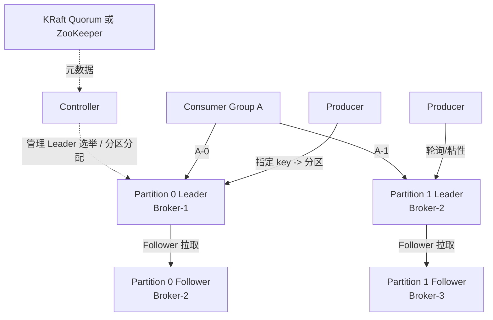

# 消息中间件 · Kafka

> 一句话定位：Kafka 是「吞吐优先 + 日志抽象」的代表 —— 它把自己定义成**分布式提交日志**而不是消息队列，所以顺序、重放、堆积能力极强，而延迟队列与死信队列这类「消息队列语义」它反而**不原生提供**。面试考的是分区/副本/ISR 能不能推演、acks 与幂等能不能组合出精确一次。
> 版本前提：Kafka 3.x（ZK 与 KRaft 双模式）与 4.0（**已完全移除 ZooKeeper**）、Spring Kafka 3.x。

## 1. 定位与选型

| 该选 Kafka | 不该选 Kafka |
| --- | --- |
| 日志采集、埋点、CDC、流式计算（Flink/Spark 生态） | 需要**原生延迟消息**（→ RocketMQ / Pulsar） |
| 超大规模吞吐（十万~百万级） | 需要**开箱即用的死信/重试队列**（Kafka 侧要靠 Spring Kafka 或 Connect 自建） |
| 需要消息**重放**（按时间/位点回溯） | 需要严格分区顺序 + 极低延迟的小消息（RocketMQ 更直接） |
| 数据管道与数据湖入口（Connect / 湖仓生态） | 团队只有 2-3 个服务、量很小（运维成本不划算） |

## 2. 架构与核心模型



**核心概念**：

| 概念 | 职责 | 关键点 |
| --- | --- | --- |
| Broker | 一个 Kafka 进程/节点 | 一个集群多个 Broker，每个 Broker 承载若干分区的 Leader/Follower |
| Topic | 逻辑消息分类 | 物理上由若干 **Partition** 组成 |
| **Partition** | **有序、仅追加的日志**，并行与顺序的基本单位 | 分区内严格有序，**跨分区不保证顺序**；分区数决定消费端最大并行度 |
| Replica | 分区的副本 | 一个 Leader + N 个 Follower；**只有 Leader 处理读写**，Follower 只做异步拉取 |
| ISR | In-Sync Replicas | 与 Leader 保持同步的副本集合，`replica.lag.time.max.ms` 默认 **30s** 未追上则踢出 ISR |
| Controller | 集群的一个特殊 Broker | 负责分区 Leader 选举、ISR 变更通知；ZK 模式下由 ZK 选出，**KRaft 模式下由内部 Quorum 选举** |
| Consumer Group | 消费组 | 同组内**一个分区只被一个消费者消费**（并发上限 = 分区数） |

**关于元数据存储的版本变更（必答）**：

- Kafka 3.3 起 **KRaft 模式生产可用**（用内置 Raft Quorum 取代 ZooKeeper）。
- **Kafka 4.0 完全移除 ZooKeeper 支持**。面试若问「Kafka 依赖什么」，回答「3.x 双模式、4.0 起只有 KRaft」。

### 2.1 副本机制：HW / LEO / ISR

| 概念 | 含义 |
| --- | --- |
| LEO（Log End Offset） | 每个副本自己的**下一条待写位置** |
| HW（High Watermark） | **ISR 中最小的 LEO**，消费者**只能读到 HW 之前**的数据 |
| ISR | 与 Leader 保持同步的副本集合 |

**为什么消费者只能读到 HW**：如果 Leader 把未同步到多数副本的数据暴露给消费者，一旦 Leader 宕机、这部分数据丢失，消费者就「读到了不存在的数据」——HW 是**一致性边界的闸门**。

**`unclean.leader.election.enable`**（默认 `false`）：ISR 全挂时是否允许非 ISR 副本当 Leader。允许 → 可用性优先但**可能丢数据**；不允许 → 等 ISR 恢复，**牺牲可用性保一致**。生产上金融类应保持 `false`。

## 3. 使用

### 3.1 Java 客户端

```java
// ---------- Producer ----------
Properties props = new Properties();
props.put("bootstrap.servers", "127.0.0.1:9092");
props.put("key.serializer", "org.apache.kafka.common.serialization.StringSerializer");
props.put("value.serializer", "org.apache.kafka.common.serialization.StringSerializer");
props.put("acks", "all");                 // 可靠性关键
props.put("enable.idempotence", "true");  // 3.0 起默认 true：幂等生产者
props.put("linger.ms", "10");             // 攒批等待，用延迟换吞吐
props.put("batch.size", "16384");         // 16KB 一批
props.put("compression.type", "lz4");     // 压缩，省网络与磁盘

try (KafkaProducer<String, String> producer = new KafkaProducer<>(props)) {
    // 指定 key：同一 key 一定进同一分区 -> 该 key 内有序
    ProducerRecord<String, String> record =
            new ProducerRecord<>("order-topic", "order-1001", "{\"status\":\"PAID\"}");
    producer.send(record, (metadata, exception) -> {
        if (exception != null) {
            // 记录失败并补偿（幂等 + acks=all 下这里失败基本是超时/不可用）
        }
    });
}

// ---------- Consumer ----------
Properties cProps = new Properties();
cProps.put("bootstrap.servers", "127.0.0.1:9092");
cProps.put("group.id", "order-consumer-group");
cProps.put("key.deserializer", "org.apache.kafka.common.serialization.StringDeserializer");
cProps.put("value.deserializer", "org.apache.kafka.common.serialization.StringDeserializer");
cProps.put("enable.auto.commit", "false");      // 手动提交
cProps.put("auto.offset.reset", "earliest");    // 位点非法时从最早开始
cProps.put("max.poll.records", "200");          // 单次 poll 条数，与 max.poll.interval.ms 配套

try (KafkaConsumer<String, String> consumer = new KafkaConsumer<>(cProps)) {
    consumer.subscribe(List.of("order-topic"));
    while (true) {
        ConsumerRecords<String, String> records = consumer.poll(Duration.ofMillis(500));
        for (ConsumerRecord<String, String> r : records) {
            handle(r.value());                     // 先处理
        }
        consumer.commitSync();                     // 处理完再提交位点（至少一次）
    }
}
```

**关键配置速查**：

| 配置 | 默认 | 作用 |
| --- | --- | --- |
| `acks` | `all`（3.0 起） | 0 / 1 / all，见第 5 节 |
| `enable.idempotence` | `true`（3.0 起） | 幂等生产者，防重试导致的重复 |
| `retries` | `Integer.MAX_VALUE`（受 `delivery.timeout.ms` 约束） | 发送重试 |
| `delivery.timeout.ms` | 120000 | 「发送 + 重试」总时长上限 |
| `max.poll.interval.ms` | 300000（5 分钟） | 两次 poll 的最大间隔，超时会被踢出组触发 Rebalance |
| `session.timeout.ms` | 45000（3.0 起） | 心跳超时判定 |
| `auto.offset.reset` | `latest` | 位点无效时 `earliest` / `latest` / `none` |
| `isolation.level` | `read_uncommitted` | 事务消费需改为 `read_committed` |

### 3.2 Spring Kafka

```java
@KafkaListener(topics = "order-topic", groupId = "order-consumer-group",
        concurrency = "3")                          // 并发度不应超过分区数
public void onMessage(ConsumerRecord<String, String> record, Acknowledgment ack) {
    handle(record.value());
    ack.acknowledge();                              // 配合 MANUAL_IMMEDIATE 模式
}
```

### 3.3 常用命令

| 命令 | 用途 |
| --- | --- |
| `kafka-topics.sh --describe --topic order-topic` | 查看分区数、副本分布、ISR |
| `kafka-consumer-groups.sh --describe --group order-consumer-group` | **看堆积（LAG 列）**，最常用 |
| `kafka-consumer-groups.sh --reset-offsets --to-earliest` | 重置位点（回放数据） |
| `kafka-configs.sh --alter --add-config max.message.bytes=...` | 改 Topic 配置 |

## 4. 底层原理

### 4.1 日志存储与零拷贝

**分区日志 = 多个 Segment**，每个 Segment 三个文件：

| 文件 | 内容 | 默认 |
| --- | --- | --- |
| `00000000000000000000.log` | 消息本体 | 滚动阈值 `segment.bytes` = 1GB |
| `.index` | **稀疏偏移索引**（每写入 `index.interval.bytes`=4KB 记一条） | 定位物理位置 |
| `.timeindex` | 时间戳索引 | 支持按时间查找位点 |

**为什么快**：

1. **顺序追加写** —— 只往文件尾部 append，磁盘顺序写可比随机写快一个量级以上。
2. **PageCache 为中枢** —— 生产者写入 PageCache 即返回（异步刷盘）；消费者读取命中 PageCache 时完全不碰磁盘。**Kafka 的「队列」本质是「操作系统页缓存 + 磁盘日志」**，这也解释了为什么它不太怕堆积。
3. **sendfile 零拷贝** —— 消费侧用 `FileChannel.transferTo` 把数据从 PageCache **直接送到网卡**，不经用户态。这是 Kafka 与 RocketMQ 的重要差异（RocketMQ 是 mmap + 用户态经 Netty 写出）。
4. **批量 + 压缩** —— 生产者攒批（`batch.size` / `linger.ms`），整批压缩（lz4/zstd），Broker 端**不做解压**直接落盘。

**一个必须知道的矛盾**：`linger.ms` 越大吞吐越高、**端到端延迟越大**。Kafka 的低延迟不如 RabbitMQ/RocketMQ，根源就在攒批。

### 4.2 副本同步与 Leader 选举

- Follower **主动向 Leader 拉取**（pull 模型），而不是 Leader 推送。
- ISR 的收缩：超过 `replica.lag.time.max.ms`（默认 30s）未追上 → 踢出 ISR。**扩张**：追上 HW 后重新加入。
- **选举优先级**：从 ISR 中选（天然不丢数据）；ISR 为空时才由 `unclean.leader.election.enable` 决定是否从非 ISR 选。
- Leader 挂掉后，Controller 负责把某个 ISR 副本提升为新 Leader，并通知所有 Broker 更新元数据。

### 4.3 Rebalance（消费端最容易出事故的地方）

**触发条件**：消费者加入/离开（含崩溃、`max.poll.interval.ms` 超时）、订阅的 Topic 分区数变化、订阅关系变更。

| 分配策略 | 特点 |
| --- | --- |
| RangeAssignor | 按 Topic 逐个分配区间，**默认策略之一**；多 Topic 时容易不均 |
| RoundRobinAssignor | 所有分区轮询分配，更均衡 |
| StickyAssignor | 尽量保留上次分配（减少迁移） |
| **CooperativeStickyAssignor** | **增量式（协作）Rebalance**，避免全组 Stop-The-World，3.x 推荐 |

**两个必须知道的坑**：

1. **Old protocol 的 Rebalance 是全组暂停** —— 所有消费者停止消费、撤销分区、再重分配；这是消费延迟尖刺的常见原因。`CooperativeSticky` 就是为了解决它。
2. **`max.poll.interval.ms` 与 `max.poll.records` 不匹配会引发"死循环 Rebalance"** —— 单批处理耗时超过 5 分钟 → 被踢出组 → 分区重分配 → 又处理不完 → 再次被踢。**解法：减小 `max.poll.records` 或调大 `max.poll.interval.ms`**，而不是盲目加机器。

**静态成员**：`group.instance.id` 让消费者重启后仍被认为是同一成员，避免重启触发 Rebalance（适合 K8s 滚动发布的场景）。

### 4.4 位点管理

- 位点存在内部 Topic **`__consumer_offsets`**（默认 **50 个分区**，副本因子 3）。
- 提交方式：自动（`enable.auto.commit=true` + `auto.commit.interval.ms`，**在 poll 时提交上一批的位点**）与手动（`commitSync` / `commitAsync`）。
- **自动提交的陷阱**：位点可能在实际处理完成前被提交 → 消费者崩溃后**丢消息**（最多一次语义）。要「不丢」就用手动提交且**先处理再提交**。

### 4.5 幂等生产者与事务

| 能力 | 机制 | 效果 |
| --- | --- | --- |
| 幂等生产者 | **PID（Producer ID）+ 分区内序列号**，Broker 端按序列号去重 | 解决**重试导致的重复**（单分区、单会话） |
| 事务 | `transactional.id` + 两阶段提交（内部 Topic `__transaction_state`） | 跨分区/跨 Topic 的原子写；配合 `isolation.level=read_committed` 实现**精确一次** |

**精确一次（EOS）的三个条件**：幂等生产者 + 事务 + 消费端 `read_committed`。缺任何一个都退回至少一次。

**注意**：Kafka 的「精确一次」主要覆盖 **Kafka 内部链路**（消费-处理-再写回 Kafka）。一旦写出到外部系统（DB、HTTP），仍要靠外部幂等。

## 5. 确认机制

### 5.1 生产者侧：acks 与最小同步副本

| `acks` | 语义 | 可靠性 | 吞吐 |
| --- | --- | --- | --- |
| `0` | 不等任何确认，发完即认为成功 | 最低，可能静默丢失 | 最高 |
| `1` | Leader 写入本地日志即返回 | Leader 宕机可能丢 | 高 |
| `all` / `-1` | **Leader 等 ISR 全部写入**才返回 | 最高 | 最低 |

**关键组合（面试必考）**：

| acks | `min.insync.replicas` | 实际效果 |
| --- | --- | --- |
| `all` | `1` | **伪可靠** —— ISR 里只剩 Leader 一人也能确认，Leader 挂就丢数据 |
| `all` | `2`（副本数 3 时） | 真正的多数派持久化，允许挂 1 个副本 |
| `all` | `> 副本数` | 永远无法满足，生产者直接报错（配置事故） |

**所以「acks=all 就可靠」是错误的** —— 必须**同时**把 `min.insync.replicas` 设成 ≥ 2。这是在面试里区分「背过」与「配过」的经典一问。

**重试与幂等**：`retries` 默认已很大（受 `delivery.timeout.ms` 总时长约束），重试会导致重复 → 由**幂等生产者**（`enable.idempotence=true`，3.0 起默认）解决。

### 5.2 消费者侧：位点提交即确认

| 方式 | 配置 | 语义 |
| --- | --- | --- |
| 自动提交 | `enable.auto.commit=true`（默认） | 可能丢消息（位点先提交后处理完） → **最多一次** |
| 手动同步 | `commitSync()` | 阻塞直到提交成功，可靠 → **至少一次**（先处理再提交） |
| 手动异步 | `commitAsync()` | 不阻塞，失败不回滚（需配合回调重试） |

**Kafka 没有「像 RabbitMQ 的 ack」这种逐条确认 API** —— 位点提交是**批量**的、按分区记录一个数字。这是它与 RabbitMQ 在「确认」上的本质区别：RabbitMQ 是**按消息确认 + 可重回队列**，Kafka 是**按位点提交 + 失败靠重放**。

| 语义 | 达成条件 |
| --- | --- |
| 最多一次 | 自动提交 / 先提交后处理 |
| 至少一次（**默认推荐**） | `acks=all` + 幂等 + 先处理后手动提交 + 消费端幂等 |
| 精确一次 | 至少一次 + 事务 + `read_committed`（仅覆盖 Kafka 内部链路） |

## 6. 延迟队列支持情况

> **结论：Kafka 不原生支持延迟队列，且这不是「没实现」，而是与它的模型冲突。**

**为什么难做**：Kafka 的分区是**仅追加的顺序日志**，消费只能沿位点单向推进，**没有「按时间取出某个时间点该触发的消息」这种随机访问能力**；消费组共享位点，也无法为「不同延迟时长的消息」维护不同的推进速度。要做延迟，就得引入外部索引或额外的 Topic 层。

| 方案 | 做法 | 优点 | 缺陷 |
| --- | --- | --- | --- |
| **外部调度（推荐）** | 延迟消息落 Redis ZSet / 时间轮 / DB，定时任务扫到期后再投 Kafka | 精度可控、任意时长、Kafka 只做正常消息 | 引入外部依赖，需自己解决可靠性与幂等 |
| 多级延迟 Topic | 建 1s/5s/30s/1m… 多级 Topic，消费者转发到下一级 | 只用 Kafka 能力 | 档位写死、Topic 爆炸、转发链路长易丢、精度差 |
| 消费端 sleep 后处理 | 收到消息后本地等待 | 最简单 | **占住分区位点**，直接拖垮吞吐，严禁用于生产 |
| 换 MQ | RocketMQ 5.x 定时消息 / RabbitMQ 延迟插件 / Pulsar | 原生能力 | 引入第二套 MQ，运维成本翻倍 |
| Kafka Streams 窗口 | 用窗口聚合处理「时间相关」逻辑 | 适合流式聚合 | **不是延迟投递**，无法满足「N 分钟后触发某个动作」 |

**面试话术**：「Kafka 的定位是分布式日志而不是消息队列，延迟投递属于 MQ 语义，我一般不在 Kafka 上做，而是把延迟索引放在 Redis ZSet 里，用定时任务扫到期消息再投 Kafka —— 把『什么时候投』和『怎么可靠投递』拆成两件事，各自用最合适的组件。」

## 7. 死信队列支持情况

> **结论：Kafka 本身没有死信队列（DLQ）机制，需要靠 Spring Kafka 或 Kafka Connect 在应用层实现。**

| 方案 | 做法 | 说明 |
| --- | --- | --- |
| **Spring Kafka `@RetryableTopic`（推荐）** | 声明式重试，自动创建 `xxx-retry-0`、`xxx-retry-1`… 与 `xxx-dlt`（死信 Topic） | 支持指数退避（`backoff`）、最大尝试次数；重试与死信 Topic 由框架自动建 |
| Spring Kafka `DefaultErrorHandler` + `DeadLetterPublishingRecoverer` | 消费失败达到次数后把消息**发布到指定 Topic**（默认 `原topic.DLT`） | 更底层、更可控，适合自定义路由 |
| Kafka Connect | `errors.tolerance=all` + `errors.deadletterqueue.topic.name=...` | 连接器的错误处理，非业务消费 |
| 自建 | 消费失败 → 生产到 `xxx.dlq`（带失败原因 header）+ 落库 + 告警 | 最灵活，需要自己实现 |

**`@RetryableTopic` 示例**：

```java
@RetryableTopic(
        attempts = "4",                                   // 1 次正常 + 3 次重试
        backoff = @Backoff(delay = 1000, multiplier = 2),  // 1s / 2s / 4s 指数退避
        dltStrategy = DltStrategy.FAIL_ON_ERROR)
@KafkaListener(topics = "order-topic", groupId = "order-consumer-group")
public void onMessage(String payload) {
    handle(payload);          // 最终失败 -> 自动投到 order-topic-dlt
}
```

**三个必须注意的点**：

1. **重试 Topic 会增加分区与存储开销**，且重试期间的消息**不再有序** —— 分区顺序消息慎用自动重试。
2. **`xxx-dlt` 必须自己监控与消费**，否则只是换个地方堆积。
3. **重试是重复投递**，消费端仍然必须幂等。

## 8. 量级介绍

> 以下为「量级」参考，勿当承诺值。Kafka 的吞吐与分区数、批量、压缩、副本数强相关。

| 维度 | Kafka 量级 | 说明 |
| --- | --- | --- |
| 集群吞吐 | **十万 ~ 百万级 msg/s** | 业界常见「百万级」指的是**集群 + 大批量 + 压缩**的综合结果，不是单机小消息 |
| 单分区吞吐 | 几 MB/s 到几十 MB/s 量级 | **顺序写是单分区上限，靠多分区水平扩展** |
| 端到端延迟 | **毫秒级**（受 `linger.ms` 影响） | 攒批换吞吐，延迟高于 RabbitMQ/RocketMQ |
| 堆积能力 | **极强**，可堆 TB~PB 级 | 数据写磁盘 + 位点与存储解耦（与 RabbitMQ 的内存索引形成鲜明对比） |
| 消息重放 | **原生支持**，重置位点即可回放历史 | 这是 Kafka 独有优势（时间旅行） |
| 分区数 | 单 Broker 建议控制在**几千**量级以内 | 分区过多 → 文件句柄、Controller 元数据、Rebalance 时间、端到端延迟都会劣化 |
| 消息大小 | 默认上限 **1MB**（`max.message.bytes`） | 大消息会拖垮批量效应，建议拆小或外置存储只传引用 |
| 数据保留 | `retention.ms`（默认 7 天）/ `retention.bytes`；或 `cleanup.policy=compact` 做 KV 压缩保留 | 保留策略决定「堆积上限」，与 MQ 的「消费后删除」完全不同 |

**两条面试加分点**：

- **Kafka 不怕堆积的根本原因**：消息写在磁盘日志里、消费位点只是一个数字，**堆积不会像 RabbitMQ 那样占用大量内存**。所以 Kafka 天生适合「夜间批量消费」这类场景。
- **「Kafka 快」不等于「Kafka 延迟低」**：它的优势是**吞吐**；延迟敏感场景（如风控决策需要 <10ms）要谨慎，或者牺牲吞吐把 `linger.ms` 调成 0。

## 9. 三家横向对比与选型

| 维度 | RabbitMQ | RocketMQ | Kafka |
| --- | --- | --- | --- |
| 定位 | 消息队列（AMQP 标准） | 分布式消息平台（交易域） | 分布式提交日志（数据管道） |
| 单机吞吐量级 | 万级 | 十万级 | 十万 ~ 百万级（集群） |
| 端到端延迟 | 微秒 ~ 毫秒（最低） | 毫秒级 | 毫秒级（受攒批影响） |
| 堆积能力 | 弱（索引常驻内存） | 强（顺序写 CommitLog） | 极强（磁盘日志 + 位点解耦） |
| 消息重放 | 不支持（消费即删） | 支持（按时间/位点重置） | 支持（原生，最灵活） |
| 顺序消息 | 弱（单队列单消费者） | 强（分区有序，原生 API 支持） | 强（分区内有序，靠 key 分区） |
| 延迟队列 | 不原生（TTL+DLX 有 head-of-line 问题 / 插件不保证可靠） | **原生**（4.x 18 级 / 5.x 任意时间） | **不原生**（模型不支持） |
| 死信队列 | **原生**（DLX） | **原生**（`%DLX%` + 重试队列闭环） | **不原生**（Spring Kafka `@RetryableTopic` / Connect 自建） |
| 确认机制 | 生产者 confirm + 消费者 basicAck（**逐条、可重回队列**） | SendResult 状态 + 监听器返回值（**按位点**） | acks + 位点提交（**按位点、批量**） |
| 事务消息 | 无（只有本地事务 + confirm） | **原生支持**（半消息 + 回查） | 支持（但语义不同，用于 Kafka 内部 EOS） |
| 元数据依赖 | 无（Erlang 集群自管理） | NameServer（无状态） | 3.x ZooKeeper / KRaft；**4.0 起只有 KRaft** |
| 运维成本 | 低 | 中 | 中高 |
| 生态 | 多语言最好、AMQP 标准 | Java 生态最好、阿里系实践多 | 大数据生态最好（Flink/Spark/Connect） |

**一句话选型**：

- **低延迟、中小消息量、路由灵活、要死信与重试** → RabbitMQ
- **交易域、要顺序/事务消息/延迟消息/海量堆积** → RocketMQ
- **日志与流式、超大规模吞吐、要消息重放** → Kafka

## 10. 高频追问与常见误区

**追问链示例**

**主问题：Kafka 怎么保证消息不丢？**
- 追问1：生产者侧要配什么？→ 落点：`acks=all` **且** `min.insync.replicas>=2`（只配 acks=all 是伪可靠）；`retries` + `delivery.timeout.ms`；失败回调里落库补偿。
- 追问2：Broker 侧呢？→ 落点：副本因子 ≥3、ISR 机制、`unclean.leader.election.enable=false`；不用等 fsync，靠副本而非单机磁盘保证。
- 追问3：消费侧呢？→ 落点：关掉自动提交，**先处理再 `commitSync`**；风险是重复而不是丢失。
- 追问4：那怎么做到「不丢且不重」？→ 落点：`enable.idempotence=true`（防生产者重试重复）+ 消费端幂等（唯一键/Redis/状态机）；跨外部系统的精确一次做不到，只能幂等 + 对账。

**主问题：Kafka 的 ISR 与 HW 是什么关系？**
- 落点：HW = ISR 中最小 LEO；消费者只能读到 HW 之前，保证读到的数据一定是「可能被选为 Leader 的副本都有的」。ISR 收缩会让 HW 短时间无法推进。

**主问题：消费者怎么扩容？**
- 落点：**分区数是并发上限**，消费者实例数超过分区数的部分会空闲；扩容要么加分区（**会改变 key 的落位、破坏既有顺序语义，且无法减少分区**）要么优化单实例处理逻辑（减小 `max.poll.records`、异步化但保证提交语义）。

**主问题：Rebalance 怎么避免？**
- 落点：用 `CooperativeStickyAssignor` 做增量协作式分配（3.x 推荐）；配 `group.instance.id` 做静态成员（K8s 滚动发布）；保证 `max.poll.interval.ms` > 单批最大处理时长，否则会陷入「处理不完 → 被踢出 → 再 Rebalance」的死循环。

**常见误区**

| # | 错误说法 | 正确理解 |
| --- | --- | --- |
| 1 | `acks=all` 就丢不了消息 | 必须配合 `min.insync.replicas >= 2`；否则 ISR 只剩 Leader 时也会确认 |
| 2 | Kafka 是消息队列，消费完就删 | 它是**日志**，按 `retention` 保留，与是否消费无关 |
| 3 | Kafka 有原生延迟队列 | 模型不支持（只能追加读），要靠外部调度或换 MQ |
| 4 | Kafka 有死信队列 | 没有，靠 Spring Kafka `@RetryableTopic` / Connect / 自建 Topic |
| 5 | 加消费者就能提高消费并发 | 并发上限 = 分区数，多余消费者空闲 |
| 6 | 分区数可以随时增减 | 可以增加，**不能减少**；且增加会改变 key 的落位，影响顺序语义 |
| 7 | `enable.auto.commit=true` 简单又可靠 | 可能在处理完成前提交位点，导致丢消息（最多一次） |
| 8 | 消费者只能读到 LEO | 只能读到 **HW**，LEO 是副本自己的写入位置 |
| 9 | Kafka 靠 fsync 保证持久化 | 默认靠**副本 + PageCache**，不强制每条 fsync（`fsync` 由 OS 决定） |
| 10 | Follower 是被动接收 Leader 推送 | Follower **主动拉取**，基于此才能做 ISR 的滞后判定 |
| 11 | 事务能覆盖「写 Kafka + 写 MySQL」 | 只覆盖 Kafka 内部（生产-消费-再生产），外部系统仍需本地消息表/幂等 |
| 12 | 消息小一点只是省空间 | 消息越小，批量效应越强，吞吐提升是数量级的 |
