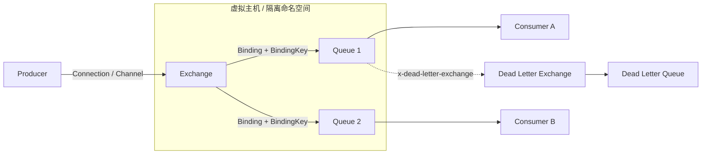
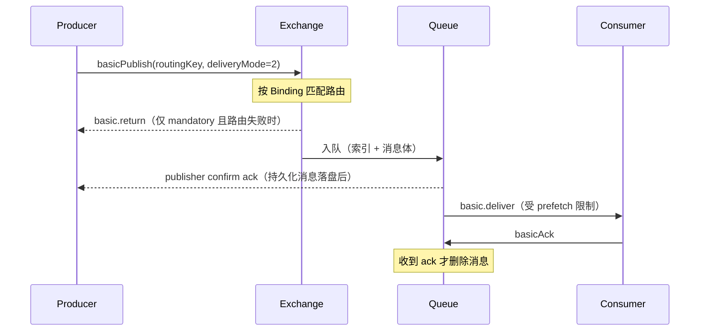
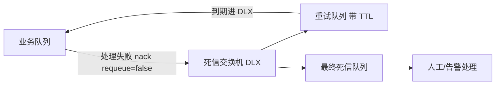

# 消息中间件 · RabbitMQ

> 一句话定位：RabbitMQ 是「协议标准 + 路由灵活 + 低延迟」的代表。面试考的不是 API，而是**AMQP 模型能不能画出来、确认机制能不能讲成一条完整链路、以及它做不了什么**（堆积与延迟队列）。
> 版本前提：RabbitMQ 3.13 / 4.0（4.0 已移除镜像队列）、AMQP 0-9-1、Java 客户端 5.x、Spring AMQP 3.x / Spring Boot 3.x。

## 1. 定位与选型

| 该选 RabbitMQ | 不该选 RabbitMQ |
| --- | --- |
| 消息量中小（单机几万 msg/s 足够） | 需要百万级吞吐（→ Kafka） |
| 需要灵活路由（按前缀/标签分发、广播） | 需要 Topic 级海量堆积与消息重放（→ RocketMQ / Kafka） |
| 低延迟（微秒~毫秒级，无批量攒批） | 需要「任意时间点」的延迟消息（→ RocketMQ 5.x / 时间轮方案） |
| 多语言客户端（Python / Go / PHP 都在用） | 需要严格分区顺序（→ RocketMQ / Kafka） |
| 运维成本敏感，不想引 ZK | 需要事务消息做上下游最终一致（→ RocketMQ） |

一句话：**RabbitMQ 的强项是「路由与协议」，弱项是「堆积与延迟」。** 这两条决定了它在电商交易域通常让位给 RocketMQ。

## 2. 架构与核心模型



**七个核心概念，一个都不能少**：

| 概念 | 职责 | 关键点 |
| --- | --- | --- |
| Connection | 一条 TCP 连接 | 建立开销大（握手 + 认证 + 心跳），要复用 |
| Channel | 连接上的逻辑多路复用通道 | **收发消息的最小单位**，几乎无开销，但**非线程安全** |
| vhost | 虚拟主机 | Exchange / Queue 的隔离命名空间，权限按 vhost 授予 |
| Exchange | 只做路由，**不存储** | 收到消息后按类型 + Binding 投递；路由不到就丢（除非 `mandatory`） |
| Binding | Exchange 与 Queue 的绑定关系 | 可携带 BindingKey |
| RoutingKey | 生产者发的路由键 | 与 BindingKey 匹配决定去向 |
| Queue | **真正存消息的地方** | FIFO；持久化、TTL、DLX、长度限制都在队列参数上 |

**四种 Exchange 的路由规则**（必背）：

| 类型 | 规则 | 示例 | 场景 |
| --- | --- | --- | --- |
| direct | RoutingKey 与 BindingKey **精确相等** | `error` → `error` | 按类型/级别分发，最常用 |
| topic | BindingKey 支持通配符，`.` 分隔单词，`*` 匹配**一个**单词，`#` 匹配**零到多个** | `order.*.created` 匹配 `order.pay.created`；`order.#` 匹配 `order.pay.created.cn` | 按业务前缀订阅，最灵活 |
| fanout | 忽略 RoutingKey，投给所有绑定队列 | 配置刷新、缓存广播 | 广播 |
| headers | 按消息 headers 匹配（`x-match: any/all`），忽略 RoutingKey | — | 复杂条件路由，性能差、少用 |

常见答错点：**topic 的 `*` 不匹配零个单词**（`order.*` 不匹配 `order`），`#` 才可以。

### 2.1 集群与队列类型（版本变更必须说清）

- **元数据（Exchange / Binding / vhost / User）在所有节点同步**，但**队列数据默认只在一个节点**（classic queue 的 owner 节点）。
- **镜像队列（classic mirrored queue）在 RabbitMQ 4.0 中已被移除**；3.8 起官方推荐 **Quorum Queue**（基于 Raft 的复制日志，多数派写入才算成功）。
- 选型：**Quorum Queue 换可靠性（多数派确认，吞吐降低），classic queue 换吞吐**。生产新集群默认用 Quorum。
- 网络分区：`cluster_partition_handling` 可选 `ignore` / `pause_minority` / `autoheal`，**Quorum Queue 依赖多数派，天然比镜像队列更抗脑裂**。

### 2.2 为什么单队列吞吐上不去：Erlang 进程模型

每个 Connection、Channel、**Queue 都是独立的 Erlang 轻量进程**，队列进程采用「邮箱 + 单进程顺序处理」模型 —— 这带来一个直接结论：

> **同一个队列的入队/出队是串行的，多消费者不会提升「单队列」的消费上限。**

所以「消费者加机器就能扩容」在 RabbitMQ 上不成立，要靠**多队列 + 分流**。这也是它堆积能力弱的根因之一。

## 3. 使用：Java 客户端与 Spring Boot

### 3.1 原生 Java 客户端（声明 + 发送 + 手动 ack 消费）

```java
ConnectionFactory factory = new ConnectionFactory();
factory.setHost("127.0.0.1");
factory.setPort(5672);
factory.setUsername("guest");
factory.setPassword("guest");
factory.setVirtualHost("/");

try (Connection conn = factory.newConnection();
     Channel channel = conn.createChannel()) {

    // 1) 声明：Exchange / Queue / Binding（durable 一旦建好不可改，冲突会报 406）
    channel.exchangeDeclare("order.exchange", BuiltinExchangeType.TOPIC, true);
    channel.queueDeclare("order.pay.queue", true, false, false,
            Map.of("x-dead-letter-exchange", "order.dlx",
                   "x-message-ttl", 60_000));
    channel.queueBind("order.pay.queue", "order.exchange", "order.pay.*");

    // 2) 开启 publisher confirm（异步回调，生产推荐）
    channel.confirmSelect();
    channel.addConfirmListener(
            (tag, multiple) -> System.out.println("ack: " + tag),
            (tag, multiple) -> System.err.println("nack: " + tag));

    // 3) 发送持久化消息（deliveryMode=2）
    AMQP.BasicProperties props = new AMQP.BasicProperties.Builder()
            .deliveryMode(2)          // 2 = persistent
            .contentType("application/json")
            .build();
    channel.basicPublish("order.exchange", "order.pay.created", props,
            "{\"orderId\":1001}".getBytes(StandardCharsets.UTF_8));

    // 4) 消费：prefetch 限流 + 手动 ack
    channel.basicQos(50);             // 单 channel 未 ack 上限
    channel.basicConsume("order.pay.queue", false,
            (consumerTag, delivery) -> {
                long tag = delivery.getEnvelope().getDeliveryTag();
                try {
                    handle(delivery.getBody());      // 业务处理
                    channel.basicAck(tag, false);    // 成功才 ack
                } catch (Exception e) {
                    // 可预期业务失败 -> 不重回队列，进死信
                    channel.basicNack(tag, false, false);
                }
            },
            consumerTag -> { });
}
```

### 3.2 Spring Boot 集成

```yaml
spring:
  rabbitmq:
    host: 127.0.0.1
    port: 5672
    username: guest
    password: guest
    publisher-confirm-type: correlated   # 开启 confirm（NONE / SIMPLE / CORRELATED）
    publisher-returns: true              # 开启 mandatory + return 回调
    listener:
      simple:
        acknowledge-mode: manual         # manual / auto / none
        prefetch: 50                     # 覆盖默认值 250
        retry:
          enabled: false                 # 用死信队列重试时建议关掉客户端重试
```

```java
@Component
public class OrderConsumer {

    @RabbitListener(queues = "order.pay.queue")
    public void onMessage(Message message, Channel channel) throws IOException {
        long tag = message.getMessageProperties().getDeliveryTag();
        try {
            handle(message.getBody());
            channel.basicAck(tag, false);
        } catch (Exception e) {
            boolean requeue = isTransient(e);        // 瞬时异常才重回队列
            channel.basicNack(tag, false, requeue);
        }
    }
}
```

**三个必踩的坑**：

1. `accessToken`…（不适用）—— 换成：**`durable` / `autoDelete` / 参数不一致会报 `PRECONDITION_FAILED(406)`**，声明是「幂等比对」而非「覆盖」。
2. **没有队列绑定到 Exchange 时消息被静默丢弃**，需要 `mandatory=true` + `ReturnListener` 才能发现路由失败。
3. **`ack` 忘写或写在业务之前**：前者导致 unacked 堆积，后者导致宕机丢消息。

## 4. 底层原理

### 4.1 消息流转全链路（含确认）



### 4.2 存储结构（3.8+ 的拆分）

| 部分 | 内容 | 说明 |
| --- | --- | --- |
| 消息体存储（msg store） | 实际消息内容 | 持久化消息写盘，非持久化消息只在内存 |
| 队列索引（queue index） | 队列中消息的位置指针 | 常驻内存（有内存占用开销） |
| 队列元数据 | 声明参数、TTL、DLX、长度 | 可持久化 |

**关键点**：索引常驻内存 —— 这是 RabbitMQ **不适合海量堆积**的直接原因：一条消息在内存里也要占索引开销，堆积几十万以上就要警惕；官方建议单队列消息数不宜过大，需靠惰性队列 / Quorum Queue 或换 MQ 解决。

### 4.3 内存与磁盘流控

| 参数 | 默认 | 作用 |
| --- | --- | --- |
| `vm_memory_high_watermark` | 约物理内存的 0.4（不同版本/发行版文档有差异，以 `rabbitmqctl status` 实际值为准） | 超过后**阻塞连接（blocking）**，不再接收新消息 |
| `vm_memory_high_watermark_paging_ratio` | 0.5 | 达到阈值的一部分后开始把消息换出到磁盘 |
| `disk_free_limit` | 50MB（可设 `{mem_relative, 1.0}`） | 磁盘低于阈值，**所有生产者被阻塞** |

**线上现象与排查**：生产者「卡住但不报错」（Java 客户端表现为 publish 阻塞或 connection 被 block），`rabbitmqctl status` 里出现 `blocked`；`rabbitmqctl list_connections` 看 `state` 为 `blocked` 的连接。**根因通常是消费端挂了导致堆积**，先救消费端，别只调水位线。

## 5. 确认机制

这是 RabbitMQ 最核心的一节，面试必问。**确认分两层：生产者要知道消息到了 Broker，消费者要让 Broker 知道消息处理完了。**

### 5.1 生产者侧

| 机制 | 做法 | 性能 | 生产建议 |
| --- | --- | --- | --- |
| 事务模式 | `txSelect` → publish → `txCommit` 同步等确认 | **极差**（吞吐下降约两个数量级） | **禁止使用** |
| 同步 confirm | `confirmSelect()` + `waitForConfirms()` | 中（逐条等待会阻塞） | 低吞吐强可靠场景 |
| 异步 confirm | `addConfirmListener` 回调 ack/nack | 高 | **生产推荐** |
| 批量 confirm | 每 N 条 `waitForConfirms()` 一次 | 高 | 可用，但失败要整批重发 |

**语义要点**：`confirm` 的 ack 表示「Broker 已接收」；**对持久化消息（durable queue + deliveryMode=2），Broker 是写盘后才回 ack**，所以 confirm 覆盖了「内存 → 磁盘」这一段。nack 表示 Broker 内部处理失败，需重发。

**`mandatory` + `basic.return`**：默认路由不到任何队列就静默丢弃。设置 `mandatory=true` 后不可路由的消息会经 `basic.return` 回给生产者。**顺序注意**：`basic.return` 先到，confirm 的 ack 后到，且 ack 仍为 true（Broker 收到了，只是没路由出去）。

**经典事故**：confirm 全 ack，下游却一条没收到 —— 因为 RoutingKey 拼错 / Queue 未绑定。**只信 confirm 不够，必须配 `mandatory` + return 回调 + 发送记录表。**

### 5.2 消费者侧

| API | 语义 | 是否重回队列 |
| --- | --- | --- |
| `basicAck(tag, multiple)` | 确认消费成功 | — |
| `basicNack(tag, multiple, requeue)` | 否定确认，可批量 | 由 requeue 决定 |
| `basicReject(tag, requeue)` | 单条否定确认（不能批量） | 由 requeue 决定 |

**ack 时机铁律**：**业务成功之后再 ack**。先 ack 后处理 → 中途宕机丢消息；处理完忘 ack → 消息长期 unacked，连接断开后重回队列造成重复消费。

**`requeue=true` 的陷阱（高频追问）**：重回队列是**放回队列头部**，如果这条消息因数据格式问题必然失败，会立刻再次投给同一消费者 → **redelivery 死循环**（CPU 打满、日志爆炸）。正确做法：

- 可预期的业务失败 → `requeue=false` 进死信队列；
- 瞬时故障（DB 连接超时）→ 延迟重试（本地退避重试或延迟队列），**不要用裸 requeue**。

**prefetch（QoS）**：`basicQos(prefetchCount)` 限制同一 channel 上未 ack 的消息数。

| prefetch | 效果 |
| --- | --- |
| 0 | 不限制，Broker 全量推给消费者 → 撑爆内存、负载不均 |
| 1 | 严格串行，最均衡但吞吐低 |
| 几十 ~ 几百 | 吞吐与公平性的折中，生产常用 |

版本前提：**Spring AMQP 2.0 起 `SimpleMessageListenerContainer` 的 prefetch 默认从 1 改为 250**；裸 Java 客户端默认仍是 0（不限）。prefetch 过大 → 慢消费者霸占大量消息；过小 → 吞吐被「网络往返 + 等 ack」限制。

### 5.3 持久化三要素与「持久化 ≠ 不丢」

| 对象 | 声明 | 说明 |
| --- | --- | --- |
| Exchange | `durable=true` | 重启后仍在 |
| Queue | `durable=true` | 重启后仍在（**durability 不可改**，声明冲突报错） |
| Message | `BasicProperties.deliveryMode=2` | 消息写盘 |

**为什么「持久化 ≠ 不丢」**：三要素只保证消息**最终**落盘，异步刷盘存在窗口期；单节点磁盘损坏仍全丢；非持久化消息在内存压力下会被换出或丢弃。**可靠链路 = 三要素 + publisher confirm + 消费端手动 ack + 集群副本（Quorum Queue），缺一环就会在特定故障下丢消息。**

## 6. 延迟队列支持情况

> **结论：RabbitMQ 不原生支持延迟队列。** 两种「绕过去」的方案都各有硬伤，高可靠 + 多档延迟的场景应当换 MQ。

### 6.1 方案 A：TTL + DLX（最常被答的写法）

```java
Map<String, Object> args = Map.of(
        "x-message-ttl", 30_000,                       // 消息 30s 后过期
        "x-dead-letter-exchange", "delay.dlx",          // 过期后转到死信交换机
        "x-dead-letter-routing-key", "delay.real");
channel.queueDeclare("delay.buffer.queue", true, false, false, args);
channel.queueDeclare("delay.real.queue", true, false, false, null);
channel.queueBind("delay.real.queue", "delay.dlx", "delay.real");
```

**致命缺陷：head-of-line blocking。** 队列只检查**队头**是否过期。若队头是一条 30 分钟 TTL 的消息、后面跟着 1 秒的消息，那么后面的必须等队头过期才能进死信 —— **延迟精度彻底失效**。

**规避方式**：**每个延迟级别独立一个队列**（如 1s / 5s / 1m / 30m 各一个队列），代价是队列数爆炸、TTL 档位写死在代码里。

### 6.2 方案 B：`rabbitmq-delayed-message-exchange` 插件

```java
Map<String, Object> args = Map.of("x-delayed-type", "direct");
channel.exchangeDeclare("delay.exchange", "x-delayed-message", true, false, args);

AMQP.BasicProperties props = new AMQP.BasicProperties.Builder()
        .headers(Map.of("x-delay", 60_000))            // 延迟 60 秒
        .build();
channel.basicPublish("delay.exchange", "delay.key", props, body);
```

| 优点 | 缺陷 |
| --- | --- |
| 支持任意延迟时长、精度到毫秒 | 延迟信息存在 **Mnesia**，节点重启后延迟消息可能丢失或立即投递 |
| 使用方便，改动小 | **单个延迟交换机是单点瓶颈**，延迟消息量大会成为集群瓶颈 |
| — | 官方不承诺强可靠（不参与镜像/Quorum 复制语义） |
| — | 插件需单独安装与升级，版本兼容要盯 |

### 6.3 决策表

| 场景 | 建议 |
| --- | --- |
| 只有 1-2 档固定延迟、量小、可容忍偶尔不精确 | TTL + DLX，**每档一个队列** |
| 多档位延迟、量中等、能接受重启风险 | 延迟插件 |
| **任意时间 + 高可靠 + 大量延迟消息** | **换 RocketMQ 5.x 定时消息 / Redis ZSet + 时间轮 / 独立延迟服务** |

## 7. 死信队列支持情况

> **结论：原生支持**，通过 DLX（Dead Letter Exchange）机制，是 RabbitMQ 做「重试 + 兜底」的标准手段。

**进入死信的三个触发条件**（缺一不可地记全）：

| # | 条件 | 说明 |
| --- | --- | --- |
| 1 | 消费者 `basicReject` / `basicNack` 且 **`requeue=false`** | 最常用，业务失败进死信 |
| 2 | 消息 TTL 或队列 TTL 过期 | 延迟队列的基础，也是「超时未支付」这类场景的实现方式 |
| 3 | 队列达到 `x-max-length` / `x-max-length-bytes`，队头消息被丢弃 | 限流保护，注意**丢的是队头** |

**配置**（在**产生死信的源队列**上声明）：

```java
Map<String, Object> args = Map.of(
        "x-dead-letter-exchange", "order.dlx",            // 必填
        "x-dead-letter-routing-key", "order.dead"          // 可选，不填则沿用原 RoutingKey
);
```

**标准使用模式**（业务重试三段式）：



**四个必须知道的细节**：

1. **DLX 是「路由」不是「存储」** —— 死信仍然是普通消息，投到死信交换机后按 Binding 走，可以再被正常消费。
2. **重试次数控制靠 `x-death` header** —— 消息每次进死信会在 headers 里累积 `x-death`（含 `count`、`reason`、`queue`），消费端据此判断是否超过阈值转入最终死信队列，否则无限循环。
3. **DLQ 自己也会堆积** —— 死信队列必须有消费者或告警，否则它只是把问题挪了个地方。
4. **不要用 `requeue=true` 代替死信** —— 那会造成 redelivery 风暴。

## 8. 量级介绍

> 以下为「量级」参考，不是承诺值。真实数字受消息大小、持久化、副本类型、prefetch、批量大小、磁盘与网络影响，**面试时应给出量级 + 影响因素，而不是报一个精确数字**。

| 维度 | RabbitMQ 量级 | 说明 |
| --- | --- | --- |
| 单机吞吐（classic，持久化，小消息） | **万级 msg/s**（几万，视配置） | 非持久化可更高 |
| 单机吞吐（Quorum Queue） | 比 classic 低（多数派确认 + Raft 日志） | 换可靠性 |
| 端到端延迟 | **微秒 ~ 毫秒级** | 不攒批、来一条推一条，延迟是最低的一档 |
| 堆积能力 | **弱** | 索引常驻内存；官方建议单队列消息量不宜过大 |
| 单队列消费上限 | 受**单队列串行**限制，加消费者不能线性扩容 | 要靠多队列分流 |
| 连接数 | 单节点数千连接量级（每连接一个 Erlang 进程） | 复用 Connection、多开 Channel |

**面试话术**：「RabbitMQ 是低延迟小消息量场景的最优解，但它的设计目标是**快速投递**而不是**海量堆积** —— 队列索引常驻内存，单队列处理还串行，所以堆积几十万以后延迟会显著上升，这个量级的堆积我一般会换 RocketMQ 或 Kafka 承接。」

## 9. 高频追问与常见误区

**追问链示例**

**主问题：RabbitMQ 怎么保证消息不丢？**
- 追问1：生产者怎么知道消息到了 Broker？→ 落点：`publisher confirm`（异步 ConfirmListener 优先），持久化消息**落盘后才 ack**；事务模式性能差不用。
- 追问2：落盘了但消费者宕机呢？→ 落点：不丢。没 ack 的消息在连接断开后重回队列；前提是**手动 ack + ack 在业务成功之后**。
- 追问3：那为什么还会丢？→ 落点：三要素没配齐（非持久化消息/未 durable 队列）、`requeue=false` 误用直接进死信、单节点磁盘损坏、`mandatory` 未开导致路由失败静默丢弃。
- 追问4：怎么验证没丢？→ 落点：发送记录表（本地消息表）+ 消费端幂等 + 定时对账；观察 `messages_unacknowledged`。

**主问题：消息重复消费怎么办？**
- 落点：RabbitMQ 的 `at-least-once` 语义决定重复不可避免（confirm 重发、ack 丢失、requeue、消费者重启）。**只能靠消费端幂等**：唯一键去重表 / Redis SETNX / 状态机（"只有待支付能改成已支付"）。
- 追问：为什么 not exactly-once？→ 落点：ack 本身可能丢，网络往返无法原子化；跨进程的 exactly-once 需要分布式事务，代价不可接受。

**主问题：为什么你们不用 RabbitMQ 做延迟队列？**
- 落点：head-of-line blocking + 插件不保证强可靠，见第 6 节；改用 RocketMQ 定时消息。

**常见误区**

| # | 错误说法 | 正确理解 |
| --- | --- | --- |
| 1 | 持久化就不会丢消息 | 三要素只保证最终落盘，还需 confirm + 手动 ack + 副本 |
| 2 | confirm ack 了消息一定被消费 | confirm 只到 Broker；路由失败也会 ack（需 mandatory + return） |
| 3 | `requeue=true` 是「专业」的重试方式 | 会重回队头，必然失败的消息将导致 redelivery 死循环 |
| 4 | 加消费者就能提升单队列吞吐 | 单队列串行处理，要靠多队列 + binding 分流 |
| 5 | 镜像队列是可靠的标配 | 4.0 已移除镜像队列，改用 Quorum Queue（Raft） |
| 6 | TTL + DLX 就能做延迟队列 | 只检查队头过期，存在 head-of-line blocking |
| 7 | topic 的 `*` 能匹配零个单词 | `*` 恰好匹配一个单词，`#` 才能匹配零到多个 |
| 8 | 死信队列就是一封「死信」的存储 | DLX 是路由机制，死信仍是普通消息，可被再次消费 |
| 9 | Channel 可以多线程共用 | Channel 非线程安全，多线程需各自开 channel 或用连接池 |
| 10 | 事务模式比 confirm 更可靠 | 语义相近但吞吐差约两个数量级，生产禁用 |
