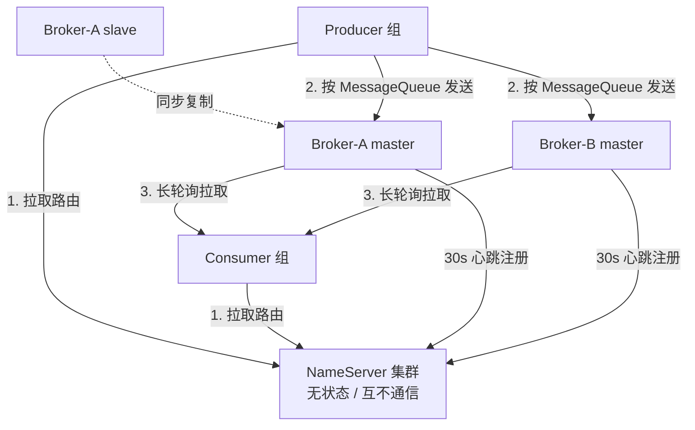
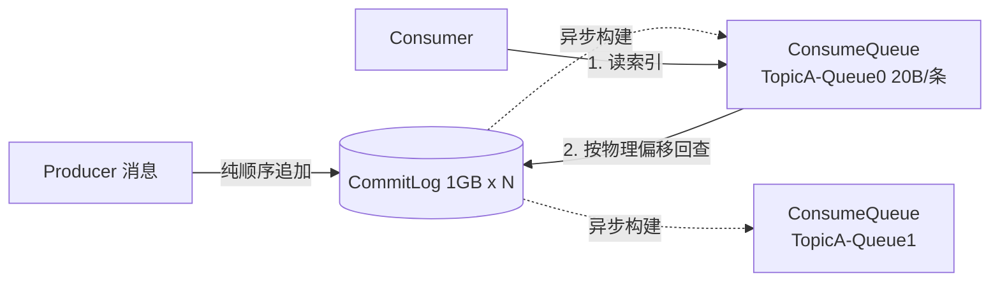
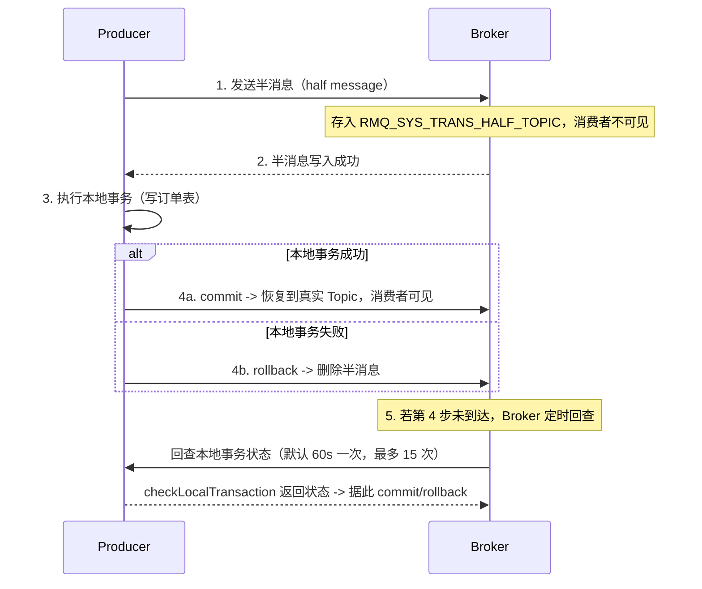

# 消息中间件 · RocketMQ

> 一句话定位：RocketMQ 是「为电商交易而生」的 MQ —— 顺序、事务消息、海量堆积、延迟消息都是原生能力，存储设计（CommitLog 顺序写）是它区别于 RabbitMQ 的核心。面试考的是**存储设计能不能推导出来**、**事务消息与重试队列能不能讲清闭环**。
> 版本前提：RocketMQ 4.9.x（经典）与 5.x（Proxy / Controller / 定时消息）、`rocketmq-spring-boot-starter` 2.3.x。

## 1. 定位与选型

| 该选 RocketMQ | 不该选 RocketMQ |
| --- | --- |
| 电商/交易域，需要**分区顺序**（订单状态机） | 超大规模日志采集与流式计算（→ Kafka） |
| 需要**事务消息**做上下游最终一致 | 只有几百条/天的轻量任务（→ RabbitMQ 或直接用库表） |
| 需要**海量堆积**（几亿条、TB 级）后回放 | 团队没有 Java 运维能力（Kafka/RabbitMQ 生态更广） |
| 需要**任意时间的延迟消息**（5.x） | 需要极低延迟的超小消息（RabbitMQ 更轻） |
| Java 技术栈，希望与 Spring 生态无缝 | 需要用非 Java 语言做重客户端（Kafka 更友好） |

## 2. 架构与核心模型



**五个角色**：

| 角色 | 职责 | 关键点 |
| --- | --- | --- |
| NameServer | 路由注册与发现 | **无状态、无主从、节点间不通信**，每个节点都有全量路由；Broker 每 **30s** 上报心跳，超过 **120s** 未上报剔除 |
| Broker | 存储、投递、位点管理 | master/slave，一个 Broker 承载多个 Topic 的多个 MessageQueue |
| Topic | 逻辑消息分类 | 在 Broker 上被切分为多个 **MessageQueue**（默认 4 个，可配） |
| Producer | 发送 | 从 NameServer 取路由，默认轮询选 Queue，支持故障规避 |
| Consumer | 消费 | 按消费组管理；**集群模式下同一队列只被组内一个消费者消费** |

**为什么 NameServer 不用 ZooKeeper**：去掉强一致选举的复杂度，节点间不通信、不怕脑裂，可用性高、运维简单；代价是路由信息**最终一致**（存在短暂延迟窗口）。

**两个基础概念**：

| 概念 | 说明 |
| --- | --- |
| MessageQueue | 并行与顺序的**基本单位**。Topic 的队列数决定了消费端最大并发度（队列数 < 消费者数的部分是空闲的） |
| Tag | 二级分类，Broker 端可用 Tag 过滤（ConsumeQueue 存了 Tag hashcode 做初筛），比 SQL92 过滤轻 |

**消费模式**：集群消费（Clustering，同组均分队列）与广播消费（Broadcasting，每个实例都收到）。

## 3. 使用

### 3.1 原生 Java 客户端

```java
// ---------- 生产者 ----------
DefaultMQProducer producer = new DefaultMQProducer("order_producer_group");
producer.setNamesrvAddr("127.0.0.1:9876");
producer.setRetryTimesWhenSendFailed(2);              // 默认 2（共 3 次）
producer.start();

Message msg = new Message("OrderTopic", "PAY_SUCCESS",
        ("orderId=1001").getBytes(StandardCharsets.UTF_8));

// 1) 同步发送（重要消息）
SendResult result = producer.send(msg);
if (result.getSendStatus() != SendStatus.SEND_OK) {
    // 重试或落库补偿
}

// 2) 分区顺序：同一 orderId 落同一 MessageQueue
producer.send(msg, (mqs, m, arg) -> {
    int idx = Math.abs(arg.hashCode()) % mqs.size();
    return mqs.get(idx);
}, 1001L);

// 3) 延迟消息（4.x 固定级别 3 = 10s；5.x 可用 setDeliverTimeMs 任意时间）
msg.setDelayTimeLevel(3);
producer.send(msg);

producer.shutdown();

// ---------- 消费者 ----------
DefaultMQPushConsumer consumer = new DefaultMQPushConsumer("order_consumer_group");
consumer.setNamesrvAddr("127.0.0.1:9876");
consumer.subscribe("OrderTopic", "PAY_SUCCESS");      // Topic + Tag 过滤
consumer.setConsumeFromWhere(ConsumeFromWhere.CONSUME_FROM_FIRST_OFFSET);

consumer.registerMessageListener((MessageListenerConcurrently) (msgs, context) -> {
    for (MessageExt m : msgs) {
        try {
            handle(m.getBody());
        } catch (Exception e) {
            // 返回 RECONSUME_LATER -> 进 %RETRY% 重试队列
            return ConsumeConcurrentlyStatus.RECONSUME_LATER;
        }
    }
    return ConsumeConcurrentlyStatus.CONSUME_SUCCESS;
});
consumer.start();
```

**Push 与 Pull 的关系**：`DefaultMQPushConsumer` 名字叫 Push，**本质上还是 Pull** —— 客户端在本地维护队列，用**长轮询（long polling）**请求 Broker；有消息立即返回，没消息 Broker 挂起请求约 15s 再返回。既保留了 Pull 的流量控制能力，又拿到接近 Push 的实时性。

### 3.2 Spring Boot 集成

```yaml
rocketmq:
  name-server: 127.0.0.1:9876
  producer:
    group: order_producer_group
    send-message-timeout: 3000
    retry-times-when-send-failed: 2
```

```java
@RocketMQMessageListener(topic = "OrderTopic", consumerGroup = "order_consumer_group",
        selectorExpression = "PAY_SUCCESS", messageModel = MessageModel.CLUSTERING)
@Component
public class OrderListener implements RocketMQListener<OrderEvent> {
    @Override
    public void onMessage(OrderEvent event) {
        handle(event);            // 抛异常即视为消费失败 -> 进重试队列
    }
}
```

### 3.3 常用运维命令

| 命令 | 用途 |
| --- | --- |
| `mqadmin clusterList` | 集群/Broker 状态 |
| `mqadmin topicRoute -t OrderTopic` | 查看路由（队列分布） |
| `mqadmin topicStatus -t OrderTopic` | 各队列的消息量与消费进度差 |
| `mqadmin consumerProgress -g order_consumer_group` | 消费组堆积（diff 即堆积量） |
| `mqadmin sendMessage -t OrderTopic -p "..."` | 手工发消息（排障用） |

**堆积排查第一步永远是 `consumerProgress` 看 diff**：diff 持续增长 = 消费能力不足；diff 为负 = 位点回退过。

## 4. 底层原理

### 4.1 存储设计：CommitLog / ConsumeQueue / IndexFile（最核心的一节）

| 文件 | 内容 | 结构 |
| --- | --- | --- |
| CommitLog | **所有 Topic 消息的物理存储**，顺序追加写 | 单文件默认 1GB，写满开新文件 |
| ConsumeQueue | 某 Topic 某 Queue 的**逻辑索引**，指向 CommitLog | 每条 **20 字节** = 8B CommitLog 物理偏移 + 4B 消息长度 + 8B Tag hashcode |
| IndexFile | 按 message key / unique key 查消息 | 哈希索引，固定槽位 |

**为什么这么设计（面试的分水岭，要能自己推导）**：

1. **写放大问题** —— 如果每个 Topic/Queue 独立存文件，海量 Topic 会退化成大量随机写。RocketMQ 让所有消息**只写一份 CommitLog（纯顺序写）**，顺序写能吃满磁盘 IO，这是高吞吐的根本。
2. **读放大问题** —— 顺序写之后，同一 Topic 的消息在 CommitLog 里是「按到达顺序和其他 Topic 混在一起」的，消费时无法直接定位。于是引入 **ConsumeQueue 作为稀疏索引**：体积小（每条 20B）可全量放 PageCache，消费者先读 ConsumeQueue 拿偏移，**再回 CommitLog 取消息体**。
3. **Tag 过滤加速** —— ConsumeQueue 里存了 Tag hashcode，过滤时先用 hashcode 初筛，命中才读消息体，避免大量无谓磁盘读。



### 4.2 mmap / PageCache / 零拷贝

- CommitLog 与 ConsumeQueue 都通过 **mmap（`MappedByteBuffer`）** 映射到进程虚拟地址空间 —— **写消息即写 PageCache**，由 OS 负责回刷磁盘。
- 读时命中 PageCache 则完全不碰磁盘；放不下的部分由 OS 按 LRU 淘汰。
- 对比 Kafka：**Kafka 消费侧用 sendfile（`FileChannel.transferTo`）做零拷贝**，数据不经用户态；**RocketMQ 走 mmap + PageCache，Java 侧读出来再经 Netty 写出**（多一次拷贝）。两者都靠「顺序写 + PageCache」拿高吞吐。

**生产坑（很常见的追问）**：mmap 让 JVM 统计不到这部分内存 —— 会出现 **JVM 堆正常但机器内存爆掉**，必须看 `ps` 的 RSS / `free -h` 的 buff/cache，而不是只看 JVM heap。

### 4.3 刷盘与主从复制：四种组合（必背）

| 刷盘模式 | 行为 | 可靠性 | 吞吐 |
| --- | --- | --- | --- |
| 异步刷盘（ASYNC_FLUSH，默认） | 写入 PageCache 即返回，后台线程定期刷（`flushIntervalCommitLog` 默认 500ms） | 断电可能丢 | 高 |
| 同步刷盘（SYNC_FLUSH） | 落盘后才返回成功（GroupCommit 批量刷） | 断电不丢 | 低 |

| 复制模式 | 行为 | 可靠性 |
| --- | --- | --- |
| 异步复制（ASYNC_MASTER，默认） | master 写入成功即返回，异步同步 slave | master 宕机可能丢 |
| 同步双写（SYNC_MASTER） | master 等 slave 写入成功才返回（**slave 也在 PageCache**） | master 宕机不丢 |

| 刷盘 | 复制 | 可靠性 | 适用 |
| --- | --- | --- | --- |
| 异步 | 异步 | 最低（断电或 master 宕机都可能丢） | 日志类、可容忍丢失 |
| 同步刷盘 | 异步复制 | 中（断电不丢，master 挂可能丢） | 较少用 |
| 异步刷盘 | 同步双写 | 中高（master 挂不丢，断电可能丢） | **常见折中** |
| 同步刷盘 | 同步双写 | 最高 | 金融级 |

**结论**：可靠性与吞吐是同一个旋钮的两端。绝大多数业务用默认「异步刷盘 + 异步复制 + 业务侧对账」。

### 4.4 发送与故障规避

| 发送方式 | 特点 | 场景 |
| --- | --- | --- |
| 同步 syncSend | 阻塞等 SendResult | 重要消息，需要知道结果 |
| 异步 asyncSend | 回调返回，不阻塞 | 高吞吐且要结果 |
| 单向 sendOneway | 不等结果 | 日志、可丢场景 |
| 批量 send(Collection) | 多条合并，注意单批大小上限 | 提高吞吐 |

**故障规避**：`sendLatencyFaultEnable=true` 后客户端记录各 Broker 的发送延迟，对高延迟 Broker 做**延迟故障规避**，把请求转到更健康的 Broker，显著降低超时率。

### 4.5 消费、Rebalance 与位点

- **Rebalance**：队列在组内消费者间重新分配。触发条件：消费者上下线、Topic 队列数变化、订阅关系变化。**Rebalance 期间会有短暂消费暂停**，且位点提交不及时会造成**重复消费**。
- **位点管理**：集群模式下位点存在 **Broker 的 `ConsumerOffsetManager`**（对应内部 Topic `%OFFSET%` / 5.x 的 `RMQ_SYS_...` 体系），本地也缓存；这也是「位点回退」类事故的根源。
- **长轮询**：见 3.1 节，Push 消费本质是带挂起的 Pull。
- **消费失败重试**：见第 7 节。

### 4.6 顺序消息

| 类型 | 实现 | 代价 |
| --- | --- | --- |
| 全局有序 | 整个 Topic 只用 **1 个 MessageQueue** + 消费端单线程 | 完全牺牲并行，生产几乎不用 |
| **分区有序（推荐）** | `MessageQueueSelector` 按业务键（订单 ID）把同一键的消息路由到**同一 MessageQueue** | 仅保证同键有序，不同键并行 |

**消费端要点**：用 `MessageListenerOrderly`，RocketMQ 对每个 MessageQueue **加本地锁**（同一队列同一时刻只有一个线程消费）；失败返回 `SUSPEND_CURRENT_QUEUE_A_MOMENT` 会**暂停当前队列一小段时间再重试**（`suspendCurrentQueueTimeMillis`），而不是跳过 —— 这是顺序不乱的保证。

**顺序被破坏的典型场景**：① 用了 `MessageListenerConcurrently`；② 发送时用了普通 `send` 而非带 selector 的重载；③ **Topic 队列数变更**（同一 key 的 hash 取模结果变了，所以队列数建好就别改）；④ 消费端把消息丢进自建线程池异步处理。

### 4.7 事务消息

解决「**本地事务与消息发送必须原子**」—— 这是 RocketMQ 相对 RabbitMQ 的核心优势。



**要点**：

- 半消息先写内部 Topic，**消费者完全不可见**，避免「消息发了但本地事务回滚」的脏数据。
- 回查参数：`transactionCheckInterval` 默认 **60s**、`transactionCheckMax` 默认 **15 次**；超过仍无结果消息被丢弃（可配置进死信）。
- **保证的是最终一致性，不是强一致**：消费者收到消息时，下游可能还没看到上游事务结果，所以消费端仍需处理「幂等 + 状态未就绪」。
- 链路长（多下游）时更推荐**本地消息表 + 定时补偿**，更可控。

## 5. 确认机制

RocketMQ 的「确认」分三段：**发送确认 → 存储确认 → 消费确认**。

### 5.1 发送侧：SendResult 状态

| 状态 | 含义 | 处理 |
| --- | --- | --- |
| `SEND_OK` | 发送成功（**同步刷盘模式下代表已落盘，同步双写模式下代表 slave 也已写入**） | 正常 |
| `FLUSH_DISK_TIMEOUT` | 同步刷盘超时（消息已进内存但未落盘，此时 master 如果宕机会丢） | 重发或告警 |
| `FLUSH_SLAVE_TIMEOUT` | 同步双写超时（slave 未确认） | 重发或告警 |
| `SLAVE_NOT_AVAILABLE` | 同步双写模式下 slave 不可用 | 降级判定或重发 |

**重试**：`retryTimesWhenSendFailed` 默认 **2**（共 3 次）；重试会**避开上次失败的 Broker** 重新选队列。**重试本身会导致消息重复**（第一次实际成功但回执丢失），所以必须配消费端幂等。

### 5.2 消费侧：返回状态即确认

| 返回值 | 语义 | 后续 |
| --- | --- | --- |
| `CONSUME_SUCCESS` | 消费成功 | 位点推进 |
| `RECONSUME_LATER` | 消费失败 | 消息进入 **`%RETRY%{consumerGroup}`** 重试队列 |

**顺序消费的确认不同**：`MessageListenerOrderly` 返回 `SUSPEND_CURRENT_QUEUE_A_MOMENT`，会让当前队列暂停重试而不是整体重投。

**一个容易混淆的点**：RocketMQ **没有像 RabbitMQ 那样的显式 ack API** —— 「确认」就是监听器的返回值，框架据此提交位点。所以**不要在业务里做异步处理后就返回 SUCCESS**（会造成位点已推进但业务未完成）。

## 6. 延迟队列支持情况

> **结论：原生支持，而且是 RocketMQ 的招牌能力之一。**

| 版本 | 机制 | 精度 | 限制 |
| --- | --- | --- | --- |
| **4.x** | `messageDelayLevel` **固定 18 级**：1s 5s 10s 30s 1m 2m 3m 4m 5m 6m 7m 8m 9m 10m 20m 30m 1h 2h | 只能选这 18 档 | **不支持任意时间** |
| **5.x** | 时间轮 + `deliverTimeMs`，支持**任意时间** | 秒级 | 需 5.x Broker 与客户端 |

**4.x 实现原理**：延迟消息被改写到内部 Topic `SCHEDULE_TOPIC_XXXX` 的对应延迟级别队列（18 个队列对应 18 级），Broker 内的定时服务按级别周期性（每秒）扫描到期队列，到期后**恢复原 Topic 与原 QueueId** 重新写入 CommitLog 投递。

```java
// 4.x：选择固定的延迟级别（level 3 = 10s）
Message msg = new Message("OrderTopic", body);
msg.setDelayTimeLevel(3);
producer.send(msg);
```

**5.x 的时间轮**：本质是「环形数组 + 槽位链表」，但 5.x 用的是**改进的多层时间轮 + TimerLog 落盘**（延迟任务持久化），解决 4.x「只能 18 档」的问题，同时保证 **Broker 重启后延迟消息不丢**（这是 4.x 的 SCHEDULE_TOPIC 方案相对脆弱的地方）。

**两个必须知道的坑**：

1. **4.x 延迟消息与顺序消息不可兼得** —— 延迟消息走 `SCHEDULE_TOPIC` 被重新投递，原 QueueId 的顺序性在这个过程中不保证。
2. **延迟消息也会占存储与堆积** —— 「延迟 7 天」的消息会在 SCHEDULE_TOPIC 里躺 7 天，量大时（如订单超时场景每秒数万条）必须规划容量，必要时改成「定时扫库 + 短延迟」的架构。

## 7. 死信队列支持情况

> **结论：原生支持，且与「重试队列」配套，形成完整的失败处理闭环。**


**机制细节**：

| 项 | 说明 |
| --- | --- |
| 重试 Topic | `%RETRY%{consumerGroup}`，**按消费组隔离**，自动创建 |
| 重试间隔 | 随重试次数递增，复用延迟级别序列（10s、30s、1m、2m … 2h） |
| 最大重试次数 | 默认 **16 次**（并发消费可配） |
| 超过之后 | 进入 **`%DLX%{consumerGroup}`** 死信队列 |
| 消费方式 | 死信队列是普通 Topic，**必须自己订阅消费**，否则只会静静堆积 |

**处理建议（面试加分）**：

1. **死信队列必须有消费者 + 告警 + 落库**，否则等于把问题挪进了黑洞。
2. 死信消息里带上失败原因与重试次数，落一张「异常消息表」供人工重放。
3. **16 次重试的间隔累计起来很长**（超过 4 小时），对「支付成功通知」这类时效敏感的消息，应当**缩短重试次数**并在业务侧做主动查询兜底（对账），而不是等 MQ 重试到底。
4. 重试是**重复投递**，消费端必须幂等 —— 幂等方案：唯一键去重表 / Redis SETNX / 状态机。

## 8. 量级介绍

> 以下是「量级」参考。真实数字受消息大小、刷盘模式、复制模式、PageCache 命中率、消费端处理能力影响，面试给量级 + 影响因素，不要报精确数字。

| 维度 | RocketMQ 量级 | 说明 |
| --- | --- | --- |
| 单机吞吐（异步刷盘 + 异步复制，小消息） | **十万级 msg/s**（数万到十几万，视配置） | 顺序写 CommitLog 是根本 |
| 单机吞吐（同步刷盘 + 同步双写） | 显著下降（可能降到万级） | 可靠性与吞吐是同一旋钮 |
| 端到端延迟 | **毫秒级**（长轮询挂起 + 无攒批等待） | 比 Kafka 略低（Kafka 攒批带来的固有延迟） |
| 堆积能力 | **极强**，单机可堆 TB 级 | 顺序写 + PageCache + 消费位点与存储解耦 |
| 消息回放 | 支持，按时间戳/位点重置消费进度 | `consumer.setConsumeTimestamp`，`mqadmin resetOffsetByTime` |
| 队列数 / Topic 数 | **不宜过多**（单机几万队列已是压力上限量级） | 队列数过多导致 ConsumeQueue 文件变多、随机读比例上升 |
| 消息大小 | 默认上限 **4MB**（`maxMessageSize`），建议压缩后小于 1MB | 大消息挤占 PageCache、放大延迟 |

**两条工程经验（面试加分项）**：

- **「RocketMQ 快在哪」的正确答法**：不是「mmap 快」，而是**所有消息只写一份 CommitLog 顺序追加**，把 N 个 Topic 的随机写合并成 1 路顺序写；mmap 与 PageCache 是配合手段。
- **队列数是并发的天花板**：`Topic 队列数 < 消费者实例数` 时多出来的消费者会空闲 —— 扩容前先确认队列数够不够。

## 9. 高频追问与常见误区

**追问链示例**

**主问题：RocketMQ 为什么快，存储为什么这么设计？**
- 追问1：如果每个 Topic 独立存文件会怎样？→ 落点：多 Topic 下变成大量随机写，磁盘 IO 吃不满；改为一写到底的顺序追加。
- 追问2：那消费时怎么定位消息？→ 落点：ConsumeQueue 稀疏索引（20B/条，可全量放 PageCache），先读索引再回 CommitLog 取消息体。
- 追问3：Tag 过滤在哪里做的？→ 落点：ConsumeQueue 里存 Tag hashcode，先 hashcode 初筛，命中才读消息体；SQL92 过滤在 Broker 端做但代价更高。
- 追问4：机器内存爆掉但 JVM 堆正常，为什么？→ 落点：mmap 的 PageCache 不在 JVM 堆统计内，看 RSS / buff/cache。

**主问题：怎么保证消息不丢？**
- 落点：三段都要配 —— 发送端检查 `SendResult` 状态、存储端 `SYNC_FLUSH`（+ `SYNC_MASTER`）、消费端位点必须「业务成功才推进」（即返回 `CONSUME_SUCCESS` 前业务已完成）。
- 追问：那吞吐怎么办？→ 落点：绝大多数业务用默认异步刷盘 + 异步复制，把可靠性交给**业务侧对账 + 幂等**，而不是把 MQ 调到最可靠。
- 追问：为什么消费成功才推进位点还会重复消费？→ 落点：Rebalance 期间位点提交滞后、客户端崩溃前位点未提交；重复不可避免，**只能幂等**。

**主问题：消息顺序怎么保证？**
- 落点：分区有序（selector 按业务键）+ `MessageListenerOrderly` + 消费端不异步化 + 队列数不变。
- 追问：为什么不能全局有序？→ 落点：只能 1 个队列 + 单线程消费，吞吐崩掉，不用于生产。
- 追问：扩容节点会破坏顺序吗？→ 落点：不会（队列不变），但**改 Topic 的队列数会**，同一 key 的取模结果变了。

**主问题：事务消息和本地消息表怎么选？**
- 落点：**事务消息**适合上游是发送方、链路较短（半消息 + 回查，框架托管）；**本地消息表**适合链路长/多下游（业务表与消息表同事务写入 + 定时补偿，可控性强、不依赖 MQ 特性）。
- 追问：事务消息能保证下游一定消费成功吗？→ 落点：不能，只保证「上游本地事务与消息投递一致」，下游仍需幂等 + 重试。

**常见误区**

| # | 错误说法 | 正确理解 |
| --- | --- | --- |
| 1 | RocketMQ 的 Push 就是服务端推 | 本质是客户端 Pull + Broker 长轮询挂起 |
| 2 | 一个消费者组可以订阅不同的 Topic/Tag | 同组内订阅关系必须一致，不一致会导致位点混乱、消息丢失 |
| 3 | 队列数随便加，能提高并发 | 加队列会影响 key 的取模落位，**顺序消息的队列数建好不要改** |
| 4 | 同步双写就不丢消息了 | slave 也在 PageCache 里，断电仍可能丢；要配合同步刷盘 |
| 5 | 消费失败会自动重试，不用管 | 重试 16 次后进 `%DLX%`，而死信队列**必须自己订阅**，否则静默堆积 |
| 6 | 4.x 也能发任意时间的延迟消息 | 4.x 只有固定 18 级；任意时间需要 5.x |
| 7 | 延迟消息和顺序消息可以同时用 | 4.x 延迟消息走 SCHEDULE_TOPIC 重投，原顺序不保证 |
| 8 | mmap 让读写都不拷贝，所以是零拷贝 | 消费侧仍有「PageCache → 用户态 → Netty」的拷贝；Kafka 的 sendfile 才是真正端到端零拷贝 |
| 9 | CommitLog 里消息是按 Topic 分块存的 | 所有 Topic 混在一起按到达顺序追加，靠 ConsumeQueue 建索引 |
| 10 | 位点存在客户端本地 | 集群模式下位点存在 Broker（`ConsumerOffsetManager`），客户端只是缓存 |
