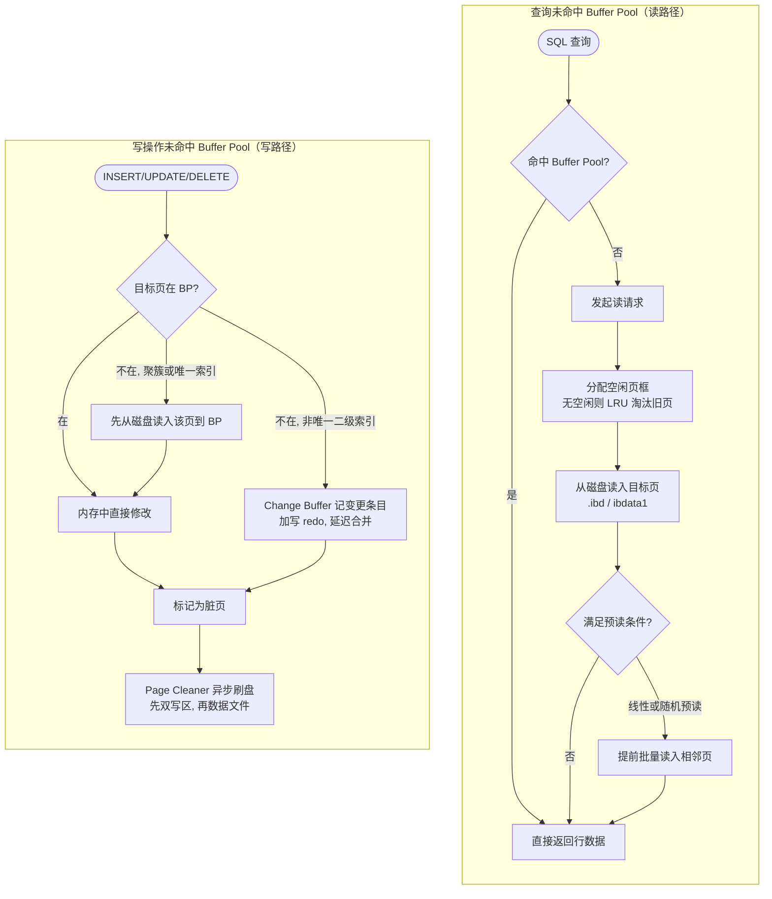

# MySQL 主题一：InnoDB 从 Server 层到引擎层的架构

> 面向 12 年经验工程师，目标中大厂 P6-P7。版本前提：MySQL 5.7 / 8.0 / 8.4，InnoDB。
>
> 参考文章链接：<https://mp.weixin.qq.com/s/oblUdSEZAzOXrrwV58gL0Q>

## 面试问法

**Q1：一条 update 语句在 MySQL 里是怎么执行的？**

- 60 秒版本：按两段式讲，Server 层（连接/解析/优化/执行器）→ 引擎层（读页入 Buffer Pool、写 undo、改脏页、写 redo）→ commit 时 redo prepare + binlog + redo commit 两阶段提交 → 后台异步刷脏。
- 补充点：补 Change Buffer 对非唯一二级索引的短路路径、undo 页修改也产生 redo、redo 是物理日志所以崩溃恢复重放的是页级修改，以及双 1 参数语义。

**Q2：Buffer Pool 的 LRU 和教科书 LRU 有什么不同？为什么？**

- 60 秒版本：young/old 分区（5/8 与 3/8，`innodb_old_blocks_pct=37`），新页插入中点（old 头部），old 区停留超过 `innodb_old_blocks_time=1000ms` 再访问才晋升。
- 补充点：目的是防全表扫描污染，扫描页只被访问一次，永远过不了 1 秒门槛，会在 old 区被淘汰，热点页不受影响；举例备份/大表 count 巡检导致命中率突降的场景。

**Q3：Change Buffer 为什么只对非唯一二级索引生效？**

- 60 秒版本：**唯一索引和主键都必须读页才能确认操作合法**，页既然已经读进来了，直接改页就行，再缓存一层没有意义。非唯一二级索引没有判重义务，才能盲记。
- 补充点：它存的是索引变更条目，不是数据行，所以插入一条数据只推迟了二级索引那部分，聚簇索引页照样要读盘。合并有四类触发（页被读入、缓冲满、后台空闲、慢关闭），不止「读的时候」。8.0 及以前 `innodb_change_buffering` 默认 all，8.4 起默认 none。

**Q4：redo log 和 binlog 有什么区别？为什么要两份日志？**

- 60 秒版本：redo 是 InnoDB 引擎层的物理日志（页内修改），循环写，服务崩溃恢复；binlog 是 Server 层逻辑日志（语句/行），追加写，用于主从复制与时间点恢复。引擎可插拔所以复制日志必须在 Server 层。
- 补充点：两阶段提交保证两者一致（崩溃时 redo prepare 有而 binlog 无则回滚）；redo 物理日志幂等可重放，binlog 不能用于引擎崩溃恢复。

**Q5：大 text 列为什么建议拆表？**

- 60 秒版本：行溢出机制，行超约 8KB 时变长列溢出到 off-page，访问溢出列多一次 IO；`SELECT *` 会把溢出页也读进来。
- 补充点：Compact 留 768B 前缀 + 20B 指针，DYNAMIC 只留 20B 指针，DYNAMIC 下不查溢出列完全无感；拆表之外可先改 DYNAMIC 并只查必要列。

**Q6：哪些内存结构在 Buffer Pool 里？**

- 60 秒版本：Change Buffer 在，它是 BP 里的页，`innodb_change_buffer_max_size` 用 BP 的百分比描述就是证据。AHI 也在 BP 的内存预算内，但没有页的身份：无独立大小参数、不落盘、重启重建。Log Buffer 不在，它是单独申请的字节缓冲区，默认 16M。
- 补充点：用参数量纲判断归属，比例在 BP 内、绝对值在 BP 外；`innodb_buffer_pool_size` 已经含了 change buffer 与 AHI，BP 之外还有 log buffer、连接会话内存、排序缓冲，所以 60%-70% 的余量不等于可用内存。

**Q7：InnoDB 的后台线程有哪些，各自负责什么？**

- 60 秒版本：四类，各自独立运行。Master Thread 做全局周期性维护（每秒/每 10 秒循环：刷脏、合并 Change Buffer、推进 purge、打 checkpoint）；脏页刷盘与 undo 回收已分别由独立的 Page Cleaner / Purge 线程并行承担，并非由 Master 去「调度」它们；IO Thread 处理异步 IO 回调，分 read/write/insert buffer/log 四小类，数量由 `innodb_read_io_threads`、`innodb_write_io_threads` 调（默认各 4，insert buffer 与 log 线程各固定 1 个）；Purge Thread 回收已提交事务的 undo 页，由 `innodb_purge_threads` 控制（8.0 默认 4）；Page Cleaner Thread 专职把脏页刷盘，由 `innodb_page_cleaners` 控制（默认 4，不超过缓冲池实例数）。
- 补充点：早期版本刷脏与 purge 都压在 Master Thread 上，单线程是瓶颈；现在拆成多线程并行，Master 主要负责全局周期性维护而非「调度」其他线程。IO Thread 的读写线程数在高 IO 负载时可调大，Page Cleaner 多实例能提升刷脏吞吐。

**Q8：InnoDB 磁盘上有哪些结构，数据最终落在哪？**

- 60 秒版本：落盘分三块。表空间（系统表空间 `ibdata1`、独立表空间 `.ibd`、通用表空间、`undo_001`/`undo_002` 撤销表空间、临时表空间）；Redo Log（`ib_logfile0/1`，物理日志循环写，崩溃恢复用）；Undo Log 与 Doublewrite Buffer 也落在系统表空间或独立文件。Doublewrite 是防页断裂的关键：脏页刷盘先顺序写双写区，再写数据文件。
- 补充点：8.0 起撤销表空间默认独立成 `undo_001`、`undo_002`（`innodb_undo_tablespaces=2`），不再挤在 `ibdata1`；事务型数据字典也从 `ibdata1` 迁到了独立的 `mysql.ibd`，所以严格说 8.0 的 `ibdata1` 主要剩双写区/双写文件、Change Buffer 持久化区、以及数据字典事务自身用的回滚段；Doublewrite 在 8.0.20+ 默认用专门的 `.dblwr` 文件而非塞进 `ibdata1`，支持原子写的设备（如部分闪存卡）可 `innodb_doublewrite=OFF` 换取性能。

### Buffer Pool 读/写未命中流程

下图把 Q1 执行链路、Q2 的 old 区防污染、Q3 的 Change Buffer 短路、Q8 的磁盘落盘串成一条线：

## 数据页（叶子节点）内部结构

一个 B+ 树叶子节点 = 一个 16KB 数据页（`innodb_page_size` 默认 16384），内部结构固定，从低地址到高地址依次为：

| 区块 | 大小 | 内容 |
| -- | -- | -- |
| File Header | 38B | 页号、前后页指针（FIL_PAGE_PREV/NEXT，把同层页串成双向链表）、页类型、校验和 |
| Page Header | 56B | 页内记录数、空闲空间起点、最大事务 ID、页层级（B+ 树第几层）、索引 ID |
| Infimum / Supremum | （无） | 两个虚拟记录，作为记录链表的头尾哨兵 |
| User Records | 不定 | 真实行记录，按主键升序，用 `next_record` 串成单链表 |
| Free Space | 不定 | 尚未使用的空间 |
| Page Directory | 不定 | 稀疏槽位，约每 6 条记录一个槽，支撑页内二分查找 |
| File Trailer | 8B | 校验和 + LSN 低 4 字节，检测页是否只写了一半（与 doublewrite 配合） |

存储层级上，InnoDB 的空间管理是 **段 → 区 → 页 → 行** 四层：段（segment，叶子与非叶子各一个）、区（extent，64 个 16KB 页 = 1MB）、页（page，16KB）、行（row）。

三个必须讲清的要点：

1. `next_record` 是 **16 bit 相对偏移**，不是内存指针。页是可持久化结构，落盘后内存指针无意义；记录在页内从 Free Space 边界向低地址**倒序存放**。
2. 页内查找是「**槽位二分 + 组内链表顺序找**」两级结构：Page Directory 的稀疏槽把记录分若干组（每组 4-8 条），先二分定位槽，再在组内沿 `next_record` 顺序扫。`n_owned` 记录每个槽管辖几条（Infimum 组 1 条、Supremum 组 1-8 条、普通组 4-8 条）。
3. 非叶节点**只存「主键值 + 子页页号」**（各约 8B 量级一条），不含任何用户数据。这是 B+ 树扇出大（单页上千指针）的根本原因，三层 B+ 树就能装下约两千万行。

为什么页固定 16KB：太小则 B+ 树层级变深、IO 次数变多；太大则单行查询的读放大严重、Buffer Pool 能缓存的页数变少。16KB 是机械盘与 SSD 都验证过的平衡点，SSD 时代一般不建议改（改成 32KB/64KB 只在纯大字段场景有收益）。

## 行记录格式（Compact / DYNAMIC）

Compact 是 MySQL 5.0+ 的默认行格式，一行记录的组成（从记录头向前）如下：

| 顺序 | 组成 | 大小 | 说明 |
| -- | -- | -- | -- |
| 1 | 变长字段长度列表 | 1-2B/列 | **逆序存放**，记录 varchar/text 实际长度；列最长可能超过 255B 时用 2B |
| 2 | NULL 值位图 | 1B/8 列 | 仅统计可空列；NULL **不占列数据空间**，只在这一位标记 |
| 3 | 记录头信息 | 5B | deleted_flag、min_rec_flag、n_owned、heap_no（本行在页内堆中的序号）、record_type（0 普通 / 1 非叶节点 / 2 infimum / 3 supremum）、**next_record** |
| 4 | `DB_ROW_ID` | 6B | 无主键且无非空唯一索引时才生成的隐藏主键 |
| 5 | `DB_TRX_ID` | 6B | 最后修改该行的事务 ID |
| 6 | `DB_ROLL_PTR` | 7B | 指向 undo log 中该行的上一版本 |
| 7 | 真实列数据 | 不定 | 按建表顺序存放 |

第 4-6 项是隐藏列。`DB_TRX_ID` + `DB_ROLL_PTR` 是 MVCC 版本链的物理载体：每行指向它在 undo log 中的上一版本，再指更旧的版本，形成版本链；ReadView 用 `DB_TRX_ID` 判断哪个版本对当前快照可见。

三个易漏点：

- **为什么长度列表逆序**：逆序让变长字段的长度字节紧邻记录头，读取时按「记录头 → 就近取长度 → 定位列数据」顺序访问，缓存友好（正向存放则长度列表与列数据头尾分离）。变长列长度 ≤255B 用 1B，否则 2B；NULL 位图只统计声明为可空的列，所以**把列定义为 NOT NULL 能省位图空间**。
- **行溢出（off-page）**：InnoDB 限制一页至少装两条记录，即单行（含隐藏列与头部开销）不得超过约 8KB（8126B）。超出时 Compact/Redundant 把过长的变长列**前 768B 留本行 + 20B 溢出指针**，其余存溢出页（类型为 BLOB page，溢出页间用链表串联）；**DYNAMIC**（5.7 默认 `innodb_default_row_format=dynamic`）/COMPRESSED 更激进：整列搬进溢出页，本行只留 20B 指针。是否溢出以「该行是否超 8KB」为准，不是单看列类型。生产影响：溢出列访问要多一次 IO，`SELECT *` 带大 text 列会明显变慢，所以大字段要拆表、查询只取需要的列；DYNAMIC 下 `SELECT` 非溢出列完全不受溢出页影响。
- **记录头里的 deleted_flag**：删除是软标记，真正物理删除由 purge 线程在版本链无人引用后完成（呼应 Q3 与追问链 L3 的标记删除与 purge）。

## 追问链

| 层级 | 问题                                            | 参考答案要点                                                                                                                                                                                                                                                     |
| -- | --------------------------------------------- | ---------------------------------------------------------------------------------------------------------------------------------------------------------------------------------------------------------------------------------------------------------- |
| L1 | InnoDB 为什么要 Buffer Pool，直接读写磁盘不行吗？            | 不行。磁盘随机 IO 比内存慢 5-6 个数量级。Buffer Pool 以 16KB 页为单位缓存数据页，写先改内存脏页、配合 WAL 异步刷盘，把同步随机写变成内存操作加顺序 redo 写。默认 128M，生产设物理内存 60%-70%，命中率要 >99%。                                                                                                                        |
| L2 | Buffer Pool 的 LRU 为什么要分 young/old 区？          | 防全表扫描污染。教科书 LRU 把新页直接放头部，一次大表扫描就会挤出全部热点页。InnoDB 把新页插到 old 区头部（37% 处），停留超过 innodb_old_blocks_time=1000ms 再被访问才晋升 young，扫描页只访问一次，会在 old 区直接被淘汰。                                                                                                              |
| L3 | Change Buffer 为什么只对非唯一二级索引生效？                 | 唯一索引和主键插入时必须读入索引页做唯一性检查或定位位置，页已在内存，缓存写操作没有意义。非唯一二级索引无需检查，目标页不在内存时可先把变更记入 Change Buffer，等页被读入、缓冲满、后台空闲或慢关闭时 merge，随机 IO 变后台批量合并。它占 BP 25%，持久化在系统表空间，变更写 redo 所以不丢。8.4 起 innodb_change_buffering 默认 none。                                                    |
| L1 | redo 和 binlog 都要写，崩溃时怎么保证一致？                  | 用内部 XA 两阶段提交：引擎先写 redo 置 prepare 并 fsync，Server 层写 binlog，最后 redo commit。崩溃恢复时检查 redo 中 prepare 的事务：binlog 有对应记录则提交，没有则回滚。前提是双 1 参数，否则任一环节可能丢。                                                                                                             |
| L2 | redo 是物理日志为什么还不够，还要 doublewrite？              | redo 记录的是「某页某偏移改了什么」，重放前提是页本身完好。16KB 页大于磁盘原子写单位，宕机可能写坏一半页（torn page），redo 无法修复坏页。doublewrite 先把页副本顺序写入双写区再写数据文件，恢复时校验和不对的页从双写区取副本再重做。                                                                                                                      |
| L3 | update 的完整链路里 undo 是干嘛的？undo 页也写 redo 吗？      | undo 记录修改前的行镜像，用于事务回滚和 MVCC 旧版本读取，行里的 DB_ROLL_PTR（7B）指向 undo 中上一版本构成版本链。undo 页也是 Buffer Pool 中的普通页，其修改同样生成 redo，否则崩溃后 undo 丢失，未完成事务无法回滚，原子性就破坏了。                                                                                                           |
| L1 | 16KB 数据页里怎么快速找到一行？                            | 两级查找：Page Directory 是稀疏槽位目录，约每 6 条记录一个槽，先对槽二分定位到组，再在组内沿 next_record 单链表顺序扫（组内 4-8 条）。next_record 是 16bit 相对偏移不是指针，记录按主键升序串成单链表，头尾是 Infimum/Supremum 哨兵。                                                                                                    |
| L2 | 为什么 B+ 树三层就能装两千万行？                            | 非叶节点页只存「主键值 + 子页页号」，一条约 8-12B，16KB 页可存上千个指针，扇出约 1000+。三层结构容量 = 1000 × 1000 × 每叶子页约 16 条（1KB 一行）≈ 1600 万-2000 万行。根页常驻内存，实际查询只需 1-2 次磁盘 IO。                                                                                                                  |
| L3 | 行超过一页怎么办？对查询有什么影响？                            | 一页须至少装两条记录，即单行上限约 8KB。**超出时变长列溢出到 off-page**：Compact 留 768B 前缀加 20B 指针，DYNAMIC（5.7 默认）整列溢出只留 20B 指针。访问溢出列要多一次 IO，SELECT * 带大 text 列会明显变慢；DYNAMIC 下只查非溢出列则完全不受影响，所以大字段建议拆表。                                                                                 |
| L1 | MySQL 为什么要多套可插拔存储引擎？InnoDB/MyISAM/Memory 怎么选？ | 插件式架构让 Server 层与存储引擎解耦，换引擎不影响 SQL 解析与优化器。InnoDB 支持事务、行锁、MVCC、崩溃恢复，是 OLTP 默认选择；MyISAM 表锁、无事务，读多写少且不怕崩的场景更快；Memory 纯内存、重启即失，适合临时或会话级数据。面试默认答 InnoDB。                                                                                                         |
| L1 | 查询没命中 Buffer Pool 时 InnoDB 做了什么？预读是什么？        | 五步：发读请求、在 BP 找空闲页框（没有就 LRU 淘汰）、从 `.ibd`/`ibdata1` 读入、可能触发预读、返回数据。预读是按访问模式提前批量读相邻页：线性预读（顺序访问达到 `innodb_read_ahead_threshold` 默认 56 页触发读整个 extent）、随机预读（缓冲池已有某 extent 多个随机页时触发，`innodb_random_read_ahead` 默认 OFF），目的是减少未来 IO；但全表扫描场景预读会放大 BP 污染，靠 old 区机制兜底。 |
| L1 | AHI 为什么只能加速等值查询，对范围查询无效？                      | **哈希表本质是数组加链表**，等值查询 O(1)，但哈希值无序，无法支持范围、排序或前缀扫描；范围查询仍要走 B+ 树的有序遍历。AHI 只对频繁等值访问的索引页建哈希，且仅在该页等值查询命中时生效，所以只对等值有用。                                                                                                                                             |
| L2 | InnoDB 磁盘上有哪些表空间？undo 表空间默认几个？                | 五类：系统表空间（`ibdata1`：8.0 起事务型数据字典迁到独立的 `mysql.ibd`，ibdata1 仍承载双写区或双写文件、Change Buffer 持久化区、数据字典事务用的回滚段）、独立表空间（每表 `.ibd`，`innodb_file_per_table=ON` 默认）、通用表空间（`CREATE TABLESPACE` 多表共享）、撤销表空间（`undo_001`/`undo_002`，8.0 默认 2 个）、临时表空间。                         |
| L2 | doublewrite 刷盘为什么要先写双写区，再写数据文件？               | 脏页先顺序写双写区（连续磁盘区域，顺序写远快于随机写），写成功后再把页随机写进数据文件实际位置；若写数据文件时崩溃、页损坏，可从双写区副本覆盖恢复。先顺序后随机是用低成本的顺序写换取页写入原子性，杜绝 torn page（半写页）。                                                                                                                                       |

## 常见误区

| ❌ 误区                                        | ✅ 正解                                                                                                                                            |
| ------------------------------------------- | ----------------------------------------------------------------------------------------------------------------------------------------------- |
| Buffer Pool 用的是标准 LRU 算法                    | 不是。是变体：young/old 两区（默认 old 占 37%），新页插入 old 区头部而非链表头，且在 old 区停留超过 innodb_old_blocks_time=1000ms 后再被访问才晋升 young，专为防全表扫描污染设计。                      |
| 插入一条数据会先写进 Change Buffer，读的时候才进 Buffer Pool | 行数据必须落进 Buffer Pool 的聚簇索引页，页不在内存就先读盘。Change Buffer 只记非唯一二级索引的变更条目，不是数据本身。                                                                       |
| Change Buffer 对所有索引的写都能加速                   | 只对非唯一二级索引生效。唯一索引必须读入索引页做唯一性检查，页既然读进来了缓存就无意义；主键（聚簇索引）是写路径必经同理。且写完立刻读的场景是负优化。                                                                     |
| redo log 足以保证崩溃恢复，doublewrite 是多余的          | redo 是页内修改的物理日志，重放的前提是页本身完好。16KB 页可能发生 torn page（只写了一半），redo 修不了坏页。doublewrite 先写双写区副本再写数据文件，恢复时用副本修复坏页后再重做 redo，两者缺一不可。                        |
| binlog 是 InnoDB 引擎写的                        | binlog 是 Server 层日志，与引擎无关（换 MyISAM 也有 binlog），用于主从复制和时间点恢复。redo 才是 InnoDB 引擎层日志。两者靠两阶段提交保持一致。                                                   |
| NULL 值在行里占一个占位字节                            | NULL 不占列数据空间，只在 NULL 值位图里占 1 bit（位图每 8 个可空列占 1 字节）。NOT NULL 列连位图位都不占，所以列定义 NOT NULL 能省空间。                                                       |
| 页内记录用指针串联、可以随机访问                            | next_record 是 16bit 相对偏移（页内地址），不是内存指针，页要落盘持久化，指针无意义。页内只能沿单链表顺序遍历，配合 Page Directory 稀疏槽二分定位组后再顺序扫。                                               |
| Adaptive Hash Index 开着总是好事                  | 不是。AHI 有分区读写锁争用，高并发混合读写或大量范围查询/LIKE 前缀场景下维护成本超过收益，SEMAPHORES 段出现 btr_search_latch 等待时应 innodb_adaptive_hash_index=OFF。                          |
| Log Buffer 是 Buffer Pool 的一部分               | 不是。Log Buffer 是启动时单独申请的一块字节缓冲区（`innodb_log_buffer_size` 默认 16M），按顺序追加写入，不按页组织、不参与 LRU。BP 之外的结构只能用绝对大小描述，用百分比描述的才在 BP 内。                         |
| Adaptive Hash Index 是 Buffer Pool 之外的一块独立内存 | 它在 BP 的内存预算内，只是没有页的身份：没有独立大小参数、不落盘、不参与 LRU，数据页被换出时对应哈希项作废，重启后整体重建。`SHOW ENGINE INNODB STATUS` 里的 node heap 就是它的开销。                              |
| Change Buffer 用的是 BP 之外的额外内存                | 不是额外内存。它是一批 BP 里的 16KB 页（ibuf B+ 树与 ibuf bitmap），`innodb_buffer_pool_size` 本来就包含它，`innodb_change_buffer_max_size=25` 是上限不是预留。                   |
| 行溢出后这一行整体搬到溢出页                              | 不是整行搬。超约 8KB 时只有过长的变长列溢出：Compact 留 768B 前缀 + 20B 指针在原行，DYNAMIC 整列溢出原行只留 20B 指针；非溢出列始终留在原数据页，DYNAMIC 下查非溢出列不受溢出影响。                               |
| MySQL 8.0 还有查询缓存，慢查询可以先查缓存命中率               | 8.0 已整体移除查询缓存。它以语句文本为 key，表有任何写就整表失效，高并发写场景命中率极低且缓存锁是全局瓶颈，5.7 也建议关闭。优化慢查询应看执行计划与 Handler_read 指标。                                               |
| 长事务只影响锁等待                                   | 远不止。长事务持有 ReadView 导致 purge 无法推进，Innodb_history_list_length 持续增长，undo 膨胀、版本链变长、快照读遍历版本链变慢、undo 表空间撑大磁盘。监控 history list 长度并清理长事务是必备运维项。          |
| InnoDB 的后台线程只有 Master Thread 一种             | 不是。至少四类：Master（总调度）、IO（read/write/insert buffer/log，数量可调）、Purge（回收 undo 页）、Page Cleaner（刷脏页）。现代版本把刷脏和 purge 从 Master 拆成多线程并行，单 Master 扛不住高并发写入。 |
| 预读（read-ahead）一定提升性能                        | 不一定。预读能减少顺序扫描的未来 IO，但全表扫描或备份场景会预先把大量页灌进 Buffer Pool，放大污染、挤掉热点；InnoDB 用 old 区（Q2）让只访问一次的预读页很快被淘汰来兜底，必要时可关随机预读。                                   |
| InnoDB 所有数据都放在独立的 `.ibd` 文件里                | 不是。系统表空间 `ibdata1` 仍承载数据字典、双写区（或双写文件）、Change Buffer 持久化区；撤销日志 8.0 默认在独立 `undo_001`/`undo_002`；临时数据走临时表空间。只有表数据和索引在 file-per-table 下才进 `.ibd`。   |
