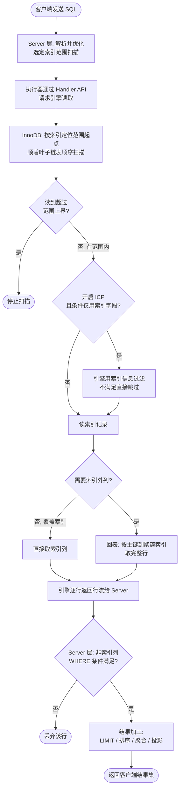

# 范围查询的引擎层与 Server 层分工

## 一、一句话结论

一次范围查询的数据处理，并非在单一层完成，而是由 **InnoDB 引擎层** 与 **MySQL Server 层协同完成**。引擎层负责**数据的定位与提取**（按索引扫描、回表、按访问谓词截断），Server 层负责**最终的条件过滤与结果加工**（非索引条件、LIMIT、排序、聚合）。

## 二、核心分工：定位提取 vs 过滤加工

### InnoDB 引擎层：负责“找数据”

核心职责是根据 Server 层选定的执行计划，在 B+ 树索引中完成数据的定位和扫描：

- **索引定位与扫描**：从 B+ 树正确的叶子位置开始，顺着叶子链表顺序遍历，找出所有落在范围条件内的索引记录。范围边界（`BETWEEN` / `>` / `<`）属于**访问谓词**，由引擎在扫描时直接判定（读到超出上界即停止）。**范围上界**即优化器从 WHERE 子句提取的、索引列在范围条件中的**最大值边界**，作为访问路径的"结束键"传给引擎：`id BETWEEN 10 AND 100` 上界是 100（闭区间），`id < 100` 上界也是 100 但为**开区间**（不含 100），`INDEX(a,b)` 上 `a=10 AND b BETWEEN 1 AND 5` 时范围发生在 b、上界是复合键 (10,5)。引擎用每条记录的**整条索引键**与上界比较，键**严格大于**上界才停，因此边界等值行（如 id=100 有 50 行）会全部返回，到下一条 101 才停。
- **回表**：如果查询需要索引之外的列，引擎根据二级索引中记录的主键值，回到聚簇索引取出完整行，再返回给 Server 层。
- **返回的是“行流”不是“结果集”**：从 **Server 与引擎的接口语义**看，<u>**Handler API 是逐行流式的**</u>：Server 每调一次 **`ha_index_next()`** 引擎返回一条记录，Server 边取边判 WHERE，不先把整个范围结果集物化到内存再一次性交出；但从**物理 IO**看，InnoDB 以 **16KB 页**为单位批量读入 Buffer Pool，一次 IO 捞起一整页的多条记录，再在页内逐条解记录往上返。所以"逐行流式"是接口语义、"按页批量"是底层 IO，二者不矛盾。

### Server 层：负责“加工数据”

执行器调用引擎接口，接收引擎返回的记录，在此完成所有引擎无法完成的加工：

- **非索引条件过滤**：最典型。例如 `WHERE create_time BETWEEN ... AND deleted = 0`，若 `deleted` 无索引，引擎只能把所有满足 `create_time` 范围的行都返回，`deleted = 0` 的二次过滤必须由 Server 层完成。
- **结果集加工**：`LIMIT`、排序、聚合、投影、`DISTINCT`、join 等均在此层。`LIMIT 100, 10` 时，Server 从引擎取经过 WHERE 过滤后的前 110 条，丢弃前 100 条，只保留最后 10 条。

## 三、数据流图示（Mermaid）

下图把一次范围查询在 InnoDB 引擎层与 Server 层之间的数据流动串成一条线：引擎负责定位、扫描、按访问谓词截断、回表（或覆盖索引），Server 负责非索引条件过滤与结果加工。



补充：若范围列与条件列都无索引，引擎层退化为全表扫描（对应第五节），即图中「按索引定位范围起点」这一步无法发生，改为逐行扫描聚簇索引并把所有行原样交给 Server，两个条件的过滤全部在 `M` 节点完成，且 ICP 不生效。

## 四、优化带来的边界变化：ICP 与覆盖索引

### 1. 索引条件下推（ICP）

这是最关键的优化，把本属于 Server 层的部分过滤**下沉到引擎层**。

- **未开启 ICP（或条件无法下推）**：引擎只按索引列的范围（如 `create_time`）扫描并回表，把完整行交给 Server，由 Server 过滤其余 WHERE 条件。
- **开启 ICP**：若 WHERE 中有某些条件（如联合索引的后续列）仅用索引字段即可判断，**优化器在生成执行计划时**把这些条件作为索引条件挂到访问路径上。引擎在回表前就用索引信息过滤，直接跳过不满足的记录，减少回表次数和传给 Server 的数据量。
- **边界**：ICP 只在**二级索引访问**（range / ref / index 等）时生效；全表扫描走聚簇索引，不触发 ICP。

### 2. 覆盖索引

当查询所需的所有列都包含在使用的索引中时，优化器选择只扫二级索引、不回表，直接从索引叶子取出数据返回。这减少了 IO 与内存拷贝，但“只取索引列”这一决策由优化器在计划阶段确定，Server 层的加工职责不变。

## 五、没有索引时的退化：全表扫描

若范围查询涉及的列都没有可用索引，引擎层无法按范围定位，只能退化为**全表扫描（聚簇索引全扫）**：

```text
Server 层执行器调用引擎接口
→ 引擎层：rnd_init / rnd_next，逐行读取聚簇索引叶子页
→ 每读到一行，原样返回给 Server 层
→ Server 层对每一行依次判断：create_time BETWEEN ... AND deleted = 0
→ 满足才进入结果集，不满足丢弃
```

| 问题                     | 答案                   |
| :--------------------- | :------------------- |
| 引擎层返回所有行吗              | 是，全表扫描，逐行返回          |
| 引擎层会过滤 create_time 范围吗 | 不会，无索引，引擎不知道范围边界     |
| 引擎层会过滤 deleted = 0 吗   | 不会                   |
| 过滤发生在哪                 | 全部在 Server 层         |
| EXPLAIN 的 type         | ALL（全表扫描）            |
| 能否用 ICP 下推             | 不能，全表扫描走聚簇索引，不触发 ICP |

## 六、三种场景对比

| 场景                                                         | 引擎层做什么                                             | Server 层做什么                         | EXPLAIN type |
| :--------------------------------------------------------- | :------------------------------------------------- | :---------------------------------- | :----------- |
| create_time 有索引，deleted 无索引                                | 用 create_time 索引范围扫描，回表取整行，返回所有满足 create_time 范围的行 | 过滤 deleted = 0                      | range        |
| create_time + deleted 有联合索引（如 INDEX(create_time, deleted)） | 用联合索引范围扫描；开启 ICP 时可在索引层先过滤 deleted = 0，再回表         | 接收已过滤的行，做最终加工                       | range        |
| 两者都无索引                                                     | 全表扫描聚簇索引，逐行返回所有行，零过滤                               | 过滤 create_time 范围和 deleted = 0 两个条件 | ALL          |

关键点：第二、三节的分工描述隐含前提是 `create_time` 上有可用索引。若 `create_time` 无索引，就不存在“引擎按 create_time 范围扫描并返回”的动作，两个条件都由 Server 过滤，`EXPLAIN` 显示 `type=ALL`。

## 七、结合 EXPLAIN 看分工

`type=range` 只是 Server 层选定的**访问策略**（告诉优化器打算用索引范围扫描），并不控制 InnoDB 内部具体的扫描与过滤细节。看分工可结合 `Extra` 列：

- **Using where**：Server 层对引擎返回的行做了额外过滤（典型：非索引列条件）。
- **Using index**：覆盖索引，引擎未回表。
- **Using index condition**：启用了 ICP，部分过滤已下推到引擎层。
- **Using filesort / Using temporary**：排序或分组在 Server 层用临时结构完成。

## 八、常见误区

| 误区                       | 正解                                                                |
| :----------------------- | :---------------------------------------------------------------- |
| 范围查询的数据都在引擎层处理好再给 Server | 错。引擎只定位提取（含访问谓词截断），过滤、分页、排序、聚合在 Server 层                          |
| type=range 就代表条件都被索引消化了  | 错。range 只说明用了索引范围扫描，非索引列条件仍由 Server 过滤                            |
| ICP 是 Server 运行时把条件推给引擎  | 简化说法。准确讲是优化器在计划阶段把可下推的索引条件挂到访问路径，引擎扫描时顺带判定                        |
| 全表扫描也能靠 ICP 提速           | 错。**ICP 只在二级索引访问时生效**，全表扫描（聚簇索引）不触发                               |
| LIMIT 只返回需要的那几行，引擎只扫那么少  | 错。引擎仍按访问路径把候选行读出，Server 读完 offset+limit 行后丢弃前 offset 行            |
| 覆盖索引时 Server 层完全不干活      | 错。是否回表只影响 IO，Server 层的过滤与加工职责不变                                   |
| 引擎一整批把范围结果读出来交给 Server   | 错。接口上是逐行流式（`ha_index_next` 一条条返），物理 IO 才按 16KB 页批量读；引擎不先把整个范围物化再交 |

## 九、追问链

| 级别 | 问题                         | 答案                                                                                                                                            |
| :- | :------------------------- | :-------------------------------------------------------------------------------------------------------------------------------------------- |
| L1 | 一次范围查询，谁负责按范围找数据           | InnoDB 引擎层。按 Server 选定的索引做范围扫描，范围边界（BETWEEN / > / <）作为访问谓词在引擎内判定                                                                              |
| L2 | 范围里有非索引列条件，谁过滤             | Server 层。引擎只返回满足索引访问路径的行，非索引列条件在 Server 逐行判定                                                                                                  |
| L3 | ICP 是什么，为什么能提速             | 索引条件下推。仅用索引字段即可判断的条件在引擎回表前就过滤，少回表、少传数据，仅在二级索引访问时生效                                                                                            |
| L4 | 范围列和条件列都没索引会怎样             | 退化为全表扫描（type=ALL），引擎逐行返回所有行，两个条件过滤全在 Server 层，无 ICP                                                                                           |
| L5 | 覆盖索引改变哪一层的工作               | 只减少引擎回表 IO，Server 层过滤与加工职责不变                                                                                                                  |
| L6 | LIMIT 100, 10 在哪层丢弃前 100 条 | Server 层。引擎仍按访问路径读出候选行，Server 读满经过 WHERE 过滤后的 110 条后丢前 100 留后 10                                                                              |
| L7 | 范围上界到底是什么                  | 优化器从 WHERE 提取的索引列范围最大值边界，即访问路径的"结束键"。`id BETWEEN 10 AND 100` 上界 100（闭区间），`id < 100` 上界也是 100 但开区间（不含 100）。引擎用每条记录整条索引键与之比，严格大于上界才停，边界等值行全部返回。 |
| L8 | 范围数据是逐行返回还是批量返回            | 接口语义是**逐行流式**（Server 每调 `ha_index_next()` 取一条，边取边过滤，不物化整个结果集）；物理 IO 是**按 16KB 页批量**读入 Buffer Pool，一次 IO 捞起一整页多行再逐条往上返。两层说法不矛盾。                |

## 十、速记口诀

**引擎是“扫描仪”**：按索引定位、提取可能符合条件的记录（可借 ICP 初筛）。  
**Server 是“质检员”**：对送来的记录做最终校验（非索引条件），并完成排序、分页等加工。  
**<u>数据在两层间流动、逐步被处理，而非某一层一次性完成。</u>**
