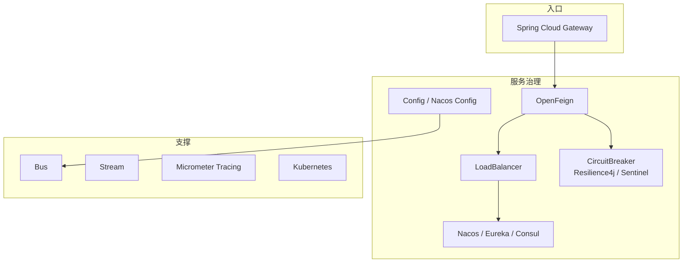

# Spring Boot 与 Spring Cloud · 区别与生态

> 一句话定位：这两个不是竞品，面试问的是「各自解决什么问题、谁依赖谁、生态里哪些组件已经退场」。
> 版本前提：Spring Boot **4.1.x**（2026-06 起的 OSS 主线）；Spring Cloud **2025.1.x（Oakwood）**。版本必须按 release train 对齐。

## 1. 是什么

**Spring Boot** 是「快速构建单个 Spring 应用」的脚手架：自动配置、starter 依赖、内嵌 Web 容器、Actuator 监控。它让一个 `main` 方法就能跑起一个可部署的服务。

**Spring Cloud** 是「构建分布式系统」的工具集：服务注册发现、配置中心、网关、声明式调用、负载均衡、熔断、消息总线、链路追踪。它建立在 Spring Boot 之上，用 Boot 的自动配置和 starter 机制把各个分布式组件装配起来。

## 2. 为什么这样设计

单体应用只需要 Boot：一个进程、一个数据库、一套配置。微服务拆成多个进程后，出现新问题：服务地址动态变化、配置要集中管理、调用要负载均衡和容错、入口要统一鉴权限流。这些问题不是单个应用内部能解决的，于是有了 Cloud。

Spring Cloud 不是 Spring Boot 的替代品，它建立在 Boot 之上。没有 Boot，Cloud 的组件也能用，但要自己处理依赖、配置和容器，非常繁琐；没有 Cloud，Boot 只能构建单体。两者是「地基」和「楼上设施」的关系。

| 维度 | Spring Boot | Spring Cloud |
| --- | --- | --- |
| 定位 | 单个应用的快速开发脚手架 | 分布式系统的治理工具集 |
| 核心能力 | 自动配置、starter、内嵌容器、Actuator | 注册发现、配置、网关、调用、熔断、追踪 |
| 依赖关系 | 独立 | **依赖 Boot** |
| 版本 | 4.1.x | release train，2025.1.x |
| 解决的问题 | 少写样板、快速启动 | 多服务之间的协调与治理 |

## 3. 底层怎么实现

### 3.1 Boot 的自动配置是 Cloud 的地基

Cloud 组件几乎都是「starter + 自动配置 + 条件注解」：引入 `spring-cloud-starter-openfeign`，Boot 的条件装配自动注册 `FeignClientFactoryBean`；引入 `spring-cloud-starter-loadbalancer`，自动注册 `LoadBalancerClient`。所以 Cloud 的版本必须和 Boot 匹配，否则自动配置类可能因为 API 变化直接加载失败。

### 3.2 Spring Cloud 生态

核心组件按职责分：

| 类别 | 组件 | 说明 |
| --- | --- | --- |
| 公共抽象 | Spring Cloud Commons | LoadBalancer、CircuitBreaker 等抽象层 |
| 注册发现 | Nacos、Eureka、Consul、Zookeeper | Eureka 维护模式；Nacos 国内主流 |
| 配置 | Spring Cloud Config、Nacos Config | Config 常配 Git + Bus 刷新 |
| 网关 | Spring Cloud Gateway | 替代 Zuul，分 WebFlux / WebMVC 两栈 |
| 调用 | OpenFeign | 声明式 HTTP 客户端 |
| 负载均衡 | Spring Cloud LoadBalancer | 替代 Ribbon |
| 熔断 | Spring Cloud CircuitBreaker | 接 Resilience4j 或 Sentinel，替代 Hystrix |
| 消息 | Spring Cloud Stream、Bus | Stream 屏蔽 MQ 差异；Bus 做配置刷新广播 |
| 追踪 | Micrometer Tracing | 替代 Sleuth |
| 容器 | Spring Cloud Kubernetes | K8s 原生集成 |
| 阿里系 | Nacos、Sentinel、Seata、RocketMQ | Spring Cloud Alibaba 提供 |

已经退场或不再推荐的：**Ribbon**（2020.0 移除，换 LoadBalancer）、**Hystrix**（停更，换 CircuitBreaker）、**Zuul 1**（换 Gateway）、**Sleuth**（换 Micrometer Tracing）。**Eureka** 处于维护模式，仍随列车发布但不再加新特性。

### 3.3 版本对应关系

| Spring Cloud | Spring Boot |
| --- | --- |
| **2025.1.x（Oakwood）** | **4.0.x / 4.1.x** |
| 2025.0.x（Northfields） | 3.5.x |
| 2024.0.x（Moorgate） | 3.4.x |
| 2023.0.x（Leyton） | 3.2.x / 3.3.x |
| 2022.0.x（Kilburn） | 3.0.x / 3.1.x |
| 2021.0.x（Jubilee） | 2.6.x / 2.7.x |

Spring Cloud Alibaba **2025.1.0.0** 对应 Spring Cloud **2025.1.0**、Spring Boot **4.0.0**，内置 Nacos **3.1.1**、Sentinel **1.8.9**、Seata **2.5.0**、RocketMQ **5.3.1**。

版本必须按 release train 对齐，不能随意混搭。用 BOM 统一管理：`spring-cloud-dependencies` + `spring-cloud-alibaba-dependencies`，不要给每个组件单独写版本。

## 4. 生产中的问题与排查

- **版本错配**：Boot 和 Cloud 大版本不匹配，启动报 `NoSuchMethodError`/`ClassNotFoundException`。先对 release train 表，再用 BOM 统一版本。
- **组件重复**：同时引 Ribbon 和 LoadBalancer、Hystrix 和 Resilience4j，导致自动配置冲突。升级时先清旧依赖。
- **BOM 没生效**：子模块单独写了版本，覆盖了 BOM。统一在 `dependencyManagement` 里 import BOM。
- **Eureka 还在用**：存量系统可以维护，新项目优先 Nacos；Eureka 维护模式不等于不能用，但不要期待新特性。
- **Gateway 选错栈**：WebFlux 和 WebMVC 两套 starter 不能混用，按项目技术栈选。

## 5. 可跑实验

- 目录：`labs/spring-distributed-boot-cloud/`
- 目的：验证版本对齐与 BOM 管理。
- 步骤：用 Spring Initializr 生成 Boot 4.1 + Cloud 2025.1 工程；引入 OpenFeign 和 LoadBalancer；故意把 Cloud 降到 2024.0 观察启动错误；再用 BOM 修正。
- 预期：版本不匹配时启动失败；BOM 对齐后正常启动。
- 结论：Cloud 的自动配置强依赖 Boot 版本，BOM 是避免错配的标准做法。

## 6. 面试问法

**Q：Spring Boot 和 Spring Cloud 有什么区别？**
60 秒版本：Boot 是单个应用的开发脚手架，解决自动配置、内嵌容器、快速启动；Cloud 是分布式治理工具集，解决注册发现、配置、网关、调用、熔断、追踪。Cloud 建立在 Boot 之上，不是替代关系。

**Q：Spring Cloud 生态包括什么？**
60 秒版本：Commons、Config、Gateway、OpenFeign、LoadBalancer、CircuitBreaker、Bus、Stream、Function、Task、Kubernetes、Consul、Zookeeper、Vault、Contract，以及维护模式的 Netflix（Eureka）。阿里系还有 Nacos、Sentinel、Seata、RocketMQ。

**Q：Ribbon、Hystrix、Zuul 现在还能用吗？**
60 秒版本：都不推荐了。Ribbon 在 **2020.0** 移除，换 LoadBalancer；Hystrix 停更，换 CircuitBreaker（Resilience4j/Sentinel）；Zuul 1 换 Gateway。新项目不要再引这些旧组件。

**Q：版本怎么选？**
60 秒版本：按 release train 对齐，Boot 4.x 配 Cloud **2025.1.x**，Boot 3.5 配 **2025.0.x**；用 `spring-cloud-dependencies` BOM 统一管理，不要给单组件写版本。Spring Cloud Alibaba 用 **2025.1.0.0** 配 Boot 4.0。

## 7. 追问链 · 参考答案

| 层级 | 问题 | 参考答案要点 |
| --- | --- | --- |
| L1 | Cloud 依赖 Boot 吗？ | 依赖。Cloud 的 starter 和自动配置建立在 Boot 之上；Boot 可以单独用，Cloud 不能脱离 Boot 的装配机制单独跑。 |
| L2 | 为什么要有 release train？ | Cloud 由多个独立模块组成，各模块版本不同步；release train 把一组兼容版本打包，保证模块之间、以及和 Boot 之间能协同工作。 |
| L3 | BOM 的作用是什么？ | `spring-cloud-dependencies` 用 `dependencyManagement` 统一管理所有 Cloud 模块版本，子模块不写版本，避免版本漂移和冲突。 |
| L4 | Gateway 和 Zuul 的区别？ | Zuul 1 基于 Servlet 同步阻塞；Gateway 基于 WebFlux + Reactor 非阻塞，少量线程支撑高并发，且与 Spring 生态整合更好。 |
| L5 | 新项目怎么选组件？ | 注册配置用 Nacos，网关用 Gateway，调用用 OpenFeign + LoadBalancer，熔断用 Sentinel/Resilience4j，追踪用 Micrometer Tracing；Eureka/Hystrix/Ribbon/Zuul 不再选。 |

## 8. 误区 · 正解

| 误区 | 正解 |
| --- | --- |
| 「Spring Cloud 是 Spring Boot 的升级版」 | Cloud 不是 Boot 的替代品，它建立在 Boot 之上；Boot 做单应用，Cloud 做多服务治理。 |
| 「版本差不多就能混用」 | 必须按 release train 对齐；Boot 4.x 配 Cloud 2025.1.x，混搭会出现 `NoSuchMethodError` 或自动配置不生效。 |
| 「Eureka 已经不能用了」 | Eureka 是**维护模式**，仍随 Spring Cloud Netflix 发布，存量系统可用；新项目优先 Nacos/Consul。 |
| 「Spring Cloud 就是 Netflix 那一套」 | Netflix 只是其中一部分，且 Ribbon/Hystrix/Zuul 已退场；现在的主力是 Gateway、OpenFeign、LoadBalancer、CircuitBreaker 和阿里系组件。 |

## 9. 我的薄弱点

（学完后同步到 `weakness.md`）
