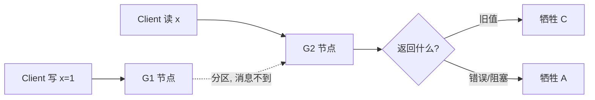

# 分布式理论 · CAP 为什么只能满足两个

> 一句话定位：面试问 CAP，不是让你背三个单词，而是让你用「分区发生时的一次写」把 C 和 A 的冲突证明出来。
> 版本前提：理论无版本；文中系统行为以 2026 年主流版本为准（Nacos 3.x、Eureka 维护模式、ZooKeeper 3.9.x、Consul 1.x）。

## 1. 是什么

CAP 是分布式系统的三个属性：

- **C（Consistency，一致性）**：线性一致性。任何一次读都能看到最近一次成功写入的值，或者返回错误。
- **A（Availability，可用性）**：每个非故障节点都能在有限时间内返回**非错误**响应，但不保证是最新值。
- **P（Partition tolerance，分区容错性）**：网络分区（节点之间消息丢失、延迟、断开）发生时，系统仍能继续运行。

CAP 定理：**三者不能同时满足**，最多同时满足两个。

## 2. 为什么只能满足两个

用一个最小场景证明。假设节点被网络分区切成两组 G1、G2，彼此收不到消息。

1. 客户端向 G1 写入 `x = 1`，G1 写入成功。
2. 客户端再向 G2 读 `x`。
3. G2 因为分区收不到这次写入，它只有两个选择：
   - 返回旧值（或超时/错误）。返回旧值就**牺牲 C**；返回错误就**牺牲 A**。
   - 拒绝服务，等分区恢复。这就是**牺牲 A** 保 C。
4. 不存在第三种做法能让 G2 既返回最新值、又保证可用，因为消息被分区切断了。

P 在分布式系统里不是可选项。只要跨网络部署，分区就是物理现实，你无法「选择不要 P」；你能选的是分区发生时**保 C 还是保 A**。所以「CA 系统」只在单机或网络绝对可靠时才成立，真实分布式系统只有 CP 或 AP。

还要注意两点：

- CAP 的 C 是线性一致性，不是 ACID 的 C。ACID 的 C 指完整性约束，两回事。
- CAP 说的是**分区期间**的取舍，不是系统永远只能二选一。正常运行时 CP/AP 系统都可以同时提供 C 和 A；只有分区发生时才被迫选边。

## 3. 底层怎么实现

不同系统用不同协议实现自己的取舍：

| 系统 | CAP | 一致性协议 | 取舍 |
| --- | --- | --- | --- |
| Eureka | **AP** | 无共识，peer 异步复制 + 客户端缓存 | 分区时继续读，注册表可能不一致 |
| ZooKeeper | **CP** | ZAB | 选主期间不可用，保证顺序一致 |
| Consul | **CP** | Raft | 多数派写成功才返回，少数派不可写 |
| etcd | **CP** | Raft | 同上，强一致 |
| **Nacos** | **AP + CP 可切换** | 临时实例 Distro(AP)、持久实例/配置 JRaft(CP) | 按数据类型选协议 |
| Redis Cluster | 偏 **AP** | 异步复制 | 主从切换可能丢写 |
| Kafka | 可 AP 可 CP | ISR + acks | `acks=all` + `min.insync.replicas` 偏 CP，否则偏 AP |

AP 的典型实现：写先落本地、异步复制给其他节点，读直接读本地。分区时各节点继续服务，恢复后靠反熵/校验补齐。代价是可能读到旧值。

CP 的典型实现：写必须多数派确认（Raft/ZAB 的 quorum），少数派节点拒绝写或读。分区时少数派不可用，换来「读到的都是已提交的最新值」。

**BASE** 是 AP 方向的理论补充：Basically Available（基本可用）、Soft state（软状态）、Eventually consistent（最终一致）。它不要求强一致，只要求最终收敛，是大多数互联网业务的默认选择。

## 4. 生产中的问题与排查

- **把 CAP 当三选二**：以为可以「选 CA」。跨网络部署必然有 P，CA 只在单机成立。正确说法是「P 必选，分区时在 C/A 之间选」。
- **把 CAP 的 C 当成事务一致性**：CAP 的 C 是线性一致，不是「数据不违反约束」。答题时说清楚，能立刻区分水平。
- **以为 AP 就是「不要一致性」**：AP 是**最终一致**，不是永远不一致；分区恢复后要收敛。
- **选型不看业务**：支付、库存扣减偏 CP 或最终一致 + 补偿；商品列表、推荐、注册中心偏 AP。不要一刀切。
- **忽略分区期间的行为**：只看正常运行时延，不看分区时是拒绝写还是返回旧值。压测要覆盖网络异常。

## 5. 可跑实验

- 目录：`labs/spring-distributed-cap/`
- 目的：直观看到分区时 CP 与 AP 的行为差异。
- 步骤：用 Docker 起 3 节点 etcd（CP）和 3 节点 Eureka（AP）；人为断开一个节点；分别向多数派、少数派写入和读取。
- 预期：etcd 少数派写失败（保 C 牺牲 A）；Eureka 少数派仍可读，但可能拿到旧注册表（保 A 牺牲 C）。
- 结论：CAP 不是配置项，是协议在分区时的必然行为。

## 6. 面试问法

**Q：CAP 为什么只能满足两个？**
60 秒版本：分区把节点切成两组，写只到达一组。另一组读的时候，要么返回旧值（牺牲 C），要么返回错误/阻塞（牺牲 A），没有第三种可能让它在收不到写的情况下还返回最新值。所以 P 成立时 C 和 A 不能同时满足。P 在分布式系统里必选，实际就是 CP 或 AP 二选一。

**Q：CAP 的 C 和 ACID 的 C 一样吗？**
60 秒版本：不一样。CAP 的 C 是线性一致性，读要能看到最近一次成功写；ACID 的 C 是完整性约束，指事务不破坏数据库约束。两者只是缩写相同。

**Q：Eureka 为什么是 AP，ZooKeeper 为什么是 CP？**
60 秒版本：Eureka 用 peer 异步复制，分区时各节点继续用本地注册表响应，接受短暂不一致，所以是 AP；ZooKeeper 用 ZAB，写要多数派确认，选主期间少数派不可用，所以是 CP。

**Q：Nacos 到底算 AP 还是 CP？**
60 秒版本：看数据类型。临时实例走 Distro，是 AP；持久实例和配置走 JRaft，是 CP。它把两种协议并存，按需选择，不能简单贴一个标签。

## 7. 追问链 · 参考答案

| 层级 | 问题 | 参考答案要点 |
| --- | --- | --- |
| L1 | CAP 分别是什么？ | C 线性一致，A 非故障节点返回非错误响应，P 分区时系统仍能运行。三者最多同时满足两个。 |
| L2 | 为什么不能选 CA？ | 跨网络部署必然发生分区，P 无法放弃；分区时只能在 C 和 A 之间选。CA 只在单机或网络绝对可靠时成立。 |
| L3 | AP 系统分区恢复后怎么收敛？ | 靠异步复制、反熵、定期校验、全量/增量同步补齐；Nacos 的 Distro 用元信息校验，Eureka 用 peer 复制和客户端增量拉取。 |
| L4 | CP 系统为什么分区时可能不可用？ | 写需要多数派确认，少数派节点拿不到 quorum，只能拒绝写或读，牺牲可用性换一致性。 |
| L5 | BASE 和 CAP 什么关系？ | BASE 是 AP 方向的延伸：基本可用、软状态、最终一致；它不追求强一致，只要求最终收敛，适合大多数互联网业务。 |

## 8. 误区 · 正解

| 误区 | 正解 |
| --- | --- |
| 「CAP 是三选二，可以选 CA」 | P 在分布式系统里不是可选项，分区必然发生；CA 只存在于单机。实际是分区时在 C/A 之间选。 |
| 「CAP 的 C 就是事务一致性」 | CAP 的 C 是线性一致性，不是 ACID 的完整性约束；两者只是字母相同。 |
| 「AP 就是放弃一致性」 | AP 是**最终一致**，分区恢复后要收敛；不是永远不一致。 |
| 「一个系统只能贴一个 CAP 标签」 | 很多系统按数据类型/操作混合，比如 Nacos 临时实例 AP、持久实例和配置 CP；Kafka 也能按 `acks` 调。 |

## 9. 我的薄弱点

（学完后同步到 `weakness.md`）
