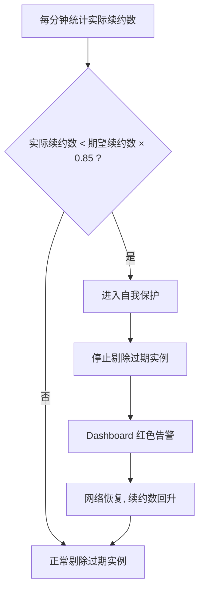
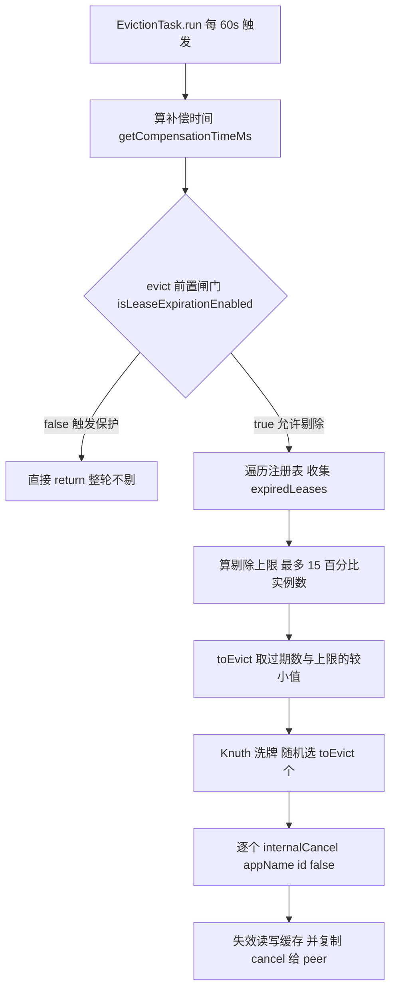
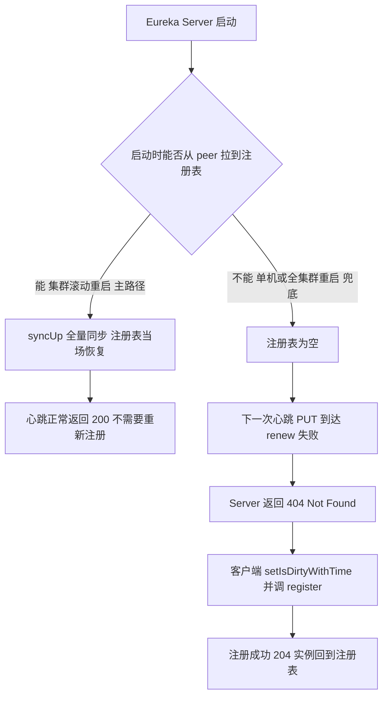
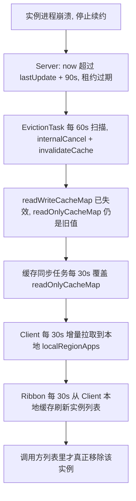

# Spring Cloud Netflix · Eureka 注册中心

> 一句话定位：Eureka 是「AP 注册中心」的经典样本，面试真正问的是心跳、注册表存哪、以及自我保护为什么敢保留可能已经挂掉的实例。  
> 版本前提：Eureka 自 **2018 年** Netflix 宣布 Eureka 2.0 停止开发后进入**维护模式**。Spring Cloud Netflix 仍随 **2025.x** 发布列车提供 `spring-cloud-starter-netflix-eureka-client` / `-server`（官方 2025.1.0-M1 发布说明仍列该模块），但新项目应优先 Nacos / Consul。中文资料常见的「2025.1 已移除 Eureka」与官方发布说明不符。

## 1. 是什么

Eureka 是 Netflix 开源的服务注册与发现组件，分 Eureka Server（注册表）和 Eureka Client（服务实例）。客户端启动时把自己的 IP、端口、健康状态注册到 Server，并周期性发心跳续约；消费者从 Server 拉取服务实例列表，在本地做负载均衡。

## 2. 为什么这样设计

Eureka 的设计目标是可用性优先。服务发现的本质是「消费者要能拿到一份可用的实例列表」，而不是「所有 Server 的注册表在任意时刻完全一致」。网络分区时，如果为了强一致而拒绝服务，消费者直接拿不到列表，业务先挂；Eureka 选择接受短暂不一致，让每个节点继续用本地注册表响应。

这也是它和 ZooKeeper 的分水岭：ZooKeeper 是 CP，选主期间不可用；Eureka 是 AP，分区期间各节点继续读，恢复后再慢慢收敛。代价是消费者可能拿到已经下线的实例，所以客户端必须配合重试和熔断。

保护机制解决的是另一个问题：网络抖动会让 Server 收不到心跳，但并不代表实例真的挂了。如果此时批量剔除，等网络恢复，实例又不会自动重新注册（只有启动时才注册），就会造成大面积「服务明明活着却调不到」。自我保护宁可保留可疑实例，也不误杀。

## 3. 底层怎么实现

### 3.1 心跳与剔除

| 参数                                                     | 默认值         | 含义                                                                            |
| ------------------------------------------------------ | ----------- | ----------------------------------------------------------------------------- |
| `eureka.instance.lease-renewal-interval-in-seconds`    | **30s**     | 客户端心跳间隔                                                                       |
| `eureka.instance.lease-expiration-duration-in-seconds` | **90s**     | 最后一次心跳后多久判定过期                                                                 |
| `eureka.server.eviction-interval-timer-in-ms`          | **60000ms** | 驱逐定时器扫描周期，它的核心任务定义在 `AbstractInstanceRegistry`类中，由一个名为 `EvictionTask`的定时任务来执行 |
| `eureka.server.renewal-percent-threshold`              | **0.85**    | 自我保护阈值系数                                                                      |

客户端每 30s 发一次 `renew`；Server 90s 没收到就把租约标记过期；驱逐定时器每 60s 扫一遍，把过期实例从注册表删除。**心跳只发给 `service-url` 列表里的第一个 Server，再由 Server 之间对等复制，不是每个 Server 都收一遍。**

### 3.2 数据存在哪

<span style="color:rgb(222, 60, 54)">Eureka 注册表只存内存，没有数据库</span>。核心结构在 `AbstractInstanceRegistry`：

- `ConcurrentHashMap<String, Map<String, Lease<InstanceInfo>>> registry`：**服务名 → 实例 ID → 租约**。
- `recentlyChangedQueue`：最近变更的实例，供增量拉取。
- 多级响应缓存：**`ReadOnlyCacheMap`**（`ConcurrentHashMap`）→ `ReadWriteCacheMap`（Guava Cache）→ 实&#x9645;**&#x20;registry**。默认 **30s** 把读写缓存同步到只读缓存（`responseCacheUpdateIntervalMs=30000`），读请求优先走只读缓存，避免读写锁竞争。

注册、续约、下线都会**先改 registry**，再放&#x5165;**&#x20;`recentlyChangedQueue`**，并通过 `PeerAwareInstanceRegistryImpl.replicateToPeers` 复制给其他 peer。复制是异步的，**所以节点间可能短暂不一致**。

### 3.3 自我保护怎么触发



期望续约数按「实例数 × 2」估算，因为 30s 一次心跳，一分钟正好 2 次。由此得到的续约阈值由 `renewal-threshold-update-interval-ms=900000` 每 **15 分钟**重算一次，但**判定是每分钟做的**，两者的分工见下方补充。

<span style="color:rgb(222, 60, 54)">自我保护一旦触发，Server 不再剔除任何过期实例</span>，即使某个实例真的宕机也会留在列表里。Dashboard 会打出 `EMERGENCY! EUREKA MAY BE INCORRECTLY CLAIMING INSTANCES ARE UP WHEN THEY'RE NOT...`。网络恢复、续约数回到阈值以上后自动退出。

**补充：15 分钟是阈值重算周期，不是判断的时间窗口**

`eureka.server.renewal-percent-threshold=0.85` （自我保护阈值系数）只定义及格线比例，本身不含时间语义，这一点没问题。但 `eureka.server.renewal-threshold-update-interval-ms=900000` 重算的是**续约阈值 `numberOfRenewsPerMinThreshold`**，**它既不是自我保护判断的观察窗口，也不是「持续低于 85% 多久」的累积时长。**&#x4E09;个周期要分开看：

| 周期      | 默认值   | 谁在跑                                                               | 干什么                                                                                  |
| ------- | ----- | ----------------------------------------------------------------- | ------------------------------------------------------------------------------------ |
| 续约数采样窗口 | 60s   | `MeasuredRate`                                                    | 每分钟把 `currentBucket` 滚进 `lastBucket`，`getNumOfRenewsInLastMin()` 取的是**最近一分钟**收到的续约总数 |
| 判定动作    | 60s   | `EvictionTask` 调 `isLeaseExpirationEnabled()`                     | 每轮剔除前比一次「最近一分钟续约数 > 阈值 ?」，不满足就直接 `return`，整轮不剔                                       |
| 阈值重算    | 15min | `scheduleRenewalThresholdUpdateTask` → `updateRenewalThreshold()` | 重新统计注册表实例数做对账纠偏，修正增减计数与集群同步造成的漂移                                                     |

判定入口在 `PeerAwareInstanceRegistryImpl.isLeaseExpirationEnabled()`：

```java
if (!isSelfPreservationModeEnabled()) {
    return true;                       // 关掉自我保护, 永远允许剔除
}
return numberOfRenewsPerMinThreshold > 0
       && getNumOfRenewsInLastMin() > numberOfRenewsPerMinThreshold;
```

`AbstractInstanceRegistry.evict()` 开头就调它，返回 `false` 直接跳过整轮剔除。所以**源码里没有「持续低于 N 分钟」这个累积条件**：某一分钟续约数低于阈值，这一轮就保护；下一分钟回升，下一轮就恢复剔除。自我保护不是一个持久状态位，没有显式的「进入模式 / 退出模式」动作。把 15 分钟当成判断窗口，会推出「掉线后要等 15 分钟才进保护」这种错误结论。

**阈值公式**（原文说的「期望续约数 × 0.85」漏了中间一项）：

`numberOfRenewsPerMinThreshold = expectedNumberOfClientsSendingRenews × (60 / expected-client-renewal-interval-seconds) × renewal-percent-threshold`

默认 30s 心跳即每实例每分钟 2 次，等价于 `实例数 × 2 × 0.85`。`eureka.server.expected-client-renewal-interval-seconds` 默认 30，是 **Server 端对客户端心跳间隔的假设**，必须与服务提供者实际的 `lease-renewal-interval-in-seconds` 一致；只调客户端心跳而不同步改这个 Server 假设值，阈值会算错，自我保护会提前或延后触发。

**阈值共有 4 个更新时机，15 分钟只是其中之一**：Server 启动初始化（`openForTraffic`）、实例注册 `register()`（计数加一并立即重算）、实例注销 `cancel()`（计数减一并立即重算）、以及 15 分钟定时任务。所以「每隔 15 分钟才更新一次阈值」不准确，注册与下线时阈值**当场就变**；定时任务主要承担对账纠偏，不是唯一入口。

**一个容易连带答错的开关**：若 `eureka.server.enable-self-preservation=false`，`isLeaseExpirationEnabled()` 直接返回 `true`，阈值与 0.85 都不再参与判定，`EvictionTask` 每轮照常剔除。

### 3.4 客户端侧

**客户端默认每 30s 拉一次注册表**（`eureka.client.registry-fetch-interval-seconds=30`），支持增量；拉到后缓存在本地。真正发起调用时，从本地列表里按负载均衡策略选一个实例，所以即使 Server 短暂不可用，客户端仍能用旧列表撑一段时间。

### 3.5 驱逐定时器 EvictionTask：一次扫描实际做了什么

**一句话主线**：`EvictionTask` 每 60s 跑一轮 `evict(compensationTimeMs)`，内部顺序是「前置闸门 → 收集过期租约 → 算单轮剔除上限 → 随机挑选 → 逐个 `internalCancel`」。

**核对结论**：

| 原文要点                                           | 判定    | 正解                                     |
| ---------------------------------------------- | ----- | -------------------------------------- |
| 配置项默认 60000ms，任务定义在 `AbstractInstanceRegistry` | 对     | 需补：调度入口在 `postInit()`，用的是 `Timer` 固定延迟 |
| 不是发现一个删一个，先收集 `expiredLeases`                  | 对     | 无                                      |
| 剔除上限 = 实例数 − 实例数 × 85%，再取较小值                   | 对     | 需补：复用的是自我保护配置项，没有独立参数                  |
| 随机分批后调 `internalCancel`                        | 对     | 需补：Knuth 洗牌实现与下线后的连锁动作                 |
| 前置闸门「15 分钟内低于 85% 触发保护」                        | **错** | 判定看最近 1 分钟续约数，每分钟一次，15 分钟只重算阈值         |
| 「预留时间用于补偿集群间数据同步延迟」                            | **错** | 补偿的是定时器自身晚执行（GC 停顿、时钟漂移）               |
| 「90 秒即 3 个心跳周期」                                | **错** | 只做时间戳比较，Server 不数心跳                    |

**调度入口**（原文没说清的部分）：`EvictionTask` 是 `AbstractInstanceRegistry` 的内部类，但把它挂上定时器的是 `postInit()`：`evictionTimer.schedule(new EvictionTask(), getEvictionIntervalTimerInMs(), getEvictionIntervalTimerInMs())`。这里用的是 `java.util.Timer` 单线程、固定延迟 `schedule`（不是 `scheduleAtFixedRate`），**首次执行在启动 60s 之后**，不是启动即扫。**集群里每个 Server 各自跑一份自己的 `EvictionTask`**，剔除只发生在本地，跨节点靠 cancel 复制同步（见 9.4.2）。

**一次扫描的完整流程**：



**逐层拆解**：

1. **前置闸门**：`evict()` 第一行 `if (!isLeaseExpirationEnabled()) return;`，返回 `false` 就整轮不剔，后面四步全不做。判据与三个周期见 3.3：比较的是 `MeasuredRate` **最近一分钟**收到的续约数与 `numberOfRenewsPerMinThreshold`，每分钟一轮现算，没有「持续低于 N 分钟」的累积条件，也不是一个会「开启」的持久模式位。若 `enable-self-preservation=false`，该方法直接返回 `true`，这道闸门永远放行。
2. **收集过期租约**：两层遍历 `registry`，对每个 `Lease` 调 `lease.isExpired(additionalLeaseMs) && lease.getHolder() != null`，命中即加入 `expiredLeases`，**此时只收集不删除**。判定式是 `evictionTimestamp > 0 || now > lastUpdateTimestamp + duration + additionalLeaseMs`。其中 `duration` 默认 90s，来自 `lease-expiration-duration-in-seconds`，这是**服务提供者客户端配置**，注册时随 `leaseInfo` 上报，改 Server 端同名配置不生效；90s 是从最后一次续约起算的固定租约时长，Server 里没有「丢了几个心跳」的计数器（详见 9.4.1）。
3. **单轮剔除上限**：`registrySizeThreshold = (int)(registrySize × renewalPercentThreshold)`，`evictionLimit = registrySize − registrySizeThreshold`，`toEvict = Math.min(expiredLeases.size(), evictionLimit)`。默认 0.85 即**单轮最多剔 15%**。源码注释写得很直白：`To compensate for GC pauses or drifting local time we need to use current registry size as a base for triggering self-preservation. Without that we would wipe out full registry.` 兜底的是 Server 自身卡顿导致大批实例被误判过期的场景。注意这里复用的就是**自我保护**的 `renewal-percent-threshold`，Eureka 并没有一个独立的「驱逐限流」配置项。
4. **随机挑选**：`Random(System.currentTimeMillis())` 加 Knuth 洗牌（循环内 `Collections.swap` 边选边交换），把 `expiredLeases` 打散后取前 `toEvict` 个。目的是避免按注册表遍历顺序剔除，导致某个应用的实例被集中一次性清空。
5. **执行下线**：逐个 `internalCancel(appName, id, false)`。它会移除租约、写 `recentCanceledQueue`、`EXPIRED` 计数、**失效 `readWriteCacheMap`**，并以 `isReplication=false` 触发 `replicateToPeers` 把 cancel 复制给其他 Server 节点。缓存失效这一步正是第 9 节 240 秒链路里「`readOnlyCacheMap` 30s 同步」的起点，所以「本轮扫描剔除完成」不等于「消费者已经感知」。

**三处必须改的归因**：

- **预留时间不是集群同步**：`additionalLeaseMs` 来自 `getCompensationTimeMs() = elapsedMs − evictionIntervalTimerInMs`，其中 `elapsedMs` 是本次与上次任务实际执行的间隔。它补偿的是 `Timer` 因 **GC 停顿、本地时钟漂移、调度挤压** 而晚于 60s 执行的时间差，把过期判定点**往后推**，让 Server 自己卡顿期间不至于误杀健康实例。全程是本机时间账，与 peer 复制、集群同步延迟无关。把它理解成「同步预留」会连带答错过期公式。
- **自我保护判据不是 15 分钟**：见 3.3 的三周期对照表。原文「短时间内丢失大量心跳」「15 分钟内低于 85%」两个说法都不成立，判据是每分钟一次、窗口一分钟的单次比较，`EvictionTask` 每轮开头现算一次。
- **90 秒不是数 3 个心跳**：见 9.4.1。`Lease.isExpired()` 只做时间戳比较，90s 是固定 `duration`，且是客户端上报的配置。

**两个源码里才看得到的补强**：

- **double-duration bug**：`renew()` 里写的是 `lastUpdateTimestamp = System.currentTimeMillis() + duration`，先把时间戳往后多加了 90s，而 `isExpired()` 又再加一次 `duration`，于是实际过期判定相当于从最后一次心跳起算约 `2 × 90 = 180s`。官方在 `Lease.isExpired()` 注释里明确承认这是 bug，标注 `will not be fixed`，只影响非优雅下线的实例。这解释了为什么实测下线感知往往比「90s 过期 + 60s 扫描」更久，也是 9.4.3 说 240 秒只是保守理论上界的原因之一。
- **剔除上限用的是自我保护配置**：`renewalPercentThreshold` 一个值两处用（自我保护及格线、单轮剔除比例），调它会同时改变两个行为，生产调参必须一起权衡。


**速查卡**：

| 项                                                           | 默认值   | 作用                       |
| ----------------------------------------------------------- | ----- | ------------------------ |
| `eureka.server.eviction-interval-timer-in-ms`               | 60000 | 扫描频率，首次执行也在启动 60s 后      |
| `eureka.instance.lease-expiration-duration-in-seconds`（客户端） | 90    | 租约时长，注册时随 `leaseInfo` 上报 |
| `eureka.instance.lease-renewal-interval-in-seconds`（客户端）    | 30    | 心跳间隔                     |
| `eureka.server.renewal-percent-threshold`                   | 0.85  | 自我保护及格线，兼作单轮最多剔 15%      |
| `eureka.server.enable-self-preservation`                    | true  | 关掉则前置闸门永远放行              |
| `getCompensationTimeMs()`                                   | 运行时计算 | 补偿定时器晚执行，把过期判定往后推        |

### 3.6 Server 重启后实例怎么回来：两条恢复路径

**一句话主线**：心跳 404 触发重新注册是真的，但它只是**单机 / 全集群同时重启 / peer 同步失败时的兜底路径**。集群滚动重启时，Server 启动会主动从 peer 同步注册表（`syncUp()`），注册表当场恢复，心跳根本不会返回 404。原文把兜底当成了唯一机制，也把「Server 不主动」这句话说过头了。

**核对结论**：

| 原文要点                   | 判定       | 正解                                                                |
| ---------------------- | -------- | ----------------------------------------------------------------- |
| 心跳返回 404 会让客户端自动发起注册   | 对        | 需补：`REREGISTER_COUNTER`、`setIsDirtyWithTime()`、`register()` 判 204 |
| 客户端每 30s 心跳，正常返回 200   | 对        | 注册成功的响应是 204 No Content，不是 200                                    |
| 下一个心跳周期（最长 30s）内完成重新注册 | 基本对      | 前提是心跳真的发出且 404 能回来；`TimedSupervisorTask` 有指数退避会拉长间隔               |
| 「并非由 Server 主动通知或拉取」   | **错**    | Server 启动会主动 `syncUp()` 从 peer 拉注册表；它只是不主动通知客户端、不替客户端注册           |
| 「Server 重启后注册表是空的」     | **不总成立** | 集群滚动重启由 peer 同步填满；仅无 peer 可用时才是空的                                 |
| 404 是因为 Server 找不到实例   | **不完整**  | 还有 `lastDirtyTimestamp` 不一致这条数据修复路径                               |
| 老消费者靠本地缓存撑住            | **需限定**  | 只有拉取失败才保留旧缓存；拉到 200 空列表会覆盖本地缓存                                    |
| 全新消费者可能拉到不完整的列表        | 对        | 且新消费者本地缓存本来就是空的，是空窗期最危险的一类                                        |
| 连接池熔断导致客户端卡住           | 归因模糊     | 精确为 `TimedSupervisorTask` 指数退避与 `RetryableEurekaHttpClient` 节点隔离  |

**两条恢复路径**：



**逐层拆解**：

1. **Server 启动时主动同步（原文完全漏掉的主路径）**：`EurekaServerBootstrap.initEurekaServerContext()` 里依次调 `registry.syncUp()` 与 `registry.openForTraffic(applicationInfoManager, registryCount)`。`syncUp()` 通过 Server 内置的 `eurekaClient.getApplications()` 拿到 peer 的全量注册表，对每个实例调 `register(instance, duration, true)`，第三个参数 `isReplication=true` 表示这是 peer 复制来的、不再反向复制回去（呼应 9.4.2）。默认重试 `eureka.server.number-of-replication-retries=5` 次，间隔 `registry-sync-retry-wait-ms=30000`，最多约 2.5 分钟。**滚动重启单个节点时注册表从其他节点直接填回来，客户端心跳照常 200，不需要重新注册。** 只有当 `register-with-eureka=false` 的单机、或所有节点一起重启、或 peer 全部不可达时，注册表才真的为空，才轮到 404 兜底。注册表只存内存（见 3.2）这句没错，错在忽略了启动阶段的回填。
2. **404 有两种来源，不只是「找不到实例」**：`InstanceResource.renewLease()` 里，`registry.renew()` 返回 false 时直接 404；即使续约成功，只要 `lastDirtyTimestamp != null` 且 `eureka.server.sync-when-timestamp-differs=true`（默认开），还会进 `validateDirtyTimestamp()`：请求带的时间戳**大于** Server 侧记录就返回 404 要求客户端重新注册，小于且来自 peer 复制就返回 409 并把本地实例放进响应体，一致才返回 200。所以 404 同时是**注册表丢失**和**实例信息版本不一致**两种修复信号。
3. **客户端收到 404 之后做了什么**：`DiscoveryClient.renew()` 的分支是 `REREGISTER_COUNTER.increment()` → `instanceInfo.setIsDirtyWithTime()` 标脏 → `register()` → 成功后 `unsetIsDirty(timestamp)`。`register()` 发的是 `POST /apps/{appName}`，成功判据是 **204 No Content**。心跳任务只在 `shouldRegisterWithEureka()=true` 时才启动，所以 `register-with-eureka=false` 的纯消费者不发心跳、也不会重新注册，它只靠 `CacheRefreshThread` 每 30s 拉列表；严格说这套自愈属于所有注册过的 Eureka Client，不只是「服务提供者」。
4. **另一条独立的注册通道**：`InstanceInfoReplicator` 初始延迟默认 40s（`initial-instance-info-replication-interval-seconds`），之后每 30s（`instance-info-replication-interval-seconds`）跑一次 `run()`：`refreshInstanceInfo()` → 若 `isDirtyWithTime() != null` 就 `register()` → `unsetIsDirty()`。状态变更（`StatusChangeListener` → `onDemandUpdate()`）也会立刻标脏并注册。应用启动时第一次注册其实就是它发的，不是构造里同步发的。因此「只有心跳能触发注册」不准确，心跳 404 只是把实例标脏后复用同一个 `register()`。
5. **30 秒上界的前提**：心跳由 `TimedSupervisorTask` 包装 `HeartbeatThread`，周期取 `lease-renewal-interval-in-seconds=30`。这个包装器在任务超时或抛异常时会按指数退避把下一轮延迟翻倍（上限 `expBackOffBound`，默认 10 倍），叠加 `RetryableEurekaHttpClient` 对故障 Server 的隔离，网络抖动期间心跳间隔可能远大于 30s。原文说的「极端情况卡住」，真实机制是这层退避加上所有 `service-url` 都不可达，而不是笼统的「连接池熔断」；只要心跳能发出并收回 404，自愈就会发生，通常不需要重启客户端应用。

**三处必须改的归因**：

- **Server 会主动拉取，只是不主动通知客户端**：把「不主动通知客户端、不替客户端发起注册」写成「Server 不主动拉取」，就把启动阶段 `syncUp()` 这条主路径抹掉了。面试里的准确口径是：注册表恢复优先靠 **Server 之间的对等同步**，同步失败才靠 **客户端心跳自愈**。
- **注册表为空不是重启的必然状态**：见上面第 1 条，多节点滚动重启时它根本不空。
- **404 不等于「Server 不认识你」**：见上面第 2 条，`lastDirtyTimestamp` 不一致同样返回 404，那时 Server 明明有这个实例。

**空窗期：本地缓存的保护是有条件的（原文最需要收紧的一句）**

`DiscoveryClient.getAndStoreFullRegistry()` 的逻辑是：只有响应 200 且 `apps != null` 才会 `localRegionApps.set(filterAndShuffle(apps))`。所以结果分两种，**不是无条件撑住**：

| Server 侧的响应      | 客户端动作                                  | 老消费者结果             |
| ---------------- | -------------------------------------- | ------------------ |
| 拉取失败、连接不通、返回 403 | `apps == null`，不更新 `localRegionApps`   | 保留旧缓存，能继续调用        |
| 返回 200 但注册表为空    | 用空 `Applications` 覆盖 `localRegionApps` | **本地缓存被清空，同样调用失败** |

原生 Eureka 有一层专门的保护：`PeerAwareInstanceRegistryImpl.shouldAllowAccess()` 在 `peerInstancesTransferEmptyOnStartup=true`（启动从 peer 一个实例都没同步到）时，会在 `startupTime + wait-time-in-ms-when-sync-empty`（默认 5 分钟）之内返回 false，让 Server 拒绝提供注册表，正是为了不让客户端用空列表刷掉本地缓存；`openForTraffic()` 里 `count > 0` 才会把这个标志置 false。**但 Spring Cloud Netflix 这层预热基本失效**：`EurekaServerInitializerConfiguration.start()` 在异步线程里初始化，应用上下文先就绪，`startupTime` 在同步结束前仍是 0，`shouldAllowAccess()` 判定被绕过，Server 会立刻用空注册表响应查询。Spring Cloud Netflix 的 issue #380 明确记录了这一行为差异，结论就是「重启单机 Server 可能导致客户端在下次 refresh 时清空本地缓存」。所以生产上单机部署不要指望客户端缓存兜底，要么配多节点 peer，要么在消费侧加重试与熔断。

顺带一个呼应 3.3 的点：`openForTraffic()` 会用 `registryCount` 设置 `expectedNumberOfClientsSendingRenews` 并重算阈值。启动同步为空时 `count=0`、阈值算出 0，按 3.3 的 `numberOfRenewsPerMinThreshold > 0 && ...` 判定会返回 false，于是**重启初期自我保护天然生效、不剔除任何实例**；随着客户端陆续重新注册，`register()` 每次计数加一并即时重算阈值，才逐步恢复正常。

**速查卡**：

| 项                                                                  | 默认值          | 作用                                   |
| ------------------------------------------------------------------ | ------------ | ------------------------------------ |
| `eureka.server.number-of-replication-retries`                      | 5            | 启动时从 peer 同步注册表的重试次数                 |
| `eureka.server.registry-sync-retry-wait-ms`                        | 30000        | 同步重试间隔，5 次最多约 2.5 分钟                 |
| `eureka.server.wait-time-in-ms-when-sync-empty`                    | 300000（5 分钟） | 同步为空时的预热拒绝访问时长，单机常设 0 跳过             |
| `eureka.server.sync-when-timestamp-differs`                        | true         | 开启后 `lastDirtyTimestamp` 不一致也会返回 404 |
| `eureka.instance.lease-renewal-interval-in-seconds`                | 30           | 心跳周期，决定 404 自愈的最长等待                  |
| `eureka.client.initial-instance-info-replication-interval-seconds` | 40           | `InstanceInfoReplicator` 首次注册延迟      |
| `eureka.client.instance-info-replication-interval-seconds`         | 30           | 标脏检查与重新注册周期                          |
| `eureka.client.register-with-eureka`                               | true         | 关掉则不发心跳、不具备 404 自愈能力                 |

**相关**：注册表只存内存见 3.2，自我保护阈值判定见 3.3，驱逐与 peer 复制见 3.5 与 9.4.2，下线感知的缓存链路见第 9 节。

## 4. 生产中的问题与排查

- **自我保护误保留宕机实例**：消费者拿到已死实例，调用报错。要看客户端是否有重试/熔断，不能只靠注册中心。可以调低 `renewal-percent-threshold` 或关闭自我保护，但要权衡误杀风险。
- **服务下线不及时**：Server 侧是默认 90s 过期 + 60s 扫描（约 150s），但消费者真正「遗忘」还要再叠加 readOnly 缓存 30s、客户端拉取 30s、Ribbon 刷新 30s，全链路保守上界约 **240s**。驱逐扫描的内部流程见 3.5，完整拆解、修正与优化配置见第 9 节。可缩短 `eviction-interval-timer-in-ms`，也可用 `use-read-only-response-cache=false` 直接去掉最贵的一层 30s；别把心跳和过期时间调得太激进，否则网络抖动就误杀。
- **注册表节点间不一致**：看 peer 复制日志与网络；Eureka 不保证强一致，跨节点读到旧列表是正常现象。
- **客户端拿到空列表**：检查 `service-url` 是否写全、Server 是否真的注册成功、`eureka.client.fetch-registry` 是否开启。
- **Eureka 本身的定位**：维护模式，不要再期待新特性；新项目用 Nacos 或 Consul，Eureka 只在存量系统里维护。

## 5. 可跑实验

- 目录：`labs/spring-distributed-eureka/`
- 目的：观察心跳、过期剔除、自我保护三个行为。
- 步骤：起一个 Eureka Server 和两个 Client；杀掉一个 Client，观察 90s 内它先变成不可用、再由驱逐定时器删除；把两个 Client 都停掉，观察续约数跌破阈值后 Dashboard 出现自我保护告警。
- 预期：单实例宕机按 90s + 60s 的节奏被剔除；批量掉线触发自我保护后实例不再被删。
- 结论：Eureka 的「删除」依赖心跳，而自我保护会在心跳大面积缺失时主动放弃删除。

## 6. 面试问法

**Q：Eureka 的心跳机制是怎样的？**  
60 秒版本：客户端默认每 **30s** 发一次续约，Server 在 **90s** 内没收到就判定租约过期，驱逐定时器每 **60s** 扫一次并删除过期实例。心跳只发给 `service-url` 里的第一个 Server，再由 Server 之间对等复制。

**Q：Eureka 为什么是 AP？**  
60 秒版本：网络分区时 Eureka 选择继续用本地注册表响应读写，接受节点间短暂不一致，保证消费者始终能拿到实例列表。它不做强一致共识，恢复后靠异步复制和增量拉取慢慢收敛。

**Q：Eureka 的数据存在哪？**  
60 秒版本：<span style="color:rgb(222, 60, 54)">只在内存，没有数据库</span>。核心是 `ConcurrentHashMap` 存「服务名 → 实例 → 租约」，外加 `recentlyChangedQueue` 和两级响应缓存；节点间通过 peer 复制同步，所以重启后注册表要靠客户端重新注册恢复。

**Q：自我保护是什么？为什么要它？**  
60 秒版本：**Server<u> 每分钟</u>统计实际续约数，低于「实例数 × 2 × 0.85」就进入自我保护，停止剔除过期实例**。目的是避免网络分区导致大面积误删，因为实例只在启动时注册，被删后不会自动回来。代价是可能保留已宕机实例，需要客户端重试/熔断兜底。

## 7. 追问链 · 参考答案

| 层级 | 问题                           | 参考答案要点                                                                               |
| -- | ---------------------------- | ------------------------------------------------------------------------------------ |
| L1 | 心跳间隔和过期时间是多少？                | 心跳 **30s**，过期 **90s**，驱逐扫描 **60s**；三个值要满足过期时间明显大于心跳间隔。                               |
| L2 | 期望续约数怎么算？                    | **实例数 × 2**，因为 30s 一次、一分钟两次；阈值再乘 **0.85**，每分钟实际续约数低于它触发自我保护。                         |
| L3 | 为什么要多级缓存？                    | 注册表读多写少，`ReadOnlyCacheMap` 承担绝大多数读，30s 从 `ReadWriteCacheMap` 同步，避免每次读都碰 registry 的锁。 |
| L4 | Eureka 和 ZooKeeper 的 CAP 区别？ | Eureka 是 **AP**，分区时继续服务、最终一致；ZooKeeper 是 **CP**，选主期间不可用。注册中心场景通常更看重可用性。              |
| L5 | 自我保护开了，消费者怎么避免调到死实例？         | 客户端要有**重试 + 熔断 + 超时**，负载均衡优先选健康实例；不能把「注册表里有」当成「实例一定活着」。                              |

## 8. 误区 · 正解

| 误区                     | 正解                                                                                                        |
| ---------------------- | --------------------------------------------------------------------------------------------------------- |
| 「Eureka 把注册表存 MySQL」   | <span style="color:rgb(222, 60, 54)">Eureka 注册表只在内存</span>，没有数据库；**节点间靠 peer 复制**，重启后靠客户端重新注册。            |
| 「自我保护是 bug，应该关掉」       | 自我保护是 **AP 取舍**：宁可保留可疑实例，也不因网络抖动误杀。关掉会在大规模网络抖动时批量删实例，风险更高。                                                |
| 「心跳发给所有 Eureka Server」 | 客户端只向 `service-url` 列表里的**第一个** Server 续约，其余节点靠 Server 间复制。                                               |
| 「Eureka 2025.1 已经被移除」  | Eureka 是**维护模式**，但 Spring Cloud Netflix 仍随 2025.x 列车发布；官方 2025.1.0-M1 发布说明仍列该模块并提供 eureka-client starter。 |

## 9. 专题：非正常下线的感知延迟（默认配置约 240 秒）

> 适用前提：单 Eureka Server 视角、默认配置、自我保护未触发、消费端仍使用 Netflix Ribbon。  
> 一句话主线：延迟不是某个开关决定的，而是「租约过期 + 定时清理 + 三层定时缓存」五个独立定时任务串联出来的保守上界。

### 9.1 结论先行：这段回答是否正确

**主干正确，数字全对，240 秒是业界通行的理论上界，可以直接用于面试。** 五个环节的名称、默认值、相加结果、自我保护的前提都成立。但有 4 处需要修正或补强，<span style="color:rgb(222, 60, 54)">其中「3 个心跳周期」属于机制归因错误</span>。


| 项                                      | 判定   | 说明                                                        |
| -------------------------------------- | ---- | --------------------------------------------------------- |
| 30s 心跳 / 90s 过期 / 60s 清理               | 正确   | 对应 lease-renewal、lease-expiration、eviction-interval 三个默认值 |
| 30s readOnly / 30s Client / 30s Ribbon | 正确   | 三层各自独立调度，串联成立                                             |
| 90 + 60 + 30 + 30 + 30 = 240           | 正确   | 单 Server、自我保护未触发时的保守上界                                    |
| 「连续 90 秒（3 个心跳周期）」                     | 需修正  | 过期靠时间戳比较，不数心跳次数，见 9.4.1                                   |
| 240 秒被称为「极限情况」                         | 需限定  | 是相位全坏的上界，不是常态，也不是硬上界，见 9.4.3                              |
| 自我保护「短时间内丢失大量心跳」                       | 需精确  | 判据是 Server 每分钟收到的续约总数低于阈值，见 9.4.4                         |
| Server 集群 peer 复制                      | 漏了一层 | 生产多节点时还有异步复制延迟，见 9.4.2                                    |

### 9.2 五阶段逐层拆解

| 环节          | 默认时长 | 配置项                                                       | 源码机制                                                            | 为什么省不掉                                                           |
| ----------- | ---- | --------------------------------------------------------- | --------------------------------------------------------------- | ---------------------------------------------------------------- |
| ① 租约过期      | 90s  | `eureka.instance.lease-expiration-duration-in-seconds=90` | `Lease.isExpired()` 比较 `now` 与 `lastUpdateTimestamp + duration` | 客户端不再续约，Server 只能等时间戳越界                                          |
| ② 定时清理      | 60s  | `eureka.server.eviction-interval-timer-in-ms=60000`       | `EvictionTask` 每 60s 扫 `registry`，过期则 `internalCancel`          | 过期是一个时间点，剔除是周期性动作，最多要等一整轮                                        |
| ③ 只读缓存同步    | 30s  | `eureka.server.response-cache-update-interval-ms=30000`   | `readOnlyCacheMap` 由定时任务从 `readWriteCacheMap` 同步                | `invalidateCache()` 只清 `readWriteCacheMap`，不清 `readOnlyCacheMap` |
| ④ 客户端拉取     | 30s  | `eureka.client.registry-fetch-interval-seconds=30`        | `CacheRefreshThread` 增量拉取 `recentlyChangedQueue`                | 客户端不实时查 Server，本地缓存正是 AP 可用性的来源                                  |
| ⑤ Ribbon 刷新 | 30s  | `ribbon.ServerListRefreshInterval=30000`                  | `PollingServerListUpdater` 从 Client 本地缓存刷新，只保留 UP 实例            | 又一层独立缓存，与 ④ 不同对象、不同调度器                                           |



两个容易顺手答错的细节：④ 拉的是**增量**（`getAndUpdateDelta`，变更项带 `ActionType.DELETED`），只有 `reconcileHashCode` 不一致、`disableDelta` 或超时才回退全量；`readWriteCacheMap` 是 Guava `LoadingCache`，`expireAfterWrite` 默认 180s，但因为 `invalidateCache()` 是主动失效，**这 180s 并不是延迟来源**。

### 9.3 240 秒时间轴

下面是一组把各定时器相位对齐到最坏情形的示例推演。具体时刻会随各定时器实际启动相位浮动，但串联结构与相加结果不变。

| 时刻       | 事件                                                  | 触发者                             |
| -------- | --------------------------------------------------- | ------------------------------- |
| t = 0    | 进程崩溃，最后一次续约约在 t = -1s                               | 服务进程                            |
| t ≈ 29s  | 第 1 次清理扫描，租约未过期                                     | `EvictionTask`（60s 周期）          |
| t ≈ 89s  | 第 2 次清理扫描，仍在 90s 边界内                                | `EvictionTask`                  |
| t ≈ 149s | 第 3 次扫描判定过期，执行 `internalCancel` 并 `invalidateCache` | `EvictionTask`                  |
| t ≈ 179s | `readOnlyCacheMap` 同步到新值                            | 缓存更新任务（30s）                     |
| t ≈ 209s | 客户端增量拉取拿到 `ActionType.DELETED`                      | `CacheRefreshThread`（30s）       |
| t ≈ 239s | Ribbon 刷新列表，死实例消失                                   | `PollingServerListUpdater`（30s） |

**算式**：90（过期）+ 60（清理）+ 30（readOnly）+ 30（Client）+ 30（Ribbon）= **240 秒**。前两段属 Server 侧约 150 秒，后三段属缓存侧 90 秒。原回答里「最长约 90 秒」之所以成立，是因为崩溃可能发生在心跳周期的任意相位，最后一次续约距崩溃 0 到 30 秒不等，所以从崩溃时刻看要等 60 到 90 秒才过期。

### 9.4 四处需要修正的地方

#### 9.4.1 「3 个心跳周期」是错的：过期判定看时间戳

Eureka **不统计丢了几个心跳**。`Lease.renew()` 每次把 `lastUpdateTimestamp` 刷成 `now + duration`（`duration` 即 90s），`Lease.isExpired()` 只做一次时间戳比较：`now > lastUpdateTimestamp + duration + additionalLeaseMs`。所以 90 秒是**从最后一次成功续约起算的固定租约时长**，不是「连续 3 次心跳没收到」的计数结果，Server 里也没有「心跳丢失计数器」这种东西。

还有两个必须一起记住的坑。`lease-renewal-interval-in-seconds` 与 `lease-expiration-duration-in-seconds` 都是**服务提供者客户端侧配置**，注册时随 `InstanceInfo` 的 `leaseInfo` 上报给 Server，Server 用上报值建租约，改 Server 端同名配置不生效。并且 **过期时长必须明显大于心跳间隔**，否则正常实例也会在两次心跳之间被判过期误杀。

#### 9.4.2 漏了 Server 集群的 peer 复制这一层

生产环境 Eureka 通常多节点互相注册。客户端只向 `serviceUrl.defaultZone` 里**第一个可用 Server** 续约，其余节点靠 `PeerAwareInstanceRegistryImpl.replicateToPeers` 的**异步批量复制**感知变化。`EvictionTask` 只在本地 Server 跑，剔完再把 cancel 复制给 peer；而带 `isReplication=true` 的 cancel 到 peer 后**不会再触发本地剔除**。所以消费者若连的是另一个 Server 节点，240 秒之上还要再叠一段复制延迟。<span style="color:rgb(222, 60, 54)">240 秒应理解为单 Server 视角的上界</span>。

#### 9.4.3 240 秒是保守理论上界，不是硬上界，也不是常态

它是**各环节周期之和**，隐含前提是 5 个独立调度定时器（EvictionTask、缓存同步、Client 拉取、Ribbon 刷新）的相位恰好全部最坏。它们各自在启动时独立排程，相位随机，全部对齐的概率极低；按均值估算大约 75（过期）+ 30（清理）+ 15 × 3（三层缓存）= **150 秒量级**。把 240 秒说成「通常要等 4 分钟」是误导。

反过来说它也**不是硬上界**，源码里有两处会让实际更长：

- `EvictionTask` 的 `getCompensationTimeMs()`：若 Server 发生 GC 停顿或调度漂移，会把超出周期的时间作为 `additionalLeaseMs` 补偿给 `isExpired()`，**把过期判定往后推**，避免误杀。停顿越久延迟越久。
- `AbstractInstanceRegistry.evict()` 的单次剔除上限：`evictionLimit = registrySize - registrySize × renewalPercentThreshold`，过期实例过多时**只剔一部分**，剩下的要跨多轮 60 秒。

严谨口径：默认配置下的保守上界约 240 秒，GC 补偿与批量掉线场景下**没有绝对硬上界**。

#### 9.4.4 自我保护判据要精确，且是 Server 端开关

「短时间内丢失大量实例心跳」只是现象，判据是：Server **每分钟统计自己收到的续约总数**，低于 `numberOfRenewsPerMinThreshold` 就进入自我保护。阈值公式为 `(60 / expected-client-renewal-interval-seconds) × 实例数 × renewal-percent-threshold`，默认 30s 心跳即每实例每分钟 2 次，`renewal-percent-threshold = 0.85`，也就是 **实例数 × 2 × 0.85**。阈值每 **15 分钟**重算一次（`renewal-threshold-update-interval-ms=900000`），但**比较每分钟都做**。开关是 `eureka.server.enable-self-preservation`，默认 `true`，属 **Server 端**。

两点补充。实例数很少时阈值按实例数线性缩小，开发或测试环境容易误触发自我保护，这是常见踩坑。自我保护退出后也**不是瞬间恢复**，仍要再走完 60s 清理和三层缓存；所以「无限延长」准确说是「只要不退出就一直不剔，退出后再叠加约 150 秒」。

### 9.5 误区 · 正解

| 误区                               | 正解                                                                           |
| -------------------------------- | ---------------------------------------------------------------------------- |
| 连续丢 3 个心跳才判过期                    | 比较 `lastUpdateTimestamp + 90s` 这个时间戳，不数心跳次数                                  |
| 240 秒是硬上限                        | 是保守理论上界，GC 补偿与 `evictionLimit` 都可能让它更长                                       |
| 240 秒是常态                         | 是各定时器相位全部最坏的上界，均值约 150 秒量级                                                   |
| 自我保护看丢了多少心跳                      | 看 Server 每分钟收到的续约总数是否低于「实例数 × 2 × 0.85」                                      |
| 自我保护一退出就恢复                       | 退出后还要再走 60s 清理和三层缓存                                                          |
| 关掉自我保护能治下线慢                      | 它治的是「批量掉线不剔除」，不是常规下线延迟，且有误杀风险                                                |
| `readWriteCacheMap` 的 180s 是延迟来源 | 它是 `expireAfterWrite`，但 `invalidateCache()` 主动失效，不构成延迟                       |
| 调参可以彻底消除延迟                       | 只能缩短，AP 模型必有窗口，必须靠重试、超时、熔断兜底                                                 |
| Ribbon 那层永远存在                    | Spring Cloud 2020.0 起 Ribbon 已被 `Spring Cloud LoadBalancer` 替代，新项目常常只剩 210 秒 |

### 9.6 优雅下线对照：为什么正常关机不用等 240 秒

| 下线方式                                                      | Server 侧路径                                                            | 消费者感知延迟                                 |
| --------------------------------------------------------- | --------------------------------------------------------------------- | --------------------------------------- |
| 优雅关闭（`kill -15`、`DiscoveryClient.shutdown()`）             | 主动发 `DELETE /apps/{app}/{id}`，立即 `internalCancel` + `invalidateCache` | 跳过 90s 与 60s，只剩 30 + 30 + 30 ≈ **90 秒** |
| 置 `OUT_OF_SERVICE` 或 `DOWN`（`/actuator/service-registry`） | 状态变更立即失效 `readWriteCacheMap`，实例仍留在注册表                                 | 注册表层面约 90 秒；Ribbon 只保留 UP 实例，一旦拉到新状态即摘流 |
| `kill -9`、进程崩溃、网络断开                                       | 不触发 `shutdown()`，只能等 90s 过期 + 60s 清理                                  | 全链路约 **240 秒**                          |
| 崩溃发生在自我保护期间                                               | Server 不剔除任何过期实例                                                      | 无限延长，退出后再叠加约 150 秒                      |


所以「非正常下线」这个限定词是关键：**慢的不是 Eureka 剔得慢，而是没有人事先通知它**。

### 9.7 优化配置速查

| 环节        | 配置项                                                    | 默认值   | 建议值                    |
| --------- | ------------------------------------------------------ | ----- | ---------------------- |
| 心跳        | `eureka.instance.lease-renewal-interval-in-seconds`    | 30    | 10 到 15                |
| 过期        | `eureka.instance.lease-expiration-duration-in-seconds` | 90    | 30 到 60，须大于心跳间隔        |
| 清理        | `eureka.server.eviction-interval-timer-in-ms`          | 60000 | 5000 到 10000           |
| 去掉只读缓存    | `eureka.server.use-read-only-response-cache`           | true  | false，直接跳过 ③ 那一整层 30s  |
| 缓存同步周期    | `eureka.server.response-cache-update-interval-ms`      | 30000 | 5000，关掉 readOnly 后此项无效 |
| 客户端拉取     | `eureka.client.registry-fetch-interval-seconds`        | 30    | 5                      |
| Ribbon 刷新 | `ribbon.ServerListRefreshInterval`                     | 30000 | 3000 到 5000            |
| 自我保护      | `eureka.server.enable-self-preservation`               | true  | 生产保持开启，测试环境可关          |
| 自我保护系数    | `eureka.server.renewal-percent-threshold`              | 0.85  | 按实例规模评估，不建议随意下调        |

**性价比最高的一刀是 `use-read-only-response-cache=false`**，它整层拿掉 30 秒，且不增加心跳压力。调参只能缩短窗口，无法消除窗口：Eureka 是 AP 注册中心，消费者拿到过期实例是设计内的可能，生产必须同时配 **重试 + 超时 + 熔断**，在调到死实例时换节点重试，而不是指望注册表实时准确。

### 9.8 追问链 · 参考答案

| 层级  | 问题                             | 参考答案                                                                                                     |
| --- | ------------------------------ | -------------------------------------------------------------------------------------------------------- |
| L1  | 默认配置下非正常下线最长多久被调用方发现？          | 约 240 秒，前提是单 Server、默认配置、自我保护未触发、消费端仍用 Ribbon。它是五个定时任务周期相加的保守上界，不是常态值。                                   |
| L2  | 240 秒怎么算出来的？                   | 90s 租约过期 + 60s 清理任务 + 30s readOnly 缓存同步 + 30s 客户端拉取 + 30s Ribbon 刷新。前两段约 150s 属 Server 侧，后三段 90s 属缓存侧。   |
| L3  | 为什么过期判定要 90 秒，是数 3 次心跳吗？       | 不是数心跳。`Lease.isExpired()` 比较 `now` 与 `lastUpdateTimestamp + 90s`，最后一次续约刷新该时间戳，Server 里没有心跳丢失计数器。         |
| L4  | 90s 和 60s 能不能合并成一个数？           | 不能简单合并。90s 决定「什么时候具备被剔资格」，60s 决定「下一班车什么时候来」，所以从具备资格到真正剔除还要等 0 到 60 秒，是串联不是替代。                            |
| L5  | readOnlyCacheMap 那 30 秒为什么省不掉？ | `invalidateCache()` 只让 `readWriteCacheMap` 失效，`readOnlyCacheMap` 由独立的定时任务每 30s 覆盖同步，剔除动作碰不到它，所以只能等下一次同步。 |
| L6  | 为什么关掉 readOnly 缓存是最有效的优化？      | 设 `use-read-only-response-cache=false` 后客户端直接读 `readWriteCacheMap`，整层拿掉 30 秒，且不增加心跳频率，比调小各项周期收益更大、副作用更小。 |
| L7  | 自我保护触发的精确判据是什么？                | Server 每分钟统计实际收到的续约数，低于 `实例数 × 2 × 0.85` 就进入自我保护并停止剔除；阈值每 15 分钟重算一次，比较每分钟都做，开关在 Server 端默认开启。            |
| L8  | 自我保护退出后是不是立刻就恢复？               | 不是。退出后过期实例还要等下一轮 60s 清理，再叠加 30s readOnly、30s 客户端、30s Ribbon，约再等 150 秒。                                   |
| L9  | Ribbon 那层现在还一定存在吗？             | 不一定。Spring Cloud 2020.0 起 Ribbon 进入维护并被 `Spring Cloud LoadBalancer` 替代，新项目若没有这层，上界相应变成约 210 秒。           |
| L10 | Server 部署成集群时 240 秒还够吗？        | 不够。客户端只向第一个 Server 续约，其他节点靠异步批量 peer 复制感知 cancel，且复制过来的 cancel 不会再触发本地剔除，所以还要再叠一段复制延迟。                   |
| L11 | 心跳和过期时长该配在哪一端？                 | 配在服务提供者客户端，注册时随 `leaseInfo` 上报给 Server，改 Server 端同名配置不生效；且过期时长必须明显大于心跳间隔，否则会误杀健康实例。                      |
| L12 | 调参能彻底解决下线感知慢吗？                 | 不能。AP 模型决定了注册表与调用方之间必然存在窗口，调参只能缩短。生产必须配重试、超时与熔断，在调到已死实例时切换节点，不能把「注册表里有」当成「实例一定活着」。                       |

### 9.9 60 秒口述稿

默认配置下，崩溃实例要让调用方彻底遗忘，最坏约 240 秒。前 150 秒在 Server 侧：客户端 30 秒续约一次，Server 用「最后一次续约时间戳 + 90 秒」判断过期，再由每 60 秒跑一次的 `EvictionTask` 剔除。后 90 秒在缓存侧：剔除只失效 `readWriteCacheMap`，`readOnlyCacheMap` 每 30 秒才同步一次，Eureka Client 每 30 秒增量拉一次，Ribbon 再每 30 秒从 Client 本地缓存刷一次。要强调三点：过期不是数心跳次数而是比时间戳，240 秒是各定时器相位全坏的保守上界且没有绝对硬上界（GC 补偿会推后），自我保护开启时 Server 完全不剔除、延迟无限延长。优化首选 `use-read-only-response-cache=false` 直接去掉一层 30 秒；但 AP 模型窗口消不掉，必须靠重试和熔断兜底。

---

## 10. 我的薄弱点

（学完后同步到 `weakness.md`）
