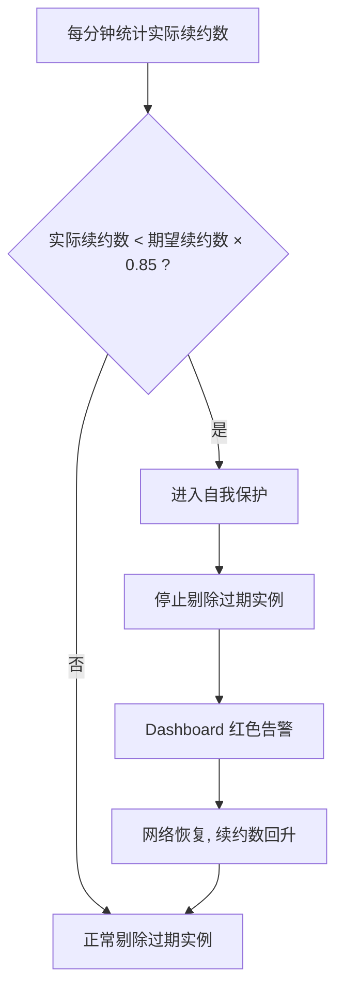

# Spring Cloud Netflix · Eureka 注册中心

> 一句话定位：Eureka 是「AP 注册中心」的经典样本，面试真正问的是心跳、注册表存哪、以及自我保护为什么敢保留可能已经挂掉的实例。
> 版本前提：Eureka 自 **2018 年** Netflix 宣布 Eureka 2.0 停止开发后进入**维护模式**。Spring Cloud Netflix 仍随 **2025.x** 发布列车提供 `spring-cloud-starter-netflix-eureka-client` / `-server`（官方 2025.1.0-M1 发布说明仍列该模块），但新项目应优先 Nacos / Consul。中文资料常见的「2025.1 已移除 Eureka」与官方发布说明不符。

## 1. 是什么

Eureka 是 Netflix 开源的服务注册与发现组件，分 Eureka Server（注册表）和 Eureka Client（服务实例）。客户端启动时把自己的 IP、端口、健康状态注册到 Server，并周期性发心跳续约；消费者从 Server 拉取服务实例列表，在本地做负载均衡。

## 2. 为什么这样设计

Eureka 的设计目标是可用性优先。服务发现的本质是「消费者要能拿到一份可用的实例列表」，而不是「所有 Server 的注册表在任意时刻完全一致」。网络分区时，如果为了强一致而拒绝服务，消费者直接拿不到列表，业务先挂；Eureka 选择接受短暂不一致，让每个节点继续用本地注册表响应。

这也是它和 ZooKeeper 的分水岭：ZooKeeper 是 CP，选主期间不可用；Eureka 是 AP，分区期间各节点继续读，恢复后再慢慢收敛。代价是消费者可能拿到已经下线的实例，所以客户端必须配合重试和熔断。

保护机制解决的是另一个问题：网络抖动会让 Server 收不到心跳，但并不代表实例真的挂了。如果此时批量剔除，等网络恢复，实例又不会自动重新注册（只有启动时才注册），就会造成大面积「服务明明活着却调不到」。自我保护宁可保留可疑实例，也不误杀。

## 3. 底层怎么实现

### 3.1 心跳与剔除

| 参数 | 默认值 | 含义 |
| --- | --- | --- |
| `eureka.instance.lease-renewal-interval-in-seconds` | **30s** | 客户端心跳间隔 |
| `eureka.instance.lease-expiration-duration-in-seconds` | **90s** | 最后一次心跳后多久判定过期 |
| `eureka.server.eviction-interval-timer-in-ms` | **60000ms** | 驱逐定时器扫描周期 |
| `eureka.server.renewal-percent-threshold` | **0.85** | 自我保护阈值系数 |

客户端每 30s 发一次 `renew`；Server 90s 没收到就把租约标记过期；驱逐定时器每 60s 扫一遍，把过期实例从注册表删除。心跳只发给 `service-url` 列表里的第一个 Server，再由 Server 之间对等复制，不是每个 Server 都收一遍。

### 3.2 数据存在哪

Eureka 注册表只存内存，没有数据库。核心结构在 `AbstractInstanceRegistry`：

- `ConcurrentHashMap<String, Map<String, Lease<InstanceInfo>>> registry`：服务名 → 实例 ID → 租约。
- `recentlyChangedQueue`：最近变更的实例，供增量拉取。
- 多级响应缓存：`ReadOnlyCacheMap`（`ConcurrentHashMap`）→ `ReadWriteCacheMap`（Guava Cache）→ 实际 registry。默认 **30s** 把读写缓存同步到只读缓存（`responseCacheUpdateIntervalMs=30000`），读请求优先走只读缓存，避免读写锁竞争。

注册、续约、下线都会先改 registry，再放入 `recentlyChangedQueue`，并通过 `PeerAwareInstanceRegistryImpl.replicateToPeers` 复制给其他 peer。复制是异步的，所以节点间可能短暂不一致。

### 3.3 自我保护怎么触发

期望续约数按「实例数 × 2」估算，因为 30s 一次心跳，一分钟正好 2 次。这个期望值每 **15 分钟**重算一次（`renewal-threshold-update-interval-ms=900000`），但比较是每分钟做的。

自我保护一旦触发，Server 不再剔除任何过期实例，即使某个实例真的宕机也会留在列表里。Dashboard 会打出 `EMERGENCY! EUREKA MAY BE INCORRECTLY CLAIMING INSTANCES ARE UP WHEN THEY'RE NOT...`。网络恢复、续约数回到阈值以上后自动退出。

### 3.4 客户端侧

客户端默认每 **30s** 拉一次注册表（`eureka.client.registry-fetch-interval-seconds=30`），支持增量；拉到后缓存在本地。真正发起调用时，从本地列表里按负载均衡策略选一个实例，所以即使 Server 短暂不可用，客户端仍能用旧列表撑一段时间。

## 4. 生产中的问题与排查

- **自我保护误保留宕机实例**：消费者拿到已死实例，调用报错。要看客户端是否有重试/熔断，不能只靠注册中心。可以调低 `renewal-percent-threshold` 或关闭自我保护，但要权衡误杀风险。
- **服务下线不及时**：默认 90s 过期 + 60s 扫描，最坏接近 2.5 分钟。可缩短 `eviction-interval-timer-in-ms`，但别把心跳和过期时间调得太激进，否则网络抖动就误杀。
- **注册表节点间不一致**：看 peer 复制日志与网络；Eureka 不保证强一致，跨节点读到旧列表是正常现象。
- **客户端拿到空列表**：检查 `service-url` 是否写全、Server 是否真的注册成功、`eureka.client.fetch-registry` 是否开启。
- **Eureka 本身的定位**：维护模式，不要再期待新特性；新项目用 Nacos 或 Consul，Eureka 只在存量系统里维护。

## 5. 可跑实验

- 目录：`labs/spring-distributed-eureka/`
- 目的：观察心跳、过期剔除、自我保护三个行为。
- 步骤：起一个 Eureka Server 和两个 Client；杀掉一个 Client，观察 90s 内它先变成不可用、再由驱逐定时器删除；把两个 Client 都停掉，观察续约数跌破阈值后 Dashboard 出现自我保护告警。
- 预期：单实例宕机按 90s + 60s 的节奏被剔除；批量掉线触发自我保护后实例不再被删。
- 结论：Eureka 的「删除」依赖心跳，而自我保护会在心跳大面积缺失时主动放弃删除。

## 6. 面试问法

**Q：Eureka 的心跳机制是怎样的？**
60 秒版本：客户端默认每 **30s** 发一次续约，Server 在 **90s** 内没收到就判定租约过期，驱逐定时器每 **60s** 扫一次并删除过期实例。心跳只发给 `service-url` 里的第一个 Server，再由 Server 之间对等复制。

**Q：Eureka 为什么是 AP？**
60 秒版本：网络分区时 Eureka 选择继续用本地注册表响应读写，接受节点间短暂不一致，保证消费者始终能拿到实例列表。它不做强一致共识，恢复后靠异步复制和增量拉取慢慢收敛。

**Q：Eureka 的数据存在哪？**
60 秒版本：只在内存，没有数据库。核心是 `ConcurrentHashMap` 存「服务名 → 实例 → 租约」，外加 `recentlyChangedQueue` 和两级响应缓存；节点间通过 peer 复制同步，所以重启后注册表要靠客户端重新注册恢复。

**Q：自我保护是什么？为什么要它？**
60 秒版本：Server 每分钟统计实际续约数，低于「实例数 × 2 × 0.85」就进入自我保护，停止剔除过期实例。目的是避免网络分区导致大面积误删，因为实例只在启动时注册，被删后不会自动回来。代价是可能保留已宕机实例，需要客户端重试/熔断兜底。

## 7. 追问链 · 参考答案

| 层级 | 问题 | 参考答案要点 |
| --- | --- | --- |
| L1 | 心跳间隔和过期时间是多少？ | 心跳 **30s**，过期 **90s**，驱逐扫描 **60s**；三个值要满足过期时间明显大于心跳间隔。 |
| L2 | 期望续约数怎么算？ | **实例数 × 2**，因为 30s 一次、一分钟两次；阈值再乘 **0.85**，每分钟实际续约数低于它触发自我保护。 |
| L3 | 为什么要多级缓存？ | 注册表读多写少，`ReadOnlyCacheMap` 承担绝大多数读，30s 从 `ReadWriteCacheMap` 同步，避免每次读都碰 registry 的锁。 |
| L4 | Eureka 和 ZooKeeper 的 CAP 区别？ | Eureka 是 **AP**，分区时继续服务、最终一致；ZooKeeper 是 **CP**，选主期间不可用。注册中心场景通常更看重可用性。 |
| L5 | 自我保护开了，消费者怎么避免调到死实例？ | 客户端要有**重试 + 熔断 + 超时**，负载均衡优先选健康实例；不能把「注册表里有」当成「实例一定活着」。 |

## 8. 误区 · 正解

| 误区 | 正解 |
| --- | --- |
| 「Eureka 把注册表存 MySQL」 | Eureka 注册表只在内存，没有数据库；节点间靠 peer 复制，重启后靠客户端重新注册。 |
| 「自我保护是 bug，应该关掉」 | 自我保护是 **AP 取舍**：宁可保留可疑实例，也不因网络抖动误杀。关掉会在大规模网络抖动时批量删实例，风险更高。 |
| 「心跳发给所有 Eureka Server」 | 客户端只向 `service-url` 列表里的**第一个** Server 续约，其余节点靠 Server 间复制。 |
| 「Eureka 2025.1 已经被移除」 | Eureka 是**维护模式**，但 Spring Cloud Netflix 仍随 2025.x 列车发布；官方 2025.1.0-M1 发布说明仍列该模块并提供 eureka-client starter。 |

## 9. 我的薄弱点

（学完后同步到 `weakness.md`）
