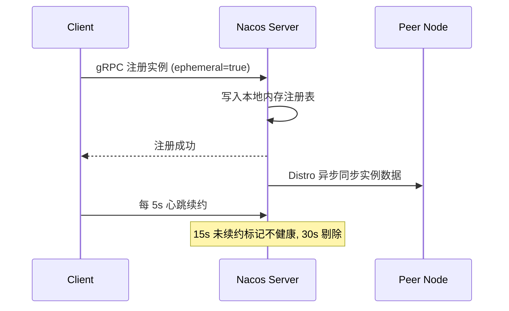
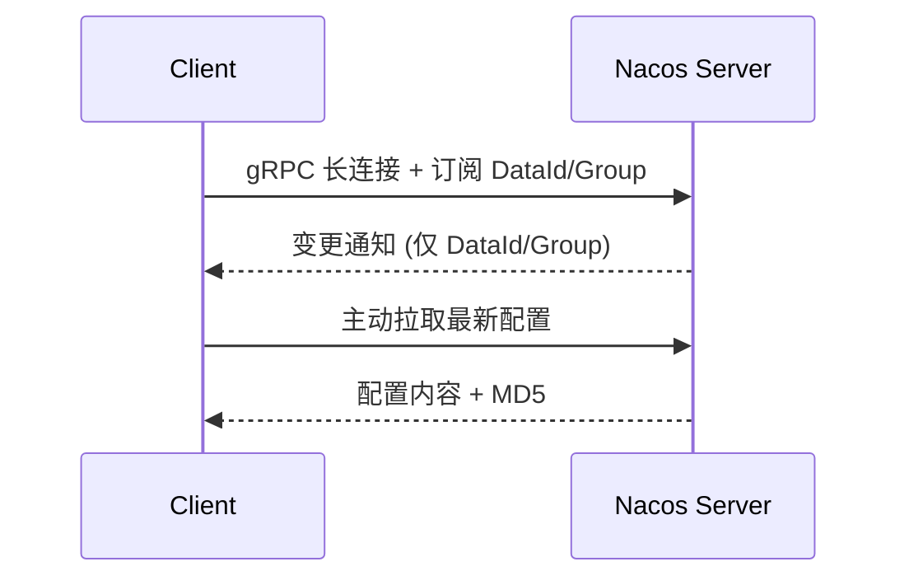

# Spring Cloud Alibaba · Nacos 注册中心与配置中心

> 一句话定位：面试问 Nacos，真正想听的是「它凭什么同时做注册中心和配置中心」以及「服务变更、配置变更到底怎么传到客户端」。
> 版本前提：Nacos **3.2.4**（2026-08 最新稳定，要求 JDK 17）；2.x 线为 **2.5.4**（JDK 8）。Spring Cloud Alibaba **2025.1.0.0** 对应 Nacos **3.1.1**。

## 1. 是什么

Nacos（Dynamic Naming and Configuration Service）是阿里开源的注册中心 + 配置中心二合一组件。2.x 起客户端与服务端改用 gRPC 长连接（客户端端口 **9848**，集群间 **9849**），**8848** 仍保留给控制台和 OpenAPI。它同时维护两类数据：服务实例清单（地址、权重、元数据、健康状态）和配置（Namespace / Group / DataId 下的内容）。

## 2. 为什么这样设计

单体时代配置写在本地文件，改一次重启一次；服务地址写死在代码里，扩缩容就要改配置。注册中心解决「实例地址动态变化」，配置中心解决「配置集中管理、动态生效」。

对比其他注册中心，Nacos 的取舍很清楚：

| 组件 | CAP | 配置中心 | 健康检查 | 主要代价 |
| --- | --- | --- | --- | --- |
| Eureka | **AP** | 无 | 客户端心跳 | 长期维护模式，注册表最终一致 |
| ZooKeeper | **CP** | 可借 ZNode 实现 | 会话 + 临时节点 | 选主期间不可用，Watch 有羊群效应 |
| Consul | **CP** | 有 | TCP/HTTP/gRPC 探测 | 国内生态一般，Raft 写有延迟 |
| Nacos | **AP + CP 可切换** | 内置 | 心跳 / 主动探测 | 组件更重，要维护 gRPC 端口与集群 |

Nacos 不追求「一种协议打天下」，而是按数据类型拆协议：**临时实例走 AP，持久实例和配置走 CP**。这就是它同时做两件事还不塌的原因。

## 3. 底层怎么实现

### 3.1 服务注册、健康检查与变更通知

实例分两类。临时实例（`ephemeral=true`，默认）只存各节点内存，客户端每 **5s** 发心跳，服务端 **15s** 未续约标记不健康、**30s** 剔除；集群间用 **Distro 协议（AP）**异步同步。持久实例（`ephemeral=false`）落 MySQL，由服务端主动做 TCP/HTTP 探测，集群间用 **JRaft（CP）**。

服务变更怎么通知客户端：注册、下线、权重变化都会在服务端产生 Naming 事件，服务端通过已建立的 gRPC 长连接向订阅了该服务的客户端推送变更，客户端更新本地缓存。集群内另一节点收到写请求时，先按实例 IP/port 算出责任节点，不属于自己就转发，再由 Distro 异步复制。

### 3.2 配置中心与变更通信

配置按 Namespace（环境）→ Group（业务线）→ DataId（应用/文件） 三级隔离。客户端启动时拉取配置并落本地快照（`~/nacos/config`），Nacos 不可用时优先读快照。

变更通知经历了两代：

- **Nacos 1.x：HTTP 长轮询**。客户端发起请求，服务端 hold 住约 **29.5s**（客户端 30s 超时重发），期间配置变更立即响应；客户端拿到变更的 `DataId + Group` 后再拉内容。用 MD5 对比减少无效传输。
- **Nacos 2.x / 3.x：gRPC 双向流**。服务端主动推 `ConfigChangeNotifyRequest`，只带 DataId、Group、lastModified，不带配置内容；客户端收到通知后自己拉最新内容。这是「推拉结合」：推负责实时，拉负责内容一致与带宽可控。

3.x 的 Client OpenAPI 不再提供 HTTP 长轮询监听，配置监听必须走官方 SDK 的 gRPC 长连接。只开 8848 不开 9848，注册和监听都会失败。

### 3.3 一致性协议分工

| 数据类型 | 协议 | 一致性 | 存储 |
| --- | --- | --- | --- |
| 临时实例 | Distro | AP，最终一致 | 各节点内存 |
| 持久实例 | **JRaft** | **CP，强一致** | MySQL |
| 配置 | JRaft | CP，强一致 | MySQL |

生产部署至少 **3 节点（奇数）**，共用外部 MySQL；节点数少于 3 时 Raft 无法选举。

## 4. 生产中的问题与排查

- **注册不上/连接超时**：先查 **9848/9849** 是否放通，再看 `server-addr` 与 namespace 是否一致。只开 8848 是最常见的坑。
- **配置不刷新**：确认 Bean 有 `@RefreshScope`、配置项确实被监听；Spring Cloud Alibaba **2025.1** 已移除 `bootstrap.yml`，改用 `spring.config.import=nacos:xxx.yml`，漏了会直接启动失败。
- **Nacos 整体不可用**：客户端读本地快照可启动，但拿不到新配置；生产要 3 节点 + MySQL + 监控，不要单机。
- **实例被误剔除**：检查心跳间隔、网络抖动、客户端线程是否被阻塞；临时实例依赖客户端主动续约，GC 长停顿也会被判定不健康。
- **集群数据不一致**：临时实例看 Distro 同步日志与 9849 连通性；持久实例/配置看 JRaft 日志与 MySQL。

## 5. 可跑实验

- 目录：`labs/spring-distributed-nacos/`
- 目的：观察注册、心跳、配置推送三条链路。
- 步骤：单机启动 Nacos 3.2.4；两个 Spring Boot 服务注册；在控制台改配置，观察客户端日志中的变更通知与 `@RefreshScope` 刷新；停掉一个服务，观察 30s 后实例被剔除。
- 预期：配置变更秒级到达；实例下线后先变不健康再被移除；只开 8848 时客户端报连接失败。
- 结论：注册走 gRPC + Distro，配置走 gRPC 通知 + 客户端拉取，两者都不是「纯推」或「纯拉」。

## 6. 面试问法

**Q：Nacos 做注册中心的原理？**
60 秒版本：服务启动时通过 gRPC 向 Nacos 注册实例，临时实例写内存并每 5s 心跳，15s 不健康、30s 剔除；集群间用 Distro 做 AP 异步复制。消费者订阅服务后拿实例列表并本地缓存，服务端在实例变化时通过 gRPC 推送。持久实例则落 MySQL、走 JRaft 保证 CP。

**Q：配置改了，客户端怎么秒级感知？**
60 秒版本：2.x/3.x 客户端与服务端保持 gRPC 长连接并订阅 DataId/Group；服务端在配置变更时推一条轻量通知，只带 DataId、Group，不带内容；客户端收到后主动拉取最新内容并更新本地快照。推拉结合兼顾实时性和带宽。1.x 则是 30s 的 HTTP 长轮询。

**Q：为什么 Nacos 要 AP、CP 两套协议？**
60 秒版本：临时实例数量大、变化频繁，要求网络分区时还能读能写，所以用 Distro 走 AP、最终一致；持久实例和配置要求强一致，所以用 JRaft 走 CP。按数据特征选协议，比强行一套协议兼顾所有场景更合理。

**Q：Nacos 和 Eureka、ZooKeeper 怎么选？**
60 秒版本：Eureka 只做注册且是 AP，已长期维护模式；ZooKeeper 是 CP，选主期间不可用且有 Watch 羊群效应；Nacos 二合一、AP/CP 可切换、gRPC 长连接，国内生态最顺。新项目优先 Nacos，强一致且只用注册可考虑 Consul/ZooKeeper。

## 7. 追问链 · 参考答案

| 层级 | 问题 | 参考答案要点 |
| --- | --- | --- |
| L1 | Nacos 有哪几个核心端口？ | **8848** 控制台/OpenAPI，**9848** 客户端 gRPC，**9849** 集群间 gRPC；2.x 起注册与监听都走 9848。 |
| L2 | 临时实例和持久实例有什么区别？ | 临时实例 `ephemeral=true` 存内存、客户端心跳、Distro AP、30s 剔除；持久实例落 MySQL、服务端主动探测、JRaft CP，不会因客户端掉线被删。 |
| L3 | 配置变更通知为什么不直接带内容？ | 通知只带 DataId/Group，避免成千上万客户端同时接收大 payload 造成带宽风暴；客户端按正常查询路径拉内容，保证内容一致。 |
| L4 | Distro 协议怎么保证最终一致？ | 每个节点平等、各负责一部分数据，写请求按责任节点路由；变更异步复制到其他节点，定期用元信息做数据校验，不一致就全量拉取补齐。 |
| L5 | Nacos 挂了服务还能启动吗？ | 能。客户端有本地配置快照（`~/nacos/config`），启动时优先读快照；但拿不到新配置，注册也会失败，所以生产必须 3 节点 + 外部 MySQL。 |

## 8. 误区 · 正解

| 误区 | 正解 |
| --- | --- |
| 「Nacos 配置变更靠客户端每秒轮询」 | 1.x 是 **30s HTTP 长轮询**，服务端 hold 请求、变更即响应；2.x/3.x 是 **gRPC 长连接推送通知 + 客户端拉取**，不是短轮询。 |
| 「Nacos 3.x 全面改成 CP 了」 | 3.x 仍保留 Distro(AP) 管临时实例，只有持久实例和配置走 JRaft(CP)。按数据类型分工没有变。 |
| 「Nacos 只开 8848 就能用」 | 2.x 起客户端还要 **9848**，集群要 **9849**；只开 8848 会出现注册失败或配置监听不通。 |
| 「配置推送到客户端就算生效」 | 推送只是通知；Bean 要能刷新还需要 `@RefreshScope`，且静态变量、`@PostConstruct` 副作用不会按预期更新。 |

## 9. 我的薄弱点

（学完后同步到 `weakness.md`）
